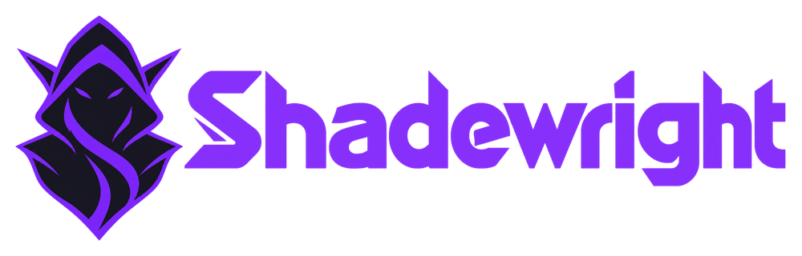

<h1 align="center">
  
</h1>

<p align="center">
  A Kubernetes operator that diagnoses incidents with an LLM and proposes fixes only as reviewed GitOps pull requests.
</p>

> [!WARNING]
> Early design. Nothing is implemented yet; the [design](docs/design.md) and [decisions](docs/adr/index.md) come first.

## What it does

1. **Observes** events and object status in the namespaces you choose, and deduplicates them into incidents.
2. **Diagnoses** with rules first, then a model that has read-only tools and redacted context. No evidence, no proposal.
3. **Proposes** a typed `RemediationRequest` from a closed catalog of actions, checked by deterministic policy.
4. **Opens a pull request** in your GitOps repository, with the evidence and a rollback plan. Your branch rules decide what merges.
5. **Verifies** the result after Flux applies it, and escalates when the symptom stays.

It never writes to the cluster directly, and a model's answer is never authorization.

## Repositories

| Repository | Contents |
| --- | --- |
| [shadewright](https://github.com/pkalin/shadewright) | The operator (Go, Kubebuilder) and the docs at [shadewright.io](https://shadewright.io) |
| [shadewright-azure](https://github.com/pkalin/shadewright-azure) | Terraform for a disposable reference lab in Azure |
| [shadewright-fleet](https://github.com/pkalin/shadewright-fleet) | The lab's GitOps repository and incident scenarios |

## Development

```bash
make manifests generate   # after changing API types
make lint-fix
make test                 # unit and envtest, no cluster needed
make run                  # against the current kubeconfig context
```

Contributor and coding-agent guide: [AGENTS.md](AGENTS.md).

## License

Apache License 2.0, see [LICENSE](LICENSE).
