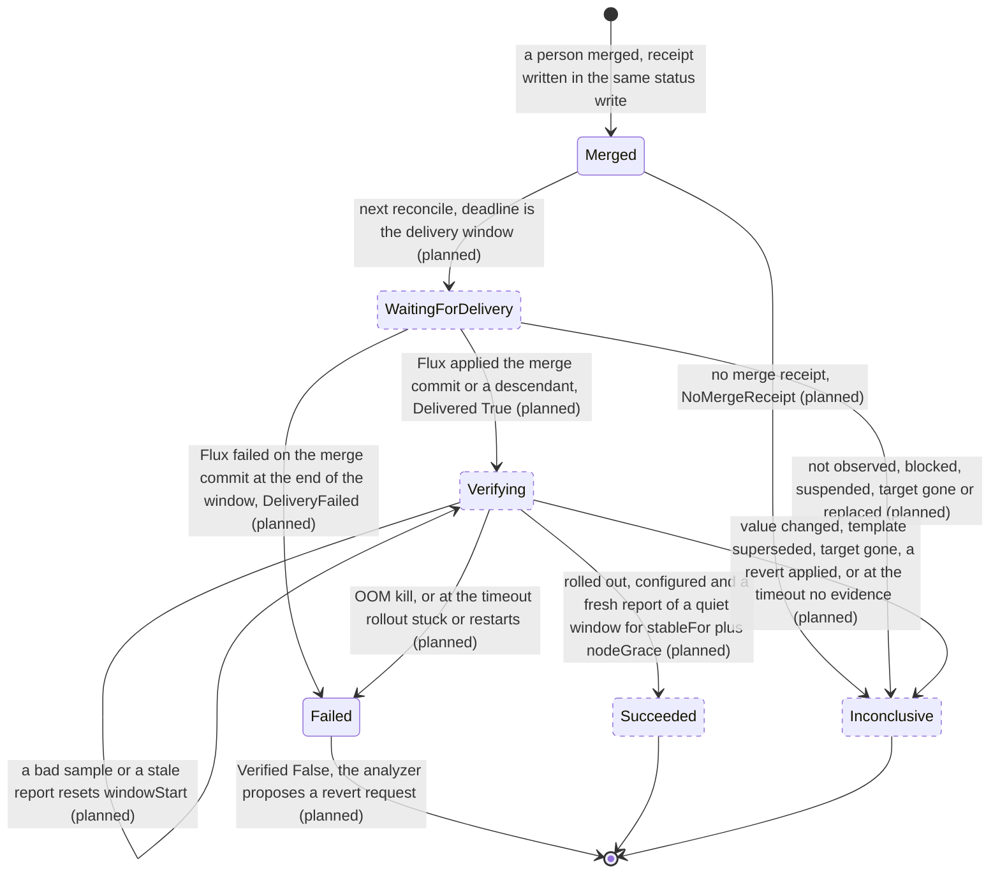

# ADR-0030: The merge receipt and the three outcomes of verification

- Status: Proposed
- Date: 2026-11-13

## Context

Milestone v0.5.0 has one goal: `Succeeded` means the merged revision is applied and the symptom is gone. Today nothing sets a phase after `Merged`. Issue [#248](https://github.com/pkalin/shadewright/issues/248) asks for the contract first, before the build tasks of epic [#19](https://github.com/pkalin/shadewright/issues/19): states after approval ([#94](https://github.com/pkalin/shadewright/issues/94)), checks with `stableFor` and timeout ([#93](https://github.com/pkalin/shadewright/issues/93)), the revert proposal ([#96](https://github.com/pkalin/shadewright/issues/96)) and the ways a change fails to land ([#95](https://github.com/pkalin/shadewright/issues/95)). The audit of 2026-11-04 that filed #248 found two gaps: no merged revision was persisted, and the checks did not require workload health, so a deleted, scaled-to-zero or unschedulable workload, or a missing metric, could look like recovery.

Four decisions were taken on 2026-11-13 and are not reopened here:

1. Three outcomes are kept apart: **rolled out** (the merged revision is applied and the rollout reached the pods), **configured** (the live object holds the new value) and **cleared** (the symptom is gone for the stated window).
2. In v0.5.0 "cleared" is read from container status only: no OOM kill after the rollout and a flat restart count, on a workload that exists with the same UID and is available. The executor gets no metrics source; metrics as evidence follow with [#508](https://github.com/pkalin/shadewright/issues/508) and [#506](https://github.com/pkalin/shadewright/issues/506).
3. Missing or stale data gives an inconclusive result, never success.
4. A revert after a failed verification is a new request through the same policy and pull request path, never a direct change.

A fifth decision of the same day, that a new component is acceptable where it helps the later stages, settles where container status is read (section 7). It replaces the decision, also of 2026-11-13, to grant the executor `list` on `pods`.

### What is built already

Since the audit, part of the gap closed. The code at `e2abcd9` has:

- **The merge commit.** `recordMerge` (`internal/controller/merge.go`) writes `status.pullRequest.mergeCommitSHA` in the status write that sets `Merged`, on all three paths that observe a merge: the recorded pull request (`watchStep`), a pull request found by its marker after a lost write (`endMerged`, the adopt path, only after `checkMerged` found exactly the planned change) and the replacement of a handoff (`handoff.go`). A CEL rule on the object keeps it set once. `status.pullRequest.mergedAt` is set with the phase.
- **Delivery.** The Flux adapter of `DeliveryVerifier` (`internal/providers/delivery/flux`, through `internal/fluxstatus`) answers `Pending`, `Applied` or `Failed` for a merge commit on a branch. A later commit of the branch counts when the Git host says it holds the merge commit (`AncestryChecker`). `DeliveryStatus` carries `AttemptedCommit` and `Suspended`.
- **The rollout report** (#532, `internal/controller/rollout.go`, `internal/verification/rollout`). On a `Merged` request whose target is a Deployment or StatefulSet, the executor waits up to an hour (paused time excluded) for the delivery, records `status.pullRequest.appliedObservedAt` and `status.rollout` (applied commit, generation, template hash, template revision, all set once), and sets the condition `RolledOut`. The phase stays `Merged`. It reads only the target and the Kustomization with the `get` it holds. Once `RolledOut` has its verdict, the check reads nothing more (`rolloutEnded`).
- **The API.** The phases `WaitingForDelivery`, `Verifying` and `Succeeded`, the `Verification` struct (`timeout` 10m, `stableFor` 3m, `checks`, with CEL bounds) and the `VerificationCheck` enum exist. The condition types `Delivered` and `Verified` are declared and never set.

What is missing is a receipt that binds the merge to its repository, branch and head, the phase moves after `Merged`, the configured and cleared outcomes, a result for the cases where nothing can be shown, and a reader of container status.

## Decision

### 1. The merge receipt

A new status field, `status.mergeReceipt`, written once in the same status write that sets `Merged`, on the three paths above, and never changed after:

| Field | Value | Source |
| --- | --- | --- |
| `repository.url`, `repository.installationID` | The repository the plan was made for | `status.planRepository` |
| `targetBranch` | The branch the pull request merged into | `status.source.targetBranch` |
| `pullRequest` | The pull request number | the merged change request |
| `headSHA` | The head that was merged: the commit Shadewright pushed, or the replacement's commit after a handoff | the merged change request, checked equal to `status.pullRequest.headSHA` |
| `mergeCommitSHA` | The commit the Git host reports for the merge | the merged change request, equal to `status.pullRequest.mergeCommitSHA` |
| `mergedAt` | When the executor recorded the merge | the phase write |

Rules:

- A CEL rule on the object keeps the whole receipt equal to its first value once set, in the same form as the existing rules for `mergeCommitSHA` and `appliedObservedAt`, so neither removing `status.mergeReceipt` nor removing the whole status can change it. A second rule requires `mergeReceipt.mergeCommitSHA` to equal `status.pullRequest.mergeCommitSHA`.
- The receipt is written only for a merge that holds exactly the planned change. `MergedWithForeignChange` (phase `NeedsIntervention`) gets none.
- When the Git host reports no merge commit, or one that is not a full commit ID, the request is still `Merged` but gets no receipt; the next reconcile ends it `Inconclusive` with reason `NoMergeReceipt` (section 5).
- **Restart and lost writes.** The receipt is part of the write that sets `Merged`. If that write is lost, the request is still in its earlier phase and the next reconcile looks for the merged pull request again. Today a recorded pull request is looked up by its branch, not its number: `watchStep` calls `FindChangeRequest(branch)`, which returns the most recent Shadewright pull request of that branch, and a pull request with another number ends the request `NeedsIntervention` (`HeadMoved`). A branch can carry a second pull request after the first merged, for instance in a supersede chain of ADR-0028, where the branch name derives from the chain's first request; the merge of the recorded pull request would then never be recorded. #94a adds a lookup by number to `GitProvider` (`GetChangeRequest(number)`, in the repository of `status.planRepository`) and uses it for every request with `status.pullRequest.number` set, checking that the pull request found has the recorded head branch, target branch and head commit. The lookup by branch and marker stays for the adopt path, where no number was recorded. The host's answer for a merged pull request does not change, so the repeated write has the same values. A status wiped by hand cannot drop the receipt (CEL), and a request whose status was never written goes through the policy check again and adopts the merged pull request by its marker.
- **Requests merged before the receipt existed** keep `Merged`. The executor sets `Verified` to `Unknown` with reason `MergedBeforeVerification` once and starts no verification, so the circuit breaker, which counts `Merged` as a success, reads the same history after the upgrade.

Every later check uses the receipt, not the live settings: delivery is asked about `mergeCommitSHA` on `targetBranch`, and the ancestry question goes to `repository`. A settings entry changed after the merge cannot point the check at another repository.

### 2. Delivery against the receipt

The executor moves a `Merged` request with a receipt to `WaitingForDelivery` on the next reconcile, with `status.deadline` set to the end of the delivery window: one hour after `mergedAt`, extended by paused time as today. The existing delivery check then runs. Each case of #248:

| Case | What the executor sees | Outcome |
| --- | --- | --- |
| The merge commit is applied | Flux reports it applied and Ready for its current generation | `Delivered` True, phase `Verifying` in the same write as `appliedObservedAt` |
| A descendant revision is applied | Flux reports a later commit of `targetBranch`; the host says it holds the merge commit | Same as above; `status.rollout.appliedRevision` names the later commit and the template it produced is judged |
| A skipped revision | Flux never applied the merge commit itself and went straight to a later one | Same as a descendant: only ancestry counts |
| A later commit overwrote the field | Delivered as a descendant, but the live field does not hold the desired value | `Configured` False, reason `ValueChanged`; the request ends `Inconclusive` (our value never ran, so there is nothing to judge or revert) |
| The applied revision does not hold the merge commit (another branch, history rewritten) | Never `Applied` | At the end of the window: `Inconclusive`, reason `DeliveryNotObserved` |
| Flux failed on exactly the merge commit | `Failed` with `AttemptedCommit` equal to the merge commit, at the end of the window | `Failed`, reason `DeliveryFailed`; leads to #96 |
| Flux failed on a later commit | `Failed` with another `AttemptedCommit` | At the end of the window: `Inconclusive`, reason `DeliveryBlocked` (the failure cannot be pinned on this change) |
| The Kustomization is suspended | `Suspended` true | At the end of the window: `Inconclusive`, reason `DeliverySuspended` |
| The target is recreated | The live object has another UID | `Inconclusive`, reason `TargetReplaced`, at once, in any phase after `Merged` |
| The target is deleted | Not found | `Inconclusive`, reason `TargetGone`, at once |
| The delivery cannot be read to the end | Read errors past the window and its grace | `Inconclusive`, reason `DeliveryNotChecked` |

Flux retries a failed attempt, so a failure inside the window is not final: the executor keeps asking and decides at the end. A failure of the merge commit itself is the one delivery result that counts against the change, because a broken commit at the head of the branch also blocks every later commit until it is reverted.

A later commit that keeps our value but changes something else in the template (an image tag, say) and arrives before the rollout is recorded is judged together with our change, and the verdict says which commit was applied. A template change after the rollout was recorded ends verification `RolloutSuperseded` (section 4).

### 3. The three outcomes

Each outcome has its own condition, so `kubectl shadewright explain` can show three lines. `Verified` sums them up and decides the phase.

| Outcome | Condition | Evidence | Read by |
| --- | --- | --- | --- |
| Rolled out | `Delivered` and `RolledOut` | Flux reports the merge commit or a descendant applied (`Delivered`); every desired replica runs the applied template (`RolledOut`, built, with the partition rule below), and the target still names that template on every sample | the executor: `get` on the Kustomization and the target (held), the host's ancestry answer (held) |
| Configured | `Configured` (new type) | The live target's field equals the desired value, read with the same field accessor the duplicate rule uses (`sourcemap.FieldFor`, `changeInEffect` in `duplicates.go`) | the executor: `get` on the target (held) |
| Cleared | `Cleared` (new type) | Container status of the target's pods: no OOM kill of the action's container since `appliedObservedAt`, restart counts flat against durable baselines, every desired replica covered | the verifier lists the pods and writes a `VerificationReport`; the executor reads the report (section 7) |

**A partitioned StatefulSet.** The rollout evaluator (`statefulSet` in `internal/verification/rollout`) calls a rolling update with `partition` above 0 complete when only the pods above the partition run the update revision: three replicas, partition 2 and one updated pod give `Complete`, while two pods keep the old template. The owner chose that, so `RolledOut` keeps saying the rollout did what the strategy asks, with its own reason `RolloutPartitioned` and a message that names the pods left on the old revision, instead of "every pod runs the current template". It is not evidence for the change: cleared needs every desired replica on the applied revision, so a sample with pods left below the partition is not good (reason `PartialRollout`, no evidence class). If the owner lowers the partition inside the timeout, the window can still complete; otherwise the request ends `Inconclusive` with `PartialRollout`.

For a ScaledObject (`AdjustKedaMaxReplicas`), "rolled out" is `Delivered` plus `KedaReady` for the ScaledObject's current generation, since there are no pods of its own. Its symptom (scaling held at the maximum, a growing backlog) is not visible in container status, so in v0.5.0 `Cleared` stays `Unknown` with reason `ClearingNotChecked`, and such a request ends `Inconclusive` once rolled out and configured held for `stableFor`. It cannot end `Succeeded` until metrics arrive. A request whose `spec.verification.checks` names `QueueBacklogDecreasing` ends the same way, reason `CheckNotAvailable`.

Who reads the outcomes:

- the executor writes all of them and is the only writer of request status (invariant 6, unchanged); the verifier writes only its reports;
- `kubectl shadewright explain` shows rolled out, configured and cleared as three lines (exit criterion 5);
- the circuit breaker reads only the phase;
- the analyzer reads `Failed` with `Verified` False to propose a revert (#96), and an Incident whose request ended without success moves to `Escalated` as it does today (design 3).

### 4. The stable window

The window is kept in two places. The verifier samples the pods every 30 seconds and keeps the pod-level window, its baselines and its resets in the request's `VerificationReport` (section 7). The executor reconciles every 30 seconds while the request is `Verifying`, makes its own reads, checks the report, and keeps its window in `status.verification` (`windowStart`, `lastReset`, `resets`). Success needs both windows to be long enough.

**The pods of the rollout** are the pods in the target's namespace that its selector matches, that are not terminating, and whose ownership the verifier proves the way the analyzer's collector does (`ownerResolver` in `internal/analyzer/collector/owners.go`), since owner references are untrusted input:

- for a Deployment: the pod's controller reference names a ReplicaSet that exists with that UID (`get`), whose selector matches the pod's labels, whose controller reference names the target with the target's UID, whose labels the target's selector matches, and whose revision annotation (`deployment.kubernetes.io/revision`) equals `status.rollout.templateRevision`;
- for a StatefulSet: the pod's controller reference has the target's UID, and its `controller-revision-hash` label equals `status.rollout.templateRevision`;
- for `SetContainerMemoryLimit`, the action's container exists in the pod with the desired limit.

A pod the selector matches whose chain does not verify is not counted; it cannot add coverage. The verifier lists with the API reader, in pages of 100, at most 2 pages; more pods than that make the sample incomplete.

**A verifier sample** is good when all of these hold:

- the target exists with the report's target UID and names the report's template revision;
- `spec.replicas` is at least 1, and the pods of the rollout number exactly `spec.replicas`: every desired replica is on the applied revision (the partition rule of section 3), with no pod of the target on another revision;
- every pod of the rollout reports a status for every container, and its `Ready` condition is True;
- no container restarted since the window started, against the baselines below.

**An executor check** is good when the target exists with the request's UID; `RolledOut` and `Configured` are True; the target, read in this reconcile, still has the generation's template hash and names `status.rollout.templateRevision` (otherwise the request ends `Inconclusive` with `RolloutSuperseded` at once); its available replicas equal `spec.replicas`; and the report passes the trust contract of section 7. The template check runs on every reconcile in `Verifying`, the last one included: the `RolledOut` verdict is not taken as still true, and `rolloutEnded` no longer stops the reads once the request is `Verifying`.

**Baselines live in the report.** At the first good sample the verifier records `windowStart` and, per pod of the rollout, its UID and the sum of its containers' restart counts (at most 200 entries, matching the pod bound). Restart counts of a pod never decrease, so the sum works per pod. On every later sample, including the first one after the verifier restarted or lost its lease, it compares against the stored baselines, so a restart count raised while nobody watched is a `Restarted` reset and never becomes a silent new baseline. A container whose current or last termination finished at or after `windowStart` minus one poll interval (the margin absorbs clock skew between the node and the verifier) is a `Restarted` reset as well; it catches restarts of pods that have no baseline yet. A pod not in the baselines that was created after the last sample before a gap (`sampledAt` more than two poll intervals old) may have replaced a pod whose history went with it: `ObservationGap` reset. Without a gap, a new pod (a scale-out or a replacement) gets a baseline of 0.

**Reset.** A sample or check that is not good moves `windowStart` forward to the next good one and records why (`lastReset`, `resets`). The reasons fall into two classes:

| Reason | Set by | Class |
| --- | --- | --- |
| `Restarted`: a container restarted above its baseline, or terminated after `windowStart` | verifier | trouble |
| `PodNotReady`: a pod of the rollout is not Ready and did not restart | verifier | no evidence |
| `PartialRollout`: fewer pods on the applied revision than `spec.replicas` | verifier | no evidence |
| `EvidenceMissing`: a pod without a status for every container, or more pods than the bound | verifier | no evidence |
| `ScaledToZero`: `spec.replicas` is 0 | verifier | no evidence |
| `ObservationGap`: no sample for more than two poll intervals and a pod created inside the gap | verifier | no evidence |
| `NotAvailable`: the target reports fewer available replicas than desired | executor | no evidence |
| `StaleReport`, `ReportMismatch`: the report fails the trust contract (section 7) | executor | no evidence |

A pod that is not Ready is no evidence, not trouble, because a node that stopped reporting and a probe that fails look the same without a read of Nodes. A crash loop still shows as `Restarted`. A failed read is retried and is not a sample. `windowStart` only moves forward (CEL, in both objects), and `resets` never decreases.

**Node freshness.** Container status is only as fresh as the kubelet's last report. When a node stops reporting, the node lifecycle controller marks the pods on it not Ready once the cluster's node monitor grace period (`--node-monitor-grace-period` of kube-controller-manager, under a minute by default) has passed, and a pod still on the node is evicted (terminating) after its toleration of the unreachable taint, 300 seconds by default. Both show in the pod list. The verifier therefore needs no Node or Lease read, and the verdict waits for them: success needs good samples until `windowStart + stableFor + nodeGrace`, where `nodeGrace` is a verifier setting (default 1 minute, which the chart documents must be at least the cluster's node monitor grace period). A node that went silent inside the window has had its pods marked not Ready before the verdict, which resets the window. A pod that turns terminating drops out of the count and makes the sample `PartialRollout`.

**Final at once.** An OOM kill of the action's container on a pod of the rollout, with `lastState.terminated.reason` `OOMKilled` and `finishedAt` at or after `appliedObservedAt`, is recorded once in the report (`oomKill`: pod UID, container name, finish time) and ends the request `Failed` with reason `OOMKilled`, whatever the window. An OOM kill of another container is a `Restarted` reset. `Configured` False, `TargetGone`, `TargetReplaced` and `RolloutSuperseded` end the request `Inconclusive` at once.

**Success.** A good executor check, with a good report whose own `windowStart` and the executor's `windowStart` are both at or before `now - stableFor - nodeGrace`, sets `Cleared` True (reason `NoRecurrence`) and `Verified` True, and ends the request `Succeeded`.

**What a quiet window proves.** Cleared means no OOM kill and no restart were observed over the window, with the pod set covered at every sample. Container status keeps only the last termination of a container, so history that went with a pod deleted between two samples (at most 30 seconds, longer across a gap) is lost; a gap with a new pod resets the window instead of trusting the new pod, and a restart while nobody watched still shows as a raised count. An OOM kill whose record was overwritten by a later termination is not reported as `OOMKilled`, but that later termination resets the window as `Restarted`.

**Minimums and timeout.** The controller derives the effective values; a request can only make them stricter (design 5.1):

- `stableFor` is the larger of `spec.verification.stableFor` (default 3m, at least 1m by CEL) and the action's minimum: 10 minutes for `SetContainerMemoryLimit`, 3 minutes for `AdjustKedaMaxReplicas`. #93 may raise the memory minimum after measuring in the lab how soon the oom scenario is killed again under the old limit.
- The timeout runs from `appliedObservedAt` and is the larger of `spec.verification.timeout` (default 10m, at most 24h) and the rollout deadline (`RolloutDeadline`, 10 minutes by default) plus the effective `stableFor` plus `nodeGrace`. For a memory fix with defaults that is 21 minutes. It is written to `status.deadline` when the request enters `Verifying`.
- At the timeout without a success: `Failed` when `RolledOut` is False (`RolloutStuck`), when a ScaledObject's `KedaReady` does not hold (`KedaNotReady`), or when the last reset was of the trouble class (`Restarted`); otherwise `Inconclusive` with the last no-evidence reason. A memory fix that does not help therefore ends `Failed` by the OOM rule well before the timeout, and a crash loop ends `Failed` at it. A change that makes pods fail their readiness probe without restarting ends `Inconclusive` (`PodNotReady`).

The kill switch does not gate verification: it makes no Git write. While writes are paused it still reads, and the delivery window keeps its pause rule.

### 5. Inconclusive is a new terminal phase

The enum `RemediationPhase` gets one value, `Inconclusive`: the change was merged, and neither success nor failure could be shown. The condition `Verified` is `Unknown` and carries the reason (`TargetGone`, `TargetReplaced`, `ValueChanged`, `RolloutSuperseded`, `PartialRollout`, `DeliveryNotObserved`, `DeliveryBlocked`, `DeliverySuspended`, `DeliveryNotChecked`, `NoMergeReceipt`, `EvidenceMissing`, `PodNotReady`, `NotAvailable`, `ScaledToZero`, `ObservationGap`, `StaleReport`, `ReportMismatch`, `ClearingNotChecked`, `CheckNotAvailable`, `RevertApplied`).

Three ways to express it were weighed:

- **A reason under `Failed`.** Rejected: #96 proposes a revert for `Failed`, and reverting a change on a deleted workload, or one that a later commit already overwrote, is wrong.
- **A reason under `NeedsIntervention`.** No API change, but the circuit breaker counts `NeedsIntervention` as a failure. Every KEDA request in v0.5.0 ends inconclusive by design (section 3), so three of them would trip the breaker on no evidence of harm. It also mixes with the pre-merge stops of #95 (merge conflicts).
- **A new phase.** Chosen. The enum change is additive (`feat(api)`, not breaking in `v1alpha1`) and user visible: `kubectl get rr`, the plugin's `status` and `explain`, troubleshooting and the phases diagram all show it. Nothing sets any phase after `Merged` today, so every switch over phases that must learn it (breaker, duplicates, target lock, plugin) is touched by #94 anyway.

For the circuit breaker `Inconclusive` is treated like `Expired`: not a failure outside a probe, a probe that ends `Inconclusive` opens the breaker again for a full cool-down, never a success, and `breakerCounts` follows the existing rule for "any other end". `Failed` after the merge stays a failure, and only `Succeeded` clears outcomes, as today.

### 6. States after approval

`Merged` and the rollout report under it are built; every state and arrow after `Merged` is planned. `Failed` exists for steps before the merge, and its use after the merge is planned. The deadline of a step after the merge never ends a request `Expired`: past the merge, the evidence decides between `Failed` and `Inconclusive`. `Expired` stays for steps before the merge, which narrows the "`Expired` on deadline" of #94 to those steps.

### 7. The verifier and its report

Container status lives on Pods, which no Shadewright identity that writes request status can read today. A third component reads it: `shadewright-verifier`, its own binary (`cmd/verifier`), Deployment and ServiceAccount. It is deterministic code, has no model access, holds no Git App credentials and never writes request status. Later evidence sources (metrics for the KEDA backlog with #508 and #506, Argo CD health) attach to this identity, so each widens the grants of a component that can only withhold or report evidence, not of the one that writes to Git.

**Grants.**

- In each namespace the chart lists (default: the analyzer's watched namespaces, `analyzer.watchNamespaces`), through one RoleBinding per namespace, never a ClusterRoleBinding: `list` on `pods` (no `get`, no `watch`); `get` on `replicasets`, `deployments` and `statefulsets` in the `apps` group (no `list`, no `watch`).
- In the operator namespace: `get`, `list` and `watch` on `remediationrequests` (read only, to learn which requests are `Verifying`); `get` and `create` on `verificationreports`; `update` on `verificationreports/status`; its own leader election Lease and core Events.

It uses the pod list only with the target's namespace and selector, keeps only pod UID, owner references, labels, the `Ready` and `PodScheduled` conditions, creation and deletion times, container names, the action's container's memory limit, restart counts and the reason and finish time of the last and current termination, and never stores, logs or puts into an Event any other pod field. The termination message is never read.

The executor's cluster reads do not change. It gains `get` on `verificationreports` in the operator namespace, a Shadewright object.

**How evidence reaches the executor.** Two carriers were weighed:

- **A field of an existing object.** Request status is written only by the executor (invariant 6), so the verifier cannot write there. Incident status is written by the analyzer, the identity that talks to the model, and mixing a second writer into it would make the executor trust an object the analyzer can also change. A ConfigMap has no schema and no CEL. Rejected.
- **A new namespaced object owned by the verifier.** Chosen: `VerificationReport` in `remediation.shadewright.io/v1alpha1`, one per request, in the operator namespace, written only by the verifier, with typed fields and CEL.

The report:

- Its name derives from the request UID; it carries an owner reference to the request (`blockOwnerDeletion` false, so it needs no permission on the request) and is deleted with it.
- `spec`, set at create and immutable by CEL: `requestUID`, `mergeCommitSHA` (from the receipt), `targetUID`, `templateRevision` (from `status.rollout`), `appliedObservedAt`, and the action's container name.
- `status`, written by the verifier: `sampledAt` (the last sample), `windowStart` (forward only), `desiredReplicas`, `podsCovered`, `resets` and `lastReset` (reason, class, time), `oomKill` (set once), `baselines` (pod UID and restart sum, at most 200), `nodeGrace`. Typed fields only: no messages copied from the cluster, so its size is bounded by the baseline list (about 15 KB at the limit).

**The trust contract.** On each reconcile in `Verifying` the executor reads the report and treats it as no evidence (a reset of its own window) when:

- it is missing (`StaleReport`);
- `sampledAt` is more than 90 seconds old (three poll intervals) or more than 30 seconds in the future by the executor's clock (`StaleReport`);
- any `spec` field differs from what the executor holds: the request UID, the receipt's merge commit, the target UID it reads itself, `status.rollout.templateRevision` (`ReportMismatch`);
- it is incomplete: `podsCovered` differs from `desiredReplicas`, or `desiredReplicas` differs from the `spec.replicas` the executor reads itself (`PartialRollout`).

A stopped or broken verifier therefore leaves the request without evidence, and it ends `Inconclusive` at the timeout, never `Succeeded`. The durable baselines (section 4) and the node freshness rule live in the report, so a restart of the verifier does not reset what it knew, and a restart of the executor loses nothing, since its own window is in request status.

**What the verifier can cause.** Cleared is the only outcome the executor takes from the report. Delivery, the rollout, the template's freshness, the live value, availability and the target's UID come from the executor's own reads. An honest verifier can withhold success (no report, a reset) or report an OOM kill. A compromised verifier can do both falsely: a forged OOM record ends a request `Failed` and leads to a revert proposal, which needs a person's approval (`approvalRequired: true`) and passes policy. It can also forge a quiet window, and so turn a request into `Succeeded`, which clears older outcomes in the circuit breaker. That is bounded: the request must really be merged, delivered, rolled out on every desired replica and configured, by the executor's reads; the verifier makes no Git write, holds no Git App credentials and cannot change policy, so a forged success authorizes no new change by itself and only lets the breaker allow more proposals, each still going through policy and a person's merge where policy asks for it. The same holds today for the executor, which could forge any phase.

### 8. A failed verification leads to #96

A request that ends `Failed` after the merge has `Verified` False with one of `OOMKilled`, `Restarted`, `RolloutStuck`, `DeliveryFailed` or `KedaNotReady`. That is the input of #96. Its shape, which #96 builds:

- The analyzer creates the revert, in deterministic code with no model call. It already holds `create` on RemediationRequests in the operator namespace and reads request status; the executor cannot create requests, and gets no such grant.
- The revert is a new RemediationRequest with the same Incident and target, the same action type with `previous` and `desired` swapped, `approvalRequired: true`, and a new link field `spec.reverts` (name and UID of the failed request). CEL requires `approvalRequired: true` whenever `reverts` is set.
- Its name derives from the failed request's UID, so a retried or repeated create finds the existing one: one revert per failure.
- It goes through the same policy check, freshness check, target lock and pull request path as any request. Its `previous` must still match the file in Git; if someone already changed the field, it ends `Superseded` like any stale plan.
- A revert is never reverted: a request with `spec.reverts` never triggers #96.
- A revert never ends `Succeeded`. It requires rolled out and configured only, since the original symptom is expected to come back, and once both held for `stableFor` it ends `Inconclusive` with reason `RevertApplied`. The circuit breaker reads that like any `Inconclusive`: not a failure outside a probe, and it clears nothing, so the failure it reverts stays counted. A revert that does not roll out ends `Failed` (`RolloutStuck` or `DeliveryFailed`) and counts as a failure. The Incident stays escalated for a person.
- `Inconclusive` never leads to a revert.

A revert of a memory increase is a decrease, and policies refuse decreases by default (`maxDecreasePercent` 0, design 5.3). Without a policy rule for reverts, the revert ends `Denied` with `DecreaseNotAllowed` and the person reverts by hand. Whether a policy may allow exactly the inverse of a failed request's change (and nothing wider) is a change to the policy decision; #96 decides it with an amendment and a red team, and it is the second point for the maintainer.

### 9. Invariants

1. **Model output is never authorization.** Every verdict comes from deterministic code over typed fields; no model is asked, and the verifier has no model access. `Succeeded` authorizes nothing new: it only lets the breaker clear older outcomes, as today. The revert is a proposal that goes through policy.
2. **Actions are a closed catalog.** Verification only reads; it never deletes, restarts or patches a pod or a workload. The revert reuses the existing action types; no value is added.
3. **Changes go through Git only.** Verification makes no Git write and asks the host only the ancestry question it asks today. The verifier holds no Git credentials. A revert is a new request and a new pull request, never a direct change and never an automatic merge (`approvalRequired: true`).
4. **Everything from the cluster is untrusted input.** Pod and Flux status are read as typed fields: integers, timestamps, owner references verified by UID and selector up to the target, and the termination reason compared with the constant `OOMKilled`. Flux messages and termination messages are not copied into status or reports. The pod list is bounded in pages and count, and the report in size. The executor treats the report as input too, bound by UID and commit and checked for age and coverage.
5. **Reconciliation is idempotent.** The receipt is written with the phase and set once; a lost write is repeated with the same values, and a recorded pull request is found again by its number. `windowStart` moves forward only, in request status and in the report. Restart baselines are durable in the report, so a restart of the verifier or the executor never sets a silent new baseline: a raised restart count is a `Restarted` reset, a pod created during a gap is an `ObservationGap` reset, and a gap can delay a verdict but never turns an observed failure into a success. Every terminal verdict is one status write. The revert's name and the report's name derive from request UIDs.
6. **Separate identities.** A third identity, `shadewright-verifier`, holds the grants of section 7: `list` on `pods` and `get` on `replicasets`, `deployments` and `statefulsets` in the chart's namespaces; read on `remediationrequests`, `get` and `create` on `verificationreports` and `update` on their status in the operator namespace, besides its own Lease and Events; no model access, no Git App. The executor's grants are unchanged except `get` on `verificationreports` in the operator namespace, and it stays the only writer of request status and the only component that sets phases. The analyzer gains nothing: it already creates requests and reads their status.

### 10. Current code and this design

| File | Exists at `e2abcd9` | Missing for this design |
| --- | --- | --- |
| `api/v1alpha1/remediationrequest_types.go` | Phases up to `Succeeded`; `Verification` with CEL bounds; `VerificationCheck` enum; `pullRequest.mergeCommitSHA`, `appliedObservedAt` (set once by CEL), `mergedAt`; `RolloutStatus` with set-once rules; condition constants `Delivered` and `Verified` | `status.mergeReceipt` with its CEL rules; phase `Inconclusive`; `status.verification` (`windowStart`, `lastReset`, `resets`) with forward-only rules; condition constants `Configured` and `Cleared`; `spec.reverts` (#96) |
| `api/v1alpha1/verificationreport_types.go` | Nothing | The `VerificationReport` type, its set-once `spec`, forward-only `windowStart`, set-once `oomKill`, bounded `baselines` |
| `internal/controller/merge.go` | `recordMerge` (merge commit), `recordApplied` | Writing the receipt next to the merge commit |
| `internal/controller/pullrequest.go`, `internal/providers/git.go`, `internal/providers/github` | `watchStep` finds the recorded pull request by branch (`FindChangeRequest`, most recent match) and stops on another number (`headMoved`); `endMerged` (adopt path) ends in `Merged` with `recordMerge`; a person's close ends `NeedsIntervention` (`rejected`) | `GetChangeRequest(number)` in the interface and the GitHub adapter, used for a recorded pull request; receipt on both paths; `Cancelled` for a close without a merge (#95) |
| `internal/controller/handoff.go` | The replacement's merge records the merge commit | Receipt on this path |
| `internal/controller/rollout.go` | `afterMerge` on `Merged` only; the delivery window with pause; `delivered` with the second Flux read; `judgeRollout` and `RolledOut`; reads stop once `rolloutEnded` | Phase moves to `WaitingForDelivery` and `Verifying`; `Delivered`; telling `DeliveryFailed` of the merge commit from a later one (`delivered` maps every non-`Applied` outcome to false today); ancestry against the receipt's repository; the template and revision read again on every reconcile in `Verifying`, ending `RolloutSuperseded` on a change |
| `internal/controller/remediationrequest_controller.go` | Calls `afterMerge` for `Merged` | Dispatch for `WaitingForDelivery` and `Verifying`; `status.deadline` per step; `MergedBeforeVerification` for old requests; reading and checking the report |
| `internal/controller/limits.go`, `breakercounts.go` | `setPhase` sets `mergedAt`; the breaker classifies phases; only `Succeeded` clears | `Inconclusive` classified like `Expired` (which covers `RevertApplied`) |
| `internal/controller/duplicates.go` | `changeInEffect` reads the live field; "`Merged` or a later phase" is a merge | The same read reused for `Configured`; the later phases listed explicitly, `Inconclusive` and `Failed` included |
| `internal/providers/delivery.go`, `internal/providers/delivery/flux`, `internal/fluxstatus` | Outcomes `Pending`, `Applied`, `Failed`; `AttemptedCommit`; `Suspended` | Nothing |
| `internal/verification/rollout` | `Evaluate` from workload status only; template hash and revision; a partitioned StatefulSet is `Complete` with "every pod runs the current template" | Reason `RolloutPartitioned` with the old pods named |
| `internal/verification/clearing` | Nothing | The pod sample, ownership checks over typed objects, baselines, resets and the window as pure functions |
| `cmd/verifier`, `internal/verifier` | Nothing | The verifier's manager, its reconciler of `Verifying` requests and the report writer |
| `internal/analyzer/collector/owners.go` | `ownerResolver` verifies Pod to ReplicaSet to Deployment by UID and selector | Its chain check moved to a shared package the verifier also uses, or copied with the same tests |
| `cmd/kubectl-shadewright/explain.go` | A section for `RolledOut` | Three lines: rolled out, configured, cleared |
| `internal/controller/cache.go`, chart RBAC | `get` on the target kinds and Flux objects | Executor: `get` on `verificationreports`; the verifier's ServiceAccount, Roles and RoleBindings (section 7) |
| `Dockerfile`, `images.yml`, `images-build.yml`, `chart.yml`, `trivy.yml` | Targets and images `executor` and `analyzer` | A `verifier` target and image, built, signed, scanned and listed with digests in the release body |
| `docs/design/2-architecture.md`, `identity.svg`, `architecture.svg`, `AGENTS.md` | Two identities; the verifier is described as part of the executor | Three identities; invariant 6 text with the verifier's grants |
| `internal/analysis` | Creates requests by a deterministic name | The revert proposer (#96) |

### 11. The build tasks

| Task | Changes | Size | Order |
| --- | --- | --- | --- |
| #94a (split from #94) Merge receipt | `status.mergeReceipt` and CEL; written on the three merge paths; `GetChangeRequest(number)` for a recorded pull request; `NoMergeReceipt`; `MergedBeforeVerification`; envtest for a lost write, a reused branch, the adopt path, the handoff and CEL refusals | L | 1 |
| #94b (rest of #94) Phases after the merge | Phase `Inconclusive`; `Merged` to `WaitingForDelivery` to `Verifying` with `status.deadline`; `Delivered`; every delivery case of section 2 with its outcome; the template read on every reconcile in `Verifying` (`RolloutSuperseded`); `RolloutPartitioned`; breaker, duplicates, target lock and plugin `status` learn the new phase; `phases.svg`, `executor.svg` and the phase lists in the docs | L | 2, after #94a |
| #93a (split from #93) Window and report logic | `internal/verification/clearing`: ownership over typed objects, coverage, durable baselines, the gap rule, node grace, resets, the timeout verdict; the report's trust contract as a pure check; unit tests: a partitioned StatefulSet is not covered, a forged owner reference is not counted, a restart during a gap resets as `Restarted`, a new pod after a gap resets as `ObservationGap`, a stale or mismatched report is no evidence, an OOM kill fails at once | M | can start with #94a, pure code |
| #93c (new) The verifier component | `VerificationReport` CRD with CEL and refusal tests; `cmd/verifier` and its reconciler; ServiceAccount, Roles and namespaced RoleBindings in the chart and `config/`; the Dockerfile target, the image build, signing, Trivy scan and release digests; `identity.svg`, `architecture.svg`, design 2 and invariant 6 in `AGENTS.md` | L | after #93a, parallel with #94b |
| #93b (rest of #93) Executor wiring | `get` on `verificationreports`; `status.verification`; `Configured` and `Cleared`; the trust contract; `Verifying` to `Succeeded`, `Failed`, `Inconclusive`; `explain` with three lines; design 9 and 10.11 | L | after #94b, #93a and #93c |
| #96 Revert proposal | `spec.reverts` with CEL; the analyzer's deterministic proposer; one revert per failure; no revert of a revert; `RevertApplied`; the policy question of section 8 | L | after #94b (it can be tested with `DeliveryFailed` first), parallel with #93b |
| #95a (split from #95) Before the merge | A close without a merge ends `Cancelled` instead of `NeedsIntervention`; a merge conflict ends `NeedsIntervention` with its own reason | S | now, parallel with everything: it touches only the steps before the merge |
| #95b (rest of #95) Resolved before the rollout | Read from the Incident the executor already gets whether the symptom stopped before `appliedObservedAt`; `Cleared` True then carries reason `ResolvedBeforeRollout` instead of `NoRecurrence`, so the attribution is visible | S | after #93b |

Order: #94a, #93a and #95a first, then #94b and #93c side by side, then #93b and #96 side by side, then #95b. #93 and #96 both list #94 under "Depends on"; with the split they depend on #94b, and #93b also on #93a and #93c. #93c adds one L task to the milestone, and #94a grows from M to L with the lookup by number; #93b no longer carries the pod grant.

## Consequences

- `Succeeded` now needs a receipt, delivery of the merge commit or a descendant, the live value, an available workload with every desired replica on the applied revision, and a quiet window of at least 10 minutes plus the node grace for a memory fix, reported fresh by the verifier. A request that cannot show this ends `Inconclusive` with a reason a person can act on.
- KEDA requests cannot succeed in v0.5.0. That is accepted until metrics are evidence (#508, #506), which attach to the verifier.
- The phase enum grows by one value, and every place that lists phases (breaker, duplicates, target lock, plugin, docs, `phases.svg`) learns it in #94.
- A third Deployment, ServiceAccount, image and signed release artifact. The install and the lab run one more pod; its requests are small (one list of the target's pods every 30 seconds per `Verifying` request).
- The verifier reads Pods in the chart's namespaces, which also exposes their specs (environment values included) to that identity. It holds no Git App credentials and no model access, so the exposure stays with an identity that cannot write to Git or send pod data to a model.
- A stopped verifier, or one that restarts often, leaves verification without fresh reports and ends it `Inconclusive`. That is the intended direction of the error.
- A partitioned StatefulSet rollout, or a change that makes pods fail readiness without restarting, ends `Inconclusive`.
- A combined later commit is judged with our change when it arrives before the rollout is recorded; after that it supersedes the verification (section 2). A pod deleted between two samples takes an OOM kill of its last run with it; the 30 second poll bounds that gap, and a longer gap with a new pod resets the window.
- A forged report from a compromised verifier can end a delivered, rolled out and configured request `Succeeded` (section 7).

## Alternatives considered

- **Freeze the existing fields instead of a receipt** (CEL on `status.source`, `status.planRepository` and `status.pullRequest.headSHA` once `mergeCommitSHA` is set). No new field, but `headSHA` moves before the merge by design (handoff, reviewer hints), and requests merged before the rule would look like they have a receipt. Rejected.
- **`Inconclusive` as a reason under `Failed` or `NeedsIntervention`.** See section 5.
- **The executor lists pods** (`list` on `pods` for the executor, decided on 2026-11-13 and replaced the same day). Rejected: the identity that holds the Git App would read every pod spec in the chart's namespaces, and every later evidence source (metrics, Argo CD health) would widen that same identity.
- **Evidence from the analyzer through the Incident.** The analyzer already watches pods and could write OOM evidence into the Incident status, which the executor reads with its `get` on Incidents. The verdict would then depend on the identity that talks to the model, a stopped analyzer would leave no new evidence that looks like no OOM kill (against decision 3), and a `Succeeded` closes the circuit breaker, so a forged clear would weaken a safety control. Rejected.
- **Pod ownership by name and count, without reading ReplicaSets.** Requiring one ReplicaSet UID across the sample and a pod count equal to the Deployment's replicas would catch most forged owner references with no `get` on `replicasets`, but it rests on the Deployment status and the pod list agreeing at the same moment. With a separate identity the `get` is cheap and matches the collector's proven chain. Rejected.
- **A metrics source for the executor in v0.5.0.** Ruled out by decision 2.
- **Count restarts as a single total.** Simpler, but a replaced pod lowers the total and hides a restart elsewhere; per-pod baselines with new pods at 0 avoid it.
- **Keep baselines in memory only.** Smaller, but a restart of the reader would take the next sample as a new baseline and lose a restart that happened while nobody watched. Rejected for durable baselines in the report.

## Points for the maintainer

1. The third component, `shadewright-verifier`, and its grants (section 7), replacing the decision of 2026-11-13 to grant the executor `list` on `pods`; with it the executor's new `get` on `verificationreports`. Needed before #93c is built.
2. The policy rule for reverts (section 8), decided in #96.

## Amendments

None.
