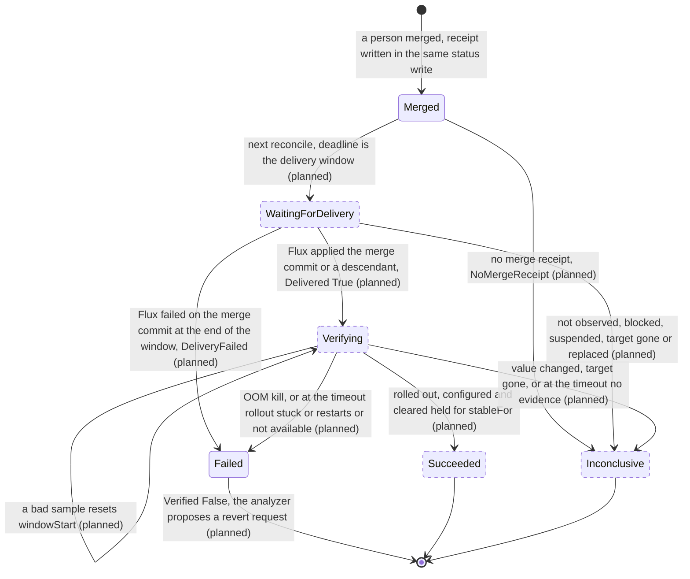

# ADR-0030: The merge receipt and the three outcomes of verification

- Status: Proposed
- Date: 2026-11-13

## Context

Milestone v0.5.0 has one goal: `Succeeded` means the merged revision is applied and the symptom is gone. Today nothing sets a phase after `Merged`. Issue [#248](https://github.com/pkalin/shadewright/issues/248) asks for the contract first, before the build tasks of epic [#19](https://github.com/pkalin/shadewright/issues/19): states after approval ([#94](https://github.com/pkalin/shadewright/issues/94)), checks with `stableFor` and timeout ([#93](https://github.com/pkalin/shadewright/issues/93)), the revert proposal ([#96](https://github.com/pkalin/shadewright/issues/96)) and the ways a change fails to land ([#95](https://github.com/pkalin/shadewright/issues/95)). The audit of 2026-11-04 that filed #248 found two gaps: no merged revision was persisted, and the checks did not require workload health, so a deleted, scaled-to-zero or unschedulable workload, or a missing metric, could look like recovery.

Four decisions were taken on 2026-11-13 and are not reopened here:

1. Three outcomes are kept apart: **rolled out** (the merged revision is applied and the rollout reached the pods), **configured** (the live object holds the new value) and **cleared** (the symptom is gone for the stated window).
2. In v0.5.0 "cleared" is read from container status only: no OOM kill after the rollout and a flat restart count, on a workload that exists with the same UID and is available. The executor gets no metrics source; metrics as evidence follow with [#508](https://github.com/pkalin/shadewright/issues/508) and [#506](https://github.com/pkalin/shadewright/issues/506).
3. Missing or stale data gives an inconclusive result, never success.
4. A revert after a failed verification is a new request through the same policy and pull request path, never a direct change.

### What is built already

Since the audit, part of the gap closed. The code at `e2abcd9` has:

- **The merge commit.** `recordMerge` (`internal/controller/merge.go`) writes `status.pullRequest.mergeCommitSHA` in the status write that sets `Merged`, on all three paths that observe a merge: the recorded pull request (`watchStep`), a pull request found by its marker after a lost write (`endMerged`, the adopt path, only after `checkMerged` found exactly the planned change) and the replacement of a handoff (`handoff.go`). A CEL rule on the object keeps it set once. `status.pullRequest.mergedAt` is set with the phase.
- **Delivery.** The Flux adapter of `DeliveryVerifier` (`internal/providers/delivery/flux`, through `internal/fluxstatus`) answers `Pending`, `Applied` or `Failed` for a merge commit on a branch. A later commit of the branch counts when the Git host says it holds the merge commit (`AncestryChecker`). `DeliveryStatus` carries `AttemptedCommit` and `Suspended`.
- **The rollout report** (#532, `internal/controller/rollout.go`, `internal/verification/rollout`). On a `Merged` request whose target is a Deployment or StatefulSet, the executor waits up to an hour (paused time excluded) for the delivery, records `status.pullRequest.appliedObservedAt` and `status.rollout` (applied commit, generation, template hash, template revision, all set once), and sets the condition `RolledOut`. The phase stays `Merged`. It reads only the target and the Kustomization with the `get` it holds.
- **The API.** The phases `WaitingForDelivery`, `Verifying` and `Succeeded`, the `Verification` struct (`timeout` 10m, `stableFor` 3m, `checks`, with CEL bounds) and the `VerificationCheck` enum exist. The condition types `Delivered` and `Verified` are declared and never set.

What is missing is a receipt that binds the merge to its repository, branch and head, the phase moves after `Merged`, the configured and cleared outcomes, a result for the cases where nothing can be shown, and the read of container status.

## Decision

### 1. The merge receipt

A new status field, `status.mergeReceipt`, written once in the same status write that sets `Merged`, on the three paths above, and never changed after:

| Field | Value | Source |
| --- | --- | --- |
| `repository.url`, `repository.installationID` | The repository the plan was made for | `status.planRepository` |
| `targetBranch` | The branch the pull request merged into | `status.source.targetBranch` |
| `pullRequest` | The pull request number | the merged change request |
| `headSHA` | The head that was merged: the commit Shadewright pushed, or the replacement's commit after a handoff | the merged change request, checked equal to `status.pullRequest.headSHA` |
| `mergeCommitSHA` | The commit the Git host reports for the merge | the merged change request, equal to `status.pullRequest.mergeCommitSHA` |
| `mergedAt` | When the executor recorded the merge | the phase write |

Rules:

- A CEL rule on the object keeps the whole receipt equal to its first value once set, in the same form as the existing rules for `mergeCommitSHA` and `appliedObservedAt`, so neither removing `status.mergeReceipt` nor removing the whole status can change it. A second rule requires `mergeReceipt.mergeCommitSHA` to equal `status.pullRequest.mergeCommitSHA`.
- The receipt is written only for a merge that holds exactly the planned change. `MergedWithForeignChange` (phase `NeedsIntervention`) gets none.
- When the Git host reports no merge commit, or one that is not a full commit ID, the request is still `Merged` but gets no receipt; the next reconcile ends it `Inconclusive` with reason `NoMergeReceipt` (section 5).
- **Restart and lost writes.** The receipt is part of the write that sets `Merged`. If that write is lost, the request is still in its earlier phase; the next reconcile finds the merged pull request again (the recorded one by number, an unrecorded one by branch and marker on the adopt path) and writes the same values, since the host's answer for a merged pull request does not change. A status wiped by hand cannot drop it (CEL), and a request whose status was never written goes through the policy check again and adopts the merged pull request by its marker.
- **Requests merged before the receipt existed** keep `Merged`. The executor sets `Verified` to `Unknown` with reason `MergedBeforeVerification` once and starts no verification, so the circuit breaker, which counts `Merged` as a success, reads the same history after the upgrade.

Every later check uses the receipt, not the live settings: delivery is asked about `mergeCommitSHA` on `targetBranch`, and the ancestry question goes to `repository`. A settings entry changed after the merge cannot point the check at another repository.

### 2. Delivery against the receipt

The executor moves a `Merged` request with a receipt to `WaitingForDelivery` on the next reconcile, with `status.deadline` set to the end of the delivery window: one hour after `mergedAt`, extended by paused time as today. The existing delivery check then runs. Each case of #248:

| Case | What the executor sees | Outcome |
| --- | --- | --- |
| The merge commit is applied | Flux reports it applied and Ready for its current generation | `Delivered` True, phase `Verifying` in the same write as `appliedObservedAt` |
| A descendant revision is applied | Flux reports a later commit of `targetBranch`; the host says it holds the merge commit | Same as above; `status.rollout.appliedRevision` names the later commit and the template it produced is judged |
| A skipped revision | Flux never applied the merge commit itself and went straight to a later one | Same as a descendant: only ancestry counts |
| A later commit overwrote the field | Delivered as a descendant, but the live field does not hold the desired value | `Configured` False, reason `ValueChanged`; the request ends `Inconclusive` (our value never ran, so there is nothing to judge or revert) |
| The applied revision does not hold the merge commit (another branch, history rewritten) | Never `Applied` | At the end of the window: `Inconclusive`, reason `DeliveryNotObserved` |
| Flux failed on exactly the merge commit | `Failed` with `AttemptedCommit` equal to the merge commit, at the end of the window | `Failed`, reason `DeliveryFailed`; leads to #96 |
| Flux failed on a later commit | `Failed` with another `AttemptedCommit` | At the end of the window: `Inconclusive`, reason `DeliveryBlocked` (the failure cannot be pinned on this change) |
| The Kustomization is suspended | `Suspended` true | At the end of the window: `Inconclusive`, reason `DeliverySuspended` |
| The target is recreated | The live object has another UID | `Inconclusive`, reason `TargetReplaced`, at once, in any phase after `Merged` |
| The target is deleted | Not found | `Inconclusive`, reason `TargetGone`, at once |
| The delivery cannot be read to the end | Read errors past the window and its grace | `Inconclusive`, reason `DeliveryNotChecked` |

Flux retries a failed attempt, so a failure inside the window is not final: the executor keeps asking and decides at the end. A failure of the merge commit itself is the one delivery result that counts against the change, because a broken commit at the head of the branch also blocks every later commit until it is reverted.

A later commit that keeps our value but changes something else in the template (an image tag, say) is judged together with our change. The rollout report already accepts that, and the verdict says which commit was applied.

### 3. The three outcomes

Each outcome has its own condition, so `kubectl shadewright explain` can show three lines. `Verified` sums them up and decides the phase.

| Outcome | Condition | Evidence | Read by the executor with |
| --- | --- | --- | --- |
| Rolled out | `Delivered` and `RolledOut` | Flux reports the merge commit or a descendant applied (`Delivered`); every pod runs the applied template (`RolledOut`, built) | `get` on the Kustomization and the target (held), the host's ancestry answer (held) |
| Configured | `Configured` (new type) | The live target's field equals the desired value, read with the same field accessor the duplicate rule uses (`sourcemap.FieldFor`, `changeInEffect` in `duplicates.go`) | `get` on the target (held) |
| Cleared | `Cleared` (new type) | Container status of the target's pods: no OOM kill of the action's container since `appliedObservedAt`, restart counts flat, workload available | `list` on `pods` (new, section 7) |

For a ScaledObject (`AdjustKedaMaxReplicas`), "rolled out" is `Delivered` plus `KedaReady` for the ScaledObject's current generation, since there are no pods of its own. Its symptom (scaling held at the maximum, a growing backlog) is not visible in container status, so in v0.5.0 `Cleared` stays `Unknown` with reason `ClearingNotChecked`, and such a request ends `Inconclusive` once rolled out and configured held for `stableFor`. It cannot end `Succeeded` until metrics arrive. A request whose `spec.verification.checks` names `QueueBacklogDecreasing` ends the same way, reason `CheckNotAvailable`.

Who reads the outcomes:

- the executor writes all of them and is the only writer of request status (invariant 6, unchanged);
- `kubectl shadewright explain` shows rolled out, configured and cleared as three lines (exit criterion 5);
- the circuit breaker reads only the phase;
- the analyzer reads `Failed` with `Verified` False to propose a revert (#96), and an Incident whose request ended without success moves to `Escalated` as it does today (design 3).

### 4. The stable window

The pods of the rollout are the pods the target's selector matches in its namespace that are not terminating and that the target controls: for a StatefulSet, controller owner UID equal to the target's and `controller-revision-hash` equal to `status.rollout.templateRevision`; for a Deployment, a controlling ReplicaSet named `<deployment>-<pod-template-hash>`, one hash among all of them, and, for `SetContainerMemoryLimit`, the action's container with the desired limit. The executor lists them with the uncached reader, in pages of 100, at most 10 pages; more pods than that make the sample incomplete.

A sample is taken every 30 seconds while the request is `Verifying`. It is good when all of these hold:

- the target exists with the request's UID;
- `RolledOut` is True and `Configured` is True;
- the workload is available: `spec.replicas` is at least 1, `availableReplicas` equals it, and for a Deployment the `Available` condition is True;
- every pod of the rollout reports a status for every container;
- no container restarted since the window started (see baseline below).

**Start.** The window starts at the first good sample. Its start is written to `status.verification.windowStart`. The restart count of each pod at that moment is the baseline; a pod created later has a baseline of 0, so a scale-out or a replaced pod does not reset the window, while any restart of any container does.

**Reset.** A sample that is not good moves `windowStart` forward to the next good sample and records why in `status.verification.lastReset` (and counts it in `status.verification.resets`). The reasons fall into two classes:

| Reason | Class |
| --- | --- |
| `Restarted`: a container restarted above its baseline | trouble |
| `NotAvailable`: the workload is not available | trouble |
| `EvidenceMissing`: a pod without container status, more pods than the bound, or a pod whose node stopped reporting | no evidence |
| `ScaledToZero`: `spec.replicas` is 0 | no evidence |
| `ObservationGap`: no good sample for more than two poll intervals, which includes a restart of the executor or a change of leader (the baseline is kept in memory only) | no evidence |

A read that fails is retried and is not a sample; if no sample succeeds for more than two poll intervals, the next one resets with `ObservationGap`. `windowStart` only moves forward (CEL), and `resets` never decreases.

**Final at once.** An OOM kill of the action's container on a pod of the rollout, with `lastState.terminated.reason` `OOMKilled` and `finishedAt` at or after `appliedObservedAt`, ends the request `Failed` with reason `OOMKilled`, whatever the window. An OOM kill of another container is a `Restarted` reset. `Configured` False, `TargetGone`, `TargetReplaced` and `RolloutSuperseded` end it `Inconclusive` at once.

**Success.** A good sample at or after `windowStart + stableFor` sets `Cleared` True (reason `NoRecurrence`) and `Verified` True, and ends the request `Succeeded`.

**Minimums and timeout.** The controller derives the effective values; a request can only make them stricter (design 5.1):

- `stableFor` is the larger of `spec.verification.stableFor` (default 3m, at least 1m by CEL) and the action's minimum: 10 minutes for `SetContainerMemoryLimit`, 3 minutes for `AdjustKedaMaxReplicas`. #93 may raise the memory minimum after measuring in the lab how soon the oom scenario is killed again under the old limit.
- The timeout runs from `appliedObservedAt` and is the larger of `spec.verification.timeout` (default 10m, at most 24h) and the rollout deadline (`RolloutDeadline`, 10 minutes by default) plus the effective `stableFor`. For a memory fix with defaults that is 20 minutes. It is written to `status.deadline` when the request enters `Verifying`.
- At the timeout without a success: `Failed` when `RolledOut` is False (`RolloutStuck`), when a ScaledObject's `KedaReady` does not hold (`KedaNotReady`), or when the last reset was of the trouble class (reason `Restarted` or `NotAvailable`); otherwise `Inconclusive` with the last no-evidence reason. A memory fix that does not help therefore ends `Failed` by the OOM rule well before the timeout, and a crash loop ends `Failed` at it.

The kill switch does not gate verification: it makes no Git write. While writes are paused it still reads, and the delivery window keeps its pause rule.

### 5. Inconclusive is a new terminal phase

The enum `RemediationPhase` gets one value, `Inconclusive`: the change was merged, and neither success nor failure could be shown. The condition `Verified` is `Unknown` and carries the reason (`TargetGone`, `TargetReplaced`, `ValueChanged`, `DeliveryNotObserved`, `DeliveryBlocked`, `DeliverySuspended`, `DeliveryNotChecked`, `NoMergeReceipt`, `EvidenceMissing`, `ScaledToZero`, `ObservationGap`, `ClearingNotChecked`, `CheckNotAvailable`).

Three ways to express it were weighed:

- **A reason under `Failed`.** Rejected: #96 proposes a revert for `Failed`, and reverting a change on a deleted workload, or one that a later commit already overwrote, is wrong.
- **A reason under `NeedsIntervention`.** No API change, but the circuit breaker counts `NeedsIntervention` as a failure. Every KEDA request in v0.5.0 ends inconclusive by design (section 3), so three of them would trip the breaker on no evidence of harm. It also mixes with the pre-merge stops of #95 (merge conflicts).
- **A new phase.** Chosen. The enum change is additive (`feat(api)`, not breaking in `v1alpha1`) and user visible: `kubectl get rr`, the plugin's `status` and `explain`, troubleshooting and the phases diagram all show it. Nothing sets any phase after `Merged` today, so every switch over phases that must learn it (breaker, duplicates, target lock, plugin) is touched by #94 anyway.

For the circuit breaker `Inconclusive` is treated like `Expired`: not a failure outside a probe, a probe that ends `Inconclusive` opens the breaker again for a full cool-down, never a success, and `breakerCounts` follows the existing rule for "any other end". `Failed` after the merge stays a failure, and only `Succeeded` clears outcomes, as today.

### 6. States after approval

`Merged` and the rollout report under it are built; every state and arrow after `Merged` is planned. `Failed` exists for steps before the merge, and its use after the merge is planned. The deadline of a step after the merge never ends a request `Expired`: past the merge, the evidence decides between `Failed` and `Inconclusive`. `Expired` stays for steps before the merge, which narrows the "`Expired` on deadline" of #94 to those steps.

### 7. The read of container status

Container status lives on Pods, which the executor cannot read today: it holds `get` on Deployments, StatefulSets, ScaledObjects, Kustomizations and GitRepositories. Cleared needs one new grant:

- verb `list` (no `get`, no `watch`) on `pods` in the core API group, bound by one RoleBinding per namespace the chart lists, defaulting to the analyzer's watched namespaces (`analyzer.watchNamespaces`), never a ClusterRoleBinding.

The executor uses it only with the target's namespace and selector, through the uncached reader, keeps only pod UID, owner, labels, container names, restart counts and the reason and finish time of the last termination, and never stores, logs or puts into an Event any other pod field. The termination message is never read. This is the one point of this ADR that changes invariant 6's text (the executor's list of grants) and needs the maintainer's decision before #93 is built.

The alternative that keeps invariant 6 unchanged was considered and rejected: the analyzer already watches pods and could write OOM evidence into the Incident status, which the executor reads with its `get` on Incidents. The verdict would then depend on the identity that talks to the model, a stopped analyzer would leave no new evidence that looks like no OOM kill (against decision 3), and a `Succeeded` closes the circuit breaker, so a forged clear would weaken a safety control.

### 8. A failed verification leads to #96

A request that ends `Failed` after the merge has `Verified` False with one of `OOMKilled`, `Restarted`, `NotAvailable`, `RolloutStuck`, `DeliveryFailed` or `KedaNotReady`. That is the input of #96. Its shape, which #96 builds:

- The analyzer creates the revert, in deterministic code with no model call. It already holds `create` on RemediationRequests in the operator namespace and reads request status; the executor cannot create requests, and gets no such grant.
- The revert is a new RemediationRequest with the same Incident and target, the same action type with `previous` and `desired` swapped, `approvalRequired: true`, and a new link field `spec.reverts` (name and UID of the failed request). CEL requires `approvalRequired: true` whenever `reverts` is set.
- Its name derives from the failed request's UID, so a retried or repeated create finds the existing one: one revert per failure.
- It goes through the same policy check, freshness check, target lock and pull request path as any request. Its `previous` must still match the file in Git; if someone already changed the field, it ends `Superseded` like any stale plan.
- A revert is never reverted: a request with `spec.reverts` never triggers #96. Its own verification requires rolled out and configured only, since the original symptom is expected to come back; the Incident stays escalated for a person.
- `Inconclusive` never leads to a revert.

A revert of a memory increase is a decrease, and policies refuse decreases by default (`maxDecreasePercent` 0, design 5.3). Without a policy rule for reverts, the revert ends `Denied` with `DecreaseNotAllowed` and the person reverts by hand. Whether a policy may allow exactly the inverse of a failed request's change (and nothing wider) is a change to the policy decision; #96 decides it with an amendment and a red team, and it is the second point for the maintainer.

### 9. Invariants

1. **Model output is never authorization.** Every verdict comes from deterministic code over typed fields; no model is asked. `Succeeded` authorizes nothing new: it only lets the breaker clear older outcomes, as today. The revert is a proposal that goes through policy.
2. **Actions are a closed catalog.** Verification only reads; it never deletes, restarts or patches a pod or a workload. The revert reuses the existing action types; no value is added.
3. **Changes go through Git only.** Verification makes no Git write and asks the host only the ancestry question it asks today. A revert is a new request and a new pull request, never a direct change and never an automatic merge (`approvalRequired: true`).
4. **Everything from the cluster is untrusted input.** Pod and Flux status are read as typed fields: integers, timestamps, owner references and the termination reason compared with the constant `OOMKilled`. Flux messages and termination messages are not copied into status. The pod list is bounded in pages and count.
5. **Reconciliation is idempotent.** The receipt is written with the phase and set once; a lost write is repeated with the same values. `windowStart` moves forward only and an executor restart resets the window, which can delay a verdict and never turns a failure into a success. Every terminal verdict is one status write. The revert's name derives from the failed request's UID.
6. **Separate identities.** The executor gains `list` on `pods` in the chart's namespaces (section 7), the one change. The analyzer gains nothing: it already creates requests and reads their status. The executor stays the only writer of request status.

### 10. Current code and this design

| File | Exists at `e2abcd9` | Missing for this design |
| --- | --- | --- |
| `api/v1alpha1/remediationrequest_types.go` | Phases up to `Succeeded`; `Verification` with CEL bounds; `VerificationCheck` enum; `pullRequest.mergeCommitSHA`, `appliedObservedAt` (set once by CEL), `mergedAt`; `RolloutStatus` with set-once rules; condition constants `Delivered` and `Verified` | `status.mergeReceipt` with its CEL rules; phase `Inconclusive`; `status.verification` (`windowStart`, `lastReset`, `resets`) with forward-only rules; condition constants `Configured` and `Cleared`; `spec.reverts` (#96) |
| `internal/controller/merge.go` | `recordMerge` (merge commit), `recordApplied` | Writing the receipt next to the merge commit |
| `internal/controller/pullrequest.go` | `watchStep` and `endMerged` (adopt path) end in `Merged` with `recordMerge`; a person's close ends `NeedsIntervention` (`rejected`) | Receipt on both paths; `Cancelled` for a close without a merge (#95) |
| `internal/controller/handoff.go` | The replacement's merge records the merge commit | Receipt on this path |
| `internal/controller/rollout.go` | `afterMerge` on `Merged` only; the delivery window with pause; `delivered` with the second Flux read; `judgeRollout` and `RolledOut` | Phase moves to `WaitingForDelivery` and `Verifying`; `Delivered`; telling `DeliveryFailed` of the merge commit from a later one (`delivered` maps every non-`Applied` outcome to false today); ancestry against the receipt's repository |
| `internal/controller/remediationrequest_controller.go` | Calls `afterMerge` for `Merged` | Dispatch for `WaitingForDelivery` and `Verifying`; `status.deadline` per step; `MergedBeforeVerification` for old requests |
| `internal/controller/limits.go`, `breakercounts.go` | `setPhase` sets `mergedAt`; the breaker classifies phases | `Inconclusive` classified like `Expired` |
| `internal/controller/duplicates.go` | `changeInEffect` reads the live field; "`Merged` or a later phase" is a merge | The same read reused for `Configured`; the later phases listed explicitly, `Inconclusive` and `Failed` included |
| `internal/providers/delivery.go`, `internal/providers/delivery/flux`, `internal/fluxstatus` | Outcomes `Pending`, `Applied`, `Failed`; `AttemptedCommit`; `Suspended` | Nothing |
| `internal/verification/rollout` | `Evaluate` from workload status only; template hash and revision | Nothing; a new package `internal/verification/clearing` holds the pod sample, the baseline and the window as pure functions |
| `cmd/kubectl-shadewright/explain.go` | A section for `RolledOut` | Three lines: rolled out, configured, cleared |
| `internal/controller/cache.go`, chart RBAC | `get` on the target kinds and Flux objects | `list` on `pods` through namespaced RoleBindings (section 7) |
| `internal/analysis` | Creates requests by a deterministic name | The revert proposer (#96) |

### 11. The build tasks

| Task | Changes | Size | Order |
| --- | --- | --- | --- |
| #94a (split from #94) Merge receipt | `status.mergeReceipt` and CEL; written on the three merge paths; `NoMergeReceipt`; `MergedBeforeVerification`; envtest for a lost write, the adopt path, the handoff and CEL refusals | M | 1 |
| #94b (rest of #94) Phases after the merge | Phase `Inconclusive`; `Merged` to `WaitingForDelivery` to `Verifying` with `status.deadline`; `Delivered`; every delivery case of section 2 with its outcome; breaker, duplicates, target lock and plugin `status` learn the new phase; `phases.svg`, `executor.svg` and the phase lists in the docs | L | 2, after #94a |
| #93a (split from #93) Check registry and window | `internal/verification/clearing`: required checks per action, effective `stableFor` and timeout with minimums, sample rules, baseline, resets, the timeout verdict; unit tests: a flapping sample resets the window, a restart resets it, an OOM kill fails at once, the timeout gives `Failed` or `Inconclusive` by the last reset | M | can start with #94a, pure code |
| #93b (rest of #93) Wiring and the pod read | `list` on `pods` (after the maintainer's decision), chart RoleBindings and tests; `status.verification`; `Configured` and `Cleared`; `Verifying` to `Succeeded`, `Failed`, `Inconclusive`; `explain` with three lines; design 9 and 10.11 and invariant 6 text in `AGENTS.md` | L | after #94b and #93a |
| #96 Revert proposal | `spec.reverts` with CEL; the analyzer's deterministic proposer; one revert per failure; no revert of a revert; the policy question of section 8 | L | after #94b (it can be tested with `DeliveryFailed` first), parallel with #93b |
| #95a (split from #95) Before the merge | A close without a merge ends `Cancelled` instead of `NeedsIntervention`; a merge conflict ends `NeedsIntervention` with its own reason | S | now, parallel with everything: it touches only the steps before the merge |
| #95b (rest of #95) Resolved before the rollout | Read from the Incident the executor already gets whether the symptom stopped before `appliedObservedAt`; `Cleared` True then carries reason `ResolvedBeforeRollout` instead of `NoRecurrence`, so the attribution is visible | S | after #93b |

Order: #94a, #93a and #95a first, then #94b, then #93b and #96 side by side, then #95b. #93 and #96 both list #94 under "Depends on"; with the split they depend on #94b, and #93b also on #93a.

## Consequences

- `Succeeded` now needs a receipt, delivery of the merge commit or a descendant, the live value, an available workload and a quiet window of at least 10 minutes for a memory fix. A request that cannot show this ends `Inconclusive` with a reason a person can act on.
- KEDA requests cannot succeed in v0.5.0. That is accepted until metrics are evidence (#508, #506).
- The phase enum grows by one value, and every place that lists phases (breaker, duplicates, target lock, plugin, docs, `phases.svg`) learns it in #94.
- The executor reads Pods in the chart's namespaces, which also exposes their specs (environment values included) to that identity. The template of each Deployment it can `get` already shows the same fields; pods of other workloads in those namespaces are new.
- An executor that restarts often never completes a window and ends verification `Inconclusive`. That is the intended direction of the error.
- A combined later commit is judged with our change (section 2). A pod deleted between two samples takes an OOM kill of its last run with it; the 30 second poll bounds that gap.

## Alternatives considered

- **Freeze the existing fields instead of a receipt** (CEL on `status.source`, `status.planRepository` and `status.pullRequest.headSHA` once `mergeCommitSHA` is set). No new field, but `headSHA` moves before the merge by design (handoff, reviewer hints), and requests merged before the rule would look like they have a receipt. Rejected.
- **`Inconclusive` as a reason under `Failed` or `NeedsIntervention`.** See section 5.
- **Evidence from the analyzer through the Incident.** See section 7.
- **A metrics source for the executor in v0.5.0.** Ruled out by decision 2.
- **Count restarts as a single total.** Simpler, but a replaced pod lowers the total and hides a restart elsewhere; per-pod baselines with new pods at 0 avoid it.

## Amendments

None.
