# ADR-0030: The merge receipt and the three outcomes of verification

- Status: Accepted
- Date: 2026-11-13

## Context

Milestone v0.5.0 has one goal: `Succeeded` means the merged revision is applied and the symptom is gone. Today nothing sets a phase after `Merged`. Issue [#248](https://github.com/pkalin/shadewright/issues/248) asks for the contract first, before the build tasks of epic [#19](https://github.com/pkalin/shadewright/issues/19): states after approval ([#94](https://github.com/pkalin/shadewright/issues/94)), checks with `stableFor` and timeout ([#93](https://github.com/pkalin/shadewright/issues/93)), the revert proposal ([#96](https://github.com/pkalin/shadewright/issues/96)) and the ways a change fails to land ([#95](https://github.com/pkalin/shadewright/issues/95)). The audit of 2026-11-04 that filed #248 found two gaps: no merged revision was persisted, and the checks did not require workload health, so a deleted, scaled-to-zero or unschedulable workload, or a missing metric, could look like recovery.

Four decisions were taken on 2026-11-13 and are not reopened here:

1. Three outcomes are kept apart: **rolled out** (the merged revision is applied and the rollout reached the pods), **configured** (the live object holds the new value) and **cleared** (the symptom is gone for the stated window).
2. In v0.5.0 "cleared" is read from container status only: no OOM kill after the rollout and a flat restart count, on a workload that exists with the same UID and is available. The executor gets no metrics source; metrics as evidence follow with [#508](https://github.com/pkalin/shadewright/issues/508) and [#506](https://github.com/pkalin/shadewright/issues/506).
3. Missing or stale data gives an inconclusive result, never success.
4. A revert after a failed verification is a new request through the same policy and pull request path, never a direct change.

A fifth decision of the same day, that a new component is acceptable where it helps the later stages, settles where container status is read (section 7). It replaces the decision, also of 2026-11-13, to grant the executor `list` on `pods`.

### What is built already

Since the audit, part of the gap closed. The code at `e2abcd9` has:

- **The merge commit.** `recordMerge` (`internal/controller/merge.go`) writes `status.pullRequest.mergeCommitSHA` in the status write that sets `Merged`, on all three paths that observe a merge: the recorded pull request (`watchStep`), a pull request found by its marker after a lost write (`endMerged`, the adopt path, only after `checkMerged` found exactly the planned change) and the replacement of a handoff (`handoff.go`). A CEL rule on the object keeps it set once. `status.pullRequest.mergedAt` is set with the phase.
- **Delivery.** The Flux adapter of `DeliveryVerifier` (`internal/providers/delivery/flux`, through `internal/fluxstatus`) answers `Pending`, `Applied` or `Failed` for a merge commit on a branch. A later commit of the branch counts when the Git host says it holds the merge commit (`AncestryChecker`). `DeliveryStatus` carries `AttemptedCommit` and `Suspended`.
- **The rollout report** (#532, `internal/controller/rollout.go`, `internal/verification/rollout`). On a `Merged` request whose target is a Deployment or StatefulSet, the executor waits up to an hour (paused time excluded) for the delivery, records `status.pullRequest.appliedObservedAt` and `status.rollout` (applied commit, generation, template hash, template revision, all set once), and sets the condition `RolledOut`. The phase stays `Merged`. It reads only the target and the Kustomization with the `get` it holds. Once `RolledOut` has its verdict, the check reads nothing more (`rolloutEnded`).
- **The API.** The phases `WaitingForDelivery`, `Verifying` and `Succeeded`, the `Verification` struct (`timeout` 10m, `stableFor` 3m, `checks`, with CEL bounds) and the `VerificationCheck` enum exist. The condition types `Delivered` and `Verified` are declared and never set.

What is missing is a receipt that binds the merge to its repository, branch and head, the phase moves after `Merged`, the configured and cleared outcomes, a result for the cases where nothing can be shown, and a reader of container status.

## Decision

[![Path after the merge, built up to the executor's own checks in Verifying (the merge receipt, delivery against it, rolled out and configured, the ends Inconclusive and Failed for those; the steps after Merged only with --verify-outcomes, off by default), and the verifier, which writes reports that the executor reads as untrusted evidence to judge cleared, with the stable window and Succeeded built, and the revert built (its creation by the analyzer's deterministic proposer, recorded once on the Incident, its link check, no report, the end RevertApplied): the merge receipt (repository, targetBranch, pullRequest, headSHA, mergeCommitSHA, mergedAt), delivery checked against the receipt, three outcomes kept apart (rolled out, configured, cleared) each with its evidence and how it is read, cleared read from a VerificationReport that a separate verifier identity writes, the stable window, and the terminal phases Succeeded, Inconclusive and Failed, with Failed leading to a revert request that the analyzer creates.](../assets/diagrams/verification-outcomes.svg)](../assets/diagrams/verification-outcomes.svg "Open full size")

### 1. The merge receipt

A new status field, `status.mergeReceipt`, written once in the same status write that sets `Merged`, on the three paths above, and never changed after:

| Field | Value | Source |
| --- | --- | --- |
| `repository.url`, `repository.installationID` | The repository the plan was made for | `status.planRepository` |
| `targetBranch` | The branch the pull request merged into | `status.source.targetBranch` |
| `pullRequest` | The pull request number | the merged change request |
| `headSHA` | The head that was merged: the commit Shadewright pushed, or the replacement's commit after a handoff | the merged change request, checked equal to `status.pullRequest.headSHA` |
| `mergeCommitSHA` | The commit the Git host reports for the merge | the merged change request, equal to `status.pullRequest.mergeCommitSHA` |
| `mergedAt` | When the executor recorded the merge | the phase write |

Rules:

- A CEL rule on the object keeps the whole receipt equal to its first value once set, in the same form as the existing rules for `mergeCommitSHA` and `appliedObservedAt`, so neither removing `status.mergeReceipt` nor removing the whole status can change it. A second rule requires `mergeReceipt.mergeCommitSHA` to equal `status.pullRequest.mergeCommitSHA`.
- The receipt is written only for a merge that holds exactly the planned change. `MergedWithForeignChange` (phase `NeedsIntervention`) gets none.
- When the Git host reports no merge commit, or one that is not a full commit ID, the request is still `Merged` but gets no receipt; the next reconcile ends it `Inconclusive` with reason `NoMergeReceipt` (section 5). The executor first waits five minutes for the commit, on its own clock (amendment of 2026-11-13).
- **Restart and lost writes.** The receipt is part of the write that sets `Merged`. If that write is lost, the request is still in its earlier phase and the next reconcile looks for the merged pull request again. Before #94a (#678) a recorded pull request was looked up by its branch, not its number: `watchStep` called `FindChangeRequest(branch)`, which returns the most recent Shadewright pull request of that branch, and a pull request with another number ends the request `NeedsIntervention` (`HeadMoved`). A branch can carry a second pull request after the first merged, for instance in a supersede chain of ADR-0028, where the branch name derives from the chain's first request; the merge of the recorded pull request would then never be recorded. #94a adds a lookup by number to `GitProvider` (`GetChangeRequest(number)`, in the repository of `status.planRepository`) and uses it for every request with `status.pullRequest.number` set, checking that the pull request found has the recorded head branch, target branch and head commit. The lookup by branch and marker stays for the adopt path, where no number was recorded. The host's answer for a merged pull request does not change, so the repeated write has the same values. A status wiped by hand cannot drop the receipt (CEL), and a request whose status was never written goes through the policy check again and adopts the merged pull request by its marker.
- **Requests merged before the receipt existed** keep `Merged`. The executor sets `Verified` to `Unknown` with reason `MergedBeforeVerification` once and starts no verification, so the circuit breaker, which counts `Merged` as a success, reads the same history after the upgrade.

Every later check uses the receipt, not the live settings: delivery is asked about `mergeCommitSHA` on `targetBranch`, and the ancestry question goes to `repository`. A settings entry changed after the merge cannot point the check at another repository.

### 2. Delivery against the receipt

The executor moves a `Merged` request with a receipt to `WaitingForDelivery` on the next reconcile, with `status.deadline` set to the end of the delivery window: one hour after `mergedAt`, extended by paused time as today. The existing delivery check then runs. Each case of #248:

| Case | What the executor sees | Outcome |
| --- | --- | --- |
| The merge commit is applied | Flux reports it applied and Ready for its current generation | `Delivered` True, phase `Verifying` in the same write as `appliedObservedAt` |
| A descendant revision is applied | Flux reports a later commit of `targetBranch`; the host says it holds the merge commit | Same as above; `status.rollout.appliedRevision` names the later commit and the template it produced is judged |
| A skipped revision | Flux never applied the merge commit itself and went straight to a later one | Same as a descendant: only ancestry counts |
| A later commit overwrote the field | Delivered as a descendant, but the live field does not hold the desired value | `Configured` False, reason `ValueChanged`; the request ends `Inconclusive` (our value never ran, so there is nothing to judge or revert) |
| The applied revision does not hold the merge commit (another branch, history rewritten) | Never `Applied` | At the end of the window: `Inconclusive`, reason `DeliveryNotObserved` |
| Flux failed on exactly the merge commit | `Failed` with `AttemptedCommit` equal to the merge commit, at the end of the window | `Failed`, reason `DeliveryFailed`; leads to #96 |
| Flux failed on a later commit | `Failed` with another `AttemptedCommit` | At the end of the window: `Inconclusive`, reason `DeliveryBlocked` (the failure cannot be pinned on this change) |
| The Kustomization is suspended | `Suspended` true | At the end of the window: `Inconclusive`, reason `DeliverySuspended` |
| The target is recreated | The live object has another UID | `Inconclusive`, reason `TargetReplaced`, at once, in any phase after `Merged` |
| The target is deleted | Not found | `Inconclusive`, reason `TargetGone`, at once |
| The delivery cannot be read to the end | Read errors past the window and its grace | `Inconclusive`, reason `DeliveryNotChecked` |

Flux retries a failed attempt, so a failure inside the window is not final: the executor keeps asking and decides at the end. A failure of the merge commit itself is the one delivery result that counts against the change, because a broken commit at the head of the branch also blocks every later commit until it is reverted.

A later commit that keeps our value but changes something else in the template (an image tag, say) and arrives before the rollout is recorded is judged together with our change, and the verdict says which commit was applied. A template change after the rollout was recorded ends verification `RolloutSuperseded` (section 4).

### 3. The three outcomes

Each outcome has its own condition, so `kubectl shadewright explain` can show three lines. `Verified` sums them up and decides the phase.

| Outcome | Condition | Evidence | Read by |
| --- | --- | --- | --- |
| Rolled out | `Delivered` and `RolledOut` | Flux reports the merge commit or a descendant applied (`Delivered`); every desired replica runs the applied template (`RolledOut`, built, with the partition rule below), and the target still names that template on every sample | the executor: `get` on the Kustomization and the target (held), the host's ancestry answer (held) |
| Configured | `Configured` (new type) | The live target's field equals the desired value, read with the same field accessor the duplicate rule uses (`sourcemap.FieldFor`, `changeInEffect` in `duplicates.go`) | the executor: `get` on the target (held) |
| Cleared | `Cleared` (new type) | Container status of the target's pods: no OOM kill of the action's container on a pod of the rollout, restart counts flat against durable baselines, every desired replica covered | the verifier lists the pods and writes a `VerificationReport`; the executor reads the report as its evidence and writes the condition (section 7) |

**A partitioned StatefulSet.** The rollout evaluator (`statefulSet` in `internal/verification/rollout`) calls a rolling update with `partition` above 0 complete when only the pods above the partition run the update revision: three replicas, partition 2 and one updated pod give `Complete`, while two pods keep the old template. The owner chose that, so `RolledOut` keeps saying the rollout did what the strategy asks, with its own reason `RolloutPartitioned` and a message that names the pods left on the old revision, instead of "every pod runs the current template". It is not evidence for the change: cleared needs every desired replica on the applied revision, so a sample with pods left below the partition is not good (reason `PartialRollout`, no evidence class). If the owner lowers the partition inside the timeout, the window can still complete; otherwise the request ends `Inconclusive` with `PartialRollout`.

For a ScaledObject (`AdjustKedaMaxReplicas`), "rolled out" is `Delivered` plus `KedaReady` for the ScaledObject's current generation, since there are no pods of its own. Its symptom (scaling held at the maximum, a growing backlog) is not visible in container status, so in v0.5.0 `Cleared` stays `Unknown` with reason `ClearingNotChecked`, and such a request ends `Inconclusive` once rolled out and configured held for `stableFor`. It cannot end `Succeeded` until metrics arrive. A request whose `spec.verification.checks` names `QueueBacklogDecreasing` ends the same way, reason `CheckNotAvailable`.

Who reads the outcomes:

- the executor writes all of them, `Cleared` included, and is the only writer of request status (invariant 6, unchanged); for `Cleared` the verifier's report is its evidence, and the verifier writes only its reports;
- `kubectl shadewright explain` shows rolled out, configured and cleared as three lines (exit criterion 5);
- the circuit breaker reads only the phase;
- the analyzer reads `Failed` with `Verified` False to propose a revert (#96), and an Incident whose request ended without success moves to `Escalated` as it does today (design 3).

### 4. The stable window

The window is kept in two places. The verifier samples the pods every 30 seconds and keeps the pod-level window, its baselines and its resets in the request's `VerificationReport` (section 7). The executor reconciles every 30 seconds while the request is `Verifying`, makes its own reads, checks the report, and keeps its window in `status.verification` (`windowStart`, `lastReset`, `resets`). Success needs both windows to be long enough, each measured on its own writer's clock.

**Clocks.** Three clocks write the times this design reads. No rule compares a time of the executor's clock with one of the verifier's, and the only comparison across clocks is the node's against the verifier's, which can only add resets:

- The verifier's clock writes the report's `sampledAt`, `windowStart`, `lastReset` and `lastTroubleReset`, and decides the gap rule below. The span of the report's window is `sampledAt - windowStart`, both written by the verifier.
- The executor's clock writes `appliedObservedAt`, `status.deadline` and the executor's own `windowStart` and `lastReset`, and measures the delivery window, the timeout, the executor's own span and the age of the report.
- The node's clock writes container termination times. They are compared only with the report's `windowStart`, with one poll interval of margin, and only to add resets (below), which are never recorded as trouble, so a node clock cannot end a request `Failed`.

The executor never reads the age of the report from `sampledAt`. The report carries `status.sample`, a counter the verifier raises by one with every sample it writes (forward only by CEL). At each check the executor keeps in memory the counter it read and the time by its own clock taken before that read (amendment of 2026-11-13, #683); the age is judged at the time taken after it. For the success decision the report must be no older than one poll interval by the executor's clock: its counter is higher than the one read at a check made at most 30 seconds earlier, so it was written after that check. A report whose counter has not risen for more than three poll intervals by the executor's clock is `StaleReport`. Once both spans are long enough the executor checks every 15 seconds, so a sample that lands just after a check delays success by one short interval. A restart of the executor forgets the counter and delays success by one check. Skew between any two clocks can therefore only delay or deny success: each span is measured on one clock, the age on the executor's, and node times can only add resets, since every restart inside the window also shows as a count above its baseline; only that count is recorded as trouble.

**The pods of the rollout** are the pods in the target's namespace that its selector matches, that are not terminating, and whose ownership the verifier proves the way the analyzer's collector does (`ownerResolver` in `internal/analyzer/collector/owners.go`), since owner references are untrusted input:

- for a Deployment: the pod's controller reference names a ReplicaSet that exists with that UID (`get`), whose selector matches the pod's labels, whose controller reference names the target with the target's UID, whose labels the target's selector matches, and whose revision annotation (`deployment.kubernetes.io/revision`) equals `status.rollout.templateRevision`;
- for a StatefulSet: the pod's controller reference has the target's UID, and its `controller-revision-hash` label equals `status.rollout.templateRevision`;
- for `SetContainerMemoryLimit`, the action's container exists in the pod with the desired limit.

A pod the selector matches whose chain does not verify is not counted; it cannot add coverage. The verifier lists with the API reader, in pages of 100, at most 2 pages; more pods than that make the sample incomplete.

**A verifier sample** is good when all of these hold:

- the target exists with the report's target UID and names the report's template revision;
- `spec.replicas` is at least 1, and the pods of the rollout number exactly `spec.replicas`: every desired replica is on the applied revision (the partition rule of section 3), with no pod of the target on another revision;
- every pod of the rollout reports a status for every container and native sidecar (an init container with `restartPolicy: Always`; ordinary init containers do not count), no current termination without a finish time, and its `Ready` condition is True;
- no container restarted since the window started, against the baselines below.

**An executor check** is good when the target exists with the request's UID; `RolledOut` and `Configured` are True; the target, read in this reconcile, still has the generation's template hash and names `status.rollout.templateRevision` (otherwise the request ends `Inconclusive` with `RolloutSuperseded` at once); its available replicas equal `spec.replicas`; and the report passes the trust contract of section 7. The template check runs on every reconcile in `Verifying`, the last one included: the `RolledOut` verdict is not taken as still true, and `rolloutEnded` no longer stops the reads once the request is `Verifying`.

**Baselines live in the report.** At the first good sample the verifier records `windowStart` and, per pod of the rollout, its UID and the sum of its containers' and native sidecars' restart counts (at most 200 entries, matching the pod bound). Restart counts of a pod never decrease, so the sum works per pod. On every later sample, including the first one after the verifier restarted or lost its lease, it compares against the stored baselines, so a restart count raised while nobody watched is a `Restarted` reset and never becomes a silent new baseline. A container whose current or last termination finished at or after `windowStart` minus one poll interval (the margin absorbs clock skew between the node and the verifier) is a `Restarted` reset as well; it makes the first sample of a window stricter and never replaces the count. With no count above its baseline it is not recorded as trouble (below): a node clock running ahead could make an old termination look recent. After a gap (the stored `sampledAt` more than two poll intervals old by the verifier's clock) every pod not in the baselines may have replaced a pod whose history went with it: `ObservationGap` reset, without comparing its creation time, which the API server's clock writes. Without a gap, a new pod (a scale-out or a replacement) gets a baseline of 0, so any restart it shows later is a `Restarted` reset.

**Deleted pods.** A baseline whose pod UID is no longer in the list is pruned in the same status write as the sample. Pruning moves no window: a restart of that pod seen at an earlier sample already reset the window then and stays in `resets` and `lastReset`; a restart between the last sample that saw the pod and its deletion is not seen, the limit stated under "What a quiet window proves". Until a replacement is a pod of the rollout, the sample is `PartialRollout`.

**More than 200 pods.** When the selector matches more pods than the two pages hold, or the pods of the rollout would need more than 200 baselines, the sample is not good with `EvidenceMissing`, unless a returned pod of the rollout shows an OOM kill of the action's container: that is checked first and ends the request by the OOM rule below. The verifier never drops a pod or a baseline to fit the bound, so a target with more than 200 desired replicas cannot succeed and ends `Inconclusive` with `EvidenceMissing` at the timeout.

**Reset.** A sample or check that is not good moves `windowStart` forward to the next good one and records why (`lastReset`, `resets`). The reasons fall into two classes:

| Reason | Set by | Class |
| --- | --- | --- |
| `Restarted`: a container or native sidecar restarted above its baseline, or terminated after `windowStart` | verifier | trouble (recorded only for a count above its baseline after the window first opened) |
| `PodNotReady`: a pod of the rollout is not Ready and did not restart | verifier | no evidence |
| `PartialRollout`: fewer pods on the applied revision than `spec.replicas` | verifier | no evidence |
| `EvidenceMissing`: a pod without a status for every container, or more pods than the bound | verifier | no evidence |
| `ScaledToZero`: `spec.replicas` is 0 | verifier | no evidence |
| `ObservationGap`: no sample for more than two poll intervals and a pod not in the baselines after it | verifier | no evidence |
| `NotAvailable`: the target reports other available replicas than `spec.replicas` | executor | no evidence |
| `StaleReport`, `ReportMismatch`: the report fails the trust contract (section 7) | executor | no evidence |

A pod that is not Ready is no evidence, not trouble, because a node that stopped reporting and a probe that fails look the same without a read of Nodes. A crash loop still shows as `Restarted`. Since each sample takes the raised count as the new baseline, a crash loop shows one `Restarted` reset per restart and `PodNotReady` resets in between, so the report also records trouble durably: `troubleResets` counts the `Restarted` resets recorded as trouble and `lastTroubleReset` keeps the last one, and a later no-evidence reset changes neither. Two `Restarted` resets still reset the window but are not recorded: one before the window first opened (the report's first good sample), such as a new pod restarting during a slow rollout, since it resets nothing the window had shown; and one that only a termination time shows, with no restart count above its baseline, since node clock skew may only delay or deny success. A crash loop from the start never opens the window; it ends `Failed` as `RolloutStuck`, not by this record. A failed read is retried and is not a sample. `windowStart` and the time of `lastReset` only move forward (CEL, in the report and in request status), the time of `lastTroubleReset` only moves forward and `troubleResets` never decreases (CEL, in the report, the only object with trouble fields), and `resets` never decreases.

**Node freshness.** Container status is only as fresh as the kubelet's last report. When a node stops reporting, the node lifecycle controller marks the pods on it not Ready once the cluster's node monitor grace period (`--node-monitor-grace-period` of kube-controller-manager, under a minute by default) has passed, and a pod still on the node is evicted (terminating) after its toleration of the unreachable taint, 300 seconds by default. Both show in the pod list. The verifier therefore needs no Node or Lease read, and the verdict waits for them: success needs good samples until `windowStart + stableFor + nodeGrace`, where `nodeGrace` is an executor setting (flag `--node-grace`, chart value `executor.verification.nodeGrace`, default 1 minute, which the chart documents must be at least the cluster's node monitor grace period). The verifier needs no copy of it: it records the window, and the executor judges its span. A node that went silent inside the window has had its pods marked not Ready before the verdict, which resets the window. A pod that turns terminating drops out of the count and makes the sample `PartialRollout`.

**Final at once.** An OOM kill of the action's container on a pod of the rollout, with `lastState.terminated.reason` `OOMKilled`, is recorded once in the report (`oomKill`: pod UID, container name, finish time) and ends the request `Failed` with reason `OOMKilled`, whatever the window. No time decides it: a pod of the rollout is proven to run the applied template with the desired limit, so every kill it records happened under the new value. An OOM kill of another container is a `Restarted` reset. A revert (section 8) is exempt: the verifier writes no report for it, so this rule never applies to it. `Configured` False, `TargetGone`, `TargetReplaced` and `RolloutSuperseded` end the request `Inconclusive` at once.

**Success.** A good executor check ends the request `Succeeded` when all of these hold: the report is good and no older than one poll interval by the executor's clock (the counter rule above); the report's span, `sampledAt - windowStart`, is at least `stableFor + nodeGrace`, both times written by the verifier; and the executor's own span, `now - windowStart` on its clock, is at least `stableFor + nodeGrace`. The same status write sets `Cleared` True (reason `NoRecurrence`) and `Verified` True. The executor is the only writer of `Cleared` (it writes request status) and the verifier's report is its evidence; #95b only changes the reason the executor writes, to `ResolvedBeforeRollout` instead of `NoRecurrence`, when two readings of the Incident's occurrence counter show the symptom had stopped before the rollout (built, #684; the rule is the next subsection).

**Resolved before the rollout** (built, #684; amendment of 2026-11-13). The window above starts at `appliedObservedAt`, so it cannot say whether the symptom was already gone when the change arrived. Nothing the executor reads today shows that: the Incident's times (`lastSeen`, `resolvedTime`, the occurrence times) are on the analyzer's or the cluster's clock, and no decision may compare them with `appliedObservedAt`. The executor therefore compares counts, not times:

- It reads the Incident of the request (`spec.incidentRef`) with the `get` it already holds, at two moments, and records `status.count` twice in `status.verification.incidentCount`: `atMerge` and `atApplied`. Each reading is `{uid, count, readAt}`: the Incident's UID, its count, and the executor's own time of the read. A reading once set is never changed, but it may be removed (CEL), `atApplied` only with `atMerge`, and `count` is at most 1000000, the value at which the Incident's count saturates.
- `atMerge` is taken only in the reconcile that writes the merge receipt and sets `Merged` (a retry of that write after a conflict reads again). If that read fails, `atMerge` stays absent for good and the reason stays `NoRecurrence`: a reading taken later, possibly after the change was already applied, could describe a quiet period that came after the fix. `atApplied` is written in the same status write as `appliedObservedAt`. A failed read never holds back the merge, the delivery or the phase: the reading stays absent and the reason stays `NoRecurrence`. `atApplied` is never filled in after the write of `appliedObservedAt`, and it is taken only by the executor process that took `atMerge` (kept in its memory with the reading), so both `readAt` come from one clock. A reading may be removed, because an executor that predates the field drops it in its typed status write after a rollback; since `atMerge` is taken only in the write that sets `Merged` and `atApplied` only with `appliedObservedAt`, a removed reading is never taken again and the reason stays `NoRecurrence`. The read of the Incident is optional and never shortens the status write it rides with: it is skipped unless the step's deadline leaves its own timeout (5 seconds by default) plus one minute, the API server's default request timeout. On a cluster whose API server allows requests longer than a minute, a write slower than that minute can still lose up to the read's timeout.
- `Cleared` True gets reason `ResolvedBeforeRollout` instead of `NoRecurrence`, in the same status write as `Succeeded`, only when all of these hold: both readings exist; both UIDs equal `spec.incidentRef.uid`; the two counts are equal; neither is at the saturation value; and `atApplied.readAt - atMerge.readAt`, two times of the executor's clock, is at least the effective `stableFor` of the request plus twice the analyzer's aggregation window (`DefaultWindow` in `internal/incidents`, 5 minutes, so 10 minutes more than `stableFor`; an open question, point 6 of the maintainer list). Twice, because the analyzer writes `status.count` at most once per window per Incident (one window of batching), and an OOM crash loop backs off up to 5 minutes between kills (a second window of silence that is no recovery). A shorter span proves nothing: equal counts over it may only mean no write fell in it.
- In every other case, the reason stays `NoRecurrence`: a missing reading, an Incident that cannot be read or is gone, another UID, a count that went down (the Incident was rebuilt or its status reset), a saturated count, or too short a span. The phase, the other conditions and the circuit breaker's reading of `Succeeded` do not change. A revert (`spec.reverts`) is not affected: its `Cleared` stays `Unknown`.

What the counter can and cannot show. It counts what the analyzer recorded: occurrences of the symptom that its collector saw and wrote. Equal counts over a span of at least `stableFor` plus two windows mean the analyzer wrote no new occurrence in that span; a count is written at most once per window and a crash loop can back off for a window, so a shorter span could not show even that. They do not mean the symptom did not happen. A symptom the analyzer missed, or an analyzer that was stopped or behind, looks quiet. Known limit: `appliedObservedAt` can be later than the real apply (the executor was down or backing off), so the quiet span can include time after the fix took effect, and the reason can then wrongly say the change was not the cause. Most deliveries are faster than the minimum span, so the reason will usually stay `NoRecurrence`. Known limit: after a restart of the executor or a change of leader between the merge and the applied time, the reason is always `NoRecurrence`, since the new process did not take `atMerge`. The same holds when the step that writes the receipt or `appliedObservedAt` has less than about a minute of its deadline left. The reason is therefore an attribution for the people reading the request ("the symptom had already stopped when the change arrived, so this change is not shown to be the cause"), and it is worded that way in the condition message. It is no evidence that the change worked, and it adds no authority: nothing branches on it (not the phase, the circuit breaker or the revert), and `Succeeded` still needs everything above, from the verifier's report as before.

**What a quiet window proves.** Cleared means no OOM kill and no restart were observed over the window, with the pod set covered at every sample. Container status keeps only the last termination of a container, so history that went with a pod deleted between two samples (at most 30 seconds, longer across a gap) is lost; a gap with a new pod resets the window instead of trusting the new pod, and a restart while nobody watched still shows as a raised count. An OOM kill whose record was overwritten by a later termination is not reported as `OOMKilled`, but that later termination resets the window as `Restarted`.

**Minimums and timeout.** The controller derives the effective values; a request can only make them stricter (design 5.1):

- `stableFor` is the larger of `spec.verification.stableFor` (default 3m, at least 1m by CEL) and the action's minimum: 10 minutes for `SetContainerMemoryLimit`, 3 minutes for `AdjustKedaMaxReplicas`. #93 may raise the memory minimum after measuring in the lab how soon the oom scenario is killed again under the old limit.
- The timeout runs from `appliedObservedAt` and is the larger of `spec.verification.timeout` (default 10m, at most 24h) and the rollout deadline (`RolloutDeadline`, 10 minutes by default) plus the effective `stableFor` plus `nodeGrace`. For a memory fix with defaults that is 21 minutes. It is written to `status.deadline` when the request enters `Verifying`.
- At the timeout without a success: `Failed` when `RolledOut` is False (`RolloutStuck`), when a ScaledObject's `KedaReady` does not hold (`KedaNotReady`), or when the report recorded trouble (`troubleResets` and `lastTroubleReset`: a restart count above its baseline after the window first opened), whatever its last reset; otherwise `Inconclusive` with the last reset reason. Recorded trouble counts in a report that passes the spec check, even one no longer fresh: like the OOM record it is affirmative evidence and cannot move back. A revert has no report, so only the executor's own reads can fail it (section 8). A memory fix that does not help therefore ends `Failed` by the OOM rule well before the timeout, and a crash loop ends `Failed` at it. A change that makes pods fail their readiness probe without restarting ends `Inconclusive` (`PodNotReady`).

The kill switch does not gate verification: it makes no Git write. While writes are paused it still reads, and the delivery window keeps its pause rule.

### 5. Inconclusive is a new terminal phase

The enum `RemediationPhase` gets one value, `Inconclusive`: the change was merged, and neither success nor failure could be shown. The condition `Verified` is `Unknown` and carries the reason (`TargetGone`, `TargetReplaced`, `ValueChanged`, `RolloutSuperseded`, `PartialRollout`, `DeliveryNotObserved`, `DeliveryBlocked`, `DeliverySuspended`, `DeliveryNotChecked`, `NoMergeReceipt`, `EvidenceMissing`, `PodNotReady`, `NotAvailable`, `ScaledToZero`, `ObservationGap`, `StaleReport`, `ReportMismatch`, `ClearingNotChecked`, `CheckNotAvailable`, `RevertApplied`).

Three ways to express it were weighed:

- **A reason under `Failed`.** Rejected: #96 proposes a revert for `Failed`, and reverting a change on a deleted workload, or one that a later commit already overwrote, is wrong.
- **A reason under `NeedsIntervention`.** No API change, but the circuit breaker counts `NeedsIntervention` as a failure. Every KEDA request in v0.5.0 ends inconclusive by design (section 3), so three of them would trip the breaker on no evidence of harm. It also mixes with the pre-merge stops of #95 (merge conflicts).
- **A new phase.** Chosen. The enum change is additive (`feat(api)`, not breaking in `v1alpha1`) and user visible: `kubectl get rr`, the plugin's `status` and `explain`, troubleshooting and the phases diagram all show it. Nothing sets any phase after `Merged` today, so every switch over phases that must learn it (breaker, duplicates, target lock, plugin) is touched by #94a anyway.

For the circuit breaker `Inconclusive` is treated like `Expired`: not a failure outside a probe, a probe that ends `Inconclusive` opens the breaker again for a full cool-down, never a success, and `breakerCounts` follows the existing rule for "any other end". `Failed` after the merge stays a failure, and only `Succeeded` clears outcomes, as today.

### 6. States after approval

```mermaid
stateDiagram-v2
    classDef planned stroke-dasharray: 5 5
    [*] --> Merged: a person merged, receipt written in the same status write
    Merged --> WaitingForDelivery: next reconcile, deadline is the delivery window
    Merged --> Inconclusive: no merge receipt, NoMergeReceipt
    WaitingForDelivery --> Verifying: Flux applied the merge commit or a descendant, Delivered True
    WaitingForDelivery --> Failed: Flux failed on the merge commit at the end of the window, DeliveryFailed
    WaitingForDelivery --> Inconclusive: not observed, blocked, suspended, target gone or replaced
    Verifying --> Verifying: a bad sample or a stale report resets windowStart
    Verifying --> Succeeded: rolled out, configured and a fresh report of a quiet window for stableFor plus nodeGrace
    Verifying --> Failed: at the timeout rollout stuck; OOM kill (not for a revert) or restarts
    Verifying --> Inconclusive: value changed, template superseded, target gone, or at the timeout no evidence; a revert applied
    Failed --> [*]: Verified False, the analyzer proposes a revert request
    Succeeded --> [*]
    Inconclusive --> [*]
```

`Merged` and the end `Inconclusive` with `NoMergeReceipt` are built (#678); `WaitingForDelivery`, `Verifying` and the ends `Failed` and `Inconclusive` from the executor's own reads are built (#681); `Succeeded` and the ends that need the verifier's report (OOM kill, restarts, the no-evidence resets) are built (#683). The receiving side of the revert is built (#96, first part: `spec.reverts`, the executor's link check, no report and the end `Inconclusive` with `RevertApplied`); the analyzer creating it is built too (#96, second part: the revert proposer, see the amendments). The deadline of a step after the merge never ends a request `Expired`: past the merge, the evidence decides between `Failed` and `Inconclusive`. `Expired` stays for steps before the merge, which narrows the "`Expired` on deadline" of #94 to those steps.

Also before the merge: a pull request closed without a merge keeps ending `NeedsIntervention` with `ChangeRequestClosed` (decided 2026-11-13), because a person rejecting a proposal is a signal the circuit breaker counts as a failure, and the fix for #643 reads that phase and reason.

### 7. The verifier and its report

Container status lives on Pods, which no Shadewright identity that writes request status can read today. A third component reads it: `shadewright-verifier`, its own binary (`cmd/verifier`), Deployment and ServiceAccount. It is deterministic code, has no model access, holds no Git App credentials and never writes request status. Later evidence sources (metrics for the KEDA backlog with #508 and #506, Argo CD health) attach to this identity, so each widens the grants of a component that can only withhold or report evidence, not of the one that writes to Git.

**Grants.**

- In each namespace of the chart value `verifier.watchNamespaces`: `list` on `pods` (no `get`, no `watch`); `get` on `replicasets`, `deployments` and `statefulsets` in the `apps` group (no `list`, no `watch`). The value follows the rules of `analyzer.watchNamespaces` (unique names, at most 256, `*` refused); left unset (`null`, the default) the chart uses `analyzer.watchNamespaces`, and a list, `[]` included, is used as it is. The rules are one ClusterRole, `verifier-watch-role` (template `dist/chart/templates/rbac/verifier-watch-role.clusterrole.yaml`), bound by one RoleBinding `verifier-watch` in each listed namespace (`verifier-watch-rolebindings.yaml`), never by a ClusterRoleBinding, the pattern of `analyzer-watch-role` and `analyzer-watch` today. The chart passes the same list as `--watch-namespaces`. With kustomize the ClusterRole is `config/rbac/verifier/watch/role.yaml`, and its RoleBindings are listed per namespace in `config/watch/` (`role_binding_verifier_demo.yaml`, next to the analyzer's), which `test/rbac` checks against the verifier's flag in `config/manager/verifier.yaml`.
- In the operator namespace: `get`, `list` and `watch` on `remediationrequests` (read only, to learn which requests are `Verifying`); `get` and `create` on `verificationreports`; `update` on `verificationreports/status`; its own leader election Lease and core Events. The chart renders them as the Role `verifier-role` and its RoleBinding (`verifier-role.role.yaml`, `verifier-rolebinding.rolebinding.yaml`) and the leader election pair, as for the executor; kustomize as `config/rbac/verifier/` (`role.yaml`, `role_binding.yaml`, `leader_election.yaml`, `service_account.yaml`).
- Cluster-wide, only the metrics authentication grant the executor and the analyzer have: `create` on `tokenreviews` and `subjectaccessreviews`, through the shared metrics-auth ClusterRoleBinding (`metrics-auth-rolebinding`, `config/rbac/metrics_auth_role_binding.yaml`), so its metrics endpoint checks the token and the permission of whoever scrapes it. No other ClusterRoleBinding names it.

It uses the pod list only with the target's namespace and selector, keeps only pod UID, owner references, labels, the `Ready` and `PodScheduled` conditions, creation and deletion times, container names, the action's container's memory limit, restart counts and the reason and finish time of the last and current termination, and never stores, logs or puts into an Event any other pod field. The termination message is never read.

The executor's cluster reads do not change. It gains `get` on `verificationreports` in the operator namespace, a Shadewright object.

**How evidence reaches the executor.** Two carriers were weighed:

- **A field of an existing object.** Request status is written only by the executor (invariant 6), so the verifier cannot write there. Incident status is written by the analyzer, the identity that talks to the model, and mixing a second writer into it would make the executor trust an object the analyzer can also change. A ConfigMap has no schema and no CEL. Rejected.
- **A new namespaced object owned by the verifier.** Chosen: `VerificationReport` in `remediation.shadewright.io/v1alpha1`, one per request, in the operator namespace, written only by the verifier, with typed fields and CEL.

The report:

- Its name derives from the request UID; it carries an owner reference to the request (`blockOwnerDeletion` false, so it needs no permission on the request) and is deleted with it.
- `spec`, set at create and immutable by CEL: `requestUID`, `mergeCommitSHA` (from the receipt), `targetUID`, `templateRevision` (from `status.rollout`) and the action's container name. It holds no time of the executor's clock.
- The verifier creates no report for a request with `spec.reverts` (section 8).
- `status`, written by the verifier: `sample` (a counter raised by one per sample, forward only), `sampledAt` (the last sample), `windowStart` (forward only), `desiredReplicas`, `podsCovered`, `resets` and `lastReset` (reason, time; the class follows from the reason), `troubleResets` and `lastTroubleReset` (forward only), `oomKill` (set once), `baselines` (pod UID and restart sum, at most 200). Typed fields only: no messages copied from the cluster, so its size is bounded by the baseline list (about 15 KB at the limit).

**The trust contract.** On each reconcile in `Verifying` the executor reads the report and treats it as no evidence (a reset of its own window) when:

- it is missing (`StaleReport`);
- its `sample` counter has not risen for more than three poll intervals by the executor's clock (`StaleReport`; section 4, where the success decision asks for a report no older than one poll interval);
- any `spec` field differs from what the executor holds: the request UID, the receipt's merge commit, the target UID it reads itself, `status.rollout.templateRevision` (`ReportMismatch`);
- it is incomplete: `podsCovered` differs from `desiredReplicas`, or `desiredReplicas` differs from the `spec.replicas` the executor reads itself (`PartialRollout`).

A stopped or broken verifier therefore leaves the request without evidence, never `Succeeded`: without recorded trouble or an OOM record in a matching report it ends `Inconclusive` at the timeout; with one, that record stands (section 4). The durable baselines (section 4) and the node freshness rule live in the report, so a restart of the verifier does not reset what it knew, and the executor's own window is in request status, but a restart or a leader change does not carry it over whole: no window counts time from before the executor process began reconciling, so every open window needs a full effective `stableFor` again (see the #96 entry on the executor's window after a restart).

**What the verifier can cause.** The executor writes `Cleared` and takes only its evidence from the report; it is the only outcome whose evidence comes from the report. Delivery, the rollout, the template's freshness, the live value, availability and the target's UID come from the executor's own reads. An honest verifier can withhold success (no report, a reset) or report an OOM kill or a restart. A compromised verifier can do both falsely: a forged OOM record ends a request `Failed` at once, and a forged `troubleResets` (or `lastTroubleReset`) ends it `Failed` at the timeout; either leads to a revert proposal, which needs a person's approval (`approvalRequired: true`) and passes policy.

**Accepted risk: a forged success.** A compromised verifier can forge a quiet window and so a `Succeeded`, which clears older outcomes in the circuit breaker. This risk is accepted. It is bounded: the request must really be merged, delivered, rolled out on every desired replica, configured and available, by the executor's own reads; the forged report must carry the request's UID, merge commit, target UID and template revision; and the verifier makes no Git write, holds no Git App credentials and cannot change policy. A forged success therefore authorizes no change: it only lets the breaker allow more proposals, each still going through policy and a person's merge where policy asks for it. Writing the evidence from the analyzer instead would remove the third identity but put the verdict with the identity that talks to the model and reads untrusted cluster text (logs, events, messages) to build its prompt. The verifier has no model access and reads typed fields only, so it is the smaller and harder target, and this design keeps the evidence there.

### 8. A failed verification leads to #96

A request that ends `Failed` after the merge has `Verified` False with one of `OOMKilled`, `Restarted`, `RolloutStuck`, `DeliveryFailed` or `KedaNotReady`. That is the input of #96. Its shape, built in #96 (the receiving side in its first part, the analyzer's proposer in its second; see the amendments):

- The analyzer creates the revert, in deterministic code with no model call. It already holds `create` on RemediationRequests in the operator namespace and reads request status; the executor cannot create requests, and gets no such grant.
- The revert is a new RemediationRequest with the same Incident and target, the same action type with `previous` and `desired` swapped, `approvalRequired: true`, and a new link field `spec.reverts` (name and UID of the failed request). CEL requires `approvalRequired: true` whenever `reverts` is set.
- Its name derives from the failed request's UID, so a retried or repeated create finds the existing one: one revert per failure at a time. The name only prevents two at the same time: once a revert is deleted, a new one with the same name can be created, so the proposer records its decision for each failed request in the Incident's `status.revertsProposed` (state `Pending` before the create, `Created` after it, or `Abandoned` when a check before the create says no) and never takes a second one (amendments of 2026-11-13 and 2026-11-14).
- The executor checks the link before the policy check, with the `get` it holds on RemediationRequests in the operator namespace: the named request exists with the UID in `spec.reverts`; it ended `Failed` with `Verified` False; it has the same target (kind, namespace and name), the same action type and, where the action names one, the same container; the revert's `previous` equals its `desired` and the revert's `desired` equals its `previous`, exactly; and the revert's name is the one derived from its UID. Otherwise the request ends `Denied` with reason `InvalidRevert`, before any Git write, and is never treated as a revert.
- Only the analyzer's deterministic revert proposer may create a request with `spec.reverts`. The analysis loop builds a request from the model's typed proposal, which has no `reverts` field, and copies none, with a test that a model proposal cannot produce one. Both paths run as the analyzer, so RBAC cannot tell them apart; the executor's check is the control. A request that carries `spec.reverts` without being exactly the inverse of a failed request is `Denied`, and a valid one can only undo a change that already failed, through policy and a person's approval, so a model cannot use the link to skip `Cleared` or gain an authorization (invariant 1). CEL keeps `spec.reverts` unchanged after create.
- A revert is exempt from the OOM rule and from `Cleared`: the verifier creates no report for it and the executor reads none; `Cleared` stays `Unknown` with reason `RevertApplied`. A revert of a memory increase is expected to be OOM killed again, so an OOM kill neither fails it nor counts in the breaker.
- It goes through the same policy check, freshness check, target lock and pull request path as any request. Its `previous` must still match the file in Git; if someone already changed the field, it ends `Superseded` like any stale plan.
- A revert is never reverted: a request with `spec.reverts` never triggers #96.
- A revert never ends `Succeeded`. It requires rolled out, configured and available only, since the original symptom is expected to come back, and once these held for `stableFor` on the executor's clock it ends `Inconclusive` with reason `RevertApplied`. The circuit breaker reads that like any `Inconclusive`: not a failure outside a probe, and it clears nothing, so the failure it reverts stays counted. A revert that does not roll out ends `Failed` (`RolloutStuck` or `DeliveryFailed`) and counts as a failure. The Incident stays escalated for a person.
- `Inconclusive` never leads to a revert.

A revert of a memory increase is a decrease, and policies refuse decreases by default (`maxDecreasePercent` 0, design 5.3). Without a policy rule for reverts, the revert ends `Denied` with `DecreaseNotAllowed` and the person reverts by hand. Whether a policy may allow exactly the inverse of a failed request's change (and nothing wider) is a change to the policy decision; #96 decides it with an amendment and a red team, and it is the fourth point for the maintainer.

### 9. Invariants

1. **Model output is never authorization.** Every verdict comes from deterministic code over typed fields; no model is asked, and the verifier has no model access. `Succeeded` authorizes nothing new: it only lets the breaker clear older outcomes, as today. The revert is a proposal that goes through policy.
2. **Actions are a closed catalog.** Verification only reads; it never deletes, restarts or patches a pod or a workload. The revert reuses the existing action types; no value is added.
3. **Changes go through Git only.** Verification makes no Git write and asks the host only the ancestry question it asks today. The verifier holds no Git credentials. A revert is a new request and a new pull request, never a direct change and never an automatic merge (`approvalRequired: true`).
4. **Everything from the cluster is untrusted input.** Pod and Flux status are read as typed fields: integers, timestamps, owner references verified by UID and selector up to the target, and the termination reason compared with the constant `OOMKilled`. Flux messages and termination messages are not copied into status or reports. The pod list is bounded in pages and count, and the report in size. The executor treats the report as input too, bound by UID and commit and checked for age and coverage.
5. **Reconciliation is idempotent.** The receipt is written with the phase and set once; a lost write is repeated with the same values, and a recorded pull request is found again by its number. `windowStart` moves forward only, in request status and in the report. Restart baselines are durable in the report, so a restart of the verifier or the executor never sets a silent new baseline: a raised restart count is a `Restarted` reset, a pod created during a gap is an `ObservationGap` reset, and a gap can delay a verdict but never turns an observed failure into a success. Every terminal verdict is one status write. The revert's name and the report's name derive from request UIDs.
6. **Separate identities.** A third identity, `shadewright-verifier`, holds the grants of section 7: `list` on `pods` and `get` on `replicasets`, `deployments` and `statefulsets` in the namespaces of the chart value `verifier.watchNamespaces` (unset: those of `analyzer.watchNamespaces`), through the ClusterRole `verifier-watch-role` and one RoleBinding `verifier-watch` per namespace, never a ClusterRoleBinding; with kustomize, `config/rbac/verifier/watch/role.yaml` bound by the RoleBindings in `config/watch/`; `get`, `list` and `watch` on `remediationrequests`, `get` and `create` on `verificationreports` and `update` on `verificationreports/status` in the operator namespace (`verifier-role`, `config/rbac/verifier/role.yaml`), besides its own Lease and Events; no model access, no Git App. The executor's grants are unchanged except `get` on `verificationreports` in the operator namespace, and it stays the only writer of request status and the only component that sets phases. The analyzer gains nothing: it already creates requests and reads their status.

### 10. Current code and this design

| File | Exists at `e2abcd9` | Missing for this design |
| --- | --- | --- |
| `api/v1alpha1/remediationrequest_types.go` | Phases up to `Succeeded`; `Verification` with CEL bounds; `VerificationCheck` enum; `pullRequest.mergeCommitSHA`, `appliedObservedAt` (set once by CEL), `mergedAt`; `RolloutStatus` with set-once rules; condition constants `Delivered` and `Verified` | `status.mergeReceipt` with its CEL rules; phase `Inconclusive`; `status.verification` (`windowStart`, `lastReset`, `resets`) with forward-only rules; condition constants `Configured` and `Cleared`; `status.verification.incidentCount` (`atMerge`, `atApplied`; never changed, removable, #95b); `spec.reverts` (#96) |
| `api/v1alpha1/verificationreport_types.go` | Nothing | The `VerificationReport` type, its set-once `spec`, forward-only `sample` and `windowStart`, set-once `oomKill`, bounded `baselines` |
| `internal/controller/merge.go` | `recordMerge` (merge commit), `recordApplied` | Writing the receipt next to the merge commit |
| `internal/controller/pullrequest.go`, `internal/providers/git.go`, `internal/providers/github` | `watchStep` finds the recorded pull request by branch (`FindChangeRequest`, most recent match) and stops on another number (`headMoved`); `endMerged` (adopt path) ends in `Merged` with `recordMerge`; a person's close ends `NeedsIntervention` (`rejected`) | `GetChangeRequest(number)` in the interface and the GitHub adapter, used for a recorded pull request; receipt on both paths; its own reason for a merge conflict (#95a) |
| `internal/controller/handoff.go` | The replacement's merge records the merge commit | Receipt on this path |
| `internal/controller/rollout.go` | `afterMerge` on `Merged` only; the delivery window with pause; `delivered` with the second Flux read; `judgeRollout` and `RolledOut`; reads stop once `rolloutEnded` | Phase moves to `WaitingForDelivery` and `Verifying`; `Delivered`; telling `DeliveryFailed` of the merge commit from a later one (`delivered` maps every non-`Applied` outcome to false today); ancestry against the receipt's repository; the template and revision read again on every reconcile in `Verifying`, ending `RolloutSuperseded` on a change |
| `internal/controller/remediationrequest_controller.go` | Calls `afterMerge` for `Merged` | Dispatch for `WaitingForDelivery` and `Verifying`; `status.deadline` per step; `MergedBeforeVerification` for old requests; reading and checking the report |
| `internal/controller/limits.go`, `breakercounts.go` | `setPhase` sets `mergedAt`; the breaker classifies phases; only `Succeeded` clears | `Inconclusive` classified like `Expired` (which covers `RevertApplied`) |
| `internal/controller/duplicates.go` | `changeInEffect` reads the live field; "`Merged` or a later phase" is a merge | The same read reused for `Configured`; the later phases listed explicitly, `Inconclusive` and `Failed` included |
| `internal/providers/delivery.go`, `internal/providers/delivery/flux`, `internal/fluxstatus` | Outcomes `Pending`, `Applied`, `Failed`; `AttemptedCommit`; `Suspended` | Nothing |
| `internal/verification/rollout` | `Evaluate` from workload status only; template hash and revision; a partitioned StatefulSet is `Complete` with "every pod runs the current template" | Reason `RolloutPartitioned` with the old pods named |
| `internal/verification/clearing` | Nothing | The pod sample, ownership checks over typed objects, baselines, resets and the window as pure functions |
| `cmd/verifier`, `internal/verifier` | Nothing | The verifier's manager, its reconciler of `Verifying` requests and the report writer |
| `internal/analyzer/collector/owners.go` | `ownerResolver` verifies Pod to ReplicaSet to Deployment by UID and selector | Its chain check moved to a shared package the verifier also uses, or copied with the same tests |
| `cmd/kubectl-shadewright/explain.go` | A section for `RolledOut` | Three lines: rolled out, configured, cleared |
| `internal/controller/cache.go`, chart RBAC | `get` on the target kinds and Flux objects | Executor: `get` on `verificationreports`; the verifier's ServiceAccount, Roles and RoleBindings (section 7) |
| `Dockerfile`, `images.yml`, `images-build.yml`, `chart.yml`, `trivy.yml` | Targets and images `executor` and `analyzer` | A `verifier` target and image, built, signed, scanned and listed with digests in the release body |
| `docs/design/2-architecture.md`, `identity.svg`, `architecture.svg`, `AGENTS.md` | Two identities; the verifier is described as part of the executor | Three identities; invariant 6 text with the verifier's grants |
| `internal/analysis` | Creates requests by a deterministic name | The revert proposer (#96) |

### 11. The build tasks

| Task | Changes | Size | Order |
| --- | --- | --- | --- |
| #94a (split from #94) Merge receipt | `status.mergeReceipt` and CEL; written on the three merge paths; `GetChangeRequest(number)` for a recorded pull request; phase `Inconclusive`, classified in the breaker like `Expired` and learned by duplicates, target lock and plugin `status` (every phase of the API must be classified, `TestEveryPhaseIsClassified`); `NoMergeReceipt`; `MergedBeforeVerification`; envtest for a lost write, a reused branch, the adopt path, the handoff and CEL refusals | L | 1 |
| #93a (#679, split from #93) Window and report logic | The `VerificationReport` API type with its CEL rules and refusal tests (the pure checks below take it as input); `internal/verification/clearing`: ownership over typed objects, coverage, durable baselines with pruning and the 200 bound, the gap rule, resets, the spans on one clock each, the timeout verdict; the report's trust contract and the counter rule as pure checks; unit tests: a partitioned StatefulSet is not covered, a forged owner reference is not counted, a restart during a gap resets as `Restarted`, a new pod after a gap resets as `ObservationGap`, a stale or mismatched report is no evidence, a skewed `sampledAt` changes no verdict, an OOM kill fails at once | L | 1, pure code |
| #95a (split from #95) Before the merge | A merge conflict ends `NeedsIntervention` with its own reason | S | 1, parallel with everything: it touches only the steps before the merge |
| #94b (rest of #94) Phases after the merge | `Merged` to `WaitingForDelivery` to `Verifying` with `status.deadline`; `Delivered`; `Configured` (needed for `ValueChanged`); every delivery case of section 2 with its outcome; the template read on every reconcile in `Verifying` (`RolloutSuperseded`); `RolloutPartitioned`; the timeout verdict from the executor's own reads, so that until #93b a request ends `Inconclusive` with `ClearingNotChecked` instead of staying `Verifying`; `executor.verification.nodeGrace`; `phases.svg`, `executor.svg` and the phase lists in the docs | L | 2, after #94a |
| #93c (#682, new) The verifier component | `cmd/verifier` and its reconciler, which skips requests with `spec.reverts`; the grants of section 7 in the chart and `config/`; the Dockerfile target, the image build, signing, Trivy scan and release digests; `identity.svg`, `architecture.svg`, design 2 and invariant 6 in `AGENTS.md` | L | 2, after #93a and #94a (the report's `spec` takes the receipt's merge commit), parallel with #94b |
| #93b (#683, rest of #93) Executor wiring | `get` on `verificationreports`; `status.verification`; `Cleared`; the trust contract and the counter rule; `Verifying` to `Succeeded`, `Failed` (`OOMKilled`, `Restarted`) and `Inconclusive`; `explain` with three lines; design 9 and 10.11 | L | 3, after #94b and #93c |
| #96 Revert proposal | `spec.reverts` with CEL; the analyzer's deterministic proposer and the test that a model proposal cannot set the link; the executor's link check and `InvalidRevert`; one revert per failure; no revert of a revert; the exemption from the OOM rule and `Cleared`; `RevertApplied`; the policy question of section 8 | L | 4, after #93b, which builds the `Verifying` verdicts that `RevertApplied` and the exemption change |
| #95b (#684, rest of #95, built) Resolved before the rollout | The executor stays the only writer of `Cleared`, with the report as its evidence; this task only changes the reason it writes, to `ResolvedBeforeRollout` instead of `NoRecurrence`, when two readings of the Incident's `status.count` (`status.verification.incidentCount`, section 4) show no new occurrence recorded between the merge and the rollout over a long enough span, so the attribution is visible. It adds a read of the Incident, with the merge receipt and with `appliedObservedAt`, with the existing `get`, one status field with CEL, and the executor's grant text in `AGENTS.md` invariant 6 and design 2 (what the `get` on the Incident is for); no new grant, no analyzer change | S | 4, after #93b, parallel with #96 |

Order: #94a, #679 and #95a first; then #94b and #682 side by side; then #683; then #96 and #95b side by side. #93 and #96 both list #94 under "Depends on"; with the split #682 depends on #679 and #94a, #683 on #94b and #682, and #96 on #683. #682 adds one L task to the milestone, #94a grows from M to L with the lookup by number and the new phase, and #679 from M to L with the report type; #683 no longer carries the pod grant or `Configured`.

A close without a merge keeps ending `NeedsIntervention` with `ChangeRequestClosed`; the decision and its reason are in section 6.

## Consequences

- `Succeeded` now needs a receipt, delivery of the merge commit or a descendant, the live value, an available workload with every desired replica on the applied revision, and a quiet window of at least 10 minutes plus the node grace for a memory fix, reported fresh by the verifier. A request that cannot show this ends `Inconclusive` with a reason a person can act on.
- KEDA requests cannot succeed in v0.5.0. That is accepted until metrics are evidence (#508, #506), which attach to the verifier.
- The phase enum grows by one value, and every place that lists phases (breaker, duplicates, target lock, plugin) learns it in #94a, the docs and `phases.svg` in #94b.
- A third Deployment, ServiceAccount, image and signed release artifact. The install and the lab run one more pod; its requests are small (one list of the target's pods every 30 seconds per `Verifying` request).
- The verifier reads Pods in the chart's namespaces, which also exposes their specs (environment values included) to that identity. It holds no Git App credentials and no model access, so the exposure stays with an identity that cannot write to Git or send pod data to a model.
- A stopped verifier, or one that restarts often, leaves verification without fresh reports and ends it `Inconclusive`. That is the intended direction of the error.
- A partitioned StatefulSet rollout, or a change that makes pods fail readiness without restarting, ends `Inconclusive`.
- A combined later commit is judged with our change when it arrives before the rollout is recorded; after that it supersedes the verification (section 2). A pod deleted between two samples takes an OOM kill of its last run with it; the 30 second poll bounds that gap, and a longer gap with a new pod resets the window.
- A forged report from a compromised verifier can end a delivered, rolled out and configured request `Succeeded` (section 7).

## Alternatives considered

- **Freeze the existing fields instead of a receipt** (CEL on `status.source`, `status.planRepository` and `status.pullRequest.headSHA` once `mergeCommitSHA` is set). No new field, but `headSHA` moves before the merge by design (handoff, reviewer hints), and requests merged before the rule would look like they have a receipt. Rejected.
- **`Inconclusive` as a reason under `Failed` or `NeedsIntervention`.** See section 5.
- **The executor lists pods** (`list` on `pods` for the executor, decided on 2026-11-13 and replaced the same day). Rejected: the identity that holds the Git App would read every pod spec in the chart's namespaces, and every later evidence source (metrics, Argo CD health) would widen that same identity.
- **Evidence from the analyzer through the Incident.** The analyzer already watches pods and could write OOM evidence into the Incident status, which the executor reads with its `get` on Incidents. The verdict would then depend on the identity that talks to the model, a stopped analyzer would leave no new evidence that looks like no OOM kill (against decision 3), and a `Succeeded` closes the circuit breaker, so a forged clear would weaken a safety control. Rejected.
- **Pod ownership by name and count, without reading ReplicaSets.** Requiring one ReplicaSet UID across the sample and a pod count equal to the Deployment's replicas would catch most forged owner references with no `get` on `replicasets`, but it rests on the Deployment status and the pod list agreeing at the same moment. With a separate identity the `get` is cheap and matches the collector's proven chain. Rejected.
- **A metrics source for the executor in v0.5.0.** Ruled out by decision 2.
- **Count restarts as a single total.** Simpler, but a replaced pod lowers the total and hides a restart elsewhere; per-pod baselines with new pods at 0 avoid it.
- **Keep baselines in memory only.** Smaller, but a restart of the reader would take the next sample as a new baseline and lose a restart that happened while nobody watched. Rejected for durable baselines in the report.

## Points for the maintainer

1. The third component, `shadewright-verifier`, and its grants (section 7), replacing the decision of 2026-11-13 to grant the executor `list` on `pods`; with it the executor's new `get` on `verificationreports`. Needed before #682 is built.
2. The accepted risk of a forged quiet window (section 7): a compromised verifier can forge a `Succeeded` for a request that is really merged, delivered, rolled out, configured and available, which lets the circuit breaker clear older outcomes. It authorizes no change.
3. KEDA requests cannot reach `Succeeded` in v0.5.0 (section 3): `Cleared` stays `Unknown` with reason `ClearingNotChecked` and they end `Inconclusive`, until metrics are evidence (#508, #506).
4. The policy rule for reverts (section 8), left to #96: whether a policy may allow exactly the inverse of a failed request's change. Without it a revert of a memory increase ends `Denied` with `DecreaseNotAllowed`.
5. The new values and intervals, each with the default its section defines:
    - chart value `verifier.watchNamespaces`, default `null` (the chart uses `analyzer.watchNamespaces`), section 7;
    - flag `--node-grace`, chart value `executor.verification.nodeGrace`, default 1 minute, to be at least the cluster's node monitor grace period, section 4;
    - sampling and reconcile interval of 30 seconds while `Verifying`, 15 seconds once both spans are long enough, fixed, not settings, section 4;
    - `spec.verification.stableFor`, default 3m, at least 1m, raised to the action's minimum (10 minutes for `SetContainerMemoryLimit`, 3 for `AdjustKedaMaxReplicas`), and `spec.verification.timeout`, default 10m, at most 24h, with the rollout deadline of 10 minutes, section 4;
    - the delivery window of one hour after `mergedAt`, section 2.
6. The minimum span between the two counter readings for `ResolvedBeforeRollout` (section 4, #684). Decided 2026-11-13: the effective `stableFor` plus twice the analyzer's aggregation window (`DefaultWindow`, 5 minutes): 13 minutes by default, 20 for a memory fix. The count is written at most once per window and an OOM crash loop backs off up to 5 minutes, so one window of batching and one of backoff must fit in the span. The alternatives are a fixed value, for example 10 minutes, for every action (simpler to explain, not tied to the request), and `stableFor` alone, rejected: it can be shorter than one window, and equal counts over it prove nothing. Most deliveries (seconds after the merge) give a span below the minimum, so the reason will usually stay `NoRecurrence`; it shows mainly when the GitOps controller is slow to deliver.

## Amendments

- 2026-11-13: building #93a (#679) changed four rules of sections 4 and 7. Native sidecars (init containers with `restartPolicy: Always`) count like containers for statuses, restarts and terminations. A current termination without a finish time makes a sample incomplete. An OOM kill of the action's container in a returned pod is judged before the 200 pod bound gives `EvidenceMissing`. Trouble is recorded durably in the report (`troubleResets`, `lastTroubleReset`), so a crash loop after the window opened ends `Failed` at the timeout even when its last reset was `PodNotReady`, and recorded trouble counts in a matching report that is no longer fresh. Only a restart count above its baseline after the window first opened is recorded: a `Restarted` reset before the first good sample, or one shown only by a termination time, resets the window and nothing more. The `class` of a reset left the report: it follows from the reason. The `VerificationReport` type and `internal/verification/clearing` are built; nothing writes or reads a report yet.
- 2026-11-13: #94a (#678) is built: `status.mergeReceipt` with its two CEL rules, `GetChangeRequest(number)` in `GitProvider`, the GitHub adapter and the fake, used by `watchStep` for a recorded pull request, the phase `Inconclusive` with reason `NoMergeReceipt`, `MergedBeforeVerification` for requests merged before receipts existed, and the Incident closure reason `RequestInconclusive`. The arrow `Merged --> Inconclusive` in section 6 is no longer planned. Section 10 describes the code at `e2abcd9`, before this.
- 2026-11-13: #94a (#678), what is built differs from section 1 in four points. A merge without a full merge commit ID ends `NoMergeReceipt` only after the executor waited five minutes for the commit, measured on its own clock from when it first saw that state (`status.mergeCommitAwaitedSince`, set once); the GitHub adapter returns such a merge without one instead of an error. Two more CEL rules tie the receipt's pull request, head and `mergedAt` to `status.pullRequest` and allow a receipt only in `Merged` or a later phase. A `Merged` request carrying the `NoMergeReceipt` mark is read by the circuit breaker like `Inconclusive`. An answer of the host for another number than the one asked for is `ChangeRequestGone`, like a pull request from another branch.
- 2026-11-13: #94b (#681) is built: `Merged` to `WaitingForDelivery` to `Verifying` with `status.deadline`, delivery asked against the receipt (its merge commit and target branch, and the ancestry of the receipt's repository, opened by the receipt's URL and installation and not gated by the kill switch, which gates writes only), `Delivered` and the new condition type `Configured`, every case of the table in section 2, the template and revision read on every reconcile in `Verifying` (`RolloutSuperseded`), `RolloutPartitioned`, and the flag `--node-grace` with the chart value `executor.verification.nodeGrace`. These points differ from the text. The phases after `Merged` run only with the executor flag `--verify-outcomes` (chart value `executor.verification.enabled`, kustomize default off), off by default until the executor reads the verifier's report (#683): until then no request can end `Succeeded`, so with the path always on every merge would end `Inconclusive` or `Failed`, the circuit breaker would never close again once tripped, and every Incident would end Escalated. Off, a `Merged` request keeps the rollout report of #532, and a request found in `WaitingForDelivery` or `Verifying` (the flag was turned off while it was there) ends `Inconclusive` at its next reconcile with a reason section 5 does not list, `VerificationDisabled`, whose message says the executor runs without `--verify-outcomes`: nothing moves such a request on with the flag off, and a half-open probe left there would make every other request wait (`CircuitHalfOpen`) for ever. It ends through the same status write as every other `Inconclusive` end, so the breaker reads it as section 5 says (a probe that ends so opens the breaker again for a full cool-down, after which the next request goes through as the new probe). The circuit breaker reads `WaitingForDelivery` and `Verifying` as undecided, neither a success nor a failure, and a half-open probe in one of them stays the probe until it ends: the move to them refreshes `lastPhaseTransitionTime`, so read as a success an old merge would close a breaker tripped by later failures. With the flag on, a `Merged` request with a merge receipt is undecided too: it stays `Merged` from `recordMerge` until its next reconcile moves it to `WaitingForDelivery`, and read as a success in that gap a probe that has just merged would close the breaker and let another request through as an ordinary one before its outcome is known. With the flag off `Merged` is a success, as before #681. A `Merged` request without a receipt is read as #678 decided: like `Inconclusive` with the `NoMergeReceipt` mark, as a success otherwise (`MergedBeforeVerification`). `status.breakerCounts` does not depend on the flag: `Merged` sets it as a success, so such a request stays read when the flag changes. Until #683 the timeout verdict is `Failed` with `RolloutStuck` when `RolledOut` is `False` with that reason, `Failed` with `KedaNotReady` when a ScaledObject target is not ready by the KedaReady rule, and `Inconclusive` with `ClearingNotChecked` otherwise. A clock that went back by more than a minute past a time the executor recorded (the merge, the applied time) ends the wait at once, `Inconclusive` with `DeliveryNotChecked` or `ClearingNotChecked`, never `Failed`; one less than a minute behind (a leader on a node whose clock lags) does not. Known limit: backward movement is measured against the step's start only, so a clock that repeatedly moves forward and back by many minutes inside one step can postpone the timeout. A target that cannot be read until the end of the timeout plus 10 minutes ends `Failed` with `RolloutStuck` when that was recorded, and otherwise `Inconclusive` with the new reason `TargetNotChecked` (the executor's own evidence on the target was not read), which also ends a request whose action field cannot be read on the target; `ClearingNotChecked` stays for evidence that the symptom cleared not read. A delivery read that keeps failing, Flux moving between applied commits included, is retried within the window and its grace, then ends `DeliveryNotChecked`; a cause that does not clear by itself (the receipt's repository gone from the settings or unusable, no ancestry check, no delivery verifier) is named in `Delivered` and in the final message. Two more CEL rules: `WaitingForDelivery` and `Verifying` require `status.mergeReceipt`, and `Verifying` requires `status.pullRequest.appliedObservedAt`, which the executor writes in the same status write. A receipt without `mergedAt` is refused by the schema; read anyway, it ends `Inconclusive` with `NoMergeReceipt`. A request merged before receipts existed (`MergedBeforeVerification`) keeps the rollout report of #532 in `Merged`; a request whose rollout report ran in `Merged` (before #681, or with the flag off) moves to `Verifying` from its recorded applied time without reading the delivery again, and ends `Inconclusive` with `ClearingNotChecked` when the timeout measured from that time has already passed.
- 2026-11-13: #682 is built: the third identity `shadewright-verifier` of section 7 (binary `cmd/verifier`, image `ghcr.io/pkalin/shadewright-verifier`, its own Deployment, ServiceAccount, Roles and RoleBindings, chart values `verifier.*`). It samples the pods of each request in `Verifying` that has a merge receipt and a template revision, every 30 seconds, through `internal/verification/clearing`, and writes the report `vr-<request UID>` and its status. Invariant 6 in `AGENTS.md`, `docs/design/2-architecture.md`, `identity.svg` and `architecture.svg` now show three identities. Not built in #682: the executor reading the report (#683), and skipping requests with `spec.reverts`, which waits for #96 (the verifier has a hook for it). No decision of this ADR changed.
- 2026-11-13: section 7 names the verifier's metrics authentication grant (decided 2026-11-13): cluster-wide `create` on `tokenreviews` and `subjectaccessreviews` through the shared metrics-auth ClusterRoleBinding, as the executor and the analyzer have. The chart and RBAC tests assert the verifier's complete set of bindings, this one included.
- 2026-11-13: #682, three points of how the verifier samples. The chart deploys the verifier (and every object of it, its metrics-auth subject included) only when `verifier.watchNamespaces`, after the fallback to `analyzer.watchNamespaces`, is not empty; the binary does not start with an empty `--watch-namespaces`. Without a verifier no request gets a report, so a merged request can end only `Inconclusive`. The report is created together with its first sample, after every read of that sample succeeded, so a read that keeps failing leaves no report (the executor reads that as `StaleReport`) instead of one with an empty status. A report without a sample can still exist when its create ran past the 20 second bound or the status write after it failed: it has no `sampledAt`, the executor reads it as stale, and the next reconcile writes its first sample. A request being deleted is not sampled. The sample time is taken after the reads, and a sample whose reads took more than 20 seconds by the verifier's clock (a third of the gap threshold) is discarded, with no write and no raised counter.
- 2026-11-13: #95a (#680) is built: a merge conflict before the merge ends `NeedsIntervention` with reason `ChangeRequestConflict` (decided 2026-11-13). The executor reads the conflict from the Git host's answer for the recorded pull request (`Conflicted` on the `GitProvider` change request; on GitHub `mergeable` `false` with `mergeable_state` `dirty`), only after the freshness check found the plan fresh, so a stale plan still ends `Superseded`. GitHub computes mergeability lazily and one answer can be stale, so a conflict ends the request only when confirmed: the first conflicted look records `status.pullRequest.conflictSeen` (the executor's clock, the recorded head, the target branch head the freshness check read), and the request ends only on a conflicted look at least two minutes later on the same recorded head. A look without a conflict removes the mark, and a clock that went back more than a minute records it anew; a move of the target branch that leaves the plan fresh does not, so a busy branch cannot postpone the end. Known limit: a clock that keeps going back restarts the wait each time and no deadline covers an open pull request, so such a request does not end (it holds the lock and writes nothing to Git). The pull request is left open for a person and the request keeps the lock on its target until it is merged or closed. No decision of this ADR changed.
- 2026-11-13: #683 is built: the executor reads the request's `VerificationReport` with `get` in the operator namespace (granted whatever `--verify-outcomes` says), keeps its own window in `status.verification` (`windowStart`, `lastReset` with the reasons `NotAvailable`, `StaleReport`, `ReportMismatch` and `PartialRollout`, `resets`; four CEL rules: kept once set, `windowStart` and the time of `lastReset` forward only, `resets` never lower), writes the condition `Cleared`, and ends `Verifying` in `Succeeded` (`Cleared` and `Verified` True, reason `NoRecurrence`, one status write), `Failed` or `Inconclusive`. `--verify-outcomes` stays off by default; its default is decided after a lab run with a release candidate. The memory minimum stays 10 minutes: no lab measurement is recorded. Decided beyond the text: (1) A report without `sampledAt` (created, its first sample never written) is read as missing, `StaleReport`. (2) Until `RolledOut` is True a check neither opens nor resets the executor's window; the OOM rule applies from the first check. (3) A failed read of the report is retried, never read as missing; one that fails until the timeout plus 10 minutes is decided by the timeout verdict without a report, and the message says so. (4) The timeout verdict of #679 took the executor's own last reset first; that hid the cause of the usual case, since the first check in `Verifying` finds no report yet (`StaleReport`) and a pod that is not Ready also makes the target not available (`NotAvailable`). It now takes, in order: the executor's reset while its window is closed by `StaleReport` or `ReportMismatch` (the report is no evidence); the report's reset while the report's window is closed (the verifier's pod-level cause, such as `PodNotReady`); the executor's reset of its closed window; then, with both windows open, the report's last reset and the executor's. No time is compared across clocks. (5) A ScaledObject's executor window is good while it is ready by the KedaReady rule and reset with `NotAvailable` otherwise, and it ends `Inconclusive` (`ClearingNotChecked`, or `CheckNotAvailable` when the request names `QueueBacklogDecreasing`) once that window spans the effective `stableFor`, without the node grace, which covers pods only. (6) A Deployment or StatefulSet request naming `QueueBacklogDecreasing` ends `Inconclusive` with `CheckNotAvailable` at the check that would otherwise end it `Succeeded`, so an OOM kill or recorded restarts still fail it. (7) Every end from `Verifying` writes `Cleared`: `False` for `OOMKilled` and `Restarted`, `Unknown` with the end's reason otherwise; while the window runs it is `Unknown` with reason `Observing` (`ClearingNotChecked` for a ScaledObject). (8) The executor's report counter is memory only and is not dropped on every reconcile of a request after the merge, only when the request ends, is being deleted or is gone.
- 2026-11-13: #683, four points of the executor's window and its end. (1) A bad check counts as a reset of the executor's window only when it closes an open window or names another reason than `lastReset`; the same reason again on a closed window changes nothing and writes no status. Before this, every bad check raised `resets`, and the status write queued the request again at once, so a request without a verifier spun until the timeout. A CEL rule now requires `resets` of at least 1 while `lastReset` is set. (2) Freshness of the report, both spans and the timeout are judged on the executor's clock taken again after the report read, while each check's counter is remembered at the time taken before its read, a lower bound of when the counter it read was true. A rise therefore counts as fresh only when the time after this read minus the time before the earlier read is at most one poll interval, so a slow read, this one or an earlier one, can make a report look older but never fresher, and cannot let a report older than one poll interval decide `Succeeded`. (3) A check is good only when the target's available replicas equal `spec.replicas`, as this section says; the build refused only fewer, and the `NotAvailable` row of the reset table now says "other" instead of "fewer". (4) `Cleared` is `False` only when the request ends `Failed` with `OOMKilled` or `Restarted`; a timeout that ends `Inconclusive` with the report's `Restarted` reset (one not recorded as trouble) leaves `Cleared` `Unknown`.
- 2026-11-13: how the executor knows the symptom stopped before the rollout (#684, planned, not built; decided 2026-11-13). Section 4 gains the subsection "Resolved before the rollout": the executor reads the request's Incident with its existing `get` and records the Incident's `status.count` twice, with the merge receipt (`atMerge`) and with `appliedObservedAt` (`atApplied`), in the new `status.verification.incidentCount`, each reading set once with the executor's own time of the read. `Cleared` True carries `ResolvedBeforeRollout` instead of `NoRecurrence` only when both readings exist, belong to `spec.incidentRef.uid`, are equal and below the saturation value, and their span on the executor's clock is at least the request's `stableFor` plus twice the analyzer's aggregation window (point 6 of the maintainer list). Otherwise the reason stays `NoRecurrence`. The Incident cannot be `Resolved` while its request is active, and its times are on other clocks, which is why counts are compared and times are not. Invariants: (1) the reason is an attribution, it decides no phase and authorizes nothing; the counter is plain deterministic data, no model is asked. (5) Both readings are set once and a reading is set once and a restart finds the recorded ones; a write that did not land takes the reading again at the next reconcile (`atMerge`) or, for `atApplied`, together with the retried `appliedObservedAt`, and nothing else sets it. (6) No new grant, no new writer and no analyzer change: the executor stays the only writer of request status, the analyzer the only writer of the count, and a compromised analyzer that freezes the count can at most put the label `ResolvedBeforeRollout` on a request that still needs the verifier's report to succeed. Options 2 (a quiet marker written by the analyzer) and 3 (no such reason in v0.5.0) of the issue are not taken: the first adds a writer of evidence that the executor must then trust, the second leaves the attribution invisible. The counter counts what the analyzer recorded, so a symptom it missed looks quiet, and `appliedObservedAt` can be later than the real apply, so the quiet span can include time after the fix; the section says both.
- 2026-11-13: #96, first part, is built: the receiving side of a revert (section 8). `spec.reverts` (name and UID of the failed request) with two CEL rules, `approvalRequired: true` required while it is set and no `spec.replaces` with it (a revert never replaces a request), and kept unchanged by the rule that makes the spec immutable. The executor checks the link before the policy check, after the chain link of ADR-0028, with a `get` through the API reader; a failed read is retried, never a refusal. The revert's name is `RevertName` of the failed UID: `revert-` and 24 hex characters of the SHA-256 of `revert/` and the UID. Every failed check ends `Denied` with the one reason `InvalidRevert`, and the message names the cause. Read in the fail-closed way where the text leaves room: the link also requires the same Incident (the shape names it), the whole `targetRef` (API version and UID too, not only kind, namespace and name), and an action with no other member set; quantities compare by value, so `384Mi` and `402653184` are the same limit. An allowed revert keeps approval required in the executor as well, even if a policy would lower it. The verifier skips a revert through its hook. In `Verifying` a revert reads no report: the executor's window is good while `RolledOut` is True (else it is reset with `PartialRollout`, so the span of an earlier window does not carry over) and the available replicas equal `spec.replicas`, at least one (else `NotAvailable`: a target scaled to zero shows no availability), and once it spans the effective `stableFor` on the executor's clock, without the node grace, the request ends `Inconclusive` with `RevertApplied`; a ScaledObject revert does the same on its KedaReady window. At the timeout a stuck rollout ends it `Failed` (`RolloutStuck`, `KedaNotReady` for a ScaledObject), anything else `Inconclusive` with the executor's last reset, or `EvidenceMissing` without one (`ClearingNotChecked` for a ScaledObject). `Cleared` is `Unknown` with `RevertApplied` while it runs and on every end of a revert from `Verifying`, `Failed` included. With `--verify-outcomes` off the `VerificationDisabled` end applies to a revert as to any request. The analysis loop never takes a request that carries `spec.reverts` as the request of its own plan. The circuit breaker never reads a revert as a success, in any phase, with `--verify-outcomes` on or off (decided 2026-11-13): with the flag off a merged revert stays `Merged`, which would otherwise count as a success against this section's "it clears nothing, so the failure it reverts stays counted". A revert that fails still counts as a failure. Not built here: the analyzer's revert proposer (#96, second part), and a policy rule for the decrease of a revert, so a revert of a memory increase still ends `Denied` with `DecreaseNotAllowed` (the fourth point for the maintainer, open). Decided beyond the text: (1) A merged revert is never a success for the circuit breaker, also with `--verify-outcomes` off, where until now `Merged` counted as one. (2) A revert's window is reset while `RolledOut` is not True (`PartialRollout`), which differs from point (2) of the #683 entry, where a check neither opens nor resets the window until `RolledOut` is True. (3) The name derived from the failed UID prevents two reverts at the same time only, not a new one after a revert is deleted; the proposer (second part) must cover it. Section 7 changed too: a restart of the executor no longer "loses nothing" (see the next entry).
- 2026-11-13: #96, first part, the executor's window after a restart (decided 2026-11-13, no API change). A check whose status write fails keeps its reset in memory and the next check applies it again, but a restart or a leader change between the two loses it, and the stored window could then end a request across the bad interval. So no window counts time from before the executor process began reconciling: the span of the executor's window runs from the later of the stored `windowStart` and that moment, taken once on the executor's clock when the manager wins leader election (on a standby that becomes leader later, that moment, not its start; a check that runs first takes its own time, which is later). This holds for every end from `Verifying` that a window decides: `Succeeded` and `CheckNotAvailable` of a Deployment or StatefulSet, the `ClearingNotChecked` and `CheckNotAvailable` ends of a ScaledObject, and `RevertApplied`; so it also changes the `Cleared` path built in #683, and replaces section 4's "a restart of the executor forgets the counter and delays success by one check" with a full window. The stored `windowStart` is never rewritten for it (CEL keeps it forward only, and no write is made), and a closed window stays closed. Cost: after a restart or a leader change every open window needs a full effective `stableFor` (plus `--node-grace` for pods) again, so a request whose timeout comes sooner ends at the timeout `Inconclusive` with the last reset of its windows (`EvidenceMissing` without one, `ClearingNotChecked` for a ScaledObject), never `Succeeded` and never `Failed` for this; an executor that keeps restarting ends no verification before the timeout, which is the fail-closed side. Both times are the executor's; one written by an earlier leader on another node is compared with this process's clock as the span already did before, and taking the later of the two can only shorten a span. The kept reset is bound to the request's UID and dropped when the request is seen ended, so a request that reuses a name never inherits it. Known limit: the kept reset lives in one process, so two executors reconciling at once without leader election can end a window across a reset whose write one of them lost; the chart runs the executor with leader election, and running it without is not supported.
- 2026-11-13: rollback from v0.5.0 (#705, decided 2026-11-13). The CEL rules on `status.mergeReceipt`, `status.mergeCommitAwaitedSince`, `status.verification` and `status.queuedBehind` stay, and so does the rule that only `status.verification.incidentCount` may be removed. They reject a status write that omits a stored value, so a v0.4.x executor image cannot write request status against the v0.5.0 CRD, and an older executor drops fields it does not know. v0.5.0 is therefore marked as a breaking change for rollback (a `BREAKING CHANGE:` footer for the release notes), which does not make it a major release before 1.0. A rollback goes through the whole chart, CRDs included, which prunes those fields from the stored requests; the steps are in [upgrade and uninstall](../upgrade-uninstall.md#roll-back-from-v050). No API or code change.
- 2026-11-13: #684 is built: `status.verification.incidentCount` (`atMerge`, `atApplied`, each `{uid, count, readAt}`, set once by CEL, `atApplied` only with `atMerge`), the two readings with the executor's existing `get` on the Incident, and `ResolvedBeforeRollout` on `Cleared` by the rule of section 4, with the minimum span of point 6. Decided beyond the text: (1) `atMerge` takes its time after the read, rounded up to the second, and `atApplied` before the read, rounded down, so the recorded span is never longer than the span the two counts cover. (2) `atMerge` is taken only in the reconcile that writes the merge receipt and sets `Merged`; when that read fails no later reconcile takes it (decided 2026-11-13), since a late reading could follow the change and make the quiet span include time after the fix. This also keeps the Incident read out of the reconciles in `WaitingForDelivery`, so it never adds a status write before the delivery check. (3) A count outside 0 to 1000000 or an Incident without a UID gives no reading, since the schema would refuse the status write that carries it; a reading of another UID is recorded as read and refused by the rule. (4) The readings are also taken where the rollout report of #532 records `appliedObservedAt` (`--verify-outcomes` off). (5) `Verified` and the Normal Event keep `NoRecurrence`; only `Cleared` carries the new reason, and its message says the change is not shown to be the cause. (6) The aggregation window is shared through `internal/incidents/aggregation` (`DefaultWindow`), which `internal/incidents` uses too; the executor does not import `internal/incidents`, whose init registers the analyzer's metrics. Phase, circuit breaker and the window logic are unchanged.
- 2026-11-13: #684, decided beyond the text after review (decided 2026-11-13). (1) A reading of `status.verification.incidentCount` may be removed but never changed: the rules no longer reject a status write without it, so an executor rolled back to a release that predates the field, which drops it in its typed status write, can still deliver and end the request. Safe because `atMerge` is taken only in the write that sets `Merged` and `atApplied` only with `appliedObservedAt`, so a removed reading is never taken again and the reason stays `NoRecurrence`. (2) `atApplied` is taken only by the process that took `atMerge`, which keeps that fact in memory, so the span is measured on one clock; two leaders with clocks that disagree could otherwise show a span that proves nothing. Cost: after a restart or a change of leader between the merge and the applied time the reason is always `NoRecurrence`. (3) The read of the Incident is taken only when the step's deadline leaves the read's own timeout plus one minute (the API server's default request timeout), so it never shortens the status write it rides with; with less left the reading stays absent.
- 2026-11-13: #96, second part, is built: the analyzer's deterministic revert proposer (section 8), package `internal/analyzer/revert`, which calls no model and imports nothing of the analysis loop or the model providers, while the analysis loop imports nothing of it (tests check both). For a request in the operator namespace that ended `Failed` with `Verified` False, is not a revert and is not being deleted, it reads the request, its Incident and its target live, records its decision in the new Incident status field `status.revertsProposed`, and creates the revert named `RevertName` of the failed UID. The revert's action comes from `InverseAction` in `api/v1alpha1`, which the executor's link check now compares against too (`IsInverseAction`), so the two cannot drift. The record is on the Incident because the analyzer already holds `update` on `incidents/status` and the request's status belongs to the executor alone; no grant is added, and the proposer watches requests through the informer the analyzer already has. Its Warning events use the core Events grant the analyzer's leader election Role already holds in the operator namespace. No revert is made for any other phase or condition (`Inconclusive` included), for a revert, when the Incident is gone or has another UID (a Warning event `RevertNotProposed` on the failed request says so), when the target is not found, has another UID, is being deleted, is of a kind the action cannot target (it is not read then) or the analyzer may not read it (`Forbidden`, logged, no retry; changed on 2026-11-14: retried until the age bound, see the last entry), or when the action cannot be inverted (an unknown type, a missing member, values missing, not positive or equal). A create whose name exists is success only when the existing request's `spec.reverts` names the same request and UID; any other is a terminal error (no retry with backoff) with a Warning event `RevertNameTaken`, and the object is left as it is (changed on 2026-11-14: the entry moves to `Abandoned`, see the next entry). Any other failed read or write is an error retried with backoff, never "gone". The Incident is left as the closure rules put it (design 3.2: `Escalated` with `RequestFailed` once the failed request is the newest); the revert names the same Incident, keeps it where it is while active, and starts no analysis (an `Escalated` Incident is never claimed). Decided beyond the text: (1) two steps in the record: an entry `{name, uid, state: Pending}` is written before the create, and moved to `Created` after it; an entry in either state means no new decision: `Pending` leads to the (idempotent) create and the move, also when the request has since passed the age bound or the list filled up (changed on 2026-11-14: only the full list still does not stop it, see the next entry), and `Created` leads to nothing, also after the revert was deleted (one revert per failure for good). CEL keeps the list append-only (no entry removed, matched by name and UID (the UID is the list's map key)) and lets a state move only from `Pending` to `Created`, while the status has any other field, as every Incident status the analyzer writes has (changed on 2026-11-14: also to `Abandoned`, and the status cannot be removed). Known limits: (a) the create succeeded, the move to `Created` was not written (a crash or a failed write), and a person deleted the revert before the retry; the retry finds `Pending` and creates the revert once more. (b) Two analyzers running at once without leader election: one reads the entry as `Pending` right before its create, the other creates the revert and moves the entry to `Created`, and the revert is deleted, all between that read and that create; the first then creates the revert once more. The chart always runs the analyzer with leader election, so only an install that turns it off and runs more than one replica meets this. (2) At most 20 entries. When no entry can be added, no revert is created (the check comes before the create, in the `Pending` write), the Incident gets the condition `RevertsStopped` (True, reason `RevertListFull`) and one Warning event `RevertListFull`, and nothing is retried; a person decides on that Incident's other failed requests. (3) A revert is proposed only when the request's `Verified` condition moved to False at most 24 hours ago, so a start-up (or an upgrade to this version) does not revert every old failure; an older one is logged and left to a person, with no event. That time is written by the executor's clock and compared with the analyzer's, so the bound is coarse on purpose. (4) No revert without its Incident, since the record lives there. (5) The revert copies the failed request's `timeout` and `stableFor` and none of its extra checks (a revert is never checked for clearing), and its mode is `GitOps`, its policy the failed request's. (6) The proposer runs whether a triage model is set or not: it needs no model. (7) The other writers of Incident status in the analyzer (the analysis controller and the Incident controller) write the whole status with `Update` on the resourceVersion they read; a write from a copy read before the proposer's gets a conflict and is done again from a fresh read (tests check both controllers), and one that dropped entries on the current resourceVersion is refused by CEL. (8) `kubectl shadewright explain` shows `Reverted by` on a failed request its Incident records as `Created`. Still open: the policy rule for the decrease of a revert (the fourth point for the maintainer), so a revert of a memory increase still ends `Denied` with `DecreaseNotAllowed` and the person reverts by hand.
- 2026-11-14: #96, second part, after review (decided 2026-11-14). (1) A `Pending` entry keeps the decision that no second revert is proposed for that failure, not the decision that this revert must be created. Every create, the first or a retried one, runs the same checks first: the age bound, the Incident not being deleted, and the target there (not found, another UID, being deleted, a kind the API server no longer serves such as a KEDA `ScaledObject` after KEDA was removed, or `Forbidden`, which the next entry changes to a retry). A full list is checked only for a new decision, since a `Pending` entry is already in it. (2) When a check says no, the entry moves to a third state, `Abandoned`, which is final: no revert is made for that failure, and one Warning event `RevertAbandoned` on the failed request says why. The same happens when the revert's name is taken by a request with another link (no longer a terminal error with `RevertNameTaken`), when the API server refuses the create as invalid (no longer retried for ever), and when the failed request is deleted after the `Pending` write or is being deleted (the event is then on the Incident when the request is gone; the proposer watches failed requests also while and after they are deleted, and lists the Incidents live with the analyzer's existing `list` to find the entry). So `Pending` always means that a create is still coming. (3) CEL: a state moves only from `Pending` to `Created` or `Abandoned`; `Created` and `Abandoned` never move. A rule on the Incident's root refuses removing the whole status while `status.revertsProposed` has entries, which the rule on the optional status object cannot see; no writer of Incident status removes it (each reads, changes and writes it back), and an upgrade keeps it. (4) Right before the create the proposer reads the Incident again and creates nothing when the entry is no longer `Pending`, so a pass that read `Pending` while another one finished and the revert was deleted does not make a second one; what remains needs two analyzers without leader election (known limit (b) above). (5) A `Verified` transition time more than five minutes ahead of the analyzer's clock gives no revert and one log line, so a clock far ahead cannot pass the age bound. (6) A terminating Incident gets no revert, as the package says.
- 2026-11-14: #96, second part, after a second review (decided 2026-11-14). (1) A `Pending` entry is settled from the Incident's side too. A second controller of the proposer watches the Incidents of the operator namespace that have a `Pending` entry, so it runs for each of them when the analyzer starts leading (the informer's first list) and whenever one changes. It reads each such entry's request live: gone, or its name now held by a request with another UID, settles the entry as in point (2). This covers a request deleted while no analyzer was leading, and a name reused by a new request, for which no event about the old request comes again. No grant is added: the watch uses the `list` and `watch` on Incidents the analyzer already holds, and the requests are read with its `get`. (2) What exists decides before the checks. For a `Pending` entry the proposer first reads the revert's name: a revert there whose `spec.reverts` names the failed request by name and UID is a create that happened while its move to `Created` was lost, and the entry moves to `Created` whatever the checks say now (target gone, age bound passed, request deleted). The checks guard only a create that has not happened. The last read of the Incident before the create also stops at a deletion: the entry moves to `Abandoned`. (3) A target read refused as `Forbidden` is no longer final. On AKS with Azure RBAC an authorization webhook that fails also answers 403, so the read is retried with the controller's backoff while the 24 hour bound lasts; then the age check moves a `Pending` entry to `Abandoned` (`OutsideAgeBound`), and a new decision records nothing. Not found and a kind no longer served stay final at once. (4) An `Abandoned` entry records why in a `reason`, a closed enum: `TargetGone`, `TargetKindUnsupported`, `OutsideAgeBound`, `IncidentDeleting`, `RequestGone`, `NameTaken`, `CreateInvalid`. CEL sets it exactly with `Abandoned` and never lets it change, and accepts a new entry only as `Pending` (a rule on the root, so the first status write is covered too). The Warning event, which expires after about an hour, names the reason; for a create refused as invalid it carries a fixed sentence and the API server's error goes to the log only. `kubectl shadewright explain` shows the state, reason and revert name of a failed request's entry, and lists every entry of an Incident, also those of requests that no longer exist; this replaces the **Reverted by** line of the first entry.
- 2026-11-14: #96, second part, after a third review (decided 2026-11-14). (1) The proposer's two controllers share one lock per Incident (by namespaced name). The create path holds it from its last read of the Incident through the create and the move to `Created`; the settlement from the Incident's side holds it for its whole pass over that Incident. Before, a settlement could run between that last read and the create: it found neither the deleted request nor a revert and wrote `Abandoned` (`RequestGone`), and the create then made a revert whose entry said `Abandoned` for good. No lock is held across a requeue or the controller's backoff, and a lock is dropped once no pass holds or waits for it. A move to `Created` that finds the entry `Abandoned` while the revert exists is not repaired (`Abandoned` is final) but logged as an error, with a Warning event `RevertAbandonedButMade` on the Incident. (2) A `Pending` entry whose request is there with its UID but no longer ended `Failed` with `Verified` False, or whose action can no longer be inverted, is settled from the Incident's side as `Abandoned` with the new reason `NotRevertible`; the request's own pass returns without a revert for such a request and settled nothing. A request being deleted is settled there too, with `RequestGone`. (3) A read or write error on one entry, or one Incident, of a settlement no longer stops the others: they are settled, and the first error is returned for a retry. Known limits: the lock lives in one process and does not help two analyzers running without leader election (known limit (b) above); and a read or a write that fails for ever (the API server unavailable, a conflict that does not settle) keeps an entry `Pending`, retried with backoff and named in the analyzer's log.
