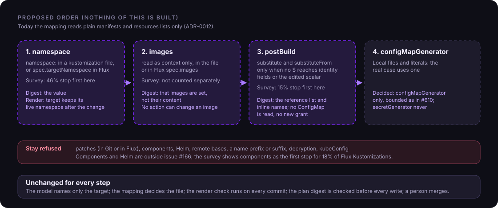

# ADR-0031: Kustomize and Flux transformations the source mapping may understand

- Status: Proposed
- Date: 2026-11-13

## Context

[ADR-0012](0012-object-to-source-mapping.md) maps a live object to one declaration in a plain manifest and stops with `NeedsIntervention` on everything that changes the build: Kustomize patches, generators, Helm, and Flux fields such as `targetNamespace`, `images` and `postBuild`. It says overlays come "when a real case needs them". The case exists: a production configuration repository where every application path uses `postBuild.substituteFrom` and the application kustomization sets `namespace`, `images` and a `configMapGenerator`. Today the mapping answers `KustomizationTransforms` or `UnsupportedKustomization` for all of it, which is correct and of no use to that repository. This ADR decides which transformations the mapping learns, in what order, and what each must bind into the plan digest, without weakening ADR-0012 or [ADR-0020](0020-yaml-patching.md) (the patch still replaces one scalar in one file) and without touching invariants 1 (model output is never authorization) and 3 (changes go through Git only).

### What exists today

Checked against the code on `main`, 2026-11-13.

- `internal/gitops/sourcemap` accepts a kustomization file that uses only `apiVersion`, `kind`, `metadata` and `resources` (`kustomizationKeys`). On the Flux Kustomization it stops on `patches`, `patchesStrategicMerge`, `patchesJson6902`, `images`, `components`, `namePrefix`, `nameSuffix`, `targetNamespace` and `postBuild` (`kustomizationTransforms`), on `decryption` and on `kubeConfig`. A declaration is a document whose `apiVersion`, `kind`, `metadata.namespace` and `metadata.name` all equal the live target's; the same group, kind and name with another version or no namespace makes the match ambiguous.
- `internal/gitops/semdiff` is wider than the mapping. Its allow-list for a kustomization file already takes components, patches (inline or local), and the name, namespace, label, annotation, image and replica transformers; generators, Helm, plugins and remote references are refused. [#610](https://github.com/pkalin/shadewright/pull/610) and [#629](https://github.com/pkalin/shadewright/pull/629) bound what patches and transformers can add to a render (`MaxTransformBytes`, `MaxMergedKeys`). The render covers the repository path only. It does not see the Flux Kustomization's own spec fields, which is why the pull request step relies on the mapping refusing them.
- `FindManifestCandidate`, the read-only lookup for reports, stops on `namePrefix`, `nameSuffix` and `targetNamespace` and only marks the others. ADR-0012 leaves their inversion to this ADR.
- The plan digest (`internal/policy/digest`, encoding `plan-digest/v2`) covers the action, the target UID, the repository reference, URL and installation, the branch, the file, the build path, the base commit, and the policy UID and generation. Nothing in it records which transformations a build had. The freshness check (`internal/policy/freshness`) does not compare the digest with a new mapping. It rebuilds the digest from the stored `status.source` and compares that with `status.planDigest` (`DigestInput`). The rebuild takes the stored `status.source`, the request's action and target UID, the repository URL and installation from the current settings, and the policy UID and generation from the current policy. So it catches an altered stored field and a changed repository URL, installation or policy, and nothing about what the cluster and Git say now. The check does map the object again (`checkSource`), but compares the result with `status.source` on repository, branch, path and build path alone. A new `transforms` field would therefore be covered by the digest and never compared with what the cluster and Git say now, so the comparison is part of task 1a.
- The executor has `get` on the Kustomization and the GitRepository and on the target kinds. It has no grant on ConfigMaps or Secrets ([AGENTS.md](https://github.com/pkalin/shadewright/blob/main/AGENTS.md), invariant 6).

### Evidence for the order

A survey of 19 public Flux repositories (shallow clones parsed as YAML, no cluster; recorded on [#166](https://github.com/pkalin/shadewright/issues/166), 2026-11-13) gives 1727 Flux Kustomizations by the first reason the mapping stops on:

| First reason | Count | Share |
| --- | ---: | ---: |
| none (plain) | 333 | 19% |
| `targetNamespace` | 793 | 46% |
| `components` | 308 | 18% |
| `postBuild` | 251 | 15% |
| `patches` | 35 | 2% |
| non-Git source | 4 | under 1% |
| `kubeConfig` | 3 | under 1% |

Three limits apply. These are objects in files, not live ones. 19% for plain is an upper bound, because 247 of the 333 plain Kustomizations name a GitRepository that is not in the scanned YAML. And 11 of the 19 repositories share one home-operations template, so the shares describe that template more than company repositories. Because each count is the first reason only, a Kustomization that sets `targetNamespace` and `postBuild` is counted once, under `targetNamespace`: serving step 1 alone frees fewer than 46%. The same repositories hold 1435 HelmRelease objects, which is the larger gap and outside this issue.

The input the issue asks for from the triage review ([#652](https://github.com/pkalin/shadewright/issues/652), counts of wanted fixes per not-found reason) does not exist: #652 was taken out of v0.5.0 on 2026-11-13 because no namespace owner could review a report. The 30% rule is therefore not applied here, and the order rests on the survey and on the one real repository above. If #652 returns with counts, the order is revisited.

## Decision

The mapping learns these transformations in this order: namespace, images, `postBuild` and `configMapGenerator`. Each is its own task and its own pull request; none is built. The three questions this ADR first left open were decided on 2026-11-13 and are stated where they apply.

### The rule that decides what is bound

A transformation has one of two homes, and the home decides what the plan digest must hold.

- **In Git** (a field of a kustomization file, a placeholder in a manifest). The base commit is already in the digest, and the render check renders the tree at the branch head with and without the change before every commit, so a change of such a fact after approval fails the render. Binding its content would only supersede plans for changes that cannot affect the edit. The digest holds that the transformation was in play, not its content, except where the content decides identity (the namespace).
- **Only in the cluster** (the Flux Kustomization's `targetNamespace`, `images` and `postBuild`, and the names of the objects `postBuild` references, never their content). No file holds them, so the render cannot see them. The mapping writes what it relied on into `status.source` and the digest covers it. The freshness check must also compare the `transforms` of a fresh mapping with the recorded ones and supersede the request when they differ; today it does not (see above), and task 1a adds it. Flux `images` is context only: the entry records that the list is set and where from, never its content (step 2).

The proposed shape is an optional, closed list `status.source.transforms`, written only by the mapping, never a field of the request spec (ADR-0012). Each entry has a `type` from a closed enum (`Namespace`, `Images`, `PostBuild`, `ConfigMapGenerator`), an `origin` (`File` or `Flux`) and the few values the sections below name. The digest encoding becomes `plan-digest/v3` and writes the list with its length, every entry labelled and length-prefixed in a fixed order, as it writes the other fields. The list is always written, with an explicit count, also when it is empty. A request decided before the upgrade holds a v2 digest, so the freshness check supersedes it once; requests live for minutes to days, so this is accepted (decided 2026-11-13). The alternative, writing the list only when it is not empty so that a request with no transformation keeps its v2 bytes, is rejected: one supersede is cheap, and an encoding with an optional tail is a place for the next ambiguity.

No decision here compares times. Git facts are pinned by a commit ID, cluster facts by UID and an equality check against what was recorded (a `resourceVersion` is an opaque token and is only ever compared for equality).

### 1. `namespace`

Two sources, one rule: `namespace:` in a kustomization file of the build, and `spec.targetNamespace` on the Flux Kustomization. In both, every namespaced object ends up in that namespace whatever namespace its manifest declares. All three target kinds (a `keda.sh` ScaledObject, an `apps/v1` Deployment or StatefulSet) are namespaced.

- **Mapping.** A declaration is a document whose `apiVersion`, `kind` and `metadata.name` equal the live target's and whose built namespace equals the live namespace. The document's own `metadata.namespace` may differ or be absent. Documents are compared by built identity, so two documents that collapse to the same kind, name and namespace are ambiguous, as two exact declarations are today.
- **One value.** If the build sets more than one distinct namespace (a nested kustomization, or a file and Flux), the mapping stops with `NamespaceConflict`. Kustomize and Flux define a precedence, but a second value is a build nobody reads without effort, and one rule is one test. The implementation task checks the precedence of the Flux version the lab runs before it relies on it.
- **Digest.** The entry holds the origin and the namespace value. The value decides which object the plan changes, and a Flux value is in no file.
- **Render.** Before and after the change, with the namespace applied the way the transformer applies it. The semantic diff must prove, as it does now, that the same set of objects renders, that no object but the target changed, and that the target differs only in the action's field. For a Flux-side value the diff takes the value as input (the render cannot read the Flux spec) and applies it to the rendered objects; this extends `semdiff.Input`.
- **Refusals.** A value that is not a valid namespace name; two distinct values; a target whose built namespace is not the live one (the inventory check usually stops it first with `NotInInventory`); two documents that build to the target's identity.

### 2. `images`

Read as context. The target's image is not the field the action changes, and the closed catalog has no action that edits an image or a kustomization file, so a plan cannot change one: the patcher edits only the declaring manifest, and the render check refuses a file that is not a resource of the build.

- **Mapping.** `images` in a kustomization file or in Flux `spec.images` no longer stops the mapping when each entry has only `name`, `newName`, `newTag` and `digest`, all strings. The value check still compares the edited field with the live value; the image field is never compared.
- **Digest.** The entry holds that images are set and from where, not their content. Content cannot reach the edited field, and Flux image automation commits new tags into exactly this list, so binding it would supersede every plan that waits for review while a bump lands.
- **Render.** As in step 1. With a Flux-side list not applied, the render proves that nothing but the edited field changes in the tree Git holds; the Flux-side transformer touches image fields only.
- **Refusals.** An entry with another key; `images` together with something still refused; a plan whose action field is an image field (cannot be built, a test keeps it that way).

### 3. `postBuild`

Flux replaces `${name}` placeholders in the built objects with values from `postBuild.substitute` and from the ConfigMaps and Secrets named in `postBuild.substituteFrom`, after the Kustomize build. The edited scalar and the identity of the target must be free of it.

- **Mapping.** `postBuild` stops the mapping unless it has only `substitute` and `substituteFrom`. Then, over the whole build: no document has a `$` in `apiVersion`, `kind`, `metadata.name` or `metadata.namespace`, so no other document can become a second declaration after substitution; and in the target document no `$` in the edited scalar, in the keys on the path to it, and, for the memory limit, in the container names. A document with a `$` in an identity field stops the mapping with `SubstitutionInIdentity`; one in the edited scalar with `SubstitutionInEditedField`. (A live value that equals the file's text already refuses a placeholder there, as `ValueMismatch`; this rule closes the cases the value check cannot see.)
- **Text rules only (decided 2026-11-13).** The mapping reads no ConfigMap and no Secret, the executor gets no ConfigMap grant, and invariant 6 does not change. A `substituteFrom` entry of either kind is allowed under the text rules above. Reading ConfigMap values stays a possible later ADR.
- **Digest.** The entry holds the origin, the `substituteFrom` references (kind, name, optional flag) in order, and the names of the inline `substitute` variables. It holds no ConfigMap UID or `resourceVersion` and no value.
- **Render.** Before and after, with placeholders left as they are in the files. The semantic diff proves what it proves for plain trees. A value that reaches the target document through a placeholder elsewhere in it (a value with a line break, say) is not seen, so an override by substitution is caught after the merge by the verification outcome `ValueChanged` ([ADR-0030](0030-merge-receipt-and-verification-outcomes.md)), not before the commit.
- **Refusals.** Each of the two rules above; a `postBuild` key other than the two.

### 4. Generators and patches

Patches, in Git or in Flux, stay refused. The semantic diff already catches a patch that overrides the new value, but a Flux-side `spec.patches` is cluster state the render cannot see, and only 2% of the survey stop there.

`configMapGenerator` is added (decided 2026-11-13), from local files and literals; `secretGenerator` never. The real repository uses a `configMapGenerator`, so refusing it would leave that repository unserved. The edited manifest is not a generator input, so the render before and after is the same except for the edited field, and the semantic diff proves it. The cost is the allow-list entry, the bounds of #610 applied to generated bytes, and the renamed references in the target (a hash suffix), which the value check does not touch. A generator input outside the repository is refused. A `ConfigMapGenerator` entry in `transforms` records that a generator was in play (name and origin `File` only, never its content), so the digest and the freshness check cover it like the other transformations. A test refuses a request whose edit targets a file that the generator lists as an input: the edited manifest is not a generator input.

### What is refused for good here

Helm, components, remote bases, `namePrefix`, `nameSuffix`, `decryption` and `kubeConfig` stay as ADR-0012 and its amendments have them. Components are the first stop for 18% of the surveyed Kustomizations and Helm is the larger gap; both need their own ADR.

## Open questions

None. The three questions of the first draft were decided on 2026-11-13 as that draft recommended: `postBuild` takes text rules only (step 3), step 4 adds `configMapGenerator`, and the plan digest moves to v3 (the rule on the digest). The alternatives are under "Alternatives considered".

## Consequences

- A repository that uses only `namespace`, `targetNamespace`, `images` and placeholders away from identity gets pull requests instead of issues. Many Kustomizations of the survey that set more than one of these need all four steps, so the first step alone serves fewer than its 46%.
- Invariant 1 holds: the model names the target and nothing else, and the mapping, the digest and the render decide. Invariant 3 holds: the patch replaces one scalar in one file of the repository, the render is made in process from files read through the Git provider, and nothing is applied to the cluster or taken from it beyond reading Flux objects.
- The mapping and the semantic diff must agree on what a build is. Today the diff is wider than the mapping; each step moves the mapping towards the diff, and the doc comment that says the mapping refuses all Flux spec fields is rewritten with each.
- `status.source` and its CRD grow by one optional list, an additive change to `v1alpha1`. Reviewers see the transformations a plan relied on.
- `FindManifestCandidate` can stop refusing `targetNamespace` once step 1 is built, and name the namespace in its result.
- The tests gate each step (below). A Flux version that changes the order in which it applies these is a risk the Flux version of the lab and the implementation tasks must check, and the mapping refuses a Kustomization whose API version it does not know.

### Pre-mortem

How this goes wrong, and what stops it.

- **Two namespaces collapse into one.** Documents of the same kind and name in two namespaces build into one: refused as ambiguous, and the render refuses the build before that.
- **The namespace is applied twice or in another order.** Refused as `NamespaceConflict`; the Flux precedence is checked by the lab and by a test with the real kustomize.
- **A placeholder in a name creates a second declaration.** Refused as `SubstitutionInIdentity` over the whole build, not only the target's document.
- **Substitution overrides the edit.** Found after the merge by verification (`ValueChanged`), not before the commit, because no value is read.
- **Image automation churn.** Content of `images` is not bound.
- **A generator reads the edited manifest.** A `configMapGenerator` that lists the target file as an input would make the render change by more than the edited field: refused, and the semantic diff of the render before and after proves the rest (step 4).
- **A ConfigMap holds secret material.** No ConfigMap and no Secret is read.
- **The survey misleads.** It describes one template more than company repositories; if #652 or another source gives counts, the order is revisited before step 2.

### Proposed tasks

One task per step, filed when the ADR is accepted. Each refusal test must fail without the change.

| Task | Content | Refusal tests |
| --- | --- | --- |
| 1a | `namespace:` in a kustomization file (`sourcemap`, `semdiff` unchanged); `status.source.transforms`, digest v3; the freshness check compares the fresh mapping's `transforms` with `status.source` (`checkSource`) | the fresh mapping gives other `transforms` than the recorded ones: `Superseded`; `NamespaceConflict`; two documents to one identity; invalid name; a file whose built namespace is not the live one. Also in this task: a bullet in `docs/upgrade-uninstall.md` (the move to `plan-digest/v3` supersedes open requests once, `PlanChanged`, like the existing pattern for digest changes) and a row for `NamespaceConflict` in `docs/troubleshooting.md` |
| 1b | Flux `spec.targetNamespace`; `semdiff.Input` takes the value; `FindManifestCandidate` follows | the Kustomization gains or changes the value after the plan: `Superseded`; value and file namespace both set |
| 2 | `images` in the file and in Flux | entry with another key; non-string value; digest unchanged when only a tag changes |
| 3 | `postBuild`, text rules; reads nothing | `SubstitutionInIdentity` in a document other than the target; `SubstitutionInEditedField`; unknown `postBuild` key; no ConfigMap read. Also in this task: rows for the `Substitution*` reasons in `docs/troubleshooting.md` |
| 4 | `configMapGenerator` | `secretGenerator`; a generator input outside the repository; generated bytes over the bound; the edited manifest listed as a generator input; the `ConfigMapGenerator` entry in `transforms` (added by this task) |

## Alternatives considered

- **Render everything and invert it** (the option ADR-0012 rejected): correct in general and much more work, and the inversion of a patch or a generator has no unique answer. This ADR renders only to prove, never to find the edit.
- **Read ConfigMap values in step 3** (the issue's design: bind UID and `resourceVersion`, resolve the target document's placeholders in the render). Rejected for now: it needs a `get` on ConfigMaps for the executor, which changes invariant 6 and `AGENTS.md`; a substitution that matches Flux's, including defaults and escapes; and a supersede on every edit of a referenced ConfigMap, even of a key nobody uses. Existence-only reads cost the same grant for little gain. A later ADR may add reading if a lab run shows an override by substitution that verification found too late; the grant would then be a namespaced Role per namespace in a chart value, default none, never a ClusterRole, and contents never reach a log, status, pull request or the model (invariant 4).
- **Keep generators refused.** Rejected: the repository that prompted this ADR would stay unserved.
- **Support everything the semantic diff accepts at once.** One change instead of four, but a Flux-side `patches` or a postBuild value could then reach the edited field with nothing in the digest to show it. The order keeps each step reviewable.
- **Bind the content of every transformation into the digest.** Simple to state, and it supersedes plans for harmless changes such as an image bump.
- **Ask users for an annotation naming the file** (ADR-0012 rejected it as untrusted input and a burden).
- **Helm first.** The survey says Helm is the larger gap, but a values edit is a different patcher and a different action catalog; it belongs to its own ADR.

## Amendments

- 2026-11-14: the render is no longer made in the executor's process. Since [ADR-0035](0035-render-check-in-a-limited-child-process.md) (#614) the render check runs in a child process of the executor's own binary, with operating system limits on its memory and CPU time, from the same files read through the Git provider. What the consequences above say about invariant 3 still holds: nothing is applied to the cluster, and the child has no token and reads only its input. The decision is unchanged.
