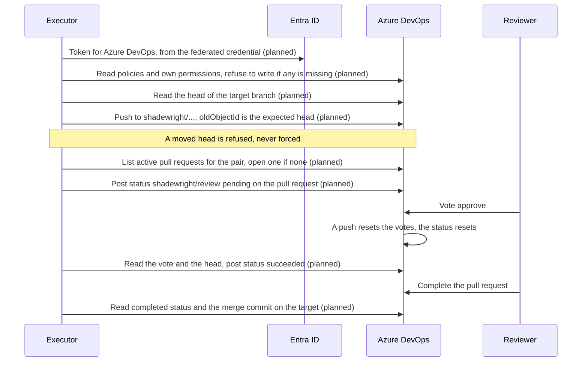

# ADR-0032: Azure DevOps as a second `GitProvider`

- Status: Proposed
- Date: 2026-11-13

This ADR took number 0032. The ADR for [#166](https://github.com/pkalin/shadewright/issues/166) is written at the same time and would take 0031, so this one skips it. If that ADR takes another number, this one keeps 0032.

Nothing in it is built. The adapter, the settings fields and the identity wiring are planned. Every statement about what Azure DevOps does cites the page it comes from in the section "Sources", or is marked as something the first slice must check against the test organization.

## Context

[ADR-0004](0004-github-and-flux-first.md) put Azure DevOps on the list of later adapters and left two things for later: the identity that completes a pull request, and branch policies with path filters, "against the same `approvalRequired` semantics". [ADR-0013](0013-adapters-for-every-external-system.md) says the interface is designed around what Shadewright needs, not around the first vendor. [ADR-0006](0006-github-app-key-in-key-vault.md) solved the identity for GitHub with an App whose key stays in Key Vault, because GitHub accepts no Entra token. [ADR-0028](0028-reviewer-hints-through-the-pull-request.md) added reading comments and reviews and a required check run, and lists Azure DevOps as planned with a sample comment payload.

An Azure DevOps organization is now available for tests. `GitProvider` (`internal/providers/git.go`) has twenty methods, some shaped by GitHub: check runs, installation tokens, an `EnableAutoMerge` that the GitHub adapter does not implement either (`Capabilities` reports `AutoMerge` false, #20). Two more interfaces sit behind the same adapter: `FeedbackSource` (three methods, ADR-0028) and `AncestryChecker` (one, used by the delivery check).

Questions to answer before any code:

1. Which of the twenty-four methods have a direct equivalent, which need a different shape, and which have none.
2. Which identity writes to Azure DevOps, and how it stays separate from the analyzer's (invariant 6).
3. What the repository must already enforce before the adapter writes, since Shadewright's own checks are not the last line of defence (invariant 3).
4. How a restart finds its own work again (invariant 5), where Azure DevOps offers no idempotent create.
5. What the first build task is.

Out of scope: the adapter itself, Azure Pipelines, and Azure DevOps Server (on premises). The adapter targets Azure DevOps Services at `dev.azure.com`.

## Decision

### 1. One adapter package, bound to one repository

A new package `internal/providers/azuredevops` implements `GitProvider`, `FeedbackSource` and `AncestryChecker`. Like the GitHub adapter it is bound at construction to one organization, project and repository (the repository by its ID, checked against every response) and to one target branch, talks to `https://dev.azure.com` only (pinned in code, no redirects, bounded response bodies, fixed-text errors, the kill switch checkpoint before every write and every retry), and writes only to branches named `shadewright/<name>`. The Entra client library is imported only in a subpackage `azuredevops/auth` (ADR-0013). The adapter has an in-memory fake through the existing `fake` package and a recorded-fixture test suite; the GitHub adapter's import test is extended so no other package imports it.

`RemediationSettings` gets a provider value `AzureDevOps` and an `azureDevOps` block beside `github`, with the same CEL rule that exactly one block matches `provider`. This is an additive API change (`feat(api)`). Its fields are listed in section 7 and one of them is an open question.

The core types need two changes before the feedback and check slices, described in section 4 (rows `CreateCheckRun`, `ListComments`) and decided in open question 3.

### 2. The identity: a federated Entra identity, no key, no token in a Secret

The executor reaches Azure DevOps with a Microsoft Entra access token for the Azure DevOps resource, acquired through workload identity from the executor's own service account. Microsoft's guidance for application identities is the same: prefer a managed identity for an Azure-hosted workload and workload identity federation or a certificate over a client secret for a service principal, and use Entra tokens in place of personal access tokens ([service principals and managed identities](https://learn.microsoft.com/en-us/azure/devops/integrate/get-started/authentication/service-principal-managed-identity?view=azure-devops)).

- **In Azure DevOps** the identity is added to the organization as a user, with the lowest access level that gives it Azure Repos (Basic), and is a member of one purpose-specific group that holds the permissions of section 5 on the one repository, never a broad default group. The page above says Azure DevOps does not use Entra application permissions to authorize an application identity: access is an access level, group membership and resource permissions, like any member.
- **The token** carries the whole identity, not one repository: it is not scoped per request the way a GitHub installation token is. The only scoping is the permissions in Azure DevOps. This is weaker than ADR-0006 on one point, and the consequence section says so. The adapter treats the token as opaque and never depends on its lifetime (the page tells clients not to); it reuses the credential object, so the library caches and renews it.
- **No Key Vault key and no `Signer`.** There is no long-lived credential to protect: no private key, no PAT, nothing in a Secret. The Key Vault role of ADR-0006 does not exist for Azure DevOps.
- **Separate identities (invariant 6).** Only the executor's service account has the federated credential. The analyzer and the verifier have no Azure DevOps identity, no federated credential and no token, so a compromised analyzer cannot write to Git or read the repository through Azure DevOps. The identity is one Entra identity per executor, not shared with the analyzer's (ADR-0029 already creates one managed identity per component).
- **Cost.** An access level is billed per organization for each application identity ("each identity consumes a license in every organization where it's assigned a paid access level", same page). Price it before the test organization gets the identity (workspace rule on lab spending).
- **Tenant.** The identity must exist in the Entra tenant the organization is connected to; a managed identity of another tenant cannot be added (same page). [NEEDS CLARIFICATION: is the test organization connected to the tenant of the lab? If not, the lab's executor identity cannot be used, and a service principal with a federated credential in the organization's tenant is the fallback of open question 1.]

The choice between this and a scoped token kept in Key Vault is open question 1, with a recommendation.

### 3. Method map

"Direct" means one documented call does what the method says. "Shape" means the same result needs a different sequence. Rows marked **spike** state something the first slice must confirm against the test organization before the method is built, because the page read for this ADR does not say it. Statements marked with a source were read in the pages of "Sources".

| Method | Azure DevOps | Fit |
| --- | --- | --- |
| `Capabilities` | `AutoMerge` false at first, as for GitHub (#20). `RequiredReviews` true, since the minimum reviewers policy exists. Whether the policies are really in place is the preflight of section 5, not this flag. | Direct |
| `ReadFile` | Items API at a commit version. Needs the checks the GitHub adapter makes: only regular files (symbolic links and submodules refused), the size known before the content is downloaded, at most `MaxFileBytes` read, content checked against its Git object ID. Items and Trees pages not read for this ADR. | Direct, **spike** (size before content, how links and submodules show, whether the object ID can be checked) |
| `ListDir` | Trees API without recursion, or Items with a one-level scope. Same checks as `ReadFile`, plus the 1000 entry bound and `ErrInvalidEntry`. | Direct, **spike** (as above) |
| `BranchHead` | Refs API, list filtered to `heads/<branch>`, returns the object ID. Only the target branch and `shadewright/` branches are accepted, as in the GitHub adapter. | Direct |
| `CreateBranch` | Refs API, update with `oldObjectId` all zeros and the new object ID; the result carries `updateStatus` per ref, and `staleOldObjectId` means the caller lost a race ([Update Refs](https://learn.microsoft.com/en-us/rest/api/azure/devops/git/refs/update-refs?view=azure-devops-rest-7.1)). An existing branch at the same commit is success by reading `BranchHead` first, at another commit `ErrConflict`. The base must be the head of the target branch or an ancestor (`IsAncestor`). | Shape |
| `CommitFile` | **One request.** Pushes API with `refUpdates[{name, oldObjectId}]` and one commit with one `edit` change whose `newContent` is the file (`rawtext` or `base64encoded`); the page shows the same call creating a branch from a base commit and updating one ([Pushes - Create](https://learn.microsoft.com/en-us/rest/api/azure/devops/git/pushes/create?view=azure-devops-rest-7.1)). GitHub needs blob, tree, commit and a GraphQL ref update. The adapter sends `oldObjectId` as the expected head and never a force. Always `base64encoded`, so bytes are not re-encoded. | Shape, **spike** (a stale `oldObjectId` in a push must be refused, not applied: the Refs page names `staleOldObjectId`, the Pushes page does not say; does an edit keep the file mode and line endings; how a moved head shows as an error) |
| `AppendCommit` | The same push, `oldObjectId` the expected head; the commit's one parent is that head in the page's examples. | Shape, **spike** (as `CommitFile`) |
| `CheckBranch`, `CheckChain`, `CheckCommit`, `CheckMerged`, `Parents` | Commits API for parents (`GitCommitRef.parents`) and Trees API to compare trees along the path, as the GitHub adapter does, not the diff API: a commit reports `commitTooManyChanges` when it holds too many changes to show, so a diff-based answer could be cut off. A cut-off or unreadable answer is an error, never a pass. `CheckMerged` needs the merge commit of section 6. | Shape, **spike** (trees by commit, same-mode comparison) |
| `CommentChangeRequest` | Pull request threads: create a thread with one comment. To find the marker first, list the threads and read the comments written by the adapter's own identity, compared by identity ID, not by name; the marker must be a whole line. A pull request with more comments than the bound is `ErrTooManyComments`. **A thread is active when created, and the optional policy "check for comment resolution" makes unresolved threads block completion** ([branch policies](https://learn.microsoft.com/en-us/azure/devops/repos/git/branch-policies?view=azure-devops)): the adapter creates its threads already resolved. | Shape, **spike** (the thread status value, own identity ID, paging) |
| `OpenChangeRequest` | Pull requests create with `sourceRefName`, `targetRefName` as `refs/heads/...`, title and description ([Create](https://learn.microsoft.com/en-us/rest/api/azure/devops/git/pull-requests/create?view=azure-devops-rest-7.1)). **The create is not idempotent by itself**: the adapter lists active pull requests for the source and target first (as `openFor` does) and returns the one found; the race of two creates is settled by Azure DevOps refusing a second active pull request of the same pair, which the spike confirms. The description is limited to 4000 characters ([Update](https://learn.microsoft.com/en-us/rest/api/azure/devops/git/pull-requests/update?view=azure-devops-rest-7.1)), against GitHub's 65536: a body over the limit is `ErrRejected`. [NEEDS CLARIFICATION: how long is the body `pullRequestBody` builds for the largest plan? If it can pass 4000, the core must shorten it for this host.] | Shape, **spike** |
| `FindChangeRequest` | Pull requests list with the source ref and all statuses, newest first; a pull request from a fork (`forkSource` set) or to another target is ignored. | Shape |
| `GetChangeRequest` | Pull request by ID. Refused as not Shadewright's unless the repository ID is the bound one, the source is a `shadewright/` branch and the target is the target branch. State: `active` is `Open`, `abandoned` is `Closed`, `completed` is `Merged`. `HeadSHA` and `MergeCommit`: section 6. | Direct, with section 6 |
| `EnableAutoMerge` | Pull request update with `autoCompleteSetBy` set to the adapter's identity and `completionOptions` (`mergeStrategy` squash, `deleteSourceBranch`). Auto-complete always waits for the required policies; the page says `autoCompleteIgnoreConfigIds` applies to optional policies only, and Shadewright sets none. **There is no "only if the head is still X" condition on this call**, which GitHub's `expectedHeadOid` gives. The guard is the required policies themselves (votes and status reset on a push) plus a read of the head before and after, and cancelling the auto-complete when it moved. `bypassPolicy` is never sent: the type of the adapter's request has no such field. Not built in the first slices: `AutoMerge` stays false, as for GitHub (open question 2). | Shape, weaker guard |
| `CloseChangeRequest` | Pull request update with status `abandoned`. Abandoning an abandoned one succeeds; a completed one is `ErrConflict`. | Direct |
| `UpdateChangeRequest` | Pull request update of title and description (both are on the list of updatable properties). Same 4000 character limit. | Direct |
| `CreateCheckRun` | **No equivalent.** A check run belongs to a commit and an App. The closest thing is a pull request **status** with a genre and a name, posted to a pull request; a status policy on the target branch requires `genre/name` to be `succeeded` ([status policy](https://learn.microsoft.com/en-us/azure/devops/repos/git/pull-request-status?view=azure-devops), [available checks](https://learn.microsoft.com/en-us/azure/devops/repos/git/available-pr-status-checks?view=azure-devops)). Genre `shadewright`, name `review`; the status context is unique, so a later post of the same context replaces the earlier one, which is what "the latest run counts" needs. States: `InProgress` is `pending`, `Success` is `succeeded`, `Failure` is `failed`. The method gets a commit, a pull request has none: the adapter finds the one open Shadewright pull request whose source head is that commit and refuses when it finds none or more than one. Section 4 covers the gate. | No equivalent, shape, interface change |
| `ListComments` (`FeedbackSource`) | Pull request threads and their comments, each with an author identity and an update date. An Azure DevOps identity ID is a GUID; `FeedbackAuthor.ID` is an `int64`. | Shape, interface change (open question 3) |
| `ListReviews` (`FeedbackSource`) | The reviewers of a pull request with their votes: 10 approved, 5 approved with suggestions, 0 none, -5 waiting for author, -10 rejected ([GitPullRequest](https://learn.microsoft.com/en-us/rest/api/azure/devops/git/pull-requests/update?view=azure-devops-rest-7.1)). **A vote has no body and no commit ID.** The commit it was cast on is not in the data. | No equivalent for the commit, section 4 |
| `CanWrite` (`FeedbackSource`) | Whether a person may write to the repository. Azure DevOps permissions come from groups and inheritance, so "has the Contribute right" is an evaluation of another identity's effective permissions, not a field. ADR-0028 left the call open for this reason. Not decided here (open question 5). | **spike**, open |
| `IsAncestor` (`AncestryChecker`) | Merge bases or commit history on the Commits API; SHA-1 only is assumed, as for GitHub. | **spike** |

### 4. The merge gate of ADR-0028 on Azure DevOps

ADR-0028 section 5 needs a required check that completes with success only when the latest head has an approval from someone who wrote no hint. On GitHub the control is a required check run bound to the App as its source. Two things differ:

- **The check is a status policy bound to an identity.** The required status policy `shadewright/review` is set to *apply by default*, so a pull request cannot complete before a `succeeded` status exists, and its *authorized identity* is the executor's identity, which the page describes as the setting that makes only that account's status count; left blank, any account counts ([available checks](https://learn.microsoft.com/en-us/azure/devops/repos/git/available-pr-status-checks?view=azure-devops)). It also resets when new changes are pushed. This is the equivalent of "required with the App as expected source", and like it the adapter cannot make it so (see section 5 for what it can read). The same pages say a status of `notApplicable` removes a policy that applies by default. Whether one posted by another account lifts a policy that has an authorized identity is something this ADR cannot state: **spike**, and red-team item.
- **A vote carries no commit.** GitHub's `commit_id` on a review lets the executor decide "an approval of this head". Azure DevOps has none. What it offers is the policy option that resets all reviewer votes when the source branch changes, and the option that the most recent pusher's vote does not count ([branch policies](https://learn.microsoft.com/en-us/azure/devops/repos/git/branch-policies?view=azure-devops)). The executor therefore decides from recorded state, not from a timestamp comparison: it completes the status only when the vote exists and the head it read after the vote equals the head it recorded before it, and the policy that resets votes is one of the preconditions of section 5. A vote cast between a push and the server's reset is a window GitHub does not have in this form. It is the main point for the red team.

If the vote-reset policy is missing, reviewer hints stay off for the repository, as ADR-0028 already does when the ruleset cannot be checked.

### 5. What the adapter must find in place before it writes

The adapter runs a preflight before the first write of a reconcile that opens or changes a pull request, and refuses to write when it fails. A failed read of the policies is an error for a retry, never "not found" and never a pass. The result is not stored in the cluster. The preflight only reads.

On the target branch:

1. Policies exist and are enabled and blocking: minimum number of reviewers (at least one), with the option that resets all reviewer votes on new changes, and the option that bars the most recent pusher. Documented in [branch policies](https://learn.microsoft.com/en-us/azure/devops/repos/git/branch-policies?view=azure-devops).
2. Required reviewers by path who are people, for the paths that hold pipelines, policies, RBAC and Flux config. This is the Azure DevOps counterpart of `CODEOWNERS` in design 8.4: automatically included reviewers with path filters.
3. The required status policy of section 4, with the executor as authorized identity, applying by default, reset on new changes. Only when reviewer hints are on.
4. A required status or build policy that fails a pull request touching anything outside the allowed paths (the trusted path guard of design 8.4). Which pipeline runs it is out of scope.

On the executor's identity, which the preflight reads as its own effective permissions: it has Contribute, create branch and contribute to pull requests on the repository; it does **not** have "Bypass policies when completing pull requests", "Bypass policies when pushing", the exempt-from-policy permission, force push, edit policies or manage permissions ([bypass permissions](https://learn.microsoft.com/en-us/azure/devops/repos/git/branch-policies?view=azure-devops)). The `forcePushRequired` update status of the Refs API is what a missing force push right looks like.

[NEEDS CLARIFICATION: can the executor read the policy configurations and its own effective permissions with only the access it is meant to have? The Policy API page read for this ADR (policy evaluations) says its scope is read of code and metadata; the policy configurations page and the permission evaluation call were not read. If either needs a right Shadewright must not have, the preflight becomes what the GitHub adapter has today: a stated requirement in the docs that the adapter cannot verify, and hints and auto-complete stay off for that repository.]

### 6. Head and merge commit: what Azure DevOps reports

Two fields would be easy to misuse, and invariants 3 and 5 and ADR-0030's merge receipt depend on them.

- `lastMergeSourceCommit` is "the commit at the head of the source branch at the time of the last pull request merge", and `mergeStatus` can be `queued`. It can lag behind the branch. So `ChangeRequest.HeadSHA` is the head of the source ref from the Refs API, and the adapter reports a state to act on only when `mergeStatus` is `succeeded`. A merge that is queued, in conflict or rejected by policy is reported as it is: a conflict is `ErrConflict` for the caller, anything not yet settled is a retry, never an approval.
- `lastMergeCommit` is "the commit of the most recent pull request merge", described as empty when the merge is in progress or failed ([Update](https://learn.microsoft.com/en-us/rest/api/azure/devops/git/pull-requests/update?view=azure-devops-rest-7.1)). While a pull request is active this is the host's trial merge. The adapter fills `MergeCommit` **only when the status is `completed`**, and only with a full commit ID that `IsAncestor` finds on the target branch; otherwise it is empty and the caller waits, which the `ChangeRequest` type already allows. **spike**: that for a completed squash and a completed no-fast-forward merge this is the commit on the target.

### 7. Settings

The `azureDevOps` block holds the organization, the project, the repository, and the client ID and tenant ID of the executor's Entra identity (the counterpart of `appClientID`, with no installation ID and no signer). Organization and project are validated as the names Azure DevOps allows; no value is a secret, and no organization name appears in the docs. [NEEDS CLARIFICATION: one repository entry per repository with the organization and project repeated, or an organization level block that entries refer to? The GitHub shape repeats; the recommendation is to repeat, for the same CEL rules per entry and no cross-reference to resolve.]

### 8. How the invariants hold

- **3, Git only.** Every write is a push to `refs/heads/shadewright/...`, a pull request, a thread, a status or an abandon. The adapter has no call to the policy, the security or the pipeline APIs that writes, and its import and endpoint allow-list test fails if one appears. The identity cannot bypass or force by permission (section 5), and the request types have no `bypassPolicy`. A merge that skips a required policy would need a permission the preflight refuses.
- **5, idempotency.** Branch and marker names come from the core unchanged. Branch create is idempotent by reading first and by `oldObjectId`; pushes by `oldObjectId`; pull request open by listing first; status by its unique context; abandon and auto-complete set by repeating to the same value; comments by the marker line. A write that may have gone through is never repeated in the same call.
- **6, identities.** Section 2. The analyzer and the verifier hold nothing for Azure DevOps, and the executor's identity has no right the analyzer would need.

### 9. First build task after this ADR: a read-only slice

One task: `internal/providers/azuredevops` with `auth`, `Capabilities`, `ReadFile`, `ListDir` and `BranchHead`, no write, no settings block yet (the constructor takes the values), a recorded-fixture test suite and the fake. It also answers every **spike** row of section 3 that is a read, and writes down the answers as an amendment here, before any write method is built. The identity in the test organization gets the read permissions only for this slice.

Later slices, each its own task: the preflight and the commit and branch writes; pull requests and comments; the settings block and the executor wiring; the status gate and feedback (after open question 3); auto-complete (after open question 2).

## Overview and sequences

[![Planned. The cluster has three identities and only the executor has an Azure DevOps identity, through workload identity and a federated credential in Entra ID that yields a short-lived token for Azure DevOps. In Azure DevOps that identity is a user with Basic access in one dedicated group, allowed to contribute, create branches and contribute to pull requests on one repository, and denied the two bypass permissions, force push, editing policies and managing permissions. The target branch has policies found in place before any write: minimum reviewers with votes reset on new changes, required reviewers by path, and a required shadewright/review status whose authorized identity is the executor. People approve and complete the pull request.](../assets/diagrams/azure-devops-identity-and-gates.svg)](../assets/diagrams/azure-devops-identity-and-gates.svg "Open full size")

The planned path of one change, without auto-complete:

## Open questions

Each is undecided. The recommendation is the author's.

1. **The identity.** What holds the one credential that can write to Git?
   - (a) The executor's federated Azure identity, a user-assigned managed identity as in ADR-0029, added to the organization. No key, no secret; the token is not repository-scoped; needs the organization in the same Entra tenant.
   - (b) A service principal (app registration) with a federated credential from the cluster's OIDC issuer, added to the organization. Same properties; works when the organization is in another tenant or the cluster is not on Azure.
   - (c) A personal access token in Key Vault. Tied to a person's account and lifecycle, which the Microsoft page lists as the thing application identities avoid, and the whole credential would be readable by whatever reads it.
   - **Recommendation:** (a) in the lab, (b) as the supported option elsewhere, same adapter and same settings block; (c) not supported. Decision of the maintainer.
2. **Auto-complete.** When #20 builds auto-merge, do we turn on Azure DevOps auto-complete?
   - (a) Not for Azure DevOps: `AutoMerge` stays false, people complete the pull request.
   - (b) Yes, with the guard of section 3 (policies reset on push, head read before and after, cancel when it moved).
   - **Recommendation:** (a) until the spike shows how a cancel behaves and a red team has looked at the missing head condition. Decide with #20.
3. **Core interface changes.** `FeedbackAuthor.ID` is an `int64` and `CreateCheckRun` takes a commit.
   - (a) Change the core: an opaque string ID with the kind, and a change request number on the check, before the status slice. Touches GitHub adapter, fake and ADR-0028 code.
   - (b) Map the GUID into an `int64` in the adapter and find the pull request from the commit. No core change; a hash of an identity is a bad key, and the commit lookup can be ambiguous.
   - **Recommendation:** (a), as its own task before the feedback slice, in line with ADR-0013.
4. **Preflight or documented requirement.** If the executor cannot read policies and its own permissions with what it is meant to have (section 5), is the preflight dropped for a stated requirement, with hints and auto-complete off?
   - **Recommendation:** yes, as the GitHub adapter does today; decided by what the first slice finds.
5. **Who may give a hint (`CanWrite`).** (a) Evaluate the commenter's effective permission on the repository. (b) Membership of one configured Azure DevOps group, checked through the Graph API, transitively. (c) The commenter is a reviewer of the pull request.
   - **Recommendation:** (b), because (a) is an evaluation for another identity under inheritance and (c) lets anyone made a reviewer give hints. Decide in the feedback slice, once the call is read.
6. **Merge types.** Does the preflight require that the target branch allows only squash? [NEEDS CLARIFICATION: ADR-0030's merge receipt works with a merge commit too, so this may need no rule.]

## Consequences

- A second host needs no change in the controller or the analyzer. The one change in the core is open question 3, and the settings enum grows by one value.
- No key and no secret for Git access, so ADR-0006's Key Vault signing has no counterpart. In exchange the token is not scoped to a repository, so a mistake in the group or the permissions of the identity is a wider mistake than a GitHub App installed on one repository. The preflight and the denied permissions are what hold it. That is the one place this is weaker than ADR-0006.
- Reviewer hints on Azure DevOps rest on votes that carry no commit and on a status whose protection is the authorized identity. Both need the red team and the test organization before hints are turned on for it.
- Azure DevOps gives one push for a commit where GitHub needs four requests, which is simpler, but its atomicity and mode handling are unconfirmed (spike rows).
- The pull request description limit of 4000 characters may force a shorter body on this host.
- Each application identity costs an access level in every organization it is in.
- Azure DevOps Server is not covered; its REST versions differ.

## Alternatives considered

- **Azure DevOps first, as in the original plan.** Rejected in ADR-0004; nothing here changes that.
- **A PAT in Key Vault (open question 1, option c).** Easier to start, the same everywhere. Tied to a person, and a stolen value is usable from anywhere until revoked. Not chosen.
- **A service hook or webhook design instead of polling.** Out of scope; the executor polls pull requests today, and Azure DevOps would be the same.
- **Mirror to GitHub and open pull requests there.** Avoids the adapter, but pull requests in a second system are not where the code lives and break the "branch and PR in the repository that holds the code" idea of invariant 3.
- **Use the diff API for the branch checks.** Shorter, but a commit can report too many changes to show, so a cut-off answer could pass as a small one. Trees are compared instead.
- **One generic Git adapter over plain Git (clone and push).** No pull request or policy model, so nothing to find in place and no status. Not chosen.

## Sources

Read for this ADR on 2026-11-13, Microsoft Learn:

- [Pull Requests - Create](https://learn.microsoft.com/en-us/rest/api/azure/devops/git/pull-requests/create?view=azure-devops-rest-7.1) and [Update](https://learn.microsoft.com/en-us/rest/api/azure/devops/git/pull-requests/update?view=azure-devops-rest-7.1): fields, updatable properties, the 4000 character description, completion options, auto-complete, merge strategies, `lastMergeCommit`, `lastMergeSourceCommit`, `mergeStatus`, votes.
- [Pushes - Create](https://learn.microsoft.com/en-us/rest/api/azure/devops/git/pushes/create?view=azure-devops-rest-7.1) and [Refs - Update Refs](https://learn.microsoft.com/en-us/rest/api/azure/devops/git/refs/update-refs?view=azure-devops-rest-7.1): `oldObjectId`, one-request commits, update statuses.
- [Evaluations - List](https://learn.microsoft.com/en-us/rest/api/azure/devops/policy/evaluations/list?view=azure-devops-rest-7.1): policy evaluation records and statuses (7.1 preview).
- [Set and manage branch policies](https://learn.microsoft.com/en-us/azure/devops/repos/git/branch-policies?view=azure-devops), [complete pull requests](https://learn.microsoft.com/en-us/azure/devops/repos/git/complete-pull-requests?view=azure-devops): minimum reviewers options, bypass permissions, path filters, auto-complete waits for required policies, comment resolution.
- [Customize pull request workflows with status](https://learn.microsoft.com/en-us/azure/devops/repos/git/pull-request-status?view=azure-devops), [Configure a branch policy for an external service](https://learn.microsoft.com/en-us/azure/devops/repos/git/pr-status-policy?view=azure-devops), [Available pull request status checks](https://learn.microsoft.com/en-us/azure/devops/repos/git/available-pr-status-checks?view=azure-devops): status policy, authorized identity, applicability, reset, `notApplicable`.
- [Use service principals and managed identities](https://learn.microsoft.com/en-us/azure/devops/integrate/get-started/authentication/service-principal-managed-identity?view=azure-devops): identity types, federation, adding to the organization, access levels, tenant, licensing, rate limits.

Not read yet, so nothing is stated from them: Items, Trees, Commits, Pull Request Threads, Policy Configurations, Security and Graph pages, and the rate-limit page. Slice 1 and later slices read them.

## Amendments

None.
