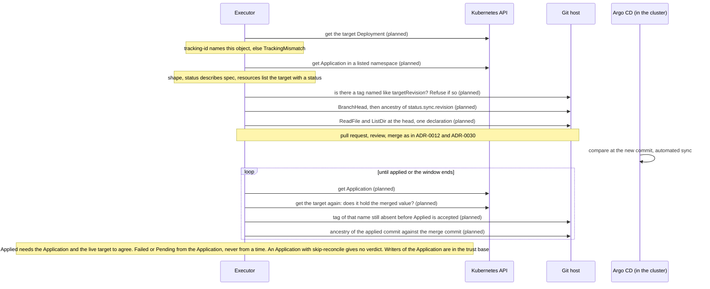

# ADR-0033: Argo CD as a second delivery system: source mapping and delivery verification

- Status: Proposed
- Date: 2026-11-13

Nothing in this ADR is built. The adapter, the source mapping for Argo CD, the grants and the chart values are planned. It answers for Argo CD what [ADR-0012](0012-object-to-source-mapping.md) answers for Flux, and says what the `DeliveryVerifier` reads from an Application. Issue: [#670](https://github.com/shadewright-labs/shadewright/issues/670).

Every statement about Argo CD cites the file and line at the tag `v3.6.1` (commit `94037c4d4e1af4bd0651d37a179fbd9e347e668c`), read for this ADR on 2026-11-13, or a fixture from the spike. The issue names no tag, so the newest stable release on the day was taken; which versions to claim is decided in section 1. The first spike ran Argo CD `v3.6.1` (`core-install.yaml` of the tag) on a Kind cluster with a Git server inside the cluster and kept no object outside the cluster. The 28 fixtures it produced are in [`0033-fixtures/`](https://github.com/shadewright-labs/shadewright/tree/main/docs/adr/0033-fixtures) (objects as `kubectl get -o yaml` returned them, with identifiers and the kubectl annotation removed); the spike was not run in `shadewright-fleet`, which has no Argo CD scenario (section 9). Statements about what Shadewright does today name the file in this repository. A second spike on 2026-11-14 (spike 1 of section 2, app of apps) kept no fixtures: its observations are written into section 2.

Order of work: Azure DevOps ([ADR-0032](0032-azure-devops-as-a-second-git-provider.md)) and Argo CD come after v0.5.0 and before the control plane (#559). Decided 2026-11-14.

## Context

[ADR-0004](0004-github-and-flux-first.md) put Flux first and Argo CD later, behind the `DeliveryVerifier` interface ([ADR-0013](0013-adapters-for-every-external-system.md)). On 2026-11-13 the maintainer decided to design the Argo CD side now.

### What exists today

- `providers.DeliveryVerifier` has one method, `Status(ctx, DeliveryUnit) (DeliveryStatus, error)` (`internal/providers/delivery.go`). `DeliveryUnit` is a kind, namespace and name. `DeliveryStatus` carries an applied and an attempted revision with their commit and ref, `Ready`, `Failed`, `Generation` and `ObservedGeneration`, a message, `Suspended` and `Source`. `Outcome` and `Verify` turn it into `Pending`, `Applied` or `Failed` for a merge commit and the target branch, with the Git host's `AncestryChecker` for later commits. Nothing in that file names Flux except the doc comments.
- The only adapter is `internal/providers/delivery/flux`. It reads a Kustomization or HelmRelease as an unstructured object through `internal/fluxstatus`. The executor builds it in `cmd/main.go` (`fluxdelivery.New`), the analyzer's `get_delivery_status` tool builds the status reader of the same package (`cmd/analyzer/analysis.go`).
- The controller is not neutral. `internal/controller/rollout.go` defines its own `DeliveryVerifier` interface (`Verify(ctx, unit, mergeCommit, branch)`), and `delivered` picks the unit with `kustomizationOf`, which reads the labels `kustomize.toolkit.fluxcd.io/name` and `/namespace` and builds `DeliveryUnit{Kind: "Kustomization"}`. So ADR-0004's sentence that Argo CD "can be added as adapters without touching the controller" does not hold for the controller today.
- The source mapping is Flux only. `Resolver.delivery` in `internal/gitops/sourcemap/sourcemap.go` follows the Flux labels to the Kustomization and its GitRepository; `FindManifestCandidate` (`candidate.go`, used by `kubectl shadewright doctor`) does the same. The Flux rules sit in `flux.go` (`checkKustomization`, `CheckGitRepository`, `checkRevision`); the stops are `Reason` values in `result.go`. The file walk for a path without a kustomization file searches recursively, as Flux builds it (ADR-0012, implementation details).
- The executor's grant is a ClusterRole with `get` on Deployments, StatefulSets, KEDA ScaledObjects, Flux `kustomizations` and `gitrepositories` (`internal/controller/cache.go` markers, `dist/chart/templates/rbac/executor-role.clusterrole.yaml`).

### Questions

1. How a workload leads to its Application, and how that is checked instead of trusted.
2. Which Application shapes are refused, each with a reason and a fixture.
3. What `DeliveryVerifier.Status` returns from the Application's sync, operation and health status.
4. What the Application's history offers a later change-evidence step.
5. What the executor must be allowed to read, and where.

Out of scope: the adapter itself, ApplicationSets as a way to fix a generated Application, Argo CD's own Git write-back (the source hydrator), and the analyzer and the kubectl plugin reading Applications (section 9).

## Decision

### 1. How Argo CD is read

The executor reads `Application` (`argoproj.io/v1alpha1`) objects with `get`, as unstructured objects, like it reads Flux objects. It does not import the Argo CD Go module, call the Argo CD API server, the repo server or the CLI, and it never writes to Argo CD: no sync, no refresh annotation, no patch. The Application CRD declares no status subresource ([`manifests/crds/application-crd.yaml`](https://github.com/argoproj/argo-cd/blob/v3.6.1/manifests/crds/application-crd.yaml)), so anyone who may update an Application may also write its status, and every field below is untrusted input (invariant 4). Which delivery system the executor reads is one setting of the install (section 2), not a choice made from the object.

Versions. Decided 2026-11-14: before the adapter is called supported, a task re-reads the fields of section 3 at the tags of the two previous minor versions (`v3.5.7` and `v3.4.13` are the latest of those on 2026-11-13) and records any difference. Until then the claim is `v3.6.1` and the CRD version `v1alpha1`.

### 2. One delivery system per install, and from the workload to the Application

Decided 2026-11-14: one delivery system serves the whole executor, set once per install (a flag of the executor and a chart value, for example `executor.delivery.system`, `flux` by default). An install serves Flux or Argo CD, not both. Decided 2026-11-14: a cluster that uses Flux and Argo CD for workloads Shadewright should fix is not supported. A second install cannot cover it, because `RemediationSettings` is one cluster-scoped object named `default` (`SettingsName` in `api/v1alpha1/remediationsettings_types.go`) and policies are cluster-scoped; the install serves one system, and objects of the other get `OtherDeliverySystem`. Supporting both would need its own ADR (Alternatives). The executor looks only for the evidence of its own system: Flux labels in a Flux install, the tracking id in an Argo CD install. An object that carries the evidence of the other system, with or without its own, is `OtherDeliverySystem`, `NeedsIntervention`: it is claimed by a system this install does not read, so what delivers it cannot be shown. In a Flux install this is a refusal Flux objects with a tracking id did not get before. One that carries neither keeps today's reason `NoFluxLabels` in a Flux install, and `NoTrackingID` in an Argo CD install, whose message then says the evidence of the configured system is missing. There is no `AmbiguousDelivery`: an install does not pick a system by what it finds on the object.

The label `app.kubernetes.io/instance` is not read. It is the default label of resource tracking by label, truncated to 63 characters, and charts set it too ([`resource_tracking.md`](https://github.com/argoproj/argo-cd/blob/v3.6.1/docs/user-guide/resource_tracking.md), [`common.go` L190](https://github.com/argoproj/argo-cd/blob/v3.6.1/common/common.go#L190)); fixture [`workload-label-only.yaml`](https://github.com/shadewright-labs/shadewright/blob/main/docs/adr/0033-fixtures/workload-label-only.yaml). The hint is the annotation `argocd.argoproj.io/tracking-id` ([`common.go` L215](https://github.com/argoproj/argo-cd/blob/v3.6.1/common/common.go#L215)), the default tracking method per `resource_tracking.md`. Its value is `<application>:<group>/<kind>:<namespace>/<name>` ([`resource_tracking.go` L233 and L238](https://github.com/argoproj/argo-cd/blob/v3.6.1/util/argo/resource_tracking.go#L233)), and the application part is `<namespace>_<name>` for an Application outside the control plane's namespace ([`types.go` L4192](https://github.com/argoproj/argo-cd/blob/v3.6.1/pkg/apis/application/v1alpha1/types.go#L4192), [`app-any-namespace.md`](https://github.com/argoproj/argo-cd/blob/v3.6.1/docs/operator-manual/app-any-namespace.md)). Kubernetes names hold no underscore, so the split is unambiguous; a value without one names the Application in the control plane's namespace, which the executor takes from its configuration (section 8), never from the object.

The annotation is a claim, as the Flux labels are. A workload carries it whether or not Argo CD applied it, and a copy of it elsewhere is legal: Argo CD itself ignores a tracking annotation that does not name the object it sits on ([`resource_tracking.md`](https://github.com/argoproj/argo-cd/blob/v3.6.1/docs/user-guide/resource_tracking.md), "Non self-referencing annotations"). The executor therefore checks, in this order:

1. The id names this object. It parses, and its group, kind, namespace and name equal the live object's own. Else `TrackingMismatch`, `Denied` (fixture [`workload-forged-claim.yaml`](https://github.com/shadewright-labs/shadewright/blob/main/docs/adr/0033-fixtures/workload-forged-claim.yaml)).
2. The Application is in the namespace the executor may read (section 8) and exists. Else `ApplicationNamespaceNotListed`, or `ApplicationNotFound` (fixture [`workload-unknown-application.yaml`](https://github.com/shadewright-labs/shadewright/blob/main/docs/adr/0033-fixtures/workload-unknown-application.yaml)). A read that fails for another reason is an error for a retry, never one of these.
3. The Application lists the object in `status.resources` with the object's group, version, kind, namespace and name and a sync status (`Synced`), not a hook, not `requiresPruning`. This is the counterpart of the Flux inventory check. The spike shows why the sync status matters: the forged workload of fixture 1 appears in the Application's `status.resources`, without a `status` ([`app-sync-failed.yaml`](https://github.com/shadewright-labs/shadewright/blob/main/docs/adr/0033-fixtures/app-sync-failed.yaml)). Not listed, or listed without a status: `NotInResources`, `Denied`. Listed `OutOfSync`: `TargetOutOfSync`, `NeedsIntervention` (a wait while an operation runs, section 4).
4. No evidence of the other system (the setting above). In an Argo CD install, an object with the Flux labels is `OtherDeliverySystem`, `NeedsIntervention`, whether or not it also has the tracking id. A Flux install gives the same reason for the tracking id.
5. A second Application claiming the object shows as the condition `SharedResourceWarning` on the Application ([`types.go`](https://github.com/argoproj/argo-cd/blob/v3.6.1/pkg/apis/application/v1alpha1/types.go)): the spike produced it by applying two Applications to one Deployment ([`app-shared-resource.yaml`](https://github.com/shadewright-labs/shadewright/blob/main/docs/adr/0033-fixtures/app-shared-resource.yaml)). Reason `SharedResource`, `NeedsIntervention`: the tracking id then names only one of them, and which one wins can change.

App of apps. Decided 2026-11-14: allowed and documented, and accepted in the first slice with the two rules below (Proposed with the rest of this ADR). The spike that was required before acceptance has been run (spike 1 below). An Application that is a file in Git and is applied by a parent Application (kind `Application` in the parent's `status.resources`) looks like any other Application to the executor, and the fix goes into the child's path. The child's spec is Git content like any other, and refusing it would need a `list` of Applications to find the parent, a second grant. What it adds to the trust base is in section 9: the writer of a child Application is whoever can push to the parent's source, in any repository the parent's AppProject allows, and the executor checks none of that.

Spike 1, run 2026-11-14: is a `status:` block in a Git manifest of an Application applied? Observed, not read from code. Argo CD `v3.6.1` (`core-install.yaml` of the tag) on a Kind cluster, an in-cluster Git daemon as the source, a parent Application with `syncPolicy.automated: {}`; the `default` AppProject had to be created by hand. No fixtures were kept.

- The forged status in the child's Git manifest (`Synced`, a made-up revision, `Healthy`) was applied: it is in the child's last-applied annotation, and the object carried it when it was created.
- The application controller overwrote it with the real revision and `OutOfSync` about 45 ms later. A poll once a second never saw the forged status.
- With `argocd.argoproj.io/skip-reconcile: "true"` on the child, the forged status stayed, unchanged for more than 3 minutes, with the resource version unchanged.
- A child created by a parent carries the annotation `argocd.argoproj.io/tracking-id` naming the parent Application (`parent:argoproj.io/Application:argocd/child-a`). An Application applied by hand has none. There is no tracking label.
- The parent did not re-create a deleted child by itself without `selfHeal`, only on a sync operation.

So an author in the parent's repository can put a status into a child, and the delivery verdict would be theirs for as long as the status stands: 45 ms normally, without limit while the same manifest sets `skip-reconcile`. Decided 2026-11-14, two rules (Proposed) that bound this, and with them app of apps is accepted in the first slice:

1. An Application that carries `skip-reconcile` gives no delivery verdict: reason `ApplicationNotReconciled`, `NeedsIntervention`, in the table of section 3 where the other refusals are, for any Application, child or not (it replaces the reason `SkipReconcile` of the first draft). Its status is frozen, whoever froze it, so nothing it says is evidence. The annotation is read from the Application's own metadata, with no `list`.
2. `Applied` is reported only when the Application's status and the executor's own read of the live object agree: the status says `Synced` at the merge commit or a descendant (section 6), and the live target holds the merged value (the `Configured` check of ADR-0030, `get` on the target, a grant the executor already has). The status alone never ends as delivered. This bounds the 45 ms window and a forged status in general: a forger can delay a verdict or end it `Failed`, but cannot produce `Applied` for a change that is not live, because the live read does not come from the Application. A change that is live by another route (a hand edit that sets the same value) is not told apart, as ADR-0030 already says. How the order of `Delivered` and `Configured` changes for the Argo CD adapter is in section 6.

The tracking-id of a child names its parent, so the executor could tell a child from a root without a `list`. This ADR does not use it: a child's spec is Git content like any other (above), and rule 1 holds for roots and children alike. [NEEDS CLARIFICATION: whether a later slice refuses children as `ApplicationManaged`; nothing in this ADR depends on it.]

### 3. Every field read, with its upstream source

All paths are in `argoproj/argo-cd` at `v3.6.1`. Nothing else of the Application is read, and the Application's `status.resources[].health` is not (the spike shows `resourceHealthSource: appTree`, so it is not inline either).

| Field read | Used for | Upstream source |
| --- | --- | --- |
| Workload `metadata.annotations["argocd.argoproj.io/tracking-id"]` | the hint of section 2 | `common/common.go` L215; `util/argo/resource_tracking.go` L233, L238 |
| Application `metadata.name`, `namespace`, `uid`, `resourceVersion`, `deletionTimestamp` | identity; the mapping's consistency re-read (`Observed`); an Application being deleted is `ApplicationDeleting` | `types.go` L67; the controller skips auto-sync of a deleting Application, `controller/appcontroller.go` L2637 and following |
| `metadata.annotations["argocd.argoproj.io/skip-reconcile"]` | `"true"` stops all processing and the status is not updated: `ApplicationNotReconciled` | `common/common.go` L249; `docs/user-guide/skip_reconcile.md`; `controller/appcontroller.go` L2878; fixture `app-skip-reconcile.yaml` (no status at all) |
| `metadata.ownerReferences[]` | a controller reference of kind `ApplicationSet`: `ApplicationGenerated` | `applicationset/controllers/applicationset_controller.go` L825 (`SetControllerReference`); fixture `app-generated.yaml` |
| `spec.source`: `repoURL`, `path`, `targetRevision` | repository, path, branch | `types.go` L195; `docs/user-guide/tracking_strategies.md` |
| `spec.source`: `chart`, `ref`, `name`, `tagPrefix`, `helm`, `kustomize`, `directory`, `plugin` | refused when set: `ToolOptions` (a Helm repository `chart` is `ChartSource`) | `types.go` L195, L566, L719, L930, L1141; fixtures `app-helm-parameters`, `app-kustomize-overrides`, `app-directory-recurse`, `app-plugin`, `app-chart-source` |
| `spec.sources` | any entry: `MultipleSources` | `types.go` L76 and `HasMultipleSources` L293; `docs/user-guide/multiple_sources.md`; fixture `app-multi-source.yaml` (`spec.source` absent, `status.sync.revision` empty) |
| `spec.sourceHydrator` | set: `SourceHydrator` | `types.go` L427; `docs/user-guide/source-hydrator.md`; fixture `app-source-hydrator.yaml` |
| `spec.destination`: `server`, `name`, `namespace` | only `server: https://kubernetes.default.svc`: else `RemoteDestination` | `types.go` L1200; fixtures `app-other-cluster-name`, `app-other-cluster-server` |
| `spec.ignoreDifferences` | non-empty: `IgnoreDifferences` (a `Synced` status then does not show that the fields hold the Git value) | `types.go` L123; fixture `app-ignore-differences.yaml` |
| `spec.syncPolicy.automated` (`enabled`) | absent or `enabled: false`: `AutomatedSyncOff` | `types.go` L1526, L1539 (`IsAutomatedSyncEnabled`), L1616; `controller/appcontroller.go` L2637; fixtures `app-manual-sync`, `app-automated-disabled` |
| `status.sync.status` | `Synced`, `OutOfSync`, `Unknown` | `types.go` L1888, L1950; `controller/state.go` L1099 |
| `status.sync.revision` | the commit the comparison used; it must be a full commit ID: else `RevisionNotCommit` (the spike shows `main`, `env/hydrated` and `1.0.0` there when the comparison failed) | `controller/state.go` L682 to L707 and L1101 to L1105; fixtures `app-plugin`, `app-source-hydrator`, `app-chart-source` |
| `status.sync.comparedTo` (`source`, `destination`, `ignoreDifferences`) | the spec the status describes (section 5) | `types.go` L1938; `controller/state.go` L690 to L707; fixture `app-stale-status.yaml` |
| `status.resources[]`: `group`, `version`, `kind`, `namespace`, `name`, `status`, `hook`, `requiresPruning` | the inventory check (section 2) | `types.go` L2237; fixture `app-applied.yaml` |
| `status.operationState`: `phase`, `operation.sync.source`, `syncResult.revision`, `syncResult.source` | `Failed`, the attempted commit, a running sync | `types.go` L1459, L1765; `gitops-engine/pkg/sync/common/types.go` L77 to L84 (`Running`, `Terminating`, `Failed`, `Error`, `Succeeded`); fixtures `app-applied`, `app-sync-failed` |
| `status.conditions[].type` | `ComparisonError`, `InvalidSpecError`, `SyncError`, `SharedResourceWarning`; the message is not copied raw (section 6) | `types.go` L1908 to L1928; `controller/state.go` L747 to L762; fixtures `app-comparison-error-after-merge`, `app-sync-failed`, `app-shared-resource` |
| `status.sourceType` | `Kustomize` or `Directory` accepted; `Helm` and `Plugin` refused (`UnsupportedSourceType`: a path with a `Chart.yaml` is a Helm source with no option set) | `types.go` L1218; `docs/user-guide/tool_detection.md`; fixture `app-helm-parameters.yaml` |
| `status.health.status` | read for display only (section 6) | `types.go` L1962; `gitops-engine/pkg/health/health.go` L19 to L31 |
| `status.history[]`: `id`, `revision`, `deployStartedAt`, `deployedAt`, `source`, `initiatedBy` | not read by this ADR's checks (section 7) | `types.go` L1841; `controller/state.go` L1268 to L1303 |

Not read: the `argocd-cm` and `argocd-cmd-params-cm` ConfigMaps, `AppProject`, `ApplicationSet` (only the owner reference on the Application), cluster and repository Secrets. What they configure (the tracking method, build options of Kustomize, the grace period of section 6, an AppProject's allowed repositories) is therefore not visible: the checks above hold whatever they say, and a setting that changes what is applied shows up as a value that differs from Git, which the value check of ADR-0012 step 3 and the post-merge checks of ADR-0030 catch.

### 4. The accepted shape and the refusals

An Application is mapped only if all of these hold. Each refusal has the reason in the table, a fixture, and the outcome `NeedsIntervention` unless the table says `Denied` or wait.

| Reason | Outcome | Rule | Fixture |
| --- | --- | --- | --- |
| `NoTrackingID`, `TrackingMismatch`, `ApplicationNamespaceNotListed`, `ApplicationNotFound`, `NotInResources`, `SharedResource`, `OtherDeliverySystem` | see section 2 | section 2 | section 2 |
| `ApplicationNotReconciled` | `NeedsIntervention` | the annotation is `true` (or any value Argo CD reads as true): the status is frozen, so it gives no delivery verdict (rule 1 of section 2). Any Application, child or not | `app-skip-reconcile` |
| `ApplicationDeleting` | `NeedsIntervention` | `deletionTimestamp` is set | none (the spike deleted Applications but did not record one while deleting; the first task adds it) |
| `MultipleSources` | `NeedsIntervention` | `spec.sources` is non-empty. The revision of such an Application is in `status.sync.revisions` and each source is its own repository, path and revision; ADR-0012's single declaration rule has no meaning across them | `app-multi-source` |
| `SourceHydrator` | `NeedsIntervention` | `spec.sourceHydrator` is set. Argo CD writes the manifests it syncs to a branch itself; the file a fix must change is in the dry source, which another tool renders | `app-source-hydrator` |
| `ApplicationGenerated` | `NeedsIntervention` | a controller owner reference of kind `ApplicationSet`: the Application's spec is a template output, and a fix to the workload is in a path that may be a generator's variable | `app-generated` |
| `ToolOptions`, `ChartSource`, `UnsupportedSourceType` | `NeedsIntervention` | no `helm`, `kustomize`, `directory` or `plugin` block, no `chart`; `status.sourceType` is `Kustomize` or `Directory`. A Kustomize source is mapped only by the rules that ADR-0012 already applies to a kustomization file (`resources` only); the options of the Application would change what is built, and ADR-0031 decides which transformations may be learned later, for Flux first | `app-helm-parameters`, `app-kustomize-overrides`, `app-directory-recurse`, `app-plugin`, `app-chart-source` |
| `IgnoreDifferences` | `NeedsIntervention` | `spec.ignoreDifferences` is non-empty | `app-ignore-differences` |
| `RemoteDestination` | `NeedsIntervention` | `spec.destination.server` is not the local cluster, or the destination is given by `name` (the name resolves through cluster Secrets, which are not read). The counterpart of `RemoteCluster` for `spec.kubeConfig` | `app-other-cluster-name`, `app-other-cluster-server` |
| `AutomatedSyncOff` | `NeedsIntervention` | `spec.syncPolicy.automated` is absent or `enabled: false`. A merged change would never be applied by Argo CD on its own: the Application stays `OutOfSync` with no operation ([`app-manual-sync.yaml`](https://github.com/shadewright-labs/shadewright/blob/main/docs/adr/0033-fixtures/app-manual-sync.yaml)) | `app-manual-sync`, `app-automated-disabled` |
| `TargetRevisionNotBranch` | `NeedsIntervention` | `spec.source.targetRevision` equals the repository's `targetBranch` of settings, exactly. An empty value, `HEAD`, a commit ID, a tag, a semver constraint and the form `refs/heads/<branch>` are refused, because Argo CD resolves them differently ([`util/git/client.go` L961](https://github.com/argoproj/argo-cd/blob/v3.6.1/util/git/client.go#L961), [`util/versions/tags.go`](https://github.com/argoproj/argo-cd/blob/v3.6.1/util/versions/tags.go): a value that parses as a semver constraint is resolved over tags only), and the branch the pull request targets must be the one the Application follows. Same rule as ADR-0012's `spec.ref.branch` | `app-revision-empty`, `-head`, `-tag`, `-commit`, `-pattern` |
| `TargetRevisionIsAlsoTag` | `NeedsIntervention` | the repository has a tag named exactly like `spec.source.targetRevision` (the read is described below) | none (the spike observed the two resolutions, no fixture) |
| `ComparisonFailed` | `NeedsIntervention` | a condition `ComparisonError` or `InvalidSpecError` (the spike: `app-plugin`, `app-other-cluster-name`, `app-comparison-error-after-merge`) | as listed |
| `RevisionNotCommit` | `NeedsIntervention` | `status.sync.revision` is not a full object ID (`providers.IsObjectID`) | `app-plugin`, `app-source-hydrator` |
| `RevisionNotOnBranch` | `Denied` | the Git host does not say that `status.sync.revision` is in the history of the head of the target branch (`AncestryChecker`) | none (see the tag and branch name above) |
| `StatusStale` | wait, then `NeedsIntervention` | `status.sync.comparedTo.source`, `.destination` and `.ignoreDifferences` differ from the spec (section 5) | `app-stale-status` |
| `ApplicationSyncing` | wait, then `NeedsIntervention` | `status.operationState.phase` is `Running` or `Terminating`, or the Application is `OutOfSync` for the target with an automated sync pending. The wait is the one of ADR-0012's amendment of 2026-11-09: no phase, bounded by `TargetStateTimeout` (10 minutes) | `app-sync-failed` (the retries) |
| `RepositoryNotConfigured`, `RepositoryNotInPolicy`, `BranchMismatch`, `PathNotAllowed`, `InvalidPath` | as today | `spec.source.repoURL` is compared byte for byte with exactly one repository of settings and must be the policy's `gitOps.repositoryRef`; the branch is the target branch; `spec.source.path` is checked as `repopath` checks a Kustomization path; the file must match `allowedPaths` | none: the same code |

The Argo CD side of "sync that is not at the target revision" is two rules, not one. Argo CD does not advance `status.sync.revision` for a commit that does not change the Application's path: in the spike `demo` stayed at the commit of its last change while two later commits to other paths were pushed (observed in the spike, not recorded in a fixture: no poll log was kept; the lab scenario of section 9 records it). So the revision is not compared with the head of the branch; it is checked to be a commit of the branch's history (`RevisionNotOnBranch`), and the declaration is read at the head, where the existing value check (live value equals file value) proves that the head and what Argo CD applied agree on the field. The second rule is that a commit Argo CD cannot render does not move the status for a while (section 6).

A name that is both a branch and a tag. The spike created `release` as a branch and as a tag. The first read of an Application with `targetRevision: release` returned the tag's commit (`023f21f`), and three later reads returned the branch's (`958d548`), so what Argo CD resolved changed between reads (observed in the spike, not recorded in a fixture; the lab scenario records it); the code returns the first reference that matches in the order the Git server lists ([`util/git/client.go` L988 to L1004](https://github.com/argoproj/argo-cd/blob/v3.6.1/util/git/client.go#L988)). The ancestry check does not catch a stale tag that is an ancestor of the branch head. Accepting it does not hold. A merge that is then not applied is safe only if nothing applies it later; here one read can give `Applied` from the branch's commit, and a later sync that resolves the tag applies the tag's commit and reverts the fix. So `TargetRevisionIsAlsoTag`, `NeedsIntervention`, is part of the first slice (it replaces the decision of 2026-11-14 to accept the case for the first slice, which rested on a merge that is not applied being safe). What the adapter reads: whether the repository has a tag named exactly `spec.source.targetRevision`, which the Git host answers and the cluster does not. That is a new `GitProvider` method (an interface ADR-0032 is also changing), for example `TagExists(ctx, name)`, one call to the host's ref lookup (for GitHub a REST read of the tag ref; the endpoint and its error codes are chosen in the task, and a failed read is a retry, never `false`). The identity is the executor's GitHub App installation token with the `contents: read` permission it already holds, on the one configured repository; no new permission. The cost is one extra API call at the source mapping and one more before an `Applied` verdict is accepted (a tag can be created after the mapping), counted against the App's rate limit like `BranchHead`. A tag created after the last read is not seen; how often Argo CD re-resolves a ref is not verified, spike.

### 5. A status that describes the spec

Flux status carries `observedGeneration`; the Application has none. The CRD has no status subresource, so `metadata.generation` also moves on status writes: the Application of fixture `app-stale-status.yaml` has `generation: 14` after two spec edits. The adapter instead compares what the status says it compared with the spec: `status.sync.comparedTo.source` equals `spec.source`, `comparedTo.destination` equals `spec.destination`, `comparedTo.ignoreDifferences` equals `spec.ignoreDifferences`. In the spike the status followed a spec edit within a second (observed, not recorded in a fixture; the lab scenario records it), except while `skip-reconcile` was set, when it stayed on the old path (the fixture). This holds only against a controller that works: a user who can write the status can write `comparedTo` too, as with every field.

### 6. What `DeliveryVerifier.Status` returns

The unit is `DeliveryUnit{Kind: "Application", Namespace, Name}`; the adapter maps that kind to `argoproj.io/v1alpha1`. Decided 2026-11-14: `DeliveryStatus` gets a field `StatusCurrent bool` that each adapter sets, and `Current()` returns it, in place of the pair `Generation` and `ObservedGeneration`, which are Flux's. This changes `internal/providers/delivery.go`, the Flux adapter, the fakes and their tests, with behaviour unchanged, and is the first task, before the adapter; the interface follows what Shadewright needs, not the first vendor (ADR-0013). The mapping into `DeliveryStatus`, and through the unchanged `Outcome` and `Verify`:

| `DeliveryStatus` field | From the Application |
| --- | --- |
| `AppliedRevision`, `AppliedCommit` | `status.sync.revision` when `status.sync.status` is `Synced`, else empty; the commit only if it is a full object ID |
| `AppliedRef` | `status.sync.comparedTo.source.targetRevision`, the branch the Application follows (Argo CD's revision names no branch); so a commit applied from another ref is never `Applied` for the target branch |
| `AttemptedRevision`, `AttemptedCommit`, `AttemptedRef` | `status.operationState.syncResult.revision` and `.source.targetRevision`, when `operationState.phase` is not empty |
| `Ready` | `Synced`, the status describes the spec (section 5), no `ComparisonError` or `InvalidSpecError` condition, no `skip-reconcile` (that is `ApplicationNotReconciled`, not a `Ready` that is False). Health is not part of it |
| `Failed` | `operationState.phase` is `Failed` or `Error`, or a condition `ComparisonError`, `InvalidSpecError` or `SyncError` is present |
| `StatusCurrent` | the comparison of section 5 |
| `Suspended` | automated sync is off (it applies no new revision by itself). `skip-reconcile` is not a suspension: it is a refusal that gives no verdict (rule 1 of section 2) |
| `Message` | the message of the first failing condition or of `operationState`, redacted whole, then bounded, as the Flux adapter does (`internal/providers/delivery/flux`); never put in status or an event raw |
| `Source` | `SourceNotCompared`: Argo CD has no separate fetched artifact |

Why health is not in `Ready`: ADR-0012's amendment of 2026-11-04 keeps workload health out of delivery for Flux, because a Kustomization that waits on a broken workload would never read as applied and no request would reach the checks that judge the workload. Argo CD shows the same: right after a sync to the new revision the Application was `Synced` and `Progressing`, three seconds later `Healthy` (observed in the spike, 19:42:08 and 19:42:11 on the poll of the Application `demo`; not recorded in a fixture, the lab scenario records it). Health is read for display and decides nothing. Decided 2026-11-14: `DeliveryStatus` gets no typed health now. An additive enum copied from the six values of `health.go` (unknown values become empty), read by `get_delivery_status` and `doctor` and never by `Outcome`, comes with the analyzer task that supports Argo CD.

What the outcomes mean on Argo CD, against the table of ADR-0030 section 2:

- Applied. `Synced` at a commit that is the merge commit or has it in its history, on the target branch, and the status describes the spec. The spike's merge of a one-line change showed `Synced` at the old revision, then `Synced` at the new one, in one poll step of three seconds. Proposed rule 2 of section 2 adds a second condition: the executor's own read of the live target holds the merged value (`Configured`), and until it does the answer stays `Pending`. Order today (ADR-0030, `internal/controller/phases.go`): `deliveryStep` reads the target with the delivery check, and `Delivered` becomes True in `enterVerifying` as soon as the verifier says `Applied`; `Configured` is judged only afterwards, in `verifyStep`, and only with `--verify-outcomes` on, so with the flag off nothing reads the live value. For the Argo CD adapter that order changes: the live read and the `Configured` comparison come first, whatever the flag says, and `Delivered` is True only when both agree. What it costs: a later commit that overwrote the field ends as `DeliveryNotObserved` at the end of the window instead of `ValueChanged`, because during delivery a value that is not there yet and a value that was replaced look the same. [NEEDS CLARIFICATION: whether the Flux path takes the same order (it needs its own decision and an ADR-0030 amendment, and is not part of this ADR), and what the controller does when `skip-reconcile` is added to the Application after the merge, since `DeliveryStatus` has no outcome for a refusal.]
- Failed on the merge commit. `operationState.phase` `Failed` and `syncResult.revision` equal to the merge commit (or a later commit that holds it). The spike (`app-sync-failed.yaml`): an automated sync of a commit with `replicas: "many"` ran with `retryCount` 1 to 5 over about five minutes (`Retry` limit 5 is the default of an automated sync, `controller/appcontroller.go` L2624 and following), then `phase: Failed`, a condition `SyncError`, `sync.status: OutOfSync`. Argo CD does not try the same commit again unless `selfHeal` is on ([`auto_sync.md`](https://github.com/argoproj/argo-cd/blob/v3.6.1/docs/user-guide/auto_sync.md), "Automated Sync Semantics"; `appcontroller.go` L2703 and `alreadyAttemptedSync` L2781), so `Failed` is closer to final than Flux's. The executor still decides at the end of the window, as ADR-0030 says; this ADR does not shorten it.
- A failure that names no commit. A commit Argo CD cannot render (the spike: a kustomization naming a missing file) leaves the Application unchanged: the controller ignores the first repo error and the following ones for a grace period (`controller/state.go` L747 to L762, default 180 seconds, [`argocd-cmd-params-cm.yaml`](https://github.com/argoproj/argo-cd/blob/v3.6.1/docs/operator-manual/argocd-cmd-params-cm.yaml)), then writes `ComparisonError`, `sync.status: Unknown` and `sync.revision: main`, a ref name ([`app-comparison-error-after-merge.yaml`](https://github.com/shadewright-labs/shadewright/blob/main/docs/adr/0033-fixtures/app-comparison-error-after-merge.yaml)). `Failed` is true, and section 6's mapping sets `AttemptedCommit` from the last `operationState.syncResult.revision`, which in that fixture is an earlier commit (`phase: Failed`, `syncResult.revision` `1f365be...`, an earlier failed sync), not the merge commit. `Outcome` does not say `Failed` for another commit, and in `Verify` (`internal/providers/delivery.go`, the `later` branch) the ancestry check finds that the merge commit is not in the history of that earlier commit, so the outcome is `Pending`, never `Failed` (the failure cannot be pinned on this change). At the end of the window the request ends `Inconclusive`. Decided 2026-11-14: the reason is the existing `DeliveryBlocked`, and ADR-0030's text for it is amended to "failing on a commit that cannot be pinned on this change"; no new reason.
- Suspended. The existing `DeliverySuspended`.

No decision compares a time of the Application (`reconciledAt`, `finishedAt`, `deployedAt`, `lastTransitionTime`) with a time of the executor. The executor keeps recording `appliedObservedAt` with its own clock when it first sees the commit applied (ADR-0030).

### 7. What the history offers a later change-evidence step

`status.history[]` has, per entry: `id` (increasing), `revision` (a commit ID), `source`, `deployStartedAt` and `deployedAt` (the controller's clock), `initiatedBy`. It is the one record in the Application of which revisions were synced. What a later step may rely on:

- An entry says that a sync of the whole Application to that revision succeeded. It is written only for a successful sync with no resource filter (`controller/sync.go` L486 and L487; `controller/state.go` L1268), so a partial sync leaves none.
- The list is cut to `revisionHistoryLimit`, 10 by default (`types.go` L90 to L95, L3864): absence of a revision proves nothing, and `0` stores none.
- An entry can name a commit that changed nothing in the path: in the spike `id: 1` is the commit of a sync forced by a shared-resource conflict.
- The times are the controller's. A step that asks "was this change deployed before the incident cleared" uses revisions and `id` order against the merge commit's ancestry, never a comparison of `deployedAt` with a timestamp from the Git host or the executor.

The history is not read by anything in this ADR. A step that reads it is its own decision.

### 8. The read grant

One new grant, for the executor only: `get` on `applications` in `argoproj.io`, nothing else, in the Argo CD control plane's namespace only, through one Role and RoleBinding (the form of `verifier.watchNamespaces`, never a ClusterRoleBinding). Decided 2026-11-14: the chart value that names that namespace is off by default; the Role and RoleBinding render only when the install's delivery system is Argo CD (section 2), and the namespace is also the one a tracking id without a prefix names. The grant is not added to the executor's ClusterRole, and nothing detects Argo CD by its CRD, because a grant should not appear because an add-on is installed. A test in `test/rbac` shows that no ClusterRoleBinding gives it. Applications in other namespaces give `ApplicationNamespaceNotListed`. Tenant namespaces are not in the first slice (open, see Open questions). The scope also decides who can forge what the executor trusts (section 9, invariant 4): in the control plane's namespace that is Argo CD's own components, cluster administrators, the users of the Argo CD API who hold `applications, update`, and the authors of the Git source of any parent Application. Chart rendering: the Role and RoleBinding render only when the delivery system is Argo CD, and the cluster-wide `get` on Flux `kustomizations` and `gitrepositories` in the executor's ClusterRole renders only when it is Flux, so an Argo CD install holds no grant on Flux objects. With the delivery system set to Argo CD and the namespace value unset, the chart refuses to render (a `fail` in the template, with a message naming the value), so there is never an Argo CD install that reads nothing or everything. Why this is the least that works:

- `get` and no `list` or `watch`, because the name is known from the tracking id; the Flux grant is the same.
- Not cluster-wide, because an Application's spec can hold Helm parameter values and plugin environment, and the control plane's namespace is one known place. A ClusterRole would let the executor read every Application of every namespace, though Applications in other namespaces exist only when Argo CD is configured for them ([`app-any-namespace.md`](https://github.com/argoproj/argo-cd/blob/v3.6.1/docs/operator-manual/app-any-namespace.md)).
- No `appprojects`, `applicationsets`, `secrets` or `configmaps`: the checks of section 4 need none of them (section 3).
- The analyzer and the verifier get nothing in this ADR (section 9).

### 9. How the invariants hold, and what is left alone

- 3, changes go through Git only. The read side only. Shadewright never syncs, refreshes, annotates or edits an Application or any Argo CD object, and it does not turn automated sync on to push a fix through (the counterpart of "Shadewright never suspends a Kustomization", design 7.3). An Application with automated sync off is refused, not helped.
- 4, untrusted input. Every field of section 3 is typed (names, enums, full commit IDs, booleans), the annotation is parsed against a fixed format, names are validated as Kubernetes names before they build a request, and no message is copied into a request, an event or a log unredacted. A forged tracking annotation on a workload is caught by the checks of section 2. A forged Application is not: the CRD has no status subresource (section 1), so whoever can `update` or `patch` an Application can write `status.sync.status: Synced`, `status.sync.revision` (the merge commit), a matching `status.sync.comparedTo` and `status.resources`, and the status alone would answer `Applied` for a change Argo CD never delivered. Rule 2 of section 2 stops that: `Applied` needs the executor's own read of the live target to hold the merged value too. Who that is, all of them in the trust base of the delivery verdict: the Argo CD application controller; the Argo CD API server on behalf of any user whose Argo CD RBAC grants `applications, update` (it can write `spec` and the `skip-reconcile` annotation, [`rbac.md`](https://github.com/argoproj/argo-cd/blob/v3.6.1/docs/operator-manual/rbac.md)); cluster administrators; with app of apps, the application controller as it writes child Applications from the parent's Git source, so whoever can push to that source, in any repository the parent's AppProject permits (`sourceRepos`, [`declarative-setup.md`](https://github.com/argoproj/argo-cd/blob/v3.6.1/docs/operator-manual/declarative-setup.md)), which the executor never checks; and, when Argo CD is set up for Applications in any namespace ([`app-any-namespace.md`](https://github.com/argoproj/argo-cd/blob/v3.6.1/docs/operator-manual/app-any-namespace.md)), whoever the cluster lets edit Applications in a listed tenant namespace. Spike 1 (section 2) showed that a `status:` in a Git manifest of a child is applied and that the controller overwrites it about 45 ms later, unless the manifest also sets `skip-reconcile`; with rule 1 (`ApplicationNotReconciled`) and rule 2 the writers named here stay the trust base and app of apps is accepted in the first slice. What stands behind it, as ADR-0030 builds it (section 3 and the executor check of section 4): `Configured` is read from the live target with `get`, `RolledOut` and the template hash and revision from the workload itself, and `Cleared` from the verifier's container status. A forged Application status cannot make those pass, and with rule 2 it cannot make `Applied` either: if the live field does not hold the new value, the request ends `Inconclusive` (`ValueChanged`), never `Succeeded` (a live edit that sets the same value by hand is not told apart from a delivery). What it can still skew is the delivery verdict and the reason a request ends, but never to `Applied` for a change that is not live: it can hold a request in `Pending` or end it as `DeliveryNotObserved`, `DeliveryBlocked` or `DeliverySuspended` (a forged `OutOfSync`, an old revision, a forged failure on another commit); a forged `Failed` on the merge commit ends the request `Failed` with `DeliveryFailed`, which leads to a revert request (#96) through the normal policy and pull request path; and with the same write access to `spec.source` it can steer the mapping to another path of the configured repository, still bounded by `allowedPaths`, the single declaration rule and review. It cannot change the repository or branch (they come from settings), the action, the digest or the pull request path. The `--verify-outcomes` phases of ADR-0030 are off by default; with them off, no check after the merge reads the live value for Flux, but the Argo CD adapter reads it before `Applied` whatever the flag says (rule 2), so the delivery answer is never the status alone. The scope of the grant (section 8, the control plane's namespace only) limits where an Application is read, not who can write one there: the writers above are that power.
- 6, separate identities. The one new grant is on the executor and is named in section 8.
- 1, 2 and 5. No change: the catalog, the digest and the branch and marker names do not depend on the delivery system.
- The lab. Decided 2026-11-14: a second Kind cluster in CI for Argo CD, with the same demo app and an Application whose `targetRevision` is `cluster/kind-argocd` (ADR-0022 gives each cluster its own branch), after the adapter exists. The spike used `core-install.yaml` (about 36,000 lines of manifest, controller, repo server, Redis, ApplicationSet controller; no UI). The cost is CI minutes. Whether `shadewright-fleet` gets an Argo CD scenario, a change to the public GitOps repository, is open.
- Not decided here. The analyzer's `get_delivery_status` and the module symptom sources for Argo CD, `kubectl shadewright doctor`, and Argo CD health as evidence for `Cleared` on the verifier (ADR-0030 section 7 names Argo CD health as a later source of the verifier). Each needs its own grant and its own review: the executor's grant above is not a precedent for them.

## Overview and sequences

The planned path of one change:

## Open questions

Questions 1 to 9 of the draft were settled by the maintainer on 2026-11-14; each answer is written into the section it concerns (1 in section 8, 2 in section 2, 3 and 4 and 7 in section 6, 5 in section 4, 6 in section 2, 8 in section 1, 9 in section 9). Two parts stay open, and neither is required before acceptance (spike 1 was run on 2026-11-14, section 2):

1. Whether tenant namespaces are in scope after the first slice. The first slice reads only the control plane's namespace (section 8). The options for a later one: tenant namespaces too, accepting that their editors are in the trust base of the delivery verdict (not of `Configured`, `RolledOut` or `Cleared`); or a listed namespace other than the control plane's only when the Application's AppProject can be shown to restrict who writes it, which needs `appprojects`, a grant section 8 refuses. No recommendation yet.
2. Whether `shadewright-fleet` gets an Argo CD scenario for the end-to-end run of section 9. No recommendation yet.

## Amendments this ADR would need

Nothing below is changed by this draft. If the ADR is accepted, each text gets a dated amendment, as [ADR-0021](0021-amending-accepted-adrs.md) says. Each text was read for this section.

**AGENTS.md invariants.**

- Invariants 1, 2 and 5: none (they name no delivery system).
- Invariant 3 ("Changes go through Git only. Branch and PR, never a push to a protected branch, never bypassing branch protection or required checks. No changes to policies, pipelines, RBAC or secrets through the remediation path."): none. Argo CD is read only.
- Invariant 4 ("Everything from the cluster is untrusted input. ..."): none; the new inputs are listed in section 3.
- Invariant 6, executor part, "`get` on the target kinds and the Flux objects that deliver them for source mapping (ADR-0012)": the Flux part, "the Flux objects that deliver them", becomes "the Flux objects that deliver them, only when the install's delivery system is Flux (a chart value, `flux` by default)", so an Argo CD install keeps no cluster-wide `get` on Flux `kustomizations` and `gitrepositories`; and add "and, only when the delivery system is Argo CD, `get` (no `list` or `watch`) on `applications.argoproj.io` in the Argo CD control plane's namespace, through one RoleBinding, for source mapping and delivery (ADR-0033)". The chart refuses to render when the delivery system is Argo CD and the namespace value is unset. Nothing for the analyzer or the verifier.
- The sentence in the first paragraph, "the GitOps controller (Flux first, Argo CD later) deploys them", and the line in "Design choices", "`DeliveryVerifier` (Flux first, Argo CD later)": none until the adapter is built; then "later" is reworded.

**ADRs.**

- ADR-0003: none. "delivered by the GitOps controller" names no product.
- ADR-0004, Decision: "Implement GitHub (`GitProvider`) and Flux (`DeliveryVerifier`) first. Define both as Go interfaces from day one, so Azure DevOps and Argo CD can be added as adapters without touching the controller." The controller and the source mapping do touch Flux (see Context). Amendment: the interface is neutral, the controller and `sourcemap` need the seam of task 1. The decision stands.
- ADR-0012: every step names Flux. Step 1, "Read the Flux labels on the live object (`kustomize.toolkit.fluxcd.io/name` and `/namespace`) to find its Kustomization." and step 2 ("The Kustomization must be Ready and list the object in `status.inventory` ... The source must track a branch (`spec.ref.branch`).") are the Flux case. Amendment: a sentence that the Argo CD case is ADR-0033, with the counterparts (tracking id for the labels, `status.resources` for the inventory, `targetRevision` for `spec.ref.branch`). The implementation detail "A path without a kustomization file is searched as Flux builds it" is Flux only: a `Directory` Application loads `.yaml`, `.yml` and `.json` files of the path, not its subdirectories unless `directory.recurse` is set ([`directory.md`](https://github.com/argoproj/argo-cd/blob/v3.6.1/docs/user-guide/directory.md)), and the mapping must not walk deeper for it (task 3). The Flux rules do not change.
- ADR-0013: none.
- ADR-0018, ADR-0022, ADR-0024: none. ADR-0022's per-cluster branch applies to an Application's `targetRevision` the same way; nothing in its text is wrong.
- ADR-0028: none.
- ADR-0030: (1) section 2's description "**Delivery.** The Flux adapter of `DeliveryVerifier` (`internal/providers/delivery/flux`, through `internal/fluxstatus`) answers `Pending`, `Applied` or `Failed` for a merge commit on a branch." gets "and the Argo CD adapter". (2) The rows of the table "Flux reports it applied and Ready for its current generation", "Flux reports a later commit of `targetBranch`" and "Flux failed on exactly the merge commit" read "or Argo CD" with the column of section 6. (3) "Flux retries a failed attempt, so a failure inside the window is not final": for Argo CD a failed sync stays failed until another commit (section 6), and the executor still decides at the end. (4) The sentence in section 7, "Later evidence sources (metrics for the KEDA backlog with #508 and #506, Argo CD health) attach to this identity": unchanged, and this ADR adds the executor's read of the Application for delivery, which is not health as evidence. (5) The row of the table of section 10 (code touched), "`get` on the target kinds and Flux objects", and (6) invariant 4 in that ADR, "Pod and Flux status are read as typed fields ...": "and Argo CD". Section 6 changes the text of `DeliveryBlocked` to "failing on a commit that cannot be pinned on this change".
- ADR-0031 (open) and ADR-0032 (open): none. ADR-0031's rules are for Flux Kustomizations; its text may say so.

**Design (`docs/design/`).**

- 1-goals: "Azure DevOps and Argo CD come later, behind the same interfaces": none until built.
- 2-architecture, 2.2 executor reads: "It reads (`get` only, no list or watch) the target kinds (Deployments, StatefulSets, KEDA ScaledObjects) and the Flux Kustomizations and GitRepositories that deliver them, for source mapping." adds the Applications bullet; the interfaces table row "`DeliveryVerifier` | Flux (`Kustomization`, `HelmRelease`) | Argo CD" moves Argo CD to built when the adapter is.
- 4-tools, `get_delivery_status`: none (the analyzer is not changed).
- 5-api: "The repository, branch and file are resolved by the controller from the Flux objects that deliver the target (ADR-0012)": "or the Application".
- 6-reconciliation: the state diagram labels "Flux applied the merge commit or a descendant" and "Flux failed on the merge commit", the Kustomization-reconciling section, and the wait rows: add the Argo CD counterpart (`ApplicationSyncing`, `StatusStale`).
- 7-existing-controllers: section 7.1 gets an Argo CD row; 7.3 gets an Argo CD subsection with the same "never" rule (never syncs, refreshes or changes an Application).
- 8-gitops-on-github, 8.2.1: "The Flux labels on the object name its Kustomization, which gives the source and path." gets the Argo CD counterpart; the list of acceptance conditions gets a second list.
- 10-security: 10.1 and the 10.11 diagram node "Target objects, Flux Kustomizations and GitRepositories" and the executor's reads gain "Applications".
- 15-decisions, "Object to source mapping | Flux labels plus plain manifests only": add Argo CD.

**Threat model (`docs/threat-model.md`).** G3.4 ("must equal the branch Flux tracks"), G3.8 ("only from the Flux objects that deliver the target"), G4.1 ("Flux labels on a live object are not trusted: the Kustomization they name must be Ready and list the object in its inventory, and the GitRepository's URL must equal exactly one configured repository.") and G6.3 ("The executor reads target kinds and the Flux objects that deliver them with `get` only ...", limit "The grant is a ClusterRoleBinding: every namespace") each get an Argo CD row or wording, and the grant of section 8 changes the last one. G4.1 needs a statement that the Application's status is not protected by a status subresource: a writer of Applications in a read namespace can forge `Synced`, the revision, `comparedTo` and `status.resources`, so an Argo CD row of G4.1 says what stands behind it (the live value, the rollout and the verifier, section 9) and that the delivery verdict and the mapping's path can be skewed. It names every writer as part of the trust base: the application controller, Argo CD API users with `applications, update`, cluster administrators, and, with app of apps, the authors of a parent's Git source in any repository its AppProject permits. G6.3 names the namespace whose Application writers are in that trust base (the control plane's) and says the Flux grant exists only in a Flux install. The attacker text "set Flux labels on an object so that they name another Kustomization" gains "or copy a tracking id". The note near the end, "The executor's `get` on target kinds and Flux objects is cluster-wide (G6.3)", gains the Applications' scope.

**User docs.** `docs/faq.md` ("GitOps: Flux only ... Argo CD is planned"), `docs/glossary.md` ("Flux today; Argo CD is planned"), `dist/chart/README.md.gotmpl` (and the generated `README.md`: "Argo CD is not supported yet"), `docs/troubleshooting.md` (new reasons), `docs/reference/configuration.md` (flag and chart value), `docs/upgrade-uninstall.md`, `docs/request-lifecycle.md`. They change with the tasks that build the feature, not before.

**Code that would change (not text).** `internal/controller/rollout.go` (`kustomizationOf`, `delivered`, the unit kind), `internal/gitops/sourcemap/sourcemap.go` and `candidate.go` (the delivery step), `result.go` (new reasons), `cmd/main.go` (the adapter), `internal/providers/delivery.go` (`StatusCurrent`), the chart and `config/` RBAC.

## Plan of tasks

None of these exist as issues yet. Each needs the answers to the questions it names. Docs are in the same pull request as the code.

1. A neutral seam (sections 2 and 6). Move the Flux step of `Resolver.delivery` and `FindManifestCandidate` behind an internal interface, and make the controller pick the unit through the same interface from the install's one setting; add `StatusCurrent`. Acceptance: every existing test passes unchanged except where a Flux install now meets a tracking id; a new test that an object carrying the other system's evidence gives `OtherDeliverySystem` fails on `main` (there is no such reason); a Flux-only test shows the same `Reason` and message text as before. Docs: ADR-0004 and ADR-0012 amendments; an upgrade note in `docs/upgrade-uninstall.md` (the current release accepts a Flux object that also carries an Argo CD tracking id; after this task it is refused with `OtherDeliverySystem`, so such an object needs one of the two sets of evidence removed) and a row for `OtherDeliverySystem` in `docs/troubleshooting.md`.
2. The Application reader and the fixtures. An internal package (like `internal/fluxstatus`) that reads the fields of section 3 from an unstructured Application, bounded and typed, with the tracking-id parser (a `Fuzz` target in `FUZZ_TARGETS`). The fixtures of `0033-fixtures/` move to its `testdata`. Acceptance: one test per fixture asserts the facts it should give (the 28 files); the fuzz target runs in `make fuzz`; a test with an Application the spike did not produce (a deleting one, `ApplicationDeleting`) is added. Docs: package comment only.
3. The source mapping for Argo CD (sections 2, 4 and 8). The checks of sections 2, 4 and 5, the `Directory` file-set rule (path root only, `.yaml`, `.yml`, `.json`; a `.json` declaration is `UnsupportedManifestFormat`, since the patcher edits YAML scalars, ADR-0020), the new `Reason` values. Acceptance: one test per refusal fixture, each failing without its check; the positive case maps `apps/demo` of the spike; a test that the file walk does not enter a subdirectory for a `Directory` Application; the ancestry check stops a revision outside the branch (a fake `AncestryChecker`); a `GitProvider` method for a tag of a given name (with ADR-0032's changes in mind) and a test that `TargetRevisionIsAlsoTag` stops a mapping when it says yes and that a failed read is an error for a retry, not a mapping. Docs: `docs/troubleshooting.md` gets a row per new reason (as ADR-0012's reasons have); design 8.2.1 and the threat model rows; ADR-0012 amendment; `docs/faq.md`; a new how-to page, "Use Argo CD as the delivery system", with what an Application must look like.
4. The grant (section 8). One Role and RoleBinding in the control plane's namespace, the delivery system chart value, the namespace value, flag, `config/` variant, `+kubebuilder:rbac` markers or the chart's own template. Acceptance: `test/rbac` shows `get` on `applications` allowed in the control plane's namespace and refused in any other, `list`, `watch`, `appprojects`, `secrets` and `configmaps` refused, and no ClusterRoleBinding carries it; with the delivery system `flux` nothing of Argo CD renders, and with `argocd` the ClusterRole has no `kustomizations` or `gitrepositories` rule (a chart test on both); with `argocd` and the namespace value unset the chart refuses to render (a test that fails without the `fail`). Docs: `docs/reference/configuration.md`, chart README, `docs/upgrade-uninstall.md` (new values, Argo CD off by default; the upgrade note of task 1 stands: a Flux object that carries an Argo CD tracking id is refused after upgrade, so it is not "nothing to do" for such objects), AGENTS.md invariant 6, design 10.1 and 10.11, threat-model G6.3.
5. The `DeliveryVerifier` adapter and the controller wiring (section 6). `internal/providers/delivery/argocd`, the table of section 6. Acceptance: a table test over the fixtures: `app-applied` gives `Applied` for its commit, `app-sync-failed` gives `Failed` for the failed commit and `Pending` for another, `app-comparison-error-after-merge` gives `Pending` with `Failed` true and an attempted commit that is not the merge commit or a descendant (a fake `AncestryChecker` says it is not), `app-stale-status` is not current, `app-manual-sync` is `Suspended` and `app-skip-reconcile` is refused as `ApplicationNotReconciled` (the adapter gives no verdict for it); a test that a status of `Synced` at the merge commit stays `Pending` until the live target holds the merged value (rule 2 of section 2), so a forged status never ends as `Applied`; a test that no time field is read (the fixtures with all times shifted give the same result); the redaction of a message with a token. Docs: troubleshooting delivery rows, `docs/request-lifecycle.md`, ADR-0030 amendment, design 6 and 7.
6. An end-to-end run (section 9). Only after the open question on the `shadewright-fleet` scenario is answered. A how-to page for the lab is part of it. The scenario records, with a poll log kept as a fixture, the four spike observations that have none: the two later commits that left `demo`'s revision unchanged, the status following a spec edit, the health times after a sync, and the two reads of the name that is both branch and tag (`release`).

## Consequences

- A second delivery system can be added without the controller or `sourcemap` knowing it: the cost is task 1, which touches the part of the executor that every request passes through.
- The Application is a weaker anchor than a Flux Kustomization in three ways the spike showed: no `observedGeneration`, a revision that lags without meaning anything, and a status that stays on the old state for the grace period when a commit cannot be rendered. The checks above cover them; the cost is that some changes end `Inconclusive` where a person looking at Argo CD would see the cause at once.
- Applications refused by the shapes above (Helm, generated, multi-source, manual sync) are most of the real ones. They get a diagnosis and an issue, not a pull request, as Helm-managed workloads do for Flux today.
- Reading Applications is as narrow as the control plane's namespace; Applications elsewhere get `ApplicationNamespaceNotListed` until the open question on tenant namespaces is settled.
- A cluster that uses Flux and Argo CD for workloads Shadewright should fix is not supported: the install serves one system, and objects of the other get `OtherDeliverySystem`.
- The mapping's consistency re-read (`Observed`: UID and `resourceVersion`) makes a busy Application cause retries, because its status is written on every reconcile with a change.
- Pre-mortem, three ways this goes wrong: an Application whose `targetRevision` is both a branch and a tag (section 4) gives an `Applied` from one and a sync of the other, if the refusal `TargetRevisionIsAlsoTag` misses a tag created after its read; a `Directory` Application that holds the declaration in a subdirectory Argo CD does not load, mapped by the Flux walker, would be refused as ambiguous at best and edited at worst, which task 3's test is for; and a version of Argo CD that renames a field would make the adapter read nothing, so every Application is `ComparisonFailed` or `StatusStale`, never `Applied` (the version task of section 1).

## Alternatives considered

- Use Argo CD's API server or CLI instead of the Application object. Rejected: it needs an Argo CD token (a credential in the cluster that can sync), and the executor's whole read surface is the Kubernetes API.
- Import the Argo CD Go module for the types. Rejected: the module pulls in most of Argo CD and Kubernetes at a pinned version; the fields read are listed in section 3, and unstructured access is what the Flux adapter does.
- Trust the instance label or the tracking id and skip the `status.resources` check. Rejected: ADR-0012's reason, and the spike's forged workload shows Argo CD itself lists such an object in `status.resources` without a status.
- Read `status.operationState.syncResult.revision` as the applied revision. Rejected: the sync result is the revision of the last sync, which is not changed by a later `Synced` comparison at a commit that did not touch the path; and a manual sync can set it. `status.sync.revision` with `Synced` is what the comparison proved about the live state.
- Accept Application shapes with options, such as Kustomize `images` or Helm values, now. Rejected for the same reason as for Flux: ADR-0012 designs overlays and values when a real case needs them, and ADR-0031 does it for Flux first.
- Give the verifier the Application grant instead of the executor. The verifier has no Git App and writes only reports; delivery is asked in the executor's phases (`WaitingForDelivery`), and the source mapping runs before a pull request exists, so the executor needs the read in any case. Health as evidence for `Cleared` can still go to the verifier later.
- Cluster-wide `get` on Applications, by adding it to the executor's ClusterRole: rejected on 2026-11-14. It would let the executor read every Application with its Helm parameters and plugin environment, make the boundary a promise of the code, and widen the threat model's cluster-wide `get` line by one kind.
- Two installs in one cluster, one per delivery system: not possible today, because `RemediationSettings` is one cluster-scoped object named `default` and policies are cluster-scoped. Supporting a cluster that uses both systems needs its own ADR (per-system settings and policies, and who owns which objects).
- One executor serving both systems by evidence on each object: rejected on 2026-11-14. It needs a selection step in the controller and the source mapping, and an object with both kinds of evidence has no safe answer.

## Amendments

None.
