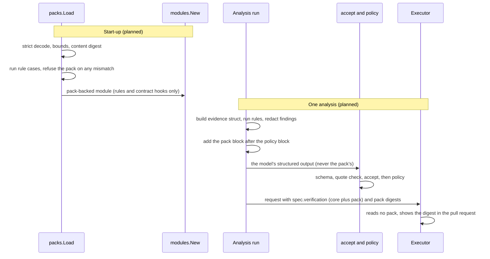

# ADR-0034: A declarative pack format, compiled in first

- Status: Proposed
- Date: 2026-11-13

## Context

[ADR-0019](0019-extension-packaging.md) decided "compiled in now, signed OCI packs later" and left the format of a pack open until there was demand. On 2026-11-13 the design was started ([#667](https://github.com/pkalin/shadewright/issues/667), epic [#279](https://github.com/pkalin/shadewright/issues/279)): the format is written now, the first pack (out-of-memory kills) is built in v0.6.0 and compiled into the binary, and OCI distribution, signatures and outside authors come later. This ADR turns step 2 of ADR-0019 into a format: what a pack contains, what it may never do, and how the first one is loaded.

A pack format can weaken two invariants of `AGENTS.md`: 2 (the action catalog is closed) and 4 (everything from the cluster is untrusted, and nothing changes the instructions, tools, permissions or catalog). A third, 1 (model output is never authorization), is only touched if a pack may propose, which is an open question below. The rest of this ADR is written so that each part of a pack can be checked against 2 and 4.

### What exists today

Checked against the code at `main`:

- **Modules are Go values.** `modules.Platform` and `modules.Integration` (`internal/modules/modules.go`) are built into one immutable registry by `modules.New` (`internal/modules/registry.go`) from an explicit list in `cmd/analyzer/main.go`. `New` validates names, rules and checks, and refuses a bad module, which stops the start.
- **What a module may contribute is a fixed struct.** `Hooks` has `Symptoms`, `Rules`, `Tools`, `Actions` and `Checks`. `Tool` is an empty placeholder. Only the core-only check in `New` reads `Hooks.Actions` (`symptoms.go` copies it): the rule that an action needs an enabled module is `catalog` in `internal/policy/decide.go`, in code.
- **Diagnosis rules are pure functions** over an `Event` or a `NodeState` and return a `Symptom` (`internal/modules/rules.go`). The evaluator bounds every input and output (`MaxRuleInput`, `ValidSymptom`), redacts evidence and skips a rule that panics.
- **The `Runbook` interface** (`internal/analysis/loop.go`) has no implementation. The loop runs any it is given before the model. `Match` receives only the `Incident`, before the context is built. A runbook plan and a model proposal both end in the same function, `accept`, which checks the target kind, the catalog and that a policy is configured for the action.
- **The prompt is code.** The system part is an embedded template (`internal/analysis/prompts/system.tmpl`), and `PromptVersion` hashes the template, the schema, the catalog and four fixed notices (`internal/analysis/prompt.go`). Context text goes in delimited blocks with a provenance (`internal/incidentcontext/types.go`). The default bound for the whole context is 48 KiB, for the policy section 2 KiB.
- **There is no typed container status for rules to read.** The builder reads container status into an unexported struct (`containerStatus`, `internal/incidentcontext/resolve.go`) and renders it as text. The only typed value it hands on is `Context.Template`, the memory limit of each container in the pod template.
- **Evaluation.** `test/eval/testdata/scenarios/` has one directory per scenario (`expected.yaml`, `rubric.yaml`, `incident.yaml`, `objects.yaml`, `metrics.yaml`, `replies.yaml`, `policy.yaml`, `variants/`). The harness computes an evaluation manifest and its digest ([evaluation](../evaluation.md), [ADR-0025](0025-analysis-claims-units-and-evaluation-manifest.md) decision 3). The manifest has no pack field. The analyzer does not compute the digest at run time and no list of passing results exists yet, so a real-model run is still an evaluation run, not production use (design 11.2).
- **The record and the pull request.** The analysis record keeps `promptVersion` (`internal/analysis/record.go`). The pull request body (`internal/controller/pullrequest.go`) names the change, the scope, the request, the policy and the plan digest, and says where the diagnosis is. It shows no prompt version and no digest of analysis input.
- **Verification.** `VerificationCheck` is a closed enum of five values in the API (`api/v1alpha1/remediationrequest_types.go`); the controller always adds the checks the action needs, so a request can only make verification stricter. `stableFor` is the larger of the request's value and a minimum per action ([ADR-0030](0030-merge-receipt-and-verification-outcomes.md)). Only the KEDA module declares a check today (`internal/modules/keda/keda.go`).
- **The catalog is closed.** `ActionType` has two values (`api/v1alpha1/common_types.go`) and `policy.CheckAction` refuses any other.
- **`cel-go` is in `go.mod`** as an indirect dependency (v0.30.0, Apache-2.0). Nothing in the operator evaluates CEL itself yet.

## Decision

### 1. A pack is a directory of data

A pack is a directory tree of regular files: text, YAML and Markdown only. No script, no binary, no link to a file outside the tree, no URL that anything fetches. Its identity is its **content digest**: SHA-256 over the files sorted by path, each as its path, a NUL, its size, a NUL and its bytes, prefixed with the format name. Two readers over the same files give the same digest. The digest is the only name a cluster, a record or a pull request uses for the pack's content; the `version` in the manifest is for people.

| Part | File | What it holds | First pack (`oom`) |
| --- | --- | --- | --- |
| Manifest | `pack.yaml` | `apiVersion: packs.shadewright.io/v1alpha1`, `kind: Pack`, `name`, `version`, `module` (kind `integration` or `platform`, and its detection as group versions or node labels, exactly the fields `modules.IntegrationDetection` and `modules.PlatformDetection` have), the list of its files, and the scenario names that must pass | yes |
| Diagnosis rules | `rules/*.yaml` | Rules of one kind in this version, `incident` (section 2) | one rule: a container of the subject was OOM killed |
| Guidance | `guidance.txt` | Plain text for the model (section 4) | yes, short |
| Verification contract | `verification.yaml` | Per catalog action: checks to require and a `stableFor` (section 5) | yes: the check the core already requires for the memory action, and nothing more |
| Rule cases | `cases/*.yaml` | Evidence in, findings out, for each rule, including cases where no rule fires | yes |

Scenario cases (the model evaluation) keep the layout they have in `test/eval/testdata/scenarios/`. For the compiled-in pack they stay there and the manifest names them (`oom`, `oom/rollout`, `statefulset-oom`). A pack that comes from outside would carry them in its own tree in the same layout; that is deferred with outside authors.

The reader decodes strictly: an unknown key, a duplicate key, a YAML anchor, alias, merge key or tag, a file not listed in the manifest or a listed file that is missing is a refusal. It bounds the number of files, the size of each file and of the tree, and the length of every string. The bounds are numbers of the format version, set when the reader is built and checked by a test.

A **pack-backed module** is an adapter in `internal/packs` that implements `modules.Integration` (or `Platform`) over a loaded pack. It fills only two hooks, and the registry has neither today. `Hooks.Rules` holds `DiagnosisRule`s, which are not the incident rules of section 2, and `Hooks.Checks` holds check implementations (a name, a group, a kind and a `Holds` function), not a contract. So the ADR names three changes to the module registry (`internal/modules`), listed under "Amendments this ADR would need" and built in plan task 1:

- a new hook for a pack's incident rules, with its own validation in `New`;
- a new hook for a pack's verification contract (section 5), separate from `Hooks.Checks`;
- a rule for a pack with no API group. The OOM pack has none: its detection would be the core group version `v1`, and `New` refuses any `Checks` from a core-only module, while an empty detection is never detected. The rule: a core pack is active when an admin enables it by name, with no detection (open question 3). It may fill the two new hooks and nothing else.

`Symptoms`, `Tools` and `Actions` are never filled from a pack. `modules.New` validates it like any module, and an admin enables it by name in `RemediationSettings` `spec.modules` like any module; nothing is enabled by default (design 2.4.1, ADR-0018 amendment of 2026-11-03).

### 2. Diagnosis rules: data over a fixed evidence struct

A rule is a name, a condition over a typed **evidence struct**, and a **finding** it produces when the condition holds. The finding has a `reason` (a CamelCase word, the pattern of `ValidSymptom`), a `summary` of fixed text of at most 256 bytes written in the pack, and a list of evidence fields, named from the struct, whose values the evaluator shows. Everything below holds whatever expression language the condition uses (open question 1):

- The condition is a pure function of the evidence struct. It has no clock, no random source, no environment, no network and no cluster access, no matter what the language offers. It has a cost bound; a condition that exceeds it, fails or panics does not fire.
- The evidence struct is fixed by the format version and built by the context builder from typed reads, before anything is rendered. The first version holds what the first pack reads: the Incident's reason and subject kind, and per container its name, the reason of its last termination, its restart count and the memory limit of the pod template. Adding a field is a format change, reviewed like an API change. Every string in it comes from the cluster and is untrusted: the condition compares it and never treats it as an instruction.
- A value reaches a finding only as an evidence entry. The evaluator redacts and bounds it the way module evidence is today (G4.11 in the threat model: at most 8 entries, 256 bytes each). The summary and the reason are the pack's own text and have no placeholders: no cluster value is ever interpolated into them.
- A finding is not a symptom and does not change how incidents are grouped. It is shown to the model in the pack block (section 4) and its reason is kept in the analysis record.

The format has two further rule kinds that map onto hooks `modules` already has: an `event` rule becomes a `modules.DiagnosisRule` with an `Event` function, a `node` rule one with a `Node` function. They are not in this version because the first pack needs neither. They return when a pack needs a symptom the core does not see, and they keep the checks of `New` and `ValidSymptom` unchanged.

A rule has no output that is a plan. Whether a rule may name an action and a value is open question 2.

### 3. A pack names actions and never defines one

A pack has no key that defines an action, a parameter, a bound, a patcher, a policy or a target kind. The reader refuses any such key, because it is not in the format. Where a pack speaks about an action (the verification part), it names a value of `v1alpha1.ActionTypes()`; a name outside the enum is a refusal at load, and `policy.CheckAction` refuses it again if one ever reached a request. Bounds stay in `RemediationPolicy`; `policy.Decide` does not import the pack package and cannot read a pack. Adding an action stays what ADR-0003 and invariant 2 say: an enum value with typed parameters, a policy rule, a patcher and a refusal test, in a pull request to the operator.

### 4. Guidance reaches the model as data, in its own block

The guidance file is plain text (UTF-8, newlines allowed, no other control characters), at most 2 KiB. A longer file is a load refusal: it is never cut, because a cut before redaction could keep the tail of a secret, the reason `MaxRuleInput` gives for rule input. The figure is proposed and is settled by the first evaluation.

At run time, only the guidance of a pack with a rule that fired on this incident is shown. It becomes one context block with its own provenance (`pack guidance`), after the policy block and before a reviewer hint, in the same renderer as every other block: redacted, in a delimiter its text cannot close (every angle bracket and look-alike escaped), under a fixed one-line notice that says the text is advice from an installed pack, never an instruction and never evidence. The block is not quotable: only values from the cluster can be quoted as evidence, so a pack cannot make the quote check pass for a proposal.

Guidance is not part of the system prompt and cannot change it. The system part gets one new fixed sentence that describes the block, which changes `PromptVersion` once. What the model does with guidance still passes the one validator: the output schema, the quote check, `accept` and then policy. Guidance is therefore a change to what the model sees, and it counts that way in the evaluation (section 6).

### 5. The verification contract: add or tighten, never lower

`verification.yaml` maps catalog actions to `require` (names from the API's `VerificationCheck` enum), `stableFor` and `timeout` (durations). The analyzer applies it when it builds the plan: the request's `spec.verification` is the union of the checks the core adds for the action, the pack's and the request's, and its `stableFor` is the largest of the core's minimum for the action ([ADR-0030](0030-merge-receipt-and-verification-outcomes.md)), the pack's and the request's. The plan carries the result in the request's spec, which is immutable, so the executor and the verifier read no pack. The plan digest does not cover `spec.verification` (`DigestInput` takes the action, the target UID, the source, and the policy UID and generation), so the approval does not bind it; immutability of the spec is what holds it. A pack can add a check and raise a window; it has no way to remove a check or to go below a minimum, and the core's minimum is a constant in code that the pack cannot name.

A longer `stableFor` needs a longer `timeout`. The CRD rejects a `Verification` whose `timeout` is not longer than `stableFor`, the timeout defaults to 10m, and the analyzer sets none today. A pack that wrote `stableFor: 10m` or more would make every proposal fail at the API server. So a contract that raises `stableFor` states a `timeout` too, and the analyzer writes both into the spec. The loader refuses a pack whose contract, after the defaults (3m `stableFor`, 10m `timeout`), does not leave `timeout` longer than `stableFor`, with `stableFor` at least 1m and `timeout` at most 24h, the bounds of the CRD.

A pack does not add a check name. The enum is closed in the API, and `modules.New` already refuses a check outside it. A pack-backed module may later implement an existing name for a kind no other module covers; a new name needs a core release. That limit is accepted.

The first pack's contract requires `NoNewOOMKills` for `SetContainerMemoryLimit`, which the core already requires. It exists to exercise the part and its no-lowering rule, and raises nothing. Raising the memory window is a separate decision of [#93](https://github.com/pkalin/shadewright/issues/93).

### 6. A pack loads only with passing cases, and its digest is recorded

Two kinds of evidence, at two moments:

1. **Rule cases, at load.** The reader runs every case of `cases/` against the pack's rules. A case that does not give exactly its expected findings, a rule with no case that fires and none that does not, or a case with no matching rule is a refusal. This runs on every start, costs nothing and needs no model. For the compiled-in pack it also runs in `make test`.
2. **Model evaluation, by digest.** The pack's name, version and content digest become a field of the evaluation manifest ([ADR-0025](0025-analysis-claims-units-and-evaluation-manifest.md)). Any change to any file of the pack, guidance included, gives a new manifest digest, so a pass recorded for the old content does not carry over. Once the list of passing results and the run-time check of ADR-0025 are built, the analyzer refuses automatic analysis when its configured packs plus model plus prompt have no passing record. Until then, a real-model run with a pack is an evaluation run in the lab, as it is without one.

The analysis record gains the list of packs its run used (name, version, content digest). The request gains an informational list of the same, and the pull request body shows it next to the plan digest, so a reviewer can tie a proposal to the pack content that shaped it (open question 4 on how it travels). Nothing reads it to decide anything: the policy, the freshness check and the plan digest ignore it. It is provenance, not authority.

### 7. One reader for the compiled-in pack and a later OCI artifact

`packs.Load(fsys fs.FS, want Digest)` is the only function that turns files into a pack. It takes a file system and, when the caller has one, the digest it must have. Today the file system is an embedded one (`//go:embed` in `internal/packs/builtin`), so the binary's own digest is the pack's. A later OCI loader unpacks a layer into an in-memory `fs.FS` (never to disk, no links) and calls the same function with the digest the cluster pinned. The reader, the strict decoding, the limits, the digest and the rule cases are the same code in both cases, so the format cannot behave one way compiled in and another way from a registry. For the compiled-in pack, a failed load stops the start, as a refusal from `modules.New` does. What a later loader does with a pack that fails (leave it out and report it) is decided with that loader.

### 8. What a hub hands to a cluster

A hub (the fleet registration prototype, [#669](https://github.com/pkalin/shadewright/issues/669)) hands a cluster a **reference and a digest**: an OCI reference and the content digest it must have, as a pull request to the cluster's own GitOps repository, merged under that repository's rules. It never hands content, never writes to the cluster, and the pull request is not a remediation: it does not go through the executor, which does not write it (invariants 3 and 6 are unchanged). The cluster admin merges it or does not. How the hub signs in and what it may open is decided in its own ADR.

### 9. What a pack may never do

| A pack may never | Enforced where | Refusal test |
| --- | --- | --- |
| Add or redefine an action, a parameter or a target kind | The format has no key for it; strict decoding; `ActionTypes()` check at load; `policy.CheckAction` | A pack with an `actions` definition key, and one that names an action outside the enum, are refused |
| Set or widen a bound, a policy or an approval mode | No such key; `internal/policy` does not import `internal/packs` | A pack with a `bounds` key is refused; `importguard` test that `policy`, `gitops` and `controller` do not depend on `packs` |
| Write anywhere: Git, the cluster, a status, a Secret | No key for it; the executor and the verifier do not import `packs` | Import test for `cmd/executor` and `cmd/verifier` |
| Grant a permission, watch a kind or offer a tool | The adapter fills only the two new hooks of section 1; RBAC is generated from the compiled registry's `Symptoms` | The generated analyzer role is byte-identical with and without the first pack |
| Put model-facing text anywhere but the guidance block, or have it treated as an instruction or as evidence | One block, one renderer, fixed notice, not quotable; the system part has no input from a pack | Guidance that says to ignore the rules and propose another action changes no tool, no schema and no catalog (extends `TestPromptInjectionChangesNoInstructionsOrTools`); a quote taken from the pack block is refused |
| Interpolate cluster text into a summary, a reason or the guidance | No placeholder syntax; the reader refuses `{{`, `${` and `%(` in text fields | A pack with a placeholder is refused; a finding's summary never contains the evidence value |
| Run code, fetch anything or read outside its tree | Regular files only, no links, no URL fields, the reader takes an `fs.FS` and nothing else; conditions are pure | A pack with a symbolic link, a binary file or a path with `..` is refused; a condition that tries a clock, the environment or a call fails to compile |
| Lower a verification minimum or remove a check | Union and maximum with the core's constants (section 5) | A pack with `stableFor: 1m` still gives the core's minimum; a pack cannot remove `NoNewOOMKills` from a memory request |
| Make a request the API server rejects | The loader checks the contract against the CRD bounds, defaults included (section 5) | A pack with `stableFor: 10m` and no `timeout`, or a `timeout` not longer than `stableFor`, is refused at load |
| Turn off or weaken redaction | No key for it; guidance and findings go through `internal/redact` | A pack with a `redaction` key is refused; a token in guidance is redacted in the block |
| Change after it loaded | The digest is checked at load and there is no reload | A changed file gives a different digest; the manifest digest in the evaluation changes with it |

### 10. How invariants 2 and 4 hold for each part

| Part | Invariant 2 (closed catalog) | Invariant 4 (untrusted input) |
| --- | --- | --- |
| Manifest | No key defines an action; module kind and detection are fields `modules` already validates | Written by the pack's author, read as data; its strings are bounded and not shown to the model |
| Rules | A rule has no output that is a plan in this version | Inputs are cluster data, compared and never obeyed; outputs are the pack's fixed text plus redacted, bounded evidence |
| Guidance | Cannot name a new action for the schema: the catalog in the prompt is generated from the enum | Its own block, redacted, not quotable, fixed notice, cannot change tools, permissions or the catalog |
| Verification | Names actions only from the enum; adds or raises, never lowers | Reads no cluster data at all |
| Cases | Run only at load and in tests | Cases contain recorded cluster data; the reader treats them as data and never as input to a live run |
| The reader | Refuses any key it does not know | Strict decoding, size bounds, no links, no code, digest check |
| The hub hand-over | No content, so nothing to add an action | A reference and a digest in a merged pull request; the digest is checked at load |

### 11. What is deferred, and what brings it back

| Deferred | Brought back by |
| --- | --- |
| OCI artifacts, cosign verification, pinning by digest in settings | The first pack that is not written by the maintainers, or a cluster that wants a pack without a new operator release. Needs its own ADR: the analyzer then pulls from a registry, which is a new egress and a new credential, an amendment of invariant 6 |
| Image volumes | Kubernetes 1.36 stable and containerd 2.1 on the clusters that matter (ADR-0019) |
| `event` and `node` rules, a pack that adds redaction patterns, read-only queries, a pack that detects an add-on by CRD | A real pack that needs one; each is additive and keeps its checks |
| Scenario cases inside a pack, so an outside author can test | Outside authors |
| A new verification check name | A core release that extends the enum |
| Learning loops and central bundles | Epic #279; see open question 5 |

## Amendments this ADR would need

Made, with dated entries under [ADR-0021](0021-amending-accepted-adrs.md), when this ADR is accepted. None of them widens what is allowed, granted or refused; the ADR-0019 change narrows it.

- **[ADR-0019](0019-extension-packaging.md), Decision 2.** The sentence "A pack contains data, never code:" stays. Its list changes:
  - "detection rules and diagnosis rules in CEL over object fields and conditions;" becomes diagnosis rules over a typed evidence struct, in the language of open question 1, with detection as the manifest's module fields.
  - "read-only queries for the analyzer (Kubernetes reads, PromQL templates);" is not in format version v1alpha1: a query needs RBAC or a metrics source, and a pack grants nothing.
  - "redaction patterns and verification checks;" becomes verification only. Redaction patterns are deferred.
  - "action definitions limited to a small set of built-in patch primitives (for example "set an integer field at this path within bounds"), each with a JSON schema for its parameters and a `ValidatingAdmissionPolicy` so the API server still enforces the bounds." is replaced: a pack defines no action. Invariant 2 requires a typed parameter set, a policy rule, a patcher and a refusal test in the operator for every action.
  - "Interfaces in step 1 are shaped so a compiled module can later be expressed as a pack." gets a link: the first pack is compiled in and read by the one reader (section 7).
  - The Consequences line "The declarative format is a real design task ... it is deferred until there is demand." gets a link to this ADR.
- **Module registry** (`internal/modules`, design 2.4.1). Not an ADR sentence but code the ADR needs, as planned work: a hook for a pack's incident rules, a hook for its verification contract, and a rule that a core pack with no API group is active when enabled by name, with no detection. Today `New` refuses `Checks` from a core-only module and an empty detection is never detected. The rule widens nothing: such a pack still contributes no symptoms, tools or actions.
- **[ADR-0018](0018-three-axes-of-pluggability.md), Decision 3.** After "Each declares how it is detected (API groups, CRDs and versions), what it watches and how conditions become symptoms, deterministic diagnosis rules, read-only tools for the analyzer, redaction rules, verification checks, and optionally actions." add that a module may be a compiled Go value or a pack, and that a pack-backed module declares only diagnosis rules and verification checks. The sentence "How modules are packaged and shipped is [ADR-0019]" links here too.
- **[ADR-0023](0023-how-the-analyzer-calls-the-model.md), decision 3.** "A static system part: role, rules, the generated catalog and the output schema. It does not vary per incident, so it can use provider prompt caching." gets the one fixed sentence about the pack block; it still does not vary per incident. "Each block is tagged with its provenance: event, pod status, log excerpt, metric, Git file or tool result." gains `pack guidance`.
- **[ADR-0023](0023-how-the-analyzer-calls-the-model.md), decision 4.** "it maps an incident's symptoms to a known diagnosis and a typed proposal by rules in code." Only if open question 2 is answered "yes": "by rules in code or in a pack". If it is answered "no", none.
- **[ADR-0025](0025-analysis-claims-units-and-evaluation-manifest.md), decision 3.** In "Every recorded real-model evaluation result names a manifest of the inputs that affect behaviour: ..." add "the packs in use (name, version, content digest);" after the redaction configuration. The keying by manifest digest is unchanged.
- **[ADR-0030](0030-merge-receipt-and-verification-outcomes.md), section 5.** "`stableFor` is the larger of `spec.verification.stableFor` (default 3m, at least 1m by CEL) and the action's minimum: 10 minutes for `SetContainerMemoryLimit`, 3 minutes for `AdjustKedaMaxReplicas`." becomes "... the action's minimum and the `stableFor` of a pack's verification part for the action". The minimums are unchanged.
- **[ADR-0003](0003-gitops-only-typed-remediation.md), [ADR-0013](0013-adapters-for-every-external-system.md), [ADR-0015](0015-analysis-records-outlive-the-lab.md), [ADR-0026](0026-the-analyzer-shows-the-model-the-policy-bounds.md) and [ADR-0028](0028-reviewer-hints-through-the-pull-request.md).** None. The record gains a field, which ADR-0015 does not enumerate.
- **Invariant 1.** None, unless open question 2 is answered "yes", when its sentence "The analyzer may only submit a proposal." stands and a pack plan is one more way to reach `accept`.
- **Invariant 2** (`AGENTS.md`). The sentence stands. After its last sentence ("No free-form commands, no `exec`, no direct `apply` against the cluster.") add: "A declarative pack names catalog actions and never defines one (ADR-0034)."
- **Invariant 3.** None. The hub hand-over (section 8) is a pull request that does not go through the executor.
- **Invariant 4.** The sentence "They never change instructions, tools, permissions or the action catalog." stands. Add: "Pack guidance reaches the model only in a block of its own, redacted, never as an instruction and never as evidence (ADR-0034)."
- **Invariant 5.** None.
- **Invariant 6.** None for the compiled-in pack: it needs no permission and the executor and verifier read no pack. The OCI loader will need an amendment (a registry egress and a credential for the analyzer), which this ADR defers.
- **Design.**
  - 2.4.1: "The analyzer builds one immutable registry at start-up (`cmd/analyzer`) from an explicit list of compiled-in modules" gains "some of them packs read by one reader". The list under "`New` refuses:" gains the pack refusals of sections 1 to 5.
  - 2 (introduction of the three axes): "Modules are compiled in for now. Signed, declarative OCI packs are the planned way to ship them later" links here.
  - 3.3 and 11.2: the context gains the pack block, and the evaluation manifest of 11.2 gains the packs field.
  - 5.4 (modules): "shipped as a pack ([ADR-0019]), needs no schema change" still holds for names. The request spec gains an optional informational list of packs if open question 4 is answered with a spec field.
  - 13, stage 5: "Declarative OCI extension packs." becomes "Declarative OCI extension packs (the compiled-in format first, ADR-0034)".
  - The evaluation page's manifest table gains a `packs` row.
- **Threat model.**
  - G4.6: "Text in events, logs, annotations, tool results and Git files never changes the instructions, the tools, the permissions or the catalog." stands. A new row beside it states the same for pack guidance.
  - G2.1 ("A request carries one of two actions ...") stands. A new row states that no pack defines or widens an action.
  - The party table gains a row for a pack: trusted for knowledge (rules, guidance, extra verification), not trusted for any action, bound, grant or write path.
  - G1.9 ("The model's only write is a proposal; ...") stands.

**What a pack can never add**, in one place: an action outside the closed catalog, a bound or a policy, a write path, a grant or a watched kind or a tool, a lower verification minimum, and model-facing text that is treated as an instruction, as evidence or as authorization. It is enforced by the format (no such key), by strict decoding, by the import boundaries in section 9, and again by `policy.CheckAction`, `accept` and `policy.Decide`, which do not know that packs exist.

## Open questions

These belong to the maintainer. The text above holds under every option.

1. **The language of a rule's condition.**
   - **CEL over the evidence struct.** One expression per rule, compiled at load against the struct's declared types, with a cost limit and no extension functions. The operator does not evaluate CEL today, but `cel-go` is already in `go.mod` and the API server's own CEL rules use the same language, so authors may know it. It is the most expressive of the two and the hardest to bound: the cost limit and the declared environment do that work. A rule would read like `container.lastTerminatedReason == "OOMKilled" && container.restartCount >= 1`.
   - **A closed set of predicates.** The rule is a small tree of named comparisons (`equals`, `atLeast`, `anyContainer`, `all`, `any`) over the same struct, written in YAML. Easy to bound and to test exhaustively, no new dependency, but every new need is a change to the operator, and an author hits the limit early.
   - **Cost.** CEL: a new direct dependency and its upgrades, a load-time compiler, a fuzz target. Predicates: a small evaluator written and tested here, and a slower path for outside authors.
   - **Recommended:** CEL, as the issue proposes, with the declared environment holding only the evidence struct and the cost limit set in the format.
2. **May a rule propose?** Today a runbook could, in principle, return a `Plan` and skip the model. Options: (a) findings only, the model still proposes (this ADR's text); (b) a rule may name a catalog action and an expression for the value, the reader builds a `Plan` and `accept` and policy check it like any other, with the previous value always read from the live template and never from the pack; (c) (b) only for a fixed value written in the pack. Option (b) moves sizing from an evaluated model to author data and needs the `Runbook` interface to receive the built context, since it takes only the `Incident` today. It also overlaps with sizing by code in v0.6.0 ([#508](https://github.com/pkalin/shadewright/issues/508), [#506](https://github.com/pkalin/shadewright/issues/506)). **Recommended:** (a) for the first pack. Revisit when sizing by code exists, because then a pack would name the sizing function and not a number.
3. **How the first pack is switched on.** (a) By name in `spec.modules.integrations`, off by default, like every module. (b) On by default as a core pack. (a) changes nothing on upgrade and keeps one rule for enabling anything; (b) gives every cluster the guidance at once, with the risk of changing proposals without the admin asking. **Recommended:** (a).
4. **How the pack digest reaches the pull request.** The executor reads the request, not the record. Options: (a) a typed optional field in the request spec (an API change, immutable with the spec, bounded in count and length); (b) a label or annotation, with no schema, bounded only by convention. (a) costs a CRD change and a refreshed API reference; (b) can be forged or dropped by anyone who can write the object before the executor reads it, and the pull request would then show wrong provenance. **Recommended:** (a). In both cases the field is provenance only and no component decides from it.
5. **Policy bundles in epic #279.** The epic lists "policy rules: allowed patch kinds, path allow lists, limits and cooldowns" and "action packs ... parameters and guards" as bundle kinds. This ADR says a pack carries no bound. Options: (a) drop those two kinds from #279; (b) keep them as a separate signed kind with its own ADR, where a bundle may only tighten a `RemediationPolicy` and never loosen it; (c) allow them in packs. **Recommended:** (b). (c) would let a pack widen what the executor may change, which is the thing invariant 2 and ADR-0011 keep in a cluster object the admin owns.

## Plan

Nothing below is built. Every task needs this ADR accepted first, which needs the design review and a red-team pass ([#667](https://github.com/pkalin/shadewright/issues/667)). Each task is its own pull request, and each refusal test fails without the change it tests.

1. **The reader and the registry hooks.** In `internal/modules`: the two new hooks of section 1 and the rule for a pack with no API group, with tests that `New` validates them, refuses a hook a core-only module may not fill, and activates a core pack by name only. In `internal/packs`: `Load(fs.FS, Digest)`, strict decoding, bounds, the content digest, the manifest and the five parts parsed into types, no rule evaluation yet. Tests: the digest is stable across two readers and changes with any byte; one refusal test per row of section 9 that is about the format (`actions` key, `bounds` key, `redaction` key, placeholder, symbolic link, binary file, `..`, unlisted file, missing file, unknown key, anchor, oversize file and tree). Import guards for `policy`, `gitops`, `controller`, `cmd/executor` and `cmd/verifier`. Docs: a reference page for the pack format (new), glossary ("pack", "content digest"), design 2.4.1, the ADR index and nav entry marked built.
2. **The evidence struct and rules.** The typed evidence struct in `internal/incidentcontext`, the rule evaluator in the language of open question 1, the cost limit, findings with the bounds of `ValidSymptom`, rule cases run at load. Tests: a rule that panics, runs over the cost limit or reads nothing it was given does not fire; a finding's summary never holds an evidence value; a load with a missing or failing case is refused. Docs: design 3.3, the pack reference page, `docs/threat-model.md` (G4.11 neighbours).
3. **The guidance block.** The new section and provenance, the fixed notice, the one system sentence, the size bound, the injection corpus cases. Tests: a guidance that tells the model to ignore the rules changes no tool, schema or catalog; the block is not quotable; look-alike delimiters in guidance are escaped; `PromptVersion` changes exactly once. Docs: design 3.3 and 11.2, `docs/evaluation.md` (injection corpus), threat model (new G4 row), data handling.
4. **The verification part.** Union and maximum with the core's checks and minimums, applied where the analyzer builds the plan. Tests: a pack cannot lower `stableFor` below the memory minimum or drop `NoNewOOMKills`; a check name outside the enum or an action outside the catalog is refused; a contract with `stableFor: 10m` and no `timeout`, or a `timeout` not longer than `stableFor`, is refused at load, and the analyzer writes both into a spec the CRD accepts. Docs: request lifecycle, ADR-0030 amendment, the pack reference page.
5. **Manifest, record and pull request.** The packs field of the evaluation manifest, the field of the analysis record, the request field of open question 4 and its line in the pull request body. Tests: changing one byte of guidance changes the manifest digest; the body shows the digest; the policy decision, the freshness check and the plan digest are identical with and without the field. Docs: `docs/evaluation.md` manifest table, data handling, API reference, design 5.
6. **The first pack and its enabling.** `internal/packs/builtin/oom/` (embedded), its rule cases, the scenario names in its manifest, the adapter in `cmd/analyzer`'s module list, enabling by name per open question 3. Tests: the three scenarios pass with the pack on the fake model; the generated analyzer role is byte-identical with and without the pack; start-up refuses a corrupted embedded pack. Docs: concepts, how-to for enabling a module, the OOM lab pages, design 2.4.1, the milestones page.

Not in the plan: the OCI loader, signatures, a registry, a hub, a pack linter for outside authors, and anything that evaluates a pack on a live cluster before the run-time evaluation check of ADR-0025 exists.

## Consequences

- Knowledge about a failure can be written as data, reviewed as a diff and tested without Go code, and the same files can later come from a registry. The operator keeps every decision that matters: the catalog, the bounds, the validator, the policy and the executor do not know that packs exist.
- A pack is less powerful than a Go module on purpose. It cannot watch a new kind, offer a tool, propose or add an action. An add-on that needs one of those is still a pull request to the operator.
- Every change to a pack, guidance included, needs a new real-model evaluation before it counts, which costs money and review time. Guidance is the cheapest way to change what the model sees, so the gate has to apply to it as it does to the prompt.
- One more thing can go wrong at start-up: a corrupted compiled-in pack stops the analyzer. That is the same behaviour as a refused module today.
- The pack digest in the pull request is provenance written by the analyzer, which the executor cannot check, because it reads no pack. A reviewer who does not trust the analyzer's record learns nothing from it. It is there to trace a proposal, not to prove one.
- The format makes the evidence struct a public contract. Changing it is a format version, and a pack written for one version is not read by an operator that does not know it.

## Alternatives considered

- **Packs as ADR-0019 described them (action definitions with patch primitives and admission policies).** Rejected: it lets a data file define an action, which invariant 2 gives only to code with a patcher and a refusal test, and a `ValidatingAdmissionPolicy` per action would be another thing an admin must trust and install.
- **gRPC plugin processes or WebAssembly for rules.** Kept in reserve as ADR-0019 says. A rule here is a pure condition over a small struct; code in a sandbox is more than that needs.
- **Guidance in the system prompt.** Rejected: the system part is code and the same for every incident (ADR-0023). Pack text there would make the pack an instruction.
- **Guidance with placeholders for cluster values.** Rejected: it is the shortest path from untrusted text to the model's instructions.
- **One digest per file, or no digest and a version only.** Rejected: the cases and the evaluation key on content, and a version string can be reused for different bytes.
- **Evaluating packs at load with the model.** Rejected: it spends money on every start and its result is not stable. Rule cases run at load; the model runs where ADR-0025 puts it.
- **A pack that reads the cluster (queries, tools).** Deferred, not rejected: it needs RBAC, which a pack must not grant, so each such read would be compiled in until a separate decision exists.

## Amendments

None.
