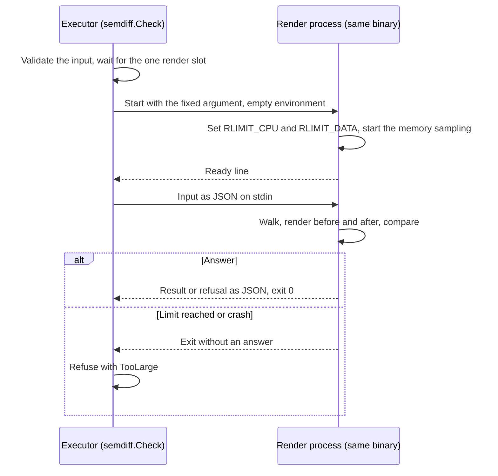

# ADR-0035: The render check runs in a child process with operating system limits

- Status: Proposed
- Date: 2026-11-14

## Context

The render check (design 8.2.2, `internal/gitops/semdiff`) builds the Kustomization path of a change twice with the kustomize API and compares the outputs. Until now it ran in the executor's own process. Git contents are untrusted (invariant 4), and kustomize grows its output from small input: a value that a transformer copies into every place it reaches, a patch merged into a wide mapping, a name copied into every reference.

Each growth found so far got a static bound on the input, checked before the render: the build bytes and documents (#482, #488), the refusal of anchors and JSON patch `copy` (#488), what patches and transformers can add (`MaxTransformBytes`, #495, #626) and the keys patches can merge into one mapping (`MaxMergedKeys`, #626). A review on 2026-11-09 found a fifth case ([#614](https://github.com/pkalin/shadewright/issues/614)): a base adds a 64 KiB annotation, an overlay moves it into a ConfigMap name with a JSON patch, and kustomize copies the new name into 1,000 references. About 100 KB of input is within every budget; the render reached 66 MB of output and 374 MiB of Go heap in 5.6 s (measured 2026-11-14 in the test process, Go 1.27.4, arm64), and the check passed. In the executor's container (256 Mi since #615) such a tree ends the process on every recheck. #626 listed more cases past its estimate (keys merged under sibling paths, labels added across overlays, patches wrapped in nested `List` documents, JSON 6902 moves, a list created by a JSON `add` and then merged).

The estimates only over-count, and each round made them more complex without closing the class. A render cannot be cancelled once it has started, and a Go process cannot bound the memory of one call. On 2026-11-10 the static estimates were stopped there, and bounding the render itself was chosen for #614 ("child-process render with an OS memory and CPU limit, needs an ADR").

## Decision

`semdiff.Check` validates its input in the executor, then runs the walk, both renders and the comparison in a child process: the executor's own binary, started again with one fixed argument (`semdiff.RunRenderProcess`, called first in `main`). Nothing else changes in what the check proves.

1. The child sets its limits before it reads any input: a CPU time limit (`RLIMIT_CPU`, `semdiff.MaxRenderCPUSeconds`, 60 s; a `SIGXCPU` at the soft limit ends it, a `SIGKILL` from the kernel 5 s later if it did not) and, on Linux, a data limit (`RLIMIT_DATA`, `semdiff.MaxRenderData`, 512 MiB of private writable mappings, the soft and hard values equal so the child cannot raise them). It then samples the memory its Go runtime holds every millisecond and exits past `semdiff.MaxRenderMemory` (128 MiB), with Go's soft memory limit at three quarters of that so the collector works harder first. The data limit counts address space (the child starts with about 135 MiB of it), so it sits above what the sampling allows and stops only a burst the sampling misses.
2. The parent writes the input as JSON to the child's stdin and reads one answer from its stdout: a result, a refusal with its reason and detail, or a failure. The child gets an empty environment and its stderr is dropped. The answer is read up to 64 KiB.
3. The child writes a ready line once its limits are set. A child that set its limits and then stopped at one, or crashed (a Go stack overflow in kustomize is not recoverable), is refused with `TooLarge`, and the message names the limit when the child knows it: "the render needs more than 128 MiB of memory", "more than 60 s of CPU time", or "the render process stopped before it answered" with all three limits. The same build ends the same way on every retry, so a refusal is the right end and the person reads it on the request. A child that could not be started, ended before its ready line, or could not read its input is an error for a retry, never a refusal. When the caller's context ends the child is killed and `Check` returns the context's error.
4. The executor runs one render process at a time, as it ran one render at a time before, so its memory is its own plus one child's.
5. The input budgets are not removed or widened: they refuse most large builds early, with a precise message, at the policy check before any plan is made. The process limits bound what they miss.

## Consequences

- A build that grows past the estimates is refused with `TooLarge` instead of ending the executor. The #614 case is refused in about 1 s (`TestCheckBoundsAChainedNameReference`), with the executor's own heap under 64 MiB, and an ordinary chain of the same shape renders (`TestCheckRendersAnOrdinaryChain`).
- A render can now be cancelled: the process is killed when the context ends.
- Each check starts one process and copies the build's files through a pipe, at most a few MiB.
- Every binary that calls `Check` must call `semdiff.RunRenderProcess` first in `main`, test binaries from `TestMain`. A binary that does not fails its flag parsing on the fixed argument and exits before the ready line, so the check fails with an error for a retry; it never starts the binary as itself and never passes.
- The memory bound is Linux's `RLIMIT_DATA` plus the sampling. macOS, used for development only, refuses a small data limit, so there the sampling is the only memory bound. Other platforms refuse to render. A binary built with the race detector (tests only) sets no data limit, since its shadow memory takes terabytes of address space, allows eight times the CPU time and gives the child `GORACE=atexit_sleep_ms=0`, so that it does not sleep a second before it exits.
- The executor's identity, RBAC and image are unchanged. The child is the same binary with no environment, no token and no network use; it reads only its stdin.
- Invariant 4 holds more strongly: the cost of untrusted Git content is bounded by the process, not by an estimate of it. Invariant 3 is unchanged: a refusal commits nothing.

## Alternatives considered

- **Another estimate round** (a compositional estimate: any value an earlier stage could create counts at its largest size for later stages). It would refuse the #614 case, but every round so far left a gap a review found, and the estimate already over-counts honest trees. Rejected on 2026-11-10.
- **A memory limit inside the executor's process** (Go's soft memory limit, or a watchdog that stops the render). The soft limit only makes the collector work harder, and kustomize cannot be stopped mid-render, so a watchdog could only end the whole executor.
- **A separate render binary in the image.** The same isolation, with a second binary to build, sign, ship and find at run time. Starting the executor's own binary needs none of that.
- **A cgroup per render.** A tighter memory bound (resident memory rather than address space), but it needs write access to the cgroup tree, which the non-root executor with all capabilities dropped does not have.
- **`RLIMIT_AS`.** The Go runtime reserves large ranges of address space it never uses, so a useful address space limit would refuse honest renders.

## Amendments

None.
