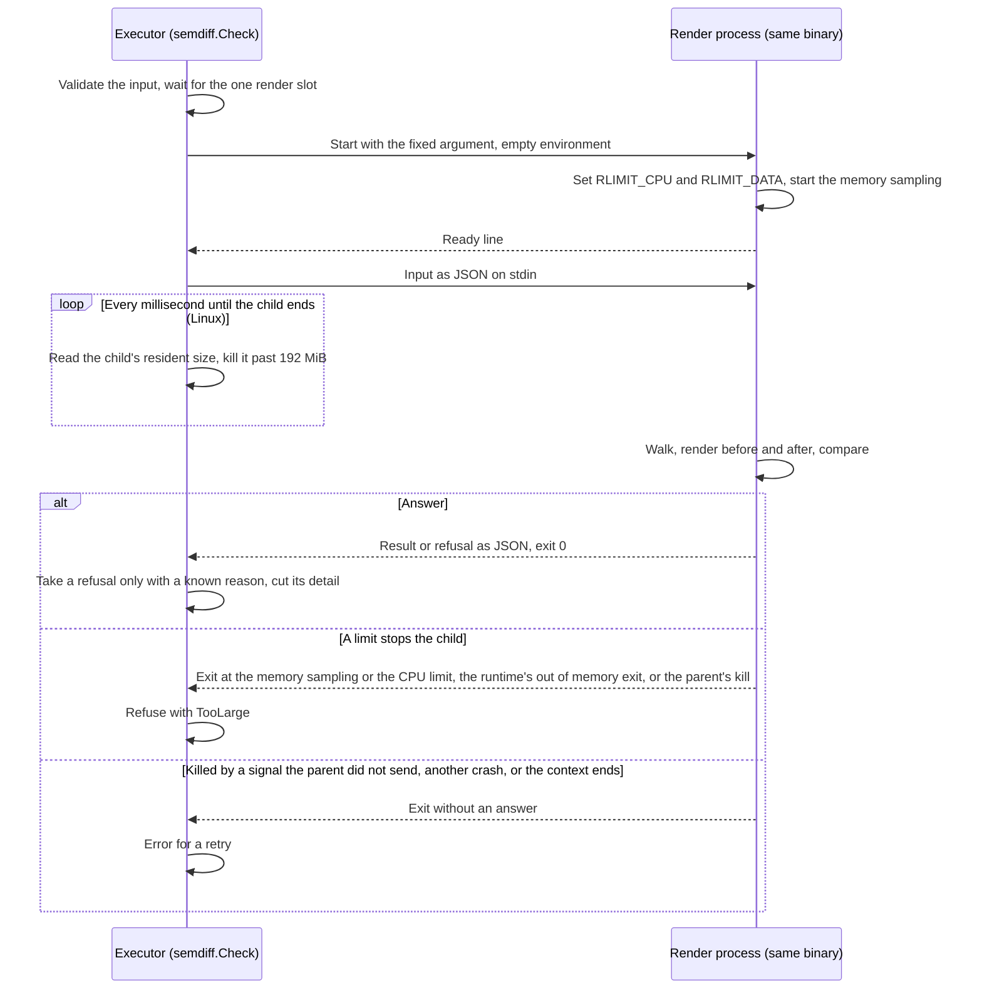

# ADR-0035: The render check runs in a child process with operating system limits

- Status: Proposed
- Date: 2026-11-14

## Context

The render check (design 8.2.2, `internal/gitops/semdiff`) builds the Kustomization path of a change twice with the kustomize API and compares the outputs. Until now it ran in the executor's own process. Git contents are untrusted (invariant 4), and kustomize grows its output from small input: a value that a transformer copies into every place it reaches, a patch merged into a wide mapping, a name copied into every reference.

Each growth found so far got a static bound on the input, checked before the render: the build bytes and documents (#482, #488), the refusal of anchors and JSON patch `copy` (#488), what patches and transformers can add (`MaxTransformBytes`, #495, #626) and the keys patches can merge into one mapping (`MaxMergedKeys`, #626). A review on 2026-11-09 found a fifth case ([#614](https://github.com/pkalin/shadewright/issues/614)): a base adds a 64 KiB annotation, an overlay moves it into a ConfigMap name with a JSON patch, and kustomize copies the new name into 1,000 references. About 100 KB of input is within every budget; the render reached 66 MB of output and 374 MiB of Go heap in 5.6 s (measured 2026-11-14 in the test process, Go 1.27.4, arm64), and the check passed. In the executor's container (256 Mi from #615 until this decision) such a tree ends the process on every recheck. #626 listed more cases past its estimate (keys merged under sibling paths, labels added across overlays, patches wrapped in nested `List` documents, JSON 6902 moves, a list created by a JSON `add` and then merged).

The estimates only over-count, and each round made them more complex without closing the class. A render cannot be cancelled once it has started, and a Go process cannot bound the memory of one call. On 2026-11-10 the static estimates were stopped there, and bounding the render itself was chosen for #614 ("child-process render with an OS memory and CPU limit, needs an ADR").

## Decision

`semdiff.Check` validates its input in the executor, then runs the walk, both renders and the comparison in a child process: the executor's own binary, started again with one fixed argument (`semdiff.RunRenderProcess`, called first in `main`). Nothing else changes in what the check proves.

1. The child sets its limits before it reads any input: a CPU time limit (`RLIMIT_CPU`, `semdiff.MaxRenderCPUSeconds`, 20 s; a `SIGXCPU` at the soft limit makes it exit, a `SIGKILL` from the kernel 5 s later if it did not) and, on Linux, a data limit (`RLIMIT_DATA`, `semdiff.MaxRenderData`, 384 MiB of private writable mappings, the soft and hard values equal so the child cannot raise them). It then samples the memory its Go runtime holds every millisecond and exits past `semdiff.MaxRenderMemory` (128 MiB), with Go's soft memory limit at three quarters of that so the collector works harder first.
2. The parent is the second sampler, on Linux: while it waits for the answer it reads the child's resident size from `/proc/<pid>/statm` every millisecond and kills the child past `semdiff.MaxRenderResident` (192 MiB). Its resident size counts the binary's text (about 44 MiB at the start), so the limit sits above what the child's own sampling lets it reach: the executor's binary as the child peaked at 145 MiB resident on builds that pass and at 118 to 179 MiB when its own sampling stopped it (point 8). A failed read of `statm` is neither a refusal nor an error: the child may have ended, and its end is read as usual. A race detector build (tests only) uses four times the limit, since its shadow memory is resident too.
3. Memory is bounded by these two samplers and the container's limit, not by the kernel. No limit an unprivileged container can set bounds the child's resident memory: `RLIMIT_AS` refuses honest renders (see the alternatives), a cgroup per render needs a delegated cgroup tree, and `RLIMIT_DATA` is no hard bound for a Go process. Linux checks the data limit when a mapping adds to the process's writable private memory, and counts only the growth net of the mappings it replaces. The Go runtime maps its heap with `mmap(MAP_FIXED)` over address space it reserved earlier with `PROT_NONE` (`sysMapOS` in `runtime/mem_linux.go`, Go 1.27.4), which replaces a mapping of the same size, so the kernel checks nothing. Measured 2026-11-14 on Linux 6.12 (arm64): with a data limit of 64 MiB, a fresh 512 MiB writable mapping was refused, while a 512 MiB `PROT_NONE` reservation mapped writable with `MAP_FIXED` succeeded and took `VmData` to 552 MiB; in the render process, with the 384 MiB limit and its sampling off, one 384 MiB allocation succeeded and took `VmData` to 466 MiB. The data limit stays as a partial guard: the process ends at its next fresh mapping past it (runtime metadata, a work queue of the collector). Then the Go runtime either exits with "fatal error: out of memory", "fatal error: runtime: out of memory" or "fatal error: runtime: cannot allocate memory", or it crashes with a `SIGSEGV` in its collector, because `newSpanSPMC` (`runtime/mgcmark_greenteagc.go`) does not check the result of `sysAlloc`. Of eight runs of that 384 MiB burst with the collector on, seven ended with the `SIGSEGV`.
4. On Linux the child also raises its own OOM score adjustment to 1000 before it reads any input (raising it needs no privilege). It helps only where the kernel's OOM killer ends one process: on cgroup v1, and on cgroup v2 nodes whose kubelet sets `singleProcessOOMKill`. Elsewhere on cgroup v2 a container OOM ends every process in the container (see the consequences). A failed write is not fatal and is not reported: the child has no one to tell, since the parent reads its stderr only for the Go runtime's fatal error line, and the render then runs with its other limits.
5. The parent writes the input as JSON to the child's stdin and reads one answer from its stdout: a result, a refusal with its reason and detail, or a failure. The answer is read up to 64 KiB. A refusal is taken only with one of the package's own reasons (any other is an error for a retry), and its detail is cut at 2 KiB, room for two repository paths of 512 bytes; the reason and detail then go where they went before (the request's condition shows only the reason). The child gets an empty environment. Go code in the child writes nothing to stderr (`os.Stderr` and the `log` package point at nothing), and the parent keeps only the first line of it that starts with `fatal error: `, which the Go runtime writes when it ends the process.
6. The child writes a ready line once its limits are set. Only the ends a limit chose are refusals, with `TooLarge` and a message that names the limit: the child's own exit at the memory sampling ("the render needs more than 128 MiB of memory"), its own exit at the CPU time limit ("more than 20 s of CPU time"), the parent's kill at the resident limit ("more than 192 MiB of resident memory"; only a kill the parent made, and only if the child was still running), and the Go runtime's exit when the data limit refused a mapping (exit code 2 with a fatal error line that says "out of memory" or "cannot allocate memory": "more than 384 MiB of data mappings"). The same build ends the same way on every retry, so a refusal is the right end and the person reads it on the request. Every other end is an error for a retry: a child that could not be started, ended before its ready line, could not read its input or answered nothing readable; a child killed by a signal the parent did not send, such as an OOM killer's `SIGKILL`, which says nothing about the build; and any other crash, the runtime's `SIGSEGV` at the data limit included (point 3), since a crash cannot be told apart from a fault that a retry clears. A request whose check keeps failing that way ends at its deadline, as other retried errors do. When the caller's context ends the child is killed and `Check` returns the context's error, also for a retry: a node starved of CPU must not turn into a refusal.
7. The CPU time limit is reached inside the step that runs the check. The pull request step bounds the load of the build, the wait for the render slot and the render by one context of 2 minutes (`controller.DefaultWriteTimeout`). At the executor's CPU limit in the chart (500m, shared by the executor and the child) 20 s of CPU time take 40 s of wall time, so even with one render at the limit ahead of it in the slot the refusal arrives before the step's deadline (`TestRenderCPURefusalWithinTheStep`, computed from the chart's value). The largest builds the input budgets allow used at most 3.9 s of CPU time (`hack/load/render` at 500m CPU and 384 MiB, Linux arm64, 2026-11-14: `heavy 4095` 3.9 s, `docs 4095` 3.5 s, `dense 100` 3.1 s, `patches 1708` 2.8 s, `flat 4` 1.3 s), so the limit leaves five times that. With 60 s, as first proposed, the limit took 120 s of wall time, the step's deadline came first, and the request was retried until its own deadline without the refusal.
8. The executor runs one render process at a time, as it ran one render at a time before, so its memory is its own plus one child's. The container's memory limit covers both with a stated margin: the executor's Go soft limit, plus the parent's resident limit for the child, plus 64 MiB (`semdiff.RenderOutsideData`) for what the soft limit does not count (the executor's binary text, stacks, pipe buffers, page tables) and what a child can add between two samples, must fit in the limit, and a chart test checks the sum from the chart's values and the package's constants (`TestExecutorMemoryLimitHoldsARenderProcess`). The chart raises the executor's limit from 256 Mi to 512 Mi (request unchanged) and sets its `GOMEMLIMIT` to 45 percent of the limit instead of 90, which keeps the executor's Go soft limit at 241591910 bytes (about 230 MiB), as before: 230 + 192 + 64 is 486 MiB. The child's memory was measured on 2026-11-14 with the executor's binary (stripped, as the image builds it) started as the render process on the input of each `hack/load/render` shape, in a container of 0.5 CPU (Linux arm64), reading `VmData` and `VmRSS` every 0.1 ms: it starts at 83 MiB of `VmData` and 44 MiB resident; at the largest builds the input budgets allow (`heavy 4095`, `dense 100`, `denseannotations 100`, `images 100` and the others of point 7) it peaked at 112 to 157 MiB of `VmData` and 75 to 119 MiB resident; on chained builds of the #614 shape (`chained`, a value of 4 to 20 KiB moved into a name copied into 1,000 references) that pass, at up to 224 MiB of `VmData` and 145 MiB resident; on larger chains, which its own sampling stopped, at up to 245 MiB of `VmData` and 118 to 179 MiB resident. `VmData` grows past the Go memory the child samples because heap the runtime has returned to the system stays mapped. The data limit is 1.5 times the largest `VmData` seen, so it does not refuse what the sampling lets through.
9. The input budgets are not removed or widened: they refuse most large builds early, with a precise message, at the policy check before any plan is made. The process limits bound what they miss.

[![The executor's container, 512Mi and 500m CPU, holds the executor and one render process. The executor validates the input, waits for the render slot and starts its own binary again with one fixed argument and an empty environment, then reads the render process's resident size every millisecond and kills it past 192 MiB. The render process sets 20 s of CPU time, 384 MiB of data mappings (a partial guard), 128 MiB of Go memory and an OOM score adjustment of 1000 before it reads its input on stdin, then answers on stdout. Three ends: an answer (a result, or a refusal with a known reason and a detail cut at 2 KiB); a TooLarge refusal for the ends a limit chose (the render process's memory and CPU exits, the parent's kill at the resident limit, the Go runtime's out of memory exit at the data limit); an error for a retry for everything else (no ready line, a signal the parent did not send such as an OOM killer's, another crash, an unreadable answer, the step's context ending). Memory: 230 MiB for the executor, 192 MiB for the render process and a 64 MiB margin, 486 MiB of 512. The two processes share the user, file system and network.](../assets/diagrams/render-process.svg)](../assets/diagrams/render-process.svg "Open full size")

## Consequences

- A build that grows past the estimates is refused with `TooLarge` instead of ending the executor. The #614 case is refused in about 1 s (`TestCheckBoundsAChainedNameReference`), with the executor's own heap under 64 MiB, and an ordinary chain of the same shape renders (`TestCheckRendersAnOrdinaryChain`).
- A render can now be cancelled: the process is killed when the context ends.
- Each check starts one process and copies the build's files through a pipe, at most a few MiB.
- Every binary that calls `Check` must call `semdiff.RunRenderProcess` first in `main`, test binaries from `TestMain`. A binary that does not fails its flag parsing on the fixed argument and exits before the ready line, so the check fails with an error for a retry; it never starts the binary as itself and never passes.
- The executor's container needs 512 Mi instead of 256 Mi (a chart value users see), with the executor's `GOMEMLIMIT` at 45 percent of the limit. A user who sets `executor.goMemLimit` or lowers the limit has to leave room for one render process: the soft limit plus 192 MiB plus 64 MiB.
- The memory bound is measured, not a kernel guarantee: two samplers (the child's own and the parent's, each every millisecond) and a container limit sized with a stated margin. On cgroup v2 the kubelet sets `memory.oom.group` on every container since Kubernetes 1.28 ([kubernetes#117793](https://github.com/kubernetes/kubernetes/pull/117793)), so an OOM of the container kills every process in it; since 1.32 the kubelet setting `singleProcessOOMKill` turns that off, and its default is false ([kubernetes#126096](https://github.com/kubernetes/kubernetes/pull/126096), [kubelet configuration](https://kubernetes.io/docs/reference/config-api/kubelet-config.v1beta1/)). AKS nodes run cgroup v2 (Ubuntu 22.04 and later, Azure Linux; [AKS supported versions](https://learn.microsoft.com/azure/aks/supported-kubernetes-versions)). So a container OOM ends the executor with the child, and the pod restarts. The budget makes that unreachable from the child's side as long as the samplers hold: the child is stopped at 192 MiB resident, and 230 + 192 + 64 MiB fits in 512 Mi.
- Residual risk: an allocation burst that outruns both samplers by more than the 64 MiB margin, or an executor far above its Go soft limit, ends the pod by the group OOM kill. The pod restarts, the request is retried, and it ends at its deadline if the same build does that every time. Measured to judge it unlikely (2026-11-14, Linux arm64, a container of 0.5 CPU): when the child's own sampling stopped a render, its resident size was at most 179 MiB, 7 MiB over its starting 44 MiB plus 128 MiB. A child that allocates and fills 4 MiB blocks as fast as it can, with its own sampling off (`TestRenderProcessResident`), grew by up to 52 MiB between two of the parent's readings (1 to 2.5 ms apart under the CPU quota), and in 20 runs the reading that killed it was at most 39 MiB over the limit (231 MiB). That is within the margin, but not by much: the margin also holds the executor's memory outside its Go heap, and the executor's own peak was not measured in a running Pod (`hack/load/measure.sh` in a Kind cluster would show it). Throttling of the container's CPU stops the child as well as the parent.
- macOS, used for development only, refuses a small data limit and has no `/proc`, so there the child's own sampling is the only memory bound. Other platforms refuse to render. A binary built with the race detector (tests only) sets no data limit, since its shadow memory takes terabytes of address space, allows eight times the CPU time and four times the resident size, and gives the child `GORACE=atexit_sleep_ms=0`, so that it does not sleep a second before it exits.
- The executor's identity, RBAC and image are unchanged. The child is the same binary with no environment, no token and no network use; it reads only its stdin.
- Residual risk to confidentiality: the child runs in the same container as the executor, as the same user, with the same file system and network. The limits bound its memory and CPU time, not what a render exploited through a flaw in kustomize or YAML parsing could read or reach: the tokens mounted in the Pod (the executor's service account token, and its workload identity token when it has one) and the network the executor may use. The empty environment keeps the executor's environment from it, and nothing in the child's normal path opens a file or a connection; a sandbox (another user, a seccomp profile of its own, no network) would need privileges the executor does not have and is not part of this decision.
- Invariant 4 holds more strongly: the cost of untrusted Git content is bounded by the process, not by an estimate of it. Invariant 3 is unchanged: a refusal commits nothing.

## Alternatives considered

- **Another estimate round** (a compositional estimate: any value an earlier stage could create counts at its largest size for later stages). It would refuse the #614 case, but every round so far left a gap a review found, and the estimate already over-counts honest trees. Rejected on 2026-11-10.
- **A memory limit inside the executor's process** (Go's soft memory limit, or a watchdog that stops the render). The soft limit only makes the collector work harder, and kustomize cannot be stopped mid-render, so a watchdog could only end the whole executor.
- **A separate render binary in the image.** The same isolation, with a second binary to build, sign, ship and find at run time. Starting the executor's own binary needs none of that.
- **A cgroup per render.** A kernel bound on resident memory, but it needs write access to a delegated cgroup tree, which the non-root executor with all capabilities dropped does not have.
- **A container memory limit sized for `RLIMIT_DATA`** (the executor's soft limit plus the data limit plus a margin), proposed on 2026-11-14 to make the group OOM kill unreachable from the child's side. Rejected the same day: the Go runtime's heap mappings pass the data limit unchecked (decision, point 3).
- **`RLIMIT_AS`.** The Go runtime reserves large ranges of address space it never uses, so a useful address space limit would refuse honest renders.

## Amendments

None.
