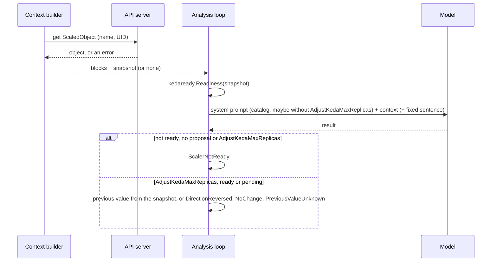

# ADR-0036: The model sees the ScaledObject of a KEDA incident

- Status: Proposed
- Date: 2026-11-14

## Context

The lab eval of 2026-11-10 (10 runs per commit, [#499](https://github.com/pkalin/shadewright/issues/499)) missed the outcome of both KEDA scenarios in some runs ([#640](https://github.com/pkalin/shadewright/issues/640)). In broken-keda-trigger one run proposed `AdjustKedaMaxReplicas` although its own summary said the trigger's Prometheus address does not resolve, so the pull request could not fix the fault. In keda-at-ceiling three runs of one commit ended `MissingData` with "the current ScaledObject spec value is not available to set previousValue exactly".

Both have one cause: the context builder did not read ScaledObjects. The model saw the Incident's summary and nothing of the object it was asked to change: not its `maxReplicaCount`, not its conditions. The policy check refuses a raise on a ScaledObject that is not ready (the KedaReady rule, `kedaready.Readiness`), so the broken trigger never became a merged change, but the analyzer only learned that after the model had proposed it.

[ADR-0026](0026-the-analyzer-shows-the-model-the-policy-bounds.md) added a block the model sees, built from typed policy fields and never quotable. A ScaledObject is different: its condition messages are free text from the cluster, and the model must be able to quote them as evidence. That needs its own decision.

## Decision

[![The ScaledObject of a KEDA incident: one get before the model call gives a snapshot; code decides readiness with the policy's rule and takes the previous maxReplicaCount from it; the model sees an allow-listed status block, and the catalog without AdjustKedaMaxReplicas plus one fixed sentence when the ScaledObject is not ready; a not-ready analysis ends ScalerNotReady unless the result proposes another action, a ready one gets its previous value from the snapshot; the executor's gate is unchanged](../assets/diagrams/keda-scaledobject-context.svg)](../assets/diagrams/keda-scaledobject-context.svg "Open full size")

1. The model sees the ScaledObject. When the Incident's subject is a `keda.sh/v1alpha1` ScaledObject, the object status section shows it, with provenance `keda scaledobject`, marked as untrusted cluster data like the other sections. It is quotable.
2. One read, before the model call: the context builder `get`s that one object by name from the API server and checks its UID, once per analysis, and the analysis keeps that snapshot to the end. The KEDA module's role already grants the `get`; there is no lookup by scale target, no read of the HPA, no `list` for this and no new RBAC. A refused or failed read leaves no snapshot: the block says "could not fetch" and the section is a failed source (an escalation signal, as for any failed read of the subject). A failed read is never "not found". An object under another UID is the subject gone.
3. The block shows an allow-list of fields: the namespace and name, `minReplicaCount` and `maxReplicaCount`, the scale target's kind and name, the type of each trigger, the metric names KEDA reports in its status, and the conditions `Ready`, `Active`, `Fallback` and `Paused` with their status, reason and message. Never a trigger's metadata (`serverAddress`, the query text), its authentication reference, the annotations or the labels. Every string goes through the redactor first and then the builder's existing rule: a value over 1 KiB after redaction is left out whole, never cut. Numbers are written by code and are not quotable. KEDA v2.21 keeps no replica counts in the ScaledObject's status, so the HPA's current and desired replicas would need a read of the HPA, which this decision does not make.
4. The baseline is decided in code. For `AdjustKedaMaxReplicas` the analysis loop does what it does for a memory limit ([#494](https://github.com/pkalin/shadewright/issues/494)), from the snapshot. The model still states `previousValue`, as a check that it reasoned about the right change. If the direction it claims (its previous value to its desired value) differs from the real one (the snapshot to the desired value), or its two values are equal, the analysis ends `DirectionReversed`; a desired value equal to the snapshot is `NoChange`; no snapshot, or a `maxReplicaCount` that is missing or not a whole number from 1 up, is `PreviousValueUnknown`. Otherwise the plan carries the snapshot's value. Decreases are allowed here: the policy bounds them. The result schema is unchanged, and the executor's baseline check against Git still decides.
5. Readiness is decided before the model call, with `kedaready.Readiness` on the snapshot, the function the policy check uses, so the analyzer and the policy cannot disagree. Only the state `NotReady` counts. A ScaledObject KEDA has not reported on yet (`Pending`) is one the policy waits for, so the action stays offered, and so it does without a snapshot (decision 4 then hands a proposal off). When the ScaledObject is not ready:
   - the catalog in the system prompt is the closed catalog without `AdjustKedaMaxReplicas`, and one fixed sentence after the context blocks says the ScaledObject is not ready and a change of its `maxReplicaCount` is not offered;
   - the model is still called, for the diagnosis;
   - a valid result that ends without a proposal (no proposal, or the model's missing data) or that proposes `AdjustKedaMaxReplicas` anyway ends with the reason `ScalerNotReady`, decided in code (decided 2026-11-14). The model's missing data stays in the outcome for the log and the record, and the diagnosis is kept. `MissingData` stays the model's own statement for an analysis where the action was offered;
   - a result that proposes another action of the catalog is handled as before, and an invalid result or a failed model call keeps its own reason: `ScalerNotReady` never hides an error.

   The policy gate is unchanged.
6. Accepted risk: a condition message is text an attacker may control: KEDA copies a scaler's error into it, and a scaler error can carry a response from a metrics endpoint. The model may quote it as evidence, and it may try to steer the model. What it can win is capped by three things that do not read it: the policy bounds, the readiness gate (in the analyzer and again in the executor) and the review of the pull request.
7. No new prompt rule beyond the fixed sentence of decision 5. The recorded eval needs none; the real-model eval after this change decides whether one is needed.

The analysis, once the context is built:

## Consequences

The two misses of #640 lose their cause. keda-at-ceiling no longer depends on the model knowing `maxReplicaCount`: the plan carries the snapshot's value, and a model that writes a stale value in the right direction still gets a valid plan. broken-keda-trigger can no longer end in a proposal, because the action is not offered and a reply proposing it is dropped by code; it ends `ScalerNotReady` in every run, which the incident's condition and `kubectl shadewright explain` show to the person who takes it over. Its expected outcome in the recorded eval changes from a model refusal (`NoProposal` or `MissingData`) to `ScalerNotReady`; no other scenario changes.

The analyzer makes one more read per KEDA analysis. A ScaledObject the analyzer may not read (the module's role not bound) now escalates the analysis as a failed source, where before the block said the kind was not read.

The model sees more text an attacker may write. The adversaries considered:

- A cluster content author (whoever controls a metrics endpoint or a ScaledObject's spec): the condition messages and names are shown, redacted and bounded, inside a delimited block marked as data. They cannot change the catalog, the tools, the schema or the policy block, which are code and typed policy fields; a test plants an injection in a condition message and checks that. The trigger's metadata is never shown, so a query or an address holding a token never reaches the model.
- A namespace tenant who can edit the ScaledObject: they can already change `maxReplicaCount` in Git. Writing a false condition is not possible for them (KEDA writes the status), and annotations, which they could write, are not shown. A pause annotation makes the object not ready, which only withholds the action.
- A wrong but trusted model cannot pick the baseline, and it cannot get a raise past a ScaledObject that is not ready. Within the policy bounds it can still propose a step that is too large; the person who merges is the check there, as ADR-0026 says.
- Restart and race: the snapshot is read once and used for the whole analysis; the executor reads the live object again for its gate, its baseline check and freshness, so a ScaledObject that changes after the analysis is caught there. No decision compares times from two clocks.
- Cost: one `get` per KEDA analysis, and a few hundred bytes of context inside the status section's existing bound.

## Alternatives considered

- A prompt rule that a scaling change does not fix a trigger that cannot reach its metrics source (scope of #640). The model would still decide, and a model that ignored the rule would still propose. Readiness is a fact the code can read, so the code decides it.
- Show the ScaledObject but keep the model's `previousValue` and its readiness reading. The misses of #640 were the model getting those two facts wrong; giving it the facts helps, deciding them in code removes the miss.
- Read the HPA as well, for its current and desired replicas. It is a second read and a second object to keep in step with the ScaledObject, for a number the Incident's symptom already carries in the ceiling case.
- Keep `MissingData` for a not-ready analysis whose model names missing data. The outcome would then depend on how the model words its answer, and the eval could not expect one reason.

## Amendments

None.
