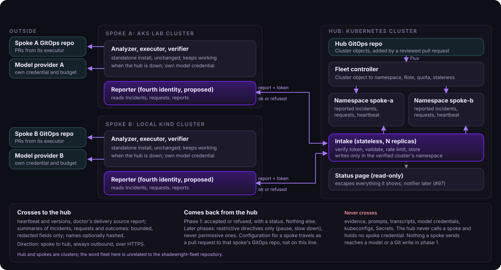
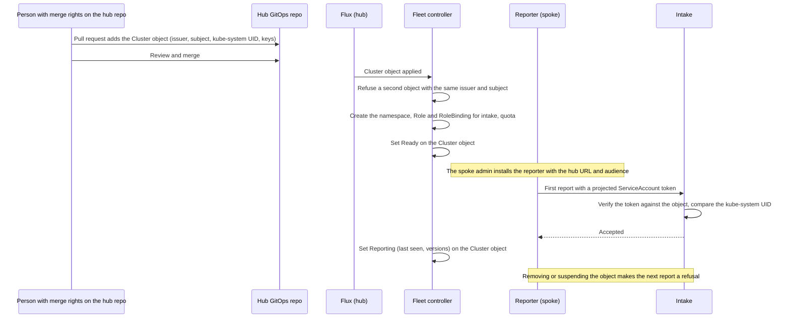
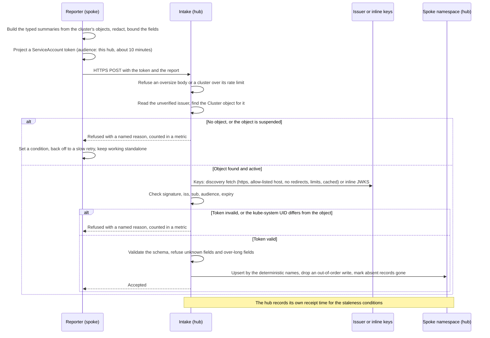

# ADR-0038: Control plane mode: a hub that many clusters report to

- Status: Proposed
- Date: 2026-11-14

## Context

Shadewright runs in one cluster today. Epic [#559](https://github.com/pkalin/shadewright/issues/559) asks for a second way to run it, for people who operate several clusters: one place that shows what the agents in all of them see and do. Task [#669](https://github.com/pkalin/shadewright/issues/669) asks for the ADR that settles how a cluster gets an identity a hub can check, what it reports, and how the hub reaches it. This is that ADR. Nothing in it is built.

How to read it. Every statement is one of three kinds:

- **Decided** means the maintainer decided it on [#559](https://github.com/pkalin/shadewright/issues/559), on the date given. This ADR only writes it down.
- **Proposed** means this ADR proposes it. It becomes a decision when the ADR is accepted.
- **Open** means nobody has decided it. It is listed under "Open questions" and the ADR does not guess.

"Fleet" in this ADR means the set of clusters. It has nothing to do with the name of the `shadewright-fleet` GitOps repository, which holds the lab's demo workloads.

Two properties of today's design shape the rest:

- The agent works with the model in the same cluster. The analyzer sends redacted context to the model deployment of its own settings ([ADR-0023](0023-how-the-analyzer-calls-the-model.md)), and a cluster has its own credential and daily budget for it ([ADR-0037](0037-the-anthropic-api-as-a-second-model-provider.md)).
- Every change goes through Git, and every identity has a narrow set of writes (invariants 3 and 6 in `AGENTS.md`). Any new component has to fit into that without a new way to change a cluster.

## Decision

### 1. Two modes, one set of binaries (Decided, 2026-11-14)

There are two modes with the same binaries and the same CRDs:

- **Standalone**, as today.
- **Control plane**: a hub, and clusters that report to it, called spokes in this ADR.

A spoke is a standalone install plus a reporter. It keeps working when the hub is down.

### 2. Where things run (Decided, 2026-11-14)

- The analyzer runs in each spoke. Evidence and prompts never cross to the hub. Analysis works when the hub is down, and no channel into a spoke is needed. Each cluster has its own model credential and its own budget ([ADR-0037](0037-the-anthropic-api-as-a-second-model-provider.md), [ADR-0023](0023-how-the-analyzer-calls-the-model.md)).
- The hub is a Kubernetes cluster with one namespace per spoke. Hub state goes through a small `StateStore` interface: read and write with compare-and-swap, list by key, a lock with a time limit, and an append-only log. That keeps a hub as a plain service on Azure Table and Blob Storage possible later ([ADR-0013](0013-adapters-for-every-external-system.md)).
- Connections are outbound from the spoke. The hub never calls a spoke and holds no kubeconfig or spoke credential.
- Redaction runs in the spoke before anything leaves it. The hub treats everything from a spoke as untrusted input (invariant 4).

[](../assets/diagrams/control-plane-overview.svg "Open full size")

### 3. Onboarding (Decided, 2026-11-14)

- A new spoke is a pull request that adds its `Cluster` object to the hub's GitOps repository. Whoever may merge there approves it. There is no self-registration.
- The object records the spoke's OIDC issuer URL and the UID of its `kube-system` namespace. The hub accepts reports for a name only from that issuer and UID. A rebuilt cluster needs a reviewed change of the object.
- A suspended or revoked spoke is refused with a clear status, and the refusals are counted in a metric. What it sent before stays readable and is marked stale. Nothing new is stored.
- The spoke learns of it from the refusal. It sets a condition, backs off to a slow retry and keeps working standalone. The hub never calls it.
- A spoke with no reachable issuer (Kind, on-premises): the `Cluster` object carries the public keys (JWKS) that sign the spoke's ServiceAccount tokens, and the hub verifies tokens against them. There is no shared secret and no hub CA. A key rotation in the spoke needs a reviewed change.



### 4. Components (Proposed)

In each spoke:

- **`reporter`**, a fourth identity (invariant 6). It reads Incidents, RemediationRequests, VerificationReports and the settings status in the operator namespace. It has no Secrets, no Git identity and no model credential. Its egress goes only to the hub's host. It reads the settings status only to report it, never to decide anything (`AGENTS.md`, invariant 6).

At the hub:

- **`intake`**: an HTTPS service, stateless, N replicas. It verifies the token, validates the report and stores it.
- **`fleet controller`**: reconciles `Cluster` objects into a namespace, a Role and RoleBinding for intake in that namespace, an object-count quota and staleness conditions.
- **A read-only status page**, and later the notifier ([#97](https://github.com/pkalin/shadewright/issues/97)).

In phase 1 the hub has no model credential and no Git write identity.

[](../assets/diagrams/control-plane-identities.svg "Open full size")

### 5. An intake service instead of the hub's Kubernetes API (Proposed)

The spoke posts to intake, and intake writes with its own identity. Reasons:

- Managed clusters do not let an operator add JWT authenticators per spoke.
- Inline keys need custom verification anyway, which the API server does not offer.
- Validation and rate limits sit in one place.
- A hub as a plain service later changes nothing for spokes.

"Spokes write to the hub's API server directly" is recorded as the rejected alternative (below). The transport stays behind an interface ([ADR-0013](0013-adapters-for-every-external-system.md)).

### 6. How intake checks a spoke (Proposed)

The reporter sends a projected ServiceAccount token with an audience that names this hub and a lifetime of about 10 minutes. Intake checks the signature, `iss`, `sub`, the audience and the expiry:

- The keys come from the issuer's discovery document, or from the inline keys of the `Cluster` object.
- `iss` and `sub` must equal those in the object.

The `kube-system` UID travels in the report and is compared with the object. This is not authentication. It guards against a rebuilt cluster that reuses an issuer or keys.

Issuer discovery is a fetch of a URL taken from a reviewed object, with these limits: https only, no redirects, size and time limits, a cache, and an issuer host that must match an allow-list of suffixes in the hub's settings.

The fleet controller refuses a second `Cluster` with the same issuer and subject. The older one stays, and the newer gets a condition.

### 7. The `Cluster` object (Proposed)

API group `fleet.shadewright.io/v1alpha1`, cluster-scoped, applied by Flux from the hub's GitOps repository.

- `spec.clusterId`: equal to the spoke's `clusterId`.
- `spec.identity`: `issuer`, `keys` (`Discovery` or `Inline`), `jwks`, `subject`, `kubeSystemUID`.
- `spec.suspended`.
- Status conditions `Ready`, `Reporting` (last seen) and `Stale`, and the reported versions.

This sketch is illustrative and not final. Field names, validation and the way a value is derived are for the build task.

```yaml
apiVersion: fleet.shadewright.io/v1alpha1
kind: Cluster
metadata:
  name: lab-kind
spec:
  clusterId: lab-kind
  suspended: false
  identity:
    keys: Inline            # or Discovery, which uses the issuer's discovery document
    issuer: https://issuer.example.com
    subject: system:serviceaccount:<operator namespace>:<reporter service account>
    kubeSystemUID: <uid of the kube-system namespace>
    jwks: |
      { "keys": [ { "kty": "RSA", "kid": "<key id>", "n": "<modulus>", "e": "AQAB" } ] }
```

### 8. What a spoke reports in phase 1 (Proposed)

A typed allow-list, not the objects themselves:

- A **heartbeat**: operator, chart and pack versions, module status, and the delivery source report of `doctor`.
- **Summaries of Incidents**: fingerprint, subject kind, namespace and name, reason, phase, times.
- **Summaries of requests**: action type, target, phase, pull request URL, condition reasons.
- **Outcomes.**

There is no evidence, no prompt, no transcript, and no free text from cluster content beyond bounded, redacted fields. A setting lets a spoke send names hashed.

The hub stores these as kinds of their own. Their working names are `ReportedIncident` and `ReportedRequest`. They are never stored as `Incident` or `RemediationRequest`: no hub controller may act on an object a spoke supplied (invariants 3 and 4).

### 9. Delivery (Proposed)

Delivery is level-based and at least once.

- The reporter sends the current state on change, and a full list periodically.
- Intake upserts by the existing deterministic names (invariant 5), drops an out-of-order write by the spoke's observed version, and marks records absent from a full list as gone.
- The reporter keeps nothing it cannot rebuild from the cluster's objects.

What "observed version" is exactly is open (see the open questions). Staleness is decided from recorded state on one clock: the time the hub itself recorded when it accepted a heartbeat, compared with the hub's clock. A time a spoke reports is shown, never used to decide whether data is stale.

### 10. Limits against a noisy or compromised spoke (Proposed)

- A rate limit per cluster and a body size limit at intake.
- An object-count quota per spoke namespace.
- Bounded field lengths.
- Schema validation, with unknown fields refused.
- The status page escapes everything. The notifier fences spoke text and neutralises mentions.
- Nothing a spoke sends reaches a model or a Git write in phase 1.

### 11. Kill switch (Proposed)

Per cluster: `spec.suspended` on its `Cluster` object. Fleet-wide: the hub's settings pause intake. In phase 1 both only stop reporting.

### 12. The rule for later phases: the hub can only make a spoke do less (Proposed)

A reply to a report may carry restrictive directives (pause remediation, slow down), never permissive ones. So a compromised hub can stop remediation in a spoke, but cannot cause it.

Configuration for a spoke (pack references, model profiles, policies) travels as a pull request to that spoke's GitOps repository (invariant 3), never as a directive.

### 13. Phases (Proposed)

1. **Fleet view**: reporter, intake, `Cluster`, status page, staleness, notifications. This is what the rest of this ADR specifies.
2. **Guard rails**: restrictive directives, a fleet-wide pause, configuration by pull request.
3. Each of these has its own ADR and is not decided here:
   - Remediation through the hub: a central executor holding the Git App. It would have to re-evaluate spoke proposals against policy held at the hub, treating them as untrusted input.
   - Horizontal scaling by key ownership.
   - The `StateStore` on Table and Blob Storage.

### 14. Prototype (Proposed)

One AKS lab cluster is the hub and also a spoke of itself (issuer discovery). A local Kind cluster is a second spoke (inline keys, outbound to the hub). So no second AKS cluster is needed. The cost has to be priced with `make lab-cost` in `shadewright-azure` before anything is built; this ADR gives no number.

### One report, from token to stored record



Whether a refusal that is not about the cluster's state (a rate limit, a malformed body) tells the reporter to back off the same way as a refusal for a suspended cluster is open. The status codes and reason names are for the build task.

## How invariants 1 to 6 hold in phase 1

1. **Model output is never authorization.** The hub has no model credential, and nothing a spoke sends reaches a model there. The analyzer and the policy gate in each spoke are unchanged.
2. **Actions are a closed catalog.** Phase 1 adds no action and no way to ask for one. A report is data about requests that already exist. The directives of phase 2 can only restrict.
3. **Changes go through Git only.** The hub writes nothing to a spoke and nothing to any Git repository in phase 1. A new spoke is a reviewed pull request to the hub's repository. Configuration for a spoke, when it comes, is a pull request to that spoke's repository.
4. **Everything from the cluster is untrusted input.** The spoke redacts before anything leaves it. The hub validates again, bounds every field, stores spoke objects as kinds of their own that no controller acts on, and escapes or fences what it shows or sends.
5. **Reconciliation is idempotent.** Delivery is at least once. Intake upserts by deterministic names, so a repeated or replayed report changes nothing, and an out-of-order one is dropped.
6. **Separate identities.** The reporter is a fourth identity with read-only access and no Secret, Git identity or model credential. At the hub, intake writes only the reported kinds in one namespace, and the fleet controller creates namespaces and Roles. No hub component has a model credential or a Git write identity. The build PR has to add the reporter, intake and the fleet controller to invariant 6; this ADR does not edit `AGENTS.md`.

## Threats and what stops each

| Threat | What stops it | What is left |
|---|---|---|
| A cluster pretends to be another spoke | The token is checked against the keys, `iss` and `sub` of the reviewed `Cluster` object, with an audience that names this hub. The `kube-system` UID is compared too, but it only guards against a rebuilt cluster, it is not authentication. | Anyone who can mint a token for the reporter's ServiceAccount in the spoke can report as that spoke, and only into that spoke's namespace. |
| A name is claimed twice | A `Cluster` is a reviewed merge. The fleet controller refuses a second object with the same issuer and subject; the older stays. | Two objects with the same `clusterId` but different issuers: open. |
| Token replay | The audience names this hub and the lifetime is about 10 minutes. A replayed report upserts the same state, and an older one is dropped. | A captured token can be used until it expires, from anywhere that reaches intake. No nonce is proposed. |
| A flooding or poisoning spoke | Per-cluster rate limit and body size, an object-count quota per namespace, bounded fields, schema validation that refuses unknown fields. Nothing reaches a model or Git in phase 1. | A spoke can fill its own quota with false records and show wrong data about itself. |
| Stale data read as current | Staleness is decided from the hub's own recorded receipt time. A suspended or revoked spoke's data stays readable and is marked stale. The status page shows when the hub last accepted a report. | A viewer who ignores the mark. |
| A compromised hub | It holds no kubeconfig or spoke credential, never calls a spoke, and has no Git write identity in phase 1. Replies carry only accepted or refused, and later only restrictive directives. | It can show false data and send false notifications. It can pause remediation in later phases. It cannot cause an action. |
| Injection through the status page or notifications | Fields are bounded and redacted in the spoke. The status page escapes everything. The notifier fences spoke text and neutralises mentions. | Not built; the build tasks need tests for each. |
| SSRF through issuer discovery | The URL comes only from a reviewed object. https only, no redirects, size and time limits, a cache, and an allow-list of host suffixes in the hub's settings. | Whether to refuse private or link-local addresses after name resolution: open. |

## Consequences

**Easier.** One view of all clusters, with no evidence, prompts or credentials gathered in one place. Each spoke is as safe as it is alone: it analyses, proposes and remediates with its own credential and budget, whether the hub is up or not. Adding a cluster uses the review path of every other change.

**Harder.**
- There is a new API group, a new set of components to build and operate, and a fourth identity in the spokes, with an `AGENTS.md` change in the build PR.
- The hub is a service that spokes depend on for the fleet view only. Its availability is an open question.
- A spoke rebuild or a key rotation needs a reviewed change at the hub.
- Hashed names (an optional setting) make the fleet view harder to read.

**Accepted.**
- In phase 1 the fleet view is read-only. The hub shows and notifies and proposes nothing.
- Reports are as true as the spoke that sends them. A compromised spoke can lie about itself.
- Cost: the prototype must be priced with `make lab-cost` before it is built.

## Alternatives considered

- **Spokes write to the hub's Kubernetes API directly.** Rejected. Managed clusters do not let an operator add a JWT authenticator per spoke, inline keys need custom verification the API server does not offer, validation and rate limits would be spread over RBAC and admission, and a plain-service hub would later change every spoke. Intake keeps those in one place.
- **The analyzer at the hub.** Evidence and redacted prompts would cross to the hub, analysis would stop when the hub is down, a channel into every spoke would be needed to read evidence on demand, and one model credential and budget would serve all clusters. Decided against on 2026-11-14.
- **The hub as a plain service from the start.** It needs a `StateStore` on Table and Blob Storage before there is a reason to have one, and gives up namespaces, RBAC, quotas and Flux for the hub's own configuration. The `StateStore` interface keeps this open for phase 3.
- **A bootstrap token exchanged once for a client certificate, as `kubeadm join` does.** It needs a shared secret to hand out and protect, a hub CA, and certificate rotation. The reviewed object with inline public keys needs none of them. It was a fallback candidate on [#559](https://github.com/pkalin/shadewright/issues/559) and was replaced by the decision of 2026-11-14.
- **A message broker (Service Bus, NATS) now.** It adds a component, a credential per spoke and a cost, to carry level-based reports that are a small HTTPS post. Not needed for phase 1. It can come back behind the same transport interface.
- **Reusing the `Incident` kind at the hub.** A hub controller that reconciles `Incident` or `RemediationRequest` could act on an object a spoke supplied, which breaks invariants 3 and 4, and the same name would mean two things. The hub stores `ReportedIncident` and `ReportedRequest`, which nothing acts on.

## Open questions

1. Where the executor and the Git App sit in the phase that remediates through the hub, and how the hub's policy evaluates a spoke's proposal (phase 3, its own ADR).
2. Hub high availability: how many replicas of intake, what the state store gives, and what the status page shows while the hub restarts.
3. Retention of reported records: how long they stay, and what happens to a removed spoke's namespace.
4. Whether hashed names should be the default instead of an option.
5. Multi-tenancy at the hub: who may read which cluster's namespace, and whether the status page shows every cluster to every viewer.
6. What the spoke's "observed version" is. An object's `resourceVersion` is opaque and must not be ordered. A counter or generation the reporter can rebuild from recorded state is needed, and the field is not chosen.
7. Where the reporter records the condition it sets after a refusal. It has no write on Incidents or requests, so this needs an object it may write, or a new grant (invariant 6), which the build task must name.
8. How the heartbeat gets the delivery source report of `doctor`. `doctor` is a kubectl plugin that runs with a person's permissions and reads Flux objects, and the reporter's reads above do not include them. Either the reporter gets that read, or the report comes from state another component already records.
9. Duplicate `spec.clusterId` across two `Cluster` objects with different issuers, and the rule for the name of a spoke's namespace.
10. Whether a refusal for a rate limit or a malformed body makes the reporter back off like a refusal for a suspended cluster, the reason names, and the leeway for clock difference when intake checks a token's expiry.
11. Whether intake refuses private and link-local addresses after name resolution of an issuer host, besides the host allow-list.
12. The price of the prototype ([#669](https://github.com/pkalin/shadewright/issues/669)): `make lab-cost` in `shadewright-azure`.

## Amendments

None.
