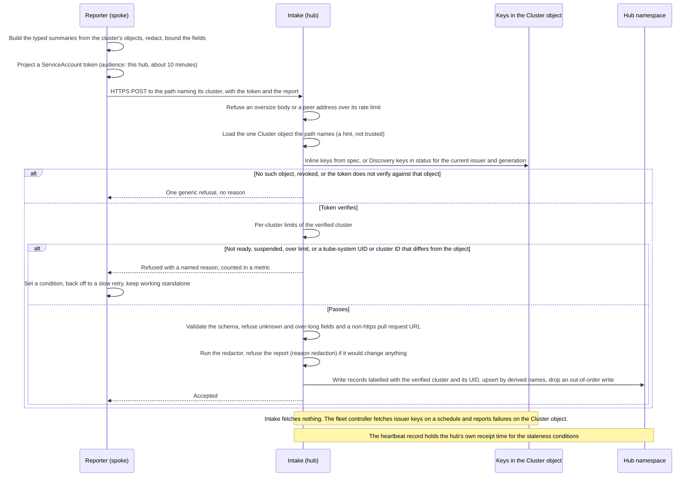

# ADR-0038: Control plane mode: a hub that many clusters report to

- Status: Proposed
- Date: 2026-11-14

## Context

Shadewright runs in one cluster today. Epic [#559](https://github.com/shadewright-labs/shadewright/issues/559) asks for a second way to run it, for people who operate several clusters: one place that shows what the agents in all of them see and do. Task [#669](https://github.com/shadewright-labs/shadewright/issues/669) asks for the ADR that settles how a cluster gets an identity a hub can check, what it reports, and how the hub reaches it. This is that ADR. Nothing in it is built. Shadewright 0.7.0 is to ship the read-only fleet view of phase 1 (section 13) on it.

How to read it. Every statement is one of three kinds:

- **Decided** means the maintainer decided it on [#559](https://github.com/shadewright-labs/shadewright/issues/559), on the date given. This ADR only writes it down.
- **Proposed** means this ADR proposes it. It becomes a decision when the ADR is accepted.
- **Open** means nobody has decided it. It is listed under "Open questions" and the ADR does not guess.

"Fleet" in this ADR means the set of clusters. It has nothing to do with the name of the `shadewright-fleet` GitOps repository, which holds the lab's demo workloads.

Two properties of today's design shape the rest:

- The agent works with the model in the same cluster. The analyzer sends redacted context to the model deployment of its own settings ([ADR-0023](0023-how-the-analyzer-calls-the-model.md)), a cluster has its own daily token budget for it (`maxTokensPerDay`, [ADR-0023](0023-how-the-analyzer-calls-the-model.md)), and its own credential for the Anthropic API ([ADR-0037](0037-the-anthropic-api-as-a-second-model-provider.md)).
- Every change goes through Git, and every identity has a narrow set of writes (invariants 3 and 6 in `AGENTS.md`). Any new component has to fit into that without a new way to change a cluster.

On 2026-11-28, after three review passes that each found new gaps in the hub's per-spoke namespaces, the maintainer narrowed the design: one hub namespace for every spoke's records, limits in intake's code, revoked clusters kept as objects, and the status page in a namespace of its own. The dropped design is under "Alternatives considered".

## Decision

### 1. Two modes, one set of binaries (Proposed)

There are two modes with the same spoke binaries plus hub binaries, and the same CRDs:

- **Standalone**, as today.
- **Control plane**: a hub, and clusters that report to it, called spokes in this ADR.

A spoke is a standalone install plus a reporter. It keeps working when the hub is down.

### 2. Where things run

- **Decided, 2026-11-14.** The analyzer runs in each spoke. Evidence and prompts never cross to the hub. Analysis works when the hub is down, and no channel into a spoke is needed. Each cluster has its own model credential ([ADR-0037](0037-the-anthropic-api-as-a-second-model-provider.md) for the key) and its own daily budget (`maxTokensPerDay`, [ADR-0023](0023-how-the-analyzer-calls-the-model.md)).
- **Decided, 2026-11-14:** the hub is a Kubernetes cluster, and hub state goes through a small `StateStore` interface: read and write with compare-and-swap, list by key, a lock with a time limit, and an append-only log. That keeps a hub as a plain service on Azure Table and Blob Storage possible later ([ADR-0013](0013-adapters-for-every-external-system.md)). **Decided, 2026-11-28, replacing the "one namespace per spoke" of 2026-11-14:** one hub namespace (`shadewright-hub` by default) holds intake, the fleet controller, the hub's settings and the reported objects of every spoke. The status page runs in a namespace of its own (section 4).
- **Decided:** the hub never calls a spoke. **Proposed:** connections are outbound from the spoke, and the hub holds no kubeconfig or spoke credential.
- **Proposed.** Redaction runs in the spoke before anything leaves it, with the existing redactor (`internal/redact`, moving to a shared module under [ADR-0048](0048-redaction-in-a-shared-module.md); [design 10.3](../design/10-security.md#103-redaction)), and again at the hub's intake, which refuses what it would change (section 10). The hub treats everything from a spoke as untrusted input (invariant 4).

[](../assets/diagrams/control-plane-overview.svg "Open full size")

### 3. Onboarding (Decided, 2026-11-14, except where marked)

- A new spoke is a pull request that adds its `Cluster` object to the hub's GitOps repository. Whoever may merge there approves it. There is no self-registration. **Decided, 2026-11-28:** that object is all onboarding adds; there is no Namespace, RoleBinding or ResourceQuota per spoke.
- The object records the spoke's OIDC issuer URL and the UID of its `kube-system` namespace. The hub accepts reports for a name only from that issuer and UID. A rebuilt cluster needs a reviewed change of the object.
- A spoke with no reachable issuer (Kind, on-premises): the `Cluster` object carries the public keys (JWKS) that sign the spoke's ServiceAccount tokens, and the hub verifies tokens against them. There is no shared secret and no hub CA. A key rotation in the spoke needs a reviewed change. (A later decision of the same day let inline keys change at the hub without a pull request. This ADR does not take it up, see "Alternatives considered"; accepting the ADR replaces that decision.)
- **Decided, 2026-11-14:** onboarding must not require copying identifiers by hand. The spoke publishes a ready-to-use registration in the operator namespace. The design that follows is **Proposed**.
- **Suspending (Proposed).** `spec.suspended: true` is the reversible stop: a spoke whose token verifies is refused with the named reason `suspended`, counted in a metric. What it sent before stays readable and is marked stale, and nothing new is stored. Setting it back to `false` resumes reporting.
- **Revoking (Decided, 2026-11-28).** Revocation is a pull request that sets `spec.revoked: true`. The object stays. Intake refuses every report for it with the generic refusal, the one an unknown name gets, so a caller cannot tell a revoked name from one never registered. The status page lists the cluster as revoked, with the time the hub last accepted a report from it, and its records stay readable. **Proposed:** a CEL transition rule keeps `revoked` true once set; a cluster that should report again registers under a new name. Deleting the object and purging its records is a later reviewed change, after the retention (proposed: 30 days, not final), and is not designed here.
- **Adopting a name again (Proposed).** Intake labels every record with the cluster name and the UID of the `Cluster` object it verified against. The status page shows only records whose UID equals the current object's. When a `Cluster` object appears for a name that has records with another UID, the fleet controller deletes those records before it sets `Ready`, and intake refuses reports with the named reason `not ready` until then. Records of a name with no `Cluster` object are kept and not shown; the purge change decides what happens to them.
- The spoke learns of a suspension from the named refusal, and of a revocation only from the generic one. The reporter sets a condition, backs off to a slow retry and keeps working standalone. The hub never calls it.

#### The registration manifest (Proposed)

- The reporter keeps a ConfigMap `shadewright-cluster-registration` in the operator namespace (`shadewright-system` by default) with one key, `cluster.yaml`: the complete `Cluster` manifest (section 7) for this spoke, ready to commit to the hub's GitOps repository. It holds the `clusterId`, the issuer URL (read from the `iss` claim of the reporter's own projected token, which the reporter decodes without verifying), `keys: Discovery` or `Inline`, for `Inline` the signing keys read from the API server's `/openid/v1/jwks`, the reporter's subject and the UID of `kube-system`.
- A second key, `status`, carries the last result from the hub: accepted, or refused with the reason. When the keys it reads differ from those of the last accepted report and the hub refuses, the reporter says there that the `Cluster` object needs a reviewed change. The reporter writes it, from what the hub answered. Anyone with `update` on ConfigMaps in the operator namespace can change both keys; RBAC decides who that is, not this ADR.
- The chart creates the ConfigMap only when it is absent, and never overwrites it on an upgrade or a reconcile. The reporter rewrites both keys on every pass, so a cleared ConfigMap heals. A deleted one comes back with the next chart upgrade, because the reporter cannot create it.
- `Discovery` is written when a chart value says the issuer is reachable from the hub, `Inline` otherwise (value name not final, for example `reporter.registration.issuerReachable`). `Inline` is the safe default, because it needs no reachable issuer. Whether that default is right is open (question 14).
- `kubectl shadewright` gets a command, proposed as `kubectl shadewright registration`, that prints the manifest or writes it to a file. It does not trust the ConfigMap: with the person's kubeconfig it reads every identity field live and prints each mismatch with the ConfigMap. The issuer comes from the API server's `/.well-known/openid-configuration`, the subject from the ServiceAccount of the reporter's Deployment, the UID from the `kube-system` Namespace, the `clusterId` from the install's settings and, for `Inline`, the keys from `/openid/v1/jwks`. The person who opens the pull request runs it and pastes the output into the description. No hub component reads the ConfigMap.
- Onboarding then is three steps: install the spoke with the hub's URL, put `cluster.yaml` into a pull request on the hub's GitOps repository, merge. Nothing is typed by hand.
- What a reviewer checks: the full issuer URL (does it belong to the cluster the name claims? for AKS, against `oidcIssuerProfile.issuerUrl`), the cluster name, the subject (it follows `system:serviceaccount:<operator namespace>:<reporter service account>`, so a different one is a reason to ask) and the command's output.
- Rotation for `Inline` is two reviewed changes: one that adds the new public key to `spec.identity.jwks` while the old key still signs, and, after the spoke signs with the new key, one that removes the old key. Kubernetes verifies with several keys and signs with one, so this leaves no gap.

Example, with placeholder values only (illustrative, not final):

```yaml
apiVersion: v1
kind: ConfigMap
metadata:
  name: shadewright-cluster-registration
  namespace: shadewright-system
data:
  cluster.yaml: |
    apiVersion: fleet.shadewright.io/v1alpha1
    kind: Cluster
    metadata:
      name: lab-kind
    spec:
      clusterId: lab-kind
      identity:
        keys: Inline
        issuer: https://issuer.example.com
        subject: system:serviceaccount:shadewright-system:shadewright-reporter
        kubeSystemUID: <uid of the kube-system namespace>
        jwks: |
          { "keys": [ { "kty": "RSA", "kid": "<key id>", "n": "<modulus>", "e": "AQAB" } ] }
  status: |
    result: refused   # or accepted
    reason: signing keys changed since the last accepted report; the Cluster object needs a reviewed change
```

**The ConfigMap is a convenience, not evidence (Proposed).** Everything in it is public. It is self-reported by the spoke, so whoever can edit it can change what gets pasted, for example an issuer of another cluster on the same AKS host, which passes the host allow-list. What makes a cluster trusted is the reviewed merge in the hub's repository, with the live comparison of the command above. **Open, not decided:** a CI check in the hub's repository that fetches the issuer's discovery document for a new `Cluster` object and reports whether keys resolve (question 15).

```mermaid
sequenceDiagram
    participant P as Person with merge rights on the hub repo
    participant R as Hub GitOps repo
    participant F as Flux (hub)
    participant C as Fleet controller
    participant S as Reporter (spoke)
    participant I as Intake
    Note over S: Proposed: the reporter writes the ConfigMap shadewright-cluster-registration (cluster.yaml, status) on every pass
    P->>S: kubectl shadewright registration: manifest, live check of every identity field
    P->>R: Pull request: the Cluster manifest only
    P->>R: Review (full issuer URL, name, subject, command output) and merge
    F->>F: Apply the Cluster object
    C->>C: Check the keys (public asymmetric only); on a conflict (same issuer and subject, or a shared inline key) refuse both objects
    C->>C: Fetch issuer keys (Discovery), delete records of an earlier Cluster UID
    C->>C: Set Ready on the Cluster object
    Note over S: The spoke admin installs the reporter with the hub URL and audience, before or after the merge
    S->>I: First report to the path of its cluster, with a projected ServiceAccount token
    I->>I: Load that one Cluster object, verify the token against it, compare the kube-system UID
    I-->>S: Accepted
    S->>S: Record the result in the status key of the ConfigMap
    C->>C: Set Reporting (last seen, versions) from the cluster's ReportedHeartbeat
    Note over S,I: Suspending the object makes the next verified report a refusal with the reason suspended. Revoking it (spec.revoked) gives the generic refusal; deleting the object and purging its records is a later reviewed change. Any change of inline keys is a reviewed pull request.
```

### 4. Components (Proposed)

In each spoke:

- **`reporter`**, a new spoke identity, `shadewright-reporter` (invariant 6). Its reads, exactly:
  - In the operator namespace: `get`, `list` and `watch` on `incidents`, `remediationrequests` and `verificationreports` (API group `remediation.shadewright.io`).
  - Cluster-scoped: `get` on `remediationsettings`, and `get` on the Namespace `kube-system` by `resourceNames` (for its UID).
  - **Open (question 8):** the Flux reads that the heartbeat's delivery report (section 8) needs. The candidate is `get` and `list` on `gitrepositories` and `kustomizations` (groups `source.toolkit.fluxcd.io` and `kustomize.toolkit.fluxcd.io`), cluster-wide or in the Flux namespace. Until that is decided the reporter has no Flux read.
  - `get` on the one ConfigMap `shadewright-cluster-registration` by `resourceNames`, and `get` on the non-resource URL `/openid/v1/jwks`.

  Its writes, exactly: `update` on that one ConfigMap, by `resourceNames`. `create` cannot be limited by name, so the chart creates the ConfigMap and the reporter never creates anything. No other new grant.

  It has no Secrets, no Git identity and no model credential. Egress, by NetworkPolicy: DNS (UDP and TCP 53 to the cluster's DNS), the API server (443 and 6443, as the existing rule of design 10), and TCP 443 for the hub. A NetworkPolicy cannot match host names ([design 10.6](../design/10-security.md#106-network)), so the network does not limit the reporter to the hub. The hub's host is pinned in the reporter's settings, and the reporter takes no URL from cluster data or from the hub's replies. Its client follows no redirects, ignores the environment's proxy settings and requires verified TLS 1.2 or later. It reads the settings status only to report it, never to decide anything (`AGENTS.md`, invariant 6).

At the hub, three identities, none `cluster-admin`, none with Secrets, a model credential or a Git write identity. "The reported kinds" are `ReportedIncident`, `ReportedRequest` and `ReportedHeartbeat` (section 8). The hub's settings are one ConfigMap, `shadewright-hub-settings`, in the hub namespace, applied by Flux.

- **`intake`**: an HTTPS service, stateless, N replicas. It verifies the token, checks the report (sections 6, 8 and 10) and stores it. Its grants:
  - Cluster-wide: `get`, `list` and `watch` on `clusters`. No write on them.
  - In the hub namespace: `get`, `list`, `watch`, `create`, `update` and `delete` on the reported kinds, and `get`, `list` and `watch` on the settings ConfigMap by `resourceNames`.
  - It is not the scoring intake of ADR-0047, and the binary is not `cmd/intake`.
- **`fleet controller`**: the only writer of `Cluster.status`: `Ready`, `Reporting`, `Stale`, `IdentityConflict`, `InvalidKeys`, `KeysUnavailable`, the reported versions, and for `Discovery` the issuer keys it fetched (section 6). It sets `Ready` only when the keys are valid, no identity conflict holds, records of an earlier registration are gone (section 3) and, for `Discovery`, keys were fetched for the current generation. Its grants:
  - Cluster-wide: `get`, `list` and `watch` on `clusters`, and `update` on `clusters/status`.
  - In the hub namespace: `get`, `list`, `watch` and `delete` on the reported kinds (delete only for the clean-up of section 3), `get`, `list` and `watch` on the settings ConfigMap by `resourceNames`, its leader election Lease and core Events.
- **`status page`**, its own identity `shadewright-fleet-status`, in its own namespace (`shadewright-hub-status` by default). Its grants: `get`, `list` and `watch` on `clusters`, and through a RoleBinding in the hub namespace `get`, `list` and `watch` on the reported kinds. No write. It has no Service, Ingress or LoadBalancer, and it listens on 127.0.0.1 only. Its namespace has a default-deny NetworkPolicy with no ingress rule, so no other pod reaches it over HTTP; kubelet health probes go to a separate port that serves only health. A person reaches it with `kubectl port-forward`, so the hub's API server authenticates the person, and RBAC (`create` on `pods/portforward` in `shadewright-hub-status`, which reaches nothing else) decides who may. Whoever reaches it sees every cluster (question 5).

**Egress (Proposed).** No hub binary makes an external call, except the fleet controller's key fetch (section 6). The NetworkPolicies follow [design 10.6](../design/10-security.md#106-network): intake and the status page get TCP 443 and 6443 for the API server and no DNS; the fleet controller gets DNS and TCP 443 and 6443. Those rules allow any address on those ports, because a standard NetworkPolicy cannot select the API server. Limiting intake and the status page to the API server at the network level needs an operator `ipBlock` for the API server's address or a CNI rule (design 10.6), which the chart does not ship.

**What RBAC does and does not do.** No hub identity creates, updates or deletes a Namespace, RoleBinding, ResourceQuota, Role or ClusterRole, or holds `bind` or `escalate`, so no admission policy is needed. RBAC does not separate spokes: every spoke's records share one namespace, and intake writes all of them. The guard is intake's code (section 10), and the build needs tests for it.

[![Identities of control plane mode and what each may write: the three spoke identities keep their writes, the reporter reads, sends reports and updates only its own registration ConfigMap, intake writes the reported kinds in the one hub namespace with the cluster taken from the verified Cluster object and limits per cluster in its code, the fleet controller alone writes Cluster status and deletes records of an earlier registration, the status page runs in its own namespace, only reads and is reached by port-forward, onboarding adds only a Cluster object, and no hub component has a model credential or a Git write](../assets/diagrams/control-plane-identities.svg)](../assets/diagrams/control-plane-identities.svg "Open full size")

### 5. An intake service instead of the hub's Kubernetes API (Proposed)

The spoke posts to intake, and intake writes with its own identity. Reasons:

- Onboarding a spoke as an API server JWT authenticator would be a change to the cloud control plane, not only a reviewed merge in the hub's GitOps repository. On AKS, structured authentication offers JWT authenticators in preview ([Microsoft Learn](https://learn.microsoft.com/azure/aks/external-identity-provider-authentication-overview)), configured per authenticator through the Azure API (`az aks jwtauthenticator add`), and it requires a publicly accessible discovery endpoint (vendor docs, checked 2026-11-14). It is a preview feature and specific to one vendor. Other vendors were not checked.
- Inline keys have no path through an API server authenticator.
- Validation, redaction checks and per-cluster limits would have no single place; at intake they sit in one.
- A hub as a plain service later changes nothing for spokes.

The transport stays behind an interface ([ADR-0013](0013-adapters-for-every-external-system.md)).

### 6. How intake checks a spoke (Proposed)

**Finding the `Cluster` object.** Kind and kubeadm clusters share the default issuer, and every install has the same reporter subject, so issuer plus subject cannot identify a spoke that uses inline keys. The reporter therefore posts to a path that names its cluster. The name is a hint and is not trusted: intake loads that one `Cluster` object and verifies the token against that object's issuer, keys and subject.

The reporter sends a projected ServiceAccount token with an audience that names this hub and a lifetime of about 10 minutes. Intake checks the signature, `iss`, `sub`, the audience and the expiry. `iss` and `sub` must equal those in the object. The keys are `spec.identity.jwks` for `Inline`, and for `Discovery` the keys the fleet controller fetched into the object's status, used only while that status names the object's current issuer and generation (below).

The `kube-system` UID travels in the report and is compared with the object. This is not authentication. It guards against a rebuilt cluster that reuses an issuer or keys. The cluster ID inside a report is compared with the object too, and a mismatch is refused.

**Order of checks.**

- Before the token verifies: a rate limit per source address, then one generic refusal with no reason. The source address is the connection's peer; `X-Forwarded-For` and `Forwarded` are ignored unless the peer is a proxy address listed in the hub's settings. A token with a key ID the object does not hold is refused the same way, and so is any report for a revoked object. Nothing a request carries makes the hub fetch anything.
- After it verifies: the per-cluster limits and the named reasons (`not ready`, `suspended`, `over limit`, `redaction`).

**Keys (both kinds).** Only public asymmetric keys are accepted: `kty` `RSA` or `EC`. A key with `kty` `oct`, `alg` `none`, or any private member (`d`, `p`, `q`, `dp`, `dq`, `qi`, `oth`, `k`) is refused. For `Inline` the fleet controller sets `InvalidKeys` and not `Ready`; for `Discovery` the fetch fails. Intake never uses such a key.

**Issuer keys for `Discovery`.** The fleet controller fetches them on a schedule (proposed: every 10 minutes, not final) and writes them into `Cluster.status` with the hub's fetch time, the issuer they were fetched for and the object's `metadata.generation` as `observedGeneration`. When the spec changes, it clears `Ready` and fetches again; intake uses the stored keys only when their issuer equals `spec.identity.issuer` and their `observedGeneration` equals the object's generation. A key the issuer added is usable after the next fetch, and one it removed is dropped then. If fetches fail, intake keeps using the stored keys until their fetch time is older than a maximum age (proposed: 24 hours, not final, compared with the hub's clock) and then refuses every token for that cluster. The fleet controller reports each failure as a condition (`KeysUnavailable`) and an Event. A failed fetch is retried, never a reason to trust old keys longer. A hub restore loses nothing: the fleet controller fetches again.

The fetch takes its URL only from a reviewed object and has these limits:

- The issuer host must match an allow-list of suffixes in the hub's settings. This limits where the hub fetches. It does not show that an issuer belongs to a cluster (on AKS, issuers share a host per region), so the reviewer checks the full issuer URL.
- The issuer is `https` on port 443. The fleet controller fetches `<issuer>/.well-known/openid-configuration`, and the document's `issuer` must equal `spec.identity.issuer` exactly.
- Its `jwks_uri` must be `https`, on the issuer's host and on port 443.
- Both fetches: verified TLS 1.2 or later, no redirects, no environment proxy, a size limit (proposed: 64 KiB each) and a time limit.
- The dial guard of [design 10.6](../design/10-security.md#106-network) checks every resolved address at connection time and refuses loopback, private (10.0.0.0/8, 172.16.0.0/12, 192.168.0.0/16, IPv6 unique local), link-local (169.254.0.0/16, fe80::/10), 100.64.0.0/10 and the hub's declared in-cluster ranges.

**Uniqueness.** For `Discovery`, issuer plus subject must be unique. For `Inline`, no two objects may share a signing key, compared by JWK thumbprint ([RFC 7638](https://www.rfc-editor.org/rfc/rfc7638)), not by key ID. On a conflict the fleet controller refuses both objects (condition `IdentityConflict`). Neither is accepted until a reviewed change resolves it. Revoked objects count, so a revoked cluster's keys cannot be registered under a new name without a review that sees the conflict.

### 7. The `Cluster` object (Proposed)

API group `fleet.shadewright.io/v1alpha1`, cluster-scoped, applied by Flux from the hub's GitOps repository.

- `spec.clusterId`: equal to the spoke's `clusterId` and to `metadata.name`, enforced by a CEL rule. It is a DNS label.
- `spec.identity`: `issuer`, `keys` (`Discovery` or `Inline`), `jwks` (`Inline` only), `subject`, `kubeSystemUID`. The spec holds only reviewed keys.
- `spec.suspended`: the reversible stop. `spec.revoked`: the final one, kept true by a CEL transition rule (section 3).
- Status, written by the fleet controller only: conditions `Ready`, `Reporting` (last seen), `Stale`, `IdentityConflict`, `InvalidKeys` and `KeysUnavailable`, the reported versions, and for `Discovery` the fetched keys with their fetch time, issuer and `observedGeneration`.

This sketch is illustrative and not final. Field names, validation and the way a value is derived are for the build task.

```yaml
apiVersion: fleet.shadewright.io/v1alpha1
kind: Cluster
metadata:
  name: lab-kind
spec:
  clusterId: lab-kind
  suspended: false
  revoked: false
  identity:
    keys: Inline            # or Discovery, which uses the issuer's discovery document
    issuer: https://issuer.example.com
    subject: system:serviceaccount:<operator namespace>:<reporter service account>
    kubeSystemUID: <uid of the kube-system namespace>
    jwks: |
      { "keys": [ { "kty": "RSA", "kid": "<key id>", "n": "<modulus>", "e": "AQAB" } ] }
```

### 8. What a spoke reports in phase 1 (Proposed)

A typed allow-list, not the objects themselves. Every field has a type, a length bound and, where it names a state, an enum:

- A **heartbeat**: operator, chart and pack versions, module status, and the delivery report of `doctor` as a typed list of at most 256 sources (the cap `doctor` uses). Each source has the Kustomization and GitRepository as namespace and name, the repository's host and path, the branch, `settings` (`named`, `not-named`, `ambiguous`, `unknown`), `state` (`ok`, `refused`, `not-ready`, `unknown`) and a reason from the source mapping's fixed set. The free-text `detail` of `doctor` is not sent.
- **Summaries of Incidents**: fingerprint, subject kind, namespace and name, reason, phase, times.
- **Summaries of requests**: action type, target, phase, pull request URL, condition reasons.
- **Outcomes**: the request's name, its final phase (one of the request phases of `api/v1alpha1` that end a request: `Succeeded`, `Denied`, `Failed`, `Expired`, `Cancelled`, `Superseded`, `NeedsIntervention`, `Inconclusive`) and the time it reached it.

There is no evidence, no prompt, no transcript, and no free text from cluster content beyond bounded fields redacted in the spoke by the redactor of [ADR-0048](0048-redaction-in-a-shared-module.md) ([design 10.3](../design/10-security.md#103-redaction)). A setting lets a spoke send names hashed.

The hub stores these as kinds of their own, all in the hub namespace: `ReportedIncident`, `ReportedRequest` (with its outcome) and one `ReportedHeartbeat` per cluster, which also holds the time the hub accepted it (working names). They are never stored as `Incident` or `RemediationRequest`: no hub controller may act on an object a spoke supplied (invariants 3 and 4). The fleet controller sets `Reporting`, `Stale` and the versions on the `Cluster` object from the heartbeat. A record's name is derived from the cluster name and the spoke's deterministic name (invariant 5), so two spokes never share a name.

### 9. Delivery (Proposed)

Delivery is level-based and at least once.

- The reporter sends the current state on change, and a full list periodically.
- Intake upserts by the derived names and drops an out-of-order write. How it orders writes is open (question 6).
- The reporter keeps nothing it cannot rebuild from the cluster's objects.

**Candidate for ordering (open question 6).** Each report carries the reporter's epoch (its start time) and a counter. Intake accepts only a pair higher than the last one stored for that cluster. The epoch is compared only with other epochs from the same reporter, never with the hub's clock.

**Full lists.** A full list is a snapshot, sent as numbered pages with a completion marker. Only a complete snapshot deletes the cluster's records it does not list. A snapshot cut short by a limit, or by a lost page, deletes nothing.

Staleness is decided from recorded state on one clock: the time the hub itself recorded when it accepted a heartbeat, compared with the hub's clock. A time a spoke reports is shown, never used to decide whether data is stale.

### 10. Limits against a noisy or compromised spoke (Proposed)

- **One cluster per write, in code.** Intake takes the cluster for every write, update and delete from the verified `Cluster` object, never from the report or the path. It refuses to update or delete a record whose cluster label or UID differs from the verified object's.
- **Per-cluster limits, in code**, keyed by the verified cluster: the number of records of each kind, the size of a body and of a record, and a request rate. Values are in the hub's settings (proposed defaults, not final: 5,000 records of each kind, 1 MiB per body, 16 KiB per record, 60 requests a minute). A report over a limit is refused with the named reason `over limit`. Counts come from intake's cache, so N replicas can overshoot a count by at most one report each, and the rate limit is per replica. A static ResourceQuota on object count for the whole hub namespace, shipped by the chart, stops a bug in that code from filling the hub; it is not per spoke.
- **Tests the build needs**: a report for one cluster cannot create, update or delete another cluster's record, whatever its path, body or names; one cluster at its limits does not refuse another's reports; each limit refuses at its bound; revoked and unknown clusters get the same refusal.
- A rate limit per source address before the token verifies (section 6), and schema validation of the types of section 8, with unknown fields refused and every field bounded.
- **The redactor again.** Intake runs the shared redactor of [ADR-0048](0048-redaction-in-a-shared-module.md) (`Redactor.Clean`) over every decoded string and key of a report, and refuses the whole report with the named reason `redaction` when it would change anything. Nothing is redacted and stored. As in [ADR-0047](0047-scoring-analysis-records-outside-the-cluster.md) section 3, values whose shape intake checks in code (the deterministic Incident and request names, fingerprints) are kept, because they trip the redactor. Intake's redactor is that of its own build, so a rule added after a spoke was built catches what the older spoke let through. A refusal is counted with the rule kinds that matched, never the text.
- **Pull request URLs** must parse as absolute `https` URLs with no userinfo. Any other is refused at intake, so the status page never renders a `javascript:` or credential-bearing link.
- The status page escapes everything.
- Nothing a spoke sends reaches a model, a notification or a Git write in phase 1.

### 11. Kill switch (Proposed)

Per cluster: `spec.suspended` on its `Cluster` object, which is reversible, or `spec.revoked` (section 3). Fleet-wide: the hub's settings pause intake. In phase 1 these only stop reporting.

### 12. The rule for later phases: the hub can only make a spoke do less (Proposed)

A reply to a report may carry restrictive directives (pause remediation, slow down), never permissive ones. So a compromised hub can stop remediation in a spoke, but cannot cause it.

A directive from the hub is held apart from the spoke's own kill switch (`docs/emergency.md`) and only adds to it. Lifting the hub's pause never lifts a local pause, and only the spoke's operator lifts a local one.

Configuration for a spoke (pack references, model profiles, policies) travels as a pull request to that spoke's GitOps repository (invariant 3), never as a directive.

### 13. Phases (Proposed)

1. **Fleet view**: reporter, intake, fleet controller, `Cluster`, the read-only status page with the identity and access of section 4, staleness. No notifications. This is what the rest of this ADR specifies, and what Shadewright 0.7.0 ships.
2. **Guard rails**: restrictive directives, a fleet-wide pause, configuration by pull request, and notifications: the notifier of [#97](https://github.com/shadewright-labs/shadewright/issues/97), with its own identity, its credential named by an ADR under the static credentials rule of invariant 6, spoke text fenced and mentions neutralised.
3. Each of these has its own ADR and is not decided here:
   - Remediation through the hub: a central executor holding the Git App. It would have to re-evaluate spoke proposals against policy held at the hub, treating them as untrusted input.
   - Horizontal scaling by key ownership.
   - The `StateStore` on Table and Blob Storage.

### 14. Prototype (Proposed)

One AKS lab cluster is the hub and also a spoke of itself (issuer discovery). A local Kind cluster is a second spoke (inline keys, outbound to the hub). So no second AKS cluster is needed.

**The prototype does not test the hub and spoke boundary.** With hub and spoke in one AKS cluster, the separation between them does not hold for that cluster: the hub's components share it with an executor that holds the Git App. The prototype tests registration and reporting, not that boundary. The public intake endpoint is also in the cluster that runs the executor and analyzer, so one rule holds there: the hub namespaces are never in `watchNamespaces` of any component. **The lab cluster does not last.** `make lab-down` in `shadewright-azure` destroys the lab AKS cluster after every session, so its issuer URL and the UID of its `kube-system` namespace change on every apply, and the hub's state goes with it. So each lab session registers its spokes again, by a pull request to the hub's repository. It is proposed that the lab script prints the registration at the end of `make lab-up`, so that the pull request needs no hand-copied values.

**Price (2026-11-14, `make lab-cost`, EUR, Sweden Central, Azure Retail Prices API).** The lab cluster costs 0.1992 per hour (one Standard_D4as_v5 node 0.1652, OS disk 0.0071, outbound public IPv4 0.0045, load balancer 0.0224, AKS Free tier). Hub and one spoke run in it and the second spoke on a local Kind cluster, which costs nothing. The only addition is one inbound public IPv4 for the intake service, 0.0045 per hour: about 0.204 per hour, or 1.63 for an 8 hour session. A second AKS cluster as the hub would double that to about 0.40 per hour. Usage-based items (data processed, egress, model tokens) are not included.

### One report, from token to stored record



Whether a refusal that is not about the cluster's state (a rate limit, a malformed body) tells the reporter to back off the same way as a refusal for a suspended cluster is open. The status codes and reason names are for the build task.

## How invariants 1 to 6 hold in phase 1

1. **Model output is never authorization.** The hub has no model credential, and nothing a spoke sends reaches a model there. The analyzer and the policy gate in each spoke are unchanged.
2. **Actions are a closed catalog.** Phase 1 adds no action and no way to ask for one. A report is data about requests that already exist. The directives of phase 2 can only restrict.
3. **Changes go through Git only.** The hub writes nothing to a spoke and nothing to any Git repository in phase 1. A new spoke, a key rotation, a suspension and a revocation are each a reviewed pull request to the hub's repository. Configuration for a spoke, when it comes, is a pull request to that spoke's repository.
4. **Everything from the cluster is untrusted input.** The spoke redacts before anything leaves it. The hub validates again, bounds every field, refuses a report its redactor would change, stores spoke objects as kinds of their own that no controller acts on, and escapes what it shows. Nothing a spoke sends changes who the hub trusts: keys come from the reviewed object or from the issuer.
5. **Reconciliation is idempotent.** Delivery is at least once. Intake upserts by names derived from the cluster and the spoke's deterministic names, so a repeated or replayed report changes nothing. Dropping an out-of-order report depends on the ordering rule (question 6).
6. **Separate identities.** The reporter is a new spoke identity, `shadewright-reporter`, with read-only access on the cluster's objects and no Secret, Git identity or model credential. Its only write is `update` on its one registration ConfigMap by `resourceNames`. At the hub, intake writes only the reported kinds in the hub namespace and has no write on `Cluster`. The fleet controller writes only `clusters/status` and deletes records of an earlier registration. The status page only reads. No hub identity creates Namespaces, RoleBindings or quotas, or holds `bind` or `escalate`. RBAC does not separate spokes: that guard is intake's code, and it needs tests. No hub component has a model credential or a Git write identity. The build PR has to add the reporter, intake, the fleet controller and the status page to invariant 6; this ADR does not edit `AGENTS.md`.

## Threats and what stops each

| Threat | What stops it | What is left |
|---|---|---|
| A cluster pretends to be another spoke | The path names a `Cluster` object, a hint that only selects what to verify against. The token is checked against the keys, `iss` and `sub` of that reviewed object, with an audience that names this hub. Intake takes the cluster for every write from the object, and a cluster ID in the report that differs is refused. The `kube-system` UID is compared too, but it only guards against a rebuilt cluster. | Anyone who can mint a token for the reporter's ServiceAccount in the spoke can report as that spoke, with that spoke's standing only. RBAC does not stop a bug in intake's code from writing another cluster's records; the tests of section 10 cover it. |
| A name is claimed twice | A `Cluster` is a reviewed merge, and `spec.clusterId` equals the object name. For `Discovery`, issuer plus subject must be unique; for `Inline`, no two objects share a signing key by thumbprint, revoked ones included. On a conflict both objects are refused (`IdentityConflict`). | None known. |
| Token replay | The audience names this hub and the lifetime is about 10 minutes. A replayed report upserts the same state. Dropping an older one depends on question 6. | A captured token can be used until it expires, from anywhere that reaches intake. No nonce is proposed. |
| A flooding or poisoning spoke, or an unauthenticated flood | Before the token verifies: a rate limit per peer address (forwarding headers ignored unless from a listed proxy) and one generic refusal; no request makes the hub fetch anything. After: per-cluster limits on count, size and rate in intake's code, and a namespace-wide quota as a backstop. Typed and bounded fields, unknown fields refused. Nothing reaches a model or Git in phase 1. | A spoke can fill its own limits with false records and show wrong data about itself. Replicas can overshoot a count by one report each. |
| Secrets stored at the hub by an old or compromised spoke | Intake runs its own build's redactor over every string and key and refuses the report if it would change anything. | A secret the redactor does not recognise. |
| Stale data read as current | Staleness is decided from the hub's own recorded receipt time. A suspended or revoked spoke's data stays readable and is marked stale or revoked. The status page shows only records stamped with the current object's UID, and older ones are deleted before a re-registered name is `Ready`. | A viewer who ignores the mark. |
| A compromised hub | It holds no kubeconfig or spoke credential, never calls a spoke, and has no Git write identity in phase 1. Replies carry only accepted or refused, and later only restrictive directives. | It can show false data. It can pause remediation in later phases. It cannot cause an action. In the prototype, hub and spoke share one AKS cluster with an executor that holds the Git App, so this row does not hold for that cluster. |
| A compromised fleet controller | It writes only `Cluster.status` and deletes reported records. It creates no namespace or binding. | It can make the hub trust wrong keys for a `Discovery` cluster, or delete reported records. |
| A compromised hub pod reads the status page | The status page has no Service, listens on 127.0.0.1 only, and its namespace denies all ingress. `pods/portforward` in its namespace reaches nothing else. | Whoever may port-forward there sees every cluster (question 5). |
| Injection through the status page | Fields are typed, bounded and redacted twice. Pull request URLs are `https` without userinfo. The status page escapes everything. | Not built; the build tasks need tests for each. |
| A tampered registration ConfigMap | The ConfigMap is a convenience, not evidence. A cluster is trusted only after the reviewed merge, where the reviewer checks the full issuer URL against the provider record, and `kubectl shadewright registration` compares every identity field with the live cluster. Everything in it is public. | A reviewer who merges without the comparison. With `Inline`, wrong keys that get merged make the hub trust whoever holds the matching private key. |
| A public intake endpoint in the cluster that also runs the executor and analyzer (prototype) | Intake is the only hub component reachable from outside. It holds no Git identity or model credential and makes no external call, verifies the token before it parses a body, and has no write on `Cluster`. The hub namespaces are never in any component's `watchNamespaces`. | Its NetworkPolicy allows 443 and 6443 to any address unless the operator narrows it (design 10.6). In the prototype the endpoint shares a cluster with the executor that holds the Git App, so the prototype does not test this boundary (section 14). A later hub gets its own cluster. |
| SSRF through issuer discovery | The URL comes only from a reviewed object, and no request triggers a fetch. The issuer host is on an allow-list, issuer and `jwks_uri` are https on port 443 of the same host, the discovery `issuer` must match exactly, no redirects or proxy, size and time limits, and the dial guard refuses loopback, private, link-local, 100.64.0.0/10 and in-cluster addresses. | A public host on an allowed suffix that serves something other than an issuer. |
| Keys that are not public signing keys | Only `RSA` and `EC` public keys are used; `oct`, `alg: none` and keys with private members are refused. Discovery keys are used only for the issuer and generation they were fetched for. | None known. |

## Consequences

**Easier.** One view of all clusters, with no evidence, prompts or credentials gathered in one place. Each spoke is as safe as it is alone: it analyses, proposes and remediates with its own credential and budget, whether the hub is up or not. Adding a cluster is one object in a reviewed pull request, and no hub identity can create a namespace or a binding.

**Harder.**
- There is a new API group, a new set of components to build and operate, and a new spoke identity, `shadewright-reporter`, with an `AGENTS.md` change in the build PR.
- The hub is a service that spokes depend on for the fleet view only. Its availability is an open question.
- The boundary between spokes at the hub rests on intake's code and its tests, not on RBAC. Whoever may read the hub namespace reads every spoke.
- Every inline key rotation is two reviewed pull requests at the hub, and a spoke rebuild needs one.
- A revoked spoke's object and records stay until a later reviewed change, which is not designed yet.
- Hashed names (an optional setting) make the fleet view harder to read.

**Accepted.**
- In phase 1 the fleet view is read-only and sends no notifications. The hub shows and proposes nothing.
- Reports are as true as the spoke that sends them. A compromised spoke can lie about itself.
- Cost: the prototype is about 0.204 per hour, 1.63 for an 8 hour session (section 14), and the lab is destroyed after each session.

## Alternatives considered

- **One hub namespace per spoke, with a quota and RoleBindings from the onboarding pull request.** The design of 2026-11-14 to 2026-11-27, dropped on 2026-11-28. Each spoke's folder at the hub held a Namespace, an object-count ResourceQuota and RoleBindings for intake, the fleet controller and the status page. Three review passes each found new gaps in it: a revoked spoke's namespace that the status page could not list without a Namespace read, Flux pruning intake's RoleBinding on revocation without editing the shared component, namespaces in deletion counted as ready, and the fleet controller unable to check quotas and bindings exactly. It still did not put the boundary between spokes into RBAC, because intake was one ServiceAccount bound in every spoke namespace, so the guard was in intake's code anyway. It cost a namespace, a quota and three bindings per spoke for a per-namespace quota that intake's code can enforce per cluster. Per-namespace impersonation by intake would have moved the guard into RBAC, at the cost of an `impersonate` grant on the component reachable from outside.
- **Revocation by deleting the `Cluster` object.** Part of the dropped design. With no object, the status page had nothing to list the spoke by and the records had no owner to show them under. Keeping the object with `spec.revoked: true` keeps both until a reviewed purge.
- **The fleet controller creates spoke namespaces, quotas and RoleBindings.** The first draft. RBAC cannot limit `create` on Namespaces by name, nor a cluster-wide RoleBinding or ResourceQuota grant to certain namespaces, so it needed a ValidatingAdmissionPolicy, and a gap in that policy (failure policy, UPDATE checks) would let a compromised controller bind intake's writes in `kube-system` or the operator namespace.
- **Automatic key updates for inline keys (`keyUpdates: Automatic`).** Decided on 2026-11-14 and dropped by this revision on 2026-11-27. A spoke would list its new keys in its reports, intake would record them, and the fleet controller would trust a key after it was listed in several authenticated reports over a window. Review found that it bent invariant 4 (data a spoke sends changing whom the hub authenticates as that spoke), that someone with brief access in a spoke could mint long-lived tokens and replay them across the window, that one spoke could list another's next key and block that spoke's rotation and onboarding, that stale observations could promote discarded keys after a suspension or re-adoption, and that a hub restore lost every promoted key. It needed a new kind, a notifier and three more open questions. Reviewed rotation (section 3) costs two pull requests per rotation and removes all of it.
- **Promotion by tokens signed with the pending key.** Part of the design above, not chosen even there: such a token shows that its signer holds the private key, not that the cluster's API server signs with it.
- **Intake fetches issuer keys itself.** It would give the one component reachable from outside an external call, and a refresh on an unknown key ID would let an unauthenticated request trigger a fetch. Intake also cannot write `Cluster.status` to report a failed fetch. The fleet controller fetches instead.
- **Spokes write to the hub's Kubernetes API directly.** Rejected. Onboarding would be an Azure control plane change on AKS (JWT authenticators are a preview feature there, configured per authenticator through the Azure API, and they need a public discovery endpoint; other vendors were not checked), inline keys have no path, validation and limits would have no single place, and a plain-service hub would later change every spoke.
- **The analyzer at the hub.** Evidence and redacted prompts would cross to the hub, analysis would stop when the hub is down, a channel into every spoke would be needed to read evidence on demand, and one model credential and budget would serve all clusters. Decided against on 2026-11-14.
- **The hub as a plain service from the start.** It needs a `StateStore` on Table and Blob Storage before there is a reason to have one, and gives up RBAC, Flux and the API server's validation for the hub's own configuration. The `StateStore` interface keeps this open for phase 3.
- **A bootstrap token exchanged once for a client certificate, as `kubeadm join` does.** It needs a shared secret to hand out and protect, a hub CA, and certificate rotation. The reviewed object with inline public keys needs none of them. It was a fallback candidate on [#559](https://github.com/shadewright-labs/shadewright/issues/559) and was replaced by the decision of 2026-11-14.
- **A message broker (Service Bus, NATS) now.** It adds a component, a credential per spoke and a cost, to carry level-based reports that are a small HTTPS post. Not needed for phase 1. It can come back behind the same transport interface.
- **Reusing the `Incident` kind at the hub.** A hub controller that reconciles `Incident` or `RemediationRequest` could act on an object a spoke supplied, which breaks invariants 3 and 4, and the same name would mean two things. The hub stores `ReportedIncident`, `ReportedRequest` and `ReportedHeartbeat`, which nothing acts on.

## Open questions

1. Where the executor and the Git App sit in the phase that remediates through the hub, and how the hub's policy evaluates a spoke's proposal (phase 3, its own ADR).
2. Hub high availability: how many replicas of intake, what the state store gives, and what the status page shows while the hub restarts.
3. Retention of reported records while a spoke is registered, the retention after revocation (30 days is proposed in section 3, not decided), and the reviewed change that deletes a revoked `Cluster` object and purges its records, including whether they are exported first.
4. Whether hashed names should be the default instead of an option.
5. Multi-tenancy at the hub: whether some viewers should see only some clusters. In phase 1 the status page shows every cluster to whoever may port-forward to it, and with one hub namespace RBAC cannot split reads by cluster.
6. How intake orders reports. An object's `resourceVersion` is opaque and must not be ordered. The candidate is the reporter's epoch plus a counter (section 9), and it is not chosen. How a reporter keeps the counter across a restart is part of it, and so is a clock that steps back across a restart, which would give a lower epoch that intake refuses until the stored pair is cleared.
7. Where the reporter records the condition it sets after a refusal. It has no write on Incidents or requests. **Proposed answer:** the `status` key of its registration ConfigMap (section 3), which needs no other grant. Open until the ADR is accepted.
8. How the heartbeat gets the delivery source report of `doctor`. `doctor` is a kubectl plugin that runs with a person's permissions and reads Flux objects, and the reporter's reads above do not include them. Either the reporter gets that read (the candidate is in section 4), or the report comes from state another component already records.
9. Closed, 2026-11-27: `spec.clusterId` equals the object name (section 7).
10. Whether a refusal for a rate limit or a malformed body makes the reporter back off like a refusal for a suspended cluster, the reason names, and the leeway for clock difference when intake checks a token's expiry.
11. Closed, 2026-11-27: the issuer fetch refuses private, link-local, 100.64.0.0/10 and in-cluster addresses after name resolution (section 6).
12. Closed, 2026-11-28: intake does not impersonate a per-spoke identity. With one hub namespace the guard between spokes is intake's code and its tests (section 10).
13. Closed, 2026-11-14: the price of the prototype ([#669](https://github.com/shadewright-labs/shadewright/issues/669)) is in section 14.
14. Whether the chart value that picks `Discovery` or `Inline` for the registration manifest has `Inline` as its default, and its name.
15. Whether the hub's repository gets a CI check that fetches the issuer's discovery document for a new `Cluster` object and reports whether keys resolve, and who owns it.
16. The name of the command that prints the registration (`kubectl shadewright registration` is a proposal), and whether the hub's status page shows the expected shape of the manifest.

## Amendments

None.
