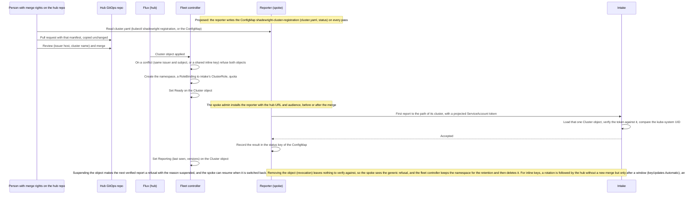
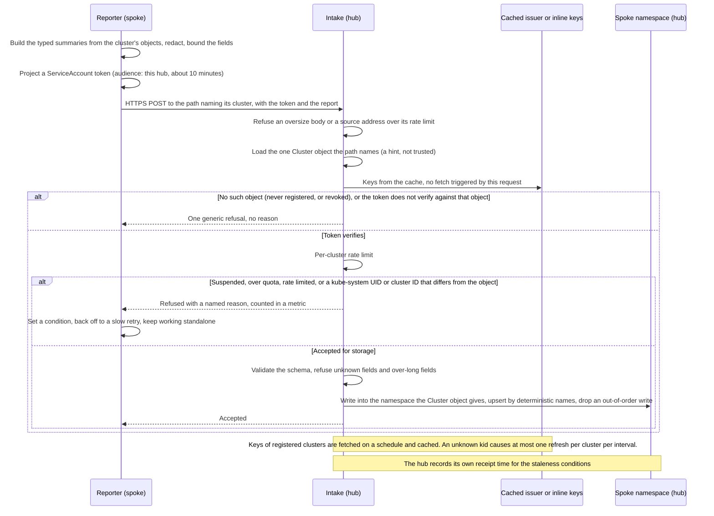

# ADR-0038: Control plane mode: a hub that many clusters report to

- Status: Proposed
- Date: 2026-11-14

## Context

Shadewright runs in one cluster today. Epic [#559](https://github.com/shadewright-labs/shadewright/issues/559) asks for a second way to run it, for people who operate several clusters: one place that shows what the agents in all of them see and do. Task [#669](https://github.com/shadewright-labs/shadewright/issues/669) asks for the ADR that settles how a cluster gets an identity a hub can check, what it reports, and how the hub reaches it. This is that ADR. Nothing in it is built.

How to read it. Every statement is one of three kinds:

- **Decided** means the maintainer decided it on [#559](https://github.com/shadewright-labs/shadewright/issues/559), on the date given. This ADR only writes it down.
- **Proposed** means this ADR proposes it. It becomes a decision when the ADR is accepted.
- **Open** means nobody has decided it. It is listed under "Open questions" and the ADR does not guess.

"Fleet" in this ADR means the set of clusters. It has nothing to do with the name of the `shadewright-fleet` GitOps repository, which holds the lab's demo workloads.

Two properties of today's design shape the rest:

- The agent works with the model in the same cluster. The analyzer sends redacted context to the model deployment of its own settings ([ADR-0023](0023-how-the-analyzer-calls-the-model.md)), a cluster has its own daily token budget for it (`maxTokensPerDay`, [ADR-0023](0023-how-the-analyzer-calls-the-model.md)), and its own credential for the Anthropic API ([ADR-0037](0037-the-anthropic-api-as-a-second-model-provider.md)).
- Every change goes through Git, and every identity has a narrow set of writes (invariants 3 and 6 in `AGENTS.md`). Any new component has to fit into that without a new way to change a cluster.

## Decision

### 1. Two modes, one set of binaries (Proposed)

There are two modes with the same binaries and the same CRDs:

- **Standalone**, as today.
- **Control plane**: a hub, and clusters that report to it, called spokes in this ADR.

A spoke is a standalone install plus a reporter. It keeps working when the hub is down.

### 2. Where things run (the analyzer, the hub form and "the hub never calls a spoke" are Decided, 2026-11-14; the rest is Proposed)

- **Decided.** The analyzer runs in each spoke. Evidence and prompts never cross to the hub. Analysis works when the hub is down, and no channel into a spoke is needed. Each cluster has its own model credential ([ADR-0037](0037-the-anthropic-api-as-a-second-model-provider.md) for the key) and its own daily budget (`maxTokensPerDay`, [ADR-0023](0023-how-the-analyzer-calls-the-model.md)).
- **Decided.** The hub is a Kubernetes cluster with one namespace per spoke. Hub state goes through a small `StateStore` interface: read and write with compare-and-swap, list by key, a lock with a time limit, and an append-only log. That keeps a hub as a plain service on Azure Table and Blob Storage possible later ([ADR-0013](0013-adapters-for-every-external-system.md)).
- **Decided:** the hub never calls a spoke. **Proposed:** connections are outbound from the spoke, and the hub holds no kubeconfig or spoke credential.
- **Proposed.** Redaction runs in the spoke before anything leaves it. The hub treats everything from a spoke as untrusted input (invariant 4).

[](../assets/diagrams/control-plane-overview.svg "Open full size")

### 3. Onboarding (Decided, 2026-11-14)

- A new spoke is a pull request that adds its `Cluster` object to the hub's GitOps repository. Whoever may merge there approves it. There is no self-registration.
- The object records the spoke's OIDC issuer URL and the UID of its `kube-system` namespace. The hub accepts reports for a name only from that issuer and UID. A rebuilt cluster needs a reviewed change of the object.
- **Suspending and revoking (Proposed).** There are two stops. `spec.suspended: true` is the reversible one: a spoke whose token verifies is refused with the named reason `suspended`, the refusals are counted in a metric, what it sent before stays readable and is marked stale, nothing new is stored, and its pending keys are discarded. Setting it back to `false` resumes reporting. Revocation is removing the `Cluster` object, by a pull request like any other change. The fleet controller then keeps the spoke's namespace and the reported objects in it for a retention (proposed: 30 days, not final), marked removed and stale, and after that deletes the namespace. It decides this from recorded state on its own clock: when it first finds a spoke namespace with no `Cluster` object it records the hub's time on the namespace, and it deletes the namespace only when the hub's clock is past that time plus the retention. If a `Cluster` object with the same name is added again during the retention, the namespace is adopted again and the mark is cleared. Nothing new is stored after revocation.
- The spoke learns of a suspension from the named refusal. After a revocation it sees only the generic refusal, the same one an unknown name gets. That is deliberate: with no `Cluster` object, intake has nothing to verify the token against, and before a token verifies no reason is given (section 6). A different answer for a removed name would tell any caller which names were once registered. So a revoked spoke cannot tell revocation from a wrong hub URL or a wrong cluster name. The reporter sets a condition, backs off to a slow retry and keeps working standalone. The hub never calls it.
- A spoke with no reachable issuer (Kind, on-premises): the `Cluster` object carries the public keys (JWKS) that sign the spoke's ServiceAccount tokens, and the hub verifies tokens against them. There is no shared secret and no hub CA. Two decisions of 2026-11-14 apply, the second revising the first. Earlier: a key rotation in the spoke needs a reviewed change. Later: the reviewed merge that registers a cluster happens once, and after it a spoke with inline keys may update its signing keys at the hub without another pull request, but slowly and visibly (design below, Proposed). The earlier rule now applies only where key continuity is lost.
- **Decided, 2026-11-14:** onboarding must not require copying identifiers by hand. The spoke publishes a ready-to-use registration in the operator namespace. The design that follows is **Proposed**.

#### The registration manifest (Proposed)

- **Proposed.** The reporter keeps a ConfigMap `shadewright-cluster-registration` in the operator namespace (`shadewright-system` by default) with one key, `cluster.yaml`: the complete `Cluster` manifest (section 7) for this spoke, ready to commit to the hub's GitOps repository. It holds:
  - the `clusterId`;
  - the issuer URL, read from the `iss` claim of the reporter's own projected token (the reporter decodes its own token and verifies nothing, it only reads where the cluster says it comes from);
  - `keys: Discovery` or `Inline`;
  - for `Inline`, the cluster's ServiceAccount signing keys, read from the API server's `/openid/v1/jwks`;
  - the reporter's subject and the UID of `kube-system`.
- **Proposed.** A second key, `status`, carries the last result from the hub: accepted, refused with the reason, or registration out of date (key continuity lost, see "Key continuity for Inline"). The reporter writes it, from what the hub answered. Who else can write it is decided by RBAC on ConfigMaps in the operator namespace, not by this ADR: anyone with `update` on ConfigMaps there can change both keys.
- **Proposed.** The chart creates the ConfigMap only when it is absent, and never overwrites `cluster.yaml` or `status` on an upgrade or a reconcile. The reporter rewrites both keys on every pass, so a cleared ConfigMap heals. A deleted one comes back with the next chart upgrade, because the reporter cannot create it.
- **Proposed.** Which mode it writes: `Discovery` when a chart value says the issuer is reachable from the hub, `Inline` otherwise. The value name is not final (for example `reporter.registration.issuerReachable`). `Inline` is the safe default, because it needs no reachable issuer, which is the case for Kind and on-premises clusters. Whether that default is right is open (question 14).
- **Proposed.** `kubectl shadewright` gets a command that prints this manifest or writes it to a file, for people who do not read ConfigMaps. The name `kubectl shadewright registration` is a proposal and is not final. The hub's status page may show the expected shape of the manifest. No hub component reads the ConfigMap.
- **Proposed.** Onboarding then is three steps: install the spoke with the hub's URL, copy `cluster.yaml` into a pull request on the hub's GitOps repository, merge. Nothing is typed by hand.
- **Proposed.** What a reviewer has to look at: the issuer host (does it belong to the cluster the name claims?) and the cluster name. The subject follows a fixed convention (`system:serviceaccount:<operator namespace>:<reporter service account>`), so a different one is a reason to ask. The `kube-system` UID is copied, not judged. For `Inline`, the issuer host and name say nothing about the keys, so the reviewer needs a check on them: `kubectl shadewright registration` (proposed) reads `/openid/v1/jwks` live from the cluster, compares it with the ConfigMap and prints a mismatch, and the person who opens the pull request runs it. The reviewer of the pull request sees that output only if it is pasted into the description.
- **Proposed.** Rotation for `Inline`: with `keyUpdates: Automatic` (below) a rotation needs no new pull request: the reporter sends the current key set and the hub follows it, after a window (hours, not seconds). The reporter rewrites `cluster.yaml` to match, so a later re-registration starts from current keys. Only when continuity is lost does it set `registration out of date` in `status`, and the hub then refuses the new tokens until a reviewed change merges.

Example, with placeholder values only (illustrative, not final):

```yaml
apiVersion: v1
kind: ConfigMap
metadata:
  name: shadewright-cluster-registration
  namespace: shadewright-system
data:
  cluster.yaml: |
    apiVersion: fleet.shadewright.io/v1alpha1
    kind: Cluster
    metadata:
      name: lab-kind
    spec:
      clusterId: lab-kind
      identity:
        keys: Inline
        issuer: https://issuer.example.com
        subject: system:serviceaccount:shadewright-system:shadewright-reporter
        kubeSystemUID: <uid of the kube-system namespace>
        jwks: |
          { "keys": [ { "kty": "RSA", "kid": "<key id>", "n": "<modulus>", "e": "AQAB" } ] }
  status: |
    result: registration out of date   # or accepted, or refused: <reason>
    reason: continuity lost, the old signing key was removed before the hub saw the new one
```

**The ConfigMap is a convenience, not evidence (Proposed).** Everything in it is public, there is no secret. It is self-reported by the spoke, so whoever can edit it can change what gets pasted. What makes a cluster trusted is the reviewed merge in the hub's repository, as before, and for `Inline` the keys are checked against the live cluster by the command above. For `Discovery` the hub also fetches the keys from the issuer itself, so a wrong issuer in the pasted manifest never verifies a token. **Open, not decided:** a CI check in the hub's repository that fetches the issuer's discovery document for a new `Cluster` object and reports whether keys resolve (question 15).



#### Key continuity for `Inline` (automatic, slow and visible)

**Decided, 2026-11-14:** the reviewed merge happens once. After it, a spoke with inline keys may update its signing keys at the hub without another pull request, but slowly and visibly: a new key is pending first and becomes trusted only after reports carrying it were authenticated by several tokens issued over a longer window, with a notification when it goes pending, and keys are dropped only after a long absence. A single captured token must not be enough to change the trusted keys. The mechanism below is **Proposed**, and its numbers are not final.

- **Anchor.** `spec.identity.jwks` in the reviewed `Cluster` object. The hub keeps the keys it currently trusts in `Cluster.status`, which starts equal to the anchor. Flux does not write status, so Git and the hub do not fight over it.
- **Who writes what.** Intake verifies every token against the trusted set only. It records what it saw in an object in that spoke's namespace (working name `KeyObservation`): the key set a report carried, and for each authenticated report an identifier of the token and the hub's own receipt time. Intake has no write on `Cluster`. The fleet controller alone writes `Cluster.status` (grant: `update` on `clusters/status`), promoting and dropping keys from those records.
- **Pending.** A key in a reported key set that the hub does not trust yet becomes pending, at that moment, with a condition and an Event on the `Cluster` object and a notification, unless it fails the uniqueness rule (see "Uniqueness" in section 6). A pending key verifies no token.
- **Promotion.** A pending key becomes trusted only after it was listed in reports authenticated by an already trusted key of that cluster: several different tokens (different issue times) spread over a window. That shows sustained control of the trusted identity, not one captured token. Proposed: at least 3 reports over at least 1 hour. The window is measured on the hub's clock from the receipt times it recorded. The issue time in a token only tells tokens apart and is never compared with the hub's clock. A spoke that rotates lists the new key while the old one still signs, for the window, and removes the old key afterwards.
- **Drop.** A trusted key is dropped only after it has been absent from every reported key set for a long period. Proposed: 7 days, measured the same way. A key that is still in the anchor is never dropped by this rule.
- **Suspending** the `Cluster` object discards pending keys.
- **Never updated by themselves:** the cluster name, `clusterId`, issuer, subject and the `kube-system` UID. A rebuilt cluster, or a rotation where the old key was removed before the hub saw the new one, has lost continuity and needs a reviewed change. The reporter's `status` key and the hub's condition say so.
- **Fail closed.** Any reviewed change to `spec.identity` replaces the trusted set with `spec.jwks` and discards pending keys, so a re-registration removes a key an attacker added. If `status` is lost after a rotation (a hub restore, an object recreated), the hub does not fall back to keys that were rotated out. The `Cluster` object holds only the reviewed keys, a hub with empty status trusts only those, and a spoke whose tokens do not verify against `spec.jwks` is refused until a reviewed change merges. **So a hub restore can require re-registration of every spoke that had rotated.** Whether the trusted keys in status should be backed up is open (question 18).
- **Limits and visibility:** a cap on trusted and pending keys per cluster, a condition and an Event on the `Cluster` object, and a notification for each key that goes pending, is promoted or is dropped. The uniqueness rule (section 6) is checked before a key becomes pending and again before it is promoted.
- **A switch per cluster:** `spec.identity.keyUpdates: Automatic` or `Reviewed` (name not final). The proposed default is `Automatic`. With `Reviewed` a key outside the anchor is never pending: it is refused with a condition, and every key change is a reviewed pull request. `Discovery` clusters are unaffected, because the hub already follows their issuer's keys.
- **Trade-off.** A single captured token (lifetime about 10 minutes) can at most add a pending key, which is visible and is discarded by a suspension or a reviewed change. Whoever can keep minting tokens for the reporter's identity for the whole window can still get a key trusted: that is the accepted cost (threat table). What an attacker gets is the standing of that one spoke: false or missing reports in the namespace of its `Cluster` object, and nothing in another cluster's namespace. That bound is kept by intake's code, which takes the namespace from the verified `Cluster` object, and not by RBAC (section 4), so it needs the tests listed there. One exposure remains across clusters: someone who can mint tokens in spoke A for the whole window can list spoke B's next key before B does, and so block B's automatic rotation until a person resolves it. This is visible (a condition on both objects and a notification). They cannot make the hub trust A as B. In phase 1 nothing a spoke sends reaches a model, a Git write or another spoke. The remedy is to suspend the `Cluster` object and register again with a reviewed change. With `Discovery`, a spoke token cannot change the issuer's key document, and exposure ends when the issuer removes the key id: intake drops it at the next successful refresh (section 6), and refuses everything once the cache's maximum age has passed without one; with `Inline` and `Automatic` it ends only with a reviewed re-registration. This must be re-examined before any later phase lets the hub act on spoke data (invariant 4).

### 4. Components (Proposed)

In each spoke:

- **`reporter`**, a fourth identity (invariant 6). Its reads, exactly:
  - In the operator namespace: `get`, `list` and `watch` on `incidents`, `remediationrequests` and `verificationreports` (API group `remediation.shadewright.io`).
  - Cluster-scoped: `get` on `remediationsettings`, and `get` on the Namespace `kube-system` by `resourceNames` (for its UID).
  - **Open (question 8):** the Flux reads that the heartbeat's delivery report (section 8) needs. The candidate is `get` and `list` on `gitrepositories` and `kustomizations` (groups `source.toolkit.fluxcd.io` and `kustomize.toolkit.fluxcd.io`), cluster-wide or in the Flux namespace. Until that is decided the reporter has no Flux read.
  - Proposed: `get` on the one ConfigMap `shadewright-cluster-registration` by `resourceNames`, and `get` on the non-resource URL `/openid/v1/jwks`.

  Its writes, exactly (Proposed): `update` on that one ConfigMap, by `resourceNames`. `create` cannot be limited by name, so the chart creates the ConfigMap, only when it is absent and never overwriting it, and the reporter never creates anything. No other new grant.

  It has no Secrets, no Git identity and no model credential. What is enforced for egress: a NetworkPolicy that allows TCP port 443 only. A NetworkPolicy cannot match host names (`docs/design/10-security.md`), so the network does not limit the reporter to the hub. The hub's host is pinned in the reporter's code and settings, and the reporter takes no URL from cluster data or from the hub's replies. It reads the settings status only to report it, never to decide anything (`AGENTS.md`, invariant 6).

At the hub:

- **`intake`**: an HTTPS service, stateless, N replicas. It verifies the token, validates the report and stores it, together with the key observations of section 3 (pending keys seen and the tokens that carried them). It reads `Cluster` objects and has no write on them.
- **`fleet controller`**: reconciles `Cluster` objects into a namespace, a RoleBinding for intake in that namespace, an object-count quota and staleness conditions. It deletes the namespace of a removed `Cluster` after the retention (section 3). It alone writes `Cluster.status` (`update` on `clusters/status`), including the trusted and pending keys, which it promotes and drops from the key observations intake recorded. It reads those records in the spoke namespaces.
- **A read-only status page**, and later the notifier ([#97](https://github.com/shadewright-labs/shadewright/issues/97)).

In phase 1 the hub has no model credential and no Git write identity.

**Hub RBAC (Proposed).**

- The chart ships one static ClusterRole for intake's writes (the reported kinds and the key observations). The fleet controller never creates Roles.
- The fleet controller creates Namespaces, ResourceQuotas and RoleBindings only, updates `clusters/status`, and for revocation (section 3) reads, patches and deletes the Namespaces it created. Its `bind` verb is limited by `resourceNames` to that one ClusterRole, and it has no `escalate`.
- RBAC cannot limit `create` on Namespaces by name, and it cannot limit a RoleBinding or a ResourceQuota to certain namespaces when the grant is cluster-wide. `bind` limited to one ClusterRole limits which role is bound, not where. So a ValidatingAdmissionPolicy is proposed that limits the fleet controller's writes in these ways:
  - Namespaces: only a name with the spoke namespace prefix, created with a label that marks it as created by the fleet controller. Patch and delete only on a namespace that carries the label and the prefix.
  - RoleBindings and ResourceQuotas: only in a namespace that has the prefix and the label. A RoleBinding must have intake's ServiceAccount as its only subject and that one Role by name as its `roleRef`.
  - Without this, a compromised fleet controller could bind intake's writes, or place a quota, in `kube-system` or in the operator namespace, which in the prototype is the cluster that also runs the executor holding the Git App.
- **RBAC does not enforce the boundary between spokes.** Intake is one ServiceAccount, bound in every spoke namespace. The guard is intake's code: the namespace a report is written to comes from the verified `Cluster` object, never from the report or the request path. The build needs tests that a report cannot reach another cluster's namespace. Per-namespace impersonation by intake would move the guard into RBAC; it is an open question.
- No hub identity is `cluster-admin`.

[![Identities of control plane mode and what each may write: the three spoke identities keep their writes, the reporter reads, sends reports and updates only its own registration ConfigMap, intake writes only the reported kinds and key observations in the namespace of the cluster it verified and cannot write Cluster objects, the fleet controller creates namespaces, ResourceQuotas and RoleBindings only (and removes the namespaces it created after a retention) and alone writes Cluster status, intake's writes are checked in its code and not by RBAC, and no hub component has a model credential or a Git write](../assets/diagrams/control-plane-identities.svg)](../assets/diagrams/control-plane-identities.svg "Open full size")

### 5. An intake service instead of the hub's Kubernetes API (Proposed)

The spoke posts to intake, and intake writes with its own identity. Reasons:

- Onboarding a spoke as an API server JWT authenticator would be a change to the cloud control plane, not only a reviewed merge in the hub's GitOps repository. On AKS, structured authentication offers JWT authenticators in preview ([Microsoft Learn](https://learn.microsoft.com/azure/aks/external-identity-provider-authentication-overview)), configured per authenticator through the Azure API (`az aks jwtauthenticator add`), and it requires a publicly accessible discovery endpoint (vendor docs, checked 2026-11-14). It is a preview feature and specific to one vendor. Other vendors were not checked.
- Inline keys have no path through an API server authenticator.
- Validation and rate limits would have no single place; at intake they sit in one.
- A hub as a plain service later changes nothing for spokes.

"Spokes write to the hub's API server directly" is recorded as the rejected alternative (below). The transport stays behind an interface ([ADR-0013](0013-adapters-for-every-external-system.md)).

### 6. How intake checks a spoke (Proposed)

**Finding the `Cluster` object.** Kind and kubeadm clusters share the default issuer, and every install has the same reporter subject, so issuer plus subject cannot identify a spoke that uses inline keys. The reporter therefore posts to a path that names its cluster. The name is a hint and is not trusted: intake loads that one `Cluster` object and verifies the token against that object's issuer, keys and subject. The name only selects what to verify against.

The reporter sends a projected ServiceAccount token with an audience that names this hub and a lifetime of about 10 minutes. Intake checks the signature, `iss`, `sub`, the audience and the expiry:

- The keys come from the issuer's discovery document, or from the inline keys of the `Cluster` object.
- `iss` and `sub` must equal those in the object.

The `kube-system` UID travels in the report and is compared with the object. This is not authentication. It guards against a rebuilt cluster that reuses an issuer or keys. The cluster ID inside a report is compared with the object too, and a mismatch is refused. The namespace a report is written to comes from the verified `Cluster` object in intake's code, never from the report.

**Order of checks.**

- Before the token verifies: a rate limit per source address, then one generic refusal with no reason. An unauthenticated request triggers no discovery fetch. Keys for registered `Cluster` objects are fetched on a schedule and cached, and an unknown `kid` triggers at most one refresh per cluster per interval.
- The cache has a maximum age (proposed: 24 hours, not final). If a refresh fails, the cached keys are kept only until that age and then every token for that cluster is refused, with a condition on the `Cluster` object, until a refresh succeeds. A failed refresh is an error to retry, never a reason to trust stale keys for longer. A key id the issuer has removed is dropped at the next successful refresh.
- After it verifies: the per-cluster rate limit and the named reasons (suspended, over quota). A revoked spoke, whose `Cluster` object is gone, never gets this far and sees the generic refusal.

Issuer discovery is a fetch of a URL taken from a reviewed object, with these limits: https only, no redirects, size and time limits, a cache with the maximum age above, and an issuer host that must match an allow-list of suffixes in the hub's settings.

**Uniqueness.** For `Discovery`, issuer plus subject must be unique. For `Inline`, no two objects may share a signing key. On a conflict between reviewed specs the fleet controller refuses both objects (condition `IdentityConflict`). The older one does not stay: neither is accepted until a reviewed change resolves it. A key that any other `Cluster` trusts, in `spec.jwks` or in its status, is never added as pending elsewhere: the report that lists it is accepted without that key, and the reporting cluster gets a visible condition (`IdentityConflict`), an Event and a notification. A key that is pending for two clusters is promoted for neither: both get the condition, and a person resolves it by a reviewed change. A key is never dropped from a cluster that already trusts it because another cluster listed it. The same holds when a reviewed `spec.jwks` names a key that another cluster already trusts or holds as pending: the new object is not accepted until a reviewed change resolves it, and the holder keeps its key. The "both refused" rule applies between reviewed specs.

### 7. The `Cluster` object (Proposed)

API group `fleet.shadewright.io/v1alpha1`, cluster-scoped, applied by Flux from the hub's GitOps repository.

- `spec.clusterId`: equal to the spoke's `clusterId`.
- `spec.identity`: `issuer`, `keys` (`Discovery` or `Inline`), `jwks` (the anchor for `Inline`), `keyUpdates` (`Automatic` or `Reviewed`, `Inline` only), `subject`, `kubeSystemUID`. The spec holds only reviewed keys.
- `spec.suspended`: the reversible stop (section 3). Removing the object is revocation: the namespace is kept for a retention and then deleted by the fleet controller.
- Status conditions `Ready`, `Reporting` (last seen) and `Stale`, the reported versions, and for `Inline` the currently trusted keys and the pending ones, written by the fleet controller only.

This sketch is illustrative and not final. Field names, validation and the way a value is derived are for the build task.

```yaml
apiVersion: fleet.shadewright.io/v1alpha1
kind: Cluster
metadata:
  name: lab-kind
spec:
  clusterId: lab-kind
  suspended: false
  identity:
    keys: Inline            # or Discovery, which uses the issuer's discovery document
    issuer: https://issuer.example.com
    subject: system:serviceaccount:<operator namespace>:<reporter service account>
    kubeSystemUID: <uid of the kube-system namespace>
    jwks: |
      { "keys": [ { "kty": "RSA", "kid": "<key id>", "n": "<modulus>", "e": "AQAB" } ] }
```

### 8. What a spoke reports in phase 1 (Proposed)

A typed allow-list, not the objects themselves:

- A **heartbeat**: operator, chart and pack versions, module status, and the delivery source report of `doctor`.
- **Summaries of Incidents**: fingerprint, subject kind, namespace and name, reason, phase, times.
- **Summaries of requests**: action type, target, phase, pull request URL, condition reasons.
- **Outcomes.**

There is no evidence, no prompt, no transcript, and no free text from cluster content beyond bounded, redacted fields. A setting lets a spoke send names hashed.

The hub stores these as kinds of their own. Their working names are `ReportedIncident` and `ReportedRequest`. They are never stored as `Incident` or `RemediationRequest`: no hub controller may act on an object a spoke supplied (invariants 3 and 4).

### 9. Delivery (Proposed)

Delivery is level-based and at least once.

- The reporter sends the current state on change, and a full list periodically.
- Intake upserts by the existing deterministic names (invariant 5) and drops an out-of-order write. How it orders writes is open (see the open questions).
- The reporter keeps nothing it cannot rebuild from the cluster's objects.

**Candidate for ordering (Proposed, open question 6).** Each report carries the reporter's epoch (its start time) and a counter. Intake accepts only a pair higher than the last one stored for that cluster. The epoch is compared only with other epochs from the same reporter, never with the hub's clock.

**Full lists.** A full list is a snapshot, sent as numbered pages with a completion marker. Nothing is marked gone until the snapshot is complete. A snapshot cut short by the quota, or by a lost page, marks nothing gone.
 Staleness is decided from recorded state on one clock: the time the hub itself recorded when it accepted a heartbeat, compared with the hub's clock. A time a spoke reports is shown, never used to decide whether data is stale.

### 10. Limits against a noisy or compromised spoke (Proposed)

- A rate limit per source address before the token verifies, and one per cluster after. A body size limit at intake.
- An object-count quota per spoke namespace.
- Bounded field lengths.
- Schema validation, with unknown fields refused.
- The status page escapes everything. The notifier fences spoke text and neutralises mentions.
- Nothing a spoke sends reaches a model or a Git write in phase 1.

### 11. Kill switch (Proposed)

Per cluster: `spec.suspended` on its `Cluster` object, which is reversible, or removing the object, which revokes it (section 3). Fleet-wide: the hub's settings pause intake. In phase 1 these only stop reporting.

### 12. The rule for later phases: the hub can only make a spoke do less (Proposed)

A reply to a report may carry restrictive directives (pause remediation, slow down), never permissive ones. So a compromised hub can stop remediation in a spoke, but cannot cause it.

A directive from the hub is held apart from the spoke's own kill switch (`docs/emergency.md`) and only adds to it. Lifting the hub's pause never lifts a local pause, and only the spoke's operator lifts a local one.

Configuration for a spoke (pack references, model profiles, policies) travels as a pull request to that spoke's GitOps repository (invariant 3), never as a directive.

### 13. Phases (Proposed)

1. **Fleet view**: reporter, intake, `Cluster`, status page, staleness, notifications. This is what the rest of this ADR specifies.
2. **Guard rails**: restrictive directives, a fleet-wide pause, configuration by pull request.
3. Each of these has its own ADR and is not decided here:
   - Remediation through the hub: a central executor holding the Git App. It would have to re-evaluate spoke proposals against policy held at the hub, treating them as untrusted input.
   - Horizontal scaling by key ownership.
   - The `StateStore` on Table and Blob Storage.

### 14. Prototype (Proposed)

One AKS lab cluster is the hub and also a spoke of itself (issuer discovery). A local Kind cluster is a second spoke (inline keys, outbound to the hub). So no second AKS cluster is needed.

**The prototype does not test the hub and spoke boundary.** With hub and spoke in one AKS cluster, the separation between them does not hold for that cluster: the hub's components share it with an executor that holds the Git App. The prototype tests registration and reporting, not that boundary. The Kind spoke is the only one that is separate from the hub. **The lab cluster does not last.** `make lab-down` in `shadewright-azure` destroys the lab AKS cluster after every session, so its issuer URL and the UID of its `kube-system` namespace change on every apply, and the hub's own state (its `Cluster` objects' status, the reported records) goes with it. So each lab session registers its spokes again, by a pull request to the hub's repository, for the hub's own cluster and for the Kind spoke if that was rebuilt too. It is proposed that the lab script prints the registration (the `Cluster` manifests with the new issuer and UID) at the end of `make lab-up`, so that the pull request needs no hand-copied values.

**Price (2026-11-14, `make lab-cost`, EUR, Sweden Central, Azure Retail Prices API).** The lab cluster costs 0.1992 per hour (one Standard_D4as_v5 node 0.1652, OS disk 0.0071, outbound public IPv4 0.0045, load balancer 0.0224, AKS Free tier). Hub and one spoke run in it and the second spoke on a local Kind cluster, which costs nothing. The only addition is one inbound public IPv4 for the intake service, 0.0045 per hour: about 0.204 per hour, or 1.63 for an 8 hour session. A second AKS cluster as the hub would double that to about 0.40 per hour. Usage-based items (data processed, egress, model tokens) are not included.

### One report, from token to stored record



Whether a refusal that is not about the cluster's state (a rate limit, a malformed body) tells the reporter to back off the same way as a refusal for a suspended cluster is open. The status codes and reason names are for the build task.

## How invariants 1 to 6 hold in phase 1

1. **Model output is never authorization.** The hub has no model credential, and nothing a spoke sends reaches a model there. The analyzer and the policy gate in each spoke are unchanged.
2. **Actions are a closed catalog.** Phase 1 adds no action and no way to ask for one. A report is data about requests that already exist. The directives of phase 2 can only restrict.
3. **Changes go through Git only.** The hub writes nothing to a spoke and nothing to any Git repository in phase 1. Automatic key updates change the hub's own trust state in `Cluster.status`, not a cluster, so no cluster is changed outside Git. Invariant 4 is the one they touch. A new spoke is a reviewed pull request to the hub's repository. Configuration for a spoke, when it comes, is a pull request to that spoke's repository.
4. **Everything from the cluster is untrusted input.** The spoke redacts before anything leaves it. The hub validates again, bounds every field, stores spoke objects as kinds of their own that no controller acts on, and escapes or fences what it shows or sends. **With `keyUpdates: Automatic` this invariant is bent, not simply held:** data a spoke sends changes who the hub authenticates as that spoke, which is untrusted input changing trust state. The bounds: it changes only that spoke's own identity, only its keys (never name, issuer, subject or UID), only after the window of section 3, visibly (condition, Event, notification), and phase 1 has no hub action on spoke data. `Reviewed` removes it. It must be re-examined before phase 2, and it is the reason for open question 17.
5. **Reconciliation is idempotent.** Delivery is at least once. Intake upserts by deterministic names, so a repeated or replayed report changes nothing. Dropping an out-of-order report depends on the ordering rule, which is an open question (6); the candidate is an epoch and counter pair per report.
6. **Separate identities.** The reporter is a fourth identity with read-only access on the cluster's objects and no Secret, Git identity or model credential. Its only write is `update` on its one registration ConfigMap by `resourceNames`; its `get` on that ConfigMap and on the non-resource URL `/openid/v1/jwks` are reads. At the hub, intake writes only the reported kinds and the key observations, and has no write on `Cluster`. The fleet controller alone writes `Cluster.status` (`update` on `clusters/status`, which holds the trusted keys), and otherwise creates Namespaces, ResourceQuotas and RoleBindings only (it also patches and deletes the Namespaces it created, for revocation), with `bind` limited to one ClusterRole and no `escalate`, and with a ValidatingAdmissionPolicy limiting where it may write. RBAC does not keep intake to one namespace, because it is one ServiceAccount bound in every spoke namespace: that guard is intake's code, which takes the namespace from the verified `Cluster` object, and it needs tests. No hub component has a model credential or a Git write identity. The build PR has to add the reporter, intake and the fleet controller to invariant 6; this ADR does not edit `AGENTS.md`.

## Threats and what stops each

| Threat | What stops it | What is left |
|---|---|---|
| A cluster pretends to be another spoke | The path names a `Cluster` object, a hint that only selects what to verify against. The token is checked against the keys, `iss` and `sub` of that reviewed object, with an audience that names this hub. The namespace written to comes from the object in intake's code, and a cluster ID in the report that differs is refused. The `kube-system` UID is compared too, but it only guards against a rebuilt cluster. | Anyone who can mint a token for the reporter's ServiceAccount in the spoke can report as that spoke. RBAC does not stop a bug in intake's code from writing to another namespace; tests and the open question on impersonation cover it. |
| A name is claimed twice | A `Cluster` is a reviewed merge. For `Discovery`, issuer plus subject must be unique; for `Inline`, no two objects may share a signing key. On a conflict both objects are refused (`IdentityConflict`). | Two objects with the same `clusterId` but different issuers: open. |
| Token replay | The audience names this hub and the lifetime is about 10 minutes. A replayed report upserts the same state. Dropping an older one depends on the open ordering question. | A captured token can be used until it expires, from anywhere that reaches intake. No nonce is proposed. |
| A flooding or poisoning spoke, or an unauthenticated flood | Before the token verifies: a rate limit per source address, one generic refusal with no reason, and no discovery fetch from an unauthenticated request. After: a per-cluster rate limit with named reasons. Body size, an object-count quota per namespace, bounded fields, schema validation that refuses unknown fields. Nothing reaches a model or Git in phase 1. | A spoke can fill its own quota with false records and show wrong data about itself. |
| Stale data read as current | Staleness is decided from the hub's own recorded receipt time. A suspended spoke's data, and a revoked one's during the retention, stays readable and is marked stale. The status page shows when the hub last accepted a report. | A viewer who ignores the mark. |
| A compromised hub | It holds no kubeconfig or spoke credential, never calls a spoke, and has no Git write identity in phase 1. Replies carry only accepted or refused, and later only restrictive directives. | It can show false data and send false notifications. It can pause remediation in later phases. It cannot cause an action. In the prototype, hub and spoke share one AKS cluster with an executor that holds the Git App, so this row does not hold for that cluster. |
| Injection through the status page or notifications | Fields are bounded and redacted in the spoke. The status page escapes everything. The notifier fences spoke text and neutralises mentions. | Not built; the build tasks need tests for each. |
| A tampered registration ConfigMap (Proposed) | The ConfigMap is a convenience, not evidence. A cluster is trusted only after the reviewed merge of its `Cluster` object, where the reviewer checks the issuer host and the name. For `Discovery` the hub fetches keys from the issuer itself, so a wrong issuer never verifies a token. For `Inline` the issuer host and name say nothing about the keys, so `kubectl shadewright registration` (proposed) compares the ConfigMap with `/openid/v1/jwks` read live from the cluster and prints a mismatch, run by the person who opens the pull request. Everything in it is public. A CI check on new `Cluster` objects is proposed as optional and is not decided. | Whoever can write ConfigMaps in the operator namespace (RBAC decides who) can change what gets pasted. A reviewer who merges without the comparison approves it. With `Inline`, wrong keys that get merged make the hub trust whoever holds the matching private key. |
| A captured reporter token used to add a key (Proposed) | A key the hub does not trust becomes pending, not trusted, with a condition, an Event and a notification at once. It is promoted only after it was listed in at least 3 reports authenticated by an already trusted key of that cluster, over at least 1 hour (proposed), and never on one report. A token lives about 10 minutes. A key that another cluster trusts is never added as pending, and a key pending for two clusters is promoted for neither. Suspending the object discards pending keys, and a reviewed change to `spec.identity` resets the trusted set. `keyUpdates: Reviewed` turns it off per cluster. | One captured token cannot get a key trusted. Someone who mints tokens in spoke A for the whole window can list spoke B's next key first and block B's automatic rotation, visibly, until a person resolves it; they cannot make the hub trust A as B. A reader who ignores the notification leaves the pending key to be promoted if more reports follow. |
| Someone who can mint reporter tokens (`create serviceaccounts/token`, or pod create in the operator namespace) (Proposed) | The window does not stop this: they can produce tokens for as long as they like. Everything else stays: the identity fields never change by themselves, a cap on keys, the uniqueness check before promotion, and visibility at each step. | **Accepted cost for phase 1.** They can get a key of their own trusted and keep reporting as that spoke after cleanup, until a reviewed re-registration. Damage is bounded to that spoke's namespace in phase 1. Re-examine before any phase lets the hub act on spoke data. |
| SSRF through issuer discovery | The URL comes only from a reviewed object. https only, no redirects, size and time limits, a cache, and an allow-list of host suffixes in the hub's settings. | Whether to refuse private or link-local addresses after name resolution: open. |

## Consequences

**Easier.** One view of all clusters, with no evidence, prompts or credentials gathered in one place. Each spoke is as safe as it is alone: it analyses, proposes and remediates with its own credential and budget, whether the hub is up or not. Adding a cluster uses the review path of every other change.

**Harder.**
- There is a new API group, a new set of components to build and operate, and a fourth identity in the spokes, with an `AGENTS.md` change in the build PR.
- The hub is a service that spokes depend on for the fleet view only. Its availability is an open question.
- A spoke rebuild, or a rotation that loses key continuity, needs a reviewed change at the hub. So can a hub restore that loses `Cluster.status`, for every spoke that had rotated.
- Hashed names (an optional setting) make the fleet view harder to read.

**Accepted.**
- In phase 1 the fleet view is read-only. The hub shows and notifies and proposes nothing.
- Reports are as true as the spoke that sends them. A compromised spoke can lie about itself.
- With `keyUpdates: Automatic` (the proposed default), data a spoke sends changes who the hub trusts as that spoke (invariant 4). Whoever can mint reporter tokens for the whole window can keep their place after cleanup. This is slow, bounded and visible (see "Key continuity for Inline") and is accepted for phase 1 only.
- Cost: the prototype is about 0.204 per hour, 1.63 for an 8 hour session (section 14), and the lab is destroyed after each session.

## Alternatives considered

- **Promotion by tokens signed with the pending key.** Not chosen. Such a token shows that its signer holds the private key, not that the cluster's API server signs with it, so one captured token that adds a pending key, followed by tokens an attacker signs with their own key, would pass, and a rotation would have a gap while the old key stops signing. Promotion rests on the already trusted key instead.
- **Spokes write to the hub's Kubernetes API directly.** Rejected. Onboarding would be an Azure control plane change on AKS (JWT authenticators are a preview feature there, configured per authenticator through the Azure API, and they need a public discovery endpoint; other vendors were not checked), inline keys have no path, validation and rate limits would have no single place, and a plain-service hub would later change every spoke.
- **The analyzer at the hub.** Evidence and redacted prompts would cross to the hub, analysis would stop when the hub is down, a channel into every spoke would be needed to read evidence on demand, and one model credential and budget would serve all clusters. Decided against on 2026-11-14.
- **The hub as a plain service from the start.** It needs a `StateStore` on Table and Blob Storage before there is a reason to have one, and gives up namespaces, RBAC, quotas and Flux for the hub's own configuration. The `StateStore` interface keeps this open for phase 3.
- **A bootstrap token exchanged once for a client certificate, as `kubeadm join` does.** It needs a shared secret to hand out and protect, a hub CA, and certificate rotation. The reviewed object with inline public keys needs none of them. It was a fallback candidate on [#559](https://github.com/shadewright-labs/shadewright/issues/559) and was replaced by the decision of 2026-11-14.
- **A message broker (Service Bus, NATS) now.** It adds a component, a credential per spoke and a cost, to carry level-based reports that are a small HTTPS post. Not needed for phase 1. It can come back behind the same transport interface.
- **Reusing the `Incident` kind at the hub.** A hub controller that reconciles `Incident` or `RemediationRequest` could act on an object a spoke supplied, which breaks invariants 3 and 4, and the same name would mean two things. The hub stores `ReportedIncident` and `ReportedRequest`, which nothing acts on.

## Open questions

1. Where the executor and the Git App sit in the phase that remediates through the hub, and how the hub's policy evaluates a spoke's proposal (phase 3, its own ADR).
2. Hub high availability: how many replicas of intake, what the state store gives, and what the status page shows while the hub restarts.
3. Retention of reported records while a spoke is registered, and the length of the retention after a spoke is removed (30 days is proposed in section 3, not decided). Whether a removed spoke's reported objects should be exported or archived before the namespace is deleted.
4. Whether hashed names should be the default instead of an option.
5. Multi-tenancy at the hub: who may read which cluster's namespace, and whether the status page shows every cluster to every viewer.
6. How intake orders reports. An object's `resourceVersion` is opaque and must not be ordered. The candidate is the reporter's epoch plus a counter (section 9), and it is not chosen. How a reporter keeps the counter across a restart is part of it.
7. Where the reporter records the condition it sets after a refusal. It has no write on Incidents or requests. **Proposed answer:** the `status` key of its registration ConfigMap (section 3), which it may update by `resourceNames` and which needs no other grant. Open until the ADR is accepted.
8. How the heartbeat gets the delivery source report of `doctor`. `doctor` is a kubectl plugin that runs with a person's permissions and reads Flux objects, and the reporter's reads above do not include them. Either the reporter gets that read (the candidate is in section 4), or the report comes from state another component already records.
9. Whether `spec.clusterId` must equal the object name, and the rule for the name of a spoke's namespace.
10. Whether a refusal for a rate limit or a malformed body makes the reporter back off like a refusal for a suspended cluster, the reason names, and the leeway for clock difference when intake checks a token's expiry.
11. Whether intake refuses private and link-local addresses after name resolution of an issuer host, besides the host allow-list.
12. Whether intake should impersonate a per-namespace identity when it writes, so that RBAC enforces the boundary between spokes, and the cost of that.
13. Closed, 2026-11-14: the price of the prototype ([#669](https://github.com/shadewright-labs/shadewright/issues/669)) is in section 14.
14. Whether the chart value that picks `Discovery` or `Inline` for the registration manifest has `Inline` as its default, and its name.
15. Whether the hub's repository gets a CI check that fetches the issuer's discovery document for a new `Cluster` object and reports whether keys resolve, and who owns it.
16. The name of the command that prints the registration (`kubectl shadewright registration` is a proposal), and whether the hub's status page shows the expected shape of the manifest.
17. Whether `keyUpdates: Automatic` is the right default once phase 2 or 3 exists, when the hub can act on what spokes send, and the name, the cap, the number of tokens, the window and the absence period of the key updates (the values in section 3 are not final).
18. Whether the trusted keys in `Cluster.status` should be backed up, so that a hub restore does not require re-registration of every spoke that had rotated (see "Fail closed" in section 3).
19. Whether `keyUpdates: Reviewed` should be the default of phase 1 instead of `Automatic`. `Reviewed` makes every key change a reviewed pull request and leaves invariant 4 unbent, at the cost of a pull request for each rotation. Related to question 17.

## Amendments

None.
