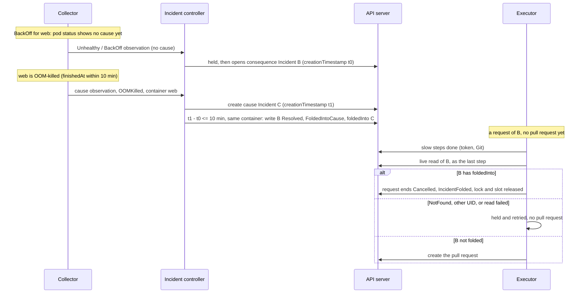

# ADR-0039: Consequence symptoms attach to their cause's Incident

- Status: Proposed
- Date: 2026-11-14

## Context

Issue [#432](https://github.com/pkalin/shadewright/issues/432) (with [#642](https://github.com/pkalin/shadewright/issues/642) folded in) asks that one fault open one Incident. It has happened three times on the lab. On 2026-11-10 (`v0.4.0-rc.1`) and again on 2026-11-14 (`v0.5.0-rc.2`) the `oom` scenario opened three Incidents for `demo/web` within two minutes: `OOMKilled`, `BackOff` and `Unhealthy`. Each one used an analysis, each proposed a memory limit for the same container, and on 2026-11-10 a queued request opened a second pull request for the same fix ([#643](https://github.com/pkalin/shadewright/issues/643), fixed separately). On 2026-11-14 the lab also reached its daily cap of 40 analyses in one day of matrix runs. [#726](https://github.com/pkalin/shadewright/issues/726) is the other side: a single readiness failure at pod start opened an Incident and got a memory increase proposed.

The cause is in design section 3.2: the fingerprint hashes the reason, so `BackOff` and `Unhealthy` on a container that was OOM-killed are different fingerprints, hence different Incidents. The fingerprint is not the problem to fix. It is stable across restarts and keeps unrelated problems of one workload apart, which the acceptance criteria of #432 require.

Decisions taken by the maintainer on #432 and not reopened here:

- **Decided (2026-11-10):** the grouping is a deterministic rule in code. No model decides it. A matching observation is evidence on the cause's Incident and opens none of its own. The fingerprint does not change.
- **Decided (2026-11-10):** a consequence Incident already open when its cause's Incident opens is closed with a reason that names the cause's Incident. Its counts are kept. A request of it that has no pull request yet is cancelled.
- **Decided (2026-11-10):** rejected are skipping the analysis while another Incident of the workload is in progress (it delays unrelated problems) and grouping a workload's Incidents into one analysis (it changes model input).
- **Decided (2026-11-14):** the first version is one general container rule. `BackOff` and probe `Unhealthy` are consequences of a container-level cause: `OOMKilled`, an image that cannot be pulled, a missing Secret or another configuration error. There is no row per pair.
- **Decided (2026-11-14):** a consequence with no cause is held for a grace period (2 minutes proposed) and opens an Incident only if the symptom is still there after the wait.
- **Decided (2026-11-14, last comment, revising the window decided earlier the same day):** the link between a consequence and its cause is read from the pod status the kubelet wrote, and it is bounded in time. For each `BackOff` or `Unhealthy` observation the collector looks at that container's status: an OOM kill that finished within the last 10 minutes, or a waiting reason for an image or configuration error now. If so, the observation is evidence on that cause's Incident and opens none of its own. Nothing depends on how long an Incident stays open or in which phase it is, and an Event alone can neither create a cause nor fold another Incident.

**Superseded: the earlier window.** The first decision of 2026-11-14 said a cause absorbs matching symptoms on its container for as long as its Incident is open, with no timer. It is replaced for two reasons. An `Escalated` Incident stays open until a person acts, so it would absorb every later probe failure on its container forever, with no analysis. And an Incident opened from an Event (for example a forged `Failed` Event) would count as a cause: it could hide real symptoms of the container and, through the late-cause rule, cancel a real request. Reading the kubelet's pod status and bounding it by time removes both.

What the code does today, which the proposals below start from (the numbers are of `main` at `0220bc9b`):

- `collector.Observation` (`internal/analyzer/collector`, `collector.go` about lines 72 to 127) carries the fingerprint, the subject (the verified owner workload), `Reason`, `Type`, `ReportingController`, the symptom, the occurrence, `Total`, `Count`, `Began`, `MayRepeat` and `Immediate`. It has no container name and no class of symptom.
- An event is read with `regarding` kind and name, reason, note, times and series. The `regarding.fieldPath`, which names the container in a kubelet event (`spec.containers{web}`), is not read.
- Pod status (`pods.go`, `terminations`, about lines 70 to 84) gives one observation per abnormal container termination, from `lastState.terminated` and `state.terminated` (`OOMKilled`, or another reason with a non-zero exit code), with the container name in the symptom. It reads the termination's reason, container ID, times and exit code. Nothing reads a container's waiting state, so an image pull failure or a configuration error reaches the analyzer only as a kubelet Warning event.
- `Incident.Spec` has no container. The spec is immutable. `Incident.Status` has `phase`, `firstSeen`, `lastSeen`, `count`, at most 32 `occurrences`, `occurrencesDroppedThrough`, `resolvedTime`, `lastAnalysisTime`, `conditions` and more.
- `consume` in `internal/incidents/controller.go` decides, per observation: count it into an existing Incident, open one at once (`Immediate`, `recurs`, or a refused fingerprint), or hold a first sighting in memory (`internal/incidents/sightings.go`, seen again 2 to 15 minutes later). `BackOff` and `Unhealthy` are never `Immediate`, because the reason of an event is written by whoever can create events (design 3.1).
- The Incident's `phase` is written by two components, not one. The Incident controller writes `Open`, and the closure rules (`internal/incidents/closure.go`) write `Resolved`, `Proposed` and `Escalated` from request phases. The analysis controller (`internal/analysis/controller.go`, about lines 834 and 1020) writes `Analyzing` in its claim and `Proposed` or `Escalated` in its outcome. Each write is guarded by the claim check `owns` (about line 491): the same UID, generation and subject, phase `Analyzing`, the `lastAnalysisTime` it wrote, and the claim not expired.
- The executor is the only writer of a request's status, and it already holds `get` on the Incident a request names (AGENTS.md, invariant 6). Its reads of the Incident today answer "nothing" on an error: `hintIncident` (`hints.go`, about lines 680 to 695) returns nil, and `verifiedIncidentName` (`pullrequest.go`, about lines 2132 to 2154) returns an empty name. That is fine for a pull request body and a hint, and wrong for a decision (point 20). The executor has no watch on Incidents (`remediationrequest_controller.go`, about line 1098): it reads an Incident only while it reconciles a request.

## Decision

[![One container's symptoms flow to one Incident: the OOMKilled termination opens the cause Incident; for BackOff and Unhealthy the collector reads the pod status the kubelet wrote and, if it shows an OOM kill within 10 minutes or an image or configuration wait, records the observation as evidence in the cause Incident's own list and opens nothing; a consequence whose cause Incident does not exist yet waits within the hold, then goes through the gate; a consequence with no cause is held and opens an Incident only if it is still failing at the end and was seen failing twice; a consequence Incident created up to 10 minutes before its cause Incident is closed in its favour and its request without a pull request is cancelled by the executor after a live read of the Incident; a cause of another container keeps its own Incident.](../assets/diagrams/cause-rule.svg)](../assets/diagrams/cause-rule.svg "Open full size")

Each point is marked **Decided** (with the date of the comment on #432 that states it), **Proposed** (this ADR's proposal, to be settled by review) or **Open**.

### 1. The rule and its classes

1. **Decided (2026-11-10, 2026-11-14).** The rule is deterministic code with no model input or output. A consequence observation whose container has a cause, read from the pod status, is evidence on the cause's Incident and opens none. The fingerprint is unchanged.
2. **Proposed.** The collector sets new fields on an observation, from what it read itself: `Container` (the container name, or empty), `Class` (`cause`, `consequence` or none) and, on a consequence whose pod status shows a cause, `CauseFingerprint`.
    - `consequence`: reason `BackOff` or probe `Unhealthy` from the kubelet, on a named container.
    - `cause`: what the pod status shows for the container (point 3). A kubelet Warning event never makes a cause, whatever its reason.
    - Everything else has no class and goes through the gate as today.
3. **Proposed.** The cause of a container is read from its status entry in the pod the collector verified, in this order:
    1. its current `state.waiting` with an image or configuration reason (`ImagePullBackOff`, `ErrImagePull`, `InvalidImageName`, `CreateContainerConfigError`, `CreateContainerError`), now;
    2. otherwise an OOM kill in `lastState.terminated` or `state.terminated` with reason `OOMKilled` and a `finishedAt` within the last 10 minutes.

    If two causes show on one container, the one that is current gets the evidence: the waiting reason of the first item, because it is what the container is doing now, and the kill of the second only when no such waiting reason is set. Any other termination (a non-zero exit code) is a cause Incident as today but does not link `BackOff` or `Unhealthy`: the first version of the rule names only the two causes of the decision. **Open:** whether a crash loop (a non-zero exit) should link too.
4. **Proposed.** The collector needs two things it does not read today. It reads the container from the Event's `regarding.fieldPath` (point 9), and it reads the waiting reasons of the pod status (`state.waiting.reason`, kept only when it equals one of the fixed values above; the waiting message is never read, it is free text). From the waiting state it emits a cause observation with that reason as `Reason`, class `cause`, the kubelet as reporting controller, which opens its Incident through the gate (not `Immediate`: a wait is often short while an image is pulled). Its fingerprint is the cause fingerprint the consequence points to. For a termination the cause fingerprint is the one of the termination observation that exists today.
5. **Proposed, with an Open point.** The 10 minute bound compares the kill's `finishedAt`, which the kubelet wrote on its node's clock, with the collector's clock. Two clocks are involved. The bound is wide, so a skew of seconds only moves its edge, and the decision is only which Incident an observation is counted on: a skew that makes the kill look too old opens the consequence's own Incident (the cost is today's behaviour), and one that makes it look too recent keeps evidence on the cause for a few more seconds. A `finishedAt` in the future is taken as now. **Open:** a decision with no time at all is possible, for example "the kill is the termination in `lastState` of the container's current run, whatever its age". It would absorb for as long as the pod keeps that status, so the maintainer's bounded form stays.

### 2. Where it runs and what state it needs

6. **Proposed.** The collector decides class and cause fingerprint from the pod status in its own cache, before it emits. The Incident controller's `consume` runs the rule after the occurrence is checked against what was counted and before the first-sighting gate and the fingerprint store. A `cause` observation goes the same way as today. A `consequence` observation with a `CauseFingerprint` asks whether the Incident of that fingerprint exists for the observation's subject UID, from the controller's own list, which a restart loads again before the first pass. It never reads the Incident's phase: an `Escalated`, `Proposed` or `Resolved` cause Incident is the cause's Incident like any other for as long as the pod status shows the cause. A `Resolved` cause whose status still shows the OOM kill (within 10 minutes) therefore still takes the evidence.
7. **Proposed.** When the pod status shows a cause but its Incident does not exist yet (the status says OOM-killed, no Incident is open), the consequence is still not opened on its own. The collector keeps it in its hold (point 16) and asks again when the cause observation has been consumed, at the latest at the end of the hold. If no cause Incident exists at the end of the hold, the consequence goes through the existing gate like any observation: it opens only when seen again 2 to 15 minutes after its first sighting and, from point 17, only if it is still failing. If the cause Incident opens later, point 12 folds the consequence's Incident. The hold therefore never drops a symptom; it can only delay it by its own length.
8. **Proposed.** The rule needs one new piece of state on the Incident: `status.containers`, at most 8 container names (each a DNS label), written by the controller from `Observation.Container` in the same status write that counts the observation. It is used only by the late-cause fold (point 12), to compare containers. A spec field was not chosen: the spec is immutable and the fingerprint does not hash the container for events.

### 3. Which container

9. **Proposed.** For an event, the container is the one in `regarding.fieldPath`, read only in the form `spec.containers{<name>}` or `spec.initContainers{<name>}` with a DNS label name, and only when the regarding object is the Pod whose UID the collector verified. The name must also exist in that pod's spec in the collector's cache. Anything else (another form, a name not in the pod, a regarding object that is not a Pod) leaves `Container` empty.
10. **Proposed.** For a status entry, the container is the entry's name.
11. **Proposed.** An observation with no named container is never absorbed and never held by this rule: it goes through the gate as today. The rule does not guess from a pod's single container or from the text of a note.

### 4. A consequence Incident that opens before its cause

12. **Decided (2026-11-10, 2026-11-14), made precise here.** A consequence Incident is folded when a cause Incident is created for the same subject UID, the consequence Incident was created at most 10 minutes before it, and both name the same container in `status.containers`. "At most 10 minutes" compares the `metadata.creationTimestamp` of the two Incidents, both stamped by the API server, so one clock decides. The earlier text compared `firstSeen` (the time of the first observation, from the cluster's Events and the collector's clock) and said that no two clocks are compared; that was wrong for a fold across a leader change and for an Incident that opened from a gated sighting, and it is dropped. A consequence Incident created more than 10 minutes before the cause stays as it is, with its own analysis.
13. **Proposed.** A cause that is gated is covered, because the comparison is on creation and not on sighting. A cause seen first and opened from a recurrence 2 to 15 minutes later is created at the later time. A consequence Incident created at most 10 minutes before that creation is folded, however early the cause was first seen. Checked against the gate: `sightings.admit` opens at the second sighting between `RecurAfter` and `RecurWithin` (`sightings.go`, about lines 96 to 118), and the Incident's `creationTimestamp` is set when it is created, not from `firstSeen`. What stays uncovered is a consequence Incident created more than 10 minutes before the cause Incident's creation: with the full 15 minute gate that can happen (a consequence created 12 minutes before a cause that waited 15 minutes), and it then keeps its own analysis. [NEEDS CLARIFICATION: whether the window should be wider than the gate's 15 minutes; 10 is the decided value.]
14. **Proposed.** The Incident controller folds in the same pass that creates the cause Incident, from its own list of Incidents. The fold is one status write on the consequence Incident, decided from what the API server holds (invariant 5), with the field manager `shadewright-incident-lifecycle`: phase `Resolved`, `resolvedTime`, the `Lifecycle` condition reason `FoldedIntoCause` with a fixed message, and a new `status.foldedInto` with the cause Incident's name and UID (the name derives from the fingerprint, so it holds nothing from the cluster). The write carries the resource version it read, so it fails if another writer got there first and is decided again from the new state.
15. **Proposed.** What a folded Incident means for the closure rules, a built part of design 3.2. `Closure` (`closure.go`, about lines 99 and 203 to 205) moves a `Resolved` Incident back to `Proposed` (`RequestActive`) when an active request names it, and moves a `Proposed` Incident to `Escalated` when its newest request ended `Cancelled` (`RequestCancelled`). An Incident with `status.foldedInto` is skipped by the closure rules: it does not return to `Proposed` for a request, and it does not end `Escalated` for the cancel with reason `IncidentFolded` that the executor writes (point 21). Without the skip, the cancel that the fold causes would escalate the Incident the fold just closed. Both lines go into the lifecycle table pointer in design 3.2.

### 5. What the cause's Incident shows

16. **Proposed.** Absorbed occurrences are kept apart from the cause's own. A new status field `status.absorbed` holds one entry per consequence reason (at most 2 now, bounded to 8 by the schema): `reason`, `count` (saturating at 1,000,000 like `status.count`) and `lastSeen`. Their occurrence records live in their own list `status.absorbedOccurrences`, at most 32 entries of occurrence ID, total and began time, newest first, with the same drop mark as `status.occurrences`. They are not in `status.occurrences`, so the trigger's reads (`newOccurrences` and `quietUntil`, `trigger.go`, about lines 243 to 250 and 457 to 486) never see them and an absorbed observation never makes the cause due again, restarts no cooldown and no debounce. The restart rule is the same as for the cause's records: an occurrence whose record is kept is not counted twice. One whose record was dropped from the 32 may be counted again; that overcounts the tally and nothing else, since no decision reads it. An absorbed observation does not change `status.count` or `status.lastSeen`.
17. **Proposed.** Absorbed observations stay out of the quiet rule too. `absorbed[].lastSeen` is not part of `quietSince`. A consequence says nothing about whether the cause is still there, and counting it would keep a cause open that nobody can still reproduce. A cause whose own symptom stopped resolves as quiet after an hour, as today; if the consequence goes on after that, the next one finds no cause in the pod status after 10 minutes and is held and judged as an orphan (point 18).
18. **Proposed, changes model input.** The model's context for the cause gets a small block built from `status.absorbed`: the reasons and counts and the last seen time, nothing from a note. The reasons come from the fixed table, not from the cluster, so the block carries no text an attacker writes. This changes what the model sees, so the evaluation gate of ADR-0025 applies: a recorded scenario for the `oom` case with the block, and no regression in the existing cases, before the change is built. **Open:** whether the first build leaves the block out, shows the cause alone, and adds the block after the evaluation. The rule itself does not depend on it.

### 6. The collector's hold

19. **Proposed.** The hold for a consequence is kept by the collector, as it keeps module symptom states (`collector.SettleAfter`): it does not emit the observation, it reconciles the object again after the grace period (`collector.ConsequenceGrace`, 2 minutes proposed).
    - **Bound.** At most 1,024 held consequences, and a share per namespace as for the other collector state. On overflow the collector does not drop and does not wait: it emits the observation at once without a verdict, so it goes through the existing gate (seen again 2 to 15 minutes later). That fails toward opening, as the gate does today, never toward hiding.
    - **The end of the wait** checks the state of the pod over the wait, not one sample. The observation is emitted for the gate when, at the end, the pod exists with the same UID and the named container is still failing (not ready for `Unhealthy`, still waiting in back-off or restarted since the event for `BackOff`), and it was seen failing at least twice during the wait (two reconciles of the pod or the event, which the informer delivers at its own pace, so the number is a proposal). A container that was failing once and is fine at the end, or fine at one of two samples, opens nothing. It also covers [#726](https://github.com/pkalin/shadewright/issues/726), a single readiness failure at pod start.
    - **A read that fails** is retried, never taken as "gone".
    - **A restart** lists the events and pods again, `Handled` finds the occurrence not counted, and the hold starts from the new process's first sight: it can only be longer, never lost. No decision compares the event's time with the collector's clock; the wait is measured on the collector's clock alone.
    - **A later update of the same occurrence after "not opened".** The collector remembers the verdict only as the total it handled. An event series that counts up gives a larger `Total`, the increase is a new hold with a new check, decided the same way; nothing is dropped for good, and nothing is counted while it is not opened. The observation's earlier count is not added when it later opens: only what is new.
20. **Proposed.** The in-memory first sightings of the Incident controller are not used for the hold: they are bounded and forgotten on a restart, and they cannot read the pod's state.

### 7. The executor's check, and what is written

21. **Proposed.** The request is cancelled by the executor, not the analyzer, so each stays the only writer of its own objects. The executor reads the Incident live as the last step before it creates the pull request, after every slow step (the token, the Git reads and the branch). The read is from the API server, not the cache, and it fails closed:
    - the Incident has `status.foldedInto`: the request ends `Cancelled` with reason `IncidentFolded`, in the same write that releases its target lock and its slot under `maxConcurrentRemediations`, as `endHandoff` does;
    - `NotFound`, a UID that is not the one the request names, or any read that fails: the request is held and retried with backoff. It is never let through. A request does not read the cache for this, and the existing reads (`hintIncident`, which returns nil on an error, and `verifiedIncidentName`, which returns an empty name and redacts the name in the body) are not used, since they fail open;
    - a request that already has a pull request runs its course; the ADR does not close pull requests.

    The executor has no watch on Incidents, so the check runs when it reconciles the request anyway. A fold that comes after the check has passed and before the pull request exists is the one window left: the request is then created, the Incident is `Resolved`, and the pull request is a fix that nobody asked for. The read is the last step so the window is as short as the create call. **Open:** [#289](https://github.com/pkalin/shadewright/issues/289) says the `Cancelled` phase has no way in, and asks for a spec field or removal. The code has two ways in already, both of the reviewer hint handoff (`HandoffRefused`, `HandoffAborted`), so the phase is in use. Whether `IncidentFolded` is a third way in or waits for #289's decision is for the maintainer.
22. **Proposed.** What deleting a folded Incident does: the live read finds `NotFound`, so a request of it with no pull request yet is held and retried and never opens a pull request. [NEEDS CLARIFICATION: what then ends such a request. Nothing does today before a pull request exists; it would end `Cancelled` with a reason such as `IncidentGone` if the maintainer wants it, but a deleted Incident of an unfolded request raises the same question and is not specific to this ADR.]
23. **Proposed.** The phase has more than one writer, so the fold over `Analyzing` relies on two things. The fold writes with the resource version it read, and the analysis's claim check `owns` reads the Incident live before it creates the request and again before its outcome write. If the fold wins, the phase is no longer `Analyzing`, `owns` fails, and the analysis ends with `errClaimLost`: it publishes no request and writes no outcome, and the unit it used is not given back. If the analysis wins first (`Proposed`, a request created), the fold's write fails on the resource version, is decided again from the new state, and the executor's check of point 21 stops the new request before its pull request. The window between the analysis's last read and its create is covered by the same executor check.

### 8. When the cause resolves and the consequence stays

24. **Proposed.** A consequence is evidence only while the pod status shows the cause: the OOM kill within the last 10 minutes, or the waiting reason now. When the memory limit was fixed and the request `Succeeded`, the container no longer shows a recent kill and a probe that still fails is an orphan: held, and opened only if the container is still failing. If the fingerprint has a folded Incident, that one is reopened as `Open` with `Lifecycle` `Reopened`, and analysed as usual. This needs a change to the recurrence rule, which would otherwise escalate a `Resolved` Incident seen again within 24 hours without analysis (design 3.2): an Incident closed as `FoldedIntoCause` is not a failed fix, so it is exempt from that escalation. **Open:** the same exemption when the folded Incident had already been analysed before the cause appeared.

### 9. Interaction with the other limits

25. **Proposed.**
    - **Debounce and cooldown:** unchanged for the cause. Absorbed observations add nothing the trigger reads (point 16), so they restart neither.
    - **`--max-incidents`:** a held or absorbed observation takes no Incident place. A folded Incident still counts until someone deletes it.
    - **Daily analysis budget:** a fold before the analysis starts saves the unit, since a `Resolved` Incident is not marked due. One folded while `Analyzing` has spent it. With the pod status read, the common case, a cause that is `Immediate` and a consequence that waits for it, opens no consequence Incident at all.
    - **Target lock and `maxConcurrentRemediations`:** a cancelled request releases both in the same write (point 21).
    - **#643 and #719 are built** (design 6.6.4 and 6.6.5: a waiting request ends `Superseded` when the request it waited behind was closed without a merge, or, with `--verify-outcomes` on, succeeded). They already stop a second pull request for the same field. What this ADR gains beyond them is fewer analyses (the budget) and a cancellation before the request reaches the queue.

### 10. Out of scope

26. **Decided scope (this ADR).** KEDA, HPA, Flux and other non-container symptoms, and the symptom states of module sources (`condition:` occurrences), are not touched. Only the two consequence reasons on a named container and the two causes of point 3 are in the rule. A row per pair, or a table the operator can configure, is a later decision.

### The late cause in one sequence

## Consequences

One OOM of `demo/web` should give one Incident, one analysis and at most one request. The acceptance checks are:

- the lab `oom` scenario gives one analysis and at most one request per workload;
- the evaluation case `startup-probe`, run as a controller or envtest test, opens nothing. (The earlier `replaced-pod` case is dropped: an `OOMKilled` termination is a cause, and the replaced pod of [#724](https://github.com/pkalin/shadewright/issues/724) is a different fault);
- a missing Secret on one container next to an OOM on another keeps two Incidents.

Each needs a test that fails without the change.

It adds a status field to the Incident for the container (`containers`), two for the tally (`absorbed` and `absorbedOccurrences`) and one for the link (`foldedInto`), a `Lifecycle` reason, a request reason, a read of `fieldPath` and of waiting reasons in the collector and new fields on `Observation`. The CRD changes are additive. The closure rules and the executor each get one rule for a folded Incident (points 15 and 21).

What becomes harder: a symptom of the same container no longer has an Incident of its own while the pod status shows a cause, so a person reads the cause's `absorbed` tally to see it, and the Incident count under the cap no longer shows every symptom. A consequence takes the hold, 2 minutes proposed, longer to open, on top of the existing rules.

### How the invariants hold

1. Model output is never authorization: the rule is code and the model neither chooses the cause nor the fold. The model's context may get the tally (point 18), which is data.
2. The action catalog is unchanged.
3. Nothing is written to Git by the rule. The only effect on requests is a cancel before a pull request exists.
4. The reason, the controller and the `fieldPath` of an event are untrusted. The rule uses them only to match fixed values, checks the named container against the pod the collector verified, and stores only reasons from the fixed table and counts. A cause is never read from an event; it is read from the pod status the kubelet wrote.
5. The cause is read from recorded state (the pod status), the fold is one status write decided from recorded state and one clock (`creationTimestamp`), and the hold is rebuilt from the informer. The one place with two clocks is the 10 minute bound on the kill (point 5), and it only picks the Incident an observation is counted on.
6. The analyzer writes only the Incident, the executor only request status. No new grant is needed, but the executor has a new use of the `get` it already holds on the Incident: it cancels a request on `status.foldedInto`, a field the analyzer wrote. The wording of AGENTS.md (invariant 6) and design 2 (the executor's reads) now says so: "`get` on the Incident a request names, also to read `status.foldedInto` and cancel a request that has no pull request yet". The bound: a compromised analyzer can cancel a request before its pull request, by folding an Incident, but it can write nothing through it, since the executor never copies a field of the Incident into a pull request or a policy decision.

### Threats

- **A tenant provokes a cheap cause to hide a real `Unhealthy`.** Whoever owns a pod can make a container crash on purpose. The evidence is bounded by the pod status the kubelet wrote and by 10 minutes after the last kill, and it stays visible in `status.absorbed` and, if point 18 is built, in the model's context. There is no state that lasts: when the kills stop, the next probe failure is an orphan after 10 minutes. This removes the open-ended window of the earlier decision.
- **Event floods.** A flood of forged `BackOff` events costs one counted occurrence each, bounded by the existing caps (1,000 per observation, 256 held occurrences per Incident, the per-namespace share), and opens nothing. A flood for a container with no cause is held in the collector's bounded state and, on overflow, goes through the existing gate.
- **A forged `Failed` event as a fake cause.** It no longer matters: an Event never makes a cause and never folds an Incident. A cause is only what the pod status shows, which a tenant can cause by running a pod that fails.

## Alternatives considered

- **Skip the analysis while another Incident of the workload is in progress.** Rejected on 2026-11-10: it delays an unrelated problem on the same workload.
- **Group a workload's Incidents into one analysis.** Rejected on 2026-11-10: it changes the model's input for every workload.
- **A table with one row per cause and consequence pair.** Replaced on 2026-11-14 by the one general container rule.
- **A cause absorbs for as long as its Incident is open.** Superseded on 2026-11-14 (see Context): an `Escalated` cause would absorb forever, and a forged Event could hide symptoms and cancel a real request.
- **Put the container in the fingerprint.** It would change every fingerprint and split Incidents that today merge, and it would still not join `BackOff` to `OOMKilled`, whose reasons differ.
- **Hold the consequence in the Incident controller's first-sighting memory.** It is bounded and forgotten on a restart, and it cannot read the pod's state. The collector holds the pod cache.

## Open questions

- Whether the first build shows the tally to the model (point 18).
- Whether `IncidentFolded` waits for the decision of #289 (point 21), and what ends a request whose Incident was deleted (point 22).
- Whether a crash loop (a non-zero exit) should link `BackOff` too (point 3), and a rule with no clock on the kill (point 5).
- Whether the 10 minute late-cause window should be wider than the 15 minute gate (point 13).
- The exemption from the 24-hour recurrence escalation for a folded Incident that was analysed before (point 24).
- The grace period of 2 minutes, the 10 minute bounds and the two samples of the end-of-wait check: values to tune on lab runs.

## Amendments

None.
