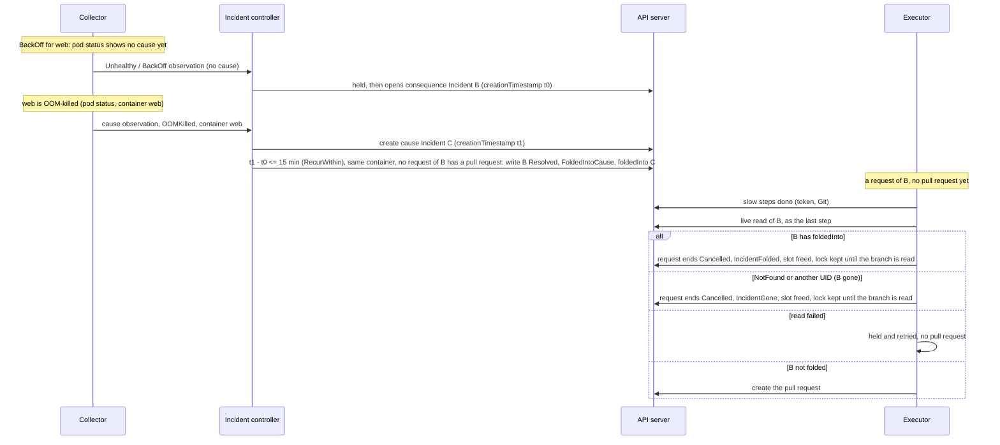

# ADR-0039: Consequence symptoms attach to their cause's Incident

- Status: Accepted
- Date: 2026-11-14

## Context

Issue [#432](https://github.com/pkalin/shadewright/issues/432) (with [#642](https://github.com/pkalin/shadewright/issues/642) folded in) asks that one fault open one Incident. It has happened three times on the lab. On 2026-11-10 (`v0.4.0-rc.1`) and again on 2026-11-14 (`v0.5.0-rc.2`) the `oom` scenario opened three Incidents for `demo/web` within two minutes: `OOMKilled`, `BackOff` and `Unhealthy`. Each one used an analysis, each proposed a memory limit for the same container, and on 2026-11-10 a queued request opened a second pull request for the same fix ([#643](https://github.com/pkalin/shadewright/issues/643), fixed separately). On 2026-11-14 the lab also reached its daily cap of 40 analyses in one day of matrix runs. [#726](https://github.com/pkalin/shadewright/issues/726) is the other side: a single readiness failure at pod start opened an Incident and got a memory increase proposed.

The cause is in design section 3.2: the fingerprint hashes the reason, so `BackOff` and `Unhealthy` on a container that was OOM-killed are different fingerprints, hence different Incidents. The fingerprint is not the problem to fix. It is stable across restarts and keeps unrelated problems of one workload apart, which the acceptance criteria of #432 require.

Decisions taken by the maintainer on #432 and not reopened here:

- **Decided (2026-11-10):** the grouping is a deterministic rule in code. No model decides it. A matching observation is evidence on the cause's Incident and opens none of its own. The fingerprint does not change.
- **Decided (2026-11-10):** a consequence Incident already open when its cause's Incident opens is closed with a reason that names the cause's Incident. Its counts are kept. A request of it that has no pull request yet is cancelled.
- **Decided (2026-11-10):** rejected are skipping the analysis while another Incident of the workload is in progress (it delays unrelated problems) and grouping a workload's Incidents into one analysis (it changes model input).
- **Decided (2026-11-14):** the first version is one general container rule. `BackOff` and probe `Unhealthy` are consequences of a container-level cause: `OOMKilled`, an image that cannot be pulled, a missing Secret or another configuration error. There is no row per pair. A probe failure of a pod that became Ready at start without a restart is dropped by the collector before this rule (design 3.1, amended 2026-11-15).
- **Decided (2026-11-14):** a consequence with no cause is held for a grace period (2 minutes as a starting value) and opens an Incident only if the symptom is still there after the wait.
- **Decided (2026-11-14, last comment, revising the window decided earlier the same day):** the link between a consequence and its cause is read from the pod status the kubelet wrote, and it is bounded in time. For each `BackOff` or `Unhealthy` observation the collector looks at that container's status: an OOM kill that finished within 10 minutes before the observation's own time, or a waiting reason for an image or configuration error now. If so, the observation is evidence on that cause's Incident and opens none of its own. Nothing depends on how long an Incident stays open or in which phase it is, and an Event alone can neither create a cause nor fold another Incident (the code does not guarantee that today, see below and point 2).

**Superseded: the earlier window.** The first decision of 2026-11-14 said a cause absorbs matching symptoms on its container for as long as its Incident is open, with no timer. It is replaced for two reasons. An `Escalated` Incident stays open until a person acts, so it would absorb every later probe failure on its container forever, with no analysis. And an Incident opened from an Event (for example a forged `Failed` Event) would count as a cause: it could hide real symptoms of the container and, through the late-cause rule, cancel a real request. Reading the kubelet's pod status and bounding it by time removes both.

What the code does today, which the decisions below start from (the numbers are of `main` at `0220bc9b`; the first bullet is of the code read on 2026-11-14):

- A pod-status termination is fingerprinted with a fixed note (`Container <name> terminated with exit code <n>`), the reporting controller `kubelet` and the reason (`pods.go`, about lines 235 to 245): the same fields an Event carries into `fingerprint.Fingerprint` (`fingerprint.go`, about lines 70 to 89), which hashes no source. An `Incident` records no class of its cause. So a forged Event with those fields lands on the fingerprint of the termination, today.
- `collector.Observation` (`internal/analyzer/collector`, `collector.go` about lines 72 to 127) carries the fingerprint, the subject (the verified owner workload), `Reason`, `Type`, `ReportingController`, the symptom, the occurrence, `Total`, `Count`, `Began`, `MayRepeat` and `Immediate`. It has no container name and no class of symptom.
- An event is read with `regarding` kind and name, reason, note, times and series. The `regarding.fieldPath`, which names the container in a kubelet event (`spec.containers{web}`), is not read.
- Pod status (`pods.go`, `terminations`, about lines 70 to 84) gives one observation per abnormal container termination, from `lastState.terminated` and `state.terminated` (`OOMKilled`, or another reason with a non-zero exit code), with the container name in the symptom. It reads the termination's reason, container ID, times and exit code. Nothing reads a container's waiting state, so an image pull failure or a configuration error reaches the analyzer only as a kubelet Warning event.
- `Incident.Spec` has no container. The spec is immutable. `Incident.Status` has `phase`, `firstSeen`, `lastSeen`, `count`, at most 32 `occurrences`, `occurrencesDroppedThrough`, `resolvedTime`, `lastAnalysisTime`, `conditions` and more.
- `consume` in `internal/incidents/controller.go` decides, per observation: count it into an existing Incident, open one at once (`Immediate`, `recurs`, or a refused fingerprint), or hold a first sighting in memory (`internal/incidents/sightings.go`, seen again 2 to 15 minutes later). `BackOff` and `Unhealthy` are never `Immediate`, because the reason of an event is written by whoever can create events (design 3.1).
- The Incident's `phase` is written by two components, not one. The Incident controller writes `Open`, and the closure rules (`internal/incidents/closure.go`) write `Resolved`, `Proposed` and `Escalated` from request phases. The analysis controller (`internal/analysis/controller.go`, about lines 834 and 1020) writes `Analyzing` in its claim and `Proposed` or `Escalated` in its outcome. Each write is guarded by the claim check `owns` (about line 491): the same UID, generation and subject, phase `Analyzing`, the `lastAnalysisTime` it wrote, and the claim not expired.
- The executor is the only writer of a request's status, and it already holds `get` on the Incident a request names (AGENTS.md, invariant 6). Its reads of the Incident today answer "nothing" on an error: `hintIncident` (`hints.go`, about lines 680 to 695) returns nil, and `verifiedIncidentName` (`pullrequest.go`, about lines 2132 to 2154) returns an empty name. That is fine for a pull request body and a hint, and wrong for a decision (point 20). The executor has no watch on Incidents (`remediationrequest_controller.go`, about line 1098): it reads an Incident only while it reconciles a request.

## Decision

[![One container's symptoms flow to one Incident: the OOMKilled termination opens the cause Incident; for BackOff and Unhealthy the collector reads the pod status the kubelet wrote and, if it shows an OOM kill within 10 minutes before the observation's own time or an image or configuration wait, records the observation as evidence in the cause Incident's own list and opens nothing, a cause being only what the pod status shows; a consequence whose cause Incident does not exist yet waits within the hold, then goes through the gate; a consequence with no cause is held and opens an Incident only if it is still failing at the end and was seen failing twice; a consequence Incident created up to 15 minutes (the gate's window) before its cause Incident, none of whose requests has a pull request, not Escalated, not waiting for an escalation by its newest request and not folded before, is closed in its favour and its request without a pull request is cancelled by the executor after a live read of the Incident, which also cancels the request of an Incident that is gone or has another UID, and only a BackOff or Unhealthy Incident of the kubelet can be folded; a cause of another container keeps its own Incident.](../assets/diagrams/cause-rule.svg)](../assets/diagrams/cause-rule.svg "Open full size")

Each point is marked **Decided** (with the date of the comment on #432 that states it, or 2026-11-14 for the points settled when this ADR was accepted) or has an **Open** part, listed under Open questions. What is built so far is listed under Amendments.

### 1. The rule and its classes

1. **Decided (2026-11-10, 2026-11-14).** The rule is deterministic code with no model input or output. A consequence observation whose container has a cause, read from the pod status, is evidence on the cause's Incident and opens none. The fingerprint of an Event and of every other symptom is unchanged; the one exception, a pod-status observation, is in point 2.
2. **Decided (2026-11-14).** The collector sets new fields on an observation, from what it read itself: `Container` (the container name, or empty), `Class` (`cause`, `consequence` or none) and, on a consequence whose pod status shows a cause, `CauseFingerprint`, and it marks the `Source` of every observation: `podStatus` or `event`.
    - `consequence`: reason `BackOff` or probe `Unhealthy` from the kubelet, on a named container. A readiness or startup probe failure of a pod that became Ready at start without a restart, or of a terminating pod, never reaches this rule: the collector drops it first (design 3.1, amended 2026-11-15).
    - `cause`: what the pod status shows for the container (point 3). A kubelet Warning event never makes a cause, whatever its reason, and only a `podStatus` observation can be of class `cause`.
    - The `Source` is part of the fingerprint input of a `podStatus` observation and of no other, so an Event cannot produce a pod-status fingerprint, whatever note, controller and reason it carries. Events and all other symptoms keep their fingerprints. This narrows the decision of 2026-11-10 that the fingerprint does not change: it changes once for the terminations and the new waiting observations read from pod status, and for nothing else. **Upgrade:** an Incident opened under the old fingerprint of a termination is not found by the new one. It resolves by the existing rules (the quiet rule after an hour without a new occurrence, or the closure rules). A fault that is still there at the upgrade opens one new Incident under the new fingerprint, so it costs one more analysis once, and a `Resolved` Incident of the old fingerprint no longer counts for the 24 hour recurrence rule on the new one. The upgrade notes of the release that builds this say so, with the advice to expect one extra Incident per ongoing fault and to mind `maxAnalysesPerDay`.
    - Everything else has no class and goes through the gate as today.
3. **Decided (2026-11-14).** The cause of a container is read from its status entry in the pod the collector verified, in this order:
    1. its current `state.waiting` with an image or configuration reason (`ImagePullBackOff`, `ErrImagePull`, `InvalidImageName`, `CreateContainerConfigError`, `CreateContainerError`), now;
    2. otherwise an OOM kill in `lastState.terminated` or `state.terminated` with reason `OOMKilled` and a `finishedAt` that the observation's own time follows by at most 10 minutes (point 5).

    If two causes show on one container, the one that is current gets the evidence: the waiting reason of the first item, because it is what the container is doing now, and the kill of the second only when no such waiting reason is set. Any other termination (a non-zero exit code) is a cause Incident as today but does not link `BackOff` or `Unhealthy` in the first build (a crash loop does not link, decided 2026-11-14): the first version of the rule names only the two causes of the decision.
4. **Decided (2026-11-14).** The collector needs two things it does not read today. It reads the container from the Event's `regarding.fieldPath` (point 9), and it reads the waiting reasons of the pod status (`state.waiting.reason`, kept only when it equals one of the fixed values above; the waiting message is never read, it is free text). From the waiting state it emits a cause observation with that reason as `Reason`, class `cause`, the kubelet as reporting controller, which opens its Incident through the gate (not `Immediate`: a wait is often short while an image is pulled). How a lasting wait gets through the gate is amended on 2026-11-16 (see Amendments). Its fingerprint is the cause fingerprint the consequence points to. For a termination the cause fingerprint is the one of the termination observation that exists today.
5. **Decided (2026-11-14).** One clock decides the 10 minute kill bound. It is measured between the kill's `finishedAt` and the observation's own time: the time the collector reads from the Event or the status entry (`lastOccurrence`, `internal/analyzer/collector/events.go`, about lines 118 to 125: the series' last observed time, else `eventTime`, else the deprecated last timestamp). `BackOff` and `Unhealthy` Events and the container status are written by the kubelet of the same node, so one clock decides and the collector's clock is not in the rule. An observation is linked when `finishedAt <= time <= finishedAt + 10 minutes`. One with no usable time, or a time before `finishedAt`, is not linked and goes through the gate as today. `lastOccurrence` falls back to the Event's `creationTimestamp`, which the API server stamps, so a different clock; for this rule the collector reports that no kubelet time is set instead of using it. The bound of a forged Event time: a tenant can write any time into an Event, but the time only decides whether the observation is counted on a cause that the kubelet's pod status really shows. It can move a forged observation onto that real cause and nowhere else; it creates no cause and folds nothing (point 2). The waiting reasons of point 3 have no time comparison: the status shows them now.

### 2. Where it runs and what state it needs

6. **Decided (2026-11-14).** The collector decides class and cause fingerprint from the pod status in its own cache, before it emits. The Incident controller's `consume` runs the rule after the occurrence is checked against what was counted and before the first-sighting gate and the fingerprint store. A `cause` observation goes the same way as today. A `consequence` observation with a `CauseFingerprint` asks whether the Incident of that fingerprint exists for the observation's subject UID, from the controller's own list, which a restart loads again before the first pass. It never reads the Incident's phase: an `Escalated`, `Proposed` or `Resolved` cause Incident is the cause's Incident like any other for as long as the pod status shows the cause. A `Resolved` cause whose status still shows the OOM kill (within 10 minutes of the observation) therefore still takes the evidence.
7. **Decided (2026-11-14).** When the pod status shows a cause but its Incident does not exist yet (the status says OOM-killed, no Incident is open), the consequence is still not opened on its own. The collector keeps it in its hold (point 19) and asks again when the cause observation has been consumed, at the latest at the end of the hold. If no cause Incident exists at the end of the hold, the consequence goes through the existing gate like any observation: it opens only when seen again 2 to 15 minutes after its first sighting and, from point 19, only if it is still failing. If the cause Incident opens later, point 12 folds the consequence's Incident. The hold therefore never drops a symptom; it can only delay it by its own length.
    - **Amended 2026-11-16 and 2026-11-17, see Amendments.** Built since [#828](https://github.com/pkalin/shadewright/issues/828) (Amendments, 2026-11-17, points 7 and 20), which corrects the amendment for #820: "the cause observation has been consumed" means the Incident controller has an Incident of the cause that the consequence would be counted on (third decision of 2026-11-17), and the controller tells the collector so.
8. **Decided (2026-11-14).** The rule needs two new pieces of state on the Incident. `status.containers`: at most 8 container names (each a DNS label), written by the controller from `Observation.Container` in the same status write that counts the observation; it is used only by the late-cause fold (point 12), to compare containers. `status.cause`: a boolean, set only when the Incident is opened or counted by a `podStatus` observation of class `cause`. The evidence link (point 6) and the fold (point 12) act only on an Incident with `status.cause`. A spec field was not chosen: the spec is immutable and the fingerprint does not hash the container for events.

### 3. Which container

9. **Decided (2026-11-14).** For an event, the container is the one in `regarding.fieldPath`, read only in the form `spec.containers{<name>}` or `spec.initContainers{<name>}` with a DNS label name, and only when the regarding object is the Pod whose UID the collector verified. The name must also exist in that pod's spec in the collector's cache. Anything else (another form, a name not in the pod, a regarding object that is not a Pod) leaves `Container` empty.
10. **Decided (2026-11-14).** For a status entry, the container is the entry's name.
11. **Decided (2026-11-14).** An observation with no named container is never absorbed and never held by this rule: it goes through the gate as today. The rule does not guess from a pod's single container or from the text of a note.

### 4. A consequence Incident that opens before its cause

12. **Decided (2026-11-10, 2026-11-14), made precise here.** Only an Incident that is itself a consequence can be folded: its `spec.reason` is `BackOff` or `Unhealthy` and its `spec.reportingController` is `kubelet`. An Incident from a non-zero exit termination of the pod status (`internal/analyzer/collector/pods.go`, reason from the termination) or from a `Failed` Event on the same container is a symptom of its own and is never folded, however close it is to the cause. A consequence Incident is folded when a cause Incident (one with `status.cause`) is created for the same subject UID, the consequence Incident was created at most 15 minutes before it, and both name the same container in `status.containers`. The 15 minutes are the gate's `RecurWithin` (`internal/incidents/sightings.go`, line 40), the same constant and not a second number (decided 2026-11-14; the 10 minutes of the earlier text were wrong for a cause that waited in the gate). "At most 15 minutes" compares the `metadata.creationTimestamp` of the two Incidents, both stamped by the API server, so one clock decides. The earlier text compared `firstSeen` (the time of the first observation, from the cluster's Events and the collector's clock) and said that no two clocks are compared; that was wrong for a fold across a leader change and for an Incident that opened from a gated sighting, and it is dropped. A consequence Incident created more than 15 minutes before the cause stays as it is, with its own analysis. It is folded only when none of its requests has reached a pull request (point 14).
13. **Decided (2026-11-14).** A gated cause is covered, because the window is the gate's own `RecurWithin` and the comparison is on creation, not on sighting. A cause seen first and opened from a recurrence 2 to 15 minutes later is created at the later time. A consequence Incident created at most 15 minutes before that creation is folded, however early the cause was first seen. Checked against the gate: `sightings.admit` opens at the second sighting between `RecurAfter` and `RecurWithin` (`sightings.go`, about lines 96 to 118), and the Incident's `creationTimestamp` is set when it is created, not from `firstSeen`. A consequence Incident created more than 15 minutes before the cause Incident's creation keeps its own analysis.
14. **Decided (2026-11-14).** The Incident controller folds in the same pass that creates the cause Incident, from its own list of Incidents, and only when no request of the consequence Incident has reached a pull request: none has the condition `PullRequestOpened` True or a phase after it, read from the controller's list of requests. Otherwise the consequence Incident is not folded: it keeps its request, the outcome of the cause's request reaches it through the existing closure rules, and the 24 hour recurrence rule applies to it unchanged (a narrowing of the decision of 2026-11-10, whose request cancel applies to a request with no pull request yet). The fold is one status write on the consequence Incident, decided from what the API server holds (invariant 5), with the field manager `shadewright-incident-lifecycle`: phase `Resolved`, `resolvedTime`, the `Lifecycle` condition reason `FoldedIntoCause` with a fixed message, and a new `status.foldedInto` with the cause Incident's name and UID (the name derives from the fingerprint, so it holds nothing from the cluster). The write carries the resource version it read, so it fails if another writer got there first and is decided again from the new state. A request can reach a pull request between the controller's read of the requests and the fold (a stale list): the request then runs its course on a folded Incident, as in point 21, and the one-time cost is that pull request.
15. **Decided (2026-11-14).** What a folded Incident means for the closure rules, a built part of design 3.2. `Closure` (`closure.go`, about lines 99 and 203 to 205) moves a `Resolved` Incident back to `Proposed` (`RequestActive`) when an active request names it, and moves a `Proposed` Incident to `Escalated` when its newest request ended `Cancelled` (`RequestCancelled`). An Incident with `status.foldedInto` is skipped by the closure rules. It has no request with a pull request when it is folded (point 14), so no outcome is lost: it does not return to `Proposed` for a request, and it does not end `Escalated` for the cancel with reason `IncidentFolded` that the executor writes (point 21). Without the skip, the cancel that the fold causes would escalate the Incident the fold just closed. Both lines go into the lifecycle table pointer in design 3.2.

### 5. What the cause's Incident shows

16. **Decided (2026-11-14).** Absorbed occurrences are kept apart from the cause's own. A new status field `status.absorbed` holds one entry per consequence reason (at most 2 now, bounded to 8 by the schema): `reason`, `count` (saturating at 1,000,000 like `status.count`) and `lastSeen`. Their occurrence records live in their own list `status.absorbedOccurrences`, at most 32 entries of occurrence ID, total and began time, newest first, with the same drop mark as `status.occurrences`. They are not in `status.occurrences`, so the trigger's reads (`newOccurrences` and `quietUntil`, `trigger.go`, about lines 243 to 250 and 457 to 486) never see them and an absorbed observation never makes the cause due again, restarts no cooldown and no debounce. The restart rule is the same as for the cause's records: an occurrence whose record is kept is not counted twice. One whose record was dropped from the 32 may be counted again; that overcounts the tally and nothing else, since no decision reads it. An absorbed observation does not change `status.count` or `status.lastSeen`.
17. **Decided (2026-11-14).** Absorbed observations stay out of the quiet rule too. `absorbed[].lastSeen` is not part of `quietSince`. A consequence says nothing about whether the cause is still there, and counting it would keep a cause open that nobody can still reproduce. A cause whose own symptom stopped resolves as quiet after an hour, as today; if the consequence goes on after that, the next one finds no cause in the pod status 10 minutes after the kill and is held and judged as an orphan (point 19).
18. **Decided (2026-11-14), changes model input.** The model's context for the cause gets a small block built from `status.absorbed`: the reasons and counts and the last seen time, nothing from a note. The reasons come from the fixed table, not from the cluster, so the block carries no text an attacker writes. This changes what the model sees, so the evaluation gate of ADR-0025 applies: a recorded scenario for the `oom` case with the block, and no regression in the existing cases, before the change is built. **Amended 2026-11-16:** this became "before a release" (see Amendments). **Settled on 2026-11-15** (see Amendments); the question was: whether the first build leaves the block out, shows the cause alone, and adds the block after the evaluation. The rule itself does not depend on it.

### 6. The collector's hold

19. **Decided (2026-11-14).** The hold for a consequence is kept by the collector, as it keeps module symptom states (`collector.SettleAfter`): it does not emit the observation, it reconciles the object again after the grace period (`collector.ConsequenceGrace`, 2 minutes as a starting value).
    - **Bound.** At most 1,024 held consequences, and a share per namespace as for the other collector state. On overflow the collector does not drop and does not wait: it emits the observation at once without a verdict, so it goes through the existing gate (seen again 2 to 15 minutes later). That fails toward opening, as the gate does today, never toward hiding.
    - **The end of the wait** checks the state of the pod over the wait, not one sample. A sample is a reconcile of the event or an update of the pod it names (two reconciles of the pod or the event, which the informer delivers at its own pace, so the numbers below are starting values). A sample is failing when the named container is waiting in back-off (`BackOff`) or not ready (`Unhealthy`), or its restart count went up since the previous sample of the same hold (the first sample compares with the count at the start of the hold). The observation is emitted for the gate when, at the end, the pod exists with the same UID, at least two samples were failing, and either the last sample is failing or the container restarted at least twice during the hold. A container that was failing once and is fine at the end, or that backed off, restarted once and then runs and is ready, opens nothing; a liveness-probe loop opens, also when the last sample falls in a life where it runs. It also covers [#726](https://github.com/pkalin/shadewright/issues/726), a single readiness failure at pod start.
    - **Amended (2026-11-16):** the rule above is the current one. The text first decided (still failing at the end, "restarted since the event" for `BackOff`, samples from reconciles of the event only) and the two amendments that changed it are in Amendments, 2026-11-16 (point 19) and 2026-11-16, second.
    - **A read that fails** is retried, never taken as "gone".
    - **A restart** lists the events and pods again, `Handled` finds the occurrence not counted, and the hold starts from the new process's first sight: it can only be longer, never lost. No decision compares the event's time with the collector's clock; the wait is measured on the collector's clock alone.
    - **A later update of the same occurrence after "not opened".** The collector remembers the verdict only as the total it handled. An event series that counts up gives a larger `Total`, the increase is a new hold with a new check, decided the same way; nothing is dropped for good, and nothing is counted while it is not opened. The observation's earlier count is not added when it later opens: only what is new.
20. **Decided (2026-11-14).** The in-memory first sightings of the Incident controller are not used for the hold: they are bounded and forgotten on a restart, and they cannot read the pod's state.
    - **Amended 2026-11-16, see Amendments.** Holds again since [#828](https://github.com/pkalin/shadewright/issues/828): the hold does not use the first sightings; they carry only what leaves the hold before its cause's Incident exists (Amendments, 2026-11-17, points 7 and 20).

### 7. The executor's check, and what is written

21. **Decided (2026-11-14).** The request is cancelled by the executor, not the analyzer, so each stays the only writer of its own objects. The executor reads the Incident live as the last step before it creates the pull request, after every slow step (the token, the Git reads and the branch). The read is from the API server, not the cache, and it fails closed:
    - the Incident has `status.foldedInto`: the request ends `Cancelled` with reason `IncidentFolded`, in a write that frees its slot under `maxConcurrentRemediations`; its target lock is kept until a read of its branch finds no open pull request that may deliver its change, and a pull request of its own that this read finds open is closed first (amended 2026-11-16, see Amendments);
    - `NotFound`: point 22;
    - a UID that is not the one the request names: the same as `NotFound`, point 22. The read is live, so the answer is definite and not a stale cache: an Incident that was deleted and opened again has the same name and a new UID (`api/v1alpha1/incidentname.go`, the name derives from the fingerprint), and the Incident the request names is gone;
    - any read that fails: the request is held and retried with backoff. It is never let through. A request does not read the cache for this, and the existing reads (`hintIncident`, which returns nil on an error, and `verifiedIncidentName`, which returns an empty name and redacts the name in the body) are not used, since they fail open;
    - a request that already has a pull request runs its course; the ADR does not close pull requests. (Amended 2026-11-16: a pull request of the cancelled request's own, from an open whose answer was lost and found by the read of its branch after the cancel, is closed; see Amendments.)

    The executor has no watch on Incidents, so the check runs when it reconciles the request anyway. A fold that comes after the check has passed and before the pull request exists is the one window left: the request is then created, the Incident is `Resolved`, and the pull request is a fix that nobody asked for. The read is the last step so the window is as short as the create call. **Settled on 2026-11-15** (see Amendments); the question was: [#289](https://github.com/pkalin/shadewright/issues/289) says the `Cancelled` phase has no way in, and asks for a spec field or removal. The code has two ways in already, both of the reviewer hint handoff (`HandoffRefused`, `HandoffAborted`), so the phase is in use. Whether `IncidentFolded` is a third way in or waits for #289's decision is for the maintainer.
22. **Decided (2026-11-14).** A request whose Incident is gone: when the live read returns `NotFound`, a definite answer of the API server and not a failed read, and the request has no pull request yet, the executor ends it `Cancelled` with reason `IncidentGone`, in a write that frees its `maxConcurrentRemediations` slot; its target lock is kept until a read of its branch finds no open pull request that may deliver its change (amended 2026-11-16, see Amendments). A live read whose Incident has another UID is the same answer: an Incident deleted and opened again has the same name and a new UID, and the one the request names is gone. Only a failed read holds and retries (point 21). This applies to any request before its pull request, folded or not. A request that already has a pull request is unchanged. The hold of point 21 is only for a failed read, which is a retry and not an answer, so it never keeps a lock indefinitely: every successful read ends in a definite answer (folded, gone or another UID, or not folded and the pull request is created), and a read that keeps failing is the API server being down, when nothing else is written either.
23. **Decided (2026-11-14).** The phase has more than one writer, so the fold over `Analyzing` relies on two things. The fold writes with the resource version it read, and the analysis's claim check `owns` reads the Incident live before it creates the request and again before its outcome write. If the fold wins, the phase is no longer `Analyzing`, `owns` fails, and the analysis ends with `errClaimLost`: it publishes no request and writes no outcome, and the unit it used is not given back. If the analysis wins first (`Proposed`, a request created), the fold's write fails on the resource version, is decided again from the new state, and the executor's check of point 21 stops the new request before its pull request. The window between the analysis's last read and its create is covered by the same executor check.

### 8. When the cause resolves and the consequence stays

24. **Decided (2026-11-14).** A consequence is evidence only while the pod status shows the cause: the OOM kill within 10 minutes before the observation's own time, or the waiting reason now. When the memory limit was fixed and the request `Succeeded`, the container no longer shows a kill within 10 minutes before the observation and a probe that still fails is an orphan: held, and opened only if the container is still failing. If the fingerprint has a folded Incident, that one is reopened as `Open` with `Lifecycle` `Reopened`, and analysed as usual. This needs a change to the recurrence rule, which would otherwise escalate a `Resolved` Incident seen again within 24 hours without analysis (design 3.2): an Incident closed as `FoldedIntoCause` is not a failed fix, so it is exempt from that escalation. A consequence Incident that was not folded because a request of it had reached a pull request (point 14) is not closed `FoldedIntoCause`: it keeps the 24 hour recurrence rule unchanged. **Settled on 2026-11-15** (see Amendments); the question was: the same exemption when the folded Incident had already been analysed before the cause appeared.

### 9. Interaction with the other limits

25. **Decided (2026-11-14).**
    - **Debounce and cooldown:** unchanged for the cause. Absorbed observations add nothing the trigger reads (point 16), so they restart neither.
    - **`--max-incidents`:** a held or absorbed observation takes no Incident place. A folded Incident still counts until someone deletes it.
    - **Daily analysis budget:** a fold before the analysis starts saves the unit, since a `Resolved` Incident is not marked due. One folded while `Analyzing` has spent it. With the pod status read, the common case, a cause that is `Immediate` and a consequence that waits for it, opens no consequence Incident at all.
    - **Target lock and `maxConcurrentRemediations`:** a cancelled request releases both in the same write (points 21 and 22).
    - **#643 and #719 are built** (design 6.6.4 and 6.6.5: a waiting request ends `Superseded` when the request it waited behind was closed without a merge, or, with `--verify-outcomes` on, succeeded). They already stop a second pull request for the same field. What this ADR gains beyond them is fewer analyses (the budget) and a cancellation before the request reaches the queue.

### 10. Out of scope

26. **Decided scope (this ADR).** KEDA, HPA, Flux and other non-container symptoms, and the symptom states of module sources (`condition:` occurrences), are not touched. Only the two consequence reasons on a named container and the two causes of point 3 are in the rule. A row per pair, or a table the operator can configure, is a later decision.

### The late cause in one sequence

## Consequences

One OOM of `demo/web` should give one Incident, one analysis and at most one request. The acceptance checks are:

- the lab `oom` scenario gives one analysis and at most one request per workload;
- the evaluation case `startup-probe`, run as a controller or envtest test, opens nothing. (The earlier `replaced-pod` case is dropped: an `OOMKilled` termination is a cause, and the replaced pod of [#724](https://github.com/pkalin/shadewright/issues/724) is a different fault);
- a missing Secret on one container next to an OOM on another keeps two Incidents;
- a forged `OOMKilled` Event (note, `kubelet` and reason as a pod-status termination carries them) folds nothing, cancels nothing and creates no cause: its fingerprint differs and `status.cause` is not set;
- a `BackOff` whose Event time is before the kill's `finishedAt`, or more than 10 minutes after it, or has no kubelet time, is not linked;
- a consequence Incident one of whose requests has a pull request is not folded and keeps its request;
- a same-container Incident that is not a consequence (a non-zero exit termination, or a `Failed` Event) with a request that has no pull request yet is untouched when an OOM cause opens: not folded, its request not cancelled;
- a request whose Incident is deleted, with no pull request, ends `Cancelled` with `IncidentGone` and frees its slot, and its lock once a read of its branch finds no open pull request that may deliver its change (a pull request of its own found open is closed first, one found merged is followed as a merged stale plan), and so does one whose live read finds another UID (the Incident was deleted and opened again), while one whose read fails is held;
- the build amends AGENTS.md (invariant 6) and design 2 with the wording of "How the invariants hold", point 6.

Each needs a test that fails without the change.

It adds a status field to the Incident for the container (`containers`), two for the tally (`absorbed` and `absorbedOccurrences`) and one for the link (`foldedInto`), a `Lifecycle` reason, a request reason, a read of `fieldPath` and of waiting reasons in the collector and new fields on `Observation`. The CRD changes are additive (`containers`, `cause`, `absorbed`, `absorbedOccurrences`, `foldedInto`). The fingerprint of pod-status observations changes once (point 2). The closure rules and the executor each get one rule for a folded Incident, and the executor one for a gone Incident (points 15, 21 and 22).

What becomes harder: a symptom of the same container no longer has an Incident of its own while the pod status shows a cause, so a person reads the cause's `absorbed` tally to see it, and the Incident count under the cap no longer shows every symptom. A consequence takes the hold, 2 minutes as a starting value, longer to open, on top of the existing rules.

### How the invariants hold

1. Model output is never authorization: the rule is code and the model neither chooses the cause nor the fold. The model's context may get the tally (point 18), which is data.
2. The action catalog is unchanged.
3. Nothing is written to Git by the rule. The only effect on requests is a cancel before a pull request exists.
4. The reason, the controller and the `fieldPath` of an event are untrusted. The rule uses them only to match fixed values, checks the named container against the pod the collector verified, and stores only reasons from the fixed table and counts. A cause is never read from an event; it is read from the pod status the kubelet wrote.
5. The cause is read from recorded state (the pod status), and no decision compares two clocks. The 10 minute kill bound compares the kill's `finishedAt` with the observation's own time, both written by the kubelet of one node (point 5); the fold compares two `creationTimestamp` values, both stamped by the API server (point 12); the hold is rebuilt from the informer and measured on the collector's clock alone. The collector's clock is in no comparison with another source's time.
6. The analyzer writes only the Incident, the executor only request status. No new grant is needed, but the executor has a new use of the `get` it already holds on the Incident: it cancels a request on `status.foldedInto`, a field the analyzer wrote. This PR changes neither AGENTS.md nor design 2. They will say so, and amending them is an acceptance item of the build: the executor's `get` on the Incident a request names (AGENTS.md invariant 6, design 2) gets the wording "`get` on the Incident a request names, also to read `status.foldedInto`, and to find it gone, and cancel a request that has no pull request yet". The bound: a compromised analyzer can cancel a request before its pull request, by folding an Incident, but it can write nothing through it, since the executor never copies a field of the Incident into a pull request or a policy decision.

### Threats

- **A tenant provokes a cheap cause to hide a real `Unhealthy`.** Whoever owns a pod can make a container crash on purpose. The evidence is bounded by the pod status the kubelet wrote and by 10 minutes between the kill and the observation, and it stays visible in `status.absorbed` and, if point 18 is built, in the model's context. There is no state that lasts: when the kills stop, the next probe failure is an orphan after 10 minutes. This removes the open-ended window of the earlier decision.
- **Event floods.** A flood of forged `BackOff` events costs one counted occurrence each, bounded by the existing caps (1,000 per observation, 256 held occurrences per Incident, the per-namespace share), and opens nothing. A flood for a container with no cause is held in the collector's bounded state and, on overflow, goes through the existing gate.
- **A forged Event as a fake cause.** Not true of the code today: a forged `OOMKilled` Event with the fixed note, `kubelet` and the reason lands on the fingerprint of a real termination (see Context), and an Incident records no class. With the source in the fingerprint of pod-status observations and `status.cause` set only from one (points 2 and 8), an Event cannot produce that fingerprint, cannot make a cause and cannot fold an Incident, and the evidence link and the fold act only on an Incident with `status.cause`. A cause is only what the pod status shows, which a tenant can cause by running a pod that fails. The test is in the acceptance checks.
- **A forged Event time.** It can move a forged observation onto a cause that the kubelet's pod status really shows, within the 10 minutes after that kill, and nowhere else (point 5).

## Alternatives considered

- **Skip the analysis while another Incident of the workload is in progress.** Rejected on 2026-11-10: it delays an unrelated problem on the same workload.
- **Group a workload's Incidents into one analysis.** Rejected on 2026-11-10: it changes the model's input for every workload.
- **A table with one row per cause and consequence pair.** Replaced on 2026-11-14 by the one general container rule.
- **A cause absorbs for as long as its Incident is open.** Superseded on 2026-11-14 (see Context): an `Escalated` cause would absorb forever, and a forged Event could hide symptoms and cancel a real request.
- **Defer the analysis of a consequence Incident while the pod status shows a cause.** The trigger would skip it: no fold, no `status.foldedInto`, no closure skip, no new executor decision and no race of point 23. Not chosen as a replacement: an `Unhealthy` Incident that opened before the kill may already be `Analyzing` or `Proposed` when the cause appears, and a deferral cannot take that back. What it would have saved is the new machinery; what it keeps is an open Incident that counts under the cap and a request that is already there.
- **Put the container in the fingerprint.** It would change every fingerprint and split Incidents that today merge, and it would still not join `BackOff` to `OOMKilled`, whose reasons differ.
- **Hold the consequence in the Incident controller's first-sighting memory.** It is bounded and forgotten on a restart, and it cannot read the pod's state. The collector holds the pod cache.

## Open questions

- None left: points 18, 21 and 24 were settled on 2026-11-15 (see Amendments).
- Not a question to settle: the grace period of 2 minutes, the 10 minute kill bound and the two samples of the end-of-wait check are starting values, tuned on lab runs.

## Amendments

- 2026-11-15: the decision of 2026-11-14 on one general container rule (Context) and the class `consequence` of point 1.2 note that the collector drops a readiness or startup probe failure of a pod that became Ready at start without a restart, or of a terminating pod, before this rule ([#726](https://github.com/pkalin/shadewright/issues/726), design 3.1). It narrows the input of the rule and changes none of its decisions.
- 2026-11-16 (point 4, [#789](https://github.com/pkalin/shadewright/issues/789)): a waiting cause still shown is reported again as a repeat of the same occurrence, so the gate's existing rule that an occurrence repeated at least `RecurAfter` after it began proves recurrence opens it. As first built, the collector recorded a waiting state's ID as handled and never sent it again, so the gate saw it once and a container stuck in `CreateContainerConfigError` for hours never opened an Incident.
    - The collector keeps, per waiting slot (one per container), the time it first saw the state, by its own clock (`Began`); the pod status has no time for a wait. The time is dropped when the state is gone, its ID changes (another reason, a restart) or the pod's state is dropped.
    - While the same state is shown, the collector reports the same occurrence again with `Began` unchanged and `ObservedAt` the time of the read, at most once per `RecurAfter` (`collector.SettleAfter`) per slot, on a pod update or on a requeue of the pod it asks for, so a wait with no pod update is reported too.
    - A repeat counts nothing (`Count` 0, `MayRepeat`; the Incident controller counts only what Handled has not). Once `ObservedAt - Began >= RecurAfter` it opens the Incident; a wait shorter than 2 minutes opens nothing, which is why point 4 does not use `Immediate`. The Incident controller needed one change for it: a `waiting:` observation with nothing new to count that proves recurrence on its own now opens the Incident of a first sighting held for its fingerprint, counting only what is held, where before it was dropped before the gate.
    - A repeat moves the Incident's `status.lastSeen` to its `ObservedAt`, never backwards, and raises neither `status.count` nor the occurrence's total, so the quiet rule keeps the Incident open while the wait lasts. Once the wait ends the repeats stop, and the quiet rule resolves it `QuietBeforeResolved` (1 hour) after the last one. Without this, an Incident of a container still waiting would resolve as quiet after an hour, and the next repeat would escalate it under the 24 hour recurrence rule as if a fix had failed. Only `waiting:` occurrences move `lastSeen` this way; any other observation with nothing new to count is a replay of something older and moves nothing. The occurrence ID schema of `status.occurrences` accepts `waiting:` for this: an ID it refused was counted but not recorded, so each repeat counted the wait again.
    - Both times come from the collector's clock, so one clock decides, as point 5 requires. A restart of the analyzer starts the time again.
    - Cost: `ErrImagePull` and `ImagePullBackOff` alternate with two fingerprints, and each change of ID starts the time again, so a failing image pull opens once one `ImagePullBackOff` lasts 2 minutes. With the kubelet's image back-off (10, 20, 40, 80 and 160 seconds, capped at 300) the first that lasts that long is the fifth: about 4.5 minutes after the first failure (150 seconds of the first four back-offs plus `RecurAfter`), plus the time of each pull attempt. Treating the two reasons as one cause is left out.
    - Rejected: `Immediate` for waiting causes (point 4 rejects it for short pulls); counting each read as a new occurrence (it raises `status.count` with a state, not with events); treating a waiting occurrence as a lasting state that the quiet rule skips (nothing reports that a wait ended, so its Incident would never go quiet).
- 2026-11-15: [#289](https://github.com/pkalin/shadewright/issues/289) is built (`spec.cancel`, design 6), so `IncidentFolded` can use the `Cancelled` phase; the open question of point 21 is settled by it.
- 2026-11-16 (point 19, [#792](https://github.com/pkalin/shadewright/issues/792)): "Restarted since the event" conflicts with "a container that was failing once and is fine at the end opens nothing": a crash-looping container can only recover by restarting, so every later sample would be failing. The rule for both reasons is now: a sample is failing when the named container is waiting in back-off (`BackOff`) or not ready (`Unhealthy`), or its restart count went up since the previous sample of the same hold. The first sample compares with the restart count at the start of the hold. The end of the wait is unchanged: the pod has the same UID, the last sample is failing, and at least two samples were failing. A container that backed off, restarted once and is running and ready for the rest of the wait opens nothing; a liveness-probe loop with no readiness probe (ready at each sample, restarts going up) is failing at each sample after the first and opens.
- 2026-11-16, second (point 19, [#792](https://github.com/pkalin/shadewright/issues/792)): the hold as first built sampled only on reconciles of the event. A container that recovers sends no more events, so its samples were the first sight and the end, and the restart between them made the end a failing sample: it opened. A liveness loop whose last sample fell in a life where the container ran and was ready stayed closed. Two changes:
    - **Samples.** An update of the pod of a held container is a sample too: the collector maps it to the held events of that pod and reads each again, as this point already says ("two reconciles of the pod or the event"). The mapping is an index of the holds by pod UID, bounded as the holds are; a pod with no hold enqueues nothing, a hold already decided to open is not mapped (its delivery retry keeps its delay), and the read of the event writes nothing, so it cannot feed itself.
    - **The end of the wait.** The observation is emitted when the pod has the same UID, at least two samples were failing, and either the last sample is failing or the container restarted at least twice during the hold. A container that recovered after one restart opens nothing; a liveness loop opens.
    - Cost: a pod updated often while it is held reads the event, and the pod, at each update. It ends at the end of the wait (2 minutes) and touches only pods with a hold.
- 2026-11-15 (points 18 and 24, [#432](https://github.com/pkalin/shadewright/issues/432)): the open parts of both points are settled. Point 18: the first build does not show the absorbed tally to the model; the cause is shown alone, and the tally block is a later task of its own ([#796](https://github.com/pkalin/shadewright/issues/796)), behind the evaluation gate of ADR-0025. Point 24: a folded Incident that had already been analysed before its cause appeared is exempt from the 24 hour recurrence escalation too; when it is seen again it is reopened and analysed as usual, since it was closed because a cause took it over, not because a fix failed.
- 2026-11-16 (point 16, [#791](https://github.com/pkalin/shadewright/issues/791)): the schema enforces what the controller writes. `status.cause` never goes back to false, also through an update that removes the whole status; `absorbed` and `absorbedOccurrences` are allowed only with `cause` true; `occurrencesDroppedThrough` and `absorbedOccurrencesDroppedThrough` only move forward. A transition rule that `absorbed[].count` and `lastSeen` never go down is not added: the list is capped and pruned, so an entry can leave it.
    - The drop mark of the absorbed list (`absorbedOccurrencesDroppedThrough`) is kept apart from the Incident's own drop mark and answers the collector's Handled only for a `consequence` observation whose cause fingerprint is that of the Incident holding it. It is not keyed by the subject UID: the subject is the owning workload, so that key would answer for never-counted `BackOff` and `Unhealthy` of every pod and container of the workload and hide them. The analyzer keeps one entry per cause Incident it knows of, restored from the stored status at start.
    - Known limit, accepted: the collector works the cause fingerprint out again from the pod status at replay, and an OOM kill loop's pod status shows only the newest kill. After a restart, a replayed consequence whose cause fingerprint changed or is empty is not recognised by the mark, goes through the gate and can open one consequence Incident of its own. That fails toward opening, as the hold bound does.
    - Built so far: the collector's fields ([#789](https://github.com/pkalin/shadewright/issues/789)) and the count on a cause's Incident (this task). The hold of a consequence with no cause is built in #792; nothing folds an Incident yet, and the rest is planned.
- 2026-11-16 (points 6, 7 and 20, [#820](https://github.com/pkalin/shadewright/issues/820)): what is held for a consequence as a first sighting from before its cause's Incident was opened is counted there when the cause's observation is consumed, in the same pass, not only when the consequence is seen again: the pod and event reconcilers deliver concurrently, so a consequence seen once a moment before its cause was otherwise never counted (an envtest case of #795 lost it in 2 of 6 runs). It also runs when a cause is reported again for an Incident that exists. The held consequences are found by an index of the first sightings by cause fingerprint, so the cost is per consequence held for that cause, not per first sighting held. A repeat of an occurrence already held is merged into it: one that names a cause fingerprint gives it to the held observation, which is then indexed by it, so a consequence first held with no cause and seen again within `RecurAfter` with its cause is counted when the cause is consumed; one that names another cause replaces the held one (the latest reading of the pod, by the order the controller consumes them in, never by comparing times); one that names none keeps the cause held. What is built differs from points 7 and 20: the collector does not hold a consequence whose pod shows a cause with no Incident yet. It emits it at once (`holdConsequence`, which holds only a consequence with no cause), and the Incident controller's first sightings carry it until the cause is consumed, an exception to point 20. Point 7's "the hold never drops a symptom" therefore does not hold across a restart in the three cases the known limit below lists. Whether to build point 7 as first written, a hold in the collector that a restart replays, is [#828](https://github.com/pkalin/shadewright/issues/828); this amendment does not decide it. **Corrected by the amendment 2026-11-17 (points 7 and 20, #828) below:** point 7 is built, and this paragraph's description of what is built no longer holds. Known limit, accepted: the first sightings are memory, so a restart between the two observations forgets the held consequence; the collector's replay reports it again with its cause and it is counted then, unless its Event is gone from the API server, its cause fingerprint changed at the replay (point 16's known limit), in which case it goes through the gate, or its pod no longer shows the cause at the replay (the container recovered, or the pod was replaced), in which case the collector holds it as a consequence with no cause and drops it, or sends it to the gate without a cause when the container is still failing (point 19). Nothing is persisted for it.
- 2026-11-16 (points 12 to 15 and 23, [#793](https://github.com/pkalin/shadewright/issues/793)): the fold of a consequence Incident that opened before its cause is built as the points say. What the build settles:
    - **The schema.** `status.foldedInto` is allowed only in phase `Resolved`, and once set it may only be cleared, together with a move to a phase other than `Resolved`, never changed to another Incident; the status cannot be removed while it is set, and it cannot name the Incident itself (decided 2026-11-16 on #793, twice). The reopen of point 24 clears it, as built in #791, and so does an escalation of a recurrence of a folded Incident seen after the 24 hours, which leaves `Resolved`. The controller also refuses a fold of an Incident into itself, by name and UID. The fold also sets `status.folded` true, which never goes back to false, and the status cannot be removed while it is true (fourth decision of 2026-11-16 on #793).
    - **When it runs.** The status write that creates a cause Incident, or sets its `status.cause`, makes its fold owed, and the write loop's pass that made the write folds. A write whose answer was lost while it may have set `status.cause` makes it owed too. A fold that fails (a read or a write) is owed again `RetryAfter` later, logged and counted in `shadewright_incident_write_errors_total`, until it is done, the cause Incident is gone or not a cause, or the analyzer stops; one cancelled by shutdown is neither logged as an error nor counted. That is the fast path. The folds owed are also derived from the stored Incidents (second and fourth decisions of 2026-11-16 on #793): at start and on every trigger pass, before the closure rules (so the quiet rule cannot resolve a consequence whose `lastSeen` stopped moving once its cause existed before its fold; fifth decision of 2026-11-16 on #793), the controller starts from the listed consequence Incidents that may still be folded and looks, for each, for a cause Incident of the same subject UID and container created at most `RecurWithin` after it, comparing the two `creationTimestamp`s only. Nothing is compared with the controller's clock, so a fold owed does not age out during an outage or a late restart. This covers a cause written by the final flush at stop, a restart, and a consequence the cache had not seen when the fast path ran. The work is bounded by the Incident cap, and a pass that finds nothing to fold writes nothing. A failed fold fails the pass, counted once in `shadewright_analysis_trigger_errors_total`, and the next pass tries again. A fold happens at most once per Incident: an Incident with `status.folded` true is never folded again, so neither the rescan nor a retry after a lost answer or a partial failure folds a reopened consequence a second time, also once an analysis, a request outcome or an escalation has replaced its `Lifecycle` reason `Reopened` (the third decision's guard on that reason was not durable).
    - **What is folded.** The candidates come from the controller's own list of Incidents and requests; each is decided again on the Incident and the requests read live before its write. A consequence Incident already `Resolved` is not folded: it is closed, and its `resolvedTime` cannot change while it stays `Resolved`. An `Escalated` one is not folded either: it waits for a person (fourth decision of 2026-11-16 on #793). Nor is one whose newest request, chosen as the closure rules choose it, ended without success (`NeedsIntervention`, `Denied`, `Failed` and the other phases the closure rules escalate): the closure rules skip a folded Incident, so the fold would take away its escalation for a person (fifth decision of 2026-11-16 on #793). A request counts as having reached a pull request when it has `PullRequestOpened` True, a recorded pull request or merge receipt, or a phase from `PRCreated` on (`PRCreated`, `AwaitingApproval`, `AutoMergeQueued`, `Merged`, `WaitingForDelivery`, `Verifying`, `Succeeded`, `Inconclusive`); in doubt it counts, so the fold never takes a pull request's Incident away.
    - **Point 23** needed no change to the analysis: its claim check `owns` already requires phase `Analyzing`. A test pins it: a fold during the model call ends the analysis with `errClaimLost`, no request and no outcome write. A fold written between the claim's last live recheck and the create of the request (`publish` in `internal/analysis/controller.go`) still leaves a request; only the executor check closes that window ([#794](https://github.com/pkalin/shadewright/issues/794), built since: see the next amendment).
    - Built so far: the collector's fields (#789), the count on a cause's Incident (#791), the hold of a consequence with no cause (#792) and the fold with the closure skip (this task). The executor's cancel of a folded Incident's request (points 21 and 22) is built in #794 (next amendment); a request that reached a pull request before the fold runs its course on the folded Incident, and the closure skip keeps its outcome from moving it.
- 2026-11-16 (points 21 and 22, [#794](https://github.com/pkalin/shadewright/issues/794)): the executor's live read of the Incident before the pull request is built as the points say (`incidentStanding` in `internal/controller/incidentcancel.go`, called by the pull request step). What the build settles:
    - **Where.** The read is the last step before the create call: after the token, the Git reads, the branch, the commit, the checks of the branch and the pull request body, whose own read of the Incident (`verifiedIncidentName`) fails open and decides nothing here. A request whose pull request already exists, recorded or found on its branch, never reaches it.
    - **What is an answer.** Only a `NotFound` whose details name the Incident is taken for gone; any other error, a `NotFound` that names no object, a read past its own deadline and an executor without an API server reader hold the request for a retry with backoff. The request's deadline bounds the retries: it ends `Expired`, which releases the lock as before.
    - **The write.** One status write past the kill switch's gate (`endForIncident`): phase `Cancelled`, condition `PullRequestOpened` `False` with `IncidentFolded` or `IncidentGone` and a fixed message that names no Incident (the name in the spec may be a secret of the right form). As first built the same write released the target lock; the next amendment keeps it until the branch is read. `Cancelled` is final, so the same write takes the request out of the count under `maxConcurrentRemediations`. The branch and its commit are left. A conflict is retried, and the retry decides again from a new read.
    - **Permissions.** No new grant: the executor's existing `get` on the Incident a request names. AGENTS.md (invariant 6) and design 2 carry the wording of "How the invariants hold", point 6.
    - Built so far: the collector's fields (#789), the count on a cause's Incident (#791), the hold of a consequence with no cause (#792), the fold with the closure skip (#793) and the executor's cancel (this task). The tally shown to the model is [#796](https://github.com/pkalin/shadewright/issues/796).
- 2026-11-16, second (points 21 and 22, [#794](https://github.com/pkalin/shadewright/issues/794)): the cancel keeps the target lock until the branch is read. Points 21 and 22 said the request ends `Cancelled` "in the same write that releases its target lock"; that no longer holds.
    - **Why.** The request has no recorded pull request, and the lock rule (`prMayBeOpen` in `internal/controller/targetlock.go`) says one may still exist in that case: an earlier open whose answer was lost and that the listing of the branch does not show yet, or a pull request a person opens later from the branch the cancel leaves. Releasing the lock in the ending write would let the next request on the same field open a second pull request while the first can still merge (invariant 5, the case of [#643](https://github.com/pkalin/shadewright/issues/643)).
    - **The rule.** The ending write (`endForIncident`) sets the phase and nothing else about the lock; `settleLock` keeps it, as it does for `Expired`. The write wakes the request, and its next reconcile reads the branch (`checkHeld`): the lock is released when no open pull request of the branch may deliver the change (`openHolding`), and kept otherwise, with condition `TargetHeld` naming the pull request that holds it. A pull request without this request's marker (one a person opened from the branch) is never closed: it keeps the lock until it is closed or merged. A read that fails keeps the lock and is made again after `heldRecheckInterval` (10 minutes); a read the Git host refuses also sets condition `PullRequestUnreadable`. Deleting the request still releases the lock once its finalizer is done, and while it holds the lock the finalizer closes the open pull requests of its branch with its marker first, as for `Expired`.
    - **Amended 2026-11-17 (#771).** A cancelled holder uses the same `settleTargetLock` decision as every other stopped holder, reading both the recorded and configured branches when they differ. The branch change permits reads only: an open pull request stays open, a closed one releases the lock only when no other pull request can still merge, and a merge is followed with the Incident cancellation reason preserved. A failed Git read of a stopped holder is retried visibly with `GitReadRetry`, after `heldRecheckInterval` (10 minutes) or the host's longer delay, never sooner; Kubernetes errors remain errors. The merge side of this change is in the [2026-11-17 amendment of ADR-0030](0030-merge-receipt-and-verification-outcomes.md).
    - **Its own pull request** (third decision of 2026-11-16 on #794). When that read finds an open pull request with this request's marker (an earlier open whose answer was lost), the executor records it (`status.pullRequest`, `PullRequestOpened` `True` saying it was found and is closed next, the reason of the cancel moved to `Approved`), and the next reconcile closes it with the cleanup `Expired` uses (`closeChangeRequest`: read by number with the marker, then the close through the provider the kill switch gates). The request stays `Cancelled` with its reason, and `PullRequestOpened` says Shadewright closed it (`PullRequestClosed`); the lock is released only by the read of the branch after the close. A close the Git host refuses, or that fails, keeps the lock and sets condition `PullRequestNotClosed` (`GitForbidden`, `GitRejected`, `GitNotFound` or `GitFailed`) with a Warning Event; a refusal is tried again after `heldRecheckInterval`, another failure with the error backoff or after the delay the host asked for. A pause holds the read and the close: the request shows `WritesPaused` (with an Event) whether the pause comes before the read or between the read and the close, and looks again every minute; the condition goes with the first read after the pause (when it records the pull request, closes it, or finds it closed by a person or gone and releases the lock). Left open, that pull request could be merged while the request is `Cancelled`, and nothing would follow the merge (`settleCancelled` in `internal/controller/incidentcancel.go`).
    - **Found merged.** A pull request of its own that the read finds merged, before or after it was recorded, is recorded as a stale plan's merge is: `Merged` with its merge receipt (`endMerged`), with `PlanFresh` `False` and the reason of the cancel as the stale mark instead of the check at the merge, so the outcome is capped: `Inconclusive` with `StalePlanMerged`, neutral for the circuit breaker, unless its verification fails; a head that is not the planned change ends `NeedsIntervention` (`MergedWithForeignChange`). The request never stays `Cancelled` over a merged change. No validation rule limits the move from `Cancelled` to `Merged`, so no CRD change was needed.
    - **Unchanged.** `Cancelled` is final, so the ending write still frees the slot under `maxConcurrentRemediations`. The cancel itself writes nothing to the Git host: the close belongs to the later read of the branch.
- 2026-11-16 (point 18, [#796](https://github.com/pkalin/shadewright/issues/796)): the tally block is built. The summary of a cause Incident with a non-empty `status.absorbed` gets a heading line and one line per reason of the fixed table that the tally holds (`BackOff`, `Unhealthy`), each with its count and the time it was last seen. Only the reason from the table, a number and a time are written, and the lines cannot be quoted as evidence. The tally is always shown, with room kept for it, and is the last thing in the summary (decided 2026-11-16, replacing the same day's decision to cut it whole, which would hide the counts from the model exactly when the summary is crowded): the summary keeps room for the longest tally, and the other lines are fitted in what is left by shortening values, each with its own note of the bytes cut, in a fixed order: the symptom text, the reporting controller, the reason, then the subject's name. The tally is never cut part way: the heading and every reason it holds reach the model together, and no line of the summary, such as the phase, is removed, with or without a tally. A third decision of 2026-11-16 made this hold at every summary bound the builder accepts, not only the default 2 KiB: as first built, at the minimum of 1 KiB an Incident at the schema's limits lost its reason, counts, times and phase once a tally was present. With every value cut to nothing, those lines and the longest tally take under 600 bytes, so the minimum was not raised. The same decision makes a cut always visible: the fit is decided on the text after the redaction of the whole summary, which stays as it is, a cut never lands inside a redaction marker, and when that redaction takes the note for a secret's value (a cut right after `token=`), the cut backs off a word at a time until the note stands intact. Cluster text that ends in something shaped like a note is left as it is; a real cut appends its own note after it. The context of an Incident with an empty tally is unchanged as long as its summary is within its bound. A summary over its bound, with or without a tally, now keeps all its lines and has values shortened with a "(N bytes cut)" note, where before whole lines were dropped from the end: this changes the context of every Incident with a long summary, not only of cause Incidents. The recorded scenario `oom/absorbed` is the case with the block for the evaluation gate of ADR-0025. The real-model run (with `oom/absorbed` and a summary over its bound) moved from "before the change is built" to before a release, because the replayed reply does not depend on the prompt (`docs/evaluation.md`); it is [#841](https://github.com/pkalin/shadewright/issues/841), on the v0.6.0 milestone.
- 2026-11-17 (points 7 and 20, [#828](https://github.com/pkalin/shadewright/issues/828), decided on the issue on 2026-11-16 and 2026-11-17): point 7 is built, and this corrects the amendment for #820 above: points 7 and 20 read true again for a cause whose Incident exists or opens at once. For a cause the gate holds as a first sighting they do not yet (the end of "What seen means" below, [#849](https://github.com/pkalin/shadewright/issues/849)). The collector holds a consequence whose pod shows a cause that the Incident controller has not seen, in the hold of point 19, and emits it with its cause as soon as the controller has seen the cause. At the end of `collector.ConsequenceGrace` (2 minutes, unchanged) it is emitted only if it is still failing, by the test of point 19 (fifth decision of 2026-11-17): a consequence whose container recovered while it was held is not emitted, whatever its cause, as point 7 says.
    - **What "seen" means** (second and third decisions of 2026-11-17 on #828). The Incident controller has seen a cause this consequence would be counted on, and nothing else: the cause's Incident that the link of point 6 counts it on (the latest Incident of the cause fingerprint, counting a cause, of the consequence's subject UID, and not Resolved more than `RecurrenceWindow`, 24 hours, before the consequence was observed), opened by this process or loaded at start. The answer is the link (`causeSeen` returns what `causeFor` decides, through `causeIncident` in `internal/incidents/consequence.go`), and a generated test runs both over the same states and requires them equal in every one. A cause refused at the Incident cap, not counted for want of room, of another subject UID, whose Incident was Resolved more than 24 hours ago, or held by the gate as a first sighting (a cause that is not `Immediate`, a waiting cause above all), is not seen: the hold waits until an observation of the cause opens its Incident, or until it ends. As first built, any existing cause Incident of the fingerprint answered yes, so a consequence of a crash that came back days later was not held and went through the gate as its own first sighting. The second build also answered yes for a cause held by the gate: the consequence was released, not linked, and when its series already recurred it opened an Incident of its own at once, which the cause's Incident, opened later, did not count. A hold whose cause the gate still holds when `ConsequenceGrace` ends is emitted with its cause (`cause_unseen`): the controller holds it as a first sighting indexed by its cause and counts it on the cause's Incident when that opens (#820), or, when its series recurs, it opens an Incident of its own, which is analyzed and which the late-cause fold of points 12 to 15 closes in favour of the cause's Incident when that opens within `RecurWithin` (15 minutes). The same holds when its pod is replaced during the hold. So for such a cause the order in which the two arrive can still open a second Incident; only a cause whose Incident opens at once is always counted on it. Closing that case is [#849](https://github.com/pkalin/shadewright/issues/849), not part of this amendment.
    - **How the collector learns it.** Both run in the same analyzer process, wired in `cmd/analyzer` as `Handled` is: no API read, no grant, no CRD field. When the hold is created, and at each sample of it, the collector asks `Controller.CauseSeen` with the hold's observation (a lock and a few map lookups). After that the controller tells it: each time a cause observation it consumed makes the cause seen for a consequence of the same subject, it calls `Collector.ReleaseCause` with the fingerprint, which marks the holds of that cause and adds their events to the event controller's queue. The mark decides nothing: each reconcile it causes is a sample that asks `CauseSeen` for the cause the pod shows then, with the hold's own observation, and only a yes emits it. There is no poll. Neither side holds a lock across the other's call. The order that makes it race-free: the controller records the cause under its lock before it calls `ReleaseCause`, and the collector stores the hold before it asks. A call that comes before the store was preceded by the record, so the ask sees the cause; a call after the store finds the hold. A release that lands between a sample's read of the hold and its store is kept by the store while the sample keeps the cause; a sample that shows another cause forgets a release for the old one and asks again for the new one (second decision of 2026-11-17), so no hold leaves as `released` for a cause the controller has not seen. The queue's `Add` never blocks and never loses a key; even without it the event's next reconcile (an update of its pod) asks again, and an end of the hold by another path (its end, the pod gone or replaced, the event leaving) counts it `released` only when the mark is for the cause it shows and `CauseSeen` confirms it. An ask that does not answer within the deadline of `Handled` (only before the Incidents are loaded) is logged and asked again 5 seconds later; any other error goes to the reconciler's backoff.
    - **The cause the hold keeps.** Every sample reads the cause again from the pod status, and the hold keeps the last cause a sample showed, with the observation of that sample. A pod that is deleted or replaced, or whose template a rollout retires (#724) during the hold, an event that stops being a Warning or a probe failure that settles: each emits the consequence with that cause and that observation, at once. A pod that recovers emits it at the release, with that cause; when the controller has not seen the cause by the end of the hold, the end applies the test of point 19 to a hold with a cause as to one with none (fifth decision of 2026-11-17): at least two samples failing, and the last one failing or two restarts during the hold. A container that recovered is not emitted (`not_opened`) and its occurrences are handled, so the event is not replayed; one still failing, also waiting in `ErrImagePull`, is emitted with its cause (`cause_unseen`). As first built, the end emitted every hold with a cause, so a recovered container could open an Incident and be analyzed. A release at the end (the mark for the cause it shows, confirmed by `CauseSeen`) is emitted recovered or not: the controller links the consequence to its cause's Incident, which counts it and opens nothing of its own. Apart from that end, a hold with a cause never ends in a drop; the one loss left is an event that no longer exists (deleted, or replaced by another event of the name), counted `dropped`. A hold with no cause whose pod later shows a cause waits for it in the same hold.
    - **Shares.** Holds first seen with a cause have their own share of the table: at most 1,024 of them, 256 per namespace, beside the same bounds for holds with no cause, so the table holds at most 2,048 consequences in all (twice `MaxHeldConsequences`, the bound of point 19 applied per share), and a bad-image rollout of hundreds of pods cannot push the readiness and crash-loop holds of point 19 into overflow. With no room in its share, a consequence with a cause is emitted at once, unheld, with the cause its pod shows (`overflow`), as before this change: never dropped.
    - **Counted once.** The released observation carries only the increase of the event's series the collector has not sent, or, after a restart, `MayRepeat`. A release belongs to the cause it was given for (fourth decision of 2026-11-17): the first delivery of a decision records the event's series total, and a delivery retried after a full channel whose pod shows another cause by then delivers only those occurrences, with the cause of the decision; the event is reconciled again at once, and the later occurrences are a new hold for the cause shown now. As first built, the retry sent the old cause's observation with the count of the moment, and committed the later occurrences as handled under it. The other paths that emit a held observation were checked for the same: a restart forgets the hold with the series state, so the replay decides again from the pod; the end of the hold, a pod gone or replaced and an event leaving end in this same delivery; an overflow is emitted unheld with the cause its pod shows at each try and records no release. The controller counts at most what is new beyond the highest total counted or held for the occurrence, so a copy that also sits in the first sightings (sent over the bound, or at the end of an earlier hold) is counted once.
    - **Restart.** The hold is memory, like the first sightings. After a restart the collector lists the events again and rebuilds the hold from the new process's first sight; the ask answers from the stored Incidents, and the replayed cause observation tells the collector again. Of the three cases of the known limit above, a cause fingerprint that changed at the replay is covered when the changed cause's Incident exists or opens at once (an OOM kill): the rebuilt hold waits for the cause its samples show, and the controller sees it. A waiting cause that changed at the replay (`ErrImagePull` to `ImagePullBackOff`, or back) is held by the gate as a first sighting, so the controller does not see it and the hold ends `cause_unseen`, as any gate-held cause: that case is open under [#849](https://github.com/pkalin/shadewright/issues/849). Two more remain, as they are: the Event is gone from the API server, so nothing replays it and no outcome counts it; and the pod no longer shows the cause at the replay, since nothing persisted tells the new process which cause it showed: a recovered container is judged by point 19 (`not_opened` when it stays fine), and the event of a replaced pod, which names no container of a pod that exists, goes to the gate without a cause.
    - **Metrics.** `shadewright_analyzer_held_consequences_total`: `released` now means the controller saw, during the hold, a cause the consequence would be counted on (before, a cause appeared on the pod of a hold with no cause; with the hold of a cause such a hold is also counted `released` when the controller had seen it); the new outcome `cause_unseen` is a hold that ended with a cause the controller had not seen, at the end of the hold with the container still failing, or when the pod or its template went; `not_opened` now also counts a hold with a cause the controller had not seen whose container recovered by the end of the hold. A consequence whose cause the controller had seen at its first sight is not held and counts no outcome. The five ends add up to the holds started. `shadewright_analyzer_consequences_held` counts both shares.
