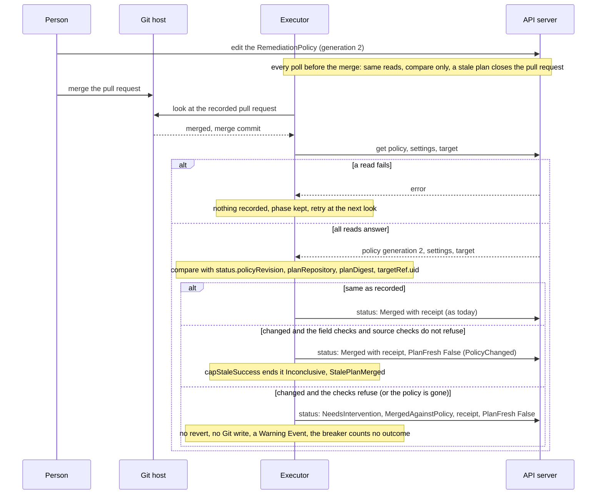

# ADR-0041: A freshness check at the merge of a pull request

- Status: Proposed
- Date: 2026-11-14

## Context

Issue [#737](https://github.com/pkalin/shadewright/issues/737) found a hole in the cap for a merged stale plan. This ADR settles how to close it. Part of it is built for #737 while the ADR stays Proposed:

- **Built:** section 1 (the check in all three paths that record a merge), section 2 (the reads and comparisons, no Git or Flux read, no pause test) and section 3 (a stale plan is recorded `Merged` with `PlanFresh` `False` and ends `Inconclusive` with `StalePlanMerged`). Section 5 needs no change for that end. The build differs from section 2 in three points. A failed read is retried only within the wait the executor already uses for the merge commit (five minutes from `status.mergeCommitAwaitedSince`); after it the merge is recorded as not shown fresh (`PlanFresh` `False`, `PlanChanged`) with a Warning Event, so a read that never answers (forbidden, for example) cannot keep the target lock. An input that can never be checked (no plan digest or source, a malformed target apiVersion) is stale at once (`PlanChanged`, `TargetChanged`). A kind the API server cannot map (`NoMatchError`) is a failed read, not a gone target.
- **Not built:** section 4. `Preflight` and the source checks are not run at the merge, and there is no `MergedAgainstPolicy`: a deleted policy, or one whose bounds or gitOps rules were narrowed, ends `Inconclusive` with `StalePlanMerged`, not `NeedsIntervention` as section 4 proposes. Section 7 (the reduced check at every poll) is not built either.

How to read it. Every statement is one of three kinds:

- **Decided** means the maintainer decided it on 2026-11-14. This ADR only writes it down.
- **Proposed** means this ADR proposes it. It becomes a decision when the ADR is accepted.
- **Open** means nobody has decided it. It is listed under "Open questions" and the ADR does not guess.

### What happens today

Before the merge the executor runs the freshness check ([ADR-0003](0003-gitops-only-typed-remediation.md), design section 6, `internal/policy/freshness`). It answers one question: is the world still the one the plan digest was made for. It runs right before every Git write, and as a full recheck every five minutes while the pull request waits (`freshRecheckInterval`). Between two full rechecks the executor only looks at the pull request, once a minute by default (`PullRequestPollInterval`, 30 seconds to 5 minutes). A definite change makes the check write `PlanFresh` `False` with the reason (`PolicyChanged`, `SettingsChanged`, `TargetChanged` and others), close the pull request and end the request `Superseded`.

That close can fail. When the Git host refuses it for good (#199), the request keeps its phase and watches the pull request, with the mark on it. A person who merges that pull request ends it `Merged`, with the mark kept. `stalePlanMerged` (`internal/controller/phases.go`) reads the mark, and `capStaleSuccess` ends the request `Inconclusive` with `StalePlanMerged` where a fresh one would have ended in a state the circuit breaker counts as a success: `Succeeded`, or `Merged` with `--verify-outcomes` off. With verification on, a failure still ends `Failed`.

### The hole

The cap reads a mark, and the mark is written by the periodic check. A person who merges between a change of the policy (or the settings, or the target) and the next full recheck merges a plan the executor does not yet know is stale. `stop` records `Merged` with no `PlanFresh` condition, and the request goes on as a fresh one.

Lab run of 2026-11-14, chart `0.5.0-rc.2`, scenario `oom`, row 11 of `scenarios/MATRIX.md` in the fleet repository (UTC):

| Time | Event |
| --- | --- |
| 19:26:09 | Pull request opened (web 48Mi to 72Mi), `status.policyRevision: demo-memory/1` |
| 19:26:44 | `demo-memory` changed, generation 2 |
| 19:26:51 | Pull request merged by a person |
| 19:27:31 | `Approved=True/ChangeRequestMerged`, no `PlanFresh` condition |
| 19:39:16 | `Verified=True/NoRecurrence`, phase `Succeeded` |

The matrix expected `Inconclusive` with `StalePlanMerged`. The new value was still inside the bounds of the changed policy here. Had the policy excluded it, the result would be a `Succeeded` request for a change the current policy refuses.

The window is not small: today it is up to the full recheck period (five minutes) plus the poll interval after every change of the policy, and a person who edits a policy and merges right after is the case this ADR is about.

## Decision

### 1. A freshness check when the executor sees the merge (Decided 2026-11-14)

When the executor sees that the pull request was merged, it checks freshness once more before it records the merge: the policy generation, the settings and the target against what the plan recorded, whatever the periodic check has seen. It does so in every path that records a merge: the look at the recorded pull request (`watchStep`), a merge found for a pull request never recorded (`endMerged`), and a merge right after a handoff (`recordHandoff`).

### 2. Which reads it makes, and what a failed read does (Proposed)

The merge-time check is a reduced form of the periodic one. It decides from recorded state and from three reads of the API server, and from nothing else:

- **Recorded state:** `status.policyUID` and `status.policyRevision` (name and generation), `status.planRepository`, `status.source.targetBranch`, `status.planDigest`, and `spec.targetRef` with its UID.
- **Reads:** the `RemediationPolicy` the request names, the `RemediationSettings` `default`, and the target object, each by a `get` straight from the API server (the same reader `loadPlan` uses).
- **The comparisons** are those of `loadPlan` and `checkTarget`: the policy has the recorded UID and revision; the action's module is still enabled; the repository entry of the plan (URL and installation) still exists with the recorded target branch; recomputing the plan digest from the recorded request, source, policy and settings gives `status.planDigest`; the target has the recorded UID and still matches the policy's `objectSelector`.

It makes **no** Git read, no source mapping, no Flux read and no read of the target's field. That is on purpose. After the merge, the target file in Git holds the new value and Flux may already have applied it, so `checkFile` and the "previous value" part of `checkTarget` would call every merged plan stale. The periodic check keeps them, because it runs before the merge.

It compares no timestamp, and certainly not one of the Git host with one of the cluster. Whether the plan is stale is a function of the recorded plan and of what the API server holds when the executor looks. The pause (`spec.paused`) does not block it, as it does not block recording a merge: `loadPlan` returns `ErrPaused` first, so the merge-time check needs a variant that reads the settings without that test. It makes no Git write, so the kill switch has nothing to gate.

**A failed read is an error for a retry.** A read that fails for any reason but "not found" (a timeout, a 5xx, a cancelled context) is neither fresh nor stale: the request keeps its phase (`PRCreated` or `AwaitingApproval`), writes nothing, and the next look at the pull request, which sees it merged again, retries. A merge is never recorded as fresh because a read failed. A "not found" is a definite answer: a deleted policy, a missing settings object or a missing target is a change (`PolicyChanged`, `SettingsChanged`, `TargetChanged`).

### 3. A stale plan that the checks do not refuse ends Inconclusive (Decided 2026-11-14)

The merge-time check writes `PlanFresh` `False` with the stale reason in the same status write that sets `Merged` (with the receipt, as [ADR-0030](0030-merge-receipt-and-verification-outcomes.md) section 1 has it). From there the existing code takes over unchanged: `stalePlanMerged` is true, `capStaleSuccess` ends the request `Inconclusive` with `StalePlanMerged`, and `breakerOutcome` reads it as no outcome. The message of `capStaleSuccess` says the plan "could not [be] close[d]"; for a plan found stale at the merge it must say that it was found stale when the merge was seen (Proposed wording change).

### 4. A stale plan that the field checks refuse ends NeedsIntervention (Decided 2026-11-14; the name is Proposed)

Whether the current policy refuses the change is asked of `policy.Preflight` (`internal/policy/decide.go`) with the recorded request, the policy and the settings just read, and the live target. Preflight never allows anything: it runs the field checks of `Decide` in the same order with the same reasons (the request may use the policy, the action is in the catalog, the module is enabled, the target is in a covered namespace and matches the selector, the values are inside the policy's bounds) and returns a refusal or "continue". No second rule set exists, and the model is not asked (invariant 1). A pass means "not refused by the field checks", not "the current policy allows it".

Preflight does **not** evaluate the source checks of `Decide` (`checkSource`: the gitOps repository the policy allows, `ReasonRepositoryNotAllowed`, the repository in the settings and its branch, the allowed paths of the policy) or the state of the live target (`checkTargetState`). Left like that, a policy whose gitOps rules were narrowed before the merge (another repository or other allowed paths) passes, and the request ends `Inconclusive` with `StalePlanMerged`, with no person called, although the current policy would refuse the file. So Proposed: the merge-time check also runs the source checks, from recorded state. `checkSource` reads only the resolved source, the policy and the settings, and the request records the resolved source in `status.source` (repository, target branch, path) before the plan digest is made. Run on that record, it needs no Git read and no source mapping, and its answer does not depend on whether the merge has happened. The build adds an exported function in `internal/policy` that runs the field checks and then `checkSource`, so the rule stays in one place. `checkTargetState` is not run, on purpose: it reads the readiness of the live ScaledObject, which the delivery of the merged change can move, and a change in readiness is not a change in what the policy allows. See open question 1.

If the checks refuse, the request ends `NeedsIntervention` with the new reason `MergedAgainstPolicy`. The merge is a fact and stays on the request: the receipt and the merge commit are recorded in the same write (the validation rule on `status.mergeReceipt` allows any phase after the merge), `PlanFresh` is `False` with the stale reason, and a Warning Event names the pull request and the refusal. No verification runs, and **Shadewright opens no revert proposal by itself**: a person merged it, so a person decides. The message says what the current policy refuses and that the change may be applied by Flux anyway.

#### Which end for which change (Proposed)

The rows are read top to bottom and the first that matches wins. Preflight is called only when the policy, the settings and the target were all read and the target has the recorded UID: `Preflight` returns `IncompleteInput` for a nil request, policy, settings or target (`decide.go`), and that would read as a refusal. It is never called with a nil input.

| What the merge-time check finds | End | Reason |
| --- | --- | --- |
| A read fails for any reason but "not found" | No end: phase kept, nothing written, retried at the next look | none |
| The target is gone, or has another UID than `spec.targetRef` names | `Inconclusive` | `StalePlanMerged`, `PlanFresh` `False` with `TargetChanged` (the existing target reasons, never the policy reason) |
| `RemediationSettings` `default` is gone | `Inconclusive` | `StalePlanMerged`, `PlanFresh` `False` with `SettingsChanged` (no policy can be asked without settings) |
| The policy is deleted | `NeedsIntervention` | `MergedAgainstPolicy`, `PlanFresh` `False` with `PolicyChanged` (there is no policy that allows it) |
| Policy, settings and target all read; recorded UID, revision, repository entry and plan digest all match | The merge is recorded as today | none |
| All read, something differs, and the field checks and the source checks refuse | `NeedsIntervention` | `MergedAgainstPolicy`, `PlanFresh` `False` with the stale reason |
| All read, something differs, and the checks do not refuse | `Inconclusive` | `StalePlanMerged`, `PlanFresh` `False` with `PolicyChanged`, `SettingsChanged` or `PlanChanged` |

### 5. The circuit breaker (Decided 2026-11-14)

The breaker counts neither new end as an outcome. Today `breakerOutcome` (`internal/controller/limits.go`) counts `Merged` and `Succeeded` as successes and `Failed` and `NeedsIntervention` as failures; `Inconclusive` is neutral. A `Merged` request that carries the mark of a stale plan is already read as no outcome (`stalePlanMerged`, #199), so the end in section 3 is no outcome as soon as the mark is written at the merge, with no change to the breaker. The end in section 4 would count as a **failure**, because `NeedsIntervention` is one. What changes: `breakerOutcome` gets one case before the failure phases, in the style of the stale-plan and revert cases it already has: a request in `NeedsIntervention` with the reason `MergedAgainstPolicy` and a merge receipt is `outcomeNone`. The change did not fail, the policy moved under it, and a person's merge must not push the breaker toward opening. `TestEveryPhaseIsClassified` classifies by phase and does not see a reason, so it stays as it is; the build adds a test for the new case.

### 6. With verification on, a failure still ends Failed (Decided 2026-11-14)

Unchanged. Only the good end is capped: where a fresh plan would end `Succeeded` a stale one ends `Inconclusive`, and a request that would end `Failed` ends `Failed`. Section 4 ends before verification, so it never reaches that point.

### 7. The reduced check also runs at every poll before the merge (Proposed)

The comparisons of section 2 need only the API server. So the executor also runs them at every look at a waiting pull request (`PRCreated`, `AwaitingApproval`), not only at the full recheck. A policy, settings or target that changed then makes the plan stale at the next look, and the existing path takes over: `PlanFresh` `False`, the pull request is closed, the request ends `Superseded`. At a poll the check only compares, as the full check does; it does not ask Preflight, because for a pull request that is still open any change is a stale plan. It makes no Git call, so the cost per look is three reads of the API server and the call budget of the poll interval does not change.

The poll interval is `PullRequestPollInterval`: one minute by default, between 30 seconds (`MinPullRequestPollInterval`) and 5 minutes (`MaxPullRequestPollInterval`, which equals the full recheck period `freshRecheckInterval`). Today a change is found at the next full recheck, up to five minutes later, with a look in between that finds nothing. With this section a stale pull request is closed within one poll of the change.

What remains is one poll interval: a person who changes the policy and merges before the next look. The merge-time check of section 1 covers that case, and it is why both exist.

[![Merge-time freshness check as proposed (built for #737: the check, its reads and the Inconclusive end; not built: Preflight, the source checks, MergedAgainstPolicy and the check at every poll): when the executor sees a pull request merged, it reads the policy, the settings and the target from the API server and compares them with the recorded plan, with no Git or Flux read; a failed read retries and records nothing; a fresh plan goes on as today; a stale plan that the field checks and the source checks (run on the recorded source) do not refuse ends Inconclusive with StalePlanMerged; one they refuse ends NeedsIntervention with MergedAgainstPolicy, with no revert proposal and no Git write; the same reads also run at every poll before the merge and close a stale pull request](../assets/diagrams/merge-time-freshness.svg)](../assets/diagrams/merge-time-freshness.svg "Open full size")

## How the invariants hold

- **Invariant 2 (closed catalog, a policy rule for each action).** No action, parameter or rule is added. The check asks the same policy code that decided the plan (`policy.Preflight` and the source check), with the policy as it is now, so a bound the maintainer tightened is applied to a change already merged. The rule for an action stays one place. (Issue #737 lists invariants 1 and 5; it was corrected on 2026-11-15. This ADR also touches 2 and 3.)
- **Invariant 3 (changes through Git only).** The merge-time check writes no Git object, opens no pull request, pushes nothing, closes nothing and merges nothing. Its outcome is a status write on a request the executor already owns. Refusing to propose a revert (section 4) keeps it that way: a revert is a new change of the cluster, and it needs its own decision by a person. A pull request that a person merged is never reverted by Shadewright in its own right.
- **Invariant 5 (idempotent, never exactly once).** The verdict is a pure function of the recorded plan and the policy, settings and target the API server holds. Run twice on the same inputs it gives the same answer. It is written in the same status write that sets the phase, so a restart finds the old phase (and looks again) or the new one (and is done), never a merge recorded without its verdict. Branch names and markers are untouched. No decision compares two clocks.
- **Invariant 1 (model output is never authorization).** The model plays no part. The executor still acts on a plan whose digest matches the approved one: a mismatch (`PlanChanged`) is one of the reasons for the stale verdict.

## Threats

- **Someone changes the policy to get a merged change marked stale.** What they get is a lower reported outcome and nothing else: `Inconclusive` or `NeedsIntervention` instead of `Succeeded`. The change is already merged and nothing in the check can un-merge, apply, revert or block it. Changing a `RemediationPolicy` needs the right to write one, and anyone who holds it can do worse directly (widen the bounds, for example). The mark is also true: the plan did not match the policy at the merge. The breaker counts neither end as an outcome (section 5), so this cannot be used to open it.
- **Someone changes the policy to make a merged change look fresh.** Not possible: any edit bumps the generation, a delete and recreate changes the UID, and an edit that is reverted still leaves another generation. The check compares against the recorded values, not against a copy of the earlier policy.
- **A forged `PlanFresh` condition.** Only the executor writes request status (invariant 6); nothing here changes that.
- **A read that never answers.** It leaves the request in `PRCreated` or `AwaitingApproval` with its lock, and the existing retry reporting (conditions and Events of the look at the pull request) says so. A request that cannot read the API server cannot do anything else either.

## The window that remains

The executor sees the merge at its next look at the pull request: up to the poll interval after it (`PullRequestPollInterval`), one minute by default and at most five. Between the merge in Git and that look, nothing is recorded. This ADR does not shorten that time, and it does not need to: what the check compares is the state when the executor looks, against what the plan recorded.

- A policy edit **before** the merge is always seen, whatever the delay, because the generation moved and does not move back.
- A policy edit **between the merge and the look** marks the plan stale although it was fresh at the merge. The executor cannot know the policy at the instant of the merge without comparing a Git time with a cluster time, which it does not do. The error is on the safe side: it only lowers the reported outcome, and the breaker counts no outcome for it.
- A policy edit **after** the look is not a stale plan at the merge, and is out of scope.

What the check does not see: the Git file and the live value (they hold the new value after the merge, see section 2) and the readiness of a ScaledObject (`checkTargetState`, section 4). The periodic check keeps them before the merge. Whether the merge-time check should also run `checkTargetState`, or leave the source checks out, is open question 1.

## Matrix row 11

Row 11 of `scenarios/MATRIX.md` in the fleet repository expects `Inconclusive` with `StalePlanMerged`, but its steps say to merge "before the executor closes it (the freshness check runs about every five minutes)", or with a Git App that may not close pull requests, and its notes say "timing dependent". With this ADR built it is reproducible without luck: change `demo-memory` (any change that bumps its generation), then merge the pull request, with no wait for the periodic check and no need to refuse the close. With section 7 built, the merge has to come before the next poll (one minute by default) or the pull request is closed first; the merge-time check is what decides the row in that case. It finds generation 2 against `demo-memory/1`. On 2026-11-14 the merge was 7 seconds after the change and the request ended `Succeeded`. The row's steps and its "timing dependent" note change with the build.

A second row is needed for section 4: change `demo-memory` so that the proposed value is outside its bounds (for example a maximum of 64Mi for a plan of 72Mi), then merge. Expected: `NeedsIntervention` with `MergedAgainstPolicy`, no second pull request, no revert request. The fleet repository keeps the matrix, so the row is added there with the build task, not by this ADR.

## Acceptance tests

Each must fail without the change. Names are the intent, not the final ones.

1. **Policy edited, then merged, no periodic check in between** (envtest, the row of #737): a request in `AwaitingApproval`; bump the policy generation, keeping the value in bounds; the pull request reads merged. Expect `Inconclusive` with `StalePlanMerged` and `PlanFresh` `False` with `PolicyChanged`, with `--verify-outcomes` on and off. Today: `Succeeded` or `Merged`, with no `PlanFresh`.
2. **Policy now refuses the change:** the same with a bound that excludes the value. Expect `NeedsIntervention` with `MergedAgainstPolicy`, the receipt recorded, no `RemediationRequest` with `spec.reverts`, no Git write by any provider call. Today: `Succeeded`.
3. **Settings and target:** a repository entry with another URL or installation, a module disabled, a target with another UID and a target relabelled out of the selector each end as in 1 or 2 as the table in section 4 says (a gone settings object or target, or another target UID, ends `Inconclusive` without a call to `Preflight`). Each fails today.
4. **A failed read retries:** the reader fails for the policy, then for the settings, then for the target; the pull request is merged. Expect the phase kept, nothing written, no `Merged`; once the reads answer, the right end. A merge is never recorded as fresh after a failed read. (A version that treats an error as "fresh" fails this test; today's code has no read, so the test is written against the new function.)
5. **Not a false positive:** unchanged policy, settings and target, the target file in Git already holds the new value and the live target the applied one. Expect the request goes on as today. This test passes before the change; it guards against building the check on the full `Check`, and fails if `checkFile` or the previous-value test runs at the merge.
6. **Pause does not block:** `spec.paused` set, the merge seen, a changed policy. Expect the verdict is still recorded.
7. **Idempotent:** the status write is lost after the check (a conflict), then retried, and the controller restarted between; the end is the same, with one Event and one receipt.
8. **All three paths:** a merge found by `endMerged` (never recorded) and one right after a handoff get the same check. Each fails today.
9. **The breaker:** a request ended by 1 is no success, one ended by 2 is no success and no failure, with the circuit staying closed after three of them; `TestEveryPhaseIsClassified` still passes.
10. **Source checks:** the policy's allowed paths or repository narrowed so the recorded source is outside them, then merged. Expect `NeedsIntervention` with `MergedAgainstPolicy`. With only `Preflight` it ends `Inconclusive`, so the test fails without the source checks.
11. **The poll:** the policy changed while the pull request is open, no full recheck due. Expect the pull request closed and the request `Superseded` at the next poll. Today it waits for the full recheck.
12. **Lab:** rows 11 and 11b of the matrix, once, on the lab with verification on.

## Consequences

- A change of the policy, the settings or the target before a merge can no longer end `Succeeded`, whatever the timing of the periodic check. A merge of a plan that the field checks and the source checks refuse stops with a person, with the facts on the request. A stale pull request is closed within one poll instead of one full recheck.
- Each recorded merge, and each poll of a waiting pull request, costs three more reads of the API server. No Git or Flux call is added.
- `stop` (or the three callers) gains a step before `Merged`, and the status write that ends `NeedsIntervention` after a merge needs a small change, since `stop` today sets `Approved` False for any phase but `Merged`. The `Approved` condition of such a request should keep saying that the pull request was merged. The exact conditions are decided in the build.
- The documents that say a stale merge is "known" (`docs/request-lifecycle.md`, `docs/troubleshooting.md`, design section 6, threat model G5.3) are updated with the build. They are not changed by this ADR, since nothing is built.
- A person who edits a policy during a review and merges gets a lower outcome than before for a change that was fine. That is the intended price.

## Alternatives considered

- **A shorter period for the periodic check.** Rejected. It narrows the window and never closes it: any period leaves a moment in which a merge finds no mark. A full recheck reads the Git host and Flux (source mapping, file reads) and costs calls; the poll interval is bounded from below by 30 seconds for the same reason (`MinPullRequestPollInterval`). A merge-time check costs three API reads once, and closes the window for the policy, the settings and the target. Section 7 shortens the open window the same way, without a Git call.
- **A required status check on the pull request that goes red when the plan is stale.** Not chosen, and not rejected forever. It would stop the merge instead of lowering the outcome after it. What the Git App may do: it holds `checks: write` ([ADR-0028](0028-reviewer-hints-through-the-pull-request.md) section 5, [ADR-0006](0006-github-app-key-in-key-vault.md)), so it can create and complete a check run for a head of its own pull request, as `shadewright/review` does. What it may not do: merge, approve, dismiss reviews, change a ruleset or bypass one (invariant 3); the repository's ruleset must name the check, with the App as the expected source, which is a setting that only the maintainer changes (#199 is about the same limit from the other side: when the App lacks a permission, a person has to act). Against it: the check goes red only when the executor has seen the change, so the window moves from "the merge" to "the check", and a person can merge in it all the same; a check that stays pending while the executor is down blocks every merge, or, if not required, protects nothing; it exists only with `--reviewer-hints`, today off by default; and it needs a gate whose failure mode is argued in its own ADR. It could complement the merge-time check later. It is an open question below.
- **Compare the merge time of the Git host with the time of the policy edit.** Rejected: two clocks (invariant 5, working agreement). The recorded generation is the only comparison.
- **Open a revert proposal when the current policy refuses the merged change.** Rejected for now (decided 2026-11-14): a person merged it, so a person decides. A revert is also a new change of a cluster that the policy must decide on again, and the policy that refuses the change may refuse its revert.
- **Run the whole `Check` at the merge.** Rejected: it compares the target file and the live value with the previous value, which a merge has changed by definition. See the false-positive test.

## Open questions

1. Section 4 proposes that the merge-time check runs the source checks on the recorded `status.source` and not `checkTargetState`. Is that the scope? If the source checks are left out, a policy whose gitOps rules were narrowed before the merge ends `Inconclusive` with `StalePlanMerged` and no person is called.
2. Should a required status check be added later (see the alternative), and under which setting?
3. Which condition carries the reason `MergedAgainstPolicy`, given that `Approved` is `True` for a merge?
4. Should the matrix get row 11b in the fleet repository with the build task?

## Amendments

None.
