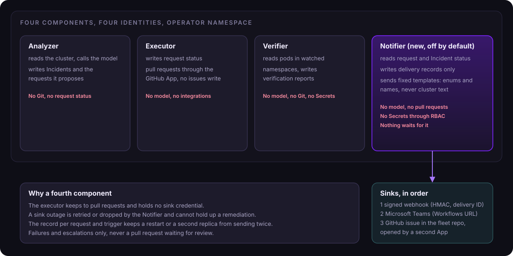

# ADR-0043: The Notifier as its own component

- Status: Proposed
- Date: 2026-11-15

## Context

Some requests and Incidents end in a way a person has to act on, and nobody may be watching the cluster. [ADR-0014](0014-notifications-github-issues-first.md) decided that a `Notifier` adapter opens one GitHub issue per incident through the executor's GitHub App, with Teams, Slack and a generic webhook later. The issue came first because Teams was blocked on an account type, and [ADR-0006](0006-github-app-key-in-key-vault.md) lists `issues: write` for it. Nothing of the Notifier is built; the executor's token request still names `issues`.

The maintainer decided on 2026-11-14 and 2026-11-15 ([#97](https://github.com/pkalin/shadewright/issues/97)): the Notifier is its own component, a fourth Deployment with its own identity, in the style of Argo CD's notifications controller; sinks in this order: a generic signed webhook, Microsoft Teams, a GitHub issue in the fleet repository; fixed templates from status fields only; failures and escalations only; one delivery record per request and trigger; built in v0.6.0, off by default; `issues: write` on the fleet repository may be granted for the issue sink. Everything else here is proposed or an open question.

### Supersedes ADR-0014

[ADR-0021](0021-amending-accepted-adrs.md) allows an amendment only when the decision stands. Here three decisions change: the issue is not first, the executor's App does not open it, and the adapter is not part of an existing component. ADR-0001 then asks for a new ADR, so ADR-0014 gets a dated line now and the status `Superseded by ADR-0043` when this ADR is accepted. What still holds carries over: every outcome is also a Kubernetes Event and CR status, and issue bodies hold only data of the kind a pull request body holds.

## Decision

### 1. A fourth Deployment

`shadewright-notifier` is its own binary, Deployment and ServiceAccount, after the analyzer, the executor and the verifier ([ADR-0030](0030-merge-receipt-and-verification-outcomes.md) section 7). It is deterministic code with no model access, no pull request permission, no Git write and no RBAC on Secrets. It never writes the status of a request or an Incident. Nothing else waits for it or reads what it writes.

### 2. What it may touch

- In the operator namespace: `get`, `list` and `watch` on `remediationrequests` and `incidents`. Nothing in the watched namespaces, no pods, no policies, no settings: its sinks are flags that the chart renders.
- In the operator namespace: `create`, `get`, `list` and `watch` on `notificationrecords` and `update` on `notificationrecords/status`, its own leader election Lease and core Events.
- Cluster-wide, only `create` on `tokenreviews` and `subjectaccessreviews` for its metrics endpoint, through the shared metrics-auth ClusterRoleBinding.
- Its only writes: the delivery record, its status, and the messages to the sinks.

### 3. Credentials

Federated authentication is used where the service offers it. The static credentials below follow the conditions of invariant 6 (named here, held only by the Notifier, a read-only mounted file the operator provides, read at each use, never in logs, events, status, records or errors):

| Sink | Credential |
| --- | --- |
| Webhook | the signing key, shared with the receiver: a mounted file |
| Teams | the Workflows webhook URL, itself a bearer secret: a mounted file |
| GitHub issue | no static credential: a second GitHub App with a Key Vault key (section 5) |

### 4. The delivery record

Two carriers were weighed. Status on the request or Incident would make the Notifier a second writer there and break invariant 6; rejected. A new object owned by the Notifier follows `VerificationReport`: **`NotificationRecord`** in `remediation.shadewright.io/v1alpha1`, in the operator namespace, one per subject (request or Incident) and trigger, typed fields and CEL, named from the subject's UID and the trigger so a repeated create finds it. `spec` (immutable): subject UID and kind, trigger. `status`: per configured sink a state (`Pending`, `Sent`, `Dropped`), an attempt count, the Notifier's own time of the last attempt and a failure class from a fixed list, never text from the sink. It is owned by the subject (`blockOwnerDeletion` false) and goes with it. Deleting a record allows one more message; no chart role gives that to anyone but an admin. This is open question 1.

### 5. Sinks

**Webhook.** A JSON body from the fixed template and three headers: `Shadewright-Delivery` (record name and sink), `Shadewright-Timestamp` (Unix seconds, Notifier's clock) and `Shadewright-Signature`, `v1=` and the hex HMAC-SHA256, keyed with the signing key, over the timestamp, a dot, the delivery ID, a dot and the exact body. A retry gets a new timestamp and signature and the same delivery ID. Replay protection is the receiver's: it rejects a timestamp outside a window it picks and remembers delivery IDs. No Shadewright decision compares the two clocks. HTTPS only, no redirects, the address checks of G3.9 (private, loopback, link-local refused when dialling) and an operator allow-list of host suffixes.

**Microsoft Teams.** A Workflows webhook with a card from the same template, under the same checks. It needs an account that allows Workflows, which ADR-0014 could not confirm. Teams has no delivery ID.

**GitHub issue.** One issue per subject in the fleet repository, found by a fixed label and a hidden marker derived from the subject's UID, so a restart finds it (invariant 5); a later trigger on the same subject adds a comment. The executor's App must not get `issues: write`, so a second App, `shadewright-notifier`, does it: installed on the fleet repository only, `issues: write` and `metadata: read`, on no bypass list, with its own non-exportable Key Vault key that only the Notifier's workload identity may `sign` with. The cost is one more App, key, role assignment, federated credential and installation in the lab Terraform. The gain: the executor's token request drops `issues` (a narrowing of ADR-0006, made with the build), so a compromised executor cannot write issues and a compromised Notifier cannot touch contents or pull requests.

### 6. Triggers

Failures and escalations only. Each exists today:

| Trigger | Where |
| --- | --- |
| A request in `NeedsIntervention`, with its reason | `PhaseNeedsIntervention`, `api/v1alpha1/remediationrequest_types.go` |
| A request in `Failed` with `Verified` False, reason `OOMKilled`, `Restarted`, `RolloutStuck`, `DeliveryFailed` or `KedaNotReady` | ADR-0030 section 8; `internal/controller/clearing.go`, `phases.go` |
| A proposed revert: a request with `spec.reverts`, waiting for approval | `api/v1alpha1/revert.go` |
| An Incident in `Escalated` | `IncidentEscalated`, `api/v1alpha1/incident_types.go` |

Never a pull request waiting for review: that is already a notification in the code host, and a second would teach people to ignore both.

### 7. Messages

A fixed template per trigger, filled only from enum and name fields: trigger, phase, condition reason, action type, the names and namespace of the request, Incident and target, and the pull request URL recorded in status. Names are bounded by API server validation and escaped per sink. No model text, no condition message, no symptom, summary, log line, label or annotation (invariant 4). That excludes what a reader may want: why the analysis escalated in words, what the log said, what the model proposed. The message links to the request; the rest is read where access control applies. No user-defined templates yet.

### 8. Exactly once in effect

Per subject and trigger the Notifier creates the record, sends, then marks the sink `Sent`. A crash between send and mark leaves `Pending` and the send is repeated: at least once, never lost. The repeat is harmless where the sink can tell (delivery ID, marker); Teams may show one duplicate. A restart reads the records and keeps no state in memory. Two replicas run under the Notifier's own Lease, and the deterministic record name makes a second create conflict, so a replica that wrongly believes it leads still finds the first record. The decision to send comes from recorded state, never from comparing a time of the subject with a time of the Notifier.

### 9. Off by default

Chart value `notifier.enabled` is `false`, and each sink is off under `notifier.sinks.<name>.enabled`. Off, the chart renders no Deployment, ServiceAccount or Role of the Notifier; the CRD is installed either way. On with no sink, the binary refuses to start.

### 10. Failure

A notification outage never holds up a remediation: nothing else waits for the Notifier. Each sink retries alone, with a bound and a backoff. Retried: timeouts, connection errors, 429 and 5xx, and any failed read (the credential file, the API server): a failed read is never `Dropped`. Dropped at once: what a retry cannot change (a 4xx other than 408 and 429, a refused address, a template error); dropped after the bound: the rest. A drop is visible: the sink's entry says `Dropped` with its failure class, a core Event names the record, and `shadewright_notifications_total` by sink, trigger and result is on the metrics endpoint. Nothing is written to a request.

## Relation to invariant 6

Invariant 6 says integrations other than the code host never go through the executor, and that a future `shadewright-coordinator` holds them, with its own ADR. The Notifier keeps the first half. For the second, this ADR is the own ADR for outbound notifications only, so the coordinator need not exist for them; any other integration, and anything inbound, still waits for it. Proposed wording for the pull request that builds the Notifier, not an edit now:

- The sentence: "Integrations other than the code host never go through the executor: outbound notifications go through `shadewright-notifier` (ADR-0043); any other integration is held by a future `shadewright-coordinator` (own ADR)."
- A Notifier entry after the verifier: own Deployment and ServiceAccount, no model access, no Git App of the executor, no Secrets, never writes request or Incident status; `get`, `list` and `watch` on requests and Incidents, `create`, `get`, `list` and `watch` on `notificationrecords`, `update` on their status, its Lease and Events, the metrics-auth grant, nothing in the watched namespaces.
- "In use today" gains the webhook signing key and the Teams URL.
- The executor's permission list drops `issues`.

## Consequences

- The executor keeps to pull requests; a notification outage cannot delay or fail a request.
- One more Deployment, Role, CRD, App, key and credential to run.
- ADR-0006 narrows, and the threat model gets a guarantee for the Notifier when it is built.

## Alternatives considered

- **Inside the executor.** Rejected: it is the component an attacker most wants, and invariant 6 keeps integrations from it. It would hold `issues: write` and sink credentials next to the App key, and a slow sink would share its process with the pull request path.
- **User templates, as Argo CD notifications has.** Rejected for now: a template can reach any status field, and a field with cluster text would reach a sink. Fixed templates make section 7 checkable.
- **The issue first, as ADR-0014 had it.** Rejected: it needs the second App, the most work of the three, and a lab issue is public. The webhook needs one file.

## Threats

- **A forged request status.** A compromised executor can write `NeedsIntervention`. Result: one fixed message per request and trigger. It cannot hide a failure, as the Notifier never reports success.
- **A hostile webhook receiver.** It gets fixed fields only. Slowness, huge bodies and redirects meet timeouts, a status-only read and no redirects. A replayed message meets the delivery ID and the receiver's own window.
- **Content as an exfiltration channel.** A compromised analyzer writes Incident text the Notifier can read, but only enum and name fields reach a template. A test that no template reads another field is a condition of the build.
- **The new credentials.** A stolen signing key sends messages the receiver trusts and reads nothing; a stolen Teams URL posts to one channel; the issue App's key never leaves Key Vault and its token writes issues only. Someone who can write records can suppress a message; no chart role grants that.

## Invariants touched

1 and 2 are not touched. 3 holds: no Git write, and the issue App has no contents or pull request permission. 4 holds by section 7. 5 holds by the record, the marker and the delivery ID. 6 is touched: a fourth identity with the grants and credentials named above.

## Open questions

1. **Where the record lives.** Recommendation: `NotificationRecord`, section 4.
2. **What marks a new escalation of one Incident.** Recommendation: one record per Incident UID for `Escalated`; a repeat waits for a task that picks a counter the analyzer already writes.
3. **Whether `Denied`, `Expired` and `Inconclusive` notify.** Recommendation: not in the first version.
4. **A receiver at a private address.** Recommendation: refused, with an operator flag that lists allowed ones.
5. **The attempt bound.** Recommendation: eight attempts, backoff from 30 seconds doubling to one hour.
6. **Whether Teams is possible.** Recommendation: check the account before filing the task; if not, build the issue sink second.

## Amendments

None.

