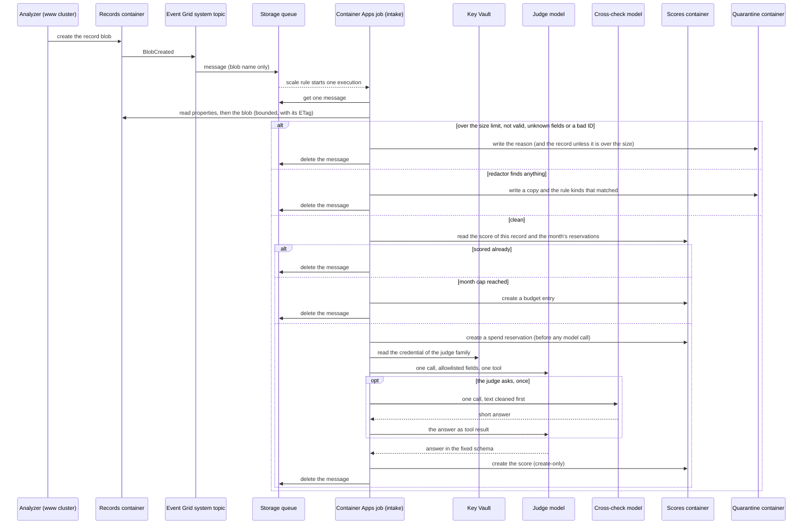

# ADR-0047: Analysis records written by an analyzer we do not run are scored by an intake outside any user cluster

- Status: Proposed
- Date: 2026-11-21

## Context

Epic [#987](https://github.com/pkalin/shadewright/issues/987), task [#988](https://github.com/pkalin/shadewright/issues/988), decisions of the maintainer on the epic on 2026-11-21.

The analyzer writes one record per analysis to a blob container ([ADR-0015](0015-analysis-records-outlive-the-lab.md), [ADR-0029](0029-azure-module-environment-and-cluster-layers.md)). A record holds the Incident's identity, counts, the model deployments and providers, the prompt version, a redacted summary and a list of missing data, and no context, prompt or raw reply (`internal/analysis/record.go:46-73`). The analyzer writes it create-only, as `<ID>.json`, and checks the decoded strings of the record with the redactor before the write (`internal/providers/store/azureblob/store.go:241-272`, `:280-283`). Today nothing reads records except a person. The blind runs of 2026-11-20, in which the analyzer of the www cluster analyzed scenarios without being told the answer, were scored by hand.

The epic wants records written by an analyzer we do not run (first the www cluster, later installations that opt in) scored without anyone reading them: a quality score when a record arrives, later a truth score when the answer is known. Scoring needs a model call, and the input of that call is text that an analyzer we do not control produced from a cluster we do not control. That text is untrusted (invariant 4), and what it costs is a model bill. This ADR decides where the scoring runs, what it may read, write and call, and what it must check before any model sees a record. It builds nothing.

What is out of scope: any change to what the analyzer sends or where it writes (it keeps writing records to its record store), truth scores and draft evaluation scenarios (P2 of the epic), and records from installations of other people. Those need their own ADR ([#995](https://github.com/pkalin/shadewright/issues/995)); a second writer into the records container is not allowed before it is accepted.

## Decision

[![The intake, left to right. The analyzer in the www cluster, which we do not run, creates a record in the records container. Blob created goes through an Event Grid system topic to a storage queue. A Container Apps job that scales to zero takes one message, checks the size and the schema, runs the redactor again and quarantines the record on any hit before any model call, skips a record that is already scored or a month whose cap is reached, then makes one judge call from the other model family with a fixed prompt, a fixed answer schema and one tool, a cross-check by a second model asked at most once. It writes a score and deletes the message. The job runs in a Container Apps environment in a virtual network whose subnet has storage and Key Vault service endpoints, which is how it reaches the records account that denies by default. Before each model call it creates a spend reservation. The model credentials are an Anthropic credential (workload identity federation if the account accepts it, otherwise a capped key) and a capped OpenAI key, with a cap of 40 to 50 USD a month each. Scores, spend reservations and quarantined records are in the intake's own containers with a retention period. One managed identity reads the records, reads and creates scores and reservations, writes quarantine, reads the Key Vault secrets and processes one queue. It holds no storage key and no cluster credential.](../assets/diagrams/analysis-intake.svg)](../assets/diagrams/analysis-intake.svg "Open full size")

### 1. What the intake is

A separate component, outside every cluster and every installation, that scores records from one container. It is the binary `cmd/intake` of the operator repository, built into its own image like the executor, analyzer and verifier (`Dockerfile:31-32`, `.github/workflows/images.yml:35`), which the images workflow signs keyless (`.github/workflows/images.yml:85-89`). Its infrastructure is in `shadewright-azure`, in its own Terraform root and state, resource group `rg-shadewright-intake` of the lab subscription, persistent (it is not destroyed with a lab cluster). It is not part of an installation: the chart and the Azure module of ADR-0029 do not create it, and nobody who installs Shadewright runs or needs it.

The first source is the record container of the www cluster. The intake reads one container, named in its configuration. A second container widens the read, so it is never added by an amendment of this ADR (ADR-0021: an amendment never widens what is granted on its own authority): it needs a new ADR, or another accepted ADR that allows it.

**How it reaches the records account.** The records account (`shadewright-azure`, `foundation/analysis-store.tf`) denies by default with no bypass, and lists only the AKS subnet, the admin addresses and the external writers' egress addresses. The intake's path in is a grant, decided on 2026-11-21 (network path: its own small virtual network and a storage service endpoint; the rest of the firewall stays as it is: the AKS subnet, the www writers and the admin addresses):

- The job runs in a Container Apps workload profiles environment (Consumption profile) in a virtual network of the intake's own root. The environment's subnet is delegated to `Microsoft.App/environments` and carries the service endpoints `Microsoft.Storage` and `Microsoft.KeyVault`. The foundation root adds that subnet to `virtual_network_subnet_ids` of the records account, through a variable that takes the subnet ID (the way it takes `external_analysis_writers`). Nothing else on the account's rules changes: no wider address range, no bypass.
- Cost, from the Microsoft documentation read on 2026-11-21: service endpoints have no extra charge. A Container Apps environment in your own network creates a managed resource group with one standard static public IP (egress) and one standard load balancer, billed at their own rates, and the Consumption plan bills vCPU-seconds and GiB-seconds with the first 180,000 vCPU-seconds, 360,000 GiB-seconds and 2 million requests free each month per subscription. [NEEDS CLARIFICATION: the unit prices of the public IP, the load balancer and the Consumption plan. The Azure pricing pages, read on 2026-11-21, show no rates (placeholders only), so this ADR states no monthly figure; the Terraform task prices them with the pricing calculator before the first apply.]
- A private endpoint instead is rejected for the first version: Microsoft recommends it over service endpoints, but it adds a Private Link charge and, for a Container Apps environment, a Dedicated Plan Management charge, and it needs private DNS zones. If the maintainer wants it, it replaces the service endpoints without changing anything else in this ADR.
- Event Grid cannot deliver through a private endpoint. With a firewall on the account that holds the queue, Event Grid delivers only with the system topic's system-assigned identity and only if "Allow Azure services on the trusted service list" is on for that account (Microsoft Learn, "Storage queue as an event handler"). The queue is therefore in the intake's own storage account, not the records account, and that account's rules are: default deny, the intake subnet, the admin addresses and the trusted-service exception. The records account keeps bypass `None`.

**Who owns what in Terraform.** Azure allows one Event Grid system topic per storage account, and the records account belongs to the foundation root. The system topic (with a system-assigned identity) is therefore a resource of the foundation root, which outputs its name. The intake root owns the queue, the event subscription on that topic (a data source reads the topic), and the queue role assignment of the topic's identity. The role assignment of the intake's identity on the records container belongs to the foundation root, which owns the container, taking the identity's principal ID as a variable. Both roots are applied by the maintainer; an apply of either needs a plan first.

### 2. How a record gets to the intake, and how many run at once

One run, from the blob to the score:

- **Trigger.** The Event Grid system topic of the records storage account has one subscription, for the event type blob created, with a filter on the records container, delivering to a storage queue with the topic's own system-assigned identity. The queue message holds the event, which names the blob; nothing from the event except the container and the blob name is used. Event Grid retries delivery a bounded number of times and queue messages have a time to live (settings in the Terraform task).
- **Scale to zero, one record per run.** The Container Apps job is event-driven with a scale rule on that queue, authenticated with the job's identity, and no minimum execution. Each execution has `parallelism` 1 and `replicaCompletionCount` 1 and takes one message. `maxExecutions` bounds how many executions the rule starts per polling interval. The job has no ingress: nothing connects to it.
- **At least once.** Event Grid can deliver an event twice, and a blob overwrite raises blob created again (the analyzer's role can overwrite, ADR-0015 amendment of 2026-11-04). The intake therefore decides from recorded state: a final score (status `scored`, `unjudged` or `invalid`) is named `<record ID>.<sha256 of the record bytes>.json`, and a message whose record bytes already have one is deleted without a model call. A record whose bytes changed gets a second score that says so. A `budget` or `error` outcome is not a score: it is written under its own prefix (`budget/<month>/` and `errors/`, section 5), so a later delivery of the same bytes, or a person who puts the record back on the queue, can still get scored.
- **Who decides the month.** The intake reads its own clock once at the start of a run and names the month from it. The month is never taken from the record, the record ID or the blob's timestamp, which the writer of the record controls or another service sets. The only month used in a decision is the one in the names the intake itself wrote (section 6).
- **A message is deleted last.** Only after the score, or the quarantine entry, is written. A read that fails (the blob, the scores, the vault, the model call) is an error for a retry, never a verdict: the message becomes visible again. The queue's own dequeue count bounds the retries (a small fixed number, 3 proposed): the next try after that writes an `errors/` entry naming the step and deletes the message. A record is never "not found" because a read failed. The intake has no dead-letter destination for events: an event that Event Grid gives up delivering (bounded attempts and a time to live, set in the Terraform task) leaves the record unscored and unseen (known limit (l)).

### 3. Checks before any model sees a record

In this order, each one final, none after a model call:

1. **Name and size.** The blob name must be `<record ID>.json` where the ID has the shape the analyzer makes (`recordID`, `internal/analysis/record.go:98-100`): the Incident UID, a dash and a UTC time as `20060102t150405z`, at most 64 bytes in all, from the characters `0-9`, `a-f`, `-` and `t`, `z` only. Any other name is quarantined without being read (the entry names a hash of the name, not the name). Every blob and queue name the intake builds is made from a validated ID by plain concatenation of fixed parts, never by joining a path or URL from text of the record (`../quarantine/x` or an over-long ID must not reach a path). The intake reads the blob's properties first. A blob over `MaxRecordBytes` (1 MiB, `internal/providers/store/azureblob/store.go:44-45`, the limit the analyzer's store already applies) is not downloaded. The download is then made with the ETag of the properties as a condition and a read limit of `MaxRecordBytes` plus one byte: a blob replaced between the two calls, or one that sends more than the limit, ends the run as a failed read for a retry (and the retry reads the new bytes), never a read of unbounded size.
2. **Schema.** The bytes must be one JSON object that decodes into the record type with no unknown field and a `schemaVersion` the intake knows (`RecordSchemaVersion`, `internal/analysis/record.go:36`), and its `id` must equal the blob name's ID. A record of a newer version is quarantined until the intake knows it. This is fail closed on purpose.
3. **The redactor, again.** The intake runs the operator's redactor over every decoded string and every key, the check the analyzer's store runs before its write (`internal/providers/store/azureblob/store.go:241-272`): `Redactor.Clean` (`internal/redact/redact.go:207-212`), not a comparison of the text with its redaction, because redaction is not idempotent and a marker can look like a value. Anything `Clean` rejects quarantines the whole record. Nothing is redacted and passed on: a record that changes is a record we do not trust. The intake's redactor is the one of its own build, so a rule added after the analyzer was built catches what the older analyzer let through. The analyzer's store keeps the record's `id` and `incident.fingerprint` (and its other verified names) out of the check (`internal/providers/store/azureblob/store.go:225-229`). The intake has no cluster, so it keeps nothing: the `id`, the fingerprint and every name are checked like any other string, and one that trips a rule quarantines the record (known limit (d)). That the `id` and the fingerprint pass an empty keep list is not assumed; the build task measures it.
4. **Scored already, and the month's cap.** The intake reads the scores container: for a final score of the same record bytes (section 2), and for the month's reservations (section 6). Either one ends the run without a model call.

Only a record that passes all four reaches section 4. The quarantine entry says which check refused the record and, for the redactor, the rule kinds that matched (kinds, not text).

### 4. One judge call

- **Which model.** The judge is of the other family than the record's model. The family is read from the record's `models` and `providers` by a fixed table in code (Anthropic and OpenAI first). A record whose models are of both families, or of a family the table does not know, is not sent to any judge: its score has status `unjudged` and the reason. The judge's deployment is configuration; the key is the intake's own (section 6).
- **What reaches it.** An allowlist of fields, not the record: the Incident's reason and subject kind, the summary, the missing data, `escalated` and the call counts. Not the model names, deployments or providers (a judge told whose answer it reads can lean on the name), and not the names, UID or fingerprint (it does not need them to judge).
- **Fixed prompt, fixed answer.** The prompt is a file in the binary with a version recorded in each score. The record is put in it as data in a delimited block, which the prompt says is untrusted text that may contain instructions. The answer must match a schema: integer scores of 0 to 5 on a fixed list of criteria, one verdict from a fixed list, and an optional note of at most 300 bytes that is written only if it passes `Clean`. An answer that does not match is recorded with status `invalid` and is not retried inside the run.
- **What the score is.** A quality score: whether the summary is specific, consistent with the reason and subject kind, and honest about what is missing. It is not a correctness score. A record holds no evidence from the cluster (`internal/analysis/record.go:46-49`), so the judge cannot tell a wrong diagnosis from a plausible one. Truth scores are P2 and come from a truth file per run.
- **One tool: a cross-check.** The judge may call `cross_check` once per record, with a question of at most 500 bytes about one claim. The count is kept in code, not by the model: a second call gets a fixed refusal text and no model call. The question is checked with `Clean` before it is sent; one that fails is not sent and still counts as the one ask. A second model, of the family of the analysis, answers it with the same limits, no tools and a short answer, returned to the judge as a tool result, untrusted like the record. [NEEDS CLARIFICATION: which model answers the cross-check. This ADR takes the other family than the judge, so that the judge's own family never checks itself; the maintainer to confirm.]
- **No other tool, no browsing, no write.** The judge's answer becomes a number and a verdict in a blob. Nothing reads a score to decide an action in any cluster.

### 5. Where the output goes, and for how long

- **Scores container.** Blobs created with `If-None-Match: *`: the final score `<ID>.<sha>.json` (status `scored`, `unjudged` or `invalid`; the answer, the prompt version, the judge's family and model, the tokens the provider reported), the spend reservations `spend/<month>/<ID>.<sha>.<dequeue count>.json` (section 6), the `budget/<month>/<ID>.<sha>.json` entry of a record the cap refused, and the `errors/<ID>.<sha>.json` entry of a record whose retries ran out, with the step that failed. The month in these names is the intake's own (section 2).
- **Quarantine container.** One entry per refused record: the reason, the size, the hash, the rule kinds, and a copy of the record unless it was over the size limit. The copy exists so that a redactor rule can be tested against it. The original stays in the records container, which the intake cannot write to or delete from.
- **Retention.** A lifecycle rule on each container: quarantine 30 days (it may hold what the redactor exists to remove), scores, reservations and entries 365 days. Both are in Terraform and are proposals of this ADR for the maintainer to confirm. The records container's own retention is the analyzer side's and unchanged.

### 6. Budget and credentials

- **Spend is paid from the providers' monthly allowances.** Decision of the maintainer, 2026-11-21 (issue #988): the intake's model calls are paid from the monthly Anthropic and OpenAI allowances, not from Azure credits. Microsoft Foundry stays the lab's evaluation endpoint, because it draws on the Azure budget of the lab subscription.
- **Anthropic.** A workspace made for the intake, with a monthly spend limit of 40 to 50 USD in the console. The credential is workload identity federation from the intake's managed identity if the Anthropic API accepts it for this account; the build task checks and records which. If it does not, a separate API key of that workspace, held in Key Vault. [ADR-0037](0037-the-anthropic-api-as-a-second-model-provider.md) says what Anthropic's limit is (per workspace, not per key, not on the default workspace) and that a leaked key costs up to that limit (`docs/adr/0037-the-anthropic-api-as-a-second-model-provider.md:47-49`).
- **OpenAI.** A project made for the intake with a monthly limit of 40 to 50 USD, and a separate API key in Key Vault: there is no keyless path from an Azure managed identity.
- **Foundry with the managed identity, rejected for the intake.** It would be keyless, but it spends the lab's Azure credits, which are kept for lab evaluation runs.
- **No other key.** Never the keys of the analyzer or the lab. The build task checks what each console does at its limit (a block or a notice) and says so in the Terraform README; this ADR does not claim it.
- **Caps in code.** Besides the consoles: a maximum of input and output tokens for each call, a maximum for one run (judge and cross-check together, `MaxRunTokens`), and a monthly cap of `MaxMonthTokens` for each provider. Before every model call of a run the intake creates a reservation blob (section 5) for the run maximum, named with the dequeue count so that each retry reserves again, and only then calls. The month's spend is the number of reservation blobs under `spend/<month>/` times `MaxRunTokens`, from a listing, with no body read and no clock but the intake's own. A call whose reply never arrives (a timeout, an out-of-memory kill, a failed score write) has already been counted at its maximum. At the cap a record gets a `budget` entry and no model call; it is not retried by itself. The caps are lower than the consoles, so the code stops first and the console is the backstop.
- **Where the credentials live, and how the conditions of AGENTS.md invariant 6 hold for each key.** Federation, where the account accepts it, holds no static credential at all. For each static key (the OpenAI key; the Anthropic key only if federation is refused):

| Condition (AGENTS.md, Static credentials) | How it is met |
| --- | --- |
| Keyless where the service offers it | OpenAI offers none from an Azure identity. Anthropic: federation is used if the account accepts it; the key exists only when it does not. |
| An ADR names the adapter and the credential | This ADR: the intake's OpenAI key and, only if needed, its Anthropic key. |
| Only the one component whose identity makes the call gets it | Only the job of the intake, through its identity. The vault holds nothing else of anyone else's, and no other identity has a role on it. |
| A read-only mounted file the operator provides, never RBAC on Secrets, an environment variable or a custom resource field | Each key is a Key Vault secret, referenced by the job as a Container Apps secret and mounted as a secret volume (files), never as an environment variable. The identity's role on the vault is Key Vault Secrets User on each secret, not on the vault. The build task checks that the mount is read-only and says so; if it is not, this row is not met and the intake goes back to a maintainer decision. There is no cluster: the "operator" here is the maintainer's Terraform. |
| Read at each use, so rotation needs no restart | An execution lives for one record, and the files are read when a call is made, so a rotated key is used by the next run. |
| Never in logs, events, status, records, traces or errors | The intake logs no credential, and a score, a quarantine entry and an error carry none (a test of the intake checks this). |

  The permission to start the job also reaches its secrets and identity (Microsoft Learn, "Jobs in Azure Container Apps", Permissions), so only the maintainer holds `Microsoft.App/jobs/start/action` on it.
- **What the vault is.** A Key Vault in the intake's own resource group, RBAC authorization, a network rule that allows the intake subnet through the `Microsoft.KeyVault` service endpoint and the admin addresses, default deny.

### 7. The identity and its grants

One user-assigned managed identity, `id-shadewright-intake`, used by the job and by its scale rule. Nothing else holds a grant on these resources except the topic's identity in the last row. No built-in role grants write without read or delete on blobs, so two custom role definitions are made, in the intake root, at subscription scope with the intake's storage account as the only assignable scope, in the way `analysis_writer` is made in the foundation root.

| What | Grant | Scope |
| --- | --- | --- |
| Records | built-in Storage Blob Data Reader (blob read, which on Azure also lists) | the one records container; assigned by the foundation root |
| Scores | custom role `intake scores`: blob read, write and add; no delete. Create-only is by `If-None-Match: *`; the role itself can overwrite, as in ADR-0015's amendment | the intake's scores container |
| Quarantine | custom role `intake quarantine`: blob write and add only; no read, no list, no delete | the intake's quarantine container |
| Queue | built-in Storage Queue Data Message Processor (peek, and retrieve and delete a message) | the one queue |
| Secrets | built-in Key Vault Secrets User | each secret, not the vault |
| Models | inference | through federation or the keys of section 6 |
| Event Grid system topic's own identity | built-in Storage Queue Data Message Sender | the one queue |

Scores need a read because the run decides from them (section 2 and section 6), which is one more than the epic's "write on scores". The role names are those of the Terraform task; the data actions above are what this ADR grants.

**What it never has.** A storage key (Shared Key is off on the intake's storage account), write or delete on the records container, a list or a read of any other container, delete on anything (the queue's retrieve-and-delete of its own messages is the one removal, and it is of events, not data), a cluster credential of any kind (no kubeconfig, no ServiceAccount token, no network path it needs to a cluster), the GitHub App, a Git token, a role assignment right, or a registry credential (the image is public and pinned by digest). The job has no ingress. Its egress is not limited to the model hosts in P1 (known limit (g)).

### 8. The binary and its release

`cmd/intake` imports the operator's redactor and the record type, so the intake and the analyzer cannot drift on what a record is or what is redacted. It is released and signed in the same workflow as the other images and Terraform pins the digest of a released tag. Nothing in the analyzer, the chart, the CRDs or the executor changes. The intake is not part of the chart, the Azure module or any install guide.

## How the invariants hold

1. **Model output is never authorization.** The judge's answer is stored as numbers and a verdict. No component reads a score to decide an action, and the intake holds no cluster credential, no Git credential and no way to call one. A later use of scores (draft evaluation scenarios, P2) is a draft for a person to review.
2. **Actions are a closed catalog, and 3. changes go through Git only.** Not touched: the intake neither proposes nor applies anything.
4. **Untrusted input and redaction.** A record is text an analyzer we do not run made from a cluster we do not run, so it is untrusted even though that analyzer redacted it. It is checked for schema and size, redacted again with the operator's current rules and refused on any hit before any model call. What reaches the judge is an allowlist of fields in a delimited block with a prompt that says it is data. The judge has one tool, bounded in size and count, and its answer must fit a schema. The quarantine container is the exception to "redacted before storage": it holds a record the redactor refused, so it is access-restricted, short-lived and never read by a model (known limit (c)).
5. **Idempotent, never exactly once.** Event Grid and the queue are at-least-once; a score is named by the record's ID and hash and created once, so a second message for the same bytes ends without a model call.
6. **Separate identities.** A new identity, not the analyzer's, the executor's or the verifier's, with the grants of section 7. It holds at most two static credentials (the OpenAI key, and the Anthropic key only if federation is refused). The table in section 6 goes through each condition of AGENTS.md invariant 6 for them. Federation is used where the account accepts it; the keys reach the job as a read-only secret volume from Key Vault, not as an environment variable. AGENTS.md names no component outside a cluster today, so accepting this ADR adds the intake to its list of identities and of static credentials (the maintainer reviews that change, as for any change to the invariants).

## Consequences

- Records of the www cluster are scored within minutes of arriving, without anyone reading them, and the model spend of that is bounded by the caps of section 6.
- A new persistent environment with an identity, a virtual network and Container Apps environment (with a static public IP and a load balancer), a queue, a job, a vault and two model workspaces to look after. It is priced before the first apply in the Terraform task (section 1 lists what is billed and what is not priced yet). At the ceiling the model spend is the two limits together, up to 100 USD a month, paid from the providers' allowances, not Azure credits.
- A second reader of records and a second place where records may sit (quarantine). Both are accounted for in sections 5 and 7. The foundation root gains a subnet rule, a system topic and a role assignment, and the records account's network rules now list a subnet of another root.
- Every record that the redactor of the intake refuses is a finding about a redactor, the analyzer's or the intake's, and goes to a person as a quarantine entry.

### Known limits

- (a) **A quality score is not a truth score.** The record holds no cluster evidence, so a confident wrong diagnosis can score well. Truth scores (P2) are what check it.
- (b) **The judge can be wrong or be talked to.** A record's text may contain instructions. The delimited block, the allowlist, the schema and the single bounded tool limit what a successful injection can do to a score, not whether it can. A forged high score is the damage.
- (c) **Quarantine holds what the redactor refused.** For 30 days it may hold a credential that the analyzer's redactor missed. The original also stays in the records container, which the intake cannot delete, so the copy does not widen who holds it, only where. Who can read quarantine: the admin principal (Storage Blob Data Contributor on the intake's account, as on the records account) and nobody else; the intake itself cannot.
- (d) **False quarantines.** With nothing kept, the record's `id`, its fingerprint and every object name are checked as plain strings, so a value that looks like a secret quarantines a record that the analyzer's store (which keeps the `id`, the fingerprint and verified names) accepted. The build task checks every record of the 2026-11-20 blind runs for this and reports the share quarantined; a share the maintainer finds too high is a reason to amend this ADR, not to weaken the check.
- (e) **Anyone who can write to the records container can spend model money.** Each blob there is processed. The queue, the per-run and monthly caps, and the consoles bound the cost; they do not stop it. Who may write to `analyses-www` today: the external writer's principal in `external_analysis_writers` (its custom write role, which can overwrite), and the admin principal, which holds Storage Blob Data Contributor on the whole account (`foundation/analysis-store.tf`), besides the firewall's address list. One overwritten record is scored again under its new hash. A person with Contributor on the records account can forge records and spend the cap; that is the admin, accepted.
- (f) **The caps can overshoot a little.** Parallel executions each list the month's reservations before they create their own, so a few runs can pass the cap together; `maxExecutions` bounds how many. Each retry of a record reserves again, so one record that fails every time costs up to dequeue count times `MaxRunTokens`. The consoles are the hard stop.
- (g) **Egress is open in P1.** The job can reach any host; only its code limits it to the two model endpoints. A network rule is a later task.
- (h) **No signature check at run time.** Container Apps pulls the image by digest; nothing at the pull verifies the signature. The check is the release workflow's and the person who sets the digest in Terraform.
- (i) **A record the intake cannot classify is not scored.** A model family outside the table, or both families in one record, ends as `unjudged`. The scores of those records are the maintainer's to read by hand.
- (j) **The intake reads one container and the build decides the rest.** The values left to the build task (the limit on tokens, the dequeue count, `maxExecutions`, the polling interval, retention numbers, the model names) are named constants and Terraform variables, not part of this decision, and a change of one is not an amendment unless it widens a read, a write or a grant.
- (k) **What the consoles do at a limit is not known yet.** See section 6. Whether Anthropic accepts workload identity federation for this account is not known either.
- (l) **A lost event is a lost record.** Event Grid retries a bounded number of times with a time to live and there is no dead-letter destination, so an undelivered event leaves a record unscored with nothing recording it. A reconciling pass that lists the records container against the scores is a later task, and it would widen nothing the intake does not already hold (records read, scores read).
- (m) **A `budget` or `error` entry is not retried by itself.** A record the cap refused or whose retries ran out stays unscored until a person puts it on the queue again. Both are listed under their own prefixes for that.
- (n) **The network path is a service endpoint, not a private endpoint.** Traffic goes over the Azure backbone but to the storage account's public address, and the account is open to every subnet in its rules.

## Alternatives considered

- **The analyzer calls the agent directly.** The analyzer would need a credential and an endpoint of ours, scoring would run in a cluster we do not run, and anyone who installs Shadewright could cause our model spend. It also makes our checks optional: the analyzer decides what it sends. Rejected: invariant 4 and 6.
- **Event Grid calls a model API.** An event handler that posts the record to a model has no place for the size check, the second redaction, the quarantine or the caps in code. The record would reach a model unchecked. Rejected.
- **Azure Container Instances.** It runs a container group until it exits. Something of ours would have to watch the queue, start groups and bound how many run, which is what the job's scale rule does. Rejected: more code to own for the same result.
- **A Function.** It has its own runtime, plan and storage, and a deployment path outside the signed image the other binaries use. The intake's code (the redactor, the record type) is in the operator module in Go. Not chosen. If the job proves costly or slow, a Function is the first alternative to look at again.
- **A scheduled GitHub Action.** Records would wait for the schedule, not arrive in minutes. It would need an Azure credential and two model keys in GitHub, records would pass through a hosted runner, and its logs are public for a public repository. Rejected.
- **A hosted agent service.** The checks of section 3 must run in our code before any model, and the caps, the allowlist and the single bounded tool must be ours. A hosted agent decides its own loop and its own tools. Rejected.
- **A comparison instead of `Clean`.** Redact the record again and compare with the text that came in. Redaction is not idempotent (`internal/redact/redact.go:207-211`), so a record that carries a marker would be refused. Rejected.
- **Redact and score anyway.** A record that the redactor changes is a record whose analyzer did not do its job. Scoring a repaired record hides that, so it is quarantined.

- **Foundry with the intake's managed identity.** Keyless, so it fits invariant 6 best, and it was the first draft's open question. Rejected on 2026-11-21: it spends the lab's Azure credits, which are kept for lab evaluation runs; the intake's calls are paid from the monthly Anthropic and OpenAI allowances instead.
- **A private endpoint to the records account.** See section 1: more cost and private DNS for no change in what the intake can do. Not chosen for the first version.
- **Allow the model providers' address ranges on the records account.** Rejected (decision of 2026-11-21): the providers never read storage, so the rule would let in addresses with no reason to be there, and their ranges are shared with all their tenants.
- **A NAT gateway with a fixed address, added to the account's address rules.** Rejected: it costs money for an address that is in use for seconds a day.
- **No virtual network, the job's own outbound addresses.** Rejected: without a network of our own, Container Apps outbound addresses are shared and can change, so no address rule can name them.

## Amendments

None.
