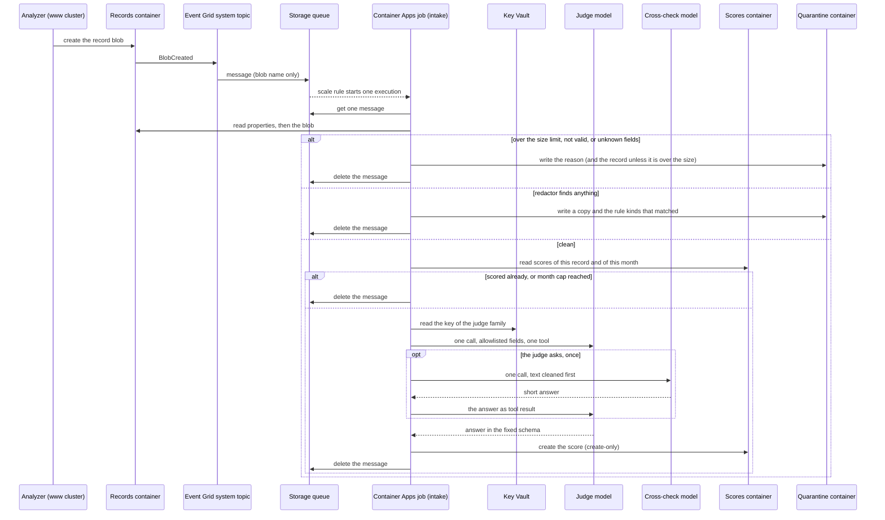

# ADR-0047: Analysis records written by an analyzer we do not run are scored by an intake outside any user cluster

- Status: Proposed
- Date: 2026-11-21

## Context

Epic [#987](https://github.com/pkalin/shadewright/issues/987), task [#988](https://github.com/pkalin/shadewright/issues/988), decisions of the maintainer on the epic on 2026-11-21.

The analyzer writes one record per analysis to a blob container ([ADR-0015](0015-analysis-records-outlive-the-lab.md), [ADR-0029](0029-azure-module-environment-and-cluster-layers.md)). A record holds the Incident's identity, counts, the model deployments and providers, the prompt version, a redacted summary and a list of missing data, and no context, prompt or raw reply (`internal/analysis/record.go:46-73`). The analyzer writes it create-only, as `<ID>.json`, and checks the decoded strings of the record with the redactor before the write (`internal/providers/store/azureblob/store.go:241-272`, `:280-283`). Today nothing reads records except a person. The blind runs of 2026-11-20, in which the analyzer of the www cluster analyzed scenarios without being told the answer, were scored by hand.

The epic wants records written by an analyzer we do not run (first the www cluster, later installations that opt in) scored without anyone reading them: a quality score when a record arrives, later a truth score when the answer is known. Scoring needs a model call, and the input of that call is text that an analyzer we do not control produced from a cluster we do not control. That text is untrusted (invariant 4), and what it costs is a model bill. This ADR decides where the scoring runs, what it may read, write and call, and what it must check before any model sees a record. It builds nothing.

What is out of scope: any change to what the analyzer sends or where it writes (it keeps writing records to its record store), truth scores and draft evaluation scenarios (P2 of the epic), and records from installations of other people. Those need their own ADR ([#995](https://github.com/pkalin/shadewright/issues/995)); a second writer into the records container is not allowed before it is accepted.

## Decision

[![The intake, left to right. The analyzer in the www cluster, which we do not run, creates a record in the records container. Blob created goes through an Event Grid system topic to a storage queue. A Container Apps job that scales to zero takes one message, checks the size and the schema, runs the redactor again and quarantines the record on any hit before any model call, skips a record that is already scored or a month whose cap is reached, then makes one judge call from the other model family with a fixed prompt, a fixed answer schema and one tool, a cross-check by a second model asked at most once. It writes a score and deletes the message. The judge keys are two separate keys with a cap of 40 to 50 USD a month each. Scores and quarantined records are in their own containers with a retention period. One managed identity reads the records, reads and writes scores, writes quarantine, reads two Key Vault secrets and processes one queue. It holds no storage key and no cluster credential.](../assets/diagrams/analysis-intake.svg)](../assets/diagrams/analysis-intake.svg "Open full size")

### 1. What the intake is

A separate component, outside every cluster and every installation, that scores records from one container. It is the binary `cmd/intake` of the operator repository, built into its own image like the executor, analyzer and verifier (`Dockerfile:31-32`, `.github/workflows/images.yml:35`), which the images workflow signs keyless (`.github/workflows/images.yml:85-89`). Its infrastructure is in `shadewright-azure`, in its own Terraform root and state, resource group `rg-shadewright-intake` of the lab subscription, persistent (it is not destroyed with a lab cluster). It is not part of an installation: the chart and the Azure module of ADR-0029 do not create it, and nobody who installs Shadewright runs or needs it.

The first source is the record container of the www cluster. The intake reads one container, named in its configuration. A container is added by amending this ADR.

### 2. How a record gets to the intake, and how many run at once

One run, from the blob to the score:

- **Trigger.** The Event Grid system topic of the records storage account has one subscription, for the event type blob created, with a filter on the records container, delivering to a storage queue with the topic's own system-assigned identity. The queue message holds the event, which names the blob; nothing from the event except the container and the blob name is used. Event Grid retries delivery a bounded number of times and queue messages have a time to live (settings in the Terraform task).
- **Scale to zero, one record per run.** The Container Apps job is event-driven with a scale rule on that queue, authenticated with the job's identity, and no minimum execution. Each execution has `parallelism` 1 and `replicaCompletionCount` 1 and takes one message. `maxExecutions` bounds how many executions the rule starts per polling interval. The job has no ingress: nothing connects to it.
- **At least once.** Event Grid can deliver an event twice, and a blob overwrite raises blob created again (the analyzer's role can overwrite, ADR-0015 amendment of 2026-11-04). The intake therefore decides from recorded state: the score of a record is named `<record ID>.<sha256 of the record bytes>.json`, and a message whose record bytes already have a score is deleted without a model call. A record whose bytes changed gets a second score that says so.
- **A message is deleted last.** Only after the score, or the quarantine entry, is written. A read that fails (the blob, the scores, the vault, the model call) is an error for a retry, never a verdict: the message becomes visible again. The queue's own dequeue count bounds the retries (a small fixed number, 3 proposed): the next try after that writes a score with status `error` naming the step, and deletes the message. A record is never "not found" because a read failed.

### 3. Checks before any model sees a record

In this order, each one final, none after a model call:

1. **Size.** The intake reads the blob's properties first. A blob over `MaxRecordBytes` (1 MiB, `internal/providers/store/azureblob/store.go:44-45`, the limit the analyzer's store already applies) is not downloaded. A quarantine entry names the record, the size and the reason.
2. **Schema.** The bytes must be one JSON object that decodes into the record type with no unknown field and a `schemaVersion` the intake knows (`RecordSchemaVersion`, `internal/analysis/record.go:36`). A record of a newer version is quarantined until the intake knows it. This is fail closed on purpose.
3. **The redactor, again.** The intake runs the operator's redactor over every decoded string and every key, the check the analyzer's store runs before its write (`internal/providers/store/azureblob/store.go:241-272`): `Redactor.Clean` (`internal/redact/redact.go:207-212`), not a comparison of the text with its redaction, because redaction is not idempotent and a marker can look like a value. Anything `Clean` rejects quarantines the whole record. Nothing is redacted and passed on: a record that changes is a record we do not trust. The intake's redactor is the one of its own build, so a rule added after the analyzer was built catches what the older analyzer let through. The intake has no cluster, so it keeps no verified names (`keep` is empty): a name that trips a rule quarantines the record (known limit (d)).
4. **Scored already, and the month's cap.** The intake reads the scores container: for the same record bytes (section 2), and for the month's spent tokens (section 6). Either one ends the run without a model call.

Only a record that passes all four reaches section 4. The quarantine entry says which check refused the record and, for the redactor, the rule kinds that matched (kinds, not text).

### 4. One judge call

- **Which model.** The judge is of the other family than the record's model. The family is read from the record's `models` and `providers` by a fixed table in code (Anthropic and OpenAI first). A record whose models are of both families, or of a family the table does not know, is not sent to any judge: its score has status `unjudged` and the reason. The judge's deployment is configuration; the key is the intake's own (section 6).
- **What reaches it.** An allowlist of fields, not the record: the Incident's reason and subject kind, the summary, the missing data, `escalated` and the call counts. Not the model names, deployments or providers (a judge told whose answer it reads can lean on the name), and not the names, UID or fingerprint (it does not need them to judge).
- **Fixed prompt, fixed answer.** The prompt is a file in the binary with a version recorded in each score. The record is put in it as data in a delimited block, which the prompt says is untrusted text that may contain instructions. The answer must match a schema: integer scores of 0 to 5 on a fixed list of criteria, one verdict from a fixed list, and an optional note of at most 300 bytes that is written only if it passes `Clean`. An answer that does not match is recorded with status `invalid` and is not retried inside the run.
- **What the score is.** A quality score: whether the summary is specific, consistent with the reason and subject kind, and honest about what is missing. It is not a correctness score. A record holds no evidence from the cluster (`internal/analysis/record.go:46-49`), so the judge cannot tell a wrong diagnosis from a plausible one. Truth scores are P2 and come from a truth file per run.
- **One tool: a cross-check.** The judge may call `cross_check` once per record, with a question of at most 500 bytes about one claim. The count is kept in code, not by the model: a second call gets a fixed refusal text and no model call. The question is checked with `Clean` before it is sent; one that fails is not sent and still counts as the one ask. A second model, of the family of the analysis, answers it with the same limits, no tools and a short answer, returned to the judge as a tool result, untrusted like the record. [NEEDS CLARIFICATION: which model answers the cross-check. This ADR takes the other family than the judge, so that the judge's own family never checks itself; the maintainer to confirm.]
- **No other tool, no browsing, no write.** The judge's answer becomes a number and a verdict in a blob. Nothing reads a score to decide an action in any cluster.

### 5. Where the output goes, and for how long

- **Scores container.** One blob per score, created with `If-None-Match: *`, holding the record's ID and hash, the status (`scored`, `unjudged`, `invalid`, `budget`, `error`), the answer, the prompt version, the judge's family and model, and the tokens charged (the sum of the month's scores is the spend of section 6, so a failed call that spent tokens still writes a score with them).
- **Quarantine container.** One entry per refused record: the reason, the size, the hash, the rule kinds, and a copy of the record unless it was over the size limit. The copy exists so that a redactor rule can be tested against it. The original stays in the records container, which the intake cannot touch.
- **Retention.** A lifecycle rule on each container: quarantine 30 days (it may hold what the redactor exists to remove), scores 365 days. Both are in Terraform and are proposals of this ADR for the maintainer to confirm. The records container's own retention is the analyzer side's and unchanged.

### 6. Budget and keys

- **Separate keys.** The intake has its own key for each provider, never the keys of the analyzer or the lab: an Anthropic workspace and an OpenAI project made for it, each with a monthly spend limit of 40 to 50 USD in the provider's console. [ADR-0037](0037-the-anthropic-api-as-a-second-model-provider.md) says what Anthropic's limit is (per workspace, not per key, not on the default workspace) and that a leaked key costs up to that limit (`docs/adr/0037-the-anthropic-api-as-a-second-model-provider.md:47-49`). The build task checks what each console does at the limit (a block or a notice) and says so in the Terraform README; this ADR does not claim it.
- **Caps in code.** Besides the consoles: a maximum of input and output tokens for each call, a maximum for one record's run (judge and cross-check together), and a monthly cap of tokens for each key. The spent tokens of a month are summed from that month's scores (recorded state, month named by the score's own name, one clock). At the cap, a record gets a score with status `budget` and no model call; it is not retried. The caps are lower than the consoles, so the code stops first and the console is the backstop if the code is wrong.
- **Where the keys live.** Two secrets in a Key Vault of the intake's own resource group. The intake reads a secret when a run needs it, through its identity, never from an environment variable, a Container Apps secret or a file of the image, and it never writes one to a log, a score, a quarantine entry or an error. A job execution lives for one record, so a rotated key is used by the next run.

### 7. The identity and its grants

One user-assigned managed identity, `id-shadewright-intake`, used by the job and by its scale rule. Nothing else holds a grant on these resources except the topic's identity in the last row.

| What | Grant | Scope |
| --- | --- | --- |
| Records | read (blob read, which on Azure also lists) | the one records container |
| Scores | read and write (create-only by `If-None-Match: *`; the role itself can overwrite, as in ADR-0015's amendment) | the intake's scores container |
| Quarantine | write | the intake's quarantine container |
| Queue | process messages (get, delete) | the one queue |
| Secrets | read the value | each of the two secrets, not the vault |
| Models | inference | through the two keys |
| Event Grid system topic's own identity | send messages | the one queue |

Scores need a read because the run decides from them (section 2 and section 6), which is one more than the epic's "write on scores".

**What it never has.** A storage key (Shared Key is off on the intake's storage account), write or delete on the records container, a list or a read of any other container, delete on anything, a cluster credential of any kind (no kubeconfig, no ServiceAccount token, no network path it needs to a cluster), the GitHub App, a Git token, a role assignment right, or a registry credential (the image is public and pinned by digest). The job has no ingress. Its egress is not limited to the two model hosts in P1 (known limit (g)).

### 8. The binary and its release

`cmd/intake` imports the operator's redactor and the record type, so the intake and the analyzer cannot drift on what a record is or what is redacted. It is released and signed in the same workflow as the other images and Terraform pins the digest of a released tag. Nothing in the analyzer, the chart, the CRDs or the executor changes. The intake is not part of the chart, the Azure module or any install guide.

## How the invariants hold

1. **Model output is never authorization.** The judge's answer is stored as numbers and a verdict. No component reads a score to decide an action, and the intake holds no cluster credential, no Git credential and no way to call one. A later use of scores (draft evaluation scenarios, P2) is a draft for a person to review.
2. **Actions are a closed catalog, and 3. changes go through Git only.** Not touched: the intake neither proposes nor applies anything.
4. **Untrusted input and redaction.** A record is text an analyzer we do not run made from a cluster we do not run, so it is untrusted even though that analyzer redacted it. It is checked for schema and size, redacted again with the operator's current rules and refused on any hit before any model call. What reaches the judge is an allowlist of fields in a delimited block with a prompt that says it is data. The judge has one tool, bounded in size and count, and its answer must fit a schema. The quarantine container is the exception to "redacted before storage": it holds a record the redactor refused, so it is access-restricted, short-lived and never read by a model (known limit (c)).
5. **Idempotent, never exactly once.** Event Grid and the queue are at-least-once; a score is named by the record's ID and hash and created once, so a second message for the same bytes ends without a model call.
6. **Separate identities.** A new identity, not the analyzer's, the executor's or the verifier's, with the grants of section 7. It holds static credentials (the two model keys), so it meets the conditions of AGENTS.md invariant 6 as far as they fit a component that is not in a cluster: an ADR names the credential (this one), only the one component whose identity makes the call gets it, it is read at each use and never logged. It does not meet "a read-only mounted file that the cluster operator provides" because it has no cluster; it reads from a Key Vault through its identity instead, which is the stronger form of the same rule. AGENTS.md names no component outside a cluster today, so accepting this ADR adds the intake to its list of identities (the maintainer reviews that change, as for any change to the invariants).

## Consequences

- Records of the www cluster are scored within minutes of arriving, without anyone reading them, and the model spend of that is bounded by the caps of section 6.
- A new persistent environment with an identity, a queue, a job, a vault and two model accounts to look after. It is priced before the first apply in the Terraform task; at the ceiling the model spend is the two limits together, up to 100 USD a month, and the rest (Event Grid, a queue, blob storage and a job that exists only while it runs) is small at the volume of one analyzer.
- A second reader of records and a second place where records may sit (quarantine). Both are accounted for in sections 5 and 7.
- Every record that the redactor of the intake refuses is a finding about a redactor, the analyzer's or the intake's, and goes to a person as a quarantine entry.

### Known limits

- (a) **A quality score is not a truth score.** The record holds no cluster evidence, so a confident wrong diagnosis can score well. Truth scores (P2) are what check it.
- (b) **The judge can be wrong or be talked to.** A record's text may contain instructions. The delimited block, the allowlist, the schema and the single bounded tool limit what a successful injection can do to a score, not whether it can. A forged high score is the damage.
- (c) **Quarantine holds what the redactor refused.** For 30 days it may hold a credential that the analyzer's redactor missed. The original also stays in the records container, which the intake cannot delete, so the copy does not widen who holds it, only where.
- (d) **False quarantines.** With no verified names, an object name that looks like a secret quarantines a record that the analyzer's store (which keeps verified names) accepted. The build task checks every record of the 2026-11-20 blind runs for this and reports the share quarantined; a share the maintainer finds too high is a reason to amend this ADR, not to weaken the check.
- (e) **Anyone who can write to the records container can spend model money.** Each blob there is processed. The queue, the per-run and monthly caps, and the consoles bound the cost; they do not stop it. Who may write there is fixed by ADR-0015 and ADR-0029 (the analyzer's identity), and the analyzer's role can overwrite, so one overwritten record is scored again under its new hash.
- (f) **The caps can overshoot a little.** Parallel executions each read the month's total before they write their score, so a few runs can pass the cap together. The consoles are the hard stop.
- (g) **Egress is open in P1.** The job can reach any host; only its code limits it to the two model endpoints. A network rule is a later task.
- (h) **No signature check at run time.** Container Apps pulls the image by digest; nothing at the pull verifies the signature. The check is the release workflow's and the person who sets the digest in Terraform.
- (i) **A record the intake cannot classify is not scored.** A model family outside the table, or both families in one record, ends as `unjudged`. The scores of those records are the maintainer's to read by hand.
- (j) **The intake reads one container and the build decides the rest.** The values left to the build task (the limit on tokens, the dequeue count, `maxExecutions`, the polling interval, retention numbers, the model names) are named constants and Terraform variables, not part of this decision, and a change of one is not an amendment unless it widens a read, a write or a grant.
- (k) **What the consoles do at a limit is not known yet.** See section 6.

## Alternatives considered

- **The analyzer calls the agent directly.** The analyzer would need a credential and an endpoint of ours, scoring would run in a cluster we do not run, and anyone who installs Shadewright could cause our model spend. It also makes our checks optional: the analyzer decides what it sends. Rejected: invariant 4 and 6.
- **Event Grid calls a model API.** An event handler that posts the record to a model has no place for the size check, the second redaction, the quarantine or the caps in code. The record would reach a model unchecked. Rejected.
- **Azure Container Instances.** It runs a container group until it exits. Something of ours would have to watch the queue, start groups and bound how many run, which is what the job's scale rule does. Rejected: more code to own for the same result.
- **A Function.** It has its own runtime, plan and storage, and a deployment path outside the signed image the other binaries use. The intake's code (the redactor, the record type) is in the operator module in Go. Not chosen. If the job proves costly or slow, a Function is the first alternative to look at again.
- **A scheduled GitHub Action.** Records would wait for the schedule, not arrive in minutes. It would need an Azure credential and two model keys in GitHub, records would pass through a hosted runner, and its logs are public for a public repository. Rejected.
- **A hosted agent service.** The checks of section 3 must run in our code before any model, and the caps, the allowlist and the single bounded tool must be ours. A hosted agent decides its own loop and its own tools. Rejected.
- **A comparison instead of `Clean`.** Redact the record again and compare with the text that came in. Redaction is not idempotent (`internal/redact/redact.go:207-211`), so a record that carries a marker would be refused. Rejected.
- **Redact and score anyway.** A record that the redactor changes is a record whose analyzer did not do its job. Scoring a repaired record hides that, so it is quarantined.

## Amendments

None.
