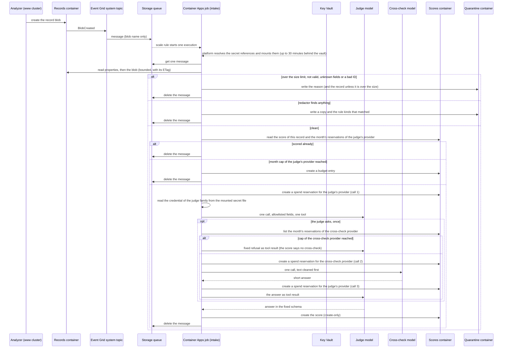

# ADR-0047: Analysis records written by an analyzer we do not run are scored by an intake outside any user cluster

- Status: Accepted
- Date: 2026-11-21

## Context

Epic [#987](https://github.com/pkalin/shadewright/issues/987), task [#988](https://github.com/pkalin/shadewright/issues/988), decisions of the maintainer on the epic on 2026-11-21.

The analyzer writes one record per analysis to a blob container ([ADR-0015](0015-analysis-records-outlive-the-lab.md), [ADR-0029](0029-azure-module-environment-and-cluster-layers.md)). A record holds the Incident's identity, counts, the model deployments and providers, the prompt version, a redacted summary and a list of missing data, and no context, prompt or raw reply (`internal/analysis/record.go:46-73`). The analyzer writes it create-only, as `<ID>.json`, and checks the decoded strings of the record with the redactor before the write (`internal/providers/store/azureblob/store.go:241-272`, `:280-283`). Today nothing reads records except a person. The blind runs of 2026-11-20, in which the analyzer of the www cluster analyzed scenarios without being told the answer, were scored by hand.

The epic wants records written by an analyzer we do not run (first the www cluster, later installations that opt in) scored without anyone reading them: a quality score when a record arrives, later a truth score when the answer is known. Scoring needs a model call, and the input of that call is text that an analyzer we do not control produced from a cluster we do not control. That text is untrusted (invariant 4), and what it costs is a model bill. This ADR decides where the scoring runs, what it may read, write and call, and what it must check before any model sees a record. It builds nothing.

What is out of scope: any change to what the analyzer sends or where it writes (it keeps writing records to its record store), truth scores and draft evaluation scenarios (P2 of the epic), and records from installations of other people. Those need their own ADR ([#995](https://github.com/pkalin/shadewright/issues/995)); a second writer into the records container is not allowed before it is accepted.

## Decision

[![The intake, left to right. The analyzer in the www cluster, which we do not run, creates a record in the records container. A blob created event goes through Event Grid to a storage queue. A Container Apps job takes one message, makes one call to the judge model (Anthropic or OpenAI, the other family than the analysis) and creates a score in the scores container. The job reads its model keys from Key Vault and puts a record it refuses in a quarantine container. Checks, caps, network, identity and retention are described in the text below, not drawn.](../assets/diagrams/analysis-intake.svg)](../assets/diagrams/analysis-intake.svg "Open full size")

### 1. What the intake is

A separate component, outside every cluster and every installation, that scores records from one container. Its name, "the intake", is not the intake service of the hub in [ADR-0038](0038-control-plane-mode-a-hub-that-many-clusters-report-to.md), which verifies the reports of spokes and holds no model credential; the two share nothing, and where the difference matters this ADR says "the scoring intake" (an `AGENTS.md` entry for it names the binary, `cmd/intake`, and this ADR). It is the binary `cmd/intake` of the operator repository, built into its own image like the executor, analyzer and verifier (`Dockerfile:31-32`, `.github/workflows/images.yml:35`), which the images workflow signs keyless (`.github/workflows/images.yml:85-89`). Its infrastructure is in `shadewright-azure`, in its own Terraform root and state, resource group `rg-shadewright-intake` of the lab subscription, persistent (it is not destroyed with a lab cluster). It is not part of an installation: the chart and the Azure module of ADR-0029 do not create it, and nobody who installs Shadewright runs or needs it.

The first source is the record container of the www cluster. The intake reads one container, named in its configuration. A second container widens the read, so it is never added by an amendment of this ADR (ADR-0021: an amendment never widens what is granted on its own authority): it needs a new ADR, or another accepted ADR that allows it.

**How it reaches the records account.** The records account (`shadewright-azure`, `foundation/analysis-store.tf`) denies by default with no bypass, and lists only the AKS subnet, the admin addresses and the external writers' egress addresses. The intake's path in is a grant, decided on 2026-11-21 (network path: its own small virtual network and a storage service endpoint; the rest of the firewall stays as it is: the AKS subnet, the www writers and the admin addresses):

- The job runs in a Container Apps workload profiles environment (Consumption profile) in a virtual network of the intake's own root. The environment's subnet is delegated to `Microsoft.App/environments` and carries the service endpoints `Microsoft.Storage` and `Microsoft.KeyVault`. The foundation root adds that subnet to `virtual_network_subnet_ids` of the records account, through a variable that takes the subnet ID (the way it takes `external_analysis_writers`). Nothing else on the account's rules changes: no wider address range, no bypass.
- Cost, from the Microsoft documentation read on 2026-11-21: service endpoints have no extra charge. A Container Apps environment in your own network creates a managed resource group with one standard static public IP (egress) and one standard load balancer, billed at their own rates, and the Consumption plan bills vCPU-seconds and GiB-seconds with the first 180,000 vCPU-seconds, 360,000 GiB-seconds and 2 million requests free each month per subscription. List prices in the lab's region (Sweden Central), read from the Azure retail prices API on 2026-11-21: the static public IP at 0.005 USD an hour (about 3.65 USD a month) and the standard load balancer at 0.025 USD an hour (about 18.25 USD a month), so the network path stands at about 22 USD a month whether the job runs or not; job runs (vCPU 0.000024 USD a second, memory 0.000003 USD a GiB-second) stay inside the free grant at the expected volume, and Event Grid and the queue cost cents. The infrastructure task (#991) prices it again before the first apply and may choose another path if one is cheaper and keeps the firewall as tight; until #991 is applied there is no intake and nothing is scored. A run by hand does nothing against the live containers: the intake writes only as the job, and comparing scores before #991 (#992) runs the scorer on downloaded copies of records, with the maintainer's own keys, keeping the output local. The admin's Storage Blob Data Contributor on the records account (`foundation/analysis-store.tf`, write and delete on every container) is never used for a run.
- A private endpoint instead is rejected for the first version: Microsoft recommends it over service endpoints, but it adds a Private Link charge and, for a Container Apps environment, a Dedicated Plan Management charge, and it needs private DNS zones. If the maintainer wants it, it replaces the service endpoints without changing anything else in this ADR.
- Event Grid cannot deliver through a private endpoint. With a firewall on the account that holds the queue, Event Grid delivers only with the system topic's system-assigned identity and only if "Allow Azure services on the trusted service list" is on for that account (Microsoft Learn, "Storage queue as an event handler"). The queue is therefore in the intake's own storage account, not the records account, and that account's rules are: default deny, the intake subnet, the admin addresses and the trusted-service exception. The records account keeps bypass `None`.

**Who owns what in Terraform.** Azure allows one Event Grid system topic per storage account, and the records account belongs to the foundation root. The system topic (with a system-assigned identity) is therefore a resource of the foundation root, which outputs its name. The intake root owns the queue, the event subscription on that topic (a data source reads the topic), and the queue role assignment of the topic's identity. The role assignment of the intake's identity on the records container belongs to the foundation root, which owns the container, taking the identity's principal ID as a variable. Both roots are applied by the maintainer; an apply of either needs a plan first.

### 2. How a record gets to the intake, and how many run at once

One run, from the blob to the score:

- **Trigger.** The Event Grid system topic of the records storage account has one subscription, for the event type blob created, with a filter on the records container, delivering to a storage queue with the topic's own system-assigned identity. The queue message holds the event, which names the blob; nothing from the event except the container and the blob name is used. Event Grid retries delivery a bounded number of times and queue messages have a time to live (settings in the Terraform task).
- **Scale to zero, one record per run.** The Container Apps job is event-driven with a scale rule on that queue, authenticated with the job's identity, and no minimum execution. Each execution has `parallelism` 1 and `replicaCompletionCount` 1 and takes one message. `maxExecutions` bounds how many executions the rule starts per polling interval. The job has no ingress: nothing connects to it.
- **At least once.** Event Grid can deliver an event twice, and a blob overwrite raises blob created again (the analyzer's role can overwrite, ADR-0015 amendment of 2026-11-04). The intake therefore decides from recorded state, and a delivery of the same bytes ends without a model call only when it comes after the first run has written its score (see "Two runs at once" below): a final score (status `scored`, `unjudged` or `invalid`) is named `<record ID>.<sha256 of the record bytes>.json`, and a message whose record bytes already have one is deleted without a model call. A record whose bytes changed gets a second score that says so. A `budget` or `error` outcome is not a score: it is written under its own prefix (`budget/<month>/` and `errors/`, section 5), so a later delivery of the same bytes can still get scored.
- **What a 409 means.** Every create of the intake is `If-None-Match: *`, and a name that exists answers 409. Each kind has one meaning, fixed here. A 409 on a **reservation** ends the run without a model call and leaves the message on the queue as an error for a retry (a reservation name holds the message ID, the dequeue count and the call index, section 6, so only a repeat of the same delivery can meet it, and the next dequeue count reserves under a new name). A 409 on a **final score**, a **`budget` entry**, an **`errors/` entry** or a **quarantine entry** counts as written: the content of the earlier blob is what stands, and the message is deleted. The re-queue of a `budget` or `error` record (known limit (m)) therefore works because its reservations carry the new message's ID; a `budget` entry of the same month is a 409 that stands, and an `errors/` entry is deleted by the person before the record is put back.
- **Two runs at once.** Two messages for the same bytes can be processed by two executions at the same time. Both pass "scored already" (a check, then an act) and both call the judge, each under its own reservations, so the month's spend counts both; the score create is then create-only and the second run gets a 409 on it, which counts as written. "A second message for the same bytes ends without a model call" holds for deliveries one after the other, not for two at once (known limit (p)).
- **The queue message's visibility timeout.** The intake sets it when it gets a message, to a value longer than the run's total deadline, and never renews it. The run's context deadline (all model call timeouts, the reads and the writes together, a named constant) is shorter than the visibility timeout, so the message cannot become visible again while its run is still working, and a second execution is not started for a run that is still alive. A run that reaches its deadline is an error for a retry, like any failed read.
- **Who decides the month.** The intake reads its own clock once at the start of a run and names the month from it. The month is never taken from the record, the record ID or the blob's timestamp, which the writer of the record controls or another service sets. The only month used in a decision is the one in the names the intake itself wrote (section 6).
- **A message is deleted last.** Only after the score, or the quarantine entry, is written. A read that fails (the blob, the scores, the vault, the model call) is an error for a retry, never a verdict: the message becomes visible again. The queue's own dequeue count bounds the retries (a small fixed number, 3 proposed; a retry is always a new delivery after the visibility timeout, never a run still in progress): the next try after that writes an `errors/` entry naming the step and deletes the message. A record is never "not found" because a read failed. The intake has no dead-letter destination for events: an event that Event Grid gives up delivering (bounded attempts and a time to live, set in the Terraform task) leaves the record unscored and unseen (known limit (l)).

### 3. Checks before any model sees a record

In this order, each one final, none after a model call:

1. **Account, container, name and size.** Before any read, the event's storage account and container must be the configured ones; a message that names another is quarantined with the reason (a hash of the names, not the names) and is not retried. The blob name must be `<record ID>.json` where the ID has the shape the analyzer makes (`recordID`, `internal/analysis/record.go:105-108`): the Incident UID, a dash and a UTC time as `20060102t150405z`, at most 64 bytes in all, from the characters `0-9`, `a-f`, `-` and `t`, `z` only. Any other name is quarantined without being read (the entry names a hash of the name, not the name). Every blob and queue name the intake builds is made from a validated ID by plain concatenation of fixed parts, never by joining a path or URL from text of the record (`../quarantine/x` or an over-long ID must not reach a path). The intake reads the blob's properties first. A blob over `MaxRecordBytes` (1 MiB, `internal/providers/store/azureblob/store.go:44-45`, the limit the analyzer's store already applies) is not downloaded. The download is then made with the ETag of the properties as a condition and a read limit of `MaxRecordBytes` plus one byte: a blob replaced between the two calls, or one that sends more than the limit, ends the run as a failed read for a retry (and the retry reads the new bytes), never a read of unbounded size.
2. **Schema.** The bytes must be one JSON object that decodes into the record type with no unknown field and a `schemaVersion` the intake knows (`RecordSchemaVersion`, `internal/analysis/record.go:36`), and its `id` must equal the blob name's ID. A record of a newer version is quarantined until the intake knows it. This is fail closed on purpose.
3. **The redactor, again.** The intake runs the operator's redactor over every decoded string and every key, the check the analyzer's store runs before its write (`internal/providers/store/azureblob/store.go:241-272`): `Redactor.Clean` (`internal/redact/redact.go:207-212`), not a comparison of the text with its redaction, because redaction is not idempotent and a marker can look like a value. Anything `Clean` rejects quarantines the whole record. Nothing is redacted and passed on: a record that changes is a record we do not trust. The intake's redactor is the one of its own build, so a rule added after the analyzer was built catches what the older analyzer let through. The analyzer's store keeps the record's `id`, `incident.fingerprint` and its other verified names out of the check (`internal/providers/store/azureblob/store.go:225-229`), and the analyzer passes the Incident's name and the request's name as verified (`internal/analysis/record.go:115-118`), because both trip the redactor: a name of `incident-` and 64 hex digits (`api/v1alpha1/incidentname.go:31`) and `remediation-` and 24 hex digits (`api/v1alpha1/requestname.go:43`) are refused by `Clean`, checked on 2026-11-21. With nothing kept, every record would be quarantined. The intake has no cluster, but it keeps a value whose shape it checks itself, in code, wherever it occurs as a whole in a string (as `Clean` keeps its `keep` list, and as the analyzer's store does for the values above, so a summary that mentions the Incident's name passes):

    - `id` equal to the validated blob ID of step 1;
    - `incident.fingerprint` matching `^sha256:[0-9a-f]{64}$`;
    - `incident.name` only if `ParseIncidentName` (`api/v1alpha1/incidentname.go:48`) returns the same fingerprint;
    - `request` only if it matches `^remediation-[0-9a-f]{24}$`.

    Every string, in any field, is checked keeping only the values that passed their shape check; any other text that the redactor would change quarantines the record. None of these fields reaches the judge (section 4 allowlist), so keeping them widens nothing a model sees. A value in one of these fields that fails its shape check is not kept, and quarantines the record. The build task starts with a generated corpus test before the rule: records the analyzer accepts (names and fingerprints made by the real name functions) must pass the intake's check, and records with a changed name or fingerprint, or a request that does not match, must be refused (known limit (d)).
4. **Scored already, and the month's cap.** The intake reads the scores container: for a final score of the same record bytes (section 2), and for the month's reservations of the judge's provider (section 6). Either one ends the run without a model call.

Only a record that passes all four reaches section 4. The quarantine entry says which check refused the record and, for the redactor, the rule kinds that matched (kinds, not text).

### 4. One judge call

- **Which model.** The judge is of the other family than the record's model. The family is read from the record's `models` (the model IDs the replies named) by a fixed table in code that matches exact ID prefixes (Anthropic and OpenAI first). `providers` cannot decide it: its values are `Foundry`, `Anthropic` and `OpenAICompatible` (`api/v1alpha1/remediationsettings_types.go:291-296`), Foundry hosts models of both families and an OpenAI-compatible endpoint can serve any model. It is used only to refuse a mismatch (a record whose `providers` name Anthropic and whose `models` match the OpenAI table is `unjudged`). A record whose models are of both families, of a family the table does not know, or a mismatch, is not sent to any judge: its score has status `unjudged` and the reason. The judge's deployment is configuration; the key is the intake's own (section 6).
- **What reaches it.** An allowlist of fields, not the record: the Incident's reason and subject kind, the summary, the missing data, `escalated` and the call counts. Not the model names, deployments or providers (a judge told whose answer it reads can lean on the name), and not the names, UID or fingerprint (it does not need them to judge).
- **Fixed prompt, fixed answer.** The prompt is a file in the binary with a version recorded in each score. The record is put in it as data in a delimited block, which the prompt says is untrusted text that may contain instructions. The answer must match a schema: integer scores of 0 to 5 on a fixed list of criteria, one verdict from a fixed list, and an optional note of at most 300 bytes that is written only if it passes `Clean`. An answer that does not match is recorded with status `invalid` and is not retried inside the run.
- **What the score is.** A quality score: whether the summary is specific, consistent with the reason and subject kind, and honest about what is missing. It is not a correctness score. A record holds no evidence from the cluster (`internal/analysis/record.go:46-49`), so the judge cannot tell a wrong diagnosis from a plausible one. Truth scores are P2 and come from a truth file per run.
- **One tool: a cross-check.** The judge may call `cross_check` once per record, with a question of at most 500 bytes about one claim. The count is kept in code, not by the model: a second call gets a fixed refusal text and no model call. The question is checked with `Clean` before it is sent; one that fails is not sent and still counts as the one ask. A second model, of the family of the analysis, answers it with the same limits, no tools and a short answer, returned to the judge as a tool result, untrusted like the record. The cross-check is answered by the other family than the judge, so that the judge's own family never checks itself (confirmed 2026-11-21).
- **No other tool, no browsing, no write.** The judge's answer becomes a number and a verdict in a blob. Nothing reads a score to decide an action in any cluster.

### 5. Where the output goes, and for how long

- **Scores container.** Blobs created with `If-None-Match: *`: the final score `<ID>.<sha>.json` (status `scored`, `unjudged` or `invalid`; the answer, the prompt version, the judge's family and model, the tokens the provider reported), the spend reservations `spend/<month>/<provider>/<day>.<record ID>.<message ID>.<dequeue count>.<call index>.<tokens>.json` (section 6), the `budget/<month>/<ID>.<sha>.json` entry of a record the cap refused, and the `errors/<ID>.<sha>.json` entry of a record whose retries ran out, with the step that failed. The month in these names is the intake's own (section 2).
- **Quarantine container.** One entry per refused record: the reason, the size, the hash, the rule kinds, and a copy of the record unless it was over the size limit. The copy exists so that a redactor rule can be tested against it. The original stays in the records container, which the intake cannot write to or delete from.
- **Retention.** A lifecycle rule on each container: quarantine 30 days (it may hold what the redactor exists to remove), scores, reservations and entries 365 days. Both are in Terraform and are proposals of this ADR for the maintainer to confirm. The records container's own retention is the analyzer side's and unchanged.

### 6. Budget and credentials

- **Spend is paid from the providers' monthly allowances.** Decision of the maintainer, 2026-11-21 (issue #988): the intake's model calls are paid from the monthly Anthropic and OpenAI allowances, not from Azure credits. Microsoft Foundry stays the lab's evaluation endpoint, because it draws on the Azure budget of the lab subscription.
- **Anthropic.** A workspace made for the intake, with a monthly spend limit of 40 to 50 USD in the console. The credential is a separate API key of that workspace, held in Key Vault like the OpenAI key. [ADR-0037](0037-the-anthropic-api-as-a-second-model-provider.md) says what Anthropic's limit is (per workspace, not per key, not on the default workspace) and that a leaked key costs up to that limit (`docs/adr/0037-the-anthropic-api-as-a-second-model-provider.md:47-49`).
- **OpenAI.** A project made for the intake with a monthly limit of 40 to 50 USD, and a separate API key in Key Vault: there is no keyless path from an Azure managed identity.
- **Foundry with the managed identity, rejected for the intake.** It would be keyless, but it spends the lab's Azure credits, which are kept for lab evaluation runs.
- **No other key.** Never the keys of the analyzer or the lab. The build task checks what each console does at its limit (a block or a notice) and says so in the Terraform README; this ADR does not claim it.
- **Caps in code.** Besides the consoles: a maximum of input and output tokens for each call (`MaxCallTokens`), a maximum for one run (judge and cross-check together, `MaxRunTokens`, kept in memory by the run), and a monthly cap of `MaxMonthTokens` for each provider. Before every model call the intake creates a reservation blob (section 5) for that call's maximum, and only then calls. The name holds the provider of the call (the judge's, or the cross-check's, which is the other one), the UTC day of the run's clock read, the record ID, the message ID, the dequeue count, the call index in the run and the reserved tokens, so a retry, a re-queued message, the cross-check call after the judge call and a parallel run never meet the same name (section 2, "What a 409 means"). The month's spend for a provider is the sum of the token values in the names under `spend/<month>/<provider>/`, from a listing, with no body read and no clock but the intake's own. The amount is in the name, so a later change of `MaxCallTokens` does not change what an earlier reservation counted. A call whose reply never arrives (a timeout, an out-of-memory kill, a failed score write) has already been counted at its maximum. Before each of the up to three calls of a run (judge, cross-check, judge with the tool result) the intake lists that call's provider's reservations for the month and creates the call's reservation. At the cap of the judge's provider a record gets a `budget` entry and no model call; it is not retried by itself. At the cap of the cross-check's provider during a run, the tool returns a fixed refusal and the judge answers without it: the score is written without a cross-check and says so. The first `budget` entry of a month logs a warning and increments a metric. The caps are lower than the consoles, so the code stops first and the console is the backstop.
- **Where the credentials live, and how the conditions of AGENTS.md invariant 6 hold for each key.** The intake holds two static keys. For each (the OpenAI key and the Anthropic key):

| Condition (AGENTS.md, Static credentials) | How it is met |
| --- | --- |
| Keyless where the service offers it | OpenAI offers none from an Azure identity. Anthropic offers federation, but the maintainer chose a capped key for the intake on 2026-11-21: it is simpler to run, and the spend cap limits a leak. |
| An ADR names the adapter and the credential | This ADR: the intake's OpenAI key and, only if needed, its Anthropic key. |
| Only the one component whose identity makes the call gets it | Only the job of the intake, through its identity. The vault holds nothing else of anyone else's, and no other identity has a role on it. |
| A read-only mounted file the operator provides, never RBAC on Secrets, an environment variable or a custom resource field | Each key is a Key Vault secret, put in the vault out of band (by the maintainer, from a key kept outside every repository, as in ADR-0037 section 7), never through Terraform state or variables, Git or a pipeline; Terraform creates the vault and the grants, not the values. The job references it as a Container Apps secret (a versionless Key Vault reference) and mounts it as a secret volume (files), never as an environment variable. The identity's role on the vault is Key Vault Secrets User on each secret, not on the vault. The build task checks that the mount is read-only and says so; if it is not, this row is not met and the intake goes back to a maintainer decision. There is no cluster: the "operator" here is the maintainer, who provides the vault and the references. |
| Read at each use, so rotation needs no restart | An execution lives for one record, and the intake reads the mounted file when it makes a call, so rotation needs no restart. The platform, not the run, resolves the Key Vault reference: with a versionless reference it picks up a new version within 30 minutes (Microsoft Learn, "Manage secrets in Azure Container Apps", read 2026-11-21), so a rotated key reaches runs that start after that delay, not the next run. Rotation order: put the new version in the vault, wait over 30 minutes, check in the provider's console that the new key shows a last use (a score carries the model and the time, not the key; what each console shows is checked by the build task, known limit (k)), and only then revoke the old key in the provider's console. |
| Never in logs, events, status, records, traces or errors | The intake logs no credential, and a score, a quarantine entry and an error carry none (a test of the intake checks this). |

  The permission to start the job also reaches its secrets and identity (Microsoft Learn, "Jobs in Azure Container Apps", Permissions), so only the maintainer holds `Microsoft.App/jobs/start/action` on it.
- **What the vault is.** A Key Vault in the intake's own resource group, RBAC authorization, a network rule that allows the intake subnet through the `Microsoft.KeyVault` service endpoint and the admin addresses, default deny.

### 7. The identity and its grants

One user-assigned managed identity, `id-shadewright-intake`, used by the job and by its scale rule. Nothing else holds a grant on these resources except the topic's identity and the admin principal in the last two rows. No built-in role grants write without read or delete on blobs, so two custom role definitions are made, in the intake root, at subscription scope with the intake's storage account as the only assignable scope, in the way `analysis_writer` is made in the foundation root.

| What | Grant | Scope |
| --- | --- | --- |
| Records | built-in Storage Blob Data Reader (blob read, which on Azure also lists) | the one records container; assigned by the foundation root |
| Scores | custom role `intake scores`: blob read, write and add; no delete. Create-only is by `If-None-Match: *`; the role itself can overwrite, as in ADR-0015's amendment | the intake's scores container |
| Quarantine | custom role `intake quarantine`: blob write and add only; no read, no list, no delete | the intake's quarantine container |
| Queue | built-in Storage Queue Data Message Processor (peek, and retrieve and delete a message) | the one queue |
| Secrets | built-in Key Vault Secrets User | each secret, not the vault |
| Models | inference | through the keys of section 6 |
| Event Grid system topic's own identity | built-in Storage Queue Data Message Sender | the one queue |
| Admin principal (the maintainer) | built-in Storage Blob Data Contributor: read, write and delete on every container, quarantine, scores and reservations included. It can delete reservations, which lowers the month's counted spend, and delete an `errors/` entry before a re-queue (known limit (c)) | the intake's storage account |

Scores need a read because the run decides from them (section 2 and section 6), which is one more than the epic's "write on scores". The role names are those of the Terraform task; the data actions above are what this ADR grants.

**What it never has.** A storage key (Shared Key is off on the intake's storage account), write or delete on the records container, a list or a read of any other container, delete on anything (the queue's retrieve-and-delete of its own messages is the one removal, and it is of events, not data), a cluster credential of any kind (no kubeconfig, no ServiceAccount token, no network path it needs to a cluster), the GitHub App, a Git token, a role assignment right, or a registry credential (the image is public and pinned by digest). The job has no ingress. Its egress is not limited to the model hosts in P1 (known limit (g)).

### 8. The binary and its release

`cmd/intake` imports the operator's redactor and the record type, so the intake and the analyzer cannot drift on what a record is or what is redacted. It is released and signed in the same workflow as the other images and Terraform pins the digest of a released tag. Nothing in the analyzer, the chart, the CRDs or the executor changes. The intake is not part of the chart, the Azure module or any install guide.

## How the invariants hold

1. **Model output is never authorization.** The judge's answer is stored as numbers and a verdict. No component reads a score to decide an action, and the intake holds no cluster credential, no Git credential and no way to call one. A later use of scores (draft evaluation scenarios, P2) is a draft for a person to review.
2. **Actions are a closed catalog, and 3. changes go through Git only.** Not touched: the intake neither proposes nor applies anything.
4. **Untrusted input and redaction.** A record is text an analyzer we do not run made from a cluster we do not run, so it is untrusted even though that analyzer redacted it. It is checked for schema and size, redacted again with the operator's current rules and refused on any hit before any model call. What reaches the judge is an allowlist of fields in a delimited block with a prompt that says it is data. The judge has one tool, bounded in size and count, and its answer must fit a schema. The quarantine container is the exception to "redacted before storage": it holds a record the redactor refused, so it is access-restricted, short-lived and never read by a model (known limit (c)).
5. **Idempotent, never exactly once.** Event Grid and the queue are at-least-once; a score is named by the record's ID and hash and created once, so a second message for the same bytes ends without a model call when it comes after the first run wrote its score. Two messages at once can both call the judge, each reserved, and the second score create is a 409 that counts as written (known limit (p)).
6. **Separate identities.** A new identity, not the analyzer's, the executor's or the verifier's, with the grants of section 7. It holds two static credentials (the OpenAI key and the Anthropic key). The table in section 6 goes through each condition of AGENTS.md invariant 6 for them. The keys reach the job as a read-only secret volume from Key Vault, not as an environment variable. AGENTS.md names no component outside a cluster today, so accepting this ADR adds the intake to its list of identities and of static credentials (the maintainer reviews that change, as for any change to the invariants).

## Consequences

- Records of the www cluster are scored within minutes of arriving, without anyone reading them, and the model spend of that is bounded by the caps of section 6.
- A new persistent environment with an identity, a virtual network and Container Apps environment (with a static public IP and a load balancer), a queue, a job, a vault and two model workspaces to look after. It is priced before the first apply in the Terraform task (section 1 lists what is billed and what is not priced yet). At the ceiling the model spend is the two limits together, up to 100 USD a month, paid from the providers' allowances, not Azure credits.
- A second reader of records and a second place where records may sit (quarantine). Both are accounted for in sections 5 and 7. The foundation root gains a subnet rule, a system topic and a role assignment, and the records account's network rules now list a subnet of another root.
- Every record that the redactor of the intake refuses is a finding about a redactor, the analyzer's or the intake's, and goes to a person as a quarantine entry.

### Known limits

- (a) **A quality score is not a truth score.** The record holds no cluster evidence, so a confident wrong diagnosis can score well. Truth scores (P2) are what check it.
- (b) **The judge can be wrong or be talked to.** A record's text may contain instructions. The delimited block, the allowlist, the schema and the single bounded tool limit what a successful injection can do to a score, not whether it can. A forged high score is the damage.
- (c) **Quarantine holds what the redactor refused.** For 30 days it may hold a credential that the analyzer's redactor missed. The original also stays in the records container, which the intake cannot delete, so the copy does not widen who holds it, only where. Who can read quarantine: the admin principal (Storage Blob Data Contributor on the intake's account, as on the records account, a row of the section 7 table) and nobody else; the intake itself cannot. The same role can delete reservations and lower the counted spend; that is the admin, accepted.
- (d) **False quarantines.** The intake keeps `id`, the fingerprint, the Incident's name and the request's name only by the shape checks of section 3, and keeps them wherever they occur whole in a string, as the analyzer's store does (`internal/providers/store/azureblob/store.go:225-229`), so a record whose analyzer made them with the real functions passes, summaries that mention the names included. Any other string that looks like a secret quarantines the record, and so does a name or fingerprint that fails its check (it is then not kept). With nothing kept the share would be 100% (the two names trip the redactor), which is why the checks exist. The build task measures the share on every record of the 2026-11-20 blind runs and reports it; a share the maintainer finds too high is a reason to amend this ADR, not to weaken the check.
- (e) **Anyone who can write to the records container can spend model money.** Each blob there is processed. The queue, the per-run and monthly caps, and the consoles bound the cost; they do not stop it. Who may write to `analyses-www` today: the external writer's principal in `external_analysis_writers` (its custom write role, which can overwrite), and the admin principal, which holds Storage Blob Data Contributor on the whole account (`foundation/analysis-store.tf`), besides the firewall's address list. One overwritten record is scored again under its new hash. A writer can also use up `MaxMonthTokens` of a provider and so starve genuine records for the rest of the month: they get `budget` entries and stay unscored (known limit (m)). The first `budget` entry of a month logs a warning and increments a metric, so a full month is seen; nothing stops it. A person with Contributor on the records account can forge records and spend the cap; that is the admin, accepted.
- (f) **The caps can overshoot a little.** Parallel executions each list the month's reservations before they create their own, so a few runs can pass the cap together. Runs alive at once are bounded by `maxExecutions` times the run deadline over the polling interval (`maxExecutions` starts each interval, each alive for at most the deadline, section 2), and a message is not handled twice while a run is alive, because the run deadline is shorter than the visibility timeout. Each retry of a record reserves again, but a record has at most 2 attempts a UTC day (amendment of 2026-11-21), so one record that fails every time costs up to 2 times `MaxRunTokens` a day, not the dequeue count times it, plus any run a person lets through by hand. The cap is a cap for each provider (reservations are listed by provider), not one pooled number. The consoles are the hard stop.
- (g) **Egress is open in P1.** The job can reach any host; only its code limits it to the two model endpoints. A network rule is a later task.
- (h) **No signature check at run time.** Container Apps pulls the image by digest; nothing at the pull verifies the signature. The check is the release workflow's and the person who sets the digest in Terraform.
- (i) **A record the intake cannot classify is not scored.** A model family outside the table, or both families in one record, ends as `unjudged`. The scores of those records are the maintainer's to read by hand.
- (j) **The intake reads one container and the build decides the rest.** The values left to the build task (the limit on tokens, the dequeue count, `maxExecutions`, the polling interval, retention numbers, the model names) are named constants and Terraform variables, not part of this decision, and a change of one is not an amendment unless it widens a read, a write or a grant.
- (k) **What the consoles do at a limit is not known yet.** See section 6.
- (l) **A lost event is a lost record.** Event Grid retries a bounded number of times with a time to live and there is no dead-letter destination, so an undelivered event leaves a record unscored with nothing recording it. A reconciling pass that lists the records container against the scores is a later task, and it would widen nothing the intake does not already hold (records read, scores read).
- (m) **A `budget` or `error` entry is not retried by itself.** A record the cap refused or whose retries ran out stays unscored until a person puts it on the queue again. Both are listed under their own prefixes for that. A re-queue in the month of a `budget` entry is refused by the cap again (the 409 on the entry stands); one after an `error` entry needs the person to delete that entry first, because a 409 on `errors/` counts as written.
- (n) **The network path is a service endpoint, not a private endpoint.** Traffic goes over the Azure backbone but to the storage account's public address, and the account is open to every subnet in its rules.
- (o) **The writer of a record picks the judge's family and the provider cap it spends.** The family comes from the `models` IDs, which the analyzer copies from replies and the record's writer controls, so a forged record can steer which provider's budget the judge call uses, and which judge reads it. Both stay inside the per-provider caps and the allowlist, and `providers` only refuses a mismatch. Same exposure as (e).
- (p) **Two messages for the same bytes at once can both call the judge.** A create-only claim blob per `<ID>.<sha>` taken before the first reservation would stop it, at the price of a stale-claim rule (a claim left by a crashed run would need its own expiry, decided from recorded state only). Not in P1: the second run's score create is a 409, both runs are reserved and counted, and the cap bounds the cost. Reconsider if duplicates are seen.

## Alternatives considered

- **The analyzer calls the agent directly.** The analyzer would need a credential and an endpoint of ours, scoring would run in a cluster we do not run, and anyone who installs Shadewright could cause our model spend. It also makes our checks optional: the analyzer decides what it sends. Rejected: invariant 4 and 6.
- **Event Grid calls a model API.** An event handler that posts the record to a model has no place for the size check, the second redaction, the quarantine or the caps in code. The record would reach a model unchecked. Rejected.
- **Azure Container Instances.** It runs a container group until it exits. Something of ours would have to watch the queue, start groups and bound how many run, which is what the job's scale rule does. Rejected: more code to own for the same result.
- **A Function.** It has its own runtime, plan and storage, and a deployment path outside the signed image the other binaries use. The intake's code (the redactor, the record type) is in the operator module in Go. Not chosen. If the job proves costly or slow, a Function is the first alternative to look at again.
- **A scheduled GitHub Action.** Records would wait for the schedule, not arrive in minutes. It would need an Azure credential and two model keys in GitHub, records would pass through a hosted runner, and its logs are public for a public repository. Rejected.
- **A hosted agent service.** The checks of section 3 must run in our code before any model, and the caps, the allowlist and the single bounded tool must be ours. A hosted agent decides its own loop and its own tools. Rejected.
- **A comparison instead of `Clean`.** Redact the record again and compare with the text that came in. Redaction is not idempotent (`internal/redact/redact.go:207-211`), so a record that carries a marker would be refused. Rejected.
- **Redact and score anyway.** A record that the redactor changes is a record whose analyzer did not do its job. Scoring a repaired record hides that, so it is quarantined.

- **Foundry with the intake's managed identity.** Keyless, so it fits invariant 6 best, and it was the first draft's open question. Rejected on 2026-11-21: it spends the lab's Azure credits, which are kept for lab evaluation runs; the intake's calls are paid from the monthly Anthropic and OpenAI allowances instead.
- **A private endpoint to the records account.** See section 1: more cost and private DNS for no change in what the intake can do. Not chosen for the first version.
- **Allow the model providers' address ranges on the records account.** Rejected (decision of 2026-11-21): the providers never read storage, so the rule would let in addresses with no reason to be there, and their ranges are shared with all their tenants.
- **A NAT gateway with a fixed address, added to the account's address rules.** Rejected: it costs money for an address that is in use for seconds a day.
- **No virtual network, the job's own outbound addresses.** Rejected: without a network of our own, Container Apps outbound addresses are shared and can change, so no address rule can name them.

## Amendments

### 2026-11-21 (#989): what is built

2026-11-21 (#989), what is built: `cmd/intake` and `internal/intake` score one record from a local file ([scoring intake reference](../reference/intake.md)), with the judge and the one cross-check of section 4 and the caps of section 6, the reservations kept in a local directory instead of the scores container. The file name stands for the blob name; a quarantine or budget outcome is written as a score with that status, since there are no containers yet. How the build meets the sections, and where it does less:

- **Section 3, the checks.** Name, size, schema and the redactor run in that order. The record ID must be the Incident UID as a lower-case UUID plus a valid time, and `incident.uid` must be that UID. Before the record is decoded, no object may hold a key twice (compared after unescaping and under the case folding the JSON decoder uses to match fields), and nothing may nest deeper than 16 levels: otherwise the redactor check and the judge could read different members of the same bytes. The redactor also runs over the values the judge is given, built from the decoded record. Both are earlier lines of defence; the check that decides is `Clean` on each request exactly as it is sent (decided 2026-11-21): every message after formatting (the judge's messages, the cross-check question with its delimiters, the cross-check answer as handed back to the judge), the tool calls, the provider blocks of the judge's reply and the tool definitions, with nothing kept. Before that, every text built from the record for a model (the judge's values, the cross-check question) has each whole occurrence of the record ID, the Incident's name, the request's name and the fingerprint (also its bare digits) replaced by a fixed word (`[record-id]`, `[incident-name]`, `[request-name]`, `[fingerprint]`), each value only after its shape check, with "whole" as the redactor's keep list takes it (`redact.ReplaceWhole`); the judge's prompt says what the words stand for. The models never get the names, which is less than section 3 and limit (d) allow (decided 2026-11-21). It runs where each request is built, and the one function that calls a model takes only a request that passed it, so no call goes around it. The judge's reply goes back in its second request as the analysis loop sends a reply: its tool calls and the provider blocks the adapter returned (the reply's content blocks as the provider sent them: text, tool calls and thinking), with no separate text, since the Anthropic adapter refuses a message with both (decided 2026-11-21). The check reads what those blocks send: each text and tool call block whole and each of its strings, and the texts of all text blocks joined, as the adapter joins them. Blocks that are not a list of objects with no key twice, or a block of any other type, refuse the request (kind `unreadable-provider-block`). Since 2026-11-21 the text of each thinking block is checked too, alone: if the redactor would change it, the second request is not sent and the record is quarantined (kind `unclean-thinking-block`), and a thinking block the check cannot read refuses the request like any other; signatures and the data of `redacted_thinking` blocks go back unchanged and unread, but their shape is checked: a signature, when present, is a string, and a `redacted_thinking` block holds exactly `type` and `data`, a string; any other member, a value of another kind, a nested value or a key twice refuses the request (kind `unreadable-provider-block`). A value joined only in them, or split over two thinking blocks, is not seen until #1093. The cross-check answer is checked as it came, with nothing kept: if the redactor would change it, it is not handed to the judge and the record is quarantined with its own reason; nothing is redacted and passed on (decided 2026-11-21). A request that fails is not sent: the record is quarantined at the first judge call; a question is not sent and counts as the ask; the judge's second request ends the run as `quarantined` after the first call. A value check alone missed a secret-named flag at the end of one field and its value at the start of the next. A name right after a secret-named flag (`--token <name>`) passes the earlier checks, where the name is kept, and is refused here: the flag's value is then the fixed word, which the redactor takes as a value. "Scored already" is built only as "the `--out` file exists": it is checked before the name, does nothing with the default `--out -`, and is keyed by the path, not by the record ID and the hash of the bytes. A repeat run with `--out -` therefore spends again. The naming by ID and hash comes with the scores container (#991).
- **Section 4, the judge.** The quality criteria are `specific`, `consistent`, `causeSupported` and `missingData`, the verdicts `useful`, `partial`, `unhelpful` and `misleading`: section 4 leaves the list to the build, and the issue's "0 to 3" score gave way to the 0 to 5 of section 4. Property names of the answer are matched exactly and the note is optional. The cross-check model is of the family of the analysis, the other family than the judge, as section 4 decides (confirmed 2026-11-21). Only the first ask is served; an ask in the judge's reply after the tool results makes the score `invalid`, because the run makes at most three calls. A judge call that cannot be reserved after the cross-check ends the run as `budget`.
- **Section 4, the mismatch of provider and model (decided 2026-11-21).** Section 4 refuses a record whose `providers` name Anthropic and whose `models` match the OpenAI table. The build compares only the providers of roles that ran: the triage provider always, the escalation provider only when the record says `escalated`. A record names the escalation provider whenever an escalation model is configured, so the literal reading left every unescalated record of an install with OpenAI triage and Anthropic escalation `unjudged`. The family still comes from `models` alone, which hold the IDs the replies named: a record whose escalation model answered has models of both families and stays `unjudged` whatever `escalated` says. More records reach a judge than under the literal reading, none that section 4 meant to keep from one.
- **Sections 5 and 6, reservations.** A reservation is named `spend/<month>/<family>/<day>.<record ID>.<run>.<call>.<tokens>.json`: the family stands for the provider, the day is the UTC day of the run's one clock read, the record ID enters the name only in the shape of the name check, and a random run ID stands for the message ID and dequeue count, which a file run does not have. Two runs therefore never meet the same name, and "What a 409 means" has no queue delivery to tell apart until the job exists. Each call is one billed attempt: the adapters are built without automatic retries, so no attempt is billed outside its reservation, and a failed call is an error for the next run, which reserves again. The `budget` outcome covers all three caps, and its reason names which one. Only the month cap clears with time (known limit (m)); a record over the call or run cap gets `budget` on every run until that cap is raised. The overshoot of known limit (f) does not happen in the build: after each call's reservation the run lists the month again and stops before the call when the sum with its own reservation is over the cap (`budget`, exit code 0, for a judge call; the fixed refusal for the cross-check), so two runs that reserved at the same time cannot both call past it, both may stop, and a stopped run's reservation stays and counts.
- **Section 6, attempts per record (decided 2026-11-21).** No model answer is stored or reused: a record run again after a run that failed part way pays its calls again. The repeats are capped instead: a record has at most 2 attempts a UTC day, counted as the distinct runs among the month's reservations of both families with that record and day, from the listing the month's sum already reads. A run that would be the third ends before any reservation or model call, with exit code 3 and a line naming the record and the count; it is neither quarantined nor scored, and a person runs it again on a later UTC day, or once with `--extra-attempt <record ID>`. The cap is the command's, so the planned job (#991) has it too, with the day and the record ID in the names of sections 5 and 6, which gives the job's container the same count. There a refusal for attempts is final for that message: the job writes an `errors/` entry with the reason and deletes the message, like any other final error. Nothing retries it by itself (known limit (m)); a person puts it back on a later UTC day or with the flag. Each run lists again right after its first reservation and ends before its first call when the count, with itself, is over 2: reservations are create-only, so of two runs racing for the second attempt the later listing sees both and at most one calls. Both may end, which costs the record its day. The spend store holds the same empty reservations with two more fields in the name, both already known to the intake; nothing is widened.
- **Sections 1 and 6, the keys.** A run by hand uses the keys of whoever runs it, as section 1 says, each read from a file at each use. It never uses the intake's keys from the vault: only the job gets those, through its identity (section 6). The build widens nothing.
- **Section 6, a cap reached.** The command logs a warning with the family and the month on every `budget` outcome, not only the first of a month. The metric comes with the job (#991).
- **Known limit (d).** A judge's reply with a text block that only names a secret-named flag quarantines the record at its second request (#992 measures how often). The false-quarantine share of the 2026-11-20 blind runs is not measured here: it needs those records, and #992 measures it. A summary that names the Incident or the request by a whole occurrence is scored, with the names replaced; every record of the generated ordinary corpus is scored, and a test fails when any of them is quarantined. A name glued to other text (`incident-<digits>.` at the end of a sentence, a later occurrence's name, a name inside a longer run) is not whole: it is neither kept nor replaced, and quarantines the record. A record that names a flag next to a value is quarantined too.

The blob source, the containers, the queue, the job and its image are not built (#990, #991). This entry records the build; it widens nothing.

### 2026-11-21 (#1093): every token but plain words and plain numbers becomes a placeholder before a model is sent anything

The form is confirmed by the maintainer's decision of 2026-11-22 (issue [#1093](https://github.com/pkalin/shadewright/issues/1093)). The figures in it (the digit bound of six, the number-like shapes, the bar of the score comparison) are a starting point: they may be adjusted from the records of the site cluster's runs by a dated amendment (A7). It adds a second layer to sections 3 and 4. It changes no sentence of them, it removes no check, and it is not a reason to relax one. The build tasks of #1093 start once this change is merged.

**About the references.** References are to `main` at 025b65d6.

**Why.** Three times a way was found for text to reach a model that the check did not judge as a whole: a key twice in one object (`internal/intake/check.go:83-147`), values split across fields (`internal/intake/check.go:371-437`), and the judge's own reply sent back in its second request, where the judge can join pieces that the record held apart (`internal/intake/intake.go:415-420`). Each was closed case by case. The judge scores the quality of a diagnosis: it needs to see that the same value appears in two places, not the value.

**What it widens: nothing.** It reads the same record fields: the allowlist of section 4 (`internal/intake/judge.go:101-111`). It writes nothing new: the score holds no record text (`docs/reference/intake.md:65`), and the mapping below is never written. It grants nothing: no identity, role, key or network path changes. Less of the record leaves than today. Invariant 4 is strengthened, and invariants 1, 2, 3 and 6 are not touched.

**What the judge no longer sees.** Timestamps, resource and namespace names, image names and tags, versions with two dots, addresses and paths are placeholders, and so is any word with a hyphen, and any number of seven digits or more. The judge keeps plain words, plain numbers (with decimals, percentages, ratios and durations, A1) and the redactor's own markers. The score comparison of A5 measures what this costs; limit (v) lists it.

### A1. The rule

The rule is built so that an unknown shape is replaced, not sent. It does not list what to replace. It lists what is kept, and keeps little.

**The texts.** The rule runs on each string built from the record for a model: `incidentReason`, `subjectKind`, `summary` and each `missingData` entry, in that order (`internal/intake/judge.go:129-136`), and on the two texts a model writes later, the judge's question and the cross-check answer (A2). The prompts, the JSON around the strings are fixed by code and not touched. The two counts `calls` and `toolCalls` (`internal/intake/judge.go:109-110`) are the exception to "fixed": they are plain `int`s of the record (`internal/analysis/record.go:59-60`) that the intake sends as JSON numbers, with no bound on their digits, so the rule does not cover them (limit (q)).

**Tokens.** In this order:

1. **Skipped spans.** The four fixed words of "Kept tokens" below, the placeholders of A2 (`[v` and a number and `]`) and the redactor's markers are skipped: each ends the token before it and starts a new one after it. A marker is a match of `redact.MarkerShapes` (`internal/redact/redact.go:228-234`, the pattern `[REDACTED]`, `[REDACTED:kind]`, `[kind]` and a run of `*`) that the intake's redactor accepts as one of its own (`Redactor.isMarker`, `internal/redact/redact.go:251-263` on `main`): `[REDACTED]`, a `[REDACTED:kind]` or `[kind]` that names a kind of one of its rules, and a run of at most three `*`. The build exports a form of `isMarker`. A run of four or more `*`, and `[info]` or another bracketed word that names no kind of its rules, are not markers: the first is a token and is replaced, the second is split at its brackets into a plain word.
2. **Separators.** The ASCII space, tab, line feed and carriage return, and these characters: `(` `)` `[` `]` `{` `}` `<` `>` `"` `'` `` ` ``. A separator is never replaced and never part of a token.
3. **A token** is a maximal run of the other characters, which are every other byte of the text: the ASCII letters and digits, `.` `:` `/` `_` `@` `-` `=` and every other printable ASCII character, and also every character outside ASCII, every control character other than tab, line feed and carriage return, and every byte of invalid UTF-8. The non-breaking space and the other Unicode spaces are not separators: they lie inside a token.
4. **Trailing stops.** Any run of `.` `:` `,` `;` `!` and `?` at the end of a token is cut from it, stays in the text as written, and is not part of the token. A number at the end of a sentence is therefore the number: `after 14.` has the tokens `after` and `14`, and `exit code 137.` ends in the plain number `137`. `restarted 14 times.` has the tokens `restarted`, `14` and `times`, `failed, again!` has `failed` and `again`, and `85%.` has `85%`. One of these characters anywhere else in a token stays in it (`.` and `/` inside a decimal or a ratio, `%` at the end of a percentage, are token characters like any other), so `Spring!2024` is one token and is replaced. A token that is empty after the cut (`...`, `.`) is nothing, and stays in the text as written.

**Plain.** A token is kept as written when it is plain, and replaced by a placeholder (A2) when it is not. A token is plain in exactly two cases. In both, a **digit run** is 1 to 6 ASCII digits (`0-9`), no more:

- **Plain word:** one or more of the ASCII letters `A-Z` and `a-z`, and nothing else. A letter outside ASCII (`é`, `ß`, a Greek or Cyrillic letter) is not an ASCII letter, so a token that holds one is replaced, whatever it looks like. An invisible format character (zero-width space, joiner, byte order mark, soft hyphen, a bidirectional mark) is not a separator and not an ASCII letter, so `password` with a zero-width space inside is one token, replaced as a whole. `CrashLoopBackOff`, `OOMKilled`, `Deployment` and `readiness` are plain words.
- **Plain number:** one of these five forms, matched on the whole token, with no space inside:
  1. **Integer:** a digit run, then optionally one unit: `s`, `m`, `Mi` or `Gi`, in exactly that case. `137`, `14`, `30s`, `250m` and `512Mi` are plain.
  2. **Decimal:** a digit run, one `.`, a digit run. `1.5` and `0.5` are plain; `.5`, `1.5.2`, `1.5Gi` and `99.5%` are not; `1.` is the plain number `1` with a trailing stop.
  3. **Percentage:** a digit run, then `%`. `85%` is plain.
  4. **Ratio:** a digit run, `/`, a digit run. `3/5` and `0/3` are plain; `1/2/3` is not.
  5. **Duration:** one or more groups, each a digit run and one unit from `h`, `m`, `s`, `ms`, in exactly that case. `1m30s`, `5m0s`, `500ms` and `2h` are plain.

  Anything with a digit run of seven digits or more is not plain, in any form: `1234567` and `1700000000` (an epoch time) are replaced, as are phone and account numbers. So are `512mi`, `0x1F`, `1.2.3`, an IP address (`10.0.0.1`), a timestamp (`2026-11-21T10:00:00Z`, `10:00:00`) and a number with any other unit. The units are those of back-off times, CPU millicores and memory limits in Kubernetes quantities, and the Go duration units; a number with any other unit is replaced. The bound and the shapes are the maintainer's decision of 2026-11-22.

Everything else is replaced, with no further rule: any mix of letters and digits (`Pod2`, `a1b2c3`, `sha256`, `v1`), any token with an inner dot, colon, comma, semicolon, exclamation mark, question mark, slash, percent sign, underscore, at sign, hyphen or equals sign that is not one of the number shapes above (`web-7d9f`, `registry.local:5000/app`, `uid=7`, `--token`, `my_secret`, `app@host`, `1.2.3`, `10.0.0.1`), and any token with a character outside the ASCII letters and digits. Workload, namespace and container names are replaced like any other token, and the same name gets the same placeholder, so the judge still sees what refers to what.

**Kept tokens.** The list of non-plain tokens that stay is the four fixed words and the redactor's markers, and nothing else:

- `[record-id]`, `[incident-name]`, `[request-name]` and `[fingerprint]` (`internal/intake/check.go:439-446`). The intake writes them in place of the record's four names before the rule runs (`internal/intake/check.go:448-468`, `internal/intake/judge.go:127-138`, `redact.ReplaceWhole` at `internal/redact/redact.go:295-314`), and the judge's prompt tells the judge what each stands for (`internal/intake/judge_prompt.txt:9-12`), which a number would lose.
- The redactor's markers, as defined in step 1 of the tokens (`[REDACTED:credential]`, `[private-key]`, `[connection-string]`, `***`). A marker holds no value: it says that the analyzer's redactor removed one. It is sent as written because the request check accepts it today (`Redactor.Clean` skips markers its rules wrote, `internal/redact/redact.go:207-225`), and a placeholder in its place would make two different redacted secrets look like one value and get clean records refused (`password: [REDACTED:credential]` is clean, `password: [[v1]]` is not). Nothing is kept that is not sent today.

Nothing else is on the list because the rubric does not need it for the evidence it can read as plain numbers. Its four criteria read the cause, the object, the evidence, the agreement with the reason and kind, and what is missing (`internal/intake/judge_prompt.txt:17-22`). The reason, the kind, the verbs and the verdict words are plain words. Most of the evidence the rubric asks for in `specific` and `causeSupported` stays readable: `exit code 137`, a restart count, `OOMKilled`, `128Mi`, `30s`, `250m`, Go durations (`5m0s`, `2m40s`, as in kubelet's `back-off 5m0s restarting failed container`), ratios (`0/3 nodes are available`, `1/1` ready), decimals (`0.5` CPU), percentages (`95%`) and reasons such as `CrashLoopBackOff`. The forms that remain placeholders are `Back-off` with its hyphen, decimal quantities with a unit (`1.5Gi`), exit codes joined by `=` or `:` (`exitCode=137`, `ExitCode:137`), `x509:` and RFC 3339 timestamps. What stays out as well is what names an installation: names, tags, versions, paths, addresses. Limit (v) lists what the judge loses. Adding a token, a unit or a shape to a list is a dated amendment, as changing the digit bound to a higher one is (A7).

**The oracle.** The rule is one function of the text, so a test that generates texts knows the answer by construction: it joins generated tokens with generated separators, and each token is built plain or not by its recipe; the number forms are built from the grammar above, with digit runs of 1 to 6 digits for plain and of 7 for the near misses. The test's own oracle for plain numbers is a whole-token match of five patterns, written apart from the rule's code. The expected output is the same text with each non-plain token, in order, replaced by the word of its first occurrence.

### A2. The placeholder scheme

- A placeholder is `[v` and a decimal number and `]`, from `[v1]`, with no leading zero. The key of a token is its exact bytes, after the trailing stops are cut, case included: `Web-1` and `web-1` are two values. The same key is always the same word within one run, and two keys never share one, as long as the texts are built from the record (the rule for the judge's question and the cross-check answer is under "A placeholder cannot collide").
- Numbers are given in order of first occurrence over the texts in the order the intake builds them (A1). The question and the answer, which a model writes later, continue the numbering. The same record bytes give the same placeholders and the same request on a retry (invariant 5), and no decision uses a clock or a second source.
- **The mapping** is one Go map in the state of the run, like `words` (`internal/intake/intake.go:193-201`), from key to word. It lives in memory for the run. It is never written to a score, a log line, an error, a reservation name, a quarantine entry or a request. There is no map from word to value anywhere: nothing after the replacement needs a value back, because a score holds numbers, a verdict and a note of at most 300 bytes (`internal/intake/judge.go:44`, `:209-260`), and a note that says `[v2]` stays `[v2]`. The keys of the map are the values, so the map is as sensitive as the record, and it is gone when the process ends.
- **A placeholder cannot collide with record text.** Before any replacement, every string of the allowlist that holds text of the shape `[v<digits>]`, or one of the four fixed words, quarantines the record: check `redactor`, kind `placeholder-collision`, a kind that is not a rule of the redactor, as `unreadable-provider-block` is (`internal/intake/check.go:350-355`). It is not repaired or escaped: a record that already says `[v1]` would make "the same word is the same value" false for the judge. The rule covers text built from the record. The two texts a model writes get a rule of their own, checked as they came and before they are numbered: the judge's question may use only words the judge was given, and the cross-check answer only words that were in the question as sent. A `[v<n>]` or a fixed word outside that set ends the cross-check. A question like that is not sent, as for a question the redactor refuses (`internal/intake/intake.go:442-453`). An answer like that is not handed on: it is handled like a bad question, the judge gets the fixed refusal and the record notes that the cross-check was not used. The record is not quarantined for it. Quarantine stays for an answer the redactor would change (`internal/intake/intake.go:467-469`, `:408-410`). So a number a model wrote never meets a number the intake gives to a new value in the same text. An answer may repeat the words of its question and may say falsely that two of them are equal; the layer cannot see that, and it costs the integrity of the score only (limit (b), (r)).
- The judge's prompt gets a paragraph that says what `[v1]` means (an opaque value, the same word is the same value, not a defect of the analysis) that a placeholder may stand for a time (a timestamp or a date, which the rule replaces) and not for data the analysis left out, and what a marker such as `[REDACTED:credential]` means (the analyzer's redactor removed a value there; it says nothing about the value, and two equal markers do not mean equal values), and `PromptVersion` changes (`internal/intake/judge.go:31-33`), so scores before and after are never mixed.

### A3. Where it runs

In this order, and none of it moves a check:

1. The checks of section 3 on the raw record and on the raw judge input (`internal/intake/intake.go:270-275`). Unchanged and first, so a record is refused for what it holds, as today.
2. The collision check of A2, on the same strings.
3. The four names become fixed words (`internal/intake/judge.go:127-138`).
4. The rule of A1 on the same strings, in the same function, with the one map.
5. `checkRequest` over every text of each request as it is sent, with nothing kept (`internal/intake/intake.go:372`, `:420`; `internal/intake/check.go:285-348`). It takes the redactor and the request and nothing else (`internal/intake/check.go:293`), so no decision reads the map, and a test keeps its signature that way.

The cross-check follows the same order. The judge's question is checked as it came (`internal/intake/judge.go:172-203`) and for words it was not given (A2), and then gets the names (`internal/intake/intake.go:448`) and the rule. The cross-check model's answer is checked as it came, and refused on any hit (`internal/intake/intake.go:467-469`) or on a word outside the question's (A2); only then does it get the rule, before it is cut and delimited for the judge (`internal/intake/judge.go:166-170`). In both, the replacement runs after the check of what came in, never before, so it cannot hide a value from that check.

**The request check is unchanged.** It runs after the replacement, on what is sent, and refuses what the redactor would change, as today. It does not depend on the rule: nothing in A1 assumes the redactor has refused any shape first. A placeholder after a secret-named flag is still a value to the redactor: `Clean` on `main` refuses `--token [v2]` and keeps `token [v2]`. A table test of the check covers it (A5). The corpora that pin the redactor's reading of a flag and a value in two fields are `TestFlagAndValueAcrossFieldsCorpus` (`internal/intake/sent_test.go:236`) and `TestValuesSplitAcrossFieldsNeverReachAModel` (`internal/intake/sent_test.go:73`), and they stay.

**The judge's reply is never mapped back**, not before the cross-check and not after. The question goes to the cross-check model with its placeholders. The cross-check model sees `[v7]` and nothing behind it.

### A4. The judge's own reply in its second request

What it is today. The request sends no thinking setting, so the model runs with its own: adaptive thinking on the current models, which on some cannot be turned off (`internal/providers/model/anthropic/doc.go:51-52`). A reply with a tool call comes back as provider blocks, and the second request sends exactly those blocks (`internal/providers/model/anthropic/doc.go:56-61`, `internal/intake/intake.go:415-420`). `checkRequest` reads the text and tool-call blocks, and the text of each thinking block whole and alone; thinking texts are not joined with each other or with the text blocks, and a thinking block's signature must be a string and a `redacted_thinking` block must hold exactly its type and its data as a string; their contents are encrypted and sent back unread (`internal/intake/check.go:326-330`, `:371-437`). The blocks are not rewritten by this amendment: they are the provider's.

What the replacement closes. The judge's thinking is made from what the judge was sent. A value in a token that is not plain was never sent, so the thinking cannot hold it, and neither can encrypted thinking: a value cannot be joined from pieces that never left the process.

What it does not close. A secret made of plain words or plain numbers is sent, and the judge can join such pieces when it reasons, in thinking the check reads only block by block or not at all. The judge can also write a string that came from its own weights and not from the record. The layer makes the reply's thinking hold less; it does not read it.

### A5. Acceptance

Generated corpus tests come first, before the rule, with answers known by construction (A1, "The oracle"). Each one is shown to fail without the rule. The generators obey three constraints: a non-plain recipe never ends in a trailing stop (`.` `:` `,` `;` `!` `?`), a non-empty separator run lies between any two tokens, and no text holds `[`, `v`, digits and `]` in a row unless a test builds it on purpose. A test compares the sequence of tokens of the output with the oracle's sequence, never substrings: a substring check fails for tokens such as `v1` or `record-id`, which are also parts of fixed text.

1. **Replacement.** Seeded tokens of every non-plain recipe (letters and digits mixed, each inner character of A1, hex of any length, near misses of the number shapes (a digit run of 7 digits in each of the five forms, `.5`, `1.2.3`, `1.5.2`, an IP address, a timestamp, `1/2/3`, `5m0`, `5x`, `512mi`, `99.5%`, `1.5Gi`), UUIDs, base64 with and without slashes, tokens with a non-ASCII letter, an invisible format character, a non-breaking space or a control character), placed alone, between plain words, after `key=` and `key: `, in a URL, next to each separator and each trailing stop, and as runs of letters and digits joined by each of `.` `:` `,` `;` `!` `?` (`Spring!2024`, `Winter?2025`): the token sequence of the output equals the oracle's: one placeholder where each non-plain token was, and the text around it unchanged.
2. **Kept.** Generated plain words and plain numbers (each of the five forms of A1, with each unit, at 1 and at 6 digits per run, and `ms`, `h`, `m` and `s` groups in any order and count) come out unchanged, with any separators and with a trailing `,` `;` `!` `?` `:` or `.` (`14.` comes out as `14.`). A digit run of 7 digits in any form, a unit outside the list or in another case, an inner dot that is not the one of a decimal, and `.5` are replaced.
3. **Words.** The same key, in two fields, gets one word; two keys never share one, case included; numbering follows first occurrence. A short ID and the full ID it abbreviates, and a host in a URL and the same host bare, each get different words, and the test asserts that, so limit (r) is a measured one.
4. **Separators and stops.** For each separator of A1, a token on each side of it is judged alone; for each other printable ASCII character, a token that holds it is one token. A trailing run of `.` `:` `,` `;` `!` `?` is cut and kept, after a digit as after a letter; one inside a token is not. The defanged forms `db[.]prod[.]example[.]com`, `db(.)prod(.)example(.)com` and `10[.]0[.]0[.]1` are in the corpus with their known answer: sent as written (limit (q)).
5. **No residue, idempotent.** A separate oracle in the test, not the rule's own code, finds no non-plain token in the output, and a second pass changes nothing (the placeholders and the four words are skipped spans).
6. **Collisions.** Records with `[v<n>]` or a fixed word in each allowlisted field are quarantined with the kind, and the same records without them pass. A judge question with a `[v<n>]` it was not given is not sent; a cross-check answer that writes a `[v<n>]` not in its question, also with a new non-plain token in the same answer, or a fixed word the question lacked, is not handed on: the judge gets the fixed refusal and the record notes that the cross-check was not used, with no quarantine; an answer that repeats the question's words passes, and an answer the redactor would change is still quarantined.
7. **Order.** Records the first layer refuses today (the redactor's generated corpora) are still quarantined with the same kinds, and no request reaches a model. Texts the first layer accepts are still accepted by `checkRequest` after the replacement; a miss is a false quarantine and is reported.
8. **End to end.** A recording fake provider holds every request of a run, the judge's, the cross-check's and the second, and the token sequence of each holds no generated non-plain token, with tokens in every allowlisted field and in the judge's question. A fake judge that answers with thinking blocks gets its blocks back unchanged in the second request.
9. **Markers.** A record built with `redact.String` (the analyzer's path) reaches the judge, and the request check, with every marker unchanged, and is not quarantined. Two different secrets that redact to the same marker share no placeholder: the judge's request holds the marker twice, as written, and no `[vN]` for either. A run of four `*` and `[info]` are not markers and are replaced or split as A1 says.
10. **Request check.** A table test of `checkRequest` with placeholders, against the redactor of `main`. Refused: `--token [v2]`, `token=[v2]`, `token: [v2]`, `password: [v2]`, `Authorization: Bearer [v2]`. Kept: `token [v2]`, `-p [v2]`, `secret [v2]`, `api_key [v2]`.
11. **Nothing kept.** A score, a log line, an error and every reservation name of a run hold none of the generated tokens.

Then the comparison. The same records, scored by the intake without and with the replacement: the records of the 2026-11-20 blind runs, as for limit (d), with the maintainer's own keys, locally and inside the caps. Each record is scored twice without (the judge's own run-to-run spread) and once with. What is compared is the whole change as it will ship: the replacement and the prompt paragraph of A2. The bar is stated here, before any run:

The bar, decided on 2026-11-22: at least 30 records, each scored twice without the replacement (the difference between the two is the judge's own noise) and once with it. For each criterion, the noise is the mean over the records of the absolute difference between the two runs without, and the difference with is the mean over the records of the absolute difference between the run with and the mean of the two runs without. The comparison passes when, for every criterion, the difference with is at most 1.5 times the noise, and no record whose two runs without both say `useful` gets `unhelpful` or `misleading` with the replacement.

Reported next to the bar, not part of it: the scores on records whose summary quotes evidence that A1 still replaces (timestamps, `=` or `:` exit codes, decimals with a unit), kept apart so a loss on them is not averaged away; the records quarantined with the replacement that were not without (apart from `placeholder-collision`, listed by name); and the share of `unjudged` and `invalid`.

A run that misses the bar is a reason to keep more (the unit of a decimal, the exit-code forms), which is a dated amendment (A7), decided by the maintainer. It is never a reason to drop the request check. A good result is not a truth score (limit (a)): a replacement that costs the judge something only a truth file would show.

### A6. Alternatives considered

- **A list of classes of opaque value to replace (form (a)).** Hex runs, UUIDs, token prefixes, addresses and hosts, each with a minimum length. It lets a class it misses through to the request check. The first draft of this amendment was written that way, and after one correction pass 4 points stayed open and 4 follow-ups were raised; six of the eight were one kind: a shape a class misses (AWS-style keys in lower case, a UUID glued to hex, `host:port/path` without a scheme, a run broken by a zero-width character), or a sentence about which shapes the request check already refuses that the redactor's code did not bear out (issue #1093, comment of 2026-11-21). A list produces these one at a time. Not taken. The rule of A1 is the other direction: a list of what is kept, with everything else replaced.
- **Presidio and LLM Guard.** Libraries for finding personal data in text, written in Python. They are made for personal data, not for the values of a cluster, and they would add a second runtime and a service to a Go binary. Not taken.
- **Hosted detection services.** The record would go to another service before it is cleaned. Not taken.
- **gitleaks.** A secret scanner: it detects and does not replace. Its rule shapes may feed the corpus tests of A5. Not taken as a dependency.
- **Log template mining.** Replacing the variable parts of log lines by a wildcard and keeping the fixed words. It is the source of the form chosen here.
- **must-gather-clean and `sos clean`.** Command-line tools that obfuscate the contents of support archives. Their design is taken as a reference (one consistent map per run, never written); the code and the tools are not a dependency. The replacement is built in the redactor's package with its work budget and corpus tests, with no outside framework and no second runtime.
- **Refuse any record whose judge reply holds thinking.** Thinking is on by default on current models (`internal/providers/model/anthropic/doc.go:51-52`), so on those models any reply that carries thinking would end the record without a score, and the judge's one tool of section 4 would stop working for them. It also leaves the other two cases open. Rejected.
- **Turn thinking off for the judge.** Not possible on every model (`internal/providers/model/anthropic/doc.go:51-52`), it changes the scores for the sake of one path, and it leaves the values in the request. Not chosen. It widens nothing, so the build may add it later as one more measure.
- **An answer store or cache.** It is about state: whether a run reuses an earlier run's answers, which it does not (`docs/reference/intake.md:34`) and which would add a place where model text is written. It changes nothing about what is sent. Rejected here; it needs its own ADR if wanted.
- **The redactor's markers (`[REDACTED:token]`) instead of numbered words, for the record's own values.** A marker removes equality: the judge could no longer see that two places hold one value. Rejected for this purpose. The markers the analyzer's redactor already wrote are the other case: they are sent as written (A1). "Redact and score anyway" of the section above stays rejected for records.

### A7. Changing the rule, the gate and the merge order

| Case | Does | Fails | Allowed by |
| --- | --- | --- | --- |
| A change that keeps more (a new kept token, a new unit, a new number shape, a higher digit bound, a rule that makes a token plain), or an adjustment of the figures from the site cluster's records | needs its own accepted ADR, or a dated amendment of this one that the maintainer has read. This amendment does not name itself as that authority | closed: the rule stays as written until then | [ADR-0021](0021-amending-accepted-adrs.md) |
| A change that replaces more (a lower digit bound, a unit removed, a separator turned into a token character) | may be a build constant, with the corpus tests of A5 changed to match | closed | narrows what section 4 allows, so no widening; [ADR-0021](0021-amending-accepted-adrs.md) for the form |
| Building the matcher | the digit bound (6 per run) and the number shapes are set by the maintainer's decision of 2026-11-22, so the build may start once this change is merged | closed | this amendment |
| Scoring live records with the replacement | the bar of A5 is set by the same decision; live scoring starts after the build and the first comparison pass the bar | closed: no live record is scored with it before then | this amendment |
| Order of merges | pull request [#1092](https://github.com/pkalin/shadewright/pull/1092) is merged; the references of this amendment point to `main` at 025b65d6 | n/a | n/a |

### A8. Known limits added

- (q) **Secrets of plain parts are not replaced.** A plain word is sent as written, so a password of 20 letters, or a key of plain words and plain numbers, reaches the model, and the request check is the only judge of it, as today. The same holds for digits: a digest cut into pieces of at most 6 digits, with spaces between, is sent, and so is one cut into pieces joined by one dot, slash or percent sign as a decimal, ratio or percentage (`123456.654321`, `123456/654321`): the number shapes carry up to 12 digits in one token. Three more shapes stay open: runs of letters and digits split by whitespace, brackets or quotes (`(Autumn)(2023)`, `'Spring' '2024'`); text set off by brackets or parentheses around a dot or colon, the common defanged form of a host or address (`db[.]prod[.]example[.]com`, `db(.)prod(.)example(.)com`, `10[.]0[.]0[.]1`), because a token made only of stops is nothing and each part between is a plain word or number; and the record's two counts `calls` and `toolCalls`, plain `int`s of the record that are sent as numbers of any length, so a forged record can carry up to 19 digits there (the analyzer sets them in code, not from cluster text, so the risk is low; the build may bound them in the schema check of section 3). Letters and digits joined by `.` `:` `,` `;` `!` or `?` (`Spring!2024`) are one token and are replaced. The redactor already documents a plain password after a blank as a known leak (`internal/redact/redact.go:43`); this amendment does not make it worse. The rule is closed for shapes, and open for these. [NEEDS CLARIFICATION: no issue builds a closer for the bracketed and split shapes yet.]
- (r) **Equality is shown on purpose.** The judge, and the cross-check model through the question, learn which places hold one value and how many distinct values there are. Not what they are, nor how long. Equality is shown for byte-identical tokens only: a short ID and the full ID, or a host in a URL and the same host bare or with a port, are not shown as equal, so the judge may read one value as two. Through the question and the cross-check answer, a value that can be guessed (a host such as `db.prod.example.com:5432`) can be confirmed: the judge asks about it and the word that comes back tells whether it equals a value of the record. The cross-check answer can also claim an equality that is false (A2).
- (s) **Encrypted thinking is not read** (A4): only its shape is checked. The layer makes the reply's thinking hold less.
- (t) **Memory, not storage.** "Never written" means by the intake. This ADR says nothing about a crash dump or swap of the platform it runs on.
- (u) **False quarantines grow a little.** A record that holds `[v1]`-shaped text or a fixed word is refused. The share is measured with the one of limit (d).
- (v) **The judge sees less.** Image names and tags, resource and namespace names, versions, file paths and any hyphenated word, or dotted word that is not a decimal, are placeholders, and so are these facts, which the rubric's `specific` and `causeSupported` ask for: exit codes joined with `=` or `:`, decimal quantities with a unit (`1.5Gi`), numbers of seven digits or more, and the timestamps that give the order of events. Decimals, percentages, ratios and durations are seen. Words joined by `,` `;` `!` or `?` with no space (`OOMKilled,Error`) and tokens of letters and digits such as `x509` are replaced too. So the judge reads `[v4]` where a person reads `nginx:1.25.3`, and a wrong or floating tag, which is often the evidence, is not visible as such. A criterion may score lower for it. The comparison of A5 measures the cost as a difference of scores; it cannot tell a loss of quality from a loss of noise.
- (x) **Docs and code follow.** `docs/reference/intake.md`, the judge's prompt and `PromptVersion` change in the build, not in this amendment.

### 2026-11-22 (#852): the judge's note is stored without control characters

The judge's note is model text, so it is stored without control characters, as the [ADR-0023 amendment of 2026-11-22](0023-how-the-analyzer-calls-the-model.md#amendments) says: section 4's note is written only if it passes `Clean`, and since this change `parseAnswer` first removes the controls from the decoded note and keeps it only when the redactor finds nothing in it as it came and as stored. The Decision is unchanged and nothing is widened ([#852](https://github.com/pkalin/shadewright/issues/852)).
