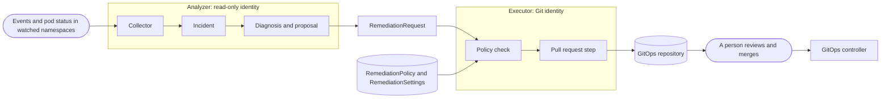
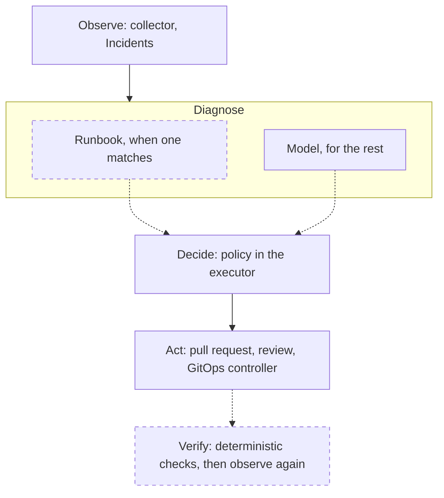

# Concepts

The objects and parts you meet when you run Shadewright, and how they relate. This page summarises; the reasoning is in the [design](design.md), linked in each section. Fields are in the [API reference](reference/api.md).

!!! note "Built and planned"
    Only the executor's path from a `RemediationRequest` to a pull request that waits for a person is built end to end. The analyzer records Incidents; it diagnoses and proposes only when started with `--triage-model`, which is off by default and, until the analyzer checks the evaluation results and fails closed ([ADR-0025](adr/0025-analysis-claims-units-and-evaluation-manifest.md) decision 7), meant for an evaluation run in the lab. So today a person (or a test) writes the `RemediationRequest`. Built parts are marked built, designed ones planned. The [home page status](index.md#status) has the full list.

## How the parts relate

All of it is built. The analysis that turns an Incident into a request runs only when the analyzer is started with `--triage-model`, so in a default install no request comes from it ([design 3.3](design/3-observation-and-deduplication.md#33-analysis)). The full flow is in [design 2](design/2-architecture.md#2-architecture).

## Incident built

One problem on one workload, kept as a namespaced object in the operator namespace. The collector turns Warning events and pod status into observations, redacts them, and the Incident controller keeps one `Incident` per fingerprint with counters and first and last seen times. It holds no logs. Repeated symptoms update the same Incident. See [design 3](design/3-observation-and-deduplication.md#3-observation-and-deduplication) and [read an Incident](how-to/read-an-incident.md).

## RemediationRequest built

One concrete plan: which action, on which target (pinned by UID), the previous and the desired value. It says what to change, never where: the executor finds the repository, branch and file from the Flux objects that deliver the target. The whole spec is immutable, so a different plan is a new request and an approval never carries over. Only the executor writes its `status` (phase and conditions). See [design 5.1](design/5-api.md#51-remediationrequest) and [the life of a request](request-lifecycle.md).

## RemediationPolicy built

A cluster-scoped object that only the cluster admin should be able to write. It lists the actions allowed, with minimum, maximum and percent bounds; the target namespaces and labels; the Git paths that may be patched; the repository by name; the namespaces whose requests may use it; and whether review is always required. Safe defaults: review required, no decreases, no "all namespaces". A request outside any bound is `Denied`. See [design 5.3](design/5-api.md#53-remediationpolicy) and [write or tighten a policy](how-to/write-a-policy.md).

## RemediationSettings built

One cluster-scoped object named `default`. It holds the kill switch (`spec.paused`), the concurrency limit, the analysis limits (only `maxAnalysesPerDay` is read today), the Git repositories Shadewright may open pull requests in (URL, target branch, GitHub App and Key Vault key), and the module list. The analyzer also writes a detection report to its `status`; no component reads that status to decide anything. See [design 5.4](design/5-api.md#54-remediationsettings) and the [configuration reference](reference/configuration.md#remediationsettings).

## The action catalog built

The closed list of changes Shadewright can make. Each action is an enum value with typed, bounded parameters, its own policy rule and its own patcher. There are two:

| Action | Changes | Target kind |
| --- | --- | --- |
| `SetContainerMemoryLimit` | A container's memory limit | `apps/v1` Deployment or StatefulSet |
| `AdjustKedaMaxReplicas` | `maxReplicaCount` of a KEDA ScaledObject (needs the `keda` module enabled) | `keda.sh/v1alpha1` ScaledObject |

There is no free-form command, no `exec` and no direct apply. See [design 5.1](design/5-api.md#51-remediationrequest) and [ADR-0003](adr/0003-gitops-only-typed-remediation.md).

## The analyzer, the executor and the verifier, and why they are separate

They are three binaries, three Deployments, three ServiceAccounts and three identities.

- The **analyzer** reads the cluster and writes only Incidents, its analysis budget ConfigMap, the requests it proposes and the settings status. Model access belongs to it alone. It has no Git credential.
- The **executor** reconciles requests, runs the policy check, and is the only component with the Git App. It cannot read Secrets and does not call a model.
- The **verifier** (`shadewright-verifier`) samples the pods of a rollout after a merge and writes a `VerificationReport` per request. It has no model access, no Git App and no Secrets, and it never writes request status: its report is evidence that the executor reads, not a verdict: the executor judges `Cleared` from it and decides the end.

A model's output is therefore only ever a proposal that the analyzer writes as a request, and deterministic policy in the executor decides whether it may run. A slow model call also cannot block the executor. See [design 2.2](design/2-architecture.md#22-components) and [design 9](design/9-identity.md#9-identity).

## Where the model sits in the loop

Shadewright is a Kubernetes controller: it observes, decides and acts against a goal, with its state in CRDs and its limits in policy. A model takes part in one step of that loop, the diagnosis, because that step has to read text (events, logs, recent Git changes) and choose a fix that nobody wrote down in advance. Every other step is deterministic code:

Dashed boxes are planned: no runbook exists yet and the verifier is not built. The model path is built but off by default (`--triage-model`), and until the analyzer checks the evaluation results and fails closed, a run with a real model is a lab evaluation, not production use (see the note at the top). So the model never tries a fix, checks the result and tries again on its own. Its output is one proposal, and the loop around it stays the same as in any other controller.

A known problem with a known fix belongs in a runbook, which makes no model call; the model is for incidents no runbook matched ([design 3.3](design/3-observation-and-deduplication.md#33-analysis)). No runbook ships yet, so today every analysis takes the model path.

Autoscaling and reconcile loops need no model at all, and they already have controllers that own them (an HPA, KEDA, Flux). Shadewright changes their declarations in Git and never competes with them for the same fields ([design 7](design/7-existing-controllers.md#7-existing-controllers)).

## Observe-only mode built

What you get from the install in [observe-only mode](install.md): the analyzer watches the namespaces you name and records Incidents, no `RemediationSettings` entry names a repository, and `spec.paused` is true, so the executor could not write to Git even if a request existed. It is the recommended first state, see [install in observe-only mode](install.md).

## Where to go next

- [The life of a request](request-lifecycle.md): phases and conditions.
- [How-to guides](how-to/index.md): one task each.
- [Glossary](glossary.md) and [FAQ](faq.md).
