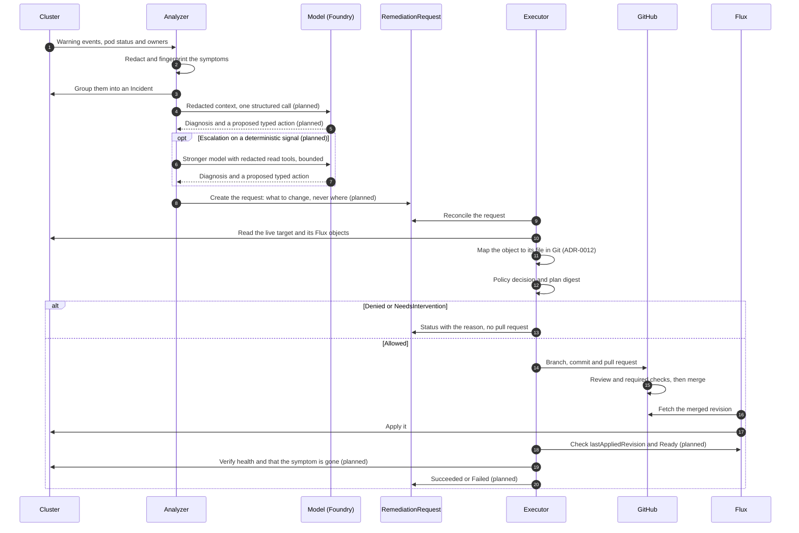
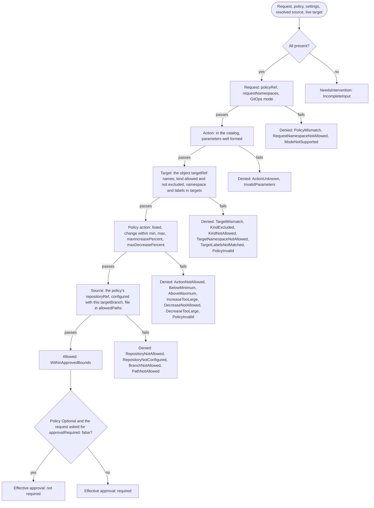
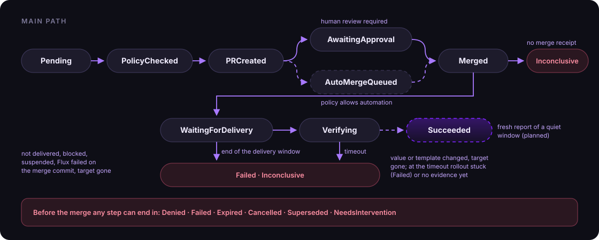
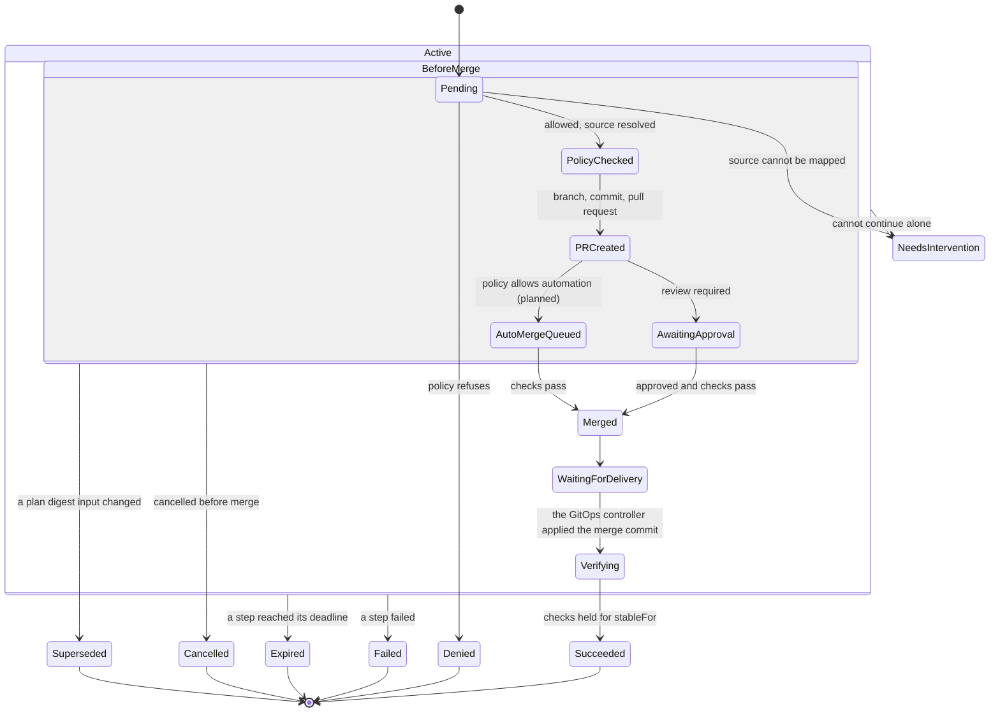
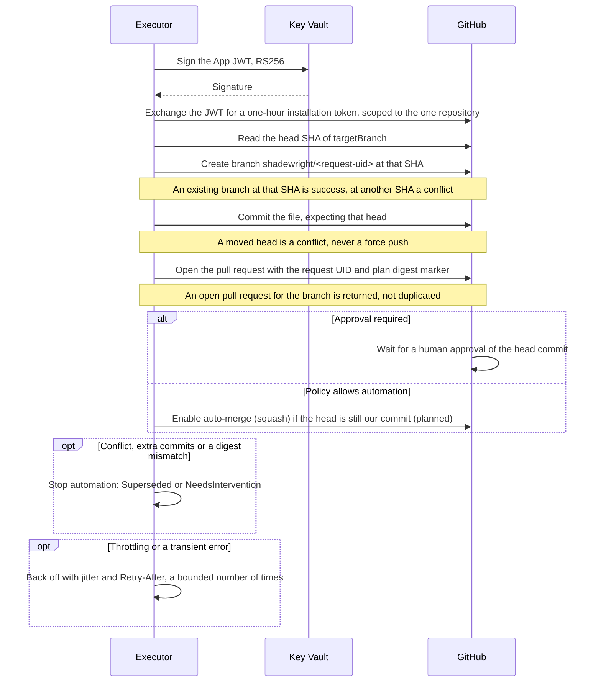
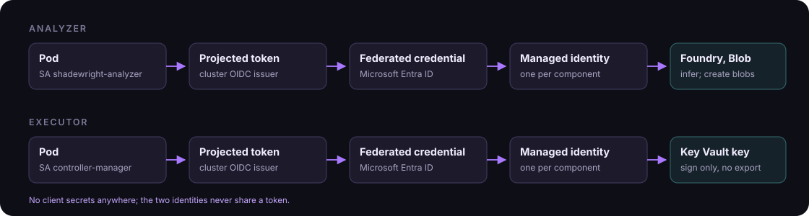
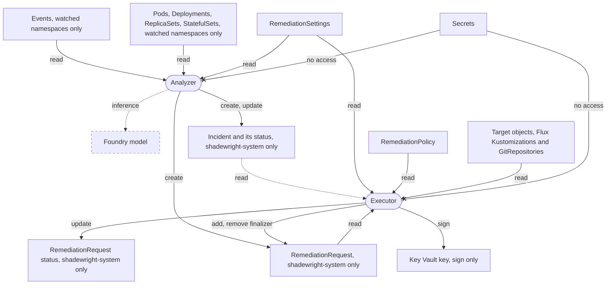

# Design

Status: draft for the MVP. Built so far: the API and its validation, the policy check step of section 6 with the source mapping and the freshness check, the YAML patchers, the semantic diff check of section 8.2, the GitHub and Key Vault adapters, the pull request step of section 6 (branch, commit and pull request, up to `AwaitingApproval`), the collector of section 3.1 and both levels of deduplication of section 3.2, with the Incident controller that keeps them in `Incident` objects, and the RBAC of sections 2.2 and 10. Everything else is design; diagrams mark unbuilt steps *(planned)*. Decisions that are already made are recorded in the [ADRs](adr/index.md); this page describes the whole system and lists what is still open.

## 1. Goals

Shadewright is a safe-remediation controller for Kubernetes clusters run with GitOps. The diagnosis, from rules or a model, is an input; the product is the control of what happens with it. It:

1. Watches events, object status and basic metrics in selected namespaces.
2. Groups repeated symptoms into incidents.
3. Prepares a diagnosis backed by evidence, and a proposed fix.
4. Records the proposed fix as a typed `RemediationRequest`.
5. Checks it against deterministic policy.
6. For declarative changes, opens a pull request in the GitOps repository.
7. Waits for human approval, or enables auto-merge where policy allows it.
8. Watches the GitOps controller roll the change out and checks the real effect.

The model helps analyse. The Go controllers own permissions, process state, validation and execution. **A model response is never, on its own, authorization to change anything.**

### Non-goals for the MVP

- Direct writes to the cluster (`apply`, `patch`, `exec`, `delete`), including as a fallback when a PR fails.
- Changes to cloud infrastructure outside the GitOps repository.
- Multiple clusters, multiple Git providers at the same time, or self-hosted models.
- Fine-tuning or a vector database.

### First scope

One cluster, a few namespaces, one GitOps repository on GitHub synced by Flux, and a small catalog of fixes. Azure DevOps and Argo CD come later behind the same interfaces ([ADR-0004](adr/0004-github-and-flux-first.md)).

## 2. Architecture

### 2.1. Flow

[](assets/diagrams/architecture.svg "Open full size")

The dashed boxes are the two identities: the analyzer can read and call the model, the executor can write request status and use the Git App. The `RemediationRequest` between them is the only thing the analyzer can hand over.

The same flow as a sequence, from a symptom to a verified change. Steps marked *(planned)* are designed but not built yet.



### 2.2. Components

| Component | Responsibility | Permission boundary |
| --- | --- | --- |
| Collector | Watches, event normalization, correlation through `ownerReferences` | Read selected namespaces and kinds |
| Incident store | Fingerprints, counters, timestamps, analysis history, operation IDs | Redacted data only |
| Analyzer | Builds context, makes one structured model call, runs a bounded tool loop on escalation (planned) | Read; in the operator namespace write Incidents, create requests, write its own Warning events |
| Policy engine | Allowed actions, scope, bounds, whether review is required | Rules owned by the cluster admin |
| Remediation controller | Reconciles `RemediationRequest`, runs the approved plan, handles failures | CR status, Git through the GitHub App |
| GitOps adapter | Reads the repository, prepares the change, branch, commit, PR, auto-merge | One repository, allowed paths |
| Verifier | Checks the applied revision, workload health and whether the symptom is gone | Read rollout state and metrics |

The base is Go with Kubebuilder, `controller-runtime` and `client-go` ([ADR-0005](adr/0005-go-kubebuilder-single-module.md)). A controller compares desired and actual state no matter which event woke it up. The work queue collapses repeated requests for the same key, but that is not incident deduplication.

The analyzer and the remediation controller are separate binaries in one Go module (`cmd/analyzer`, `cmd/main.go`), deployed as separate Deployments with separate ServiceAccounts and identities. A slow model call must never block the controller's other reconciles.

The collector, the incident store and the analyzer run in the analyzer binary; the policy engine, the remediation controller, the GitOps adapter and the verifier run in the executor (`cmd/main.go`). Their roles are generated from kubebuilder RBAC markers (`internal/analyzer`, `internal/analyzer/collector`, `internal/controller`):

- **Analyzer:** reads events (`events.k8s.io/v1`) and pods (`get`, `list`, `watch`) and workloads (ReplicaSets, Deployments and StatefulSets, `get` only) only in the namespaces it is started with (`--watch-namespaces`): a ClusterRole that is only a catalogue of verbs, bound by one RoleBinding per watched namespace and never cluster-wide, and a cache restricted to the same list for those kinds, and to the operator namespace for Incidents and requests. Incidents live in the operator namespace, next to the requests that point at them: it creates and reads `Incident` objects and updates their status, and creates `RemediationRequest` objects, there only (a Role). The Warning event about its own Pod when the Incident cap is reached (3.2) is a core Event, written with the `create` and `patch` on core Events that its leader election Role already holds in the operator namespace; it has no grant on `events.k8s.io` Events beyond reading them in the watched namespaces. Its one cluster-wide grant is reading the cluster-scoped `RemediationSettings`. The cache drops managed fields before it stores an object. The collector uses list and watch only on events and pods; it reads a pod's owners with a `get`, one object at a time, and starts no informer for workloads, which it could not: the role grants no `list` or `watch` on them. The watched namespaces are a deployer setting (`demo` is the lab default). The RoleBindings are built from `config/watch` (separately from `config/default`, in namespaces that must already exist) and must match `--watch-namespaces`; `test/rbac` checks that they do. The operator namespace comes from `--namespace`, defaulting to `POD_NAMESPACE`, and the analyzer refuses to start without it or with an empty list. The cluster ID hashed into every fingerprint comes from the required `--cluster-id` flag (1 to 63 letters, digits, `.`, `_` or `-`, starting and ending with a letter or digit), set by whoever installs the analyzer, so it needs no permission to read the cluster. It cannot update, delete or write the status of a request.
- **Executor:** reads (`get` only) policies and settings, always from the API server, never through a cache (reading incidents for verification is planned); reads (`get` only, no list or watch) the target kinds (Deployments, StatefulSets, KEDA ScaledObjects) and the Flux Kustomizations and GitRepositories that deliver them, for source mapping; reads requests, writes their status and patches them to add or remove its finalizer in the operator namespace only (a Role), and its cache watches requests only there; the spec of a request is immutable (CEL), so the patch cannot change what was decided. It cannot create requests or write incidents.
- Neither can read `Secret` objects. An envtest suite (`test/rbac`) checks this boundary against a real API server.

No model runs in the cluster and no GPU is needed: the analyzer calls a managed model endpoint (Microsoft Foundry first). The call, and the bounded tool loop on escalation (planned), are our own code, not a hosted agent service.

### 2.3. Provider interfaces

Shadewright is pluggable along three axes ([ADR-0018](adr/0018-three-axes-of-pluggability.md)): platform services outside the cluster (this section), the cluster platform (2.4) and the add-ons installed in the cluster (2.5). On every axis the core works on plain Kubernetes with no module at all; modules add knowledge and capabilities. Modules are compiled in for now; signed, declarative OCI packs are the planned way to ship them later ([ADR-0019](adr/0019-extension-packaging.md)).

Every external system sits behind a Go interface with one adapter per product, so switching a product means writing an adapter, not changing the core ([ADR-0013](adr/0013-adapters-for-every-external-system.md)). Interfaces use neutral terms (a change request, not a pull request) and adapters declare what they support, such as auto-merge, so the core adapts instead of assuming GitHub.

| Interface | First implementation | Later |
| --- | --- | --- |
| `GitProvider` | GitHub (GitHub App) | Azure DevOps, GitLab |
| `DeliveryVerifier` | Flux (`Kustomization`, `HelmRelease`) | Argo CD |
| `ModelProvider` | Microsoft Foundry (OpenAI and Anthropic models) | Direct vendor APIs, other gateways |
| `MetricsSource` | Prometheus HTTP API | Grafana Cloud, Azure Monitor managed Prometheus |
| `LogSource` | Kubernetes pod logs API | Loki, Azure Monitor Logs |
| `Notifier` | GitHub issue in the fleet repo | Microsoft Teams, Slack, generic webhook |
| `AnalysisStore` | Azure Blob Storage | S3-compatible, local filesystem for tests |
| `Signer` | Azure Key Vault key | AWS KMS, HashiCorp Vault transit |

Provider SDKs are imported only inside their adapter package. Each interface has an in-memory fake used by the tests.

### 2.4. Cluster platforms

A `Platform` module per provider, detected from node `providerID` and labels. The generic module is always present; the others add diagnosis and, later, platform-specific actions.

| Concern | AKS | EKS | GKE | Cluster API |
| --- | --- | --- | --- | --- |
| Workload identity | Microsoft Entra Workload ID | EKS Pod Identity, IRSA | GKE Workload Identity Federation | depends on the infrastructure provider |
| Node capacity and scaling | node pools, cluster autoscaler | managed node groups, Karpenter | node pools, Autopilot | `MachineDeployment` in the management cluster, changed through GitOps |
| Typical platform failures | pod IP exhaustion, quota, Spot eviction | ENI and IP limits, load balancer limits | Autopilot resource rules | machines that do not become nodes |
| Managed add-ons | AKS extensions (Flux, KEDA) | EKS add-ons | Config Sync | none |

Order: generic and AKS first; EKS and GKE as detection-only skeletons; Cluster API when a real case needs it.

### 2.5. Cluster integrations

An `Integration` module per add-on: detection (API groups, CRDs, versions), watched kinds and how their conditions become symptoms, deterministic diagnosis rules, read-only tools for the analyzer, redaction rules, verification checks, and optionally actions that follow the same rules as every action (typed, bounded, policy rule, GitOps patcher, refusal test). Integrations that guard security diagnose only: they explain a refusal or a missing secret, and never propose to relax a policy, change a secret or suppress a finding.

| Integration | Diagnosis | Actions |
| --- | --- | --- |
| Core workloads (Deployment, StatefulSet, PDB, NetworkPolicy, ResourceQuota) | OOM, crash loops, unschedulable pods, quota | `SetContainerMemoryLimit` |
| KEDA | trigger errors, `ScaledObject` not ready, replica ceiling | `AdjustKedaMaxReplicas` |
| Flux | failing `Kustomization` or `HelmRelease`, drift | none: Flux is the delivery path |
| Kyverno | a deployment refused by a policy, policy reports | diagnosis only |
| Secrets Store CSI driver | pods stuck on a missing secret or identity | diagnosis only |
| cloudflared | tunnel down, so the application is unreachable | none |

Later candidates: External Secrets Operator, Reloader, cert-manager, Trivy Operator, Karpenter. Modules are enabled per cluster in `RemediationSettings`, and the operator reports what it detected in status.

## 3. Observation and deduplication

### 3.1. Collecting

Use `events.k8s.io/v1`. Handle both new events and updates to an event series. Fields read: `regarding`, `reason`, `action`, `type`, `reportingController`, `note`, `eventTime`, `series.count`, `series.lastObservedTime`, and `deprecatedCount` and `deprecatedLastTimestamp` for events written by older recorders ([Event API](https://kubernetes.io/docs/reference/kubernetes-api/events/event-v1/)). Do not also watch `core/v1` events: they are the same objects in an older version, so each event would be counted twice.

Events detect symptoms; they are not a durable audit log. The collector keeps what it needs beyond event retention and also reads current object state.

The collector (`internal/analyzer/collector`) runs in the analyzer and reads through its cache, so it sees only the watched namespaces:

- **Events:** only type `Warning`. A reason that is not a plain CamelCase word, a reporting controller that is not a plain component name, fields longer than the `Incident` schema allows, a regarding object in another namespace than the event, or a regarding reference without a UID make the event unusable, and it is dropped.
- **Pod status:** every abnormal container termination, in init and app containers, from the current and the last state: `OOMKilled`, or any other reason with a non-zero exit code. A reason that is not a plain CamelCase word within the schema's length is reported as `Terminated`. A termination is one observation, identified by its container ID, or without one by its start and finish times, exit code and reason (not the restart count, which changes when the termination moves to the last state); two such terminations of one container in the same seconds with the same exit code and reason count once. The symptom is the container name and the exit code. The termination message is never read: the container writes it.
- **Owners:** the subject of an observation is the owning workload, following controller owner references (only those marked `controller`) from Pod to ReplicaSet to Deployment and from Pod to StatefulSet. A pod whose controller reference names a Deployment directly is its own subject: Deployments control ReplicaSets, not pods. Owner references are untrusted, so each hop is read with the API reader (a `get` with a deadline, in the object's own namespace, which the role limits to the watched namespaces) and must exist with the referenced UID and a non-empty selector that matches the labels of the object below it; otherwise the chain stops at the last verified object. The read decodes the whole object, pod template included, and keeps only the UID check, selector, labels and controller reference. DaemonSets and Jobs are not followed, because the analyzer cannot read them, so their pods are their own subjects. A ReplicaSet without a Deployment is its own subject. An event that names a Deployment or a StatefulSet is kept only if the object exists with the event's UID. The owner reference of each pod looked up is remembered, so an event that arrives after its pod was deleted still reaches the workload; a pod deleted before the collector looked it up stays its own subject.
- **Output:** each observation carries the fingerprint and the normalized, redacted symptom from `internal/incidents/fingerprint`, the subject, the occurrence (an event UID, or a hash naming one container termination), the occurrence's total as the cluster reports it, the new occurrence count and when it happened (never later than the collector's clock). The new count is at most 1,000 per observation: a series count is written by whoever can create events, so one forged jump adds at most that much (each further update as much again). No raw note leaves the collector. Observations go to a bounded channel read by the Incident controller; when it stays full, the reconcile tries again later without recording anything as handled.
- **Defaults:** a send to the channel waits up to 10 s, and a reconcile whose send timed out is retried 5 s later; each watch runs one reconcile at a time, so a slow consumer delays the others by up to that much. Each owner read and each question to the Incident controller (3.2) has a 5 s deadline, and a timed-out question is retried 5 s later. Owner reads have no rate limit of their own: each watch reads at most one owner at a time, and the cache absorbs repeats. The owner cache holds 4,096 entries: verified owners for 10 minutes, owners that could not be verified for 5 s (the read goes to the API server, and a controller exists before its pods, so a miss is not a lag to wait out). Event state holds 10,000 entries and pod state 5,000 (see 3.2). The informer cache of the watched namespaces and this state count against the analyzer's memory limit (128 Mi in `config/manager/analyzer.yaml`); namespaces with many pods or events need a higher limit.

First cases:

- `FailedScheduling`: insufficient resources, quota, node affinity or taints.
- Image pull failures and invalid pod configuration (missing Secret or ConfigMap reference).
- Restarting containers: `CrashLoopBackOff`, `OOMKilled`, failing probes.
- KEDA trigger errors and Flux reconciliation failures.

Reasons differ by component and version. `OOMKilled`, for example, comes from container status, not from an event with that reason, so detection always joins events with object state.

### 3.2. Two levels of deduplication

**Observation level:** remember the event UID and the last handled count. On a series update, process the increase, not the total, and at most 1,000 per observation. A single event without a series counts once, or as its `deprecatedCount` when an older recorder kept one; the series count includes the first occurrence, so a single event that becomes a series of 2 adds 1.

The collector keeps this state in memory, in maps with a fixed capacity (10,000 events and 5,000 pods by default) that drop the least recently used entry. Memory alone does not survive a restart, so the collector cannot tell how much of an occurrence is new when the event or termination is older than its first reconcile (a restart, or a new leader), or no newer than state it dropped to stay within its capacity. A pod's terminations are judged against the collector's start and the eviction bound as it was when the collector first saw the pod, so committing one does not make the others look new. A termination without a finish time always counts as possibly repeated. For those occurrences the Incident controller tells the collector how much of that occurrence was already counted, and the collector emits only the rest (capped as above), or nothing. The question names the occurrence (the event UID, or a hash of pod UID, container and termination) and when it began, not the fingerprint: several pods or events share one fingerprint, and the fingerprint depends on owner correlation, which can differ after a restart (an owner deleted in between), while the occurrence does not. So the answer is looked up across Incidents.

The Incident controller (`internal/incidents`) therefore persists, per occurrence, the highest total it counted and when the occurrence began, in `status.occurrences` of the `Incident`. An Incident keeps at most 32 occurrences, newest first by when they began (an occurrence without a known beginning sorts as the oldest, so it is dropped first); when it drops older ones, `status.occurrencesDroppedThrough` records when the newest dropped one began. The controller answers from memory, loaded from the Incidents when it starts, and a question waits until they are loaded, so a restart never reads as "never counted". For an occurrence it kept it answers the recorded total. For one it has no record of that began no later than the latest drop mark of any Incident, it answers that the occurrence was counted in full, so a bound never counts twice; the mark is shared across Incidents because the question does not name the fingerprint, so a busy Incident can make an old occurrence of another look counted (an undercount, never an overcount). An occurrence without a known beginning cannot be placed against the mark, so the mark never answers for it: once its record is dropped it may be counted again. That overcount is preferred to a count silently lost, because the count feeds a bounded trigger. It answers that it never counted an occurrence only when that is true. Without an answer the collector does not guess: it emits the observation with a new count of 0, the cluster's total and *may repeat*, and the consumer subtracts what it holds. The consumer caps that difference at 1,000 as well (`Observation.Increase`), and an observation of an occurrence it holds a record of adds at most the increase over that record, so a collector that lost its state does not count the same occurrence again. The cap is per observation: every further forged update of a series can add up to 1,000 again, so `status.count` saturates at 1,000,000 (the schema refuses more). It is a bounded count of reported occurrences, not a count of distinct ones.

**Incident level:** group similar observations by fingerprint:

```text
hash(clusterID, namespace, ownerUID-or-resourceUID,
     reason, action, type, reportingController, normalizedSymptom)
```

`resourceVersion` is not an incident ID. A pod UID alone is not enough either, because one pod can have several problems, and correlating to the owning Deployment joins symptoms from successive pods of the same workload. The rollout revision is kept as extra context.

Normalization removes variable parts (random pod suffixes, timestamps) but keeps what matters: image name, error code, the name of the missing Secret, the kind of dependency. Secrets are redacted before storage and before anything reaches the model.

Both are pure functions in `internal/incidents/fingerprint`. The note is redacted first with the shared redaction package, so no later substitution can shield part of a secret; redaction markers become fixed placeholders, so secrets or addresses of different lengths do not change the fingerprint. Normalization then replaces object UIDs, image digests, timestamps, IPs and durations with placeholders, strips pod name suffixes and ReplicaSet hashes only from names the text (or the event's regarding object) identifies as a Pod or ReplicaSet, so a missing Secret such as `db-7d4b9` keeps its name, and cuts the symptom to the 1024 characters `spec.symptom` allows. Every field is length-prefixed in the hash, and a version string is hashed first so that changed rules give new fingerprints instead of merging old and new incidents.

Starting values, to be tuned on real traffic:

| Mechanism | MVP value |
| --- | --- |
| Debounce before analysis | 30-60 s |
| Aggregation window for similar observations | 5 min |
| Cooldown before re-analysis without new data | 15 min |
| Concurrent actions | One per target object |
| Re-analysis trigger | New symptom, significant context change, or cooldown expired |

Deduplication state must survive restarts. In the MVP it lives in a namespaced `Incident` CR in the operator namespace ([ADR-0007](adr/0007-incident-state-in-crds.md)), one per fingerprint, named `incident-` and the hex of the fingerprint. Its spec holds the fingerprint, the subject and the normalized, redacted symptom; raw logs never go into a CR. The Incident controller runs in the analyzer, in the leader only, and writes in batches: the first observation of an Incident in a process is written at once, later ones are gathered and written once per aggregation window (5 min), so a burst costs a few writes, not one per observation. Writes run apart from the consumption of observations, so a slow API server delays the writes, not the collector. Each write reads the Incident from the API server, not the cache, retries on a conflict, and leaves out a batch the status already holds, checked per occurrence: an occurrence recorded with at least the batch's total shows the batch was stored, one recorded lower or missing although it began after `occurrencesDroppedThrough` shows it was not, and one the write could have dropped or skipped (it began no later than the mark, has no known beginning, or has an ID the schema refuses) shows neither. A batch is taken as stored only when at least one occurrence shows it and none shows otherwise. So a write whose answer was lost (a timeout after the API server stored it) is not counted twice when it is tried again, 5 s later; the batches it sent are kept apart from the observations that arrive meanwhile, so these cannot hide that it was stored. A batch none of whose occurrences can show it is written again (a possible overcount, not a loss). A batch the API server refuses as invalid is logged and dropped rather than tried again, and the controller's memory of its occurrences goes back to what the Incident stores; an Incident it could not create frees its place under the cap. An Incident of the expected name that holds another fingerprint is not written either, and its batch and memory go the same way: anyone who can create Incidents in the operator namespace can block a fingerprint like that, and only the log and `shadewright_incident_batches_dropped_total` (reason `fingerprint_conflict`) show it. On shutdown or a lost leadership, pending and failed batches are written once more, with retries, within 5 s, under the Pod's 10 s termination grace period; each of these writes too reads the Incident fresh and leaves out what it already holds, so it adds nothing a new leader already wrote. Lost are the batches still unwritten at that deadline (counted with reason `stopped`), observations still in the channel, and everything pending when the process is killed, not stopped. A new leader that loaded the Incidents before the old leader's last writes landed may count those occurrences again.

The number of Incidents is bounded instead of retained for a time: at most 500 in the operator namespace (`--max-incidents`), counting those that exist when the analyzer starts. At the cap a new fingerprint is not stored. Its observations are counted in the Prometheus counter `shadewright_incident_observations_refused_total`, each new fingerprint is logged once, and a Warning event (reason `IncidentCapReached`) about the analyzer's Pod, whose name comes from `POD_NAME`, is written for at most one refusal every 10 minutes, because whoever can create events in a watched namespace can make new fingerprints at will. Fingerprints that already have an Incident are still counted. Nothing deletes Incidents yet, so once reached the cap stays reached until someone deletes some and the analyzer restarts (it counts the Incidents when it starts); retention by age is not built, and when Incidents should go is open (question 8 in section 15, and the 2026-11-03 amendment of [ADR-0007](adr/0007-incident-state-in-crds.md#amendments)).

### 3.3. Analysis

Proposed in [ADR-0023](adr/0023-how-the-analyzer-calls-the-model.md): context first, one structured call.

Deterministic rules and known runbooks run first. A runbook match is deterministic and makes no model call. The model path is for incidents no runbook matched, and its common case is one small-model call: the context builder assembles a bounded, redacted context deterministically (incident summary, object status and owners, a log excerpt, selected metrics and recent Git changes for the source of the object) and the small model returns one structured result. Read tools (section 4) are offered only on escalation, within fixed step, token and spend budgets, so the cost per incident is predictable and a recorded context can be replayed in CI.

The prompt is a Go `embed` template in `internal/analysis/prompts/`, reviewed like code; there is no setting, ConfigMap or CRD for it. Its catalog and the output schema are generated from the Go action and result types. It has a static system part (role, rules, catalog, schema) and then the untrusted context in delimited blocks tagged with their provenance, with a rule that their text is data, never instructions. Each analysis record stores the prompt version (a content hash), the model deployment and ID, and the token counts. What the model sees also depends on operator redaction patterns and on the deployment, which is why the evaluation (11.2) is keyed on model and prompt together.

The result has a fixed schema: hypotheses, evidence, missing data, uncertainty, proposed action, expected effect and verification conditions. When the evidence is not there, the correct result is no proposal and a hand-off to a human. A non-empty "missing data" is a hand-off that says what is missing, not an escalation. A model's self-reported confidence never makes an action eligible and never triggers escalation. The structured result is the only way a proposal is made: one validator checks it against the schema and the catalog and builds the `RemediationRequest`. If policy later denies the request, the analyzer does not propose again, and the denial reason is never shown to the model.

Escalation runs on deterministic signals only: the context builder truncated the context or could not fetch a source, or the small model's output failed schema validation after one retry. The stronger model then gets the read tools, within the same budgets, at most once per incident fingerprint per cooldown window.

## 4. Tools

The analyzer exposes tools to the model through its own adapters. In the MVP loop they are offered only when an analysis escalates (3.3, 11.2); the first call runs on the prepared context alone. Every tool result goes through `internal/redact` before the model sees it. MCP is optional: it can expose the same tools later, but it is not required by the controller and it does not replace Kubernetes RBAC ([ADR-0003](adr/0003-gitops-only-typed-remediation.md)).

| Tool | Purpose | Mode |
| --- | --- | --- |
| `get_resource`, `list_events` | Object state and symptom history | Read, redacted |
| `get_pod_logs` | Bounded time range and byte count | Read, redacted |
| `query_metrics` | Approved query templates only | Read, redacted |
| `get_delivery_status` | Flux Kustomization / HelmRelease revision and readiness | Read, redacted |
| `read_git_file`, `get_recent_changes` | Map an object to its source in Git | Read, redacted |

There is no proposal tool: a proposal is the structured output of the call (3.3), checked by one validator. PR creation and auto-merge are not model tools at all: only the remediation controller does them, after policy.

The model never gets a shell, `kubectl exec`, `kubectl apply`, or a way to change policy. Every tool has an argument schema, a timeout, a response size limit, an allow list of object kinds and server-side authorization. Tool results, logs and repository content are untrusted data, including when they contain instructions addressed to the agent. RBAC on the ServiceAccount enforces the limits; hiding write tools is not enough.

## 5. API

Group `remediation.shadewright.io`, version `v1alpha1` ([ADR-0009](adr/0009-api-group-and-docs-domain.md)). Schemas are generated from Go types by Kubebuilder.

### 5.1. RemediationRequest

A namespaced CR that holds one concrete plan, the policy decision and the execution state. Example (values are illustrative):

```yaml
apiVersion: remediation.shadewright.io/v1alpha1
kind: RemediationRequest
metadata:
  name: orders-keda-capacity-001
  namespace: shadewright-system
spec:
  incidentRef:
    name: orders-scaling-001
    uid: "11111111-1111-4111-8111-111111111111"
  targetRef:
    apiVersion: keda.sh/v1alpha1
    kind: ScaledObject
    namespace: orders
    name: orders-worker
    uid: "22222222-2222-4222-8222-222222222222"
  mode: GitOps
  approvalRequired: true
  policyRef: keda-capacity
  action:
    type: AdjustKedaMaxReplicas
    adjustKedaMaxReplicas:
      previousValue: 10
      desiredValue: 15
  verification:
    timeout: 10m
    stableFor: 3m
    checks:
      - DeliveryRevisionApplied
      - KedaReady
      - QueueBacklogDecreasing
status:
  observedGeneration: 1
  phase: AwaitingApproval
  effectiveApprovalRequired: true
  source:
    repositoryRef: fleet
    targetBranch: main
    path: apps/orders/scaledobject.yaml
    buildPath: apps/orders
    baseCommit: "0123456789abcdef0123456789abcdef01234567"
  planDigest: "sha256:aaaaaaaaaaaaaaaaaaaaaaaaaaaaaaaaaaaaaaaaaaaaaaaaaaaaaaaaaaaaaaaa"
  policyRevision: "keda-capacity/3"
  policyUID: "44444444-4444-4444-8444-444444444444"
  pullRequest:
    number: 42
    url: https://github.com/example/fleet/pull/42
    headSHA: "89abcdef0123456789abcdef0123456789abcdef"
    renderedTargetHead: "fedcba9876543210fedcba9876543210fedcba98"
  conditions:
    - type: PolicyAllowed
      status: "True"
      reason: WithinApprovedBounds
      message: "The change is within the policy bounds"
      observedGeneration: 1
      lastTransitionTime: "2026-11-01T10:00:00Z"
```

Each action type has its own typed parameter struct (a discriminated union on `action.type`), so validation happens in the schema rather than in a free-form map. The MVP catalog has two actions: `AdjustKedaMaxReplicas` and `SetContainerMemoryLimit`. Schema rules are enforced by the API server itself (OpenAPI and CEL), before any controller sees the object, and are covered by envtest tests in `test/apivalidation`. Valid examples of every kind are in `config/samples`, and a test applies them.

Schema and admission rules:

- `approvalRequired` defaults to `true`; `GitOps` is the default and, in the MVP, the only mode.
- The action type is an enum; parameters are typed and bounded. Memory values are whole bytes between 1Mi and 1Ti.
- Each action type fixes the kinds it may target: `AdjustKedaMaxReplicas` only a `keda.sh` ScaledObject, `SetContainerMemoryLimit` only an `apps/v1` Deployment or StatefulSet. The target must be namespaced and pinned by UID.
- The spec says what to change, never where. The repository, branch and file are resolved by the controller from the Flux objects that deliver the target ([ADR-0012](adr/0012-object-to-source-mapping.md)) and written to `status.source`. A request cannot point a change at another file, another repository or an unprotected branch.
- `policyRef` points to admin-managed configuration, and the policy decides which namespaces may use it (`requestNamespaces`). The model never chooses a URL, host, branch or credential reference.
- The target namespace and object are authorized independently, including cross-namespace references.
- Any change to the plan, resolved source, repository settings or policy invalidates an earlier approval. The digest covers the semantic change, the target UID, the resolved source with the repository URL and installation from settings, and the policy UID and generation (a recreated policy can reach the same generation again, never the same UID). It is `sha256:` over a versioned canonical encoding: every field labelled, length-prefixed and in a fixed order, and memory quantities written by value, so `256Mi` and `268435456` give the same digest (`internal/policy/digest`).
- The digest is fixed when the branch is created: the policy check stores it in `status.planDigest` in the same status write that sets `PolicyChecked`, from the very policy, settings and source the decision was made on. The branch is created later, at the head of the target branch as it is then, after the freshness check has confirmed that the target file there still holds the previous value. Later merges to the target branch do not change it: before each write the controller checks that the target file at the branch head still holds the previous value. If an input of the digest changes, the request becomes `Superseded`, its PR is closed and a new request is needed; the branch is never rebuilt or force-pushed. The check (`internal/policy/freshness`) reads the policy and settings from the API server, never the cache, compares the policy UID and generation and recomputes the digest from the live settings, confirms the target still has the planned UID, and reads the target file at the head of the target branch (not of the PR branch). Any error reading an input is "not fresh": the write waits and is retried, and only a definite change supersedes. The one exception is repository settings that can never open a Git provider: they end the request in `NeedsIntervention` (`RepositoryUnusable`) without closing anything. While `RemediationSettings.spec.paused` is set the write waits too. The cleanup runs in three steps: a status write that sets `PlanFresh` `False` with the stale reason and leaves the phase as it is (the mark that the cleanup has started), the idempotent close of the change request, and the status write that sets `Superseded`. A crash, restart or deadline anywhere in between leaves the mark, and the next reconcile finishes the cleanup without checking the plan again: it closes again (a no-op if the first close went through) and supersedes. A recorded pull request found closed while the mark is set was closed by that cleanup, so it ends `Superseded`, not `NeedsIntervention` (`ChangeRequestClosed`), even if the plan looks fresh again by then.
- Verification can only be made stricter: the controller always runs the checks the action needs, `stableFor` is at least 1m, and `timeout` is at most 24h and longer than `stableFor`.
- `approvalRequired: false` is a request for automation, not a way to lower central policy.
- The whole spec is immutable: a different plan is a new request, so an approval can never carry over to a changed plan.
- `/status` subresource, standard conditions and `observedGeneration` are part of the implementation.

Only the user or analyzer writes `metadata` and `spec`. Only the controller writes `status`. RBAC on `/status` separates proposal from decision and execution.

Raising `maxReplicaCount` makes sense only after confirming that the replica cap is the cause, and that the cluster and the downstream dependency have capacity. A backlog alone is not enough evidence.

### 5.2. Incident

A namespaced CR in the operator namespace, next to the requests that point at it ([ADR-0007](adr/0007-incident-state-in-crds.md)), that holds the fingerprint, counters, first and last seen, the correlated owner, and references to analyses and requests. Large data (log excerpts, full model transcripts) lives outside etcd, or is dropped after analysis in the MVP.

### 5.3. RemediationPolicy

A cluster-scoped CR, writable only by the cluster admin ([ADR-0011](adr/0011-policy-as-cluster-scoped-crd.md)). Each policy names the action types it allows, the target selector (namespaces and labels; kinds are fixed per action by the catalog), parameter bounds, the Git paths it may patch, the namespaces whose requests may use it, and whether review is always required. `metadata.generation` together with the policy UID is the revision recorded in every request's digest. Safe defaults:

- `approval` is `Required`.
- A policy must name its target namespaces: there is no "all namespaces".
- `requestNamespaces` is `[shadewright-system]`. A request from any other namespace is `Denied`, so the right to create requests somewhere does not grant a policy.
- Bounds have a minimum and a maximum, and `maxDecreasePercent` is 0: decreases are refused unless the admin allows them.
- `allowedPaths` are globs with a literal first segment. `*` and `**` never match a segment that starts with a dot, and no segment may start with a dot or a dash, so a policy cannot cover the whole repository, `.github/` or option-like names.

The decision is a pure function (`internal/policy`): it reads the request, the policy, the settings, the resolved source and the live target, and returns `Allowed`, `Denied` or `NeedsIntervention` with a machine-readable reason (one per check) and the effective approval. It uses no client and no clock, so the same input always gives the same decision. Missing input (no resolved source, no live target) gives `NeedsIntervention`; every failed check gives `Denied`. It checks, in order: the request's `policyRef` and namespace (`requestNamespaces`) and the `GitOps` mode; that the action type is in the catalog and its parameters are well formed; that the live target is the object `targetRef` names (UID, apiVersion, kind, namespace, name), that its kind is one the action may target and not one excluded by section 10 item 10, and that its namespace and labels are covered by `targets`; that the policy lists the action and the change is within `min`, `max`, `maxIncreasePercent` and `maxDecreasePercent` (compared by value, in arbitrary precision); and that the resolved repository is the policy's `gitOps.repositoryRef`, is configured in RemediationSettings with the resolved branch as its `targetBranch`, and that the file matches `allowedPaths`. The path match is purely lexical, so it is never the only guard: a pattern such as `apps/**` also matches a file declaring a Role or a Secret, and the kind check refuses it. The decision does not trust the API server to have defaulted the policy: an unset field reads in its strictest sense (no request namespaces, approval `Required`, no increases or decreases). The effective approval is `false` only when the outcome is `Allowed`, the policy is `Optional` and the request asked for `approvalRequired: false`. One exception to the strict reading: a policy without `objectSelector` covers every object of the allowed kinds in its target namespaces. Labels are not a security boundary anyway, because anyone who can patch the object can set them.

The checks run in this order, and the first one that fails gives the reason. All of this is built (`internal/policy.Decide`).



### 5.4. RemediationSettings

One cluster-scoped object named `default`. It holds the kill switch (`paused`, checked right before every write), global limits (`maxConcurrentRemediations`, `maxAnalysesPerDay`) and the Git repositories Shadewright may write to, each with its provider settings: for GitHub, the App client ID, installation ID and the signer (a Key Vault key, ADR-0006). Each repository also names the only branch pull requests may target (`targetBranch`, default `main`); the branch Flux tracks must equal it. URLs carry no credentials, query or fragment, and a GitHub repository must be `https://github.com/<owner>/<repo>`, so installation tokens never go to another host. Policies and requests refer to repositories by name only.

## 6. Reconciliation

[](assets/diagrams/phases.svg "Open full size")

Other terminal or waiting phases: `Denied`, `Failed`, `Expired`, `Cancelled`, `Superseded`, `NeedsIntervention`. Conditions explain why; `phase` is a summary for humans.

The transitions between phases. The API defines every phase below. The executor sets the first step: a `Pending` request (or one without a phase yet) becomes `PolicyChecked`, `Denied` or `NeedsIntervention` in one status write. It also re-checks the freshness of a decided request before merge every five minutes (and at once on any change to the request), so a stale plan becomes `Superseded`, or `NeedsIntervention` if its repository settings became unusable, without waiting for a write. A fresh `PolicyChecked` request then opens its pull request and moves to `PRCreated` and `AwaitingApproval` (below). Merge, delivery and verification are designed but not built.



The policy check, the first step, loads the policy the request names, the `default` RemediationSettings and the live target, and then maps the target to its file in Git (ADR-0012). The target is read again after the mapping, and the check starts over if its UID or resourceVersion changed, so the previous value and the file in Git always describe the same object. It stores `status.source`, `policyUID`, `policyRevision` (`name/generation`), `effectiveApprovalRequired`, the pull request step's `deadline` (unless writes are paused) and the `PolicyAllowed` condition together with the phase, through the status subresource with the resourceVersion it read, so a stale read ends in a conflict and a decided request is never decided again.

| Finding | Phase | `PolicyAllowed` |
| --- | --- | --- |
| Policy or settings object missing, target UID differs from the live object | `Denied` (`PolicyNotFound`, `SettingsNotFound`, `TargetMismatch`) | `False` |
| The previous value in the request is not the live value (the policy measures increases and decreases from it) | `Denied` (`PreviousValueMismatch`) | `False` |
| The live object does not set the field the action changes | `NeedsIntervention` (`FieldNotFound`) | `Unknown` |
| Source mapping denies (repository, branch, path or inventory) or `policy.Decide` denies | `Denied`, reason of the check | `False` |
| Source mapping needs a human (Helm, patches, missing target, unknown Flux shape), or the target got another UID while the mapping ran (`TargetChanged`) | `NeedsIntervention`, reason of the mapping | `Unknown` |
| The matching repository's settings cannot open a Git provider (a value the schema accepts but the adapter refuses, such as an App client ID outside `[A-Za-z0-9._-]` or a target branch starting with `_` or longer than 200 characters) | `NeedsIntervention`, `RepositoryUnusable` | `Unknown` |
| The Git host refuses a read of the source mapping for good (the table below: a 403 without rate limit signals, a token the installation refuses, an unexplained 422) | `NeedsIntervention` (`GitForbidden`, `GitRejected`) | `Unknown` |
| All checks pass | `PolicyChecked`, `WithinApprovedBounds` | `True` |

Only a failure worth retrying (API server, Git host, or a signer that is throttled, cannot reach Key Vault or Entra ID, or cannot get a token yet) is retried, with backoff, or after the delay the host asked for (`Retry-After`, cut to the time left before `status.deadline` for a request that has not opened its pull request yet, so it expires on time); every permanent refusal is a final phase, settings that can never open a Git provider included (the same refusal ends a later freshness check in `NeedsIntervention`, `PlanFresh` reason `RepositoryUnusable`, without closing anything), and so is a read of the source mapping that the Git host refuses for good (`GitForbidden`, `GitRejected`; the classes are in the table of the pull request step below). While a retry is pending the request keeps no phase (or `Pending`) and no `PolicyAllowed` condition. The retry limit is planned. The policy and settings are read from the API server on every check, never from the cache, so a deleted policy or a tightened setting takes effect at once. Messages and conditions never carry Git URLs or provider text.

Every external call of a step runs under the step's own deadline: the policy check (the uncached reads and the source resolver together) and, separately, the freshness check and the cleanup of a stale plan (open the repository, find and close the change request, as one sequence). A step that reaches its deadline returns a retryable error and keeps the request in its phase; it never ends in a final phase. The caller's own cancellation stays a different error, so shutdown is not reported as a timeout.

Each reconcile:

1. Gets the current CR and checks generation, plan validity and cancellation.
2. Reads the target object, its UID, the incident state and the policy revision.
3. Checks that the change is still needed and that no other action runs on the same target.
4. Rebuilds external state: does the branch, commit, PR or finished rollout already exist?
5. Does one idempotent step, or records why it is waiting.
6. Updates status and requeues with a deadline.

Never assume exactly-once execution. A PR can be created while the status write that records its number fails. The branch name `shadewright/<request-uid>` and a marker in the PR body (request UID and plan digest) let the controller find the existing operation after a restart.

The pull request step (`internal/controller/pullrequest.go`) runs for a fresh request in `PolicyChecked`, and again while its pull request waits in `PRCreated` or `AwaitingApproval` (step 6). It does at most one write per reconcile, right after the freshness check, in the repository that check opened and at the target branch head it checked:

1. Its deadline, `status.deadline` (30 minutes by default), is stored by the policy check in the same status write that sets `PolicyChecked`, so it also ends a request whose freshness check never passes (a Git host that stays down). A request decided while writes are paused gets no deadline then; it gets one, in its own write, on the first freshness check that finds writes allowed again. Once started, time spent paused counts against it, and a request whose deadline passed during a pause becomes `Expired` when writes resume. The step then adds the finalizer `remediation.shadewright.io/close-pull-request`, in its own write.
2. It looks for a change request on `shadewright/<request-uid>` first. One that carries the request's exact marker and holds the desired value at its head is adopted; a merged one becomes `Merged`, a closed one or one without the marker `NeedsIntervention` (`ChangeRequestClosed`, `ForeignChangeRequest`).
3. Without one, it creates the branch at the head of the target branch at which the freshness check has just found the file holding the previous value (not at a head read again, which may hold a file no check saw), then renders the change at the head of the target branch the freshness check of that later reconcile has read, which may be newer than the branch (the render rule below), and only then commits the typed change on top of the branch head it read (the patch checks the previous value), then opens the pull request with the evidence, scope, expected effect, risk, rollback and the marker. The title and body are built from validated fields and redacted. Every write names the head it expects, so a lost status write or a concurrent reconcile finds the work instead of repeating it.
4. Recording the pull request sets `PRCreated` with its number, URL and head commit and clears the deadline; the next reconcile moves it to `AwaitingApproval` (`Approved` `False`, `WaitingForReview`). Auto-merge is not built yet, so a request whose policy allows automation also waits for a person (the `AutoMergeQueued` edge of the diagram is planned).
5. From then on each reconcile looks at the recorded pull request before the freshness check, because a merged change makes the plan look stale: merged is `Merged` (`Approved` `True`); a moved head or a pull request that cannot be found is `NeedsIntervention` (`HeadMoved`, `ChangeRequestGone`); closed without a merge is a rejection, `NeedsIntervention` (`ChangeRequestClosed`), unless the cleanup of a stale plan has started (`PlanFresh` `False` with a stale reason, written before the close) or the plan is stale now: a stale plan's own close looks the same and ends `Superseded`. Once a pull request is recorded, these outcomes are written to the `Approved` condition and `PullRequestOpened` stays `True`.
6. While the pull request waits, a fresh plan is rendered again (the render rule below) when the freshness check found the target branch at another head than `status.pullRequest.renderedTargetHead`, the head of the last render that passed. The field is empty when the pull request is recorded, so the first recheck renders once more (the commit was rendered at a head the status does not keep); after that a quiet target branch costs no Git read beyond the freshness check, which returns the head and the target file it checked. A waiting pull request that fails the render is closed and the request stops in `NeedsIntervention` (the render rule below).

A branch whose file holds neither the previous nor the desired value, a head that moved away from the recorded commit, or a patch the patcher refuses stops automation with `NeedsIntervention` (`BranchDiverged`, `HeadMoved`, `PatchRefused`); nothing is force-pushed or rebuilt. A request that has not opened its pull request by its deadline closes what it opened and becomes `Expired` (`PullRequestDeadline`), also while the freshness check keeps failing; if the Git host refuses that look-up or close for good, it still becomes `Expired`, and the message says that a pull request of its own may be left open and must be closed by hand. A refusal the Git host gives for good does not wait for the deadline; the GitHub adapter classes each error status from its code and headers:

| GitHub answers | Class | The request |
| --- | --- | --- |
| 429 (any), or 403 with `Retry-After`, with `x-ratelimit-remaining: 0`, with the secondary rate limit message (searched in at most 16 KiB of the body, never kept), or with a body that cannot be read | retryable, with the delay asked for (`Retry-After`, else until `x-ratelimit-reset`, else one minute) | waits in place up to 15 seconds, else requeues after the delay, cut to `status.deadline` |
| 403 without those signals (a permission the App lacks, a rule of the repository), on a call or when the installation refuses the token | final, `ErrForbidden` | `NeedsIntervention` (`GitForbidden`); with a pull request recorded, see below |
| 422 that the state explains: the branch exists (at the same commit; at another, a conflict the next reconcile reads again), or an open pull request of the branch | resolved by the adapter | goes on; a pull request without the request's marker is `NeedsIntervention` (`ForeignChangeRequest`) |
| 422 that the state does not explain (a branch name or rule GitHub refuses, a pull request it will not open). A create of the branch or the pull request is sent again first, up to four attempts with backoff, because a read may come from a replica that does not show the branch, the pull request of a lost response or the commit just pushed yet; when the call runs out of time before the last attempt, it is retryable | final, `ErrRejected` | `NeedsIntervention` (`GitRejected`); with a pull request recorded, see below |
| 408, 5xx, network errors and timeouts | retryable | retried with backoff until `status.deadline`, then `Expired` |

The stop is written with fixed text, never with the response, and applies wherever the refusal comes from: the policy check's source mapping, the freshness check's reads and the pull request step. A refusal while a recorded pull request waits (`PRCreated`, `AwaitingApproval`) does not stop the watch: the phase stays, `PlanFresh` `Unknown` (`GitForbidden`, `GitRejected`) says why, Shadewright writes nothing to Git, and each recheck still looks at the pull request first, so a later merge (or a moved head, or a pull request that is gone) is recorded, and a close without a merge is decided once the freshness check can run again; the condition is removed once the freshness check passes again. A stale plan whose close the Git host refuses for good ends in `NeedsIntervention` with `PlanFresh` `False` (`GitForbidden`, `GitRejected`) saying that the plan is stale and its change request was not closed; that request no longer watches its pull request. Reads of the render check are still retried whatever the status, and so is a GraphQL `updateRefs` refusal while the branch head has not moved (the commit); a deletion still waits for its close. A 422 when the installation token is created is not classed either: GitHub documents it for a failed validation and for a spammed endpoint alike, so it is retried until the deadline.

A change request is closed only by its recorded number or, before one is recorded, when it carries the request's exact marker, so someone else's pull request on the same branch name is never closed. A validation refusal is written with fixed text, never with the content it checked. The render rule covers both windows in which the target branch can move under the change, between cutting the branch and the commit, and while the pull request waits (#181): the change is rendered at the head of the target branch at which the freshness check has just found the plan fresh, which is what merging it would build. First, the merge must give exactly the file the change commits or committed. Before the commit, the target file at that head must be byte for byte the file on the branch the change is made from, so a merge elsewhere passes and any edit of that file (another field, a comment, another spelling of the previous value) stops the request. While the pull request waits, the target file at that head with the planned change applied must be byte for byte the file of the pull request; the patcher replaces the bytes of one scalar only, so the one difference it allows is how the previous value is spelled (`256Mi` or `268435456`), which is on the line the pull request changes, so Git cannot merge it without a conflict, and resolving that pushes to the branch (`HeadMoved`). If another edit to the file was merged, the merge would combine edits that no render saw, and the request stops in `NeedsIntervention` (`TargetFileDiverged`); a target file the patcher refuses at that head stops it with `PatchRefused`. Then the Kustomization's directory (`status.source.buildPath`) at that head is rendered with and without the change (8.2 steps 4 and 5): anything but the planned difference stops it in `NeedsIntervention` with the check's reason (such as `OtherObjectChanged`). Before the commit, nothing is committed (`PullRequestOpened` `False`). A waiting pull request that fails the render, for any of these reasons, is closed through the same close and the same permission as a stale plan's or an expired request's (only by its recorded number, in the repository the plan was made for, with no comment and nothing from the file), and then the request stops in `NeedsIntervention`, written to the `Approved` condition with the reason and fixed text, never file content; `renderedTargetHead` keeps the last head that passed. On GitHub the pull request shows as closed without a merge by the App, with no comment, and its branch `shadewright/<request-uid>` stays; the reason is on the request (`kubectl get remediationrequest`). It is closed rather than left open because Shadewright no longer stands behind it: left open it could still be approved and merged while the request says it would build something other than the plan, and nothing on the pull request would say so. Shadewright never reopens it and does not watch it any more; the way back to the change is a new request. A close that fails is handled as the close of a stale plan's change request: a Git host failure, paused writes or the deadline leave the request waiting and are retried (the next reconcile renders and closes again), and settings that no longer reach the repository stop the request with the pull request left open. If the close succeeds but the status write after it fails, the next reconcile finds the pull request closed and stops the request with `ChangeRequestClosed` instead of the render's reason. A failed Git read is retried like the rest of the step, after the delay the host asked for (`Retry-After`), and a render cut short by the step's deadline (`WriteTimeout`) or by cancellation is retried, never a refusal. A merge to the target branch does not wake the request, so it is seen at the next periodic recheck, at most five minutes later; a person who merges the pull request in that window merges a change that was not rendered at the new head. A request whose `status.source` has no `buildPath` (one decided before the field existed) stops in `NeedsIntervention` (`PlanIncomplete`) before any commit and has to be decided again; in practice the freshness check sees the missing value first (the mapping and the plan digest both include it) and ends it `Superseded` (`SourceChanged`). A pull request adopted after a lost status write is rendered on its first recheck from the target file at its head; other files on its branch are not compared (the limit below). One known limit: after a lost status write the step checks the file at the branch head, not that the head is its own commit, because the provider interface has no commit-parent read yet; a later push that keeps the desired value is caught only once the pull request is recorded.

Required mechanisms:

- Leader election, bounded concurrency, a lock per target object.
- Optimistic concurrency on Kubernetes objects and a base SHA check on every Git write.
- Retries with exponential backoff, jitter and `Retry-After`, with a limit (the limit is planned).
- Deadlines for policy, PR, delivery and verification, stored in status.
- No model call during reconcile when the context did not change.
- Policy and plan freshness re-checked right before every write: same policy UID and generation, same settings, the source mapping (ADR-0012) run again with the policy check's resolver still gives the recorded repository, branch, file and build directory (`status.source.buildPath`) (the base commit is not compared, because it moves with every merge; a merge that moves it leaves the plan fresh but makes the pull request step render the change again at the new head), and the target file still holds the previous value. The mapping reads the Flux Kustomization and GitRepository again after scanning Git and retries if either changed, for a stop (`Denied`, `NeedsIntervention`) as for a source, and the freshness check, after its last Git read, reads the branch head again, then the target and those Flux objects, and last the policy and settings (a pause returns "paused", any other change a retry) before it says fresh. A stale mapping is checked in the same order before it is acted on. A mapping error is "not fresh" and is retried, never stale; a mapping that now denies or needs a person, or gives another source, is stale (`SourceChanged`), never fresh, but only once, when the mapping read the plan's repository and target branch, the head of that branch is still the commit it read (or the branch is still missing), then the target and those Flux objects (a missing one still missing) are read again unchanged, and last the policy and settings it was given are unchanged; otherwise it describes a delivery or a tree that has gone, and the check is retried. A stale plan becomes `Superseded` and its change request is closed (once, idempotently), never a rebuilt branch: the status is marked first (`PlanFresh` `False`, phase unchanged), then the change request is closed, then the phase is set to `Superseded`, so a close whose answer was lost is known to be Shadewright's own. The close happens only in the repository the plan was made for (same URL and installation) and against its recorded target branch: if that entry is gone or now names another target branch, nothing is closed and the request ends in `NeedsIntervention` (`RepositoryUnavailable` or `TargetBranchChanged`). The step is `ensureFresh` in the controller (around `freshness.Checker.Check`); the pull request step and the later state machine run right after it and write only on what it read, and the reconcile runs it every five minutes for a decided request before merge.
- Auto-merge disabled when the request is cancelled before merge. After merge, undoing needs a separate revert PR.

A finalizer is used only where deleting the CR needs bounded external cleanup (closing an open PR, disabling auto-merge). The pull request step adds it before its first Git write; deleting a request before merge, or after it stopped in `NeedsIntervention` or `Expired`, closes its pull request (a repository that left the settings or changed its target branch, or a pull request that is already gone or merged, does not block the deletion) and then removes the finalizer. While writes are paused the deletion waits, because closing is a write. Deleting the CR never rolls back a deployment.

## 7. Existing controllers

Rule: change the declaration in its real source, and leave execution to the controller that owns the object. Shadewright never competes for the same fields with KEDA, Flux or an HPA.

| Controller | What we analyse | Fix path |
| --- | --- | --- |
| KEDA | `ScaledObject` conditions, trigger errors, the HPA, backlog and available capacity | PR changing a justified `ScaledObject` field or the Helm values behind it |
| Flux | Kustomization and HelmRelease readiness, revision, build and apply errors | PR fixing the manifest, values or Kustomization |
| Crossplane (later) | `Ready` and `Synced`, provider messages, XR dependencies | PR changing the XR or its parameters |

**KEDA:** never set Deployment replicas by hand when an autoscaler owns them. `cooldownPeriod` applies to scaling to zero; scaling from one to many is the HPA's job. A broken trigger authentication is not fixed by raising `maxReplicaCount` ([ScaledObject spec](https://keda.sh/docs/2.21/reference/scaledobject-spec/)). Match the adapter to the installed version.

**Flux:** after merge, check that the `Kustomization` (or `HelmRelease`) reports the merge commit as its last applied revision and is `Ready`, then check workload health. `Ready` alone does not prove the incident is gone. Shadewright never suspends a Kustomization, disables pruning or changes Flux config to push a fix through.

## 8. GitOps on GitHub

### 8.1. What approvalRequired means

| Request says | Shadewright does | Repository rules |
| --- | --- | --- |
| `true` | Opens the PR and waits for an independent human approval of the current head commit | All branch rules still apply |
| `false` | May enable auto-merge after policy allows automation | All branch rules still apply |
| Anything, but policy requires review | Effective value is `true` | Shadewright cannot lower it |
| Anything, but the change is not allowed | Stops with `Denied` | No PR |

`approvalRequired` is a field of our CRD, not a switch that turns off review on GitHub. If the branch requires a review, a PR with `false` still waits for it.

Fully automatic merges happen only where the repository owner deliberately allows them. On GitHub that is expressed with a ruleset plus `CODEOWNERS`: require code owner review, make every path owned by a human, and leave only the narrow paths that policy may auto-merge without an owner (a later `CODEOWNERS` pattern with no owner). Those PRs then merge on required checks alone; everything else needs a human.

### 8.2. Making a change

1. Map the object to its source in Git ([ADR-0012](adr/0012-object-to-source-mapping.md)): the Flux labels on the object name its Kustomization, which gives the source and path; the file is the one plain manifest in that path that declares the object. The labels are untrusted, so the mapping is accepted only if the Kustomization is Ready and its `status.inventory` lists the object, and the value in the file equals the live value (otherwise an inline patch changes it). The `GitRepository` must track a branch (`spec.ref.branch`); tags, semver, commits and other refs stop with `NeedsIntervention`. Its URL must equal exactly one repository in RemediationSettings, that repository must be the policy's `gitOps.repositoryRef` (otherwise `Denied`), the branch must equal the repository's `targetBranch`, and the file must match the policy's `allowedPaths`. Record the result in `status.source`. The files searched are the ones the path's kustomization file lists in `resources`; a path without a kustomization file, and objects from patches, generators or Helm charts, are not supported yet: stop with `NeedsIntervention` (details in ADR-0012).
2. Read the current SHA of the target branch and create branch `shadewright/<request-uid>`.
3. Apply the typed change to the allowed file, checking the previous value. Patch YAML in place, preserving comments and formatting.
4. Render the final manifests and compute the semantic diff, including indirect changes through values.
5. Validate YAML, schemas, safety rules and cost or capacity bounds.
6. Commit and open a PR with the evidence, scope, expected effect, risk and rollback plan.
7. Bind the PR to the request UID and plan digest. Any new push to the branch invalidates the plan.
8. After merge, follow delivery and the success criteria instead of stopping at "merged".

Steps 4 and 5 are built in `internal/gitops/semdiff`, with its own tests, and the pull request step calls them before every commit and again whenever the target branch moves while the pull request waits (section 6). `Load` reads the files the Kustomization path (`status.source.buildPath`, recorded by the policy check) builds from at the head of the target branch, the tree the change would merge into (bounded like the source mapping), and `Check` renders the path with the kustomize API, in process, twice: from those files and with the patched file in their place. It passes only when both renders hold the same objects, every object other than the target is unchanged, and the target differs in exactly the action's field, from the previous to the desired value; another object changed (for example through a shared base), an object added or removed, another field of the target changed, or a value an overlay overrides all refuse with a reason. The changed object then gets basic schema checks: a Deployment or StatefulSet must convert strictly to its `apps/v1` type and keep its memory limit at or above its memory request; a ScaledObject must name its scale target and keep `maxReplicaCount` at or above `minReplicaCount`. Rendering is locked down: every kustomization file must use only resources, components, patches and the built-in name, namespace, label, annotation, image and replica transformers, and every reference must be a plain relative path inside the repository, so no URL or remote base reaches kustomize; generators, Helm charts, plugins and KRM functions are refused, kustomize runs with built-in plugins only and Helm off, and its file system is in memory and holds only the files of the build. The walk counts directory visits and input bytes with repetition, so a diamond of overlays over a large base is refused before it is rendered once per path, and a `.sourceignore` file anywhere on the build stops it, as in the source mapping. Renders run one at a time; a caller waiting for its turn gives up when its context ends, while a render that has started runs to its end. Helm values, safety rules and cost or capacity bounds are not checked yet.

Opening the change on GitHub, steps 2 to 7 above. Steps marked *(planned)* are designed but not built yet. The executor signs, exchanges the token and reads the head for the source mapping and the freshness check, and creates the branch, commits and opens the pull request in the pull request step (section 6). Auto-merge is not built in any adapter (`EnableAutoMerge` returns an error and `Capabilities()` reports no auto-merge, #20). *(planned)* means not called by the running operator. The GitHub App key never leaves Key Vault ([ADR-0006](adr/0006-github-app-key-in-key-vault.md)); every write names the state it expects, so a restart or a race finds the existing work instead of repeating it.



The GitHub steps are done by the `GitProvider` adapter in `internal/providers/github`; the executor already uses it to read Git (head of the branch and files) for the source mapping and the freshness check, to write the branch, commit and pull request, and to close the pull request of a stale plan, signing through Key Vault with workload identity; auto-merge is not wired yet. One provider per repository entry is kept across reconciles, so the token cache survives; it is built on first use from the entry (URL, installation ID, App client ID, key ID, target branch), rebuilt when the entry changes and dropped when it leaves the settings (`internal/providers/registry`). The adapter is bound to one repository and its `targetBranch`, and refuses anything else before sending a request:

- It writes only to branches named `shadewright/<name>`. A new branch must start at the head of `targetBranch` or an ancestor of it, so a commit of a fork or another branch cannot become the base.
- The commit is built with the Git data API (blob, tree, commit, keeping the file mode) on top of the expected head, and the branch moves with GraphQL `updateRefs`: an atomic compare-and-swap on the expected head, without force. A head that moved in any direction, a rewind to an ancestor included, is a conflict; the update never forces.
- Pull requests are opened, found and closed only when their head is a `shadewright/` branch of this repository and their base is `targetBranch`; a fork's pull request from a branch of the same name is ignored.
- Files are read through the commit's trees: only regular files, the size checked before the download, at most 1 MiB read, and the content checked against its Git object ID.
- Transient failures (network, timeouts, 408, 429, 5xx, rate limits) are retried with exponential backoff and jitter, at most four attempts. A delay GitHub asks for (`Retry-After`, `X-RateLimit-Reset` for an exhausted quota, or one minute for a secondary rate limit without headers) is waited for when it is at most 15 seconds; a longer one goes back to the reconciler with the delay, so it requeues instead of blocking.
- Errors carry fixed text, the status code and their class (not found, conflict, too large, retryable); never a URL, a header, response text, a repository or branch name, or a token.

### 8.3. Auto-merge

The GitHub App enables auto-merge (GraphQL `enablePullRequestAutoMerge`, squash) only when policy allows automation, the head SHA is the commit Shadewright created, and the diff still matches the plan digest. GitHub then merges once required reviews and checks pass. The repository must have "Allow auto-merge" on.

### 8.4. Branch protection

- Required status checks, including a trusted path guard that fails when a PR touches anything outside the allowed paths.
- `.github/`, `CODEOWNERS`, Flux config, RBAC and policy files are owned by a human, so a PR that touches them always needs review.
- Stale approvals dismissed on new pushes, and approval of the most recent push required.
- The GitHub App is never on a ruleset bypass list and has only `contents: write`, `pull_requests: write`, `issues: write` (for notifications, ADR-0014) and `metadata: read` on one repository. It cannot approve its own PRs.
- No direct pushes or force pushes to `main`; only branches and PRs.
- Extra commits, a changed target or a digest mismatch stop automation.

## 9. Identity

[](assets/diagrams/identity.svg "Open full size")

- **Analyzer:** its own managed identity with only the inference role on the model deployment and permission to create blobs in the analysis records container (ADR-0015). Token audience must match the endpoint.
- **Executor:** its own managed identity with permission to *sign* with one Key Vault key. The GitHub App private key is imported into Key Vault as a non-exportable key; the executor signs the App JWT through Key Vault and exchanges it for a one-hour installation token. The private key never exists in the pod or in a Kubernetes Secret ([ADR-0006](adr/0006-github-app-key-in-key-vault.md)). The JWT is issued 60 seconds in the past and lives 10 minutes in total; the token request names the one repository and the four permissions of section 8.4, and the response is refused unless it lists exactly that repository. The token is cached until 5 minutes before it expires, concurrent callers share one refresh, and it prints as a placeholder (`internal/providers/github/auth`).
- Federated credentials use subject `system:serviceaccount:<namespace>:<serviceaccount>` and audience `api://AzureADTokenExchange` ([AKS workload identity](https://learn.microsoft.com/en-us/azure/aks/workload-identity-overview)). With `config/` the executor's subject is `system:serviceaccount:shadewright-system:shadewright-executor` (the lab default since [shadewright-azure#7](https://github.com/pkalin/shadewright-azure/pull/7)).
- The executor pod carries the label `azure.workload.identity/use: "true"` and its ServiceAccount the annotation `azure.workload.identity/client-id` with the executor identity's client ID (a placeholder in `config/`, set by the deployer). Without them the executor cannot sign, and every repository open fails as a transient error that is retried with backoff, so requests wait in their phase and the log shows the failure. The repository settings are validated before the signer is built, so an entry the adapter refuses is still reported as `RepositoryUnusable`, not retried.
- A sign call through Key Vault (`internal/providers/signer/azurekv`) has a 30-second deadline, or the caller's if that is shorter, and a 10-second deadline per try. Within it, throttling, transient server errors, network failures (including TLS alerts from the server, a closed idle connection, HTTP/2 GOAWAY or stream resets, and any HTTP client error not known to be local) and a response body that breaks off are retried up to 3 times with exponential backoff and jitter. What is still failing then is reported as transient, and so is a token request that gets no answer from Entra ID, gets a successful answer that cannot be used, or runs into the per-try deadline, so the caller retries later. A certificate the client refuses (from Key Vault or Entra ID), an https request answered in plain HTTP, a token request Entra ID refuses, a federated token file that cannot be read (missing also after one retry 50 ms later, not a regular file, empty or larger than 64 KiB), a token failure the signer cannot see into (from a credential it did not build) and a caller that cancels are final. When Entra ID answers, its status decides, unless the caller cancelled. Errors keep only fixed text, the status code and the class.
- In Go: workload identity through `azidentity` (or a deliberately configured `DefaultAzureCredential`). The Key Vault signer builds it as `azidentity.ClientAssertionCredential` with the same tenant, client ID and authority host as `WorkloadIdentityCredential`, reads the federated token file itself and sends its token requests through the signer's own HTTP transport, so it knows when the file or the connection to Entra ID is the failure.
- No PATs, no client secrets, no long-lived API keys. Tokens for Foundry, Key Vault and GitHub are never interchangeable.

## 10. Security

1. **Least privilege RBAC:** never `cluster-admin`; read only selected namespaces and kinds. The analyzer's namespaces are a boundary of its identity, not only a setting: one RoleBinding per watched namespace, and an empty list is refused rather than read as "all namespaces" (2.2). Separate roles for analysis, proposal, status and execution.
2. **Untrusted data:** events, logs, annotations, tool descriptions and Git files may carry prompt injection. They never change instructions, permissions or the action catalog.
3. **Redaction:** secrets, tokens, connection strings and personal data are removed before the model sees them. One function does it (`internal/redact`): built-in rules for common token formats, long random tokens without a known prefix, JWTs, private keys, connection strings, credentials in URLs (any userinfo), Authorization values, Basic and Bearer values that look like credentials, values of secret-named keys in env, JSON (also escaped inside a string) and YAML forms (all scalar values under a secret-named YAML key), Kubernetes environment variables whose name holds a secret, emails and IP addresses, plus operator-supplied patterns; a match becomes a marker naming its kind, and the output is never longer than the input. Reading `Secret` objects is off by default; checking that a referenced Secret exists goes through a narrow adapter that returns only yes or no.
4. **Bounded actions:** typed operations, namespace and path scope, change limits, per-environment policy. No commands generated by the model.
5. **Approval of a specific change:** approval is bound to the current plan and head commit. A field set by an untrusted author never replaces an admin or reviewer decision.
6. **Network:** controlled egress to the Kubernetes API, the model endpoint, Key Vault, GitHub and Entra ID. NetworkPolicies in the Shadewright namespace.
7. **Loop protection:** retry limits, a global limit on concurrent fixes, cooldowns, a circuit breaker and an automation kill switch.
8. **Audit:** input references, model and tool versions, policy decision, plan digest, PR, delivered revision and outcome. Large or sensitive data stays outside the CR.
9. **Verification:** watch metrics and health after the change. A failed fix leads to escalation or a reviewed revert PR, never to further unbounded experiments.
10. **Excluded from the MVP:** deleting PVCs, databases or namespaces, removing finalizers, widening permissions, changing network security, Secrets, protected branches or approval rules.

The [threat model](threat-model.md) names the adversaries and says which of these items are built, with the code and the tests behind each.

Emergency direct actions on the cluster could come later as a separate catalog with separate authorization. They are never an automatic fallback after a failed PR.

What each identity can read and write. Arrows show where data goes: a read points at the identity, a write away from it. The roles come from kubebuilder markers in `internal/analyzer`, `internal/analyzer/collector` and `internal/controller`, the analyzer's namespaced reads are bound per watched namespace in `config/watch`, and `test/rbac` checks them against a real API server. Dashed boxes and links are designed but not built yet.



Each identity also has its own leader election Lease, which only it can renew.

## 11. Model

### 11.1. Setup

The analyzer runs locally during development and in the cluster later, always against a managed endpoint.

1. A separate Foundry resource and budget for the lab.
2. A model available in the chosen region and deployment type, with structured outputs and tool calling.
3. Pay-per-token first. No provisioned throughput without measured steady load.
4. Entra ID authentication and the minimum data-plane role for inference.
5. Deployment name, model ID and version, API version and TPM/RPM limits in config, not in code.
6. Timeouts, throttling, malformed output and an unavailable model are handled and tested.
7. Quality is measured on recorded scenarios before any automation is enabled.

Global deployments can process data outside the resource's region; the resource region alone does not guarantee where inference happens ([deployment types](https://learn.microsoft.com/en-us/azure/foundry/foundry-models/concepts/deployment-types)).

For the lab: Sweden Central ([ADR-0016](adr/0016-lab-region-sweden-central.md)). Checked 2026-11-01 on the lab subscription with `az cognitiveservices model list`: it is the only EU region listed with both OpenAI and Anthropic models, and Anthropic models there are offered as Global Standard only. Azure OpenAI token prices are the same in every EU and US region; Global Standard is about 10% cheaper than Data Zone Standard (for example GPT-5.4 mini input: 0.6733 EUR per 1 M tokens Global, 0.7406 EUR Data Zone, Azure Retail Prices API, 2026-11-01).

### 11.2. Model strategy

- Small model: summarize context, classify the symptom, propose a known runbook. One structured call on a prepared context, without tools.
- Stronger model: hard incidents, ambiguous dependencies, multi-step analysis, with read tools and fixed step, token and spend budgets. Used as an escalation, not by default. Deterministic signals trigger it, never model output: the context was truncated or a source could not be fetched, or the small model's output failed schema validation after one retry. At most one escalation per incident fingerprint per cooldown window. A runbook match (a rule with no model call) never reaches the model at all.
- Deterministic code: enforce policy, compute bounds, build the diff, decide whether execution is allowed.

`ModelProvider` is built as `Complete(ctx, CompletionRequest) (Completion, error)`: messages, tool definitions, an optional response schema and `MaxOutputTokens` in; `Content` (a string), tool calls, `Usage` and a `Model` field out; throttling and unavailability as `ErrRetryable`. Planned: a deployment field, typed malformed-output and timeout errors, and usage reported on failure (11.1). Foundry adapters cover the OpenAI and Anthropic families.

Evaluation gate. A change to a prompt, model or schema must pass the scenario evaluation before merge. In CI it runs against a fake model and covers plumbing, schemas and refusal paths only; it does not test the prompt's defences or model quality. Quality is gated by a recorded real-model evaluation keyed by model ID and version plus the prompt hash, stored in this repository (for example `test/eval/results/`). Its recorded contexts from the fleet scenarios live here too (for example `test/eval/contexts/`); the fleet's `scenarios/*/expected.yaml` are the expectations, and each result pins the fleet commit it read them from. The analyzer embeds the list of evaluated (model, prompt hash) pairs and refuses automatic analysis, with the reason reported, when the configured deployment's model (or `Completion.Model`) has no passing record. It fails closed. Details in [ADR-0023](adr/0023-how-the-analyzer-calls-the-model.md).

Concrete models are chosen by benchmark on the scenario set. Measure diagnosis accuracy, plan usefulness, false fixes, latency and cost per resolved incident.

## 12. Cost

### 12.1. Formula

```text
inference cost =
    uncached input tokens / 1,000,000 * input price
  + cached input tokens   / 1,000,000 * cached input price
  + output tokens         / 1,000,000 * output price
```

Count every call of an analysis: tool steps, retries and escalations. Check how reasoning tokens and long context are billed for the chosen model.

### 12.2. Illustration (made-up prices, not a quote)

100 analyses a day for 30 days, each 6,000 input and 1,500 output tokens: 18 M input and 4.5 M output tokens a month.

| Variant | Input per 1 M | Output per 1 M | Result |
| --- | ---: | ---: | ---: |
| A, cheaper | 0.20 USD | 0.80 USD | 18 × 0.20 + 4.5 × 0.80 = 7.20 USD/month |
| B, stronger | 2.00 USD | 8.00 USD | 18 × 2.00 + 4.5 × 8.00 = 72.00 USD/month |

Runbook matches make no model call and cost nothing, so the figures above are an upper bound for the model path. The common case there is one call to A. If a made-up 5% of analyses also escalate to B with the same context size (escalations also run tools, so real ones cost more): 7.20 + 0.05 × 72.00 = 10.80 USD/month.

### 12.3. Controls

Real prices come from the model card, the deployment configurator and the [Azure Pricing Calculator](https://azure.microsoft.com/en-us/pricing/calculator/), recorded with the date checked. The app enforces maximum context, steps, output tokens, concurrency, analyses per day and a daily spend limit. An Azure budget only alerts; it does not stop usage ([budgets](https://learn.microsoft.com/en-us/azure/cost-management-billing/costs/tutorial-acm-create-budgets)). Deduplication and cached diagnoses keep repeated calls down. A failed or timed-out call is charged at its upper bound (the input estimate plus `MaxOutputTokens`). The daily counter lives in the operator namespace, in an object the analyzer owns (the exact object is left to [#43](https://github.com/pkalin/shadewright/issues/43)); a counter that cannot be read or written means refuse, not allow.

The lab itself (AKS node, Key Vault, storage, Foundry) is priced in `shadewright-azure` and runs only when needed ([ADR-0008](adr/0008-disposable-azure-lab.md)).

## 13. Milestones

**Stage 0: lab and scenarios.** Disposable lab cluster, fleet repo, branch rules, scenario set: bad image, missing Secret reference, OOM, unschedulable pod, broken KEDA trigger, invalid manifest. Each scenario has an expected outcome, including the cases where the agent must refuse. *Done when:* every scenario can be reproduced with one command. How a scenario is switched on and where it runs is proposed in [ADR-0022](adr/0022-scenario-switch-and-clusters.md): each cluster's Flux tracks its own `cluster/<cluster>` branch, a scenario is one commit on it, and scenarios run on Kind and the lab.

**Stage 1: observe and diagnose, read-only.** Collector, fingerprints, aggregation, durable incidents, model integration, analysis output. No writes to the cluster or Git. *Done when:* a burst of repeated symptoms makes one incident, a restart does not cause an analysis storm, and each diagnosis names its evidence.

**Stage 2: RemediationRequest and PR with review.** CRDs, controller state machine, policy, Git source mapping, typed patches, GitHub App through Key Vault. Every request has `approvalRequired: true`. *Done when:* one scenario produces exactly one correct PR, repeated reconciles do not open another, and an unknown change or stale context stops the process.

**Stage 3: delivery and verification.** Merge, Flux revision and operational effect. Timeouts, Git conflicts, rejected PRs and incidents that resolved before rollout. *Done when:* `Succeeded` appears only after the right revision is applied and stability criteria hold, and every failure has a clear status and escalation.

**Stage 4: controlled auto-merge in the lab.** One or two narrowly defined change classes with `approvalRequired: false`, matching `CODEOWNERS` and ruleset, no bypass. *Done when:* the positive case merges automatically and negative attempts stop on unmet rules, extra diff, exceeded bounds or a swapped plan.

**Stage 5: extensions.** More integrations and platforms (2.4, 2.5), more observability adapters, MCP, Argo CD, Azure DevOps and GitLab adapters, Crossplane, more clusters, and declarative OCI extension packs.

The first end-to-end result is: one controlled incident, one documented diagnosis, one safe PR, approval, Flux delivery and a confirmed recovery.

## 14. Testing

Tests target process behaviour: deduplication across restarts, idempotency after a crash between an API call and the status write, prompt injection in events and logs, refusal of disallowed actions, approval invalidated by a plan change, branch rules, model and GitHub outages, and an incident that changes while the PR waits for review.

Pilot metrics: time to diagnosis and to fix, events per incident, operator-rated plan accuracy, share of accepted PRs, failed or reverted changes, cost and tokens per incident, and actions blocked by policy.

## 15. Decisions made and open questions

Decided on 2026-11-01:

| Topic | Decision |
| --- | --- |
| Policy format | Cluster-scoped `RemediationPolicy` CRD ([ADR-0011](adr/0011-policy-as-cluster-scoped-crd.md)) |
| Object to source mapping | Flux labels plus plain manifests only, otherwise `NeedsIntervention` ([ADR-0012](adr/0012-object-to-source-mapping.md)) |
| External systems | An interface and adapters for every one of them ([ADR-0013](adr/0013-adapters-for-every-external-system.md)) |
| Notifications | GitHub issue in the fleet repo first; Teams through a `Notifier` adapter later ([ADR-0014](adr/0014-notifications-github-issues-first.md)) |
| Analysis records | Kept, redacted, in storage that outlives the lab ([ADR-0015](adr/0015-analysis-records-outlive-the-lab.md)) |
| Lab region and models | Sweden Central; the model is picked by benchmark from what Foundry offers there ([ADR-0016](adr/0016-lab-region-sweden-central.md)) |
| Lab metrics | Prometheus in the lab cluster, Grafana later if needed ([ADR-0017](adr/0017-prometheus-in-the-lab.md)) |
| Kill switch | A field in a cluster-scoped config object, checked before every write |
| Evaluation | Recorded contexts per scenario with the expected diagnosis or refusal; CI runs them against a fake model, the real model on demand |
| Agent observability | controller-runtime Prometheus metrics, plus OpenTelemetry traces per analysis (tool calls, tokens, latency) |
| Packaging | Kubebuilder's Helm plugin; images on GHCR, signed keyless, with SBOMs |
| Pluggability | Three axes: platform services, cluster platforms, cluster integrations ([ADR-0018](adr/0018-three-axes-of-pluggability.md)); security integrations diagnose only |
| Extension packaging | Compiled in now; signed declarative OCI packs later ([ADR-0019](adr/0019-extension-packaging.md)) |
| Controller identities | Separate analyzer and executor ServiceAccounts and roles; incidents and requests reachable only in the operator namespace, the analyzer's reads only in the watched namespaces (2.2) |

Still open:

1. **Helm-rendered and patched objects.** How to map and patch objects that come from Helm charts, Kustomize patches or generators. Revisit when a real case needs it.
2. **YAML patching.** Proposed in [ADR-0020](adr/0020-yaml-patching.md): replace the bytes of one scalar found with `go.yaml.in/yaml/v3`, then check that only that value changed. A spike showed that `kyaml` reformats the file and changes aliased values. Open until the ADR is accepted.
3. **Model choice.** Benchmark on the scenario set at stage 1: a small model for triage and a stronger one for escalation.
4. **Teams.** Whether the maintainer's Microsoft account can receive Teams Workflows webhooks. If not, GitHub issues stay the only notifier for now.
5. **Required checks in policy.** Whether a policy should name verification checks a request cannot drop, beyond the ones each action always runs.
6. **Scenario switch.** Proposed in [ADR-0022](adr/0022-scenario-switch-and-clusters.md): Flux on each cluster tracks a `cluster/<cluster>` branch that the scenario harness moves forward with one scenario or reset commit at a time, and the agent's pull requests target that branch. Open until the ADR is accepted.
7. **Calling the model.** Proposed in [ADR-0023](adr/0023-how-the-analyzer-calls-the-model.md): prompts are code, context first with one structured call, escalation on deterministic signals with bounded tools, an evaluation gate keyed on model and prompt that the analyzer enforces at run time. Open until the ADR is accepted.
8. **Incident retention.** Incidents are bounded by a count (3.2), not deleted: the analyzer has no `delete` on them. When old Incidents should go, and who deletes them, is open.

## 16. Prior art

These projects are references and integration candidates, not a survey of the field: other tools diagnose incidents, open pull requests or gate remediation behind a human, and the list makes no claim about them. What Shadewright adds is the combination of sections 6 to 8 (a closed catalog, a plan bound to the policy and to the object's real source in Git, a freshness check before every write, and verification of the effect), and the claim stands only as far as those sections are built.

| Project | Use |
| --- | --- |
| [controller-runtime](https://github.com/kubernetes-sigs/controller-runtime) | Controllers, cache, watches, reconcile |
| [Kubebuilder](https://github.com/kubernetes-sigs/kubebuilder) | Scaffold, API types, CRD generation |
| [K8sGPT](https://github.com/k8sgpt-ai/k8sgpt) and its [operator](https://github.com/k8sgpt-ai/k8sgpt-operator) | Kubernetes analyzers, results as resources |
| [HolmesGPT](https://github.com/HolmesGPT/holmesgpt) | Incident analysis with tools and observability sources; evaluation fixtures |
| [Kubernetes MCP Server](https://github.com/containers/kubernetes-mcp-server) | MCP access to Kubernetes, in a restricted read-only setup |
| [MCP Go SDK](https://github.com/modelcontextprotocol/go-sdk) | Own MCP client or server in Go |
| [Flux](https://github.com/fluxcd/flux2), [KEDA](https://github.com/kedacore/keda), [Argo CD](https://github.com/argoproj/argo-cd), [Crossplane](https://github.com/crossplane/crossplane) | Delivery and integration targets |

Check the current version, license, supported APIs and authentication of each before use.
