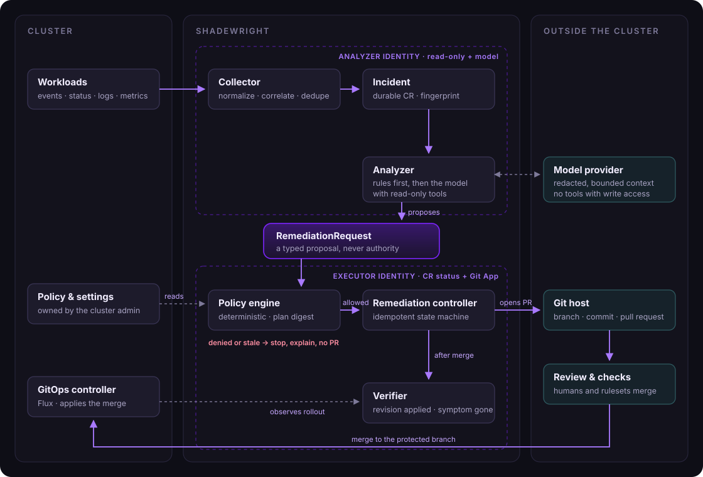

# Design

Status: draft for the MVP. Nothing here is implemented yet. Decisions that are already made are recorded in the [ADRs](adr/index.md); this page describes the whole system and lists what is still open.

## 1. Goals

Shadewright is an operations agent for Kubernetes that:

1. Watches events, object status and basic metrics in selected namespaces.
2. Groups repeated symptoms into incidents.
3. Prepares a diagnosis backed by evidence, and a proposed fix.
4. Records the proposed fix as a typed `RemediationRequest`.
5. Checks it against deterministic policy.
6. For declarative changes, opens a pull request in the GitOps repository.
7. Waits for human approval, or enables auto-merge where policy allows it.
8. Watches the GitOps controller roll the change out and checks the real effect.

The model helps analyse. The Go controllers own permissions, process state, validation and execution. **A model response is never, on its own, authorization to change anything.**

### Non-goals for the MVP

- Direct writes to the cluster (`apply`, `patch`, `exec`, `delete`), including as a fallback when a PR fails.
- Changes to cloud infrastructure outside the GitOps repository.
- Multiple clusters, multiple Git providers at the same time, or self-hosted models.
- Fine-tuning or a vector database.

### First scope

One cluster, a few namespaces, one GitOps repository on GitHub synced by Flux, and a small catalog of fixes. Azure DevOps and Argo CD come later behind the same interfaces ([ADR-0004](adr/0004-github-and-flux-first.md)).

## 2. Architecture

### 2.1. Flow

[](assets/diagrams/architecture.svg "Open full size")

The dashed boxes are the two identities: the analyzer can read and call the model, the executor can write request status and use the Git App. The `RemediationRequest` between them is the only thing the analyzer can hand over.

### 2.2. Components

| Component | Responsibility | Permission boundary |
| --- | --- | --- |
| Collector | Watches, event normalization, correlation through `ownerReferences` | Read selected namespaces and kinds |
| Incident store | Fingerprints, counters, timestamps, analysis history, operation IDs | Redacted data only |
| Analyzer | Builds context, calls the model, runs a bounded tool loop | Read, plus create `RemediationRequest` |
| Policy engine | Allowed actions, scope, bounds, whether review is required | Rules owned by the cluster admin |
| Remediation controller | Reconciles `RemediationRequest`, runs the approved plan, handles failures | CR status, Git through the GitHub App |
| GitOps adapter | Reads the repository, prepares the change, branch, commit, PR, auto-merge | One repository, allowed paths |
| Verifier | Checks the applied revision, workload health and whether the symptom is gone | Read rollout state and metrics |

The base is Go with Kubebuilder, `controller-runtime` and `client-go` ([ADR-0005](adr/0005-go-kubebuilder-single-module.md)). A controller compares desired and actual state no matter which event woke it up. The work queue collapses repeated requests for the same key, but that is not incident deduplication.

The analyzer and the remediation controller are separate binaries in one Go module (`cmd/analyzer`, `cmd/main.go`), deployed as separate Deployments with separate ServiceAccounts and identities. A slow model call must never block the controller's other reconciles.

The collector, the incident store and the analyzer run in the analyzer binary; the policy engine, the remediation controller, the GitOps adapter and the verifier run in the executor (`cmd/main.go`). Their roles are generated from kubebuilder RBAC markers (`internal/analyzer`, `internal/controller`):

- **Analyzer:** reads events (`events.k8s.io/v1`), pods and workloads; creates and updates `Incident` objects and their status; creates `RemediationRequest` objects in the operator namespace only (a Role). It cannot update, delete or write the status of a request.
- **Executor:** reads incidents, policies and settings; reads requests and writes their status in the operator namespace only (a Role), and its cache watches requests only there. It cannot create requests or write incidents.
- Neither can read `Secret` objects. An envtest suite (`test/rbac`) checks this boundary against a real API server.

No model runs in the cluster and no GPU is needed: the analyzer calls a managed model endpoint (Microsoft Foundry first). The tool loop is our own code, not a hosted agent service.

### 2.3. Provider interfaces

Shadewright is pluggable along three axes ([ADR-0018](adr/0018-three-axes-of-pluggability.md)): platform services outside the cluster (this section), the cluster platform (2.4) and the add-ons installed in the cluster (2.5). On every axis the core works on plain Kubernetes with no module at all; modules add knowledge and capabilities. Modules are compiled in for now; signed, declarative OCI packs are the planned way to ship them later ([ADR-0019](adr/0019-extension-packaging.md)).

Every external system sits behind a Go interface with one adapter per product, so switching a product means writing an adapter, not changing the core ([ADR-0013](adr/0013-adapters-for-every-external-system.md)). Interfaces use neutral terms (a change request, not a pull request) and adapters declare what they support, such as auto-merge, so the core adapts instead of assuming GitHub.

| Interface | First implementation | Later |
| --- | --- | --- |
| `GitProvider` | GitHub (GitHub App) | Azure DevOps, GitLab |
| `DeliveryVerifier` | Flux (`Kustomization`, `HelmRelease`) | Argo CD |
| `ModelProvider` | Microsoft Foundry (OpenAI and Anthropic models) | Direct vendor APIs, other gateways |
| `MetricsSource` | Prometheus HTTP API | Grafana Cloud, Azure Monitor managed Prometheus |
| `LogSource` | Kubernetes pod logs API | Loki, Azure Monitor Logs |
| `Notifier` | GitHub issue in the fleet repo | Microsoft Teams, Slack, generic webhook |
| `AnalysisStore` | Azure Blob Storage | S3-compatible, local filesystem for tests |
| `Signer` | Azure Key Vault key | AWS KMS, HashiCorp Vault transit |

Provider SDKs are imported only inside their adapter package. Each interface has an in-memory fake used by the tests.

### 2.4. Cluster platforms

A `Platform` module per provider, detected from node `providerID` and labels. The generic module is always present; the others add diagnosis and, later, platform-specific actions.

| Concern | AKS | EKS | GKE | Cluster API |
| --- | --- | --- | --- | --- |
| Workload identity | Microsoft Entra Workload ID | EKS Pod Identity, IRSA | GKE Workload Identity Federation | depends on the infrastructure provider |
| Node capacity and scaling | node pools, cluster autoscaler | managed node groups, Karpenter | node pools, Autopilot | `MachineDeployment` in the management cluster, changed through GitOps |
| Typical platform failures | pod IP exhaustion, quota, Spot eviction | ENI and IP limits, load balancer limits | Autopilot resource rules | machines that do not become nodes |
| Managed add-ons | AKS extensions (Flux, KEDA) | EKS add-ons | Config Sync | none |

Order: generic and AKS first; EKS and GKE as detection-only skeletons; Cluster API when a real case needs it.

### 2.5. Cluster integrations

An `Integration` module per add-on: detection (API groups, CRDs, versions), watched kinds and how their conditions become symptoms, deterministic diagnosis rules, read-only tools for the analyzer, redaction rules, verification checks, and optionally actions that follow the same rules as every action (typed, bounded, policy rule, GitOps patcher, refusal test). Integrations that guard security diagnose only: they explain a refusal or a missing secret, and never propose to relax a policy, change a secret or suppress a finding.

| Integration | Diagnosis | Actions |
| --- | --- | --- |
| Core workloads (Deployment, StatefulSet, PDB, NetworkPolicy, ResourceQuota) | OOM, crash loops, unschedulable pods, quota | `SetContainerMemoryLimit` |
| KEDA | trigger errors, `ScaledObject` not ready, replica ceiling | `AdjustKedaMaxReplicas` |
| Flux | failing `Kustomization` or `HelmRelease`, drift | none: Flux is the delivery path |
| Kyverno | a deployment refused by a policy, policy reports | diagnosis only |
| Secrets Store CSI driver | pods stuck on a missing secret or identity | diagnosis only |
| cloudflared | tunnel down, so the application is unreachable | none |

Later candidates: External Secrets Operator, Reloader, cert-manager, Trivy Operator, Karpenter. Modules are enabled per cluster in `RemediationSettings`, and the operator reports what it detected in status.

## 3. Observation and deduplication

### 3.1. Collecting

Use `events.k8s.io/v1`. Handle both new events and updates to an event series. Fields read: `regarding`, `related`, `reason`, `action`, `type`, `reportingController`, `reportingInstance`, `note`, `eventTime`, `series.count`, `series.lastObservedTime` ([Event API](https://kubernetes.io/docs/reference/kubernetes-api/events/event-v1/)). Do not also watch `core/v1` events, or each event is counted twice.

Events detect symptoms; they are not a durable audit log. The collector keeps what it needs beyond event retention and also reads current object state periodically.

First cases:

- `FailedScheduling`: insufficient resources, quota, node affinity or taints.
- Image pull failures and invalid pod configuration (missing Secret or ConfigMap reference).
- Restarting containers: `CrashLoopBackOff`, `OOMKilled`, failing probes.
- KEDA trigger errors and Flux reconciliation failures.

Reasons differ by component and version. `OOMKilled`, for example, comes from container status, not from an event with that reason, so detection always joins events with object state.

### 3.2. Two levels of deduplication

**Observation level:** remember the event UID and the last handled count. On a series update, process the increase, not the total. A single event without a series counts once.

**Incident level:** group similar observations by fingerprint:

```text
hash(clusterID, namespace, ownerUID-or-resourceUID,
     reason, action, type, reportingController, normalizedSymptom)
```

`resourceVersion` is not an incident ID. A pod UID alone is not enough either, because one pod can have several problems, and correlating to the owning Deployment joins symptoms from successive pods of the same workload. The rollout revision is kept as extra context.

Normalization removes variable parts (random pod suffixes, timestamps) but keeps what matters: image name, error code, the name of the missing Secret, the kind of dependency. Secrets are redacted before storage and before anything reaches the model.

Both are pure functions in `internal/incidents/fingerprint`. The note is redacted first with the shared redaction package, so no later substitution can shield part of a secret; redaction markers become fixed placeholders, so secrets or addresses of different lengths do not change the fingerprint. Normalization then replaces object UIDs, image digests, timestamps, IPs and durations with placeholders, strips pod name suffixes and ReplicaSet hashes only from names the text (or the event's regarding object) identifies as a Pod or ReplicaSet, so a missing Secret such as `db-7d4b9` keeps its name, and cuts the symptom to the 1024 characters `spec.symptom` allows. Every field is length-prefixed in the hash, and a version string is hashed first so that changed rules give new fingerprints instead of merging old and new incidents.

Starting values, to be tuned on real traffic:

| Mechanism | MVP value |
| --- | --- |
| Debounce before analysis | 30-60 s |
| Aggregation window for similar observations | 5 min |
| Cooldown before re-analysis without new data | 15 min |
| Concurrent actions | One per target object |
| Re-analysis trigger | New symptom, significant context change, or cooldown expired |

Deduplication state must survive restarts. In the MVP it lives in a namespaced `Incident` CR with bounded retention ([ADR-0007](adr/0007-incident-state-in-crds.md)). Raw logs never go into a CR.

### 3.3. Analysis

Deterministic rules and known runbooks run first. The model gets a bounded context: incident summary, object status and owners, a log excerpt, selected metrics and recent Git changes for the source of the object.

The result has a fixed schema: hypotheses, evidence, missing data, uncertainty, proposed action, expected effect and verification conditions. When the evidence is not there, the correct result is no proposal and a hand-off to a human. A model's self-reported confidence never makes an action eligible.

## 4. Tools

The analyzer exposes tools to the model through its own adapters. MCP is optional: it can expose the same tools later, but it is not required by the controller and it does not replace Kubernetes RBAC ([ADR-0003](adr/0003-gitops-only-typed-remediation.md)).

| Tool | Purpose | Mode |
| --- | --- | --- |
| `get_resource`, `list_events` | Object state and symptom history | Read |
| `get_pod_logs` | Bounded time range and byte count | Read, redacted |
| `query_metrics` | Approved query templates only | Read |
| `get_delivery_status` | Flux Kustomization / HelmRelease revision and readiness | Read |
| `read_git_file`, `get_recent_changes` | Map an object to its source in Git | Read |
| `submit_remediation_proposal` | Submit a plan for policy check | Write a proposal |

PR creation and auto-merge are not model tools at all: only the remediation controller does them, after policy.

The model never gets a shell, `kubectl exec`, `kubectl apply`, or a way to change policy. Every tool has an argument schema, a timeout, a response size limit, an allow list of object kinds and server-side authorization. Tool results, logs and repository content are untrusted data, including when they contain instructions addressed to the agent. RBAC on the ServiceAccount enforces the limits; hiding write tools is not enough.

## 5. API

Group `remediation.shadewright.io`, version `v1alpha1` ([ADR-0009](adr/0009-api-group-and-docs-domain.md)). Schemas are generated from Go types by Kubebuilder.

### 5.1. RemediationRequest

A namespaced CR that holds one concrete plan, the policy decision and the execution state. Example (values are illustrative):

```yaml
apiVersion: remediation.shadewright.io/v1alpha1
kind: RemediationRequest
metadata:
  name: orders-keda-capacity-001
  namespace: shadewright-system
spec:
  incidentRef:
    name: orders-scaling-001
    uid: "11111111-1111-4111-8111-111111111111"
  targetRef:
    apiVersion: keda.sh/v1alpha1
    kind: ScaledObject
    namespace: orders
    name: orders-worker
    uid: "22222222-2222-4222-8222-222222222222"
  mode: GitOps
  approvalRequired: true
  policyRef: keda-capacity
  action:
    type: AdjustKedaMaxReplicas
    adjustKedaMaxReplicas:
      previousValue: 10
      desiredValue: 15
  verification:
    timeout: 10m
    stableFor: 3m
    checks:
      - DeliveryRevisionApplied
      - KedaReady
      - QueueBacklogDecreasing
status:
  observedGeneration: 1
  phase: AwaitingApproval
  effectiveApprovalRequired: true
  source:
    repositoryRef: fleet
    targetBranch: main
    path: apps/orders/scaledobject.yaml
    baseCommit: "0123456789abcdef0123456789abcdef01234567"
  planDigest: "sha256:aaaaaaaaaaaaaaaaaaaaaaaaaaaaaaaaaaaaaaaaaaaaaaaaaaaaaaaaaaaaaaaa"
  policyRevision: "keda-capacity/3"
  policyUID: "44444444-4444-4444-8444-444444444444"
  pullRequest:
    number: 42
    url: https://github.com/example/fleet/pull/42
    headSHA: "89abcdef0123456789abcdef0123456789abcdef"
  conditions:
    - type: PolicyAllowed
      status: "True"
      reason: WithinApprovedBounds
      message: "The change is within the policy bounds"
      observedGeneration: 1
      lastTransitionTime: "2026-11-01T10:00:00Z"
```

Each action type has its own typed parameter struct (a discriminated union on `action.type`), so validation happens in the schema rather than in a free-form map. The MVP catalog has two actions: `AdjustKedaMaxReplicas` and `SetContainerMemoryLimit`. Schema rules are enforced by the API server itself (OpenAPI and CEL), before any controller sees the object, and are covered by envtest tests in `test/apivalidation`. Valid examples of every kind are in `config/samples`, and a test applies them.

Schema and admission rules:

- `approvalRequired` defaults to `true`; `GitOps` is the default and, in the MVP, the only mode.
- The action type is an enum; parameters are typed and bounded. Memory values are whole bytes between 1Mi and 1Ti.
- Each action type fixes the kinds it may target: `AdjustKedaMaxReplicas` only a `keda.sh` ScaledObject, `SetContainerMemoryLimit` only an `apps/v1` Deployment or StatefulSet. The target must be namespaced and pinned by UID.
- The spec says what to change, never where. The repository, branch and file are resolved by the controller from the Flux objects that deliver the target ([ADR-0012](adr/0012-object-to-source-mapping.md)) and written to `status.source`. A request cannot point a change at another file, another repository or an unprotected branch.
- `policyRef` points to admin-managed configuration, and the policy decides which namespaces may use it (`requestNamespaces`). The model never chooses a URL, host, branch or credential reference.
- The target namespace and object are authorized independently, including cross-namespace references.
- Any change to the plan, resolved source, repository settings or policy invalidates an earlier approval. The digest covers the semantic change, the target UID, the resolved source with the repository URL and installation from settings, and the policy UID and generation (a recreated policy can reach the same generation again, never the same UID). It is `sha256:` over a versioned canonical encoding: every field labelled, length-prefixed and in a fixed order, and memory quantities written by value, so `256Mi` and `268435456` give the same digest (`internal/policy/digest`).
- The digest is fixed when the branch is created. Later merges to the target branch do not change it: before each write the controller checks that the target file at the branch head still holds the previous value. If an input of the digest changes, the request becomes `Superseded`, its PR is closed and a new request is needed; the branch is never rebuilt or force-pushed.
- Verification can only be made stricter: the controller always runs the checks the action needs, `stableFor` is at least 1m, and `timeout` is at most 24h and longer than `stableFor`.
- `approvalRequired: false` is a request for automation, not a way to lower central policy.
- The whole spec is immutable: a different plan is a new request, so an approval can never carry over to a changed plan.
- `/status` subresource, standard conditions and `observedGeneration` are part of the implementation.

Only the user or analyzer writes `metadata` and `spec`. Only the controller writes `status`. RBAC on `/status` separates proposal from decision and execution.

Raising `maxReplicaCount` makes sense only after confirming that the replica cap is the cause, and that the cluster and the downstream dependency have capacity. A backlog alone is not enough evidence.

### 5.2. Incident

A namespaced CR that holds the fingerprint, counters, first and last seen, the correlated owner, and references to analyses and requests. Large data (log excerpts, full model transcripts) lives outside etcd, or is dropped after analysis in the MVP.

### 5.3. RemediationPolicy

A cluster-scoped CR, writable only by the cluster admin ([ADR-0011](adr/0011-policy-as-cluster-scoped-crd.md)). Each policy names the action types it allows, the target selector (namespaces and labels; kinds are fixed per action by the catalog), parameter bounds, the Git paths it may patch, the namespaces whose requests may use it, and whether review is always required. `metadata.generation` together with the policy UID is the revision recorded in every request's digest. Safe defaults:

- `approval` is `Required`.
- A policy must name its target namespaces: there is no "all namespaces".
- `requestNamespaces` is `[shadewright-system]`. A request from any other namespace is `Denied`, so the right to create requests somewhere does not grant a policy.
- Bounds have a minimum and a maximum, and `maxDecreasePercent` is 0: decreases are refused unless the admin allows them.
- `allowedPaths` are globs with a literal first segment. `*` and `**` never match a segment that starts with a dot, and no segment may start with a dot or a dash, so a policy cannot cover the whole repository, `.github/` or option-like names.

The decision is a pure function (`internal/policy`): it reads the request, the policy, the settings, the resolved source and the live target, and returns `Allowed`, `Denied` or `NeedsIntervention` with a machine-readable reason (one per check) and the effective approval. It uses no client and no clock, so the same input always gives the same decision. Missing input (no resolved source, no live target) gives `NeedsIntervention`; every failed check gives `Denied`. It checks, in order: the request's `policyRef` and namespace (`requestNamespaces`) and the `GitOps` mode; that the action type is in the catalog and its parameters are well formed; that the live target is the object `targetRef` names (UID, apiVersion, kind, namespace, name), that its kind is one the action may target and not one excluded by section 10 item 10, and that its namespace and labels are covered by `targets`; that the policy lists the action and the change is within `min`, `max`, `maxIncreasePercent` and `maxDecreasePercent` (compared by value, in arbitrary precision); and that the resolved repository is the policy's `gitOps.repositoryRef`, is configured in RemediationSettings with the resolved branch as its `targetBranch`, and that the file matches `allowedPaths`. The path match is purely lexical, so it is never the only guard: a pattern such as `apps/**` also matches a file declaring a Role or a Secret, and the kind check refuses it. The decision does not trust the API server to have defaulted the policy: an unset field reads in its strictest sense (no request namespaces, approval `Required`, no increases or decreases). The effective approval is `false` only when the outcome is `Allowed`, the policy is `Optional` and the request asked for `approvalRequired: false`. One exception to the strict reading: a policy without `objectSelector` covers every object of the allowed kinds in its target namespaces. Labels are not a security boundary anyway, because anyone who can patch the object can set them.

### 5.4. RemediationSettings

One cluster-scoped object named `default`. It holds the kill switch (`paused`, checked right before every write), global limits (`maxConcurrentRemediations`, `maxAnalysesPerDay`) and the Git repositories Shadewright may write to, each with its provider settings: for GitHub, the App client ID, installation ID and the signer (a Key Vault key, ADR-0006). Each repository also names the only branch pull requests may target (`targetBranch`, default `main`); the branch Flux tracks must equal it. URLs carry no credentials, query or fragment, and a GitHub repository must be `https://github.com/<owner>/<repo>`, so installation tokens never go to another host. Policies and requests refer to repositories by name only.

## 6. Reconciliation

[](assets/diagrams/phases.svg "Open full size")

Other terminal or waiting phases: `Denied`, `Failed`, `Expired`, `Cancelled`, `Superseded`, `NeedsIntervention`. Conditions explain why; `phase` is a summary for humans.

Each reconcile:

1. Gets the current CR and checks generation, plan validity and cancellation.
2. Reads the target object, its UID, the incident state and the policy revision.
3. Checks that the change is still needed and that no other action runs on the same target.
4. Rebuilds external state: does the branch, commit, PR or finished rollout already exist?
5. Does one idempotent step, or records why it is waiting.
6. Updates status and requeues with a deadline.

Never assume exactly-once execution. A PR can be created while the status write that records its number fails. The branch name `shadewright/<request-uid>` and a marker in the PR body (request UID and plan digest) let the controller find the existing operation after a restart.

Required mechanisms:

- Leader election, bounded concurrency, a lock per target object.
- Optimistic concurrency on Kubernetes objects and a base SHA check on every Git write.
- Retries with exponential backoff, jitter and `Retry-After`, with a limit.
- Deadlines for policy, PR, delivery and verification, stored in status.
- No model call during reconcile when the context did not change.
- Policy and plan freshness re-checked right before every write: same policy UID and generation, same settings, and the target file still holds the previous value. A stale plan becomes `Superseded`, never a rebuilt branch.
- Auto-merge disabled when the request is cancelled before merge. After merge, undoing needs a separate revert PR.

A finalizer is used only where deleting the CR needs bounded external cleanup (closing an open PR, disabling auto-merge). Deleting the CR never rolls back a deployment.

## 7. Existing controllers

Rule: change the declaration in its real source, and leave execution to the controller that owns the object. Shadewright never competes for the same fields with KEDA, Flux or an HPA.

| Controller | What we analyse | Fix path |
| --- | --- | --- |
| KEDA | `ScaledObject` conditions, trigger errors, the HPA, backlog and available capacity | PR changing a justified `ScaledObject` field or the Helm values behind it |
| Flux | Kustomization and HelmRelease readiness, revision, build and apply errors | PR fixing the manifest, values or Kustomization |
| Crossplane (later) | `Ready` and `Synced`, provider messages, XR dependencies | PR changing the XR or its parameters |

**KEDA:** never set Deployment replicas by hand when an autoscaler owns them. `cooldownPeriod` applies to scaling to zero; scaling from one to many is the HPA's job. A broken trigger authentication is not fixed by raising `maxReplicaCount` ([ScaledObject spec](https://keda.sh/docs/2.21/reference/scaledobject-spec/)). Match the adapter to the installed version.

**Flux:** after merge, check that the `Kustomization` (or `HelmRelease`) reports the merge commit as its last applied revision and is `Ready`, then check workload health. `Ready` alone does not prove the incident is gone. Shadewright never suspends a Kustomization, disables pruning or changes Flux config to push a fix through.

## 8. GitOps on GitHub

### 8.1. What approvalRequired means

| Request says | Shadewright does | Repository rules |
| --- | --- | --- |
| `true` | Opens the PR and waits for an independent human approval of the current head commit | All branch rules still apply |
| `false` | May enable auto-merge after policy allows automation | All branch rules still apply |
| Anything, but policy requires review | Effective value is `true` | Shadewright cannot lower it |
| Anything, but the change is not allowed | Stops with `Denied` | No PR |

`approvalRequired` is a field of our CRD, not a switch that turns off review on GitHub. If the branch requires a review, a PR with `false` still waits for it.

Fully automatic merges happen only where the repository owner deliberately allows them. On GitHub that is expressed with a ruleset plus `CODEOWNERS`: require code owner review, make every path owned by a human, and leave only the narrow paths that policy may auto-merge without an owner (a later `CODEOWNERS` pattern with no owner). Those PRs then merge on required checks alone; everything else needs a human.

### 8.2. Making a change

1. Map the object to its source in Git ([ADR-0012](adr/0012-object-to-source-mapping.md)): the Flux labels on the object name its Kustomization, which gives the source and path; the file is the one plain manifest in that path that declares the object. The labels are untrusted, so the mapping is accepted only if the Kustomization is Ready and its `status.inventory` lists the object, and the value in the file equals the live value (otherwise an inline patch changes it). The `GitRepository` must track a branch (`spec.ref.branch`); tags, semver, commits and other refs stop with `NeedsIntervention`. Its URL must equal exactly one repository in RemediationSettings, that repository must be the policy's `gitOps.repositoryRef` (otherwise `Denied`), the branch must equal the repository's `targetBranch`, and the file must match the policy's `allowedPaths`. Record the result in `status.source`. Objects from patches, generators or Helm charts are not supported yet: stop with `NeedsIntervention`.
2. Read the current SHA of the target branch and create branch `shadewright/<request-uid>`.
3. Apply the typed change to the allowed file, checking the previous value. Patch YAML in place, preserving comments and formatting.
4. Render the final manifests and compute the semantic diff, including indirect changes through values.
5. Validate YAML, schemas, safety rules and cost or capacity bounds.
6. Commit and open a PR with the evidence, scope, expected effect, risk and rollback plan.
7. Bind the PR to the request UID and plan digest. Any new push to the branch invalidates the plan.
8. After merge, follow delivery and the success criteria instead of stopping at "merged".

### 8.3. Auto-merge

The GitHub App enables auto-merge (GraphQL `enablePullRequestAutoMerge`, squash) only when policy allows automation, the head SHA is the commit Shadewright created, and the diff still matches the plan digest. GitHub then merges once required reviews and checks pass. The repository must have "Allow auto-merge" on.

### 8.4. Branch protection

- Required status checks, including a trusted path guard that fails when a PR touches anything outside the allowed paths.
- `.github/`, `CODEOWNERS`, Flux config, RBAC and policy files are owned by a human, so a PR that touches them always needs review.
- Stale approvals dismissed on new pushes, and approval of the most recent push required.
- The GitHub App is never on a ruleset bypass list and has only `contents: write`, `pull_requests: write`, `issues: write` (for notifications, ADR-0014) and `metadata: read` on one repository. It cannot approve its own PRs.
- No direct pushes or force pushes to `main`; only branches and PRs.
- Extra commits, a changed target or a digest mismatch stop automation.

## 9. Identity

[](assets/diagrams/identity.svg "Open full size")

- **Analyzer:** its own managed identity with only the inference role on the model deployment and permission to create blobs in the analysis records container (ADR-0015). Token audience must match the endpoint.
- **Executor:** its own managed identity with permission to *sign* with one Key Vault key. The GitHub App private key is imported into Key Vault as a non-exportable key; the executor signs the App JWT through Key Vault and exchanges it for a one-hour installation token. The private key never exists in the pod or in a Kubernetes Secret ([ADR-0006](adr/0006-github-app-key-in-key-vault.md)).
- Federated credentials use subject `system:serviceaccount:<namespace>:<serviceaccount>` and audience `api://AzureADTokenExchange` ([AKS workload identity](https://learn.microsoft.com/en-us/azure/aks/workload-identity-overview)).
- In Go: `azidentity.WorkloadIdentityCredential` (or a deliberately configured `DefaultAzureCredential`).
- No PATs, no client secrets, no long-lived API keys. Tokens for Foundry, Key Vault and GitHub are never interchangeable.

## 10. Security

1. **Least privilege RBAC:** never `cluster-admin`; read only selected namespaces and kinds. Separate roles for analysis, proposal, status and execution.
2. **Untrusted data:** events, logs, annotations, tool descriptions and Git files may carry prompt injection. They never change instructions, permissions or the action catalog.
3. **Redaction:** secrets, tokens, connection strings and personal data are removed before the model sees them. One function does it (`internal/redact`): built-in rules for common token formats, JWTs, private keys, connection strings, emails and IP addresses, plus operator-supplied patterns; a match becomes a marker naming its kind, and the output is never longer than the input. Reading `Secret` objects is off by default; checking that a referenced Secret exists goes through a narrow adapter that returns only yes or no.
4. **Bounded actions:** typed operations, namespace and path scope, change limits, per-environment policy. No commands generated by the model.
5. **Approval of a specific change:** approval is bound to the current plan and head commit. A field set by an untrusted author never replaces an admin or reviewer decision.
6. **Network:** controlled egress to the Kubernetes API, the model endpoint, Key Vault, GitHub and Entra ID. NetworkPolicies in the Shadewright namespace.
7. **Loop protection:** retry limits, a global limit on concurrent fixes, cooldowns, a circuit breaker and an automation kill switch.
8. **Audit:** input references, model and tool versions, policy decision, plan digest, PR, delivered revision and outcome. Large or sensitive data stays outside the CR.
9. **Verification:** watch metrics and health after the change. A failed fix leads to escalation or a reviewed revert PR, never to further unbounded experiments.
10. **Excluded from the MVP:** deleting PVCs, databases or namespaces, removing finalizers, widening permissions, changing network security, Secrets, protected branches or approval rules.

Emergency direct actions on the cluster could come later as a separate catalog with separate authorization. They are never an automatic fallback after a failed PR.

## 11. Model

### 11.1. Setup

The analyzer runs locally during development and in the cluster later, always against a managed endpoint.

1. A separate Foundry resource and budget for the lab.
2. A model available in the chosen region and deployment type, with structured outputs and tool calling.
3. Pay-per-token first. No provisioned throughput without measured steady load.
4. Entra ID authentication and the minimum data-plane role for inference.
5. Deployment name, model ID and version, API version and TPM/RPM limits in config, not in code.
6. Timeouts, throttling, malformed output and an unavailable model are handled and tested.
7. Quality is measured on recorded scenarios before any automation is enabled.

Global deployments can process data outside the resource's region; the resource region alone does not guarantee where inference happens ([deployment types](https://learn.microsoft.com/en-us/azure/foundry/foundry-models/concepts/deployment-types)).

For the lab: Sweden Central ([ADR-0016](adr/0016-lab-region-sweden-central.md)). Checked 2026-11-01 on the lab subscription with `az cognitiveservices model list`: it is the only EU region listed with both OpenAI and Anthropic models, and Anthropic models there are offered as Global Standard only. Azure OpenAI token prices are the same in every EU and US region; Global Standard is about 10% cheaper than Data Zone Standard (for example GPT-5.4 mini input: 0.6733 EUR per 1 M tokens Global, 0.7406 EUR Data Zone, Azure Retail Prices API, 2026-11-01).

### 11.2. Model strategy

- Small model: summarize context, classify the symptom, propose a known runbook.
- Stronger model: hard incidents, ambiguous dependencies, multi-step analysis. Used as an escalation, not by default.
- Deterministic code: enforce policy, compute bounds, build the diff, decide whether execution is allowed.

Concrete models are chosen by benchmark on the scenario set. Measure diagnosis accuracy, plan usefulness, false fixes, latency and cost per resolved incident.

## 12. Cost

### 12.1. Formula

```text
inference cost =
    uncached input tokens / 1,000,000 * input price
  + cached input tokens   / 1,000,000 * cached input price
  + output tokens         / 1,000,000 * output price
```

Count every call of an analysis: tool steps, retries and escalations. Check how reasoning tokens and long context are billed for the chosen model.

### 12.2. Illustration (made-up prices, not a quote)

100 analyses a day for 30 days, each 6,000 input and 1,500 output tokens: 18 M input and 4.5 M output tokens a month.

| Variant | Input per 1 M | Output per 1 M | Result |
| --- | ---: | ---: | ---: |
| A, cheaper | 0.20 USD | 0.80 USD | 18 × 0.20 + 4.5 × 0.80 = 7.20 USD/month |
| B, stronger | 2.00 USD | 8.00 USD | 18 × 2.00 + 4.5 × 8.00 = 72.00 USD/month |

If A handles everything and 10% also goes to B with the same context size: 7.20 + 0.10 × 72.00 = 14.40 USD/month.

### 12.3. Controls

Real prices come from the model card, the deployment configurator and the [Azure Pricing Calculator](https://azure.microsoft.com/en-us/pricing/calculator/), recorded with the date checked. The app enforces maximum context, steps, output tokens, concurrency, analyses per day and a daily spend limit. An Azure budget only alerts; it does not stop usage ([budgets](https://learn.microsoft.com/en-us/azure/cost-management-billing/costs/tutorial-acm-create-budgets)). Deduplication and cached diagnoses keep repeated calls down.

The lab itself (AKS node, Key Vault, storage, Foundry) is priced in `shadewright-azure` and runs only when needed ([ADR-0008](adr/0008-disposable-azure-lab.md)).

## 13. Milestones

**Stage 0: lab and scenarios.** Disposable lab cluster, fleet repo, branch rules, scenario set: bad image, missing Secret reference, OOM, unschedulable pod, broken KEDA trigger, invalid manifest. Each scenario has an expected outcome, including the cases where the agent must refuse. *Done when:* every scenario can be reproduced with one command.

**Stage 1: observe and diagnose, read-only.** Collector, fingerprints, aggregation, durable incidents, model integration, analysis output. No writes to the cluster or Git. *Done when:* a burst of repeated symptoms makes one incident, a restart does not cause an analysis storm, and each diagnosis names its evidence.

**Stage 2: RemediationRequest and PR with review.** CRDs, controller state machine, policy, Git source mapping, typed patches, GitHub App through Key Vault. Every request has `approvalRequired: true`. *Done when:* one scenario produces exactly one correct PR, repeated reconciles do not open another, and an unknown change or stale context stops the process.

**Stage 3: delivery and verification.** Merge, Flux revision and operational effect. Timeouts, Git conflicts, rejected PRs and incidents that resolved before rollout. *Done when:* `Succeeded` appears only after the right revision is applied and stability criteria hold, and every failure has a clear status and escalation.

**Stage 4: controlled auto-merge in the lab.** One or two narrowly defined change classes with `approvalRequired: false`, matching `CODEOWNERS` and ruleset, no bypass. *Done when:* the positive case merges automatically and negative attempts stop on unmet rules, extra diff, exceeded bounds or a swapped plan.

**Stage 5: extensions.** More integrations and platforms (2.4, 2.5), more observability adapters, MCP, Argo CD, Azure DevOps and GitLab adapters, Crossplane, more clusters, and declarative OCI extension packs.

The first end-to-end result is: one controlled incident, one documented diagnosis, one safe PR, approval, Flux delivery and a confirmed recovery.

## 14. Testing

Tests target process behaviour: deduplication across restarts, idempotency after a crash between an API call and the status write, prompt injection in events and logs, refusal of disallowed actions, approval invalidated by a plan change, branch rules, model and GitHub outages, and an incident that changes while the PR waits for review.

Pilot metrics: time to diagnosis and to fix, events per incident, operator-rated plan accuracy, share of accepted PRs, failed or reverted changes, cost and tokens per incident, and actions blocked by policy.

## 15. Decisions made and open questions

Decided on 2026-11-01:

| Topic | Decision |
| --- | --- |
| Policy format | Cluster-scoped `RemediationPolicy` CRD ([ADR-0011](adr/0011-policy-as-cluster-scoped-crd.md)) |
| Object to source mapping | Flux labels plus plain manifests only, otherwise `NeedsIntervention` ([ADR-0012](adr/0012-object-to-source-mapping.md)) |
| External systems | An interface and adapters for every one of them ([ADR-0013](adr/0013-adapters-for-every-external-system.md)) |
| Notifications | GitHub issue in the fleet repo first; Teams through a `Notifier` adapter later ([ADR-0014](adr/0014-notifications-github-issues-first.md)) |
| Analysis records | Kept, redacted, in storage that outlives the lab ([ADR-0015](adr/0015-analysis-records-outlive-the-lab.md)) |
| Lab region and models | Sweden Central; the model is picked by benchmark from what Foundry offers there ([ADR-0016](adr/0016-lab-region-sweden-central.md)) |
| Lab metrics | Prometheus in the lab cluster, Grafana later if needed ([ADR-0017](adr/0017-prometheus-in-the-lab.md)) |
| Kill switch | A field in a cluster-scoped config object, checked before every write |
| Evaluation | Recorded contexts per scenario with the expected diagnosis or refusal; CI runs them against a fake model, the real model on demand |
| Agent observability | controller-runtime Prometheus metrics, plus OpenTelemetry traces per analysis (tool calls, tokens, latency) |
| Packaging | Kubebuilder's Helm plugin; images on GHCR, signed keyless, with SBOMs |
| Pluggability | Three axes: platform services, cluster platforms, cluster integrations ([ADR-0018](adr/0018-three-axes-of-pluggability.md)); security integrations diagnose only |
| Extension packaging | Compiled in now; signed declarative OCI packs later ([ADR-0019](adr/0019-extension-packaging.md)) |
| Controller identities | Separate analyzer and executor ServiceAccounts and roles; requests reachable only in the operator namespace (2.2) |

Still open:

1. **Helm-rendered and patched objects.** How to map and patch objects that come from Helm charts, Kustomize patches or generators. Revisit when a real case needs it.
2. **YAML patching library.** `kyaml` (keeps comments, used by Kustomize) or a typed round-trip. *Leaning:* `kyaml`. Decide at stage 2.
3. **Model choice.** Benchmark on the scenario set at stage 1: a small model for triage and a stronger one for escalation.
4. **Teams.** Whether the maintainer's Microsoft account can receive Teams Workflows webhooks. If not, GitHub issues stay the only notifier for now.
5. **Required checks in policy.** Whether a policy should name verification checks a request cannot drop, beyond the ones each action always runs.

## 16. Prior art

These projects are references and integration candidates. None of them implements the whole flow above.

| Project | Use |
| --- | --- |
| [controller-runtime](https://github.com/kubernetes-sigs/controller-runtime) | Controllers, cache, watches, reconcile |
| [Kubebuilder](https://github.com/kubernetes-sigs/kubebuilder) | Scaffold, API types, CRD generation |
| [K8sGPT](https://github.com/k8sgpt-ai/k8sgpt) and its [operator](https://github.com/k8sgpt-ai/k8sgpt-operator) | Kubernetes analyzers, results as resources |
| [HolmesGPT](https://github.com/HolmesGPT/holmesgpt) | Incident analysis with tools and observability sources; evaluation fixtures |
| [Kubernetes MCP Server](https://github.com/containers/kubernetes-mcp-server) | MCP access to Kubernetes, in a restricted read-only setup |
| [MCP Go SDK](https://github.com/modelcontextprotocol/go-sdk) | Own MCP client or server in Go |
| [Flux](https://github.com/fluxcd/flux2), [KEDA](https://github.com/kedacore/keda), [Argo CD](https://github.com/argoproj/argo-cd), [Crossplane](https://github.com/crossplane/crossplane) | Delivery and integration targets |

Check the current version, license, supported APIs and authentication of each before use.
