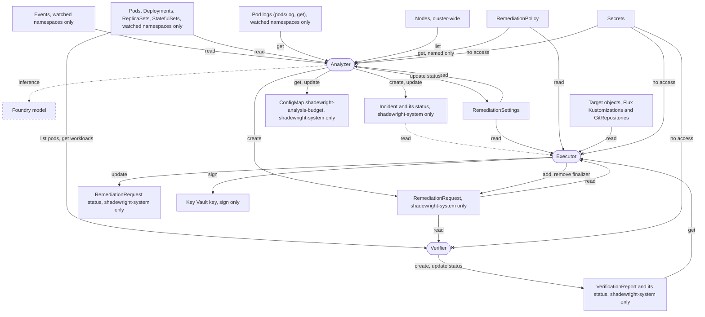

# 10. Security

This section is the security design. It states ten security rules (10.1 to 10.10; the project's invariants are the six in `AGENTS.md`), then shows what each identity can read and write (10.11). The [threat model](../threat-model.md) names the adversaries and says which invariants are built, with the code and the tests behind each. Numbers and edge cases that only matter when you build or debug are in the table "Details" at the end (10.12).

## 10.1. Least privilege RBAC

**What it does.** No component has `cluster-admin`. Each reads only selected namespaces and kinds. Analysis, proposal, status, execution and verification have separate roles. The verifier, a third component, serves its metrics on the same port as the other two (`metrics.port`, behind the same token check) and has its own metrics Service.

**Why.** The analyzer's namespaces are a boundary of its identity, not only a setting. There is one RoleBinding per watched namespace.

**Limit.** An empty namespace list watches nothing. It is never read as "all namespaces" (2.2).

**Pod logs.** The analyzer's one read of free text from workloads is `get` on `pods/log`, in the watch role, so only in the watched namespaces and never cluster-wide (`test/rbac` `TestPodLogsOnlyInWatchedNamespaces`). The pod logs source and the Prometheus source are given the same namespace list and refuse any other before a request, and so does the context builder for an Incident's subject: the boundary does not rest on RBAC alone, which Prometheus does not have (2.3). `--pod-logs=false` stops the reads; the Helm chart then also renders the role without the grant (`analyzer.podLogs.enabled=false`), while `config/` always keeps it.

## 10.2. Untrusted data

Events, logs, annotations, tool descriptions and Git files may carry prompt injection. They never change instructions, permissions or the action catalog.

## 10.3. Redaction

**What it does.** Secrets, tokens, connection strings and personal data are removed before the model sees them. One function does it: `internal/redact`. A match becomes a marker that names its kind, and the output is never longer than the input.

**What it covers.**

- Built-in rules for common token formats (current-format Microsoft Entra client secrets among them, matched whole although they hold `~` and `.`, also glued to each other or with `~` percent-encoded; one cut to 36 characters or fewer is not matched), and long random tokens without a known prefix.
- JWTs, private keys, connection strings, and credentials in URLs (any userinfo).
- `Authorization` values, and Basic and Bearer values that look like credentials.
- Values of secret-named keys in env, JSON (also escaped inside a string) and YAML forms (all scalar values under a secret-named YAML key).
- Kubernetes environment variables whose name holds a secret.
- Emails and IP addresses.
- Patterns supplied by the operator.

**No access to Secrets.** Neither identity has any permission on `Secret` objects. `test/rbac` fails if any role of the analyzer names `secrets`.

**Why the answer is never "exists".** Whether a Secret or ConfigMap that a pod references is missing is inferred from what the analyzer already reads (the missing reference check, section 4). The answer is `missing` or `unknown`, never `exists`.

- Kubernetes RBAC has no metadata-only verb. `get`, `list` or `watch` on secrets returns the data, also through the metadata API (`PartialObjectMetadata`).
- So a true answer that a Secret exists would need a grant that breaks invariant 6 (separate identities, `AGENTS.md`).
- The absence of the kubelet's error is no proof either: the kubelet may not have tried yet, the Event may have expired, or the reference may be optional.

## 10.4. Bounded actions

Actions are typed operations with a namespace and path scope, change limits and a per-environment policy. The model never generates commands.

## 10.5. Approval of a specific change

Approval is bound to the current plan and head commit. A field set by an untrusted author never replaces an admin or reviewer decision.

## 10.6. Network

**What it does.** Egress is limited by port and direction. The destinations the components need are the Kubernetes API, the model endpoint, Key Vault, GitHub and Entra ID. The analyzer also needs the in-cluster metrics source and the trace exporter (below).

### The NetworkPolicies

They live in the Shadewright namespace (`config/network-policy`, included in `config/default`).

- `default-deny` selects every pod in the namespace and denies all ingress and egress.
- `allow-analyzer-egress` and `allow-executor-egress` select one component each (by `app.kubernetes.io/component`). They allow cluster DNS (kube-dns in `kube-system`, port 53) and TCP 443 and 6443 to any address.
    - 443 is the model endpoint, Key Vault, Entra ID, GitHub and the API server of a managed cluster.
    - 6443 is the API server on kubeadm and kind.
- `allow-metrics-traffic` allows ingress to port 8443 only from namespaces labeled `metrics: enabled`. Nothing else is allowed in, and there is no webhook.
- Kubelet probes on port 8081 come from the node, which NetworkPolicy does not block.

An additional namespace-scoped policy is needed for anything else that must reach the pods, such as a Prometheus in another namespace (label it `metrics: enabled`).

### The analyzer's two extra destinations

The two egress policies do not open these by default.

- **Metrics source.** The Prometheus HTTP API on port 9090 (the lab's in-cluster Prometheus, [ADR-0017](../adr/0017-prometheus-in-the-lab.md), behind the `MetricsSource` interface).
- **Trace exporter.** OpenTelemetry, off by default; the analyzer exports over OTLP gRPC only ([traces reference](../reference/traces.md)). When tracing is enabled it needs a rule to the collector's port, OTLP gRPC on 4317 by default: the chart's `networkPolicy.analyzer.traceCollector` adds it, off by default like the Prometheus rule. Without it a call to the collector is dropped, and the analysis goes on: the exporter is asynchronous and bounded.

The chart has a rule for Prometheus, off by default because the analyzer sends Prometheus nothing unless `--prometheus-url` is set: with `--prometheus-cluster` too it probes it at startup and every 10 minutes, and it queries it when the analysis loop ([#76](https://github.com/pkalin/shadewright/issues/76), started with `--triage-model`) calls the context builder or a read tool. `networkPolicy.analyzer.prometheus.enabled` adds to `allow-analyzer-egress` (never to the executor's policy) a rule to the Pods you name in one namespace on one port.

- The Prometheus namespace must allow the analyzer in its own ingress policy. The fleet's `prometheus-server` ingress policy already expects it.
- The chart changes nothing outside its namespace.
- The kustomize manifests in `config/` have no such rule.

### The limit: ports, not destinations

A standard NetworkPolicy cannot match host names, and the API server has no label to select. So the policies limit ports and directions, not destinations. The analyzer can reach any HTTPS address at the network level, including `api.github.com`.

What keeps the analyzer away from GitHub is that its binary has no GitHub adapter and holds no GitHub credential (`AGENTS.md` invariant 6), not the policy. The lab confirmed on 2026-11-07 that the network does not stop it (the binary itself was not tested there). A test pod in the operator namespace with the analyzer's labels (`app.kubernetes.io/name=shadewright`, `app.kubernetes.io/component=analyzer`), so under the same NetworkPolicies, with the restricted security context and no service account token, got HTTP 200 from `https://github.com` and `https://api.github.com` (`curl -sS -m 10 -o /dev/null -w '%{http_code}' <url>`), and could not connect to `http://github.com` (port 80). The port rules are enforced, the destination is not.

This is accepted ([#391](https://github.com/pkalin/shadewright/issues/391)): the analyzer may open TCP 443 to any address, including GitHub, and is kept from GitHub by having no GitHub client in its binary and no GitHub identity or credential, not by the network. The acceptance also covers reaching any other HTTPS host, so a compromised analyzer could send what it holds (redacted context, its own Entra ID token for the model) to an attacker-chosen host; no analyzer path takes a URL from cluster data or model output (the model endpoints come from `RemediationSettings` and the `--model-endpoint-suffixes` allow-list). Narrowing egress by host name stays the operator's choice, not shipped (below). The lab uses none of the ways to do it.

The API server rule is 443 and 6443 to any address because its address is unknown when the chart renders and differs per cluster. The manifests in `config/` follow the same established pattern. The trade-off is that a pod of the component can reach any HTTPS address too.

The per-component split exists so that narrowing is possible without touching the other component. Two ways to narrow, neither shipped or tested (the chart does not claim a host name restriction):

- Replace the `0.0.0.0/0` block with `ipBlock` ranges for the API server and the model endpoint (a private endpoint has a stable address). Public GitHub and Entra ID ranges change, so this suits only private endpoints.
- Filter by host name, outside the shipped objects. Allow the model host for the analyzer, and `api.github.com`, `login.microsoftonline.com` and the Key Vault host for the executor. Ways to do it, each the operator's choice:
    - A CNI with FQDN rules. Upstream Cilium (`CiliumNetworkPolicy` `toFQDNs`), including as a bring-your-own CNI on AKS. Calico with domain rules. On AKS's managed Azure CNI powered by Cilium, FQDN rules are part of Advanced Container Networking Services, a paid add-on ([FQDN filtering](https://learn.microsoft.com/azure/aks/container-network-security-fqdn-filtering-concepts)).
    - An egress firewall with FQDN rules (Azure Firewall or a network virtual appliance, reached by a route table). It sees node addresses, not Pods, so rules per component need the components on separate node pools or subnets.
    - An egress proxy or gateway with an allow-list (an HTTP proxy, or a service mesh egress gateway), with the components' egress allowed only to it.

### What can go wrong

- **No enforcing CNI.** NetworkPolicy needs a CNI that enforces it (kindnet in recent kind, Azure CNI with Azure Network Policy or Cilium on AKS). On one that does not, the objects are accepted and do nothing.
- **Cilium and the API server.** Cilium treats the API server as the `kube-apiserver` entity, so the `ipBlock 0.0.0.0/0` rule on 443 and 6443 might not match it and would cut the operator off from the API server and leader election. Verified in the lab on 2026-11-07 (AKS, Azure CNI powered by Cilium, [#216](https://github.com/pkalin/shadewright/issues/216)): both leader election Leases renewed under the shipped policies, so the analyzer and the executor reach the API server. Test pods with each component's labels, under the same policies, also reached their other destinations over HTTPS: the executor Key Vault, Entra ID and GitHub, the analyzer the Foundry model endpoint and Entra ID. Cilium enforces the port rules of the core NetworkPolicy. Host-name rules were not tried: the lab uses none of the ways above. On another cluster or CNI version, check again; the fallback is a `CiliumNetworkPolicy` overlay with `toEntities: [kube-apiserver]`.
- **Switching off.** The chart's policies are on by default (`networkPolicy.enabled`). `false` removes the default deny too.

### The `helm test` policies

The chart's `helm test` hook adds two NetworkPolicies while the test runs. One lets only the test Pod (label `app.kubernetes.io/component: test`) send DNS and reach the metrics port of the three components. The other lets only that Pod in to that port. The metrics endpoint still refuses the test Pod without a token.

Helm deletes both after the test, also when it fails. A `helm test` that is cancelled or killed can leave them behind. Remove them with `kubectl -n <namespace> delete networkpolicy -l app.kubernetes.io/component=test`.

### How it is checked

- `test/netpol` renders `config/default` and asserts every NetworkPolicy in the build.
- `test/chart` asserts that the chart's policies equal `config/`, and that the Prometheus rule exists only for the analyzer and only when enabled.

## 10.7. Loop protection

**What it does.** The design has retry limits, a global limit on concurrent fixes, cooldowns, a circuit breaker and an automation kill switch, to keep the agent from looping on a target. Only some are built (below).

**Built.**

- The kill switch: `RemediationSettings` `spec.paused`, read from the API server by one gate right before every Git write, failing closed (5.4).
- The concurrency limit, a lock per target and a circuit breaker with a cool-down (#88).

**Planned.** Retry limits and cooldowns between attempts.

### Where the limits apply

The limits hold back one step: the one that lets a request through the policy check (`Pending` to `PolicyChecked`), after which it writes to Git.

- A request already past that step is never stopped by them. The kill switch does that.
- A refusal (`Denied`, `NeedsIntervention`) at the first check is never held back.
- A request already `Queued` checks only the limits. It is decided again, and refused if the policy now says so, only once the limits let it through.

The executor lets an allowed request through only when all three hold:

- no other request that holds the lock names the same target UID;
- fewer than `maxConcurrentRemediations` are active;
- the breaker lets it through.

The limits count the requests of one namespace, the operator namespace where requests live.

### Active requests

A request is active while the executor can still move it on before the merge: a phase before `Merged` with a plan digest. It is also active while it is being deleted and its finalizer may still write to Git: it has not ended, holds the lock, or ended `NeedsIntervention` or `Expired`, whose finalizer closes a pull request that may still be open.

Such a request is read while it is being deleted. One that ended `NeedsIntervention` or `Expired` without the lock is not in the other lists, so its finalizer first sets `status.breakerCounts` to `true`, before it closes anything; the breaker's list then reads it (#390). A check made before that write did not count it and may have let another request through in its slot, so the finalizer then checks the limits under the admission lock and closes the pull request only when fewer than `maxConcurrentRemediations` others count; otherwise it waits and checks again in 30 seconds, without writing to Git. Other requests that ended and are being deleted count there only while their own close runs, so two of them never wait on each other. A request that ended in another phase and holds no lock is not counted: its finalizer writes nothing to Git.

### The target lock

The lock lasts longer than the active state that counts against `maxConcurrentRemediations` (#294, #376).

The lock is per target object, not per file in Git. Two targets declared in one file can each have an active request. The plan digest and the freshness check supersede the second plan when the first one changes the file.

The executor records the lock in `status.holdsTarget` (#294, #376). It is set in the status write of the allowed decision and cleared only when the release is proven. The release is proven by one of these:

- the pull request merged (`Merged` or a later phase, or seen merged after a stop);
- the pull request closed by Shadewright or seen closed (`Superseded`, written only after the close, or `PullRequestOpened` with reason `PullRequestClosed`, `ChangeRequestClosed` or `ChangeRequestMerged`);
- a cleanup or a look-up that found none of the request's own open.

Everything else keeps the lock (fail closed):

- A request that stops with its pull request still open (`NeedsIntervention` after the head moved, after a confirmed merge conflict with reason `ChangeRequestConflict`, or after a refused close) keeps a second pull request off the target.
- So does one that stopped without a recorded pull request, since one may have opened while the status write that would record it was lost.
- An expiry whose cleanup the Git host refused ends with its own reason, `PullRequestDeadlineCleanupRefused`, and keeps the lock.
- Any other state keeps the lock: a pull request the executor could not find (`ChangeRequestGone`), `Failed` and an unknown phase included.

A request that waits behind a holder of the same Incident whose pull request is then merged does not take the lock while the merged change is in effect: it ends `Superseded` with reason `AnotherRequestMerged` ([6.6.3](6-reconciliation.md#663-duplicates-of-a-merged-request), #556). A request that waits behind a holder for the same field, of any Incident, whose pull request is then closed without a merge does not take the lock either: it ends `Superseded` with reason `AnotherRequestClosed` ([6.6.4](6-reconciliation.md#664-requests-after-a-pull-request-closed-without-a-merge), #643).

### Stopped holders

A stopped request that holds the lock is looked at every 10 minutes. Its pull request is found by its branch and marker (`AGENTS.md` invariant 5) and recorded when the status did not have it. The lock is released once the pull request is closed or merged, so a person who closes it frees the target without deleting the request. A look-up that fails keeps the lock.

A request queued behind a stopped holder checks the limits every 10 minutes instead of every 30 seconds, and at once when the holder changes.

### Deleting a request

Deleting the request releases the lock once its finalizer is gone. The finalizer tries to close the pull request of every request that holds the lock, whatever its phase.

A close the Git host refuses leaves the request `Terminating` and the lock held, until a person fixes the permission or removes the finalizer by hand ([uninstall, step 3](../upgrade-uninstall.md#uninstall)).

### Requests from before the field existed

Such requests get `status.holdsTarget` once, from their status:

- A request that ended without a plan digest (a refusal) gets `false`.
- Any other gets the lock it may hold (fail closed).

Such a request holds no slot under `maxConcurrentRemediations`.

### The circuit breaker

Requests that ended before `lastPhaseTransitionTime` existed are not counted, so after an upgrade the breaker starts closed.

**It trips** when three failures came after the latest success, among the requests that went through the policy check.

- Failures: `Failed`, `NeedsIntervention`, a rejected pull request included.
- Successes: `Merged` and `Succeeded`.
- Undecided: `WaitingForDelivery` and `Verifying` (#681) are neither. The move to them refreshes `lastPhaseTransitionTime`, so a merge older than later failures would otherwise read as a newer success and close the breaker. With `--verify-outcomes` on, a `Merged` request with a merge receipt is undecided too: the next reconcile moves it to `WaitingForDelivery`, and read as a success in between it would close the breaker before its outcome is known. With the flag off it is a success, and a request found in `WaitingForDelivery` or `Verifying` ends `Inconclusive` (`VerificationDisabled`), so none waits there for ever.
- It stays tripped until a success.

**While tripped** it is open for 30 minutes after the latest failure: nothing goes through. After that it is half-open (#295): one request goes through as the probe, and the others wait while it runs.

- The probe's success closes the breaker.
- The probe's failure is the latest failure, so the breaker is open again for a full cool-down.
- A probe that ends neither way (`Expired`, `Cancelled`, `Superseded`, `Denied`, `Inconclusive`) also opens it again for a full cool-down from its end. Only a success closes it (fail closed).

**Which failures count.** Outside a probe, `Expired` is not a failure: it comes from Git host outages and deadlines, not from a bad change. `Denied`, `Cancelled` and `Superseded` are skipped too, and so is `Inconclusive` (#678, [ADR-0030](../adr/0030-merge-receipt-and-verification-outcomes.md) section 5): merged, with no evidence either way, it is read like `Expired` and is never a success.

**The probe is marked.** The policy check sets `status.breakerProbe` on a request it lets through while the breaker is tripped, in the same status write as the allowed decision. The breaker finds the probe by that field only, so leaders with different clocks agree on it and a restart keeps it.

- A request without the field (let through before the trip, or before the field existed) is not a probe.
- A probe runs until it reaches a final phase or `Merged`, also while it is being deleted. `Merged` and `Succeeded` count as its success. A probe in `WaitingForDelivery` or `Verifying`, or with `--verify-outcomes` on in `Merged` with a merge receipt, stays the probe until it ends, so the others keep waiting (`CircuitHalfOpen`). With the flag off such a probe in `WaitingForDelivery` or `Verifying` ends `Inconclusive` (`VerificationDisabled`), which opens the breaker again for a full cool-down, after which the next request goes through as the new probe.
- One that ended without `lastPhaseTransitionTime` (written by hand) is taken to have ended one cool-down after the trip. It holds the breaker open for one more cool-down at most.
- Requests let through before the trip that still run are not probes. They are not stopped, and a failure among them opens the breaker again.

**Reset by a person.** Deleting failed requests closes the breaker. Deleting the probe lets the next request through as a new one. Both are a person's decision: only someone allowed to delete requests can.

### The breaker's watermark

The breaker reads only the outcomes it may still need (#390). Each request carries `status.breakerCounts`, a selectable field:

- **Set** in the status write that ends the request: `true` for a success, a failure, or a probe that ended any other way (`Expired`, `Cancelled`, `Superseded`, `Denied`, `Inconclusive`); `false` for any other end (a refusal, `Expired` outside a probe).
- **Cleared** to `false` only on outcomes that ended before the latest request in `Succeeded`, the only final success. The same write names that request in `status.breakerClearedBy`, also a selectable field. `Merged` counts as a success for the decision, as before (with `--verify-outcomes` on, not one with a merge receipt; the field does not depend on the flag), but clears nothing: the phases after the merge (#681) may still move it to `Failed`, and that write sets the field `true` again. `WaitingForDelivery` and `Verifying` are no outcome: the write that moves a request to one of them sets the field `false`, or `true` for a probe, which the breaker must keep reading.
- **Restored** to `true` when the request in `Succeeded` is deleted: its finalizer lists the requests that name it and sets the field back on each before it removes itself. A restore that fails keeps the finalizer, and the deletion is retried.
- **Unset** while the request has not ended, and on one that ended before the field existed. An unset request is read (fail closed). A one-time pass sets the field on an older ended request from its status, in the same status write as `status.holdsTarget`.

An outcome before the latest success never changes the breaker's state: the failures in a row are counted after the latest success, and a probe that ended before it opens nothing again. So clearing never changes a decision the breaker makes from the same requests, whatever the clocks of the leaders that wrote the times.

**How much is read.** Once cleared, the breaker reads the latest request in `Succeeded` and every outcome that ended after it. A long row without a final success stays read. While the breaker is tripped it grows by about one request per cool-down (one probe each 30 minutes): about 48 a day, about 1,400 in a month, 15 pages of 100. That is accepted. Retention of ended requests is a separate task.

**When it is written.** The executor clears after the check of the limits that found the outcomes, once its decision is written and outside the lock of the admission, so no admission waits for it. One clearing runs at a time, with its own deadline and at most 100 requests, so the first checks after the upgrade clear the history in steps.

- Each write carries the `resourceVersion` that was read: a request that changed since is left as it is and judged again at the next check.
- A write that fails changes no decision: the request is only read once more. One that fails for good (`Forbidden`, `Invalid`) is logged as an error and counted in `shadewright_circuit_breaker_clear_errors_total`.
- Before it writes, the clearing checks, under a mutex it shares with the restore, that the success still exists and is not being deleted. So no clearing names a success whose finalizer already restored.

**What can go wrong.** Removing the finalizer of a request in `Succeeded` by hand skips the restore: the outcomes it cleared stay unread. This is a deliberate admin action, like deleting failed requests to close the breaker. Set `status.breakerCounts` back to `true` on the requests whose `status.breakerClearedBy` names it ([troubleshooting](../troubleshooting.md#limits)). A clearing by a former leader that is still running while the new leader deletes the success is not covered: leader election stops the former leader's process.

### What a held request shows

A request held back stays `Pending` and shows the condition `Queued` with one of `TargetLocked`, `ConcurrencyLimitReached`, `CircuitOpen` or `CircuitHalfOpen`. It checks only the limits every 30 seconds, so it does not read Git. Once they let it through, the whole policy check runs again.

**The clock of a wait.** A wait for the target's state (KEDA has not reported, Flux is reconciling, section 6) is timed by the `PolicyAllowed` condition. The limits queue a request only after a policy check that did not wait, and `Queued` removes a waiting condition (#556), so time spent `Queued` never counts towards a later wait: a request that waited for Flux, was then queued behind the lock and meets Flux again applying the holder's merge once it is let through starts a new wait of `TargetStateTimeout`.

### How the state is read

Everything is read from the requests on the API server: their phase, `lastPhaseTransitionTime` (kept to the microsecond), `status.breakerProbe` and `status.breakerCounts`. It is read right before the decision, under one lock with the status write. So a restart or a new leader forgets nothing (an open breaker, a running probe), and two workers never take the same slot or both become the probe.

**Failing closed.** A read that fails lets nothing through. That includes an unsupported field selector, an expired continue token between pages, a timeout, and a missing API server reader.

**The three lists** (#293, #390). Each uses a field selector on a selectable field (`status.phase`, `status.holdsTarget`, `status.breakerCounts`), in pages of 100.

1. Every request whose phase has not ended (not a success, a failure or a neutral end), no phase included. The cap and the requests the executor still moves on come from this one consistent snapshot. A phase added later is read until it is classified.
2. Every request whose `status.holdsTarget` is not `false`, in any phase: every holder of the lock, a stopped one included (also one whose phase was edited to `Denied`), and requests that do not have the field yet. The executor writes `false` with every refusal, and the one-time pass above covers older requests, so only undecided requests lack it after that.
3. Every request whose `status.breakerCounts` is not `false`, in any phase: the outcomes the breaker still needs, every running probe, requests being deleted whose finalizer may close a pull request, and requests not classified yet (see the watermark above). The breaker's successes, failures and probes come from this list, read last, so a request that ended while the first two were read is seen in its newer state.

**Cost.** A request that ended, holds no lock and whose outcome the breaker no longer needs is never read. So the cost grows with the requests that run, hold a lock or are not classified yet, and with the outcomes since the latest final success, not with the history before it. After 10,000 ended requests, a check reads only the latest `Succeeded` and the requests that ended after it (`TestBreakerReadsBounded`).

## 10.8. Audit

The target: an audit trail of input references, model and tool versions, the policy decision, the plan digest, the PR, the delivered revision and the outcome. Today the request records its policy decision, plan digest and pull request in its status; the rest is planned with the analysis records (ADR-0015). Large or sensitive data stays outside the CR.

## 10.9. Verification

**Planned (#92).** Metrics and health are watched after the change. A failed fix leads to escalation or a reviewed revert PR, never to further unbounded experiments. [ADR-0030](../adr/0030-merge-receipt-and-verification-outcomes.md) sets the contract for v0.5.0: container status is the evidence for a cleared symptom, missing or stale data ends `Inconclusive` and never `Succeeded`, and a revert is a new request from the analyzer through the same policy and pull request path. Built: the `VerificationReport` type and the checks that judge it (`internal/verification/clearing`, #679), the verifier that writes it (#682) only for requests in `Verifying`, which they reach only with `--verify-outcomes`, and the executor, which reads it with `get` as untrusted evidence and judges `Cleared` from it (#683, behind `--verify-outcomes`, off by default). A missing, never sampled, stale, mismatched or incomplete report resets the executor's own window and can never end a request `Succeeded`; an OOM kill or recorded restarts in a report bound to the request end it `Failed`. A compromised verifier can forge a quiet window and so a `Succeeded`, which authorizes no change (ADR-0030 section 7, an accepted risk). The revert after a failure is planned (#96).

## 10.10. Excluded from the MVP

These are not done by the agent: deleting PVCs, databases or namespaces, removing finalizers, widening permissions, changing network security, Secrets, protected branches or approval rules.

Emergency direct actions on the cluster could come later as a separate catalog with separate authorization. They are never an automatic fallback after a failed PR.

## 10.11. What each identity can read and write

What each identity can read and write. Arrows show where data goes: a read points at the identity, a write away from it. The roles come from kubebuilder markers in `internal/analyzer`, `internal/analyzer/collector` and `internal/controller`, the analyzer's namespaced reads are bound per watched namespace in `config/watch`, the verifier's in `internal/verifier` and `internal/verifier/watchrbac`, and `test/rbac` checks them against a real API server. Dashed boxes and links are designed but not built yet.

Each identity also has its own leader election Lease, which only it can renew.

## 10.12. Details

| Topic | Detail |
| --- | --- |
| Egress ports | DNS 53 to kube-dns in `kube-system`; TCP 443 and 6443 to any address; for the analyzer only and only when enabled, the Prometheus rule (`networkPolicy.analyzer.prometheus`) and the trace collector rule (`networkPolicy.analyzer.traceCollector`) |
| Metrics ingress | Port 8443, only from namespaces labeled `metrics: enabled` |
| Probe port | 8081, from the node, not blocked by NetworkPolicy |
| Prometheus port | 9090, off by default (`networkPolicy.analyzer.prometheus.enabled`) |
| Breaker threshold | Three failures after the latest success |
| Breaker open time | 30 minutes after the latest failure, then half-open with one probe |
| Stopped holder look-up | Every 10 minutes |
| Queued request limit check | Every 30 seconds; every 10 minutes behind a stopped holder; at once when the holder changes |
| List page size | 100 |
| Timestamp precision | `lastPhaseTransitionTime` kept to the microsecond |
| Probe without `lastPhaseTransitionTime` | Taken to have ended one cool-down after the trip |
| Limits scope | Requests of the operator namespace |
