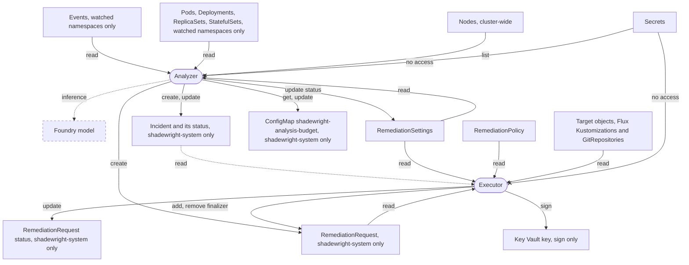

# 10. Security

This section is the security design. It states ten invariants (10.1 to 10.10), then shows what each identity can read and write (10.11). The [threat model](../threat-model.md) names the adversaries and says which invariants are built, with the code and the tests behind each. Numbers and edge cases that only matter when you build or debug are in the table "Details" at the end (10.12).

## 10.1. Least privilege RBAC (invariant 1)

**What it does.** No component has `cluster-admin`. Each reads only selected namespaces and kinds. Analysis, proposal, status and execution have separate roles.

**Why.** The analyzer's namespaces are a boundary of its identity, not only a setting. There is one RoleBinding per watched namespace.

**Limit.** An empty namespace list watches nothing. It is never read as "all namespaces" (2.2).

## 10.2. Untrusted data (invariant 2)

Events, logs, annotations, tool descriptions and Git files may carry prompt injection. They never change instructions, permissions or the action catalog.

## 10.3. Redaction (invariant 3)

**What it does.** Secrets, tokens, connection strings and personal data are removed before the model sees them. One function does it: `internal/redact`. A match becomes a marker that names its kind, and the output is never longer than the input.

**What it covers.**

- Built-in rules for common token formats, and long random tokens without a known prefix.
- JWTs, private keys, connection strings, and credentials in URLs (any userinfo).
- `Authorization` values, and Basic and Bearer values that look like credentials.
- Values of secret-named keys in env, JSON (also escaped inside a string) and YAML forms (all scalar values under a secret-named YAML key).
- Kubernetes environment variables whose name holds a secret.
- Emails and IP addresses.
- Patterns supplied by the operator.

**No access to Secrets.** Neither identity has any permission on `Secret` objects. `test/rbac` fails if any role of the analyzer names `secrets`.

**Why the answer is never "exists".** Whether a Secret or ConfigMap that a pod references is missing is inferred from what the analyzer already reads (the missing reference check, section 4). The answer is `missing` or `unknown`, never `exists`.

- Kubernetes RBAC has no metadata-only verb. `get`, `list` or `watch` on secrets returns the data, also through the metadata API (`PartialObjectMetadata`).
- So a true answer that a Secret exists would need a grant that breaks invariant 6.
- The absence of the kubelet's error is no proof either: the kubelet may not have tried yet, the Event may have expired, or the reference may be optional.

## 10.4. Bounded actions (invariant 4)

Actions are typed operations with a namespace and path scope, change limits and a per-environment policy. The model never generates commands.

## 10.5. Approval of a specific change (invariant 5)

Approval is bound to the current plan and head commit. A field set by an untrusted author never replaces an admin or reviewer decision.

## 10.6. Network (invariant 6)

**What it does.** Egress is limited by port and direction. The destinations the components need are the Kubernetes API, the model endpoint, Key Vault, GitHub and Entra ID. The analyzer also needs the in-cluster metrics source and the trace exporter (below).

### The NetworkPolicies

They live in the Shadewright namespace (`config/network-policy`, included in `config/default`).

- `default-deny` selects every pod in the namespace and denies all ingress and egress.
- `allow-analyzer-egress` and `allow-executor-egress` select one component each (by `app.kubernetes.io/component`). They allow cluster DNS (kube-dns in `kube-system`, port 53) and TCP 443 and 6443 to any address.
    - 443 is the model endpoint, Key Vault, Entra ID, GitHub and the API server of a managed cluster.
    - 6443 is the API server on kubeadm and kind.
- `allow-metrics-traffic` allows ingress to port 8443 only from namespaces labeled `metrics: enabled`. Nothing else is allowed in, and there is no webhook.
- Kubelet probes on port 8081 come from the node, which NetworkPolicy does not block.

An additional namespace-scoped policy is needed for anything else that must reach the pods, such as a Prometheus in another namespace (label it `metrics: enabled`).

### The analyzer's two extra destinations

The two egress policies do not open these by default.

- **Metrics source.** The Prometheus HTTP API on port 9090 (the lab's in-cluster Prometheus, [ADR-0017](../adr/0017-prometheus-in-the-lab.md), behind the `MetricsSource` interface).
- **Trace exporter.** OpenTelemetry (see the observability row of the stack table). When tracing is enabled it needs a rule to the collector's port, for example OTLP on 4317 or 4318. Until then it is not allowed and a call to it is dropped.

The chart has a rule for Prometheus, off by default because the analyzer does not query Prometheus yet. `networkPolicy.analyzer.prometheus.enabled` adds to `allow-analyzer-egress` (never to the executor's policy) a rule to the Pods you name in one namespace on one port.

- The Prometheus namespace must allow the analyzer in its own ingress policy. The fleet's `prometheus-server` ingress policy already expects it.
- The chart changes nothing outside its namespace.
- The kustomize manifests in `config/` have no such rule.

### The limit: ports, not destinations

A standard NetworkPolicy cannot match host names, and the API server has no label to select. So the policies limit ports and directions, not destinations. The analyzer can reach any HTTPS address at the network level, including `api.github.com`.

What keeps the analyzer away from GitHub is that its binary has no GitHub adapter and holds no GitHub credential (invariant 6), not the policy. The lab check that the analyzer cannot reach GitHub's API at the network level is therefore not possible with this policy.

The API server rule is 443 and 6443 to any address because its address is unknown when the chart renders and differs per cluster. The manifests in `config/` follow the same established pattern. The trade-off is that a pod of the component can reach any HTTPS address too.

The per-component split exists so that narrowing is possible without touching the other component. Two ways to narrow, neither shipped or tested (the chart does not claim a host name restriction):

- Replace the `0.0.0.0/0` block with `ipBlock` ranges for the API server and the model endpoint (a private endpoint has a stable address). Public GitHub and Entra ID ranges change, so this suits only private endpoints.
- Use the CNI's FQDN policy (Cilium `CiliumNetworkPolicy` `toFQDNs`, also on AKS with Azure CNI powered by Cilium; Calico `NetworkPolicy` with domain rules). Allow the model host for the analyzer, and `api.github.com`, `login.microsoftonline.com` and the Key Vault host for the executor.

### What can go wrong

- **No enforcing CNI.** NetworkPolicy needs a CNI that enforces it (kindnet in recent kind, Azure CNI with Azure Network Policy or Cilium on AKS). On one that does not, the objects are accepted and do nothing.
- **Cilium is unverified.** It treats the API server as the `kube-apiserver` entity, and the `ipBlock 0.0.0.0/0` rule on 443 and 6443 may not match it. That would cut the operator off from the API server and leader election. Checking this in the lab is [#216](https://github.com/pkalin/shadewright/issues/216). The fallback is a `CiliumNetworkPolicy` overlay with `toEntities: [kube-apiserver]`.
- **Switching off.** The chart's policies are on by default (`networkPolicy.enabled`). `false` removes the default deny too.

### The `helm test` policies

The chart's `helm test` hook adds two NetworkPolicies while the test runs. One lets only the test Pod (label `app.kubernetes.io/component: test`) send DNS and reach the metrics port of the two components. The other lets only that Pod in to that port. The metrics endpoint still refuses the test Pod without a token.

Helm deletes both after the test, also when it fails. A `helm test` that is cancelled or killed can leave them behind. Remove them with `kubectl -n <namespace> delete networkpolicy -l app.kubernetes.io/component=test`.

### How it is checked

- `test/netpol` renders `config/default` and asserts every NetworkPolicy in the build.
- `test/chart` asserts that the chart's policies equal `config/`, and that the Prometheus rule exists only for the analyzer and only when enabled.

## 10.7. Loop protection (invariant 7)

**What it does.** The design has retry limits, a global limit on concurrent fixes, cooldowns, a circuit breaker and an automation kill switch, to keep the agent from looping on a target. Only some are built (below).

**Built.**

- The kill switch: `RemediationSettings` `spec.paused`, read from the API server by one gate right before every Git write, failing closed (5.4).
- The concurrency limit, a lock per target and a circuit breaker with a cool-down (#88).

**Planned.** Retry limits and cooldowns between attempts.

### Where the limits apply

The limits hold back one step: the one that lets a request through the policy check (`Pending` to `PolicyChecked`), after which it writes to Git.

- A request already past that step is never stopped by them. The kill switch does that.
- A refusal (`Denied`, `NeedsIntervention`) at the first check is never held back.
- A request already `Queued` checks only the limits. It is decided again, and refused if the policy now says so, only once the limits let it through.

The executor lets an allowed request through only when all three hold:

- no other request that holds the lock names the same target UID;
- fewer than `maxConcurrentRemediations` are active;
- the breaker lets it through.

The limits count the requests of one namespace, the operator namespace where requests live.

### Active requests

A request is active while the executor can still move it on before the merge: a phase before `Merged` with a plan digest. It is also active while it is being deleted and still holds the finalizer that closes its pull request.

A request that ended `Denied`, `Cancelled` or `Superseded`, holds no lock and is not a probe is not read, so it is not counted.

### The target lock

The lock is per target object, not per file in Git. Two targets declared in one file can each have an active request. The plan digest and the freshness check supersede the second plan when the first one changes the file.

The executor records the lock in `status.holdsTarget` (#294, #376). It is set in the status write of the allowed decision and cleared only when the release is proven. The release is proven by one of these:

- the pull request merged (`Merged` or a later phase, or seen merged after a stop);
- the pull request closed by Shadewright or seen closed (`Superseded`, written only after the close, or `PullRequestOpened` with reason `PullRequestClosed`, `ChangeRequestClosed` or `ChangeRequestMerged`);
- a cleanup or a look-up that found none of the request's own open.

Everything else keeps the lock (fail closed):

- A request that stops with its pull request still open (`NeedsIntervention` after the head moved or a close was refused) keeps a second pull request off the target.
- So does one that stopped without a recorded pull request, since one may have opened while the status write that would record it was lost.
- An expiry whose cleanup the Git host refused ends with its own reason, `PullRequestDeadlineCleanupRefused`, and keeps the lock.
- Any other state keeps the lock: a pull request the executor could not find (`ChangeRequestGone`), `Failed` and an unknown phase included.

### Stopped holders

A stopped request that holds the lock is looked at every 10 minutes. Its pull request is found by its branch and marker (invariant 5) and recorded when the status did not have it. The lock is released once the pull request is closed or merged, so a person who closes it frees the target without deleting the request. A look-up that fails keeps the lock.

A request queued behind a stopped holder checks the limits every 10 minutes instead of every 30 seconds, and at once when the holder changes.

### Deleting a request

Deleting the request releases the lock once its finalizer is gone. The finalizer tries to close the pull request of every request that holds the lock, whatever its phase.

A close the Git host refuses leaves the request `Terminating` and the lock held, until a person fixes the permission or removes the finalizer by hand ([uninstall, step 3](../upgrade-uninstall.md#uninstall)).

### Requests from before the field existed

Such requests get `status.holdsTarget` once, from their status:

- A request that ended without a plan digest (a refusal) gets `false`.
- Any other gets the lock it may hold (fail closed).

Such a request holds no slot under `maxConcurrentRemediations`. Requests that ended before `lastPhaseTransitionTime` existed are not counted, so after an upgrade the breaker starts closed.

### The circuit breaker

**It trips** when three failures came after the latest success, among the requests that went through the policy check.

- Failures: `Failed`, `NeedsIntervention`, a rejected pull request included.
- Successes: `Merged` or a later phase (`WaitingForDelivery`, `Verifying`, `Succeeded`).
- It stays tripped until a success.

**While tripped** it is open for 30 minutes after the latest failure: nothing goes through. After that it is half-open (#295): one request goes through as the probe, and the others wait while it runs.

- The probe's success closes the breaker.
- The probe's failure is the latest failure, so the breaker is open again for a full cool-down.
- A probe that ends neither way (`Expired`, `Cancelled`, `Superseded`, `Denied`) also opens it again for a full cool-down from its end. Only a success closes it (fail closed).

**Which failures count.** Outside a probe, `Expired` is not a failure: it comes from Git host outages and deadlines, not from a bad change. `Denied`, `Cancelled` and `Superseded` are skipped too.

**The probe is marked.** The policy check sets `status.breakerProbe` on a request it lets through while the breaker is tripped, in the same status write as the allowed decision. The breaker finds the probe by that field only, so leaders with different clocks agree on it and a restart keeps it.

- A request without the field (let through before the trip, or before the field existed) is not a probe.
- A probe runs until it reaches a final phase or `Merged`, also while it is being deleted. A phase after `Merged` (`WaitingForDelivery`, `Verifying`, `Succeeded`) counts as its success.
- One that ended without `lastPhaseTransitionTime` (written by hand) is taken to have ended one cool-down after the trip. It holds the breaker open for one more cool-down at most.
- Requests let through before the trip that still run are not probes. They are not stopped, and a failure among them opens the breaker again.

**Reset by a person.** Deleting failed requests closes the breaker. Deleting the probe lets the next request through as a new one. Both are a person's decision: only someone allowed to delete requests can.

### What a held request shows

A request held back stays `Pending` and shows the condition `Queued` with one of `TargetLocked`, `ConcurrencyLimitReached`, `CircuitOpen` or `CircuitHalfOpen`. It checks only the limits every 30 seconds, so it does not read Git. Once they let it through, the whole policy check runs again.

**What can go wrong: the clock.** The time a request spends `Queued` is not paused for the wait for KEDA (section 6). Its clock is the `PolicyAllowed` condition, which `Queued` does not reset. A request that waited for its `ScaledObject` before it was queued, and finds it unreported again once the limits let it through, can reach `TargetStateTimeout` at once.

### How the state is read

Everything is read from the requests on the API server: their phase, `lastPhaseTransitionTime` (kept to the microsecond) and `status.breakerProbe`. It is read right before the decision, under one lock with the status write. So a restart or a new leader forgets nothing (an open breaker, a running probe), and two workers never take the same slot or both become the probe.

**Failing closed.** A read that fails lets nothing through. That includes an unsupported field selector, an expired continue token between pages, and a missing API server reader.

**The three lists** (#293). Each uses a field selector on a selectable field (`status.phase`, `status.holdsTarget`, `status.breakerProbe`), in pages of 100.

1. Every request whose phase is not `Denied`, `Cancelled` or `Superseded`, no phase included. The cap, the requests the executor still moves on, and the breaker's successes and failures come from this one consistent snapshot. A phase added later is read until it is classified.
2. Every request whose `status.holdsTarget` is not `false`, in any phase: every holder of the lock, a stopped one included (also one whose phase was edited to `Denied`), and requests that do not have the field yet. The executor writes `false` with every refusal, and the one-time pass above covers older requests, so only undecided requests lack it after that.
3. Every probe.

**Cost.** A request that ended `Denied`, `Cancelled` or `Superseded`, holds no lock and is not a probe is never read, so refusals do not add to the cost. The breaker still reads every success and failure (a bound on that is a follow-up). Such a request being deleted with the finalizer no longer counts against the cap: its deletion writes nothing to Git, and a `Denied` one never opened a pull request.

## 10.8. Audit (invariant 8)

The audit trail records input references, model and tool versions, the policy decision, the plan digest, the PR, the delivered revision and the outcome. Large or sensitive data stays outside the CR.

## 10.9. Verification (invariant 9)

Metrics and health are watched after the change. A failed fix leads to escalation or a reviewed revert PR, never to further unbounded experiments.

## 10.10. Excluded from the MVP (invariant 10)

These are not done by the agent: deleting PVCs, databases or namespaces, removing finalizers, widening permissions, changing network security, Secrets, protected branches or approval rules.

Emergency direct actions on the cluster could come later as a separate catalog with separate authorization. They are never an automatic fallback after a failed PR.

## 10.11. What each identity can read and write

What each identity can read and write. Arrows show where data goes: a read points at the identity, a write away from it. The roles come from kubebuilder markers in `internal/analyzer`, `internal/analyzer/collector` and `internal/controller`, the analyzer's namespaced reads are bound per watched namespace in `config/watch`, and `test/rbac` checks them against a real API server. Dashed boxes and links are designed but not built yet.

Each identity also has its own leader election Lease, which only it can renew.

## 10.12. Details

| Topic | Detail |
| --- | --- |
| Egress ports | DNS 53 to kube-dns in `kube-system`; TCP 443 and 6443 to any address |
| Metrics ingress | Port 8443, only from namespaces labeled `metrics: enabled` |
| Probe port | 8081, from the node, not blocked by NetworkPolicy |
| Prometheus port | 9090, off by default (`networkPolicy.analyzer.prometheus.enabled`) |
| Breaker threshold | Three failures after the latest success |
| Breaker open time | 30 minutes after the latest failure, then half-open with one probe |
| Stopped holder look-up | Every 10 minutes |
| Queued request limit check | Every 30 seconds; every 10 minutes behind a stopped holder; at once when the holder changes |
| List page size | 100 |
| Timestamp precision | `lastPhaseTransitionTime` kept to the microsecond |
| Probe without `lastPhaseTransitionTime` | Taken to have ended one cool-down after the trip |
| Limits scope | Requests of the operator namespace |
