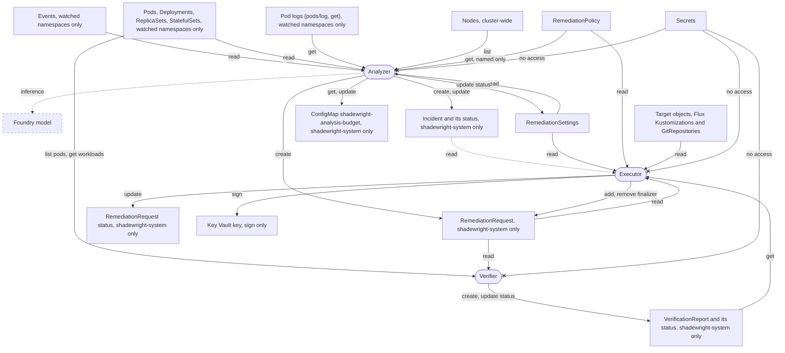

# 10. Security

This section is the security design. It states ten security rules (10.1 to 10.10; the project's invariants are the six in `AGENTS.md`), then shows what each identity can read and write (10.11). The [threat model](../threat-model.md) names the adversaries and says which invariants are built, with the code and the tests behind each. Numbers and edge cases that only matter when you build or debug are in the table "Details" at the end (10.12).

## 10.1. Least privilege RBAC

**What it does.** No component has `cluster-admin`. Each reads only selected namespaces and kinds. Analysis, proposal, status, execution and verification have separate roles. The verifier, a third component, serves its metrics on the same port as the other two (`metrics.port`, behind the same token check) and has its own metrics Service.

**Why.** The analyzer's namespaces are a boundary of its identity, not only a setting. There is one RoleBinding per watched namespace.

**Limit.** An empty namespace list watches nothing. It is never read as "all namespaces" (2.2).

**Pod logs.** The analyzer's one read of free text from workloads is `get` on `pods/log`, in the watch role, so only in the watched namespaces and never cluster-wide (`test/rbac` `TestPodLogsOnlyInWatchedNamespaces`). The pod logs source and the Prometheus source are given the same namespace list and refuse any other before a request, and so does the context builder for an Incident's subject: the boundary does not rest on RBAC alone, which Prometheus does not have (2.3). `--pod-logs=false` stops the reads; the Helm chart then also renders the role without the grant (`analyzer.podLogs.enabled=false`), while `config/` always keeps it.

## 10.2. Untrusted data

Events, logs, annotations, tool descriptions and Git files may carry prompt injection. They never change instructions, permissions or the action catalog.

## 10.3. Redaction

**What it does.** Secrets, tokens, connection strings and personal data are removed before the model sees them. One function does it: `internal/redact`. A match becomes a marker that names its kind, and the output is never longer than the input.

**What it covers.**

- Built-in rules for common token formats (current-format Microsoft Entra client secrets among them, matched whole although they hold `~` and `.`, also glued to each other or with `~` percent-encoded; one cut to 36 characters or fewer is not matched), and long random tokens without a known prefix.
- JWTs, private keys, connection strings, and credentials in URLs (any userinfo).
- `Authorization` values, and Basic and Bearer values that look like credentials.
- Values of secret-named keys in env, JSON (also escaped inside a string) and YAML forms (all scalar values under a secret-named YAML key, and, after a block scalar indicator, wherever the key stands on its line: after other text (`msg: password: |` and the indented lines below), inside a JSON or logfmt string value, with no blank or a Unicode space at the colon, after a `---` line, with the block less indented than the key's line, and with the block flattened onto the key's line before the text reached the redactor ([#840](https://github.com/pkalin/shadewright/issues/840)), and of secret-named command-line flags (`--client-secret <value>`, `--sas <value>`, also with one dash and two or more letters as Go programs take them: `-password <value>`): in an argument list (JSON, also pretty-printed or escaped inside a string, a YAML list as `kubectl get -o yaml` prints container args, or a YAML flow sequence of quoted or plain items), on the next line, after a shell line continuation, glued to `=`, `.`, `/` or `_` (`EXTRA_ARGS=--client-secret <value>`), and when an earlier flag took the flag as its own value (`--enable-auth --client-secret <value>`). The value after such a flag goes whatever it reads as or starts with (`--password --Hunter2pw`). A key name of two or more words also counts before a blank, joined by `_`, by `-` or in camelCase (`aws configure set aws_secret_access_key <value>`, `client-secret <value>`, `ClientSecret <value>`, `secret_id <value>`, `SECRET_KEY_BASE <value>`), with the same name rules as the other forms (`password_stdin <value>` counts: `stdin` marks a reference for a flag only), but this form exists for an opaque key after a key name: it redacts the value only when the whole value is 16 or more characters, every character is from `A-Z a-z 0-9 / + = _ -`, and it has at least one digit or one of `/ + =`. Nothing else is scored. So `db_password not set`, `api_key missing`, `client_secret is missing`, `ClientSecretCredential AuthenticationFailed`, `DB_PASSWORD CredentialUnavailableError 12345`, `secret-volume (ro)` and the rows of `kubectl get secrets` (`db-password   Opaque`, `db-password   kubernetes.io/basic-auth   2`) stay. After a name joined by `-` or in camelCase a value that reads as a flag stays (`kubectl describe secret db-password -n prod`), and in this form a name ending in `volume` names a volume (`volumes=[secret-volume kube-api-access-x]` stays). After a flag or such a name, three rules decide what the value is. Its extent: a value that opens with a quote, plain or a double quote escaped as JSON inside a string, runs to its closing quote on the same line, or past a backslash directly before the line end inside double quotes (one whose quote does not close is the quote and the token after it, and so is a value after `\'`); an unquoted value ends at whitespace, the line end, or a quote character (`"`, `'`, or a backslash-escaped quote), and not at `,`, `]` or `}`, so a key inside a JSON or logfmt string cannot take the fields after it (`{"message":"ClientSecretCredential AuthenticationFailed","reason":"FailedMount"}` keeps `reason`), while a comma, bracket or brace of the text around a value may go with it (`--password abc, --x` loses `abc,`). The separator between a flag and its value: whitespace including real line ends (`\n`, `\r\n` or `\r`), vertical tab and form feed, a backslash directly followed by a real line end (shell continuation), a YAML list dash only at the start of a line after indentation, a comma only directly after the flag name or its closing quote (JSON and YAML flow lists, `[--client-secret, <value>]`), and that quote, plain or backslash-escaped; nothing else, so literal `\n`, `\r` and `\t` pairs, a comma after whitespace and a bare `-` are the start of the value (`--password , --region west` loses `,` and keeps `--region west`). Overlap: a match that starts inside a value already taken is skipped, whether or not that value was redacted, except a secret-named flag, which is judged on its own (its value is redacted when it runs past the end of the one already taken) (`client_secret db_password --region west` does not read `db_password` as a key name; `client_secret --password <value>` loses `<value>`). A value never starts at the closing quote of an argument that holds the flag (`["--password ", "--region"]` stays). A Vault AppRole secret ID (`--secret-id`, `secret_id`, `secretId`) and any name holding the word `secret` and ending in `id` (`client_secret_key_id`) are secrets, not references. The short key `sas` (an Azure shared access signature) counts as `sas=<value>`, `sas: <value>` (a blank after the colon) or a quoted key, at the end of a longer key after `_`, `.` or `-` (`AZURE_STORAGE_SAS`, `--source-sas`) or in camelCase (`storageSas`, `StorageSas`), and never right after `/`, so an image named `sas` keeps its tag and `kansas` or `sasl` never count.
- Base64 secrets that slashes cut into short parts, such as an AWS secret access key in a path, judged by how the parts read (#525).
- Kubernetes environment variables whose name holds a secret.
- Emails and IP addresses.
- Patterns supplied by the operator.

**Known limits.** The key name is the stronger signal ([#585](https://github.com/pkalin/shadewright/issues/585)). With no secret key name in front, a slash-split base64 key can still leak whole or in part: a key whose parts all read as words, a key made of upper-case parts, or a short part at its start or end that reads as a path word. So can a value after a secret key and blanks alone, with no colon, `=` or arrow (`password reset failed` reads as prose, so `userPassword <value>` keeps its value), a value after a separator that holds more than 16 marks, controls or invisible characters (blanks around them do not count, so a column-aligned `password::` with fifteen spaces after it keeps no value), a value after a key and a separator of `|`, `~`, `>`, `-` or a dash used as one (`password | <value>`), a value after a key, a line break and then the separator, a value after a one-word key name and a blank without a dash (`set secret <value>`), because `kubectl get secret <name>` and `kubectl create token <sa>` have the same shape, a value after a single-letter flag (`-p <value>`), a key or flag name written with Unicode escapes (`"\u0070assword"`), and a secret in a here-document or here-string (`--password-stdin <<EOF`, `<<< "<value>"`). After a lone CR the next line goes with the value (`password: <value>\rnext: x` loses `next: x`), since a lone CR does not end the line of a value on one line. The string after a secret flag is its value whatever it looks like, in a text and in a sequence of strings (`["--token", "--verbose"]` hides `--verbose`, as main's second pass over a tool's whole answer did). A read tool's result is decided as one text ([section 4](4-tools.md)); where main read a JSON object or list after a secret-named field (`secret`, `imagePullSecrets`, `serviceAccountToken`), every value in that collection is hidden whole as on main (`redact.SecretCollection`), so the reference names and paths under such a field (a Secret volume's `secretName` and item paths, an image pull secret's name, a projected token's path) stay hidden. Whether those names should be shown, since a diagnosis can use them, is decided in [#860](https://github.com/pkalin/shadewright/issues/860). Where the object gives the key and the extent of a value, the rule uses them (fifth decision of 2026-11-18): a value is one value whatever it holds, so a value under a map key, a field name or a label name that is a secret key is hidden whole (`{password: "line1\nS"}` in a CSI volume's `volumeAttributes`, `{auth: mint}`); nothing beyond that value is hidden, so a block or a flow collection the value opens (`|\n  block`, `{S`) takes no later entry of the map; a value that a key outside it takes (an HTTP header's `value` after a `name` such as `X-Api-Key`, a selector's `values` after a `key` that is a secret key) is hidden from its first character that is no blank to its end; two keys of a map that redact alike stay two entries (the later gets ` (2)`, ` (3)`). How a tool result is decided, and what is hidden of a key found inside a value, is under **Tool results** below. Hiding too much is the accepted cost in three places: after a key word, the text behind `->`, `=>` or `==` is hidden (`token => refreshed`); a list of URLs in angle brackets before a link with an `@` (`<https://example.com>,<mailto:ops@example.com>`) is redacted whole up to the `@`, as on main (sixth decision of 2026-11-18, point 4: nothing main hides is shown, with no exceptions; showing the first link is [#860](https://github.com/pkalin/shadewright/issues/860)); and a secret key that stands as the value of another secret key (`auth: password: <value>`) loses its own name with the value. Key names and separators outside these classes cannot be listed to the end by review; finding such values by the shape of the value is [#859](https://github.com/pkalin/shadewright/issues/859). After a key name, one bounded extent rule finds where the value ends ([#708](https://github.com/pkalin/shadewright/issues/708)), with no parser per format. A value that opens a quote, `[`, `{`, `$(` or a backtick runs to the end of that group, over line ends, with nested groups and quoted strings inside read as such, also escaped as JSON inside a string (`{"password": ["a", "b"]}`, `--password "a\nb"`, `--password "$(vault read "x y")"`, ``--password "`cat x`"``). Inside `$(` or backticks, brackets and braces are plain text, as in a shell (`$(printf a[b)`). After a key name (not a flag), a quoted string crosses a line end only to a line that is blank or indented deeper than the key, as a YAML scalar does; at any other line it does not close, so `apiKey: "abc` keeps the fields on the lines after it. A quote after a flag spans lines as in a shell, and one that does not close within the bound takes the rest of its line up to the next flag (`--password "a b c` at the end of a log). In free text and after a flag, pieces glued to it go too (`--client-secret="a"'<value>'`, `"a"\ b`), and so do closing brackets with more of the word after them (`$(cat pw)}<value>`); a plain word with a `$(`, a backtick or an escaped blank glued to it goes whole (`abc$(cat pw)`, `a\ b`), and after a flag a comma glued to a group goes as well (`$(echo),<value>`). Shell syntax (`$(`, backticks, backslash escapes, glued words) applies only where the value is a shell word: in free text and after a flag on a command line. Inside a JSON or YAML quoted string, an array, an object, or an item of an argument list or sequence, the text is literal and a quoted string ends at its closing quote (`["--password", "$(", "x"]` keeps `"x"`); a value read from inside a quoted string whose key opens right after its quote never crosses that string's closing quote, and an unclosed `$(`, backtick or bracket inside it ends at the string's end (`["--client-secret=$(echo", "x)", "--region"]` keeps `"x)"` and `"--region"`), and an apostrophe inside a plain scalar opens no string (`[horse'battery, staple]` is one array); a quote opens a string only at the start of a scalar. Inside `$(`, `\)` does not close it. The value is the union of the value the redactor gave before #708 and the extent, computed first and widened, so it is never shorter than before. `:=` is a separator like `=` (`password := "a b"`). After a flag that is an item of a YAML flow sequence, a plain value runs to the end of its item, also over lines indented deeper than the line it starts on (`[--client-secret, a b c]`). After a flag item of a block sequence, a block scalar takes its indented lines, also after an anchor or tag (`- &pw |-`), and an anchor or tag takes the rest of the item (`- &pw a b c`, `- !!str a b c`). When the flag is itself an item of a block sequence and its value the next item at the same column, a plain value takes the rest of its line ([#769](https://github.com/pkalin/shadewright/issues/769): `- --client-secret` then `- a b c`); a flag that is no item keeps the narrower value (`--password` then `  - a b` loses only `a`). Inside an array or object, a quote after a YAML anchor or tag opens a string (`[!!str "a]b", c]`). In a shell word, a quote glued to plain text opens a piece of the same word when the byte after the quote is no blank, quote, backslash or one of `, ; : ) ] }` and the piece closes on its line (`--password ab"c d"`); otherwise the quote may close an enclosing JSON or logfmt string, and the value ends before it. After a flag, a backslash and a punctuation character glued to a quoted piece go on with the word (`--client-secret "a"\!b`). After a key name (not a flag), a comma glued to a quoted piece goes on with the word unless a blank, a quote, a field (`name=value`, `name:`) or a secret key name with blanks, `=` or `:` after it follows it (`TOKEN="abc",<value>`; `password="abc",user=bob` keeps `user=bob`; `password="abc",DB_PASSWORD= "a b"` redacts both values). `--name=value` at the start of a quoted argument runs to the argument's closing quote, other quotes inside it included (`["--client-secret=a b c"]`, `["--password='a b' c"]`), also when the value opens with a backslash (`["--client-secret=\\a b c"]`), and JSON comments before a value go with it; a comment that does not end within the bound does not. The rule reads at most 4 KiB past the start of a value and nests groups at most 32 deep, so each value costs constant time and the rules stay linear in the input. A group that does not close within that bound, or meets a closer that does not match, keeps the value it had before (one token, or its format's boundary), so a stray quote or bracket does not take the text after it. Still open: the part of a value past the 4 KiB bound (kept by decision in #769: any bound leaves a part past it, and without one a value costs time in proportion to the rest of the input, so the rules would no longer be linear; a 4 KiB value under a secret key is rare outside a private key, which its own rule takes whole), a quoted piece glued to an unquoted value that does not close on its line (`--password ab"c` then `<value>"` on the next line), a backslash and a letter or digit glued to a quoted piece after a flag (`--client-secret "a"\x<value>`: `\n` after a quoted piece is a JSON escape in a log line), and after a key name (not a flag) a field after a comma glued to a quoted piece (`TOKEN="abc",x=<value>`). A value after a compound key name and a blank that is no opaque token stays as well: shorter than 16 characters, with a character outside the set, or with no digit and none of `/ + =`, which covers most passwords (`DB_PASSWORD changeme`, `client_secret hunter2`, `ClientSecret "Password!"`, `aws_secret_access_key abc,<key>`). So does the part of an unquoted value after a quote inside it (`--password ab'<value>`), the words after the first in a value quoted with `\'` (`--password \'a b c\'` loses only `\'a`), the words after the first of a block sequence item after a quoted flag item (`- "--password"` then `- a b c` loses only `a`) or of an item after a flag item that opens with a backslash or `$(` (`- \a b c`, `- $(a b c)`), a quoted scalar after a verbatim tag in an array, which ends at its first `]` (`[!<tag:yaml.org,2002:str> "a]<value>", b]`), and the value of a key that follows a quoted value which never closed (`token="x DB_PASSWORD="a b"` keeps `b`: the first value runs to the second one's opening quote). A key after other text on its line reads a block below only after a block indicator: `msg: credentials:` with a map on the following lines keeps the map, since no YAML has a key there and reading the lines below took prose for a block (decided 2026-11-17, #840). Under a bare short key a scalar over several lines counts by its first line only (`auth: <word>` and a `<value>` on the next line keeps the `<value>`), as before #840. These are checked by `TestKeyNameKnownLeaks`, which fails when one is closed. For a secret key and a block scalar indicator after other text on its line (#840), the block below takes every line indented deeper than the line's own text, which is more than YAML would give the key; with no such line, the lines from the next one indented less than the key's line (but not at column 0) go, and one `---` or `...` line right after the header is skipped. Where text follows the indicator, a block was flattened onto the line and its end cannot be told, so the rest of the line goes (up to the end of the string when the key stands in a quoted string), with any block below; a bare short key counts it only when a word looks like a secret. Nothing else reads the rest of a line: two blanks after a value, a deeper line after prose and a value followed by more text keep their text (decided 2026-11-17). A key inside a JSON object or YAML flow collection that closes on the line, outside a quoted string, is left to the flow rules, unless text follows its block indicator (`msg: [password: | x]`): then the text up to the bracket that closes the innermost collection goes; a bracket that never closes opens nothing. Any number of `---` or `...` lines between a header and its block are skipped. Redaction is the first step on text as it was read, before a character is replaced, a line joined or a value cut, and once (#840; since #845 the rewritten text is no longer redacted again, see below): `fingerprint.Normalize`, `Symptom` and `Value` (and `modules.BoundValue`, which uses it) redact the note before sanitizing it (which turns `>` into `)` and `[` into `(`) and write each match's placeholder at once, so only the text between matches is sanitized and the input still cannot forge a placeholder; `incidentcontext.Value` and `Redact` (and the read tools, which use them) redact before invalid UTF-8 is replaced and before line breaks become blanks; the summary fit and each section's cut work on redacted text; and the log excerpt (`kube.Excerpt`) redacts the read before its cut drops older lines and before invalid UTF-8 is replaced, so a block or a PEM key whose first line the cut drops is still redacted in the lines kept, by the marker of the part kept. Every input of both generated corpora goes through each of these entry points (`TestBlockCorporaThroughEveryEntryPoint`): at the second build of #840 the fingerprint's entry points leaked 3,295 of 12,957 inputs (the folded `>` forms) and the log excerpt 7,405 (cuts that drop the key's line), none now (`TestSymptomIsRedactedBeforeItIsFlattened`, `TestSymptomIsRedactedBeforeAnyCharacterIsReplaced`, `TestValueIsRedactedBeforeItIsFlattened`, `TestSummaryCutAcrossAFlattenedBlock`, `TestExcerptRedactsBeforeTheCut`, `TestFlowAndMarkerFormsRedactEverySecret`). Over-redaction kept by decision: the block below a secret key and a block indicator after other text (every line deeper than the key's line, or the less indented ones when there is none) and the rest of the line after such an indicator followed by text (`password: > 8 characters` loses `8 characters`), and the opaque token after a flag's value that is itself a compound key name (`--password,client_secret <token>`: the two forms read the text independently), the next line of a double-quoted value that ends its line with a backslash, the lines between a quote after a key name and a quote that closes it on a later line within the bound (a truncated line loses the start of the next one up to its first quote), the anchor or tag before a value, a comment after a plain block sequence item that a flag item's value takes (`- a b # rotated`), the text glued after a quoted piece that is glued to a plain value (`--password ab"cd"ef` loses `ef` too), the word after a comma glued to a quoted piece after a key name when it is no field (`TOKEN="abc",later`), a key name or flag in the middle of a quoted string (not right after its opening quote), whose value is read without that string's closing quote as a bound and so can run past it (`{"msg":"run --password $(a","x":"b)"}` loses `","x":"b)`), the word after a boolean secret-named flag (`--enable-token true`, `gh auth login --with-token foo`, `--use-token --verbose` loses `--verbose`), also in prose (`"--password flag is deprecated"` loses `flag`), a comma, bracket or brace of the surrounding text glued to a value after a flag or a compound name, and values that name rather than hold a secret after a flag whose name ends in no reference suffix (`--secret db-creds`, `--private-key /etc/ssl/key.pem`). Flags whose names end in a reference suffix (`file`, `path`, `name`, `ref`, `url`, `type`, `count`, `ttl` and the rest of `referenceSuffixes` in the package) keep their value, and so do flags followed by a blank whose names end in `stdin` or `audience` (`--password-stdin -u bob`, `--token-audience api`); as a key of any other form (`PASSWORD_STDIN=<value>`, `CLIENT_SECRET_FOR_AUDIENCE=<value>`, `--password-stdin=<value>`) such a name holds a secret. Two differential tests compare with the redactor before #585: everything it removed, in every key-name form and with every reference suffix, is still removed (`TestStillRedactsWhatMainRedactedForKeyNames`), and on the realistic log, event, `kubectl` and `curl` lines of a table nothing it kept is removed, except values this change is meant to redact (`TestKeepsWhatMainKept`). For #708, a generated corpus of 4,000 inputs (key names and flags in each form, values of random quotes, brackets, substitutions, commas, escapes and line ends) checks that every byte the redactor before #708 removed is still removed (`TestExtentStillRedactsWhatMainRedacted`), and a second one of 4,000 values whose extent is known by construction (shell words, JSON strings with shell syntax inside, quoted arguments, YAML flow sequences) checks that no byte of the value stays and the token after it does (`TestExtentTakesTheKnownValue`), and a third one of 3,000 JSON, YAML and escaped JSON argument lists with unclosed shell syntax in a secret argument checks that the items after it survive byte for byte (`TestExtentKeepsTheArgumentsAfterAQuotedSecret`). For #769, a corpus of 3,000 inputs in the contexts it changed checks against the redactor before it that every byte it removed is still removed (`TestBlanksStillRedactsWhatMainRedacted`), one of 3,000 values of the classes it closed, whose extent is known by construction, checks that no byte of the value stays and the token after it does (`TestBlanksTakeTheKnownValue`), one of 1,200 JSON, logfmt and comma-separated lines checks that the field after a one-token value stays (`TestBlanksKeepTheFieldsAfterTheValue`), and one of 3,000 pairs of key=value fields joined by a comma, with blanks, quotes and secret-named or plain second keys, checks against the redactor before #769 that every byte it removed is still removed (`TestCommaFieldsStillRedactWhatMainRedacted`). The extents #769 widens never hide a later key: a key-value rule skips the keys inside a value only up to where the redactor before #769 ends that value, so a key in the part #769 adds is matched and its own value redacted (`TOKEN=ab"cd DB_PASSWORD= "<value>"`). A copy of that redactor (`internal/redact/testdata/mainredact`) is the oracle of a corpus of 12,000 lines of two or three key/value fields, whose later keys are secret-named, with every separator, quote, flag form, glue, YAML tag and anchor the rules read (`TestMonotonicAgainstMain`), and of a fuzz target (`FuzzMonotonicAgainstMain`): every input byte it removes must still be removed. A table written from main fails once its corpus generator no longer gives the inputs it holds. That holds for the tables, the corpus and the fuzzed inputs, not as a guarantee for every input. For #840, a generated corpus of 12,320 block values under secret keys (every block scalar indicator, values on the following lines as a scalar, a list, a nested map or a list of block scalars, quoted scalars over lines and plain continuation lines, with spaces or tabs, LF or CRLF, the key at the start of the input, after a line of prose, after other text on its line and with every line break flattened, then the end of the input, a dedented key, prose or a second secret key glued on with each separator and quote) places each secret at a known offset and checks that it goes and the text around it stays (`TestBlockValueCorpusRedactsEverySecret`; 7,546 of them leaked before #840). Since the decision of 2026-11-17 a value after a block indicator must go wherever its key stands, flattened or not; any other value only under a key first on its line, and flattened text is checked as the callers make it: redacted with its lines, flattened, redacted again. A second generated corpus of 3,152 inputs covers the forms that decision named (a key inside a JSON or logfmt string, after a bracket that never closes, `password:|`, a block less indented than the key's line, `---` after the header, a no-break or other Unicode space at the colon, one blank before a flattened value, the head of a value before a cut note, and a block indicator inside the block of a bare short key that refuses its value): 1,900 of them leaked at the first build of #840 and 2,736 before #840, none now (`TestBlockFormsCorpusRedactsEverySecret`). 57 ordinary Kubernetes messages (Events, kubelet and container runtime errors, logfmt and JSON log lines, tracebacks), each in five layouts, come out byte for byte as before #840 (`TestOrdinaryMessagesRedactAsOnMain`; the first build changed 35 of the 285). The same blocks under innocent keys stay byte for byte (`TestBlockValueCorpusKeepsInnocentBlocks`), every byte the redactor before #840 removed in both corpora is still removed (`TestBlockValueStillRedactsWhatMainRedacted`, `TestBlockFormsStillRedactWhatMainRedacted`), the fingerprint and the symptom of every string of the recorded scenarios and of every redaction sample are what they were before #840 (`TestRecordedFingerprintsAreUnchanged`, 709 notes, so no fingerprint changes on upgrade), and the bytes the rule reads on hostile inputs (many keys on one long line, refused bare keys, keys in strings and flow collections, deepening and shallowing indentation) are counted, not timed, and stay within a fixed multiple of the input (`TestAnyKeyWorkIsLinear`); the count exists only in a test build with the tag `redactwork`, which `make test` runs for `internal/redact` and the log source, so the product build holds no counter. The user info of a URL may hold `<` and `>` (`postgres://app:Hunter<2Secret@db/x`; #840, decided 2026-11-17): the rule stopped at a raw bracket, and `get_resource` matched only while its JSON encoder escaped it, which it no longer does; events and logs were never escaped. The host part still ends at `<` and `>`, so the bracket of markup around a URL stays (`<postgres://u:p@h/x>`). A table written from main (`testdata/connstring-main.jsonl`, 4,000 connection strings whose user, password and host hold `< > & " '` and their JSON, HTML, percent and backslash escapes) checks through every entry point, the read tools included, that no secret part main kept out of an output comes out (`TestConnStringsThroughEveryEntryPointAgainstMain`; before the change 3,917 outputs did), and 10,140 texts whose answer is known by construction (brackets at the start, the end, doubled, with a closing quote, markup and a second secret right after) come out as the text before the URL, one marker and the text after it (`TestConnStringByConstruction`). A host holding `<` or `>` (no valid host name does) still loses only the part before the bracket; main redacted the rest only in `get_resource`, through the escape. Since [#845](https://github.com/pkalin/shadewright/issues/845) (decided 2026-11-17) the block rules also read one canonical view of the text, decided once: every Unicode space, control and format character (no-break and other spaces, zero-width characters and joiners, NUL) and every byte that is not valid UTF-8 counts as indentation, LF, CRLF and a lone CR end a line (NEL, LS and PS count as indentation, so a value is not lifted out of its block), and nothing is replaced, escaped or cut to make the view: the rules compute spans of the original bytes, and the spans of every rule are merged and replaced once, so no rule reads another's output and no pass comes first. The rules of #840 and before are kept as they were and the view only adds spans, so nothing they removed comes back. On the view each secret key of a line with a block indicator gets the block below (`pass: | token: |`, also when a bare short key refuses its value and the next key on the line claims the block), a flow value runs to the bracket that closes its collection after any brackets inside the secret (`[password: > a]b[c]`), the key names of other secret keys inside a value the view takes stay visible, as every key-value rule shows key names, and an environment entry whose value comes before its name goes, in flow form (`{value: <value>, name: PASSWORD}`) and in block form (`- value: <value>` with `name: PASSWORD` among the entry's keys below it). A comment line at column 0 between the lines of a block is read like a blank line: the block goes on after it, and the comment stays. The rules also read a folded view of the text, made only where it differs: a run of invisible characters after a character of a key name is dropped when another key character, a colon, `=`, a quote, a colon look-alike or the end of the line follows it (`pass<U+200B>word: <value>`, `api_key<U+200B>: <value>`, `pass<U+3164>word: <value>`); the invisible characters are a class, every code point Unicode 18.0.0 marks `Default_Ignorable_Code_Point` or puts in category Cf (the zero-width space and joiners, word joiner, byte order mark, soft hyphen, combining grapheme joiner, Hangul fillers and variation selectors among them; `TestInvisibleIsDefaultIgnorableOrFormat` checks the table against an extract of `DerivedCoreProperties.txt` and `DerivedGeneralCategory.txt`), and invisible characters right after a redacted range go with it (`pass<U+200B>word: <value><U+200B>`), every character that Unicode's confusables list (`confusables.txt` version 18.0.0) maps to one colon or two reads as `:` (35 characters: the fullwidth colon of CJK text, U+02D0, U+0589, U+05C3, U+0703, U+1361, U+2236, U+2E2C and the Indic visargas among them; `TestFoldColonsAreTheConfusablesOfColon` checks the table against an extract of the list), an explicit YAML key (`? password` with `:` at the same column on the next line) reads as `password:`, also when the key stands alone on the line below `?` or below a block scalar header (`? |`, then `password` indented, then `: <value>` at the column of the `?`), and the separator after a secret key is a class too: a run of blanks of any length and at most 16 controls, invisible characters, colons (or look-alikes), equals signs (or look-alikes: every character the confusables list of Unicode 18.0.0 maps to `=`, the fullwidth `＝` among them) and arrows (`->`, `=>`, and `→` and `⇒` with what the same list maps to them, folded to `->` and `=>`), with at least one colon, `=` or arrow in it, reads as `: ` (`userPassword:: <base64>` of LDIF, `password => <value>`, `token ::= <value>`, `password<U+200B> : <value>`, `"token"<U+200B>: "<value>"`, `password<NUL>: <value>`, `password::` and fifteen spaces before the value), while one `:`, `=` or `:=` between spaces and tabs stays as the rules always read it, except an `=` after a quoted key (`"password" = "<value>"`, which no rule read, on main either); a secret key and its separator right after the separator of another secret key start a line of their own in the folded view (`auth: password: <value>`, `token = apiKey -> <value>`), so the first key does not take the second as its value; each match on the folded view counts on the original bytes it was folded from, so the characters folded away inside it go with it. A sequence of strings is decided as a whole, by one function for a list of strings (`redact.Strings`, and `redact.Pieces` over the values of a tool's answer in their order, a container's command and arguments among them) and for a sequence written in a text (JSON, YAML flow and block sequences, plain or escaped): a string is a value when the non-blank string before it ends with a secret key and a colon, a block indicator or `=`, or with a secret-named flag, also after other words (`["app --password", "<value>"]`) or before a line break inside the string (`["--password\n", "<value>"]`); blank strings between them are skipped (`["--password", "", "<value>"]`), the colon or `=` may stand in a string of its own (`["password", ":", "<value>"]`), and after a key and a colon the indented strings that follow its value are the lines of its block. Since the fourth round Strings has no matcher of its own: it takes the decision String takes on the strings joined by line breaks and maps it back to each string, adds what String redacts in each string alone, and the sequence function above on top, which reads each string in its folded view and takes a separator of the class in a string of its own (`["password", "::", "<value>"]`), a separator or an env entry's `value:` at the start of the string after a key (`["? password", ": <value>"]`, `["- name: DB_PASSWORD", "  value: <value>"]`), a quoted key (`["'password':", "  <value>"]`) and a flag glued to text in front of it (`["--args=--client-secret", "<value>"]`, `[":--password", "<value>"]`). Whatever String hides in the strings joined by a line break, or written as a sequence in any of the corpus's renderings, Strings hides in the strings apart (`TestStringsDecidesAsTheJoinedText`, 20,000 generated sequences, whose parts hold such keys since the third round; at the first build of this rule 2,913 secrets failed it, at the second 10,335 in 1,336 sequences, all through a key the strings did not fold; since the fourth round its parts are drawn from the classes of separators and invisible characters and from the forms split over strings, and at the third build 1,232 secrets in 215 sequences failed it). Joined by a blank, String reads `password: a b c` as a value to the line's end, which a list of arguments does not mean, so that join is not the measure. `query_metrics` redacts each label of a series as its name with `=` and its value, a sequence of two strings, so a secret label name takes its value (`{password=<value>, api_token=<value>}`): the first build of #845 redacted the name and the value apart, after the second pass over the whole answer was removed, and showed both values (`TestQueryMetricsRedactsALabelWithItsName`). Every tool of the registry that shows text from a source is an entry point of the corpus, and a test fails for one that is not (`TestEveryToolIsAnEntryPoint`; `read_git_file` and `get_recent_changes` are never offered and answer "not available"). Callers redact once, as the text was read, and never redact what they made of it: `incidentcontext.Redact` and `Value` no longer redact the text again after invalid UTF-8 is replaced, the log excerpt (`kube.Excerpt`) is not redacted again after its cut, and the read tools no longer redact the assembled answer again before cutting it (each value, the log header and the excerpt were redacted as they were read; a tool result is decided once on the text it returns, a value under a secret key the object gives (a map key, a field name, a metric label's name) hidden whole, which that pass had covered). Two second looks remain, each on text that only lost characters: the context builder and the log tool redact a log source's excerpt at their boundary, because a source behind the `LogSource` interface may not redact (the built-in one does), and the fingerprint's `finish` redacts the normalized symptom until it no longer changes, which keeps the 709 recorded fingerprints and the guarantee that a stored symptom holds nothing a later read would redact (`TestRecordedFingerprintsAreUnchanged`, `TestNormalizeRedacts`; removing it changed two of them, `credentials:` and `password: |` with a value below, whose placeholder merges only on the flattened line). A list of URLs in angle brackets before an address (`<https://example.com>,<mailto:ops@example.com>`) is one URL with user info up to the `@`, as main read it, and is redacted whole; a tag inside the user info (`http://host:8080<b>user@example.com</b>`) cannot be told from a password such as `Hun<ter>2Sec<ret` and stays redacted, a known over-redaction (`TestConnStringWiderUserInfoKeepsItsNeighbours`). A generated corpus of 14,310 inputs of these forms (written before the rule; 1,073 of them in its second round, 1,122 in its third, 2,422 in its fourth, 1,578 in its fifth), with line feeds, CRLF and lone carriage returns, block headers with indentation indicators and comments, `--flag=<value>` and `["--password=", "<value>"]`, a block in a log whose key line a cut of the log excerpt drops, the forms combined and next to a second secret key, a key and its value split over more strings, a key with a format character or a colon look-alike, an explicit key, the folded forms as strings of a sequence, a format character before a key's colon, every other colon look-alike of the confusables list, a key written as a block scalar below `? |`, a comment at column 0 inside a block, an environment entry in block form with its value first, the labels of a metric series, a secret key followed by a separator run drawn from its class (blanks, controls, invisible characters, colons and their look-alikes, `=`, arrows) and by the value after a blank, glued, quoted, in JSON and in a list entry, an invisible character of each range of its class inside a key or next to its colon, a URL with a user and password in angle brackets before a second link, and a key, separator and value over three strings, places each piece of secret and each piece of text that must stay (keys, flags such as `--port=8080`, words around the value) at a known offset, and runs through String and every entry point, the read tools included (`TestCanonCorpusThroughString`, `TestCanonCorpusThroughEveryEntryPoint`). At an entry point a piece counts as leaked when its first or last 8 bytes are in the output, and a kept piece as lost when the output, as written or escaped as JSON, holds it fewer times than the input; kept text is not checked where the entry point replaces variable parts by design (the fingerprint, `modules.BoundValue`). What leaks now is listed piece by piece in `testdata/canonical-leaks-string.tsv` and `testdata/canonical-leaks-entry.tsv`, so a new leak fails, a listed one that stops leaking fails, and a row that names no piece of the corpus fails; tables written from main check that no byte main removed is kept and no piece leaks at an entry point where main hid it (`TestCanonCorpusStillRedactsWhatMainRedacted`, `TestCanonEntryPointsLeakNothingMainHid`), and the work String takes on each form is counted (`TestCanonCorpusWorkIsLinear`). Before #845 4,926 secret pieces leaked through String and up to 4,753 at an entry point; none now, and every expected-leak table lists kept text only: 4,438 pieces through String as before, and at each entry point no more than before (get_resource 4,821, was 14,683; `get_pod_logs` 5,417, was 5,526; `list_events` 4,821, was 11,441; `incidentcontext.Value` and `kube.Excerpt` 4,821, were 4,893; container arguments 186, were 249). The second round's forms leaked on the first build of #845 too (secret pieces through String: split sequences 549, format characters and colon look-alikes 267, explicit keys 40, comments in a block 44, environment entries with the value first 36; the metric labels 48 at `query_metrics`, and 472 pieces at entry points where main hid them, the labels among them); all but the labels leaked on main as well. None leaks now. On the inputs of the first round the kept-text counts are unchanged at every entry point; on the second round's inputs String loses 76 more pieces of kept text than the first build, all in one known over-redaction it inherits: a lone carriage return does not end the line of a value on one line (`password: <value>\rnext: x` loses `next: x`), now also after a key with a format character or a colon look-alike, and after an explicit key. The third round's forms leaked on the second build (secret pieces through String: format characters and colon look-alikes 840, keys written below `?` 42; through `get_resource` as a container's arguments 587); all of them on main as well. None leaks now. On the third round's inputs String loses 162 pieces of kept text, 5 at the second build: 156 through the same lone carriage return, and 6 in one argument list escaped inside a JSON string (`\"password=\", \"<value>\", \"--port=8080\"` loses what follows the value), each exactly what the same text loses with a plain key and colon; on the inputs of the earlier rounds no count changed at any entry point. The fourth round's forms leaked on the third build (secret pieces through String: separators of other characters 518, invisible characters in or next to a key 968, user info in angle brackets 128, keys and values over three strings 72, and through `get_resource` as a container's arguments 90; and 1,132 pieces at entry points where main hid them, the angle brackets among them, which main redacted whole). Through String main leaks more of these forms (separators 774 pieces, invisible characters 1,300, sequences 96) and hides only the angle brackets. None leaks now, at String or at any entry point. On the fourth round's inputs String loses 682 pieces of kept text, every one of them the line after a value that a lone carriage return ends (`userPassword:: <value>\rnext: x` loses `next: x`), the over-redaction a plain key and colon has; on the inputs of the earlier rounds no count changed at String or at any entry point, and the 709 recorded fingerprints are unchanged. The fifth round (second decision of 2026-11-18) adds 1,578 inputs, drawn from classes: a separator with blanks of any length around its marks (1,068), a secret key with a separator as the value of another key (360), the look-alikes of `=` and the arrow characters (60), and URLs in angle brackets whose password is digits, letters or punctuation (90). On the fourth build String leaked 948 secret pieces of them (blanks around the separator 798, a key as a value 60, the look-alikes 60, all-digit passwords 30, which main redacted), and the entry points 255 pieces where main hid them. None leaks now. On the new inputs String loses 894 pieces of kept text: 784 the line after a value that a lone CR ends, 110 the name of a secret key that stands as another key's value; on the earlier inputs no count changed at String or at any entry point, and the fingerprint golden test passes unchanged. Each read tool is also checked field by field (`TestFieldsOfEveryToolHideWhatMainHid`): a walk of the types each tool reads (Pod, Deployment, StatefulSet and ReplicaSet for `get_resource`, Event for `list_events`, Pod and Event for `check_missing_reference`, the metric series, the delivery status and the log) places a secret key and value in every string, list of strings and map with string keys, 3,750 places, compared with what main hid (`testdata/fields-main-entry.tsv`, written at c84029ce, whose redaction is that of 7e5cedb1). Since the fifth decision it also places values after a line break, CRLF, a lone CR, blanks, a block marker, a comment line or a key line (four such shapes at each string place, two at each pair of places, the next ones at the next place) and every key of the secret-key list, with a credential and with a plain word, in every map: 71,274 calls, of which the build before showed 6,010 values main hid (5,726 after a line break, blank or marker, 284 words under `auth`, `pass`, `sig` and `sas`), none now. On the fourth build `get_resource` showed 336 values main hid: a map value under a secret key (labels, selectors, `nodeSelector`, a CSI volume's `volumeAttributes`, a FlexVolume's `options`) and a secret in a map key, since the pass over the whole answer was gone. A map entry's value is under its key: a key that is a secret key by main's rule for a quoted key (`redact.SecretKey`, short keys such as `auth` and `pass` included) hides the whole value, line breaks included, and a map keeps every entry. The cost is counted with the tag `redactwork`, and each figure here is printed by that run, main's from `testdata/canonical-main-work.tsv` (written at 7e5cedb1 by `TestWriteCanonMainWork`): String does 46.8 steps per byte on the corpus of 14,310 inputs, 27.3 on main (1.72 times, `TestCanonCorpusWorkIsLinear`); each form, every input of it once and eight times over (up to about 1 MiB), costs the same per byte at both sizes, at most 76.3 (keys and values in two strings, 24.6 on main; no form costs more than 31.8 on main), since a text with a character to fold is read twice; the repeated hostile units of the view (keys on one line, refused bare blocks, brackets in a flow value, other indentation, keys and values in two strings, environment entries in either order) at most 57.6 per byte at 256 KiB (`TestRepeatedPatternsStayLinear`); the budget is 1,536 steps per byte for String and for the log excerpt (`TestExcerptWorkIsBoundedOnTheLargestInput`; 1,024 before the reading of the release before was added, thirteenth decision of 2026-11-18), and the largest unit, comma fields after a quoted value (`blanks commas`), takes 1,417.4, about 710 for the rules of this package and as many for the reading of the release before (the line `largest unit` of `TestRepeatedPatternsStayLinear`). Lines each indented one more than the last, each opening a block that holds all the lines after it, cost 505.2, 987.4 and 1,952.5 steps per byte at 64 KiB, 256 KiB and 1 MiB with `pass: |` on main: a bare short key refused its block, and the block of each header inside it was read again. A refused block is now read once and the bare headers inside it are skipped unread (the block of a header inside a block is part of it, so none of its lines looks like a secret either), and a bare short key's plain value with a continuation line is refused after reading the first line below it, never the whole continuation; these staircases (`pass: |`, two keys on a line, a value after the indicator, an unclosed quote, a folded key, a key below `? |` and others, 18 lines) cost 30.0 to 75.5 steps per byte, flat over the sizes, `pass: |` 46.2, 45.6 and 45.3 (`TestCanonStairWorkIsLinear`). Many bare short keys with a block indicator on one line, all claiming one block below that looks like no secret (`pass: | pass: | ...`), read the block once for the line, 48.4 to 80.1 steps per byte at 512, 1,024 and 2,048 keys, flat over the three counts (`TestCanonRepeatedKeysWorkIsLinear`). A line of quoted keys, each with an indicator and a word (`"password: | pear" ` repeated), made each key look through every later key of the line for the next one in its own string, n(n-1)/2 comparisons in a loop that counted none of them, so no cost test saw it; that key is now found for every key in one pass over the line, 48.1 steps per byte at 512, 1,024 and 2,048 keys, 36.4 on main (`TestRepeatedQuotedKeysWorkIsLinear`). Every loop of the package counts its turns with the work count or is listed with the constant that bounds it (`TestEveryLoopCountsItsWork`: 217 loops, 213 counted, 4 listed). `get_resource` on a pod of 64 and 256 containers takes 46.2 steps per byte of the pod as JSON at both sizes, the walk of its tokens included (46.1 for the redactor alone before the seventh decision), 57.7 on main (`TestGetResourceWorkIsLinear`, main's figure from `testdata/getresource-main-work.tsv`, written at c84029ce by `TestWriteGetResourceMainWork`). The reading of the release before (thirteenth decision of 2026-11-18, under **Tool results** below) adds that release's own cost and changes these figures: String takes 75.7 steps per byte on the corpus (2.77 times main), the quoted keys 85.5, `get_resource` 112.1 and 112.2 on the pods of 64 and 256 containers and 114.2 to 114.5 on the pods of `TestGetResourceLayoutWorkIsLinear`, with about 790 bytes allocated per byte of the pod. The staircases cost again what they cost on main, which grows with the size (`pass: |` 552.3, 1,034.0 and 1,998.8 steps per byte at 64 KiB, 256 KiB and 1 MiB, against 505.2, 987.4 and 1,952.5 on main), so `TestCanonStairWorkIsLinear` fails on them; whether that cost is accepted until the kept reading is retired is open on [#845](https://github.com/pkalin/shadewright/issues/845). The key names are a closed list in code (`internal/redact`), with no setting to extend them.

**Tool results.** A read tool's result is decided once, on the bytes the tool returns ([#845](https://github.com/pkalin/shadewright/issues/845), sixth decision of 2026-11-18). The tool writes its answer as pieces: the text it writes (a header line, a field name, JSON punctuation) and each value from a source, written as the answer writes it, on a line of text (`list_events`, `check_missing_reference`, `get_delivery_status`, `query_metrics`: control characters and line breaks become spaces) or as the content of a JSON string (`get_resource`: the object's JSON, each string of it a value, a line break written `\n`). `redact.Pieces` then hides the union of three readings of the same answer (ninth decision of 2026-11-18): (1) each piece alone: each value as it was read (a block under a key inside the value is found by its lines), plus the value of a key, separator or flag in an earlier value (the sequence rule), plus the whole value when the object gives it a secret key or places it under a secret-named field; (2) the whole answer as the tool writes it, where a line break inside a value (written `\n` by `get_resource`, a space by `list_events`) ends a match as it ends a line for the reading of that value alone, so a value hidden to the end of its line stops there and the lines after it stay (tenth decision of 2026-11-18): a ConfigMap-style value `password: x`, then `host: db.internal` and `port: 5432` on the next lines, keeps the host and port; line breaks before the match's first other character do not end it, and a match still reaches across what the encoding puts side by side (a key and its value, the items of a list, a flag and its argument); (3) the reading of the release before (thirteenth decision of 2026-11-18): the redactor of `origin/main` before #845 is kept unchanged as package `internal/redact/released` and applied as that release's tools applied it, each value redacted, made valid UTF-8 and redacted again, written into the answer as the tool wrote it, then the whole answer redacted twice the same way; each of its passes read the text the pass before wrote, and each span it finds is traced back to the bytes of the values it stands for. A match of (2) is cut at each value's ends and widened to whole characters and escapes. The readings only find spans: nothing is replaced until all three have run, and no reading takes another's replaced text as its only input. Before, a map key hidden as a piece (a connection string, a line break, then `-authorization`) lost the word `authorization` before the answer was read, and the value under it showed where main hid it. Everything the release before hid is hidden because its own code says so; (1) and (2) can only add. The reading of the release before replaced a rebuilt version of it (the answer with the markers of the first reading in place, a value that a key outside it takes, a map key read as the answer writes it), which missed one more interaction of main's rules in each round: an address glued to a flag (`192.168.1.1--password`, a line break, the secret) becomes `[ip]--password` in main's first pass and its second pass takes the next line as the flag's value (`TestTheReleasedReadingHidesWhatItsSecondPassFound`, at `get_resource` and `get_pod_logs`). The same reading applies wherever main called its redactor: one pass in `String`, `StringKeeping`, `Replace` and `Clean`; two in `incidentcontext.Value` and the context builder (`StringTwice`); at `get_pod_logs` two, the cut to the newest lines, and two more, as `RenderLog` and `FitLog` did; in the log source one, the cut, and one more (`ReplaceFrom`). The kept code is pinned by its SHA-256 (`TestReleasedIsTheReleaseBefore`) and by its results: on 35,503 inputs of the corpora its `String` returns what main 0701cd3a returned, byte for byte (`TestReleasedReproducesTheReleaseBefore`, `testdata/released-main.tsv`). It is retired with its reading by its own issue, once a release has run with both. The answer of `get_resource` is cut at 16 KiB like main's, and its replacements are fitted on the text after them: when the decided answer is longer than the limit, every marker takes the first shorter form that makes it fit (`[kind]`, `[REDACTED]`, `***`, one `*` per character of the value it covers), so it is whole JSON wherever main's was (`TestGetResourceFitsWhereTheReleaseBeforeFit`: a table written from main of 150 pods byte by byte across the limit, with replacements longer and shorter than main's). The answer is those pieces joined: no field is decided apart, and nothing is redacted after the decision. So a pattern that exists only in the returned line is seen (an Event whose reason is `Bearer` and whose object has a long name: `Warning Bearer Pod/<name>` hides the name, as on main), and String over a returned result hides no value more (`TestStringOverAToolResultHidesNothingMore`, every read tool with a key, scheme or flag in one place and a value in another, in every order of up to 64 places and 400 drawn pairs for a larger type). Where the object gives the key of a value (a map key, a field name, a label name), the whole value is hidden and nothing beyond it: a block or flow value under a secret map key takes no later entry (`TestASecretMapValueTakesNoOtherEntry`). A key found inside a value hides as far as main hid at that tool, and no further: at `list_events` a note is one line, the value ends where the rule ends it on the note as read (at its line break, or after the indented lines of a block) or on the line, and the rest of the note stays (`token: expired` then `retrying in 5s` on the next line keeps `retrying in 5s`); at `get_resource` a line break inside a string is `\n`, so it does not end the value and the next blank does (`token: expired\nretrying in 5s` hides `expired\nretrying` and keeps `in 5s`). A table written from main checks 720 such notes at both tools: no value main hid shows and no word main showed is hidden (`TestNotesHideAsFarAsMain`, `testdata/notes-main-entry.tsv`). The kept pieces of the canonical corpus that main keeps and the rule loses are a stored table by entry point (`testdata/canonical-overredaction-entry.tsv`, `TestCanonOverRedactionAgainstMain`): 9,167 rows (`list_events` 1,902, `get_resource` 1,821, `get_pod_logs` 1,730, `incidentcontext.Value` and `kube.Excerpt` 1,857 each), down from 13,485 with the rebuilt reading of main that the reading of the release before replaced, and no row added. Reading (2) adds 117 of them (`list_events` 78, `get_resource` 39; 9,050 without it), all of one form: a block under a key whose content line is indented with characters other than blanks (a control character, an invalid byte, another space) and holds a second key and value. the answer as written (where `list_events` writes a control character as a space) reads that line as the block's content and hides it whole, where the value alone hides the two values and keeps the second key. Before the tenth decision reading (2) added 6,362 (19,750 rows): the text after the secret on the later lines of a value with line breaks. The rest are the forms whose keys the classes now read (a look-alike colon, a separator of other characters), which main did not. A generated corpus places a text hidden by one rule that carries the signal of another (a key word, a flag, a header name) before, inside and after a line break, as a map key, a value, a list item, a metric label and free text, at every read tool (`TestReadingsKeepTheSignalOfAHiddenText`, and 13,872 rows of `testdata/fields-main-entry.tsv` written from main). For readings (1) and (2) a line break inside a value ends a line, however the answer writes it (`\n` in JSON, a space on a line); reading (3) reads each text as main's passes read it. The comparison with main is made on the text the tools return, in the encoding they return it in (twelfth decision of 2026-11-18): each generated answer is one a tool writes (`get_resource`'s indented JSON, one list item per line; `query_metrics`'s labels of a series on one line; `list_events`'s lines; `TestReadingsPlacesAreTheToolsAnswers` checks them against encoding/json and the tools), and main's decision on each is a table written from main (`testdata/readings-main.tsv`). Nothing main hid shows. A signal and a secret on two lines of one value are decided as main decides them (eleventh decision; main shows 1,191 of those 1,728 answers), and so are three more answers of one value, `_authorization=` and the secret on the line after a connection string, which main and the value read alone show ([#868](https://github.com/pkalin/shadewright/issues/868)). Every generated list also goes through each read tool that can carry one (`get_resource`'s container arguments, `list_events`' notes, `get_pod_logs`' lines, `query_metrics`' labels and series), against a table of main's tools (`testdata/readings-tools-main.tsv`, `TestReadingsListsAtTheToolsAsMain`): no secret main hid shows. A `token=` carrier, a line break and `-authorization` in one item with the secret in the next is shown by main at every tool but `query_metrics`, whose labels share one line, and the rule decides it as main at each. Two keys of a map decided alike stay two entries, renamed with one counter per decided key: a name is tried once for each key that takes or skips it, so renaming is linear (`TestRenamingAlikeMapKeysIsLinear`: 4 times the keys, 4.0 times the allocations; 17.1 times before), and a real key already named like a renamed one pushes it on. Two steps sort, and each sort is bounded: the matches of a text before they are merged (`mergeSpans`, in String as well, and for the spans of the reading of the release before), m log m comparisons for m matches, m at most linear in the text. The read tools sort nothing of their own: encoding/json sorts the keys of each map of `get_resource`, as on main. Every other step is linear.

**The pieces of `get_resource`** are the string tokens of the JSON it returns ([#845](https://github.com/pkalin/shadewright/issues/845), seventh decision of 2026-11-18). The object is encoded once, and the tokens of that output are walked in one pass: every string token that is a value or a map key is a piece, in its place in the returned bytes; its text is the string of the object as it was read, which the walk reaches along the tokens (so an invalid byte, which the encoding writes as U+FFFD, stays an invalid byte, read as indentation), and the redactor writes it back as the content of a JSON string, a replacement on whole characters and escapes, so the answer stays valid JSON. The key of a piece and its path come from the tokens around it (the member it is the value of; none in a list), and the object followed along the tokens tells a struct's field names, text the tool writes, from a map's keys, which are values; a token that is not the encoding of the string it is read along fails the answer (fail closed). A type that writes its own JSON (an int-or-string, a quantity, a time, raw content) is tokens like any other, its text what the token decodes to (an int-or-string's own string): a probe port `--password V` hides `V` as main did. The layout this replaced put a stand-in for every string, encoded, and mapped the stand-ins back: a string inside such a type fell outside the pieces, and a value made of the stand-in character made every stand-in longer (a pod of 89 KB, one argument of 6,800 private use characters and 6,800 arguments `x`, allocated 1,975 MB; 30 MB now). The walk counts its work with the redactor's (`redact.Tick`, counted by `redact.Work` with `redactwork`): on pods made of the characters a layout could use (runs of private use characters, quotes, backslashes and escaped quotes, each followed by as many short arguments) the work per byte stays the same at 8 times the size (`TestGetResourceLayoutWorkIsLinear`: 47.0 steps per byte for pods of 8.7 KB to 68 KB) and so do the bytes allocated (`TestGetResourceMemoryIsLinear`: 375 and 364 bytes per byte of the pod at 8.7 KB and 68 KB; 863 and 4,219 with the layout this replaced). Every string token of the answer is a piece, so a type that writes its own JSON is checked against main like every other place (`fields_marshaled_test.go`: 4,512 placings in int-or-strings, the raw content of managed fields and maps of quantities, every one hidden by main and by the walk). A reference is not a value: the name and key of a `secretKeyRef` or `configMapKeyRef`, an `envFrom` source's name and a ConfigMap volume's name, key and path show as on main, and so does the name of the next variable, while the names under a secret-named field stay hidden as on main (`TestReferencesShowWhatMainShowed`, from `testdata/references-main-entry.tsv`, written from main: 1,035 identifiers, none hidden that main showed, none shown that main hid; 190 hidden that main showed with the layout this replaced). A map key is a piece like a value (eighth decision of 2026-11-18): main redacted no key alone, only its JSON answer, where a line break in a key is `\n`, and the reading of the release before reads the key there as main did, so a CSI `volumeAttributes` key that holds a connection string, a line break and more text is hidden to its closing quote as on main (`fields_keys_test.go`: 5,096 keys of free-form maps in 13 value shapes, 756 shown that main hid when the key was decided alone, none now). Numbers, booleans and null are tokens of the walk too: inside a collection main hid whole, or under a secret key (`automountServiceAccountToken`), each is written as a JSON string holding the marker, so a Secret volume's `defaultMode` and `optional` are hidden as on main and the answer stays JSON, which main's was not there (`"secret": [REDACTED:credential]`; 940 numbers and booleans placed in every such field of the objects `get_resource` reads, 44 shown that main hid before, none now).

**No access to Secrets.** Neither identity has any permission on `Secret` objects. `test/rbac` fails if any role of the analyzer names `secrets`.

**Why the answer is never "exists".** Whether a Secret or ConfigMap that a pod references is missing is inferred from what the analyzer already reads (the missing reference check, section 4). The answer is `missing` or `unknown`, never `exists`.

- Kubernetes RBAC has no metadata-only verb. `get`, `list` or `watch` on secrets returns the data, also through the metadata API (`PartialObjectMetadata`).
- So a true answer that a Secret exists would need a grant that breaks invariant 6 (separate identities, `AGENTS.md`).
- The absence of the kubelet's error is no proof either: the kubelet may not have tried yet, the Event may have expired, or the reference may be optional.

## 10.4. Bounded actions

Actions are typed operations with a namespace and path scope, change limits and a per-environment policy. The model never generates commands.

## 10.5. Approval of a specific change

Approval is bound to the current plan and head commit. A field set by an untrusted author never replaces an admin or reviewer decision.

## 10.6. Network

**What it does.** Egress is limited by port and direction. The destinations the components need are the Kubernetes API, the model endpoint, Key Vault, GitHub and Entra ID. The analyzer also needs the in-cluster metrics source and the trace exporter (below).

### The NetworkPolicies

They live in the Shadewright namespace (`config/network-policy`, included in `config/default`).

- `default-deny` selects every pod in the namespace and denies all ingress and egress.
- `allow-analyzer-egress` and `allow-executor-egress` select one component each (by `app.kubernetes.io/component`). They allow cluster DNS (kube-dns in `kube-system`, port 53) and TCP 443 and 6443 to any address.
    - 443 is the model endpoint, Key Vault, Entra ID, GitHub and the API server of a managed cluster.
    - 6443 is the API server on kubeadm and kind.
- `allow-metrics-traffic` allows ingress to port 8443 only from namespaces labeled `metrics: enabled`. Nothing else is allowed in, and there is no webhook.
- Kubelet probes on port 8081 come from the node, which NetworkPolicy does not block.

An additional namespace-scoped policy is needed for anything else that must reach the pods, such as a Prometheus in another namespace (label it `metrics: enabled`).

### The analyzer's two extra destinations

The two egress policies do not open these by default.

- **Metrics source.** The Prometheus HTTP API on port 9090 (the lab's in-cluster Prometheus, [ADR-0017](../adr/0017-prometheus-in-the-lab.md), behind the `MetricsSource` interface).
- **Trace exporter.** OpenTelemetry, off by default; the analyzer exports over OTLP gRPC only ([traces reference](../reference/traces.md)). When tracing is enabled it needs a rule to the collector's port, OTLP gRPC on 4317 by default: the chart's `networkPolicy.analyzer.traceCollector` adds it, off by default like the Prometheus rule. Without it a call to the collector is dropped, and the analysis goes on: the exporter is asynchronous and bounded.

The chart has a rule for Prometheus, off by default because the analyzer sends Prometheus nothing unless `--prometheus-url` is set: with `--prometheus-cluster` too it probes it at startup and every 10 minutes, and it queries it when the analysis loop ([#76](https://github.com/pkalin/shadewright/issues/76), started with `--triage-model`) calls the context builder or a read tool. `networkPolicy.analyzer.prometheus.enabled` adds to `allow-analyzer-egress` (never to the executor's policy) a rule to the Pods you name in one namespace on one port.

- The Prometheus namespace must allow the analyzer in its own ingress policy. The fleet's `prometheus-server` ingress policy already expects it.
- The chart changes nothing outside its namespace.
- The kustomize manifests in `config/` have no such rule.

### The limit: ports, not destinations

A standard NetworkPolicy cannot match host names, and the API server has no label to select. So the policies limit ports and directions, not destinations. The analyzer can reach any HTTPS address at the network level, including `api.github.com`.

What keeps the analyzer away from GitHub is that its binary has no GitHub adapter and holds no GitHub credential (`AGENTS.md` invariant 6), not the policy. The lab confirmed on 2026-11-07 that the network does not stop it (the binary itself was not tested there). A test pod in the operator namespace with the analyzer's labels (`app.kubernetes.io/name=shadewright`, `app.kubernetes.io/component=analyzer`), so under the same NetworkPolicies, with the restricted security context and no service account token, got HTTP 200 from `https://github.com` and `https://api.github.com` (`curl -sS -m 10 -o /dev/null -w '%{http_code}' <url>`), and could not connect to `http://github.com` (port 80). The port rules are enforced, the destination is not.

This is accepted ([#391](https://github.com/pkalin/shadewright/issues/391)): the analyzer may open TCP 443 to any address, including GitHub, and is kept from GitHub by having no GitHub client in its binary and no GitHub identity or credential, not by the network. The acceptance also covers reaching any other HTTPS host, so a compromised analyzer could send what it holds (redacted context, its own Entra ID token for the model) to an attacker-chosen host; no analyzer path takes a URL from cluster data or model output (the model endpoints come from `RemediationSettings` and the Foundry `--model-endpoint-suffixes` list and exact compatible `--openai-compatible-endpoints` declarations). Narrowing egress by host name stays the operator's choice, not shipped (below). The lab uses none of the ways to do it.

The API server rule is 443 and 6443 to any address because its address is unknown when the chart renders and differs per cluster. The manifests in `config/` follow the same established pattern. The trade-off is that a pod of the component can reach any HTTPS address too.

The per-component split exists so that narrowing is possible without touching the other component. Two ways to narrow, neither shipped or tested (the chart does not claim a host name restriction):

- Replace the `0.0.0.0/0` block with `ipBlock` ranges for the API server and the model endpoint (a private endpoint has a stable address). Public GitHub and Entra ID ranges change, so this suits only private endpoints.
- Filter by host name, outside the shipped objects. Allow the model host for the analyzer, and `api.github.com`, `login.microsoftonline.com` and the Key Vault host for the executor. Ways to do it, each the operator's choice:
    - A CNI with FQDN rules. Upstream Cilium (`CiliumNetworkPolicy` `toFQDNs`), including as a bring-your-own CNI on AKS. Calico with domain rules. On AKS's managed Azure CNI powered by Cilium, FQDN rules are part of Advanced Container Networking Services, a paid add-on ([FQDN filtering](https://learn.microsoft.com/azure/aks/container-network-security-fqdn-filtering-concepts)).
    - An egress firewall with FQDN rules (Azure Firewall or a network virtual appliance, reached by a route table). It sees node addresses, not Pods, so rules per component need the components on separate node pools or subnets.
    - An egress proxy or gateway with an allow-list (an HTTP proxy, or a service mesh egress gateway), with the components' egress allowed only to it.

The built OpenAICompatible provider ([ADR-0042](../adr/0042-openai-compatible-model-endpoints.md))
uses exact install-time base declarations, each with a nonempty allowed model
list and its own optional key. Settings cannot choose an undeclared model alias.
Declarations with segment path prefixes on the same authority are refused. The key
is a read-only Secret or CSI mount in the analyzer only, read at every attempt;
executor and verifier never receive it and no Secret RBAC is added.
For each `analyzer.analysis.openAICompatible.endpoints[].service` declaration the chart adds
one egress rule to its `namespace` and `podSelector` (1 to 32 valid labels, refused otherwise at render and at analyzer startup) on the pod target
`port`. The declared Service base uses verified HTTPS (443 by default). A Service
address in 100.64.0.0/10 is refused at dial even when declared: carrier-grade NAT
and cloud infrastructure share that range (one cloud serves its instance metadata
at 100.100.100.200), so the guard cannot tell a Service there from a host outside
the cluster; use an RFC 1918 Service address. Anyone who may create pods in the
Service's namespace, or edit the Service or its EndpointSlices, can take the key
and the redacted context (a pod there can mount the serving certificate), so run
the inference Service in a namespace where only cluster administrators create pods. This explicit selector rule
is necessary on CNIs such as Cilium where CIDR rules exclude in-cluster pods.
Public compatible declarations add their explicit TCP ports other than 443 to a
separate rule whose `0.0.0.0/0` peer excludes 10.0.0.0/8, 172.16.0.0/12,
192.168.0.0/16, 100.64.0.0/10, 169.254.0.0/16 and the IPv4 ranges of
`analyzer.analysis.openAICompatible.inClusterCIDRs`. Those declared in-cluster
ranges (the cluster's pod and Service ranges when they are routable addresses,
IPv4 or IPv6) are refused by the dial guard of every compatible endpoint that is
not a declared Service, like the private ranges; the install declares them,
the analyzer does not read them from Nodes. The existing 443/6443 rule
remains unchanged, including its API-server access: it excepts no range, so on 443
the dial guard alone keeps a compatible endpoint off the private and declared
ranges, and neither rule allows an IPv6 address. The chart and the analyzer refuse
the same entries: a CIDR that is not canonical, has host bits, is a /0, or is an
IPv6 form of IPv4 addresses ([rule](../reference/configuration.md#in-cluster-ranges)). These rules do not enforce DNS identity.
Keep the selectors narrow and consistent with the Service and trusted certificate.

### What can go wrong

- **No enforcing CNI.** NetworkPolicy needs a CNI that enforces it (kindnet in recent kind, Azure CNI with Azure Network Policy or Cilium on AKS). On one that does not, the objects are accepted and do nothing.
- **Cilium and the API server.** Cilium treats the API server as the `kube-apiserver` entity, so the `ipBlock 0.0.0.0/0` rule on 443 and 6443 might not match it and would cut the operator off from the API server and leader election. Verified in the lab on 2026-11-07 (AKS, Azure CNI powered by Cilium, [#216](https://github.com/pkalin/shadewright/issues/216)): both leader election Leases renewed under the shipped policies, so the analyzer and the executor reach the API server. Test pods with each component's labels, under the same policies, also reached their other destinations over HTTPS: the executor Key Vault, Entra ID and GitHub, the analyzer the Foundry model endpoint and Entra ID. Cilium enforces the port rules of the core NetworkPolicy. Host-name rules were not tried: the lab uses none of the ways above. On another cluster or CNI version, check again; the fallback is a `CiliumNetworkPolicy` overlay with `toEntities: [kube-apiserver]`.
- **Switching off.** The chart's policies are on by default (`networkPolicy.enabled`). `false` removes the default deny too.

### The `helm test` policies

The chart's `helm test` hook adds two NetworkPolicies while the test runs. One lets only the test Pod (label `app.kubernetes.io/component: test`) send DNS and reach the metrics port of the three components. The other lets only that Pod in to that port. The metrics endpoint still refuses the test Pod without a token.

Helm deletes both after the test, also when it fails. A `helm test` that is cancelled or killed can leave them behind. Remove them with `kubectl -n <namespace> delete networkpolicy -l app.kubernetes.io/component=test`.

### How it is checked

- `test/netpol` renders `config/default` and asserts every NetworkPolicy in the build.
- `test/chart` asserts that the chart's policies equal `config/`, and that the Prometheus rule exists only for the analyzer and only when enabled.

## 10.7. Loop protection

**What it does.** The design has retry limits, a global limit on concurrent fixes, cooldowns, a circuit breaker and an automation kill switch, to keep the agent from looping on a target. Only some are built (below).

**Built.**

- The kill switch: `RemediationSettings` `spec.paused`, read from the API server by one gate right before every Git write, failing closed (5.4).
- The concurrency limit, a lock per target and a circuit breaker with a cool-down (#88).

**Planned.** Retry limits and cooldowns between attempts.

### Where the limits apply

The limits hold back one step: the one that lets a request through the policy check (`Pending` to `PolicyChecked`), after which it writes to Git.

- A request already past that step is never stopped by them. The kill switch does that.
- A refusal (`Denied`, `NeedsIntervention`) at the first check is never held back.
- A request already `Queued` checks only the limits. It is decided again, and refused if the policy now says so, only once the limits let it through.

The executor lets an allowed request through only when all three hold:

- no other request that holds the lock names the same target UID;
- fewer than `maxConcurrentRemediations` are active;
- the breaker lets it through.

The limits count the requests of one namespace, the operator namespace where requests live.

### Active requests

A request is active while the executor can still move it on before the merge: a phase before `Merged` with a plan digest. It is also active while it is being deleted and its finalizer may still write to Git: it has not ended, holds the lock, or ended `NeedsIntervention` or `Expired`, whose finalizer closes a pull request that may still be open.

Such a request is read while it is being deleted. One that ended `NeedsIntervention` or `Expired` without the lock is not in the other lists, so its finalizer first sets `status.breakerCounts` to `true`, before it closes anything; the breaker's list then reads it (#390). A check made before that write did not count it and may have let another request through in its slot, so the finalizer then checks the limits under the admission lock and closes the pull request only when fewer than `maxConcurrentRemediations` others count; otherwise it waits and checks again in 30 seconds, without writing to Git. Other requests that ended and are being deleted count there only while their own close runs, so two of them never wait on each other. A request that ended in another phase and holds no lock is not counted: its finalizer writes nothing to Git.

### The target lock

The lock lasts longer than the active state that counts against `maxConcurrentRemediations` (#294, #376).

The lock is per target object, not per file in Git. Two targets declared in one file can each have an active request. The plan digest and the freshness check supersede the second plan when the first one changes the file.

The executor records the lock in `status.holdsTarget` (#294, #376). It is set in the status write of the allowed decision and cleared only when the release is proven. The release is proven by one of these:

- the pull request merged (`Merged` or a later phase, `Failed` with a merge receipt included, or seen merged after a stop). With the executor flag `--verify-outcomes` on, a merged request keeps the lock while its outcome is verified (`Merged` with a merge receipt, `WaitingForDelivery`, `Verifying`) and releases it in the status write that ends it (`Succeeded`, `Failed`, `Inconclusive`), see [requests behind a change being verified](6-reconciliation.md#665-requests-behind-a-change-being-verified) (#719);
- the pull request seen merged (`PullRequestOpened` with reason `ChangeRequestMerged`);
- the pull request closed by Shadewright or seen closed (`Superseded`, written only after the close, or `PullRequestOpened` with reason `PullRequestClosed` or `ChangeRequestClosed`), and a read of the branch that finds no other open pull request that may deliver the change (see [stopped holders](#stopped-holders));
- a look-up of the branch that found none of the request's own open and no other open pull request that may deliver the change (`openHolding`). A cleanup (the stale plan's, the deadline's) closes only the pull requests with the request's marker, so it never releases the lock itself: a person may have opened one without the marker from the branch (#688).

Everything else keeps the lock (fail closed):

- A request that stops with its pull request still open (`NeedsIntervention` after the head moved, after a confirmed merge conflict with reason `ChangeRequestConflict`, or after a refused close of a stale plan with no recorded pull request) keeps a second pull request off the target.
- So does one that stopped without a recorded pull request, since one may have opened while the status write that would record it was lost. That includes a request cancelled right before its pull request because its Incident was folded or is gone (`Cancelled` with `IncidentFolded` or `IncidentGone`, #794): a person may also open a pull request from the branch it left. The read of the branch after the cancel releases it when none is open. One with the request's marker that it finds open (an earlier open whose answer was lost) is recorded and closed first, through the kill switch's gate, and the lock goes only after the close; one found merged is followed as a merged stale plan (`Inconclusive`, `StalePlanMerged`). One without the marker is never closed and keeps the lock. Deleting such a request while it holds the lock closes its marked pull requests, as for `Expired`.
- An expiry whose cleanup close the Git host refused, or whose repository now targets another branch or cannot be used, ends with its own reason, `PullRequestDeadlineCleanupRefused`, and keeps the lock. A refused read of the branch keeps `PullRequestDeadline` and is retried. A close that keeps failing for another reason shows `CleanupFailing` and, 24 hours after the first failure, ends with `PullRequestDeadlineCleanupFailed`, and keeps the lock.
- Any other state keeps the lock: a pull request the executor could not find (`ChangeRequestGone`), `Failed` and an unknown phase included.

A request that waits behind a holder of the same Incident whose pull request is then merged does not take the lock while the merged change is in effect: it ends `Superseded` with reason `AnotherRequestMerged` ([6.6.3](6-reconciliation.md#663-duplicates-of-a-merged-request), #556). A request that waits behind a holder for the same field, of any Incident, whose pull request is then closed without a merge does not take the lock either: it ends `Superseded` with reason `AnotherRequestClosed` ([6.6.4](6-reconciliation.md#664-requests-after-a-pull-request-closed-without-a-merge), #643). With `--verify-outcomes` on, a request that waits behind a merged holder for the same field, from the same previous value and in the same direction, ends `Superseded` with reason `AnotherRequestSucceeded` when the holder ends `Succeeded` ([6.6.5](6-reconciliation.md#665-requests-behind-a-change-being-verified), #719).

### Stopped holders

A stopped request that holds the lock is looked at every 10 minutes. Its pull request is found by its recorded number, or by its branch when none is recorded, and its marker (`AGENTS.md` invariant 5), and recorded when the status did not have it. The lock is released once the pull request is closed or merged, so a person who closes it frees the target without deleting the request. A recorded pull request closed without a merge releases it only after a read of every open pull request of the branch (#688, [ADR-0028](../adr/0028-reviewer-hints-through-the-pull-request.md) amendment of 2026-11-13): any open one keeps the lock, since it has the branch head and so the request's commit, unless it is the recorded pull request of another request on the same target and branch that holds the lock itself (a replacement that took it over). The status alone never releases the lock on a closed pull request, so the stop of the watch, the close of a stale plan and the close at the deadline all go through that read, in the same reconcile or the next. One function writes `status.holdsTarget` false (`lockverdict.Release`, which takes a verdict only the proving read can build and refuses a nil or empty one), and only the lock rule (`settleTargetLock`, `settleRecorded`, and `checkHeld` through `releaseUnread`) calls it on a pull request's account; a test over the package source checks both. A merge the status records releases the lock from the status alone, with no read of the branch, once verification no longer holds it ([section 6](6-reconciliation.md)), except a merge that did not deliver the plan as shown (`MergedWithForeignChange`, `MergeContentUnreadable`): that one waits for the read of the branch, unless its repository left the settings. While an open pull request keeps the lock, condition `TargetHeld` (reason `PullRequestOpenOnBranch`) names it. A look-up that fails keeps the lock, and so does a 404 for the recorded number. A look-up the Git host refuses (403 or 422), or one that cannot be made because the repository of the plan left the settings, also keeps the lock, and condition `PullRequestUnreadable` (reason `GitForbidden`, `GitRejected` or `RepositoryUnavailable`; `TargetBranchChanged` or `RepositoryUnusable` when the repository is in the settings again with another target branch or an entry that cannot be used) says which read failed and since when, with one Warning Event when it is set; the next look-up that works removes it (#688). The status write that releases the lock of a stopped request removes it too, since no look-up follows. A request stopped with `TargetBranchChanged` keeps the lock while its pull request is open on the branch the settings name now or on the recorded one: the look-up reads the recorded number on both, records a merge that counts ([section 6](6-reconciliation.md), #771) and releases the lock on a close without a merge.

A request queued behind a stopped holder checks the limits every 10 minutes instead of every 30 seconds, and at once when the holder changes.

### Deleting a request

Deleting the request releases the lock once its finalizer is gone. The finalizer tries to close the pull request of every request that holds the lock, whatever its phase, except a merged request that holds it only while its outcome is verified: its pull request is merged, so the finalizer reads nothing and goes (#719).

The rule above that no release happens while an open pull request may still deliver the change does not cover deletion. The finalizer closes the pull requests that carry the request's marker and then goes, and the lock goes with the request, even when a pull request without the marker (one a person opened from the branch) is still open there and may be merged. This is deliberate: a person deleted the holder, and the open pull request is theirs to close (#688). The same holds for the recorded pull request when a person removed the request's marker from it while it is open: the finalizer leaves it open and goes. A recorded pull request that is really gone lets the finalizer go only on a second look of the same executor process at least two minutes after the first (6.5.3), so a restart of the executor starts that wait again.

A step of the cleanup that the Git host refuses for good (403 or 422 on the token for the repository, the read of the pull request, the listing of the branch or the close) keeps the request `Terminating` and the lock held until the first attempt that is refused 15 minutes or more after the first refusal since the deletion began (condition `CleanupRefused`; an attempt that fails another way after the 15 minutes releases nothing, and the 24 hour bound below covers it); then the finalizer goes and the lock with it, with a Warning Event `PullRequestLeftOpen` that names the pull request: left open when the close was refused, of unknown state and maybe open when an earlier step was (6.7, #288). This is the same trade as above: the pull request may still be merged, and a person has to check and close it. Any other failure, whatever its class (a server error, a timeout, a failed read that is not a refusal, a token the Git App cannot get, a signer that cannot sign), keeps the request `Terminating` and the lock held for 24 hours after the first failure since the deletion began (condition `CleanupFailing`); then the finalizer goes the same way, with a Warning Event `PullRequestLeftOpen` that says the state of the pull request is not known and it may be open (6.7). A person can fix the cause sooner, or remove the finalizer by hand ([uninstall, step 3](../upgrade-uninstall.md#uninstall)).

### Requests from before the field existed

Such requests get `status.holdsTarget` once, from their status:

- A request that ended without a plan digest (a refusal) gets `false`.
- Any other gets the lock it may hold (fail closed).

Such a request holds no slot under `maxConcurrentRemediations`.

### The circuit breaker

Requests that ended before `lastPhaseTransitionTime` existed are not counted, so after an upgrade the breaker starts closed.

**It trips** when three failures came after the latest success, among the requests that went through the policy check.

- Failures: `Failed`, `NeedsIntervention`, a rejected pull request included.
- Successes: `Merged` and `Succeeded`, except a revert (`spec.reverts`, [ADR-0030](../adr/0030-merge-receipt-and-verification-outcomes.md) section 8), which is never a success in any phase, with `--verify-outcomes` on or off: it clears nothing, so the failure it reverts stays counted. A revert that fails counts as a failure.
- Undecided: `WaitingForDelivery` and `Verifying` (#681) are neither. The move to them refreshes `lastPhaseTransitionTime`, so a merge older than later failures would otherwise read as a newer success and close the breaker. With `--verify-outcomes` on, a `Merged` request with a merge receipt is undecided too: the next reconcile moves it to `WaitingForDelivery`, and read as a success in between it would close the breaker before its outcome is known. With the flag off it is a success, and a request found in `WaitingForDelivery` or `Verifying` ends `Inconclusive` (`VerificationDisabled`), so none waits there for ever.
- It stays tripped until a success.

**While tripped** it is open for 30 minutes after the latest failure: nothing goes through. After that it is half-open (#295): one request goes through as the probe, and the others wait while it runs.

- The probe's success closes the breaker.
- The probe's failure is the latest failure, so the breaker is open again for a full cool-down.
- A probe that ends neither way (`Expired`, `Cancelled`, `Superseded`, `Denied`, `Inconclusive`) also opens it again for a full cool-down from its end. Only a success closes it (fail closed).

**Which failures count.** Outside a probe, `Expired` is not a failure: it comes from Git host outages and deadlines, not from a bad change. `Denied`, `Cancelled` and `Superseded` are skipped too, and so is `Inconclusive` (#678, [ADR-0030](../adr/0030-merge-receipt-and-verification-outcomes.md) section 5): merged, with no evidence either way, it is read like `Expired` and is never a success.

**The probe is marked.** The policy check sets `status.breakerProbe` on a request it lets through while the breaker is tripped, in the same status write as the allowed decision. The breaker finds the probe by that field only, so leaders with different clocks agree on it and a restart keeps it.

- A request without the field (let through before the trip, or before the field existed) is not a probe.
- A probe runs until it reaches a final phase or `Merged`, also while it is being deleted. `Merged` and `Succeeded` count as its success, except for a revert. A probe in `WaitingForDelivery` or `Verifying`, or with `--verify-outcomes` on in `Merged` with a merge receipt, stays the probe until it ends, so the others keep waiting (`CircuitHalfOpen`). With the flag off such a probe in `WaitingForDelivery` or `Verifying` ends `Inconclusive` (`VerificationDisabled`), which opens the breaker again for a full cool-down, after which the next request goes through as the new probe.
- One that ended without `lastPhaseTransitionTime` (written by hand) is taken to have ended one cool-down after the trip. It holds the breaker open for one more cool-down at most.
- Requests let through before the trip that still run are not probes. They are not stopped, and a failure among them opens the breaker again.

**Reset by a person.** Deleting failed requests closes the breaker. Deleting the probe lets the next request through as a new one. Both are a person's decision: only someone allowed to delete requests can.

### The breaker's watermark

The breaker reads only the outcomes it may still need (#390). Each request carries `status.breakerCounts`, a selectable field:

- **Set** in the status write that ends the request: `true` for a success, a failure, or a probe that ended any other way (`Expired`, `Cancelled`, `Superseded`, `Denied`, `Inconclusive`); `false` for any other end (a refusal, `Expired` outside a probe).
- **Cleared** to `false` only on outcomes that ended before the latest request in `Succeeded`, the only final success. The same write names that request in `status.breakerClearedBy`, also a selectable field. `Merged` counts as a success for the decision, as before (with `--verify-outcomes` on, not one with a merge receipt; the field does not depend on the flag), but clears nothing: the phases after the merge (#681) may still move it to `Failed`, and that write sets the field `true` again. `WaitingForDelivery` and `Verifying` are no outcome: the write that moves a request to one of them sets the field `false`, or `true` for a probe, which the breaker must keep reading.
- **Restored** to `true` when the request in `Succeeded` is deleted: its finalizer lists the requests that name it and sets the field back on each before it removes itself. A restore that fails keeps the finalizer, and the deletion is retried.
- **Unset** while the request has not ended, and on one that ended before the field existed. An unset request is read (fail closed). A one-time pass sets the field on an older ended request from its status, in the same status write as `status.holdsTarget`.

An outcome before the latest success never changes the breaker's state: the failures in a row are counted after the latest success, and a probe that ended before it opens nothing again. So clearing never changes a decision the breaker makes from the same requests, whatever the clocks of the leaders that wrote the times.

**How much is read.** Once cleared, the breaker reads the latest request in `Succeeded` and every outcome that ended after it. A long row without a final success stays read. While the breaker is tripped it grows by about one request per cool-down (one probe each 30 minutes): about 48 a day, about 1,400 in a month, 15 pages of 100. That is accepted. Retention of ended requests is a separate task.

**When it is written.** The executor clears after the check of the limits that found the outcomes, once its decision is written and outside the lock of the admission, so no admission waits for it. One clearing runs at a time, with its own deadline and at most 100 requests, so the first checks after the upgrade clear the history in steps.

- Each write carries the `resourceVersion` that was read: a request that changed since is left as it is and judged again at the next check.
- A write that fails changes no decision: the request is only read once more. One that fails for good (`Forbidden`, `Invalid`) is logged as an error and counted in `shadewright_circuit_breaker_clear_errors_total`.
- Before it writes, the clearing checks, under a mutex it shares with the restore, that the success still exists and is not being deleted. So no clearing names a success whose finalizer already restored.

**What can go wrong.** Removing the finalizer of a request in `Succeeded` by hand skips the restore: the outcomes it cleared stay unread. This is a deliberate admin action, like deleting failed requests to close the breaker. Set `status.breakerCounts` back to `true` on the requests whose `status.breakerClearedBy` names it ([troubleshooting](../troubleshooting.md#limits)). A clearing by a former leader that is still running while the new leader deletes the success is not covered: leader election stops the former leader's process.

### What a held request shows

A request held back stays `Pending` and shows the condition `Queued` with one of `TargetLocked`, `ConcurrencyLimitReached`, `CircuitOpen` or `CircuitHalfOpen`. It checks only the limits every 30 seconds, so it does not read Git. Once they let it through, the whole policy check runs again.

**The clock of a wait.** A wait for the target's state (KEDA has not reported, Flux is reconciling, section 6) is timed by the `PolicyAllowed` condition. The limits queue a request only after a policy check that did not wait, and `Queued` removes a waiting condition (#556), so time spent `Queued` never counts towards a later wait: a request that waited for Flux, was then queued behind the lock and meets Flux again applying the holder's merge once it is let through starts a new wait of `TargetStateTimeout`.

### How the state is read

Everything is read from the requests on the API server: their phase, `lastPhaseTransitionTime` (kept to the microsecond), `status.breakerProbe` and `status.breakerCounts`. It is read right before the decision, under one lock with the status write. So a restart or a new leader forgets nothing (an open breaker, a running probe), and two workers never take the same slot or both become the probe.

**Failing closed.** A read that fails lets nothing through. That includes an unsupported field selector, an expired continue token between pages, a timeout, and a missing API server reader.

**The three lists** (#293, #390). Each uses a field selector on a selectable field (`status.phase`, `status.holdsTarget`, `status.breakerCounts`), in pages of 100.

1. Every request whose phase has not ended (not a success, a failure or a neutral end), no phase included. The cap and the requests the executor still moves on come from this one consistent snapshot. A phase added later is read until it is classified.
2. Every request whose `status.holdsTarget` is not `false`, in any phase: every holder of the lock, a stopped one included (also one whose phase was edited to `Denied`), and requests that do not have the field yet. The executor writes `false` with every refusal, and the one-time pass above covers older requests, so only undecided requests lack it after that.
3. Every request whose `status.breakerCounts` is not `false`, in any phase: the outcomes the breaker still needs, every running probe, requests being deleted whose finalizer may close a pull request, and requests not classified yet (see the watermark above). The breaker's successes, failures and probes come from this list, read last, so a request that ended while the first two were read is seen in its newer state.

**Cost.** A request that ended, holds no lock and whose outcome the breaker no longer needs is never read. So the cost grows with the requests that run, hold a lock or are not classified yet, and with the outcomes since the latest final success, not with the history before it. After 10,000 ended requests, a check reads only the latest `Succeeded` and the requests that ended after it (`TestBreakerReadsBounded`).

## 10.8. Audit

The target: an audit trail of input references, model and tool versions, the policy decision, the plan digest, the PR, the delivered revision and the outcome. Today the request records its policy decision, plan digest and pull request in its status; the rest is planned with the analysis records (ADR-0015). Large or sensitive data stays outside the CR.

## 10.9. Verification

**Planned (#92).** Metrics and health are watched after the change. A failed fix leads to escalation or a reviewed revert PR, never to further unbounded experiments. [ADR-0030](../adr/0030-merge-receipt-and-verification-outcomes.md) sets the contract for v0.5.0: container status is the evidence for a cleared symptom, missing or stale data ends `Inconclusive` and never `Succeeded`, and a revert is a new request from the analyzer through the same policy and pull request path. Built: the `VerificationReport` type and the checks that judge it (`internal/verification/clearing`, #679), the verifier that writes it (#682) only for requests in `Verifying`, which they reach only with `--verify-outcomes`, and the executor, which reads it with `get` as untrusted evidence and judges `Cleared` from it (#683, behind `--verify-outcomes`, off by default). A missing, never sampled, stale, mismatched or incomplete report resets the executor's own window and can never end a request `Succeeded`; an OOM kill or recorded restarts in a report bound to the request end it `Failed`. A compromised verifier can forge a quiet window and so a `Succeeded`, which authorizes no change (ADR-0030 section 7, an accepted risk). A revert is checked before the policy check: it must name a request that ended `Failed` with `Verified` False and be its exact inverse, or it ends `Denied` with `InvalidRevert`; it needs a person's approval (CEL and the executor), and it never ends `Succeeded`. The analyzer proposes it in deterministic code with no model call, once per failed request, recorded in the Incident's `status.revertsProposed`; the analysis loop cannot reach that code and a model proposal has no `reverts` field (built, #96).

## 10.10. Excluded from the MVP

These are not done by the agent: deleting PVCs, databases or namespaces, removing finalizers, widening permissions, changing network security, Secrets, protected branches or approval rules.

Emergency direct actions on the cluster could come later as a separate catalog with separate authorization. They are never an automatic fallback after a failed PR.

## 10.11. What each identity can read and write

What each identity can read and write. Arrows show where data goes: a read points at the identity, a write away from it. The roles come from kubebuilder markers in `internal/analyzer`, `internal/analyzer/collector` and `internal/controller`, the analyzer's namespaced reads are bound per watched namespace in `config/watch`, the verifier's in `internal/verifier` and `internal/verifier/watchrbac`, and `test/rbac` checks them against a real API server. Dashed boxes and links are designed but not built yet.

Each identity also has its own leader election Lease, which only it can renew.

## 10.12. Details

| Topic | Detail |
| --- | --- |
| Egress ports | DNS 53 to kube-dns in `kube-system`; TCP 443 and 6443 to any address; for the analyzer only and only when enabled, the Prometheus rule (`networkPolicy.analyzer.prometheus`) and the trace collector rule (`networkPolicy.analyzer.traceCollector`) |
| Metrics ingress | Port 8443, only from namespaces labeled `metrics: enabled` |
| Probe port | 8081, from the node, not blocked by NetworkPolicy |
| Prometheus port | 9090, off by default (`networkPolicy.analyzer.prometheus.enabled`) |
| Breaker threshold | Three failures after the latest success |
| Breaker open time | 30 minutes after the latest failure, then half-open with one probe |
| Stopped holder look-up | Every 10 minutes |
| Queued request limit check | Every 30 seconds; every 10 minutes behind a stopped holder; at once when the holder changes |
| List page size | 100 |
| Timestamp precision | `lastPhaseTransitionTime` kept to the microsecond |
| Probe without `lastPhaseTransitionTime` | Taken to have ended one cool-down after the trip |
| Limits scope | Requests of the operator namespace |
