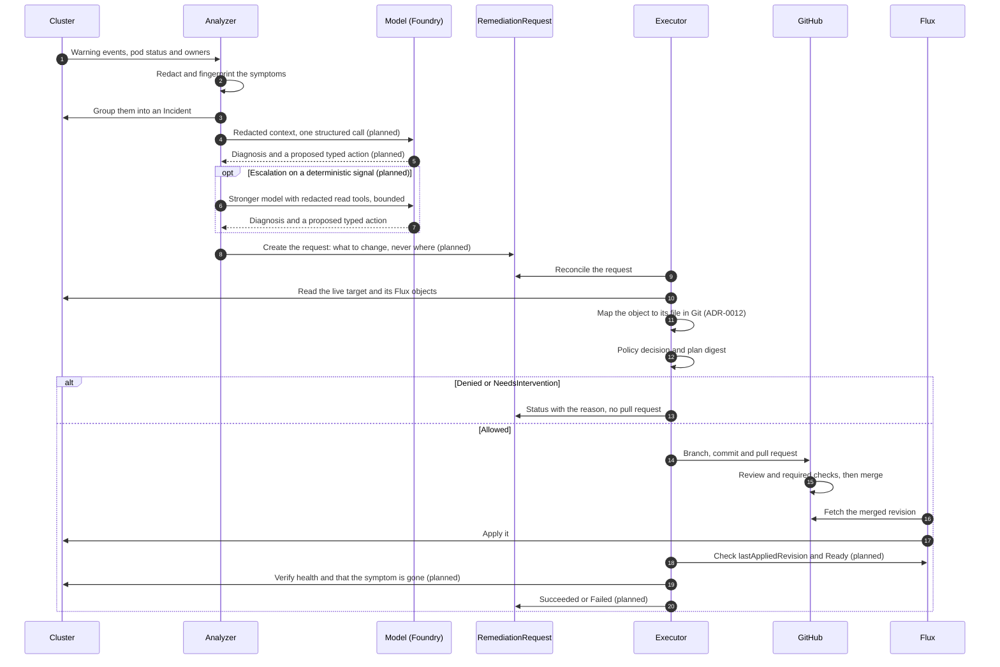

# 2. Architecture

## 2.1. Flow

The dashed boxes are the two identities: the analyzer can read and call the model, the executor can write request status and use the Git App. The `RemediationRequest` between them is the only thing the analyzer can hand over.

The same flow as a sequence, from a symptom to a verified change. Steps marked *(planned)* are designed but not built yet.

## 2.2. Components

| Component | Responsibility | Permission boundary |
| --- | --- | --- |
| Collector | Watches, event normalization, correlation through `ownerReferences` | Read selected namespaces and kinds |
| Incident store | Fingerprints, counters, timestamps, analysis history, operation IDs | Redacted data only |
| Analyzer | Builds context, makes one structured model call, runs a bounded tool loop on escalation (planned); detects the platform and integrations | Read; in the operator namespace write Incidents, create requests, write its own Warning events; update the `RemediationSettings` status with the detection report |
| Policy engine | Allowed actions, scope, bounds, whether review is required | Rules owned by the cluster admin |
| Remediation controller | Reconciles `RemediationRequest`, runs the approved plan, handles failures | CR status, Events about a request in the operator namespace, Git through the GitHub App |
| GitOps adapter | Reads the repository, prepares the change, branch, commit, PR, auto-merge | One repository, allowed paths |
| Verifier | Checks the applied revision, workload health and whether the symptom is gone | Read rollout state and metrics |

The base is Go with Kubebuilder, `controller-runtime` and `client-go` ([ADR-0005](../adr/0005-go-kubebuilder-single-module.md)). A controller compares desired and actual state no matter which event woke it up. The work queue collapses repeated requests for the same key, but that is not incident deduplication.

The analyzer and the remediation controller are separate binaries in one Go module (`cmd/analyzer`, `cmd/main.go`), deployed as separate Deployments with separate ServiceAccounts and identities. A slow model call must never block the controller's other reconciles.

The collector, the incident store and the analyzer run in the analyzer binary; the policy engine, the remediation controller, the GitOps adapter and the verifier run in the executor (`cmd/main.go`). Their roles are generated from kubebuilder RBAC markers (`internal/analyzer`, `internal/analyzer/collector`, `internal/controller`):

- **Analyzer:** reads events (`events.k8s.io/v1`) and pods (`get`, `list`, `watch`) and workloads (ReplicaSets, Deployments and StatefulSets, `get` only) only in the namespaces it is started with (`--watch-namespaces`): a ClusterRole that is only a catalogue of verbs, bound by one RoleBinding per watched namespace and never cluster-wide, and a cache restricted to the same list for those kinds, and to the operator namespace for Incidents and requests. Incidents live in the operator namespace, next to the requests that point at them: it creates and reads `Incident` objects and updates their status, and creates `RemediationRequest` objects, there only (a Role). The Warning event about its own Pod when the Incident cap is reached (3.2) is a core Event, written with the `create` and `patch` on core Events that its leader election Role already holds in the operator namespace; it has no grant on `events.k8s.io` Events beyond reading them in the watched namespaces. In the operator namespace it may also `get` and `update` one ConfigMap, `shadewright-analysis-budget`, named in `resourceNames`: the daily analysis budget (3.2). It cannot create, list, watch, patch or delete ConfigMaps, nor read any other. Cluster-wide it may read the cluster-scoped `RemediationSettings` and `update` its status subresource, the one write it has outside the operator namespace: the report of platform and integration detection (2.4, 5.4, [ADR-0024](../adr/0024-analyzer-writes-detection-to-settings-status.md)), no component reads any field of that status to decide anything; no `patch`, and nothing on the spec. For that detection it may `list` Nodes cluster-wide, with no `get` or `watch`, so it starts no informer on them; the discovery API needs no grant. The cache drops managed fields before it stores an object. The collector uses list and watch only on events and pods; it reads a pod's owners with a `get`, one object at a time, and starts no informer for workloads, which it could not: the role grants no `list` or `watch` on them. The watched namespaces are a deployer setting (`demo` is the lab default). The RoleBindings are built from `config/watch` (separately from `config/default`, in namespaces that must already exist) and must match `--watch-namespaces`; `test/rbac` checks that they do. The Helm chart's RBAC is written by hand in `dist/chart/templates/rbac`, with the RoleBindings rendered from `analyzer.watchNamespaces`, and `test/chart` keeps it equal to `config/` (any extra or missing verb, resource or subject fails). The operator namespace comes from `--namespace`, defaulting to `POD_NAMESPACE`, and the analyzer refuses to start without it. An empty `--watch-namespaces` watches no namespace, never all of them: the cache's default is then the operator namespace alone (an empty default would mean every namespace to controller-runtime), no collector is started, and the settings status carries the condition `NoWatchedNamespaces` True. It is the chart's default. With no values it reads no namespaced object outside the operator namespace, has no Git identity, and writes only in the operator namespace (its Leases, the budget ConfigMap, Events) plus the settings status once a settings object exists; it still lists Nodes and reads discovery and the settings cluster-wide. The executor has no Azure workload identity, so it cannot reach Key Vault to sign for the GitHub App. The gauge `shadewright_analyzer_watched_namespaces` reports the count, so an alert on 0 catches a forgotten list. The cluster ID hashed into every fingerprint comes from the required `--cluster-id` flag (1 to 63 letters, digits, `.`, `_` or `-`, starting and ending with a letter or digit), set by whoever installs the analyzer, so it needs no permission to read the cluster. The chart defaults it to the UID of the `kube-system` namespace, read by Helm with `lookup` at install time (the installer's permission, not the analyzer's); an explicit `clusterId` wins. GitOps tools and client-side renders (`helm template`, helm diff, Argo CD, Flux with a dry-run) ask no cluster, and an installer without `get` on the `kube-system` namespace cannot read it, so each of those must set `clusterId` explicitly. It is an ID, never a display name. It cannot update, delete or write the status of a request. It has no permission on Kyverno kinds today: reading them (`get`, `list`, `watch` on `kyverno.io` `clusterpolicies` and `policies`, and on `wgpolicyk8s.io` `policyreports` and `clusterpolicyreports`) is granted only with the wiring of symptom sources (planned, 2.5). It has no permission on the Secrets Store CSI driver kinds (`secrets-store.csi.x-k8s.io` `secretproviderclasses` and `secretproviderclasspodstatuses`) either, and that module needs none: it watches no kind and reads only the kubelet's events (2.5). The cloudflared module's symptom source reads Pods, which the analyzer already reads in the watched namespaces, so it needs no new grant. It has no grant on `pods/log`: the pod logs adapter (2.3) is built but not wired, and the grant comes with its wiring, in the watched namespaces only.
- **Executor:** reads (`get` only) policies and settings, always from the API server, never through a cache; reads (`get` only) the Incident a request names, in the operator namespace and from the API server, to check the name the pull request body shows (the verifier's read of Incidents is planned); reads (`get` only, no list or watch) the target kinds (Deployments, StatefulSets, KEDA ScaledObjects) and the Flux Kustomizations and GitRepositories that deliver them, for source mapping; reads requests, writes their status and patches them to add or remove its finalizer in the operator namespace only (a Role), and its cache watches requests only there; it records the kill switch's Events about a request (5.4) as core Events, with the `create` and `patch` on core Events that its leader election Role already holds in the operator namespace; the spec of a request is immutable (CEL), so the patch cannot change what was decided. It cannot create requests or write incidents.
- Neither can read `Secret` objects. An envtest suite (`test/rbac`) checks this boundary against a real API server.

No model runs in the cluster and no GPU is needed: the analyzer calls a managed model endpoint (Microsoft Foundry first). The call, and the bounded tool loop on escalation (planned), are our own code, not a hosted agent service.

## 2.3. Provider interfaces

Shadewright is pluggable along three axes ([ADR-0018](../adr/0018-three-axes-of-pluggability.md)): platform services outside the cluster (this section), the cluster platform (2.4) and the add-ons installed in the cluster (2.5). On every axis the core works on plain Kubernetes with no module at all; modules add knowledge and capabilities. Modules are compiled in for now; signed, declarative OCI packs are the planned way to ship them later ([ADR-0019](../adr/0019-extension-packaging.md)).

Every external system sits behind a Go interface with one adapter per product, so switching a product means writing an adapter, not changing the core ([ADR-0013](../adr/0013-adapters-for-every-external-system.md)). Interfaces use neutral terms (a change request, not a pull request) and adapters declare what they support, such as auto-merge, so the core adapts instead of assuming GitHub.

| Interface | First implementation | Later |
| --- | --- | --- |
| `GitProvider` | GitHub (GitHub App) | Azure DevOps, GitLab |
| `DeliveryVerifier` | Flux (`Kustomization`, `HelmRelease`) | Argo CD |
| `ModelProvider` | Microsoft Foundry (OpenAI and Anthropic models) | Direct vendor APIs, other gateways |
| `MetricsSource` | Prometheus HTTP API | Grafana Cloud, Azure Monitor managed Prometheus |
| `LogSource` | Kubernetes pod logs API | Loki, Azure Monitor Logs |
| `Notifier` | GitHub issue in the fleet repo | Microsoft Teams, Slack, generic webhook |
| `AnalysisStore` | Azure Blob Storage | S3-compatible, local filesystem for tests |
| `Signer` | Azure Key Vault key | AWS KMS, HashiCorp Vault transit |

Provider SDKs are imported only inside their adapter package. Each interface has an in-memory fake used by the tests.

The Prometheus adapter (`internal/providers/metrics/prometheus`) speaks the plain Prometheus HTTP query API with the standard library, Thanos, Mimir, Grafana Cloud and Azure Monitor managed Prometheus serve the same query API, but the adapter is untested against them; a backend shared by several clusters needs the cluster setting of section 4, without which an answer that mixes clusters is refused. It runs only the templates listed in section 4, and only for the namespaces it is configured with (section 4). TLS and authentication come from the HTTP client it is given; it never follows a redirect and never puts a parameter value, an unknown parameter name, the URL or response text in an error. It refuses a URL with user information, a query or a fragment, and without a client of its own it requires TLS 1.2 or later; 401 and 403 are forbidden, 408, 429 and 5xx retryable (with a `Retry-After` delay capped at 10 minutes), a 503 with `errorType` `timeout` final, and any other status (3xx included) rejected.

The pod logs adapter (`internal/providers/logs/kube`) reads the `pods/log` subresource through client-go's pods client and the pod through its REST client; tests pair a fake clientset with a REST client that answers from it. It is built but not wired: the analyzer does not create it and has no grant on `pods/log` (section 2.2); wiring it adds that grant, in the watched namespaces only. It reads one container of one pod per call, only in the namespaces it is configured with, within the bounds of section 4, and redacts the excerpt before returning it. It reads the pod (`get` on pods, granted by the analyzer watch role, which is bound only in the watched namespaces) before the first and after the last log request to tie the excerpt to a pod and container instance, and marks the excerpt uncertain when the two differ or the second fails (section 4); a failed first check is an error, not an excerpt. It retries no request, and client-go's own retries are off for the log requests and the pod reads alike (neither a status with Retry-After nor a reset connection is sent again), and it never puts a namespace, pod or container name, log text or the API server's message in an error: 404 is not found, 401 and 403 forbidden, 408, 429, 5xx, a network error, a stream cut short and the expiry of its own timeout retryable (with the server's delay, capped at 10 minutes), and any other 4xx, such as 400, rejected. When the caller's context ends the call, the caller's context error is returned.

## 2.4. Cluster platforms

A `Platform` module per provider, detected from node `providerID` and labels. The generic module is always present; the others add diagnosis and, later, platform-specific actions.

| Concern | AKS | EKS | GKE | Cluster API |
| --- | --- | --- | --- | --- |
| Workload identity | Microsoft Entra Workload ID | EKS Pod Identity, IRSA | GKE Workload Identity Federation | depends on the infrastructure provider |
| Node capacity and scaling | node pools, cluster autoscaler | managed node groups, Karpenter | node pools, Autopilot | `MachineDeployment` in the management cluster, changed through GitOps |
| Typical platform failures | pod IP exhaustion, quota, Spot eviction | ENI and IP limits, load balancer limits | Autopilot resource rules | machines that do not become nodes |
| Managed add-ons | AKS extensions (Flux, KEDA) | EKS add-ons | Config Sync | none |

Order: generic and AKS first; EKS and GKE as detection-only skeletons (built: detected and reported, no diagnosis rules yet); Cluster API when a real case needs it.

There is no global registry: the analyzer builds one immutable registry at start-up (`cmd/analyzer`) from an explicit list of compiled-in modules ([ADR-0019](../adr/0019-extension-packaging.md)): the generic, AKS, EKS and GKE platforms (EKS and GKE detected only) and the cloudflared, Flux, KEDA, Kyverno and Secrets Store CSI driver integrations. The executor does not need detection. A refusal from `New` stops the start.

Detection runs in the analyzer (`internal/analyzer/detection`), in the leader only, as a controller on the `RemediationSettings` object `default`: when the analyzer becomes leader, when the spec changes (a new generation; its own status writes do not wake it), and every 10 minutes while the object exists, so a node pool or an add-on installed later is found within that time; a failed run is retried with the controller's backoff. A run lists the nodes with the API reader (pages of 100 whole Node objects, dropped once read; at most 5,000 nodes, keeping only the provider ID and label keys; a larger cluster is taken as generic) and the group versions the discovery API serves, each with a 30 s deadline that also ends a discovery call that hangs. It then reads the settings from the API server, works out the active modules from `spec.modules` and that detection, and writes the report to status (5.4) with an update read fresh and retried on a conflict, only when something changed; the read and the write, retries included, have a 30 s deadline of their own, and a run that reaches it fails and is retried. No field of the status is read for this or anything else (ADR-0024). Each write also sets the condition `NoWatchedNamespaces` from the count of `--watch-namespaces` the binary was started with (not from detection; 5.4). When detection fails, the active modules follow the current spec with the last detection that succeeded and the condition `DetectionFailed` is `True`; with none yet, only generic is active and the report says so, so a report left by a former leader does not stand. When the settings do not exist, only generic is active and no further run is scheduled until they are created; when they cannot be read for another reason, the previous selection is kept and the run is retried. Followers keep generic only; they run no collector either.

The generic platform is always active, next to the detected one too, since its rules hold on every cluster: `node-pressure` (a `MemoryPressure`, `DiskPressure` or `PIDPressure` condition that is `True`) and `insufficient-capacity` (a `FailedScheduling` event of a pod whose note names `Insufficient <resource>` or `Too many pods`, with the resources and the `n/m nodes are available` count as evidence). The AKS module (`internal/modules/aks`) adds `pod-ip-exhaustion` (`FailedCreatePodSandBox` with the Azure CNI's "not enough IPs available" or "Failed to allocate address", or any `InsufficientSubnetSize`), `quota-exceeded` (Azure's `QuotaExceeded` or `InsufficientVCPUQuota` in an event note, with the quota, region and numbers of the message as evidence) and `spot-eviction` (a `PreemptScheduled` event about a Node in the namespace `default`, where events about cluster-scoped objects are written, or a `VMEventScheduled` condition that is `True` and names a Preempt event). The EKS (`internal/modules/eks`) and GKE (`internal/modules/gke`) modules contribute no hooks: they are detected and reported in status only. A rule is a pure function of an event or a node to symptoms. Of an event it sees the namespace, reason, type, reporting controller and note, and the regarding and related objects, whose fields are kept only when they fit the `ObjectRef` patterns; its reason and summary are its own text, and every evidence value from the cluster is redacted and normalized as the collector does for a symptom (`fingerprint.Normalize`) and cut to 256 bytes, at most 8 per symptom. Text longer than 16 KiB is not shown to a rule, and a rule that panics is skipped. The sources of these events are not checked: Microsoft documents `PreemptScheduled` as a node-problem-detector event but not the reporting controller AKS gives it, so the reporter is kept as evidence, and whoever can create events in a namespace can forge a matching one, as for every event the collector reads. Event rules see Node events only when their namespace (`default`) is watched. The subject of a finding (the event's regarding object, or the node) is untrusted too: a field that breaks the pattern of `ObjectRef` is emptied. The rules run on what the analysis context (3.3) feeds them through the current selection (planned, [#70](https://github.com/pkalin/shadewright/issues/70)); no rule changes an Incident or its fingerprint.

A module contributes hooks (symptom sources, diagnosis rules, tools, actions, verification checks) only when the cluster admin enabled it in `RemediationSettings` and it is detected (invariant 4). Detection alone never adds a tool or an action, and an enabled module that is not detected contributes nothing. An integration for an add-on with no API group of its own declares the core group version and is detected on every cluster, so for it detection does not narrow and enabling it is the only gate; such a module may only diagnose ([ADR-0018](../adr/0018-three-axes-of-pluggability.md), amendment of 2026-11-04). Module tools are part of the tool set the evaluation gate covers ([ADR-0023](../adr/0023-how-the-analyzer-calls-the-model.md)).

`New` refuses:

- a name that is not a DNS label starting with a letter (at most 63 characters), the rule the `RemediationSettings` schema applies to module names (5.4);
- a name given twice on one axis, `generic` included;
- more than 8 platform modules besides generic or more than 32 integration modules, the caps of the `RemediationSettings` lists (5.4), so every compiled-in module can be enabled and reported;
- a provider ID scheme without node labels;
- a node label listed twice by one platform, or an invalid label key or group version;
- two platforms with identical claims (same scheme, same labels in any order);
- a diagnosis rule with an invalid or repeated name, or with neither an event nor a node function;
- an integration whose detection is core group versions only (no API group of its own) that offers tools, actions or verification checks;
- a verification check whose name is not one of the API's `VerificationCheck` values, with an empty group or kind or no function, or declared by two modules (on either axis).

Platform and integration names are separate namespaces (a platform and an integration may share a name), so `RemediationSettings` enables them in separate lists (5.4).

Detection is a pure function of the nodes' `providerID` values and label keys. A provider ID scheme (`azure`, `aws`, `gce`) names the cloud, not the managed service: a self-managed cluster on cloud machines (Cluster API, kubeadm) has the same scheme as AKS, EKS or GKE. So a platform is recognised by the node labels its managed service sets (AKS `kubernetes.azure.com/cluster`, GKE `cloud.google.com/gke-nodepool`, EKS managed node groups `eks.amazonaws.com/nodegroup`), and the scheme is an extra condition for a node whose provider ID is set; a scheme alone claims nothing. Two platforms may share a scheme (AKS and a Cluster API platform on Azure) as long as their labels differ.

- A node is on a platform when it carries every label the platform requires and, if it has a provider ID and the platform declares a scheme, that scheme.
- Nodes no platform could claim, with neither a provider ID nor any label a platform requires (a node still joining, a virtual node), are left out.
- The cluster is on a platform when every remaining node is on it. No remaining node, a node on no platform or on two, or nodes on different platforms give generic, since diagnosis for the wrong platform is worse than none.
- EKS sets `eks.amazonaws.com/nodegroup` only on managed node groups. A node from a self-managed node group, Karpenter, EKS Auto Mode or Fargate does not carry it, so such a node, once it has a provider ID, is on no platform and the cluster is generic. GKE sets `cloud.google.com/gke-nodepool` on each node of a node pool. The sources are cited in the module packages.

## 2.5. Cluster integrations

An `Integration` module per add-on: detection (API groups, CRDs, versions), watched kinds and how their conditions become symptoms, deterministic diagnosis rules, read-only tools for the analyzer, redaction rules, verification checks, and optionally actions that follow the same rules as every action (typed, bounded, policy rule, GitOps patcher, refusal test). Integrations that guard security diagnose only: they explain a refusal or a missing secret, and never propose to relax a policy, change a secret or suppress a finding.

| Integration | Diagnosis | Actions |
| --- | --- | --- |
| Core workloads (Deployment, StatefulSet, PDB, NetworkPolicy, ResourceQuota) | OOM, crash loops, unschedulable pods, quota | `SetContainerMemoryLimit` |
| KEDA | trigger errors and fallback, an HPA that cannot read its metrics, `ScaledObject` or `ScaledJob` not ready, replica ceiling of the HPA a `ScaledObject` owns; verification check `KedaReady` | `AdjustKedaMaxReplicas`, allowed only with the `keda` integration enabled in `spec.modules` and refused unless the `ScaledObject` is ready (`KedaReady`, sections 5.1 and 6) |
| Flux | failing `Kustomization`, `HelmRelease` or `GitRepository`, drift from the source | none: Flux is the delivery path |
| Kyverno | a request refused by a policy at admission, failing policy report results, a policy not `Ready` | diagnosis only |
| Secrets Store CSI driver | a pod whose secrets volume cannot be mounted: a missing `SecretProviderClass`, the driver or its provider not running on the node, and for Azure Key Vault an identity that gets no token, access denied, a vault or an object not found | diagnosis only |
| cloudflared | tunnel down: a cloudflared replica that is not ready (no connection to Cloudflare's edge, a crash loop, a missing token), so the application is unreachable | none |

Later candidates: External Secrets Operator, Reloader, cert-manager, Trivy Operator, Karpenter. Modules are enabled per cluster in `RemediationSettings` (5.4), and the analyzer reports what it detected in status (2.4, 5.4).

An integration is detected when the discovery API serves any of the group versions it declares (KEDA: `keda.sh/v1alpha1`), again as a pure function of the list the caller collected. Detection returns, with each integration, the first of its declared group versions that is served, the value status reports. An add-on without an API group of its own, such as cloudflared, declares the core group version of the kinds it reads, so it is detected on every cluster, detection does not narrow it, and its symptom source recognises its workloads itself; such a module may only diagnose ([ADR-0018](../adr/0018-three-axes-of-pluggability.md), amendment of 2026-11-04); detection by other signals, such as the image of a Deployment, would need the detector to read workloads and is not built. As in 2.4, an integration contributes hooks only when it is enabled and detected. A module's contributions (symptom sources, diagnosis rules, read-only tools, catalog actions, verification checks) are declared in one value whose zero value contributes nothing, so a detection-only module is a name and its detection.

A symptom source names one watched kind (group, the versions it can read in order of preference, kind, plural resource and the controller whose status it reads) and a pure function from one object, as decoded from JSON, to symptoms. A symptom has a reason (a CamelCase word of at most 128 characters) and a summary (at most 256 bytes) that the rule writes itself, never cluster text, and at most 8 evidence entries: values read from the object, each with the field it came from. Evidence values are untrusted and left as read; the planned evaluator ([#61](https://github.com/pkalin/shadewright/issues/61)) checks each symptom against these limits (`ValidSymptom`), redacts every value with the fingerprint normalization and cuts it to 256 bytes. `New` refuses a source with an invalid group version, kind, resource or controller, or without a function, and a kind watched twice, by one module or by two on either axis. It keeps a copy of each module's hooks as validated, and lookups return that copy.

**Flux** (`internal/modules/flux`, built; it contributes once the analyzer wires symptom sources, planned): detected by `kustomize.toolkit.fluxcd.io/v1`, `helm.toolkit.fluxcd.io/v2` or `source.toolkit.fluxcd.io/v1` (Flux 2.3 and later; beta versions are not read). It watches `Kustomization`, `HelmRelease` and `GitRepository` and reports at most one symptom per object:

- Conditions for an older generation (a set `observedGeneration` that differs from `metadata.generation`, when the object has one) are skipped first. Then `Stalled=True` is reported, otherwise `Ready=False`. `Ready=True`, `Ready=Unknown` (reconciling), a suspended object and `HealthCheckCanceled` (a new reconciliation replaced the running one) show nothing.
- `DependencyNotReady` is reported with that reason, so a dependency that is missing, suspended or not watched does not fail silently.
- Otherwise the reason is the Flux reason when it is one the controllers set for the kind (read from kustomize-controller v1.10.1, helm-controller v1.7.1 and source-controller v1.10.1: for example `BuildFailed`, `ReconciliationFailed`, `HealthCheckFailed`, `UpgradeFailed`, `RollbackSucceeded`, `GitOperationFailed`, `AuthenticationFailed`), `Stalled`, or `NotReady`.
- Evidence always holds the condition's reason and message. By kind:
    - `Kustomization`: `status.lastAttemptedRevision`, and `status.lastAppliedRevision` when it differs.
    - `HelmRelease`: `status.lastAttemptedRevision`, compared with the chart version of the newest deployed release in `status.history` without its `+` build suffix (so an OCI digest suffix is no difference), and `status.lastAttemptedConfigDigest` compared with that release's `configDigest` (a values-only failed upgrade); each one that differs is added.
    - `GitRepository`: `status.artifact.revision`, the artifact it still serves; a failing GitRepository does not say which revision it tried, so nothing is compared.
- When the Kustomization or HelmRelease comparison differs, the summary says the cluster runs a different revision (for a HelmRelease, chart version or values) than its source declares, naming the source kind when it is a Flux source kind. That is how drift from the source shows.

The Flux module has no actions and no tools, and reads objects only: a fix is a pull request to the manifest, values or Kustomization (section 7), never a change to a Flux object. The read-only access to these kinds comes with the wiring; Flux objects usually live in `flux-system`, which then has to be among the analyzer's watched namespaces. A revision evidence value is kept unredacted only when the whole value is a Flux revision (an optional reference name, `@`, `sha1:` and exactly 40 lower-case hex digits, `redact.IsFluxRevision`); the evaluator that applies this is planned (#61). Inside any other text, such as a condition message, the commit hash is redacted like any long hex run, so `sha1:` written in front of a secret keeps nothing.

**KEDA** (`internal/modules/keda`, built and in the analyzer's registry; its symptom sources are not consumed yet, planned): detected by `keda.sh/v1alpha1`, the only group version of `ScaledObject`, `ScaledJob` and `TriggerAuthentication` in KEDA 2.x. It watches `ScaledObject`, `ScaledJob` and the `HorizontalPodAutoscaler` (`autoscaling/v2`) that KEDA creates for each `ScaledObject`, and reports at most one symptom per object. Conditions and reasons were read from KEDA v2.21.0 (the release the lab installs) and Kubernetes v1.37.2:

- A paused object (`Paused=True`) shows nothing. KEDA sets the same condition for a pause of scale-in or scale-out only, which is hidden too.
- `Ready=False` is reported first, with KEDA's reason when it is one KEDA sets for the kind (`TriggerError`, `ScaledObjectCheckFailed`, `ErrorGettingCurrentReplicas`, `ErrorScalingTarget`, `ScaledJobCheckFailed`, `KEDAJobCreateFailed`), and `NotReady` otherwise. `TriggerError` means no trigger is active and at least one fails (for a `ScaledObject`, with no fallback set). Then, for a `ScaledObject`, `Fallback=True` as `FallbackExists` (KEDA does not set `TriggerError` when a fallback is set), then `HPAActive=False` as `HPAMetricsUnavailable` (KEDA's reason for an HPA that cannot read its metrics; KEDA mirrors the HPA's `ScalingActive` there and does not change `Ready`, so the HPA's own reason is evidence), then `Ready=Unknown` with `PartialTriggerError` (a trigger fails while another one is active). `Active` says whether a trigger is active, which is no failure, and shows nothing. KEDA's conditions carry no `observedGeneration`, so none is compared.
- Evidence is the condition's reason and message, `status.triggersTypes` (trigger type names) and, when `status.health` marks triggers failing, how many and their highest failure count.
- A replica ceiling (`ReplicaCeiling`) is read from an HPA whose controller is a `ScaledObject`: `ScalingLimited=True` with reason `TooManyReplicas`, `currentReplicas` at or above `maxReplicas`, a status for the current generation and no `ScalingActive=False` (when metrics fail the HPA stops updating `ScalingLimited`, so an old `TooManyReplicas` can remain). Evidence: the `ScaledObject`'s name, `spec.maxReplicas`, `status.currentReplicas`, the limit reason and, for up to two external metrics, the current value (the backlog the HPA sees) and its target.
- A trigger error is never answered by raising replicas (section 7): the `TriggerError`, `PartialTriggerError`, `FallbackExists` and `HPAMetricsUnavailable` symptoms carry no replica count or metric, and no summary says what to change. The ceiling symptom is only a candidate: a symptom source sees one object, the HPA, not the owning `ScaledObject`. A full pause deletes the HPA, but a `ScaledObject` paused for scale-in or scale-out only, or on fallback (with a fallback above `maxReplicaCount` the HPA reports `TooManyReplicas` while the triggers fail), keeps an HPA that may report the limit. The deterministic gate for `AdjustKedaMaxReplicas` (sections 5.1 and 6) refuses the action unless the `ScaledObject` itself is ready (`KedaReady`), so no new read is added here.
- Trigger metadata and `TriggerAuthentication`s are never read: metadata may hold addresses, queries and credentials, and a `TriggerAuthentication` names Secrets and keys. `status.authenticationsTypes` (the names people gave their `TriggerAuthentication`s) is left out, and the metric names KEDA derives from trigger metadata (the keys of `status.health`, `status.externalMetricNames`, the HPA's metric names) are never separate evidence. Condition messages are evidence as they are, though: KEDA copies raw scaler and HPA errors into them (`ScaledObjectCheckFailed`, `HPAActive`), and these can name metrics or quote metadata. Like every evidence value they are untrusted, and the evaluator redacts and bounds them. A `TriggerAuthentication` has no conditions, so it is not watched: a broken authentication shows as a trigger error of the object that uses it.
- Known limit: the registry allows one symptom source per kind, so this module's `HorizontalPodAutoscaler` source is the only one; a later core-workloads HPA rule must share it (move into it or be split out of it) rather than add a second source.

The KEDA module contributes the verification check `KedaReady` (the `ScaledObject` is `Ready=True`, not paused, partial pauses and the pause annotations included, not being deleted, not on fallback, and `HPAActive` is not `False`), a pure function over the object, and the action `AdjustKedaMaxReplicas`. It offers no tools. The action is allowed only while the cluster admin enables the `keda` integration in `RemediationSettings` `spec.modules.integrations`: the policy check refuses it otherwise (`Denied`, `ModuleNotEnabled`), reading the spec only, never the status, and disabling the module after approval supersedes the plan. The function, KEDA's API version, condition names and pause annotations live in `internal/kedaready`, which imports only the standard library, so the policy check and the module share one definition without the policy depending on the module registry or on the module. Consuming its symptom sources needs read-only access (`get`, `list`, `watch`) to `scaledobjects`, `scaledjobs` and `horizontalpodautoscalers` in the watched namespaces, which comes with that wiring.

**Kyverno** (`internal/modules/kyverno`, built and in the analyzer's list of modules; its admission rule and symptom sources contribute once the analyzer runs diagnosis rules and wires symptom sources (planned)): detected by `kyverno.io/v1` only, read at Kyverno tag v1.19.2. The policy report group `wgpolicyk8s.io/v1alpha2` is no detection signal: Trivy, Kubewarden, kube-bench and other engines serve and write it too. Its kinds are read only once Kyverno is detected, and then only Kyverno's results. `reports.kyverno.io/v1` holds only the short-lived ephemeral reports that Kyverno merges into policy reports, and `openreports.io/v1alpha1` is written instead only when Kyverno's `openreportsEnabled` flag is set (off by default); neither is read. Each source names as its reporting controller the event source Kyverno writes for that component (`kyverno-admission` for policies, `kyverno-scan` for reports), the reporting controller the collector gives the events about the same results, so both name the same component.

- `PolicyReport` and `ClusterPolicyReport`: one symptom per result of a Kyverno policy (its `source` is `kyverno` or one of the `policies.kyverno.io` kinds) with result `fail` (reason `PolicyViolation`) or `error` (`PolicyError`), the reasons Kyverno itself uses for these results. Results of Kubernetes' own `ValidatingAdmissionPolicy` and `MutatingAdmissionPolicy`, which Kyverno only reports on, and of other engines are not read. Evidence is the policy, the rule, the resource the result applies to (the result's first resource, or the report's `scope`, where Kyverno names it), the message and the severity. A report on a resource checked by many policies can hold thousands of results, so at most the first 32 failing results of a report, in its order (Kyverno sorts by policy and rule), give symptoms; the rest are not read.
- `ClusterPolicy` and `Policy`: `Ready=False` gives `PolicyNotReady`, with the condition's reason and message. In Kyverno 1.19 it means the admission webhooks do not serve the policy yet.
- Admission refusals, a diagnosis rule on events: Kyverno's admission controller reports a refused request as a `Warning` event with reason `PolicyViolation` from `kyverno-admission`, regarding the policy, not the refused resource, and with a note whose first part ends with `(blocked)`. It gives `AdmissionRefused`; the finding's subject is the policy. Evidence is the rule's name read from the note, the refused resource (the event's `related` object, or the note's resource part when the related object has no valid name, such as a ClusterRole named `system:aggregate-to-edit`), and the event's reason, controller and note. The event must sit where Kyverno writes it: in `default` for a `ClusterPolicy` and in the policy's own namespace for a `Policy`, so an event forged in another namespace is refused; `default` then has to be among the analyzer's watched namespaces. Refusals by the `policies.kyverno.io` kinds regard those kinds and are not matched yet.

Reasons and summaries are fixed text; no summary suggests changing, excepting or removing a policy, and a test lists them all. The module has no actions and no tools (a test checks both): Shadewright explains what Kyverno decided and never proposes to relax a policy, add an exception or suppress a finding. A fix, if any, is a change to the refused or failing resource in Git. Known limit: `wgpolicyk8s.io` is shared, and `New` refuses a kind watched by two modules, so a later Trivy module would have to share the `PolicyReport` source with this one rather than watch it again.

**Secrets Store CSI driver** (`internal/modules/secretsstore`, built and in the analyzer's list of modules; its mount failure rule contributes once the analyzer runs diagnosis rules (planned)): detected by `secrets-store.csi.x-k8s.io/v1`, read at secrets-store-csi-driver tag v1.6.1, with the Azure Key Vault provider's texts read at its tag v1.8.2 and the kubelet's at Kubernetes v1.37.2. It has no symptom sources: `SecretProviderClass` has an empty status in `v1`, and the driver creates a `SecretProviderClassPodStatus` only after a mount succeeded, always with `mounted: true` and with no condition or error field, so a failed mount leaves no such object. The module watches no kind, never reads a Kubernetes `Secret` and adds no permission.

- Mount failures, a diagnosis rule on events: the kubelet's `Warning` event with reason `FailedMount` from `kubelet` about a Pod, in the pod's namespace, whose note is the kubelet's `MountVolume.SetUp failed for volume "<name>" : <error>` (or that with the `(combined from similar events): ` prefix the kubelet's recorder gives an aggregated event) and whose error is the kubelet's "driver name secrets-store.csi.k8s.io not found in the list of registered CSI drivers" or starts, after gRPC's `rpc error: code = <code> desc = `, with one of the driver's own texts. Other CSI drivers' failures, and the kubelet's "Unable to attach or mount volumes" timeouts, which name no driver, are not matched. The finding's subject is the pod.
- The reason says what failed, as far as the note shows it: `SecretProviderClassNotFound` (the driver's NotFound for the class the volume names, with its name as evidence), `SecretsStoreDriverNotRegistered`, `SecretsStoreProviderUnavailable` (the driver cannot reach the provider's socket, with the provider's name). `SecretProviderClassNotFound` needs the namespace in the driver's text to be the pod's. For the Azure Key Vault provider, recognised by its own wrapper "failed to mount objects, error:": `KeyVaultIdentityFailed` (an `azidentity` credential error, which carries Entra ID's `AADSTS` code, or a missing service account token, client ID or client secret), `KeyVaultAccessDenied` (`RESPONSE 403`), `KeyVaultObjectNotFound` (`SecretNotFound`, `KeyNotFound` or `CertificateNotFound`) and `KeyVaultNotFound` (the vault's host name does not resolve), with the object's type and name, the store's error code or the vault's host as evidence; the object's version is not read. They are read from the error after the object part, which holds the object's name the user chose. When a note fits more than one Key Vault reason, the first of identity, access denied, object not found, vault not found applies, because the token is fetched on the first call and its error is wrapped in the object's error. Any other provider error is `SecretsStoreProviderFailed`. `SecretsStoreMountFailed` is given for the driver's other texts: "failed to get secretproviderclass" for any error but a NotFound in the pod's namespace, "failed to create secret provider class pod status for pod", "secretProviderClass is not set", "provider not set in" and "parameters not set in". The driver's and kubelet's texts are fixed strings in their sources; the Azure SDK says its messages are not contractual, so a change there makes a Key Vault failure fall back to `SecretsStoreProviderFailed`, still with the error as evidence.
- Evidence is the event's reason and controller, the volume's name, what the reason names, and the note's error part (`event.note.error`): the note without the kubelet's, the driver's and the Azure provider's fixed prefixes and without the object part, whose version is not kept. It is redacted and cut to 256 bytes like every evidence value, which the prefixes alone would fill. A test runs notes with a bearer token, a connection string, a client secret, a vault URL with a SAS signature and credentials in a URL through the evaluator and checks that none of them survives.

Reasons and summaries are fixed text, and no summary suggests changing a secret, an identity or an access policy. The module has no actions and no tools (a test checks both): it explains why a pod's secrets are missing. As for every event rule, whoever can create events in the pod's namespace can forge a matching one.

**cloudflared** (`internal/modules/cloudflared`, built and in the analyzer's list of modules; its symptom source contributes once the analyzer wires symptom sources, planned): cloudflared has no CRD and no API group, so the module declares the core group version `v1`, the one of the Pods it reads ([ADR-0018](../adr/0018-three-axes-of-pluggability.md), amendment of 2026-11-04). It is therefore detected on every cluster and listed as detected in status (5.4), where `detected: true` means nothing for it, and it is active wherever the cluster admin enables it; recognising cloudflared is the job of its symptom source, pod by pod, and the module may only diagnose. Detecting it from workloads instead would need the detector to read Pods in the watched namespaces (which it does not do today, and whose result is no group version for `status.integrations[].version`) or to `list` Deployments, a grant the analyzer does not have, so no permission is added for it. Values were read from cloudflared 2026.10.7, Cloudflare's `helm-charts` (tags `cloudflare-tunnel-remote-0.1.2` and `cloudflare-tunnel-0.3.2`), Kubernetes v1.37.2 and containerd v2.4.2.

- The module owns the core Pod symptom source (core `v1`, reporting controller `kubelet`, which writes pod status and is the collector's reporting controller for its pod observations too). The registry allows one source per kind and refuses a second one, so a later module or core-workloads rule that reads Pods must share this source rather than add its own.
- A container of `spec.containers` is cloudflared when its image is Cloudflare's own, `cloudflare/cloudflared` alone or under one of Docker Hub's host names (`docker.io`, `index.docker.io`, `registry-1.docker.io`), any tag or digest (the image cloudflared publishes to `docker.io/cloudflare`); or when it is a copy, an image whose repository is `cloudflared` or ends in `/cloudflared`, and the pod carries a label of Cloudflare's manifests (`pod=cloudflared`, `app.kubernetes.io/name=cloudflare-tunnel`) or `app.kubernetes.io/name=cloudflared`. A label alone never matches, nor does a copy without the label (another Docker Hub user's `cloudflared`, `cloudflare/cloudflared` in another registry). Init and ephemeral containers are not read, an image over 512 bytes is not cloudflared, and only the first 64 containers, container statuses and conditions are read.
- A `Pending` or `Running` pod that is not being deleted and whose status is for its current spec (a set `status.observedGeneration`, written by the kubelet since Kubernetes 1.35, not below `metadata.generation`) gives one `TunnelDown` about the first of its cloudflared containers whose status says `ready: false` and that does not wait with `ContainerCreating` or `PodInitializing`, the kubelet's states before a container first starts (the Warning events that explain a pod stuck there are collected as for every pod). A ready cloudflared container before it does not hide it. cloudflared's `/ready` endpoint returns 200 only while it holds at least one connection to Cloudflare's edge and 503 otherwise, so a readiness probe on it makes a tunnel without connections not ready; Cloudflare's charts probe it as a liveness probe instead, and there the tunnel shows as a container restarted and backing off. A container that exits (cloudflared exits with 1 on a failed command), cannot start (`CreateContainerConfigError` for a missing token key) or cannot pull its image is not ready too. One symptom is about one replica; the summary says that the applications are unreachable when no replica of the tunnel is ready.
- Evidence is the container's name and image, its restart count, its state with the waiting or terminated reason, the reason and exit code of its last termination, and the reason of the pod's `Ready` condition. The command, args and env (which hold the tunnel token, `--token` or `TUNNEL_TOKEN`), annotations and every message (waiting, termination and condition messages; a termination message can hold the tail of the log) are never read.
- Known limits, for the wiring of symptom sources (planned) to settle:
    - Start-up: a running container is not ready until its first readiness probe passes, so every rollout gives `TunnelDown` for a few seconds. A symptom source is a pure function of one object and has no clock, so it cannot wait for a grace period. The 45 s debounce of 3.2 does not absorb this: it waits until observations stop, so a single one still becomes due. The wiring has to, for example by reporting the symptom only when the same pod still shows it some time later.
    - Duplicates: a crash-looping cloudflared container gives both `TunnelDown` and the collector's own termination observation (reason `Error`, 3.1). They have different reasons, so they are two fingerprints and two Incidents; the wiring has to join or drop one.
    - A cloudflared container with no probe on `/ready` stays ready while it has no connection and is not seen, since the analyzer reads no logs (no grant on `pods/log`, and logs are free text). The kubelet's probe failure events name no image, so no event rule can tell a cloudflared pod from another; they are collected as for every pod.
    - Images and labels are untrusted, so whoever can create a pod in a watched namespace can make it look like cloudflared; a false match only adds a symptom about that pod.

The module has no actions, no tools and no rules besides the source (a test checks this, and `New` would refuse the others for a module detected by the core group only): it explains why the tunnel is down and proposes nothing. A missing or wrong token is a Secret, which the remediation path never changes (invariant 3).

Verification checks are resolved by the executor, where the verifier runs (2.2; planned, [#19](https://github.com/pkalin/shadewright/issues/19)): it is to build its own registry from the same compiled-in module list as the analyzer and look a check up by name among the integrations enabled in `RemediationSettings` `spec.modules`. It runs no detection (a check on an add-on that is not installed finds no object and fails) and never reads the settings status (ADR-0024). Verification fails closed: a check the request needs that no enabled module implements fails verification (`NeedsIntervention`) and never counts as passed.
