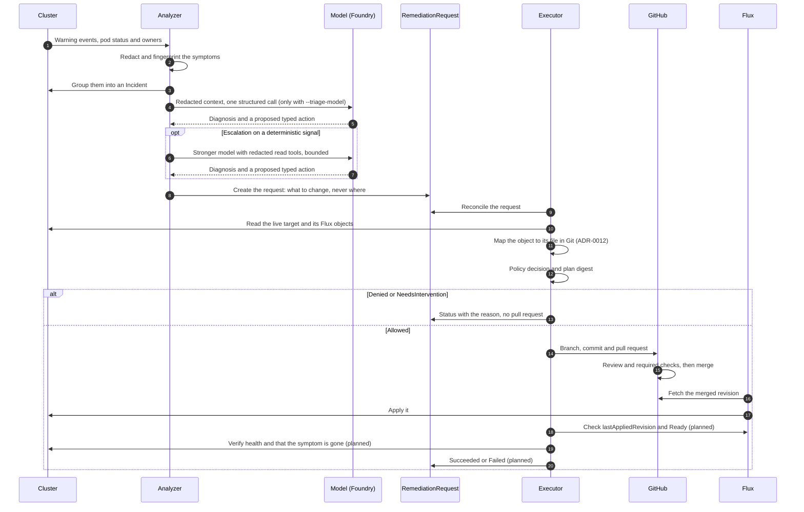

# 2. Architecture

## 2.1. Flow

The dashed boxes are the two identities: the analyzer can read and call the model, the executor can write request status and use the Git App. The `RemediationRequest` between them is the only thing the analyzer can hand over.

The same flow as a sequence, from a symptom to a verified change. Steps marked *(planned)* are designed but not built yet.

## 2.2. Components

This section lists the components (2.2), the two binaries and what each may read and write (2.2.1 to 2.2.3). The provider interfaces (2.3), cluster platforms (2.4) and cluster integrations (2.5) follow. Numbers and edge cases that only matter when you build or debug are in the table "Details" at the end (2.6).

| Component | Responsibility | Permission boundary |
| --- | --- | --- |
| Collector | Watches, event normalization, correlation through `ownerReferences` | Read selected namespaces and kinds |
| Incident store | Fingerprints, counters, timestamps, analysis history, operation IDs | Redacted data only |
| Analyzer | Builds context; makes one structured model call, runs a bounded tool loop on escalation (built, started with `--triage-model`, off by default); detects the platform and integrations | Read; in the operator namespace write Incidents, create requests, write its own Warning events; update the `RemediationSettings` status with the detection report |
| Policy engine | Allowed actions, scope, bounds, whether review is required | Rules owned by the cluster admin |
| Remediation controller | Reconciles `RemediationRequest`, runs the approved plan, handles failures | CR status, Events about a request in the operator namespace, Git through the GitHub App |
| GitOps adapter | Reads the repository, prepares the change, branch, commit, PR, auto-merge | One repository, allowed paths |
| Verifier | Checks the applied revision, workload health and whether the symptom is gone | Read rollout state and metrics |

The base is Go with Kubebuilder, `controller-runtime` and `client-go` ([ADR-0005](../adr/0005-go-kubebuilder-single-module.md)).

A controller compares desired and actual state no matter which event woke it up. The work queue collapses repeated requests for the same key, but that is not incident deduplication.

### 2.2.1. Two binaries

The analyzer and the remediation controller are separate binaries in one Go module (`cmd/analyzer`, `cmd/main.go`). They are deployed as separate Deployments with separate ServiceAccounts and identities. A slow model call must never block the controller's other reconciles.

- The collector, the incident store and the analyzer run in the analyzer binary.
- The policy engine, the remediation controller, the GitOps adapter and the verifier run in the executor (`cmd/main.go`).

Their roles are generated from kubebuilder RBAC markers (`internal/analyzer`, `internal/analyzer/collector`, `internal/controller`).

A third binary in the module, `cmd/kubectl-shadewright`, is not deployed: it is a kubectl plugin that a person runs with their own kubeconfig and permissions (`kubectl shadewright status`). It only gets and lists Incidents, RemediationRequests, the RemediationSettings, the analysis budget ConfigMap and the version label of the Shadewright CRDs, holds no identity of its own, and cleans every string from the cluster of control characters and terminal escape sequences before printing it (invariant 4); see [check status with kubectl](../how-to/check-status.md).

No model runs in the cluster and no GPU is needed: the analyzer calls a managed model endpoint (Microsoft Foundry first). The call, and the bounded tool loop on escalation, are our own code, not a hosted agent service.

### 2.2.2. Analyzer permissions

**What it may read.**

- Events (`events.k8s.io/v1`), pods and HorizontalPodAutoscalers (`autoscaling`, for the KEDA module's symptom source, 2.5.3) (`get`, `list`, `watch`), pod logs (`get` on `pods/log`, for the pod logs source of the context builder, 2.3.2), and workloads (ReplicaSets, Deployments and StatefulSets) and KEDA `ScaledObject`s (`get` here; `list` and `watch` too through the KEDA module role, 2.2.2), only in the namespaces it is started with (`--watch-namespaces`). The analyzer reads `ScaledObject`s only while the KEDA module is active; the grant itself does not depend on it.
- That is a ClusterRole that is only a catalogue of verbs, bound by one RoleBinding per watched namespace and never cluster-wide.
- Its cache is restricted to the same list for those kinds, and to the operator namespace for Incidents and requests.
- The cache drops managed fields before it stores an object.
- Cluster-wide it may read the cluster-scoped `RemediationSettings`, and `list` Nodes for platform detection, with no `get` or `watch`, so it starts no informer on them. The discovery API needs no grant. With the chart value `analyzer.modules.kyverno.clusterWide.enabled` (off by default) it may also read Kyverno's cluster-scoped kinds (below). With the analysis on and `analyzer.analysis.actionPolicies` set, it may `get` the RemediationPolicies named there, and only those (`resourceNames`; no `list` or `watch`), so the context builder can show the model the bounds of the policy that will decide its proposal (3.3, [#493](https://github.com/pkalin/shadewright/issues/493)). Without a name there is no rule.

**What it may write.** All of this is in the operator namespace (a Role), except the settings status.

- It creates and reads `Incident` objects and updates their status, and creates `RemediationRequest` objects. Incidents live next to the requests that point at them.
- It may `get` and `update` one ConfigMap, `shadewright-analysis-budget`, named in `resourceNames`: the daily analysis budget (3.2). It cannot create, list, watch, patch or delete ConfigMaps, nor read any other.
- The Warning event about its own Pod when the Incident cap is reached (3.2) is a core Event, written with the `create` and `patch` on core Events that its leader election Role already holds. The Normal event `AnalysisSkipped` about an Incident whose first analysis is skipped (`NotRecent`, 3.2) is written the same way; Incidents live in the operator namespace. It has no grant on `events.k8s.io` Events beyond reading them in the watched namespaces.
- It may `update` the status subresource of `RemediationSettings`, the one write it has outside the operator namespace: the report of platform and integration detection (2.4, 5.4, [ADR-0024](../adr/0024-analyzer-writes-detection-to-settings-status.md)). No `patch`, and nothing on the spec.
- No component reads any field of that status to decide anything.
- It cannot update, delete or write the status of a request.

**How the collector reads.**

- It uses list and watch only on events, pods, HPAs and the add-on kinds of its module symptom sources (2.5.1).
- It reads a pod's owners with a `get`, one object at a time. It starts no informer for workloads, which it could not: the role grants no `list` or `watch` on them.
- It watches an add-on's kind only while a module that reads it is active, the chart rendered its grant (`--module-grants`), the API server serves it and the analyzer may list it. The check is one metadata-only list of at most one object in each watched namespace, or cluster-wide for a cluster-scoped kind, every 30 seconds, and only while the kind is not watched: at most one list per watched namespace and kind per 30 seconds, and none while the watch runs. Otherwise it starts no informer and reports the kind: the condition `SymptomSourcesNotWatched` of the settings status, a log line and the gauge `shadewright_analyzer_symptom_source_watched` at `0`.
- Each such watch has an informer cache of its own, never the manager's: a controller waits for every informer of its cache to sync, so one that cannot sync there would hold up the built-in watches and, after the sync timeout, stop the analyzer. While a watch runs its own errors decide. Every list and watch request of the watch counts, including the ones its informer retries without reporting them (a 429, or a refusal streamed after the watch started). A refused list or watch (a grant removed, or `list` granted without `watch`), a kind no longer served, a cache that does not sync, or a controller that stops on its own ends the watch: the kind is reported as not granted or not served when the check finds it so, otherwise as `Failed`, and the watch is started again only after a backoff (one minute, doubled after each failure in a row, at most 30 minutes). Errors the informer retries itself (the API server unavailable, a 429) are reported as `Failed` once three checks in a row found no request succeeding since, while the watch keeps running. The check looks the kind up with a discovery request of its own, with the lookup deadline, never through the manager's RESTMapper, so a stalled add-on group holds up no other source and no stop.
- A kind whose optional grant the chart leaves out on purpose (`analyzer.modules.kyverno.clusterWide.enabled` off, the least-privilege setup) is not checked, not watched and not reported, and the gauge has no series for it. Without `--module-grants` (the kustomize manifests, where any of `config/modules` may be added) every kind is checked.

**Watched namespaces.** They are a deployer setting (`demo` is the lab default).

- The RoleBindings are built from `config/watch` (separately from `config/default`, in namespaces that must already exist) and must match `--watch-namespaces`. `test/rbac` checks that they do.
- The Helm chart's RBAC is written by hand in `dist/chart/templates/rbac`, with the RoleBindings rendered from `analyzer.watchNamespaces`. `test/chart` keeps it equal to `config/`: any extra or missing verb, resource or subject fails. The value-dependent grants are `get` on `pods/log`, rendered only while `analyzer.podLogs.enabled` is true, and one read-only ClusterRole per module under `analyzer.modules` (below). `test/chart` compares each with every toggle on against `config/` plus `config/modules/<name>`.
- An empty `--watch-namespaces` watches no namespace, never all of them. The cache's default is then the operator namespace alone (an empty default would mean every namespace to controller-runtime), no collector is started, and the settings status carries the condition `NoWatchedNamespaces` True. This is the chart's default.
- With no chart values (the default): the analyzer reads no namespaced object outside the operator namespace, has no Git identity, and writes only in the operator namespace (its Leases, the budget ConfigMap, Events) plus the settings status once a settings object exists. It still lists Nodes and reads discovery and the settings cluster-wide. The executor has no Azure workload identity, so it cannot reach Key Vault to sign for the GitHub App. (`config/manager/manager.yaml` gives the executor workload identity otherwise.)
- The gauge `shadewright_analyzer_watched_namespaces` reports the count, so an alert on 0 catches a forgotten list.

**Operator namespace and identity.**

- The operator namespace comes from `--namespace`, defaulting to `POD_NAMESPACE`, and the analyzer refuses to start without it.

**The cluster ID.** It is hashed into every fingerprint and comes from the required `--cluster-id` flag (1 to 63 letters, digits, `.`, `_` or `-`, starting and ending with a letter or digit). It is an ID, never a display name.

- Whoever installs the analyzer sets it, so the analyzer needs no permission to read the cluster.
- The chart defaults it to the UID of the `kube-system` namespace, read by Helm with `lookup` at install time (the installer's permission, not the analyzer's). An explicit `clusterId` wins.
- GitOps tools and client-side renders (`helm template`, helm diff, Argo CD, Flux with a dry-run) ask no cluster, and an installer without `get` on the `kube-system` namespace cannot read it. Each of those must set `clusterId` explicitly.

**Reads of the add-ons' own kinds** ([#409](https://github.com/pkalin/shadewright/issues/409)). Each module's reads are a ClusterRole of their own, made from the markers of `internal/analyzer/modulerbac/<name>` (`config/rbac/analyzer/modules/<name>`), with `list` and `watch` only, for the sources' informers, and `get` on `scaledobjects` alone, where the owner a KEDA HPA names is read by name. The chart renders each only while its value is on, so an add-on that is not deployed gets no grant, and passes the list of rendered roles to the analyzer (`--module-grants`, 2.2.2); the value grants reads only, and whether a module runs is still `spec.modules` and detection.

| Chart value | Default | Role, binding | Kinds |
|---|---|---|---|
| `analyzer.modules.keda.enabled` | `true` | `analyzer-watch-keda`, a RoleBinding per watched namespace | `keda.sh` `scaledobjects`, `scaledjobs` |
| `analyzer.modules.flux.enabled` | `false` | `analyzer-watch-flux`, a RoleBinding per watched namespace | `kustomizations`, `helmreleases`, `gitrepositories` |
| `analyzer.modules.kyverno.enabled` | `false` | `analyzer-watch-kyverno`, a RoleBinding per watched namespace | `kyverno.io` `policies`, `wgpolicyk8s.io` `policyreports` |
| `analyzer.modules.kyverno.clusterWide.enabled` | `false` | `analyzer-kyverno-cluster`, a ClusterRoleBinding | `kyverno.io` `clusterpolicies`, `wgpolicyk8s.io` `clusterpolicyreports` |

- KEDA is on by default because the HPA source already read `scaledobjects` (`get`, to verify the subject): off, a ceiling would be an Incident about the HPA instead of the ScaledObject. `config/default` and `config/watch` include it.
- Flux and Kyverno are off by default (least privilege): no module used those reads before. With kustomize, add `config/modules/<name>`, whose RoleBindings name the lab's `demo` namespace.
- The Kyverno cluster-wide role is the one read of an add-on's kinds outside the watched namespaces; a ClusterPolicyReport names resources of every namespace, so it is a value of its own.

**What it cannot read.**

- Secrets Store CSI driver kinds (`secrets-store.csi.x-k8s.io` `secretproviderclasses` and `secretproviderclasspodstatuses`): that module needs none. It watches no kind and reads only the kubelet's events (2.5).
- The cloudflared module's symptom source reads Pods, which the analyzer already reads in the watched namespaces, and the workloads it already reads by name, so it needs no grant and no chart value. It is wired (2.5.1).

### 2.2.3. Executor permissions

- It reads (`get` only) policies and settings, always from the API server, never through a cache.
- It reads (`get` only) the Incident a request names, in the operator namespace and from the API server, to check the name the pull request body shows, and to read its `Analyzed` condition and handled-hint ID, to learn that a reviewer hint was refused (built, code merged, not enabled in the binary (no flag) until #539, #538, [ADR-0028](../adr/0028-reviewer-hints-through-the-pull-request.md)). The verifier's read of Incidents is planned.
- It reads (`get` only, no list or watch) the target kinds (Deployments, StatefulSets, KEDA ScaledObjects) and the Flux Kustomizations and GitRepositories that deliver them, for source mapping.
- It reads requests, writes their status and patches them to add or remove its finalizer, in the operator namespace only (a Role). Its cache watches requests only there.
- It records the kill switch's Events about a request (5.4) as core Events in the operator namespace, with the `create` and `patch` on core Events that its leader election Role already holds. The spec of a request is immutable (CEL), so the patch cannot change what was decided.
- It reads the comments of the pull requests it opened and the commenter's permission in the code host, and writes accepted reviewer hints into request status (built, code merged, not enabled in the binary (no flag) until the merge gate, #538). built (#539) It moves the branch of a handed-over pull request by one fast-forward commit, rewrites its title and body and creates the check run `shadewright/review` (`in_progress`). planned It posts replies and completes the check run on those pull requests, with the Git App's existing permissions and one new one, `checks: write` (2.3.3, [ADR-0028](../adr/0028-reviewer-hints-through-the-pull-request.md)).
- It cannot create requests or write incidents.

Neither binary can read `Secret` objects. An envtest suite (`test/rbac`) checks this boundary against a real API server.

## 2.3. Provider interfaces

Shadewright is pluggable along three axes ([ADR-0018](../adr/0018-three-axes-of-pluggability.md)):

- platform services outside the cluster (this section);
- the cluster platform (2.4);
- the add-ons installed in the cluster (2.5).

On every axis the core works on plain Kubernetes with no module at all; modules add knowledge and capabilities. Modules are compiled in for now. Signed, declarative OCI packs are the planned way to ship them later ([ADR-0019](../adr/0019-extension-packaging.md)).

Every external system sits behind a Go interface with one adapter per product ([ADR-0013](../adr/0013-adapters-for-every-external-system.md)). Switching a product means writing an adapter, not changing the core. Interfaces use neutral terms (a change request, not a pull request). Adapters declare what they support, such as auto-merge, so the core adapts instead of assuming GitHub.

| Interface | First implementation | Later |
| --- | --- | --- |
| `GitProvider` | GitHub (GitHub App) | Azure DevOps, GitLab |
| `FeedbackSource` (planned, behind `GitProvider`, 2.3.3) | GitHub pull request comments | Azure DevOps, GitLab |
| `DeliveryVerifier` | Flux (`Kustomization`, `HelmRelease`) | Argo CD |
| `ModelProvider` | Microsoft Foundry (OpenAI and Anthropic models) | Direct vendor APIs, other gateways |
| `MetricsSource` | Prometheus HTTP API | Grafana Cloud, Azure Monitor managed Prometheus |
| `LogSource` | Kubernetes pod logs API | Loki, Azure Monitor Logs |
| `Notifier` | GitHub issue in the fleet repo | Microsoft Teams, Slack, generic webhook |
| `AnalysisStore` | Azure Blob Storage | S3-compatible, local filesystem for tests |
| `Signer` | Azure Key Vault key | AWS KMS, HashiCorp Vault transit |

Provider SDKs are imported only inside their adapter package. Each interface has an in-memory fake used by the tests.

### 2.3.1. Prometheus adapter

**What it does.** The adapter (`internal/providers/metrics/prometheus`) speaks the plain Prometheus HTTP query API with the standard library. It runs only the templates listed in section 4, and only for the namespaces it is configured with (section 4).

**How the analyzer wires it.** With `--prometheus-url` set, the analyzer creates it with the watched namespaces (`--watch-namespaces`, the set of the cache and the RoleBindings) and gives it to the context builder (3.3), which the analysis loop calls when the analyzer runs with `--triage-model` ([#76](https://github.com/pkalin/shadewright/issues/76)). Without the flag the metrics section is "not available". More than 256 watched namespaces with the flag set refuse the start.

- With `--prometheus-cluster`, the analyzer checks at startup and every 10 minutes, on every replica, with one fixed query that is not a template and returns no label, that kube-state-metrics and cAdvisor both hold series with that `cluster` value. With no watched namespace it builds no source and runs no check.
- When they do not, the analyzer still starts and logs an error, and metrics are **unavailable**: every query fails, so the metrics section is "could not fetch", which escalates (3.3), rather than empty answers read as evidence of absence. A label that disappears later switches metrics off at the next check, and one that appears switches them on.
- A check that cannot reach Prometheus is not "not found": it changes nothing the last answer said, and before any answer, or once the last one is older than 10 minutes, a query checks first. One check runs at a time; a query waits for it no longer than its own deadline. Decided on [#371](https://github.com/pkalin/shadewright/issues/371) (2026-11-05), instead of refusing to start, which would crash-loop the analyzer on a typo.

**Limits.**

- Thanos, Mimir, Grafana Cloud and Azure Monitor managed Prometheus serve the same query API, but the adapter is untested against them.
- A backend shared by several clusters needs the cluster setting of section 4. Without it, an answer that mixes clusters is refused.

**Safety rules.**

- TLS and authentication come from the HTTP client it is given.
- It never follows a redirect.
- It never puts a parameter value, an unknown parameter name, the URL or response text in an error.
- It refuses a URL with user information, a query or a fragment. Without a client of its own it requires TLS 1.2 or later.

HTTP status handling is in 2.6.

### 2.3.2. Pod logs adapter

**What it does.** The adapter (`internal/providers/logs/kube`) reads the `pods/log` subresource through client-go's pods client, and the pod through its REST client. Tests pair a fake clientset with a REST client that answers from it.

**Limits.**

- The analyzer creates it unless `--pod-logs=false`, with the watched namespaces, and gives it to the context builder (3.3), which the analysis loop calls when the analyzer runs with `--triage-model` ([#76](https://github.com/pkalin/shadewright/issues/76)). It reads with the analyzer's own identity: `get` on `pods/log` in the watch role, so only in the watched namespaces (2.2.2).
- It takes at most 256 namespaces. With more in `--watch-namespaces` and logs on, the analyzer refuses to start with a configuration error that names the limit (decided on [#371](https://github.com/pkalin/shadewright/issues/371)): running without logs would make every analysis escalate on a source it could not fetch.
- It reads one container of one pod per call, only in the namespaces it is configured with, within the bounds of section 4. It redacts the excerpt before returning it.

**Tying an excerpt to a pod.** It reads the pod (`get` on pods, granted by the analyzer watch role, which is bound only in the watched namespaces) before the first and after the last log request.

- This ties the excerpt to a pod and container instance.
- It marks the excerpt uncertain when the two reads differ or the second fails (section 4).
- A failed first check is an error, not an excerpt.

**What can go wrong.**

- It retries no request. client-go's own retries are off for the log requests and the pod reads alike: neither a status with Retry-After nor a reset connection is sent again.
- It never puts a namespace, pod or container name, log text or the API server's message in an error.
- When the caller's context ends the call, the caller's context error is returned.

Status mapping is in 2.6.

### 2.3.3. Reviewer hints

planned ([ADR-0028](../adr/0028-reviewer-hints-through-the-pull-request.md), epic [#533](https://github.com/pkalin/shadewright/issues/533)). A person with write access can steer the analysis from the pull request with a comment `/shadewright reanalyze: <hint>`. Policy still decides; a hint never authorizes anything.

- **The code host** where the pull request lives is read by the executor through the `GitProvider` adapter, behind a narrow `FeedbackSource` interface (comments, author identity and type, permission, reviews, reply, check run). No new App; one new permission, `checks: write`, for the merge gate (the required check run `shadewright/review`, 8.4). Hints are seen on the executor's existing pull request poll (one conditional comments query `since` a durable watermark per poll, paginated within a bound, and one permission call per new comment); there are no webhooks.
- **Every other integration** (on-call tools, chat, inbound alerts) never goes through the executor. It belongs to a future `shadewright-coordinator`, designed in its own ADR when the first one arrives.
- **Rules for every source:** permission checked in the source system, bots and Apps ignored, at most 2 KiB, at most 3 per supersede chain, redacted before storage, pinned by comment ID, digest and `updated_at` in request status that only the executor writes, fenced in the prompt, counted in `maxAnalysesPerDay`, 15 minute cooldown.
- **One pull request for the conversation:** the replacement request takes the existing pull request and branch over (6.5.4).

## 2.4. Cluster platforms

A `Platform` module per provider, detected from node `providerID` and labels. The generic module is always present; the others add diagnosis and, later, platform-specific actions.

| Concern | AKS | EKS | GKE | Cluster API |
| --- | --- | --- | --- | --- |
| Workload identity | Microsoft Entra Workload ID | EKS Pod Identity, IRSA | GKE Workload Identity Federation | depends on the infrastructure provider |
| Node capacity and scaling | node pools, cluster autoscaler | managed node groups, Karpenter | node pools, Autopilot | `MachineDeployment` in the management cluster, changed through GitOps |
| Typical platform failures | pod IP exhaustion, quota, Spot eviction | ENI and IP limits, load balancer limits | Autopilot resource rules | machines that do not become nodes |
| Managed add-ons | AKS extensions (Flux, KEDA) | EKS add-ons | Config Sync | none |

Order: generic and AKS first; EKS and GKE as detection-only skeletons (built: detected and reported, no diagnosis rules yet); Cluster API when a real case needs it.

### 2.4.1. The module registry

There is no global registry. The analyzer builds one immutable registry at start-up (`cmd/analyzer`) from an explicit list of compiled-in modules ([ADR-0019](../adr/0019-extension-packaging.md)):

- the generic, AKS, EKS and GKE platforms (EKS and GKE detected only);
- the cloudflared, Flux, KEDA, Kyverno and Secrets Store CSI driver integrations.

The executor does not need detection. A refusal from `New` stops the start.

A module contributes hooks (symptom sources, diagnosis rules, tools, actions, verification checks) only when both are true:

- the cluster admin enabled it in `RemediationSettings`;
- it is detected (invariant 4).

Detection alone never adds a tool or an action, and an enabled module that is not detected contributes nothing.

An integration for an add-on with no API group of its own declares the core group version and is detected on every cluster. For it, detection does not narrow and enabling it is the only gate. Such a module may only diagnose ([ADR-0018](../adr/0018-three-axes-of-pluggability.md), amendment of 2026-11-04).

Module tools are part of the tool set the evaluation gate covers ([ADR-0023](../adr/0023-how-the-analyzer-calls-the-model.md)).

`New` refuses:

- a name that is not a DNS label starting with a letter (at most 63 characters), the rule the `RemediationSettings` schema applies to module names (5.4);
- a name given twice on one axis, `generic` included;
- more than 8 platform modules besides generic or more than 32 integration modules, the caps of the `RemediationSettings` lists (5.4), so every compiled-in module can be enabled and reported;
- a provider ID scheme without node labels;
- a node label listed twice by one platform, or an invalid label key or group version;
- two platforms with identical claims (same scheme, same labels in any order);
- a diagnosis rule with an invalid or repeated name, or with neither an event nor a node function;
- an integration whose detection is core group versions only (no API group of its own) that offers tools, actions or verification checks;
- a verification check whose name is not one of the API's `VerificationCheck` values, with an empty group or kind or no function, or declared by two modules (on either axis).

Platform and integration names are separate namespaces (a platform and an integration may share a name), so `RemediationSettings` enables them in separate lists (5.4).

### 2.4.2. How a platform is detected

**What it does.** Detection is a pure function of the nodes' `providerID` values and label keys.

**Why labels.** A provider ID scheme (`azure`, `aws`, `gce`) names the cloud, not the managed service. A self-managed cluster on cloud machines (Cluster API, kubeadm) has the same scheme as AKS, EKS or GKE. So a platform is recognised by the node labels its managed service sets:

- AKS: `kubernetes.azure.com/cluster`;
- GKE: `cloud.google.com/gke-nodepool`;
- EKS managed node groups: `eks.amazonaws.com/nodegroup`.

The scheme is an extra condition for a node whose provider ID is set. A scheme alone claims nothing. Two platforms may share a scheme (AKS and a Cluster API platform on Azure) as long as their labels differ.

**Rules.**

- A node is on a platform when it carries every label the platform requires and, if it has a provider ID and the platform declares a scheme, that scheme.
- Nodes no platform could claim, with neither a provider ID nor any label a platform requires (a node still joining, a virtual node), are left out.
- The cluster is on a platform when every remaining node is on it.
- No remaining node, a node on no platform or on two, or nodes on different platforms give generic, since diagnosis for the wrong platform is worse than none.

**Limits.**

- EKS sets `eks.amazonaws.com/nodegroup` only on managed node groups. A node from a self-managed node group, Karpenter, EKS Auto Mode or Fargate does not carry it. Such a node, once it has a provider ID, is on no platform and the cluster is generic.
- GKE sets `cloud.google.com/gke-nodepool` on each node of a node pool.
- The sources are cited in the module packages.

### 2.4.3. When detection runs

Detection runs in the analyzer (`internal/analyzer/detection`), in the leader only, as a controller on the `RemediationSettings` object `default`. It runs:

- when the analyzer becomes leader;
- when the spec changes (a new generation; its own status writes do not wake it);
- every 10 minutes while the object exists, so a node pool or an add-on installed later is found within that time;
- when the watch state of a symptom source kind of an active module changes (#409), so the condition `SymptomSourcesNotWatched` (5.4) follows it. Such a run only reports: it writes the status like any other, and needs no other grant (ADR-0024, amended 2026-11-07).

A failed run is retried with the controller's backoff. Followers keep generic only, and run no collector either.

**One run.**

- It lists the nodes with the API reader, and reads the group versions the discovery API serves. Node lists and discovery calls each have a 30 s deadline that also ends a call that hangs.
- It reads the settings from the API server, works out the active modules from `spec.modules` and that detection, and writes the report to status (5.4).
- The write is an update read fresh and retried on a conflict, and only when something changed. The read and the write, retries included, have a 30 s deadline of their own. A run that reaches it fails and is retried.
- No field of the status is read for this or anything else (ADR-0024).
- Each write also sets the condition `NoWatchedNamespaces` from the count of `--watch-namespaces` the binary was started with (not from detection; 5.4).
- Each write also sets the condition `SymptomSourcesNotWatched` from the collector's report of the symptom source kinds it does not watch, while it watches namespaces (not from detection; 5.4).

**What can go wrong.**

- When detection fails, the active modules follow the current spec with the last detection that succeeded, and the condition `DetectionFailed` is `True`. With none yet, only generic is active and the report says so, so a report left by a former leader does not stand.
- When the settings do not exist, only generic is active and no further run is scheduled until they are created.
- When the settings cannot be read for another reason, the previous selection is kept and the run is retried.
- A cluster of more than 5,000 nodes is taken as generic (see 2.6).

### 2.4.4. Diagnosis rules of the platforms

The generic platform is always active, next to the detected one too, since its rules hold on every cluster:

- `node-pressure`: a `MemoryPressure`, `DiskPressure` or `PIDPressure` condition that is `True`.
- `insufficient-capacity`: a `FailedScheduling` event of a pod whose note names `Insufficient <resource>` or `Too many pods`, with the resources and the `n/m nodes are available` count as evidence.

The AKS module (`internal/modules/aks`) adds:

- `pod-ip-exhaustion`: `FailedCreatePodSandBox` with the Azure CNI's "not enough IPs available" or "Failed to allocate address", or any `InsufficientSubnetSize`.
- `quota-exceeded`: Azure's `QuotaExceeded` or `InsufficientVCPUQuota` in an event note, with the quota, region and numbers of the message as evidence.
- `spot-eviction`: a `PreemptScheduled` event about a Node in the namespace `default`, where events about cluster-scoped objects are written, or a `VMEventScheduled` condition that is `True` and names a Preempt event.

The EKS (`internal/modules/eks`) and GKE (`internal/modules/gke`) modules contribute no hooks: they are detected and reported in status only.

**How a rule works.** A rule is a pure function of an event or a node to symptoms.

- Of an event it sees the namespace, reason, type, reporting controller and note, and the regarding and related objects, whose fields are kept only when they fit the `ObjectRef` patterns.
- Its reason and summary are its own text.
- Every evidence value from the cluster is redacted and normalized as the collector does for a symptom (`fingerprint.Normalize`) and cut to 256 bytes, at most 8 per symptom.
- Text longer than 16 KiB is not shown to a rule, and a rule that panics is skipped.
- The subject of a finding (the event's regarding object, or the node) is untrusted too: a field that breaks the pattern of `ObjectRef` is emptied.
- No rule changes an Incident or its fingerprint.
- The rules run on what the analysis context (3.3) feeds them through the current selection (planned, [#70](https://github.com/pkalin/shadewright/issues/70)).

**What can go wrong.**

- The sources of these events are not checked. Microsoft documents `PreemptScheduled` as a node-problem-detector event but not the reporting controller AKS gives it, so the reporter is kept as evidence.
- Whoever can create events in a namespace can forge a matching one, as for every event the collector reads.
- Event rules see Node events only when their namespace (`default`) is watched.

## 2.5. Cluster integrations

An `Integration` module per add-on. It declares:

- detection (API groups, CRDs, versions);
- watched kinds and how their conditions become symptoms;
- deterministic diagnosis rules;
- read-only tools for the analyzer;
- redaction rules;
- verification checks;
- optionally actions, which follow the same rules as every action (typed, bounded, policy rule, GitOps patcher, refusal test).

Integrations that guard security diagnose only. They explain a refusal or a missing secret, and never propose to relax a policy, change a secret or suppress a finding.

| Integration | Diagnosis | Actions |
| --- | --- | --- |
| Core workloads (Deployment, StatefulSet, PDB, NetworkPolicy, ResourceQuota) | OOM, crash loops, unschedulable pods, quota | `SetContainerMemoryLimit` |
| KEDA | trigger errors and fallback, an HPA that cannot read its metrics, `ScaledObject` or `ScaledJob` not ready, replica ceiling of the HPA a `ScaledObject` owns; verification check `KedaReady` | `AdjustKedaMaxReplicas`, allowed only with the `keda` integration enabled in `spec.modules` and refused unless the `ScaledObject` is ready (`KedaReady`, sections 5.1 and 6) |
| Flux | failing `Kustomization`, `HelmRelease` or `GitRepository`, drift from the source | none: Flux is the delivery path |
| Kyverno | a request refused by a policy at admission, failing policy report results, a policy not `Ready` | diagnosis only |
| Secrets Store CSI driver | a pod whose secrets volume cannot be mounted: a missing `SecretProviderClass`, the driver or its provider not running on the node, and for Azure Key Vault an identity that gets no token, access denied, a vault or an object not found | diagnosis only |
| cloudflared | tunnel down: a cloudflared replica that is not ready (no connection to Cloudflare's edge, a crash loop, a missing token), so the application is unreachable | none |

Later candidates: External Secrets Operator, Reloader, cert-manager, Trivy Operator, Karpenter. Modules are enabled per cluster in `RemediationSettings` (5.4), and the analyzer reports what it detected in status (2.4, 5.4).

### 2.5.1. Detection and symptom sources

**Detection.** An integration is detected when the discovery API serves any of the group versions it declares (KEDA: `keda.sh/v1alpha1`). Again it is a pure function of the list the caller collected. Detection returns, with each integration, the first of its declared group versions that is served, the value status reports.

- An add-on without an API group of its own, such as cloudflared, declares the core group version of the kinds it reads. It is then detected on every cluster, detection does not narrow it, and its symptom source recognises its workloads itself. Such a module may only diagnose ([ADR-0018](../adr/0018-three-axes-of-pluggability.md), amendment of 2026-11-04).
- Detection by other signals, such as the image of a Deployment, would need the detector to read workloads and is not built.
- As in 2.4, an integration contributes hooks only when it is enabled and detected.

**What a module contributes.** Symptom sources, diagnosis rules, read-only tools, catalog actions and verification checks are declared in one value whose zero value contributes nothing. A detection-only module is a name and its detection.

**Symptom sources.** A source names one watched kind: group, the versions it can read in order of preference, kind, plural resource and the controller whose status it reads. It adds a pure function from one object, as decoded from JSON, to symptoms.

- A symptom has a reason (a CamelCase word of at most 128 characters) and a summary (at most 256 bytes) that the rule writes itself, never cluster text.
- It has at most 8 evidence entries: values read from the object, each with the field it came from.
- Evidence values are untrusted and left as read. The evaluator (`modules.EvaluateSource`) checks each symptom against these limits (`ValidSymptom`), drops one it refuses or that has no summary, redacts every value with the fingerprint normalization and cuts it to 256 bytes. A source that panics shows nothing; if redacting one evidence value panics, of a source or a rule, that value is replaced by `[REDACTED]` and the symptom is kept (#523).
- A symptom may say when the state it reports began (`Since`, the condition's `lastTransitionTime`).
- A source may name the kind of controller owner its symptoms are about (`Subject`), with a function that checks the owner claims the object (`Claims`: owned, not owned, or pending while the owner's controller has not written its claim yet, which the collector waits for with a backoff of 2 seconds doubling up to 2 minutes instead of settling on the object itself). The KEDA HPA source names the `ScaledObject`.
- `New` refuses a source with an invalid group version, kind, resource or controller, or without a function, a subject owner with an invalid group version, kind or resource or of the watched kind itself, and a kind watched twice, by one module or by two on either axis.
- It keeps a copy of each module's hooks as validated, and lookups return that copy.

**Wiring** built. The collector (3.1) watches the kinds of `collector.SourceKinds` in the watched namespaces: `autoscaling/v2` `HorizontalPodAutoscaler` and core `Pod` always, and the add-ons' kinds below only once served and granted (2.2.2), and on each object runs the source an active module declares for that kind, so a source runs only while its module is enabled and detected. Each symptom becomes an observation for the Incident controller (3.1). The subject of each source is the object an action would patch where one exists, else the object whose state fails:

| Source | Subject | Fingerprint hashes |
|---|---|---|
| KEDA `HorizontalPodAutoscaler` | the `ScaledObject`, once verified (`AdjustKedaMaxReplicas` patches it) | its UID, the reason, the fixed summary |
| cloudflared `Pod` | the pod's verified workload (its Deployment or StatefulSet), else the pod | the workload's UID (or the pod's), the reason, the fixed summary |
| KEDA `ScaledObject`, `ScaledJob`; Flux `Kustomization`, `HelmRelease`, `GitRepository`; Kyverno `Policy`, `PolicyReport` | the object itself (the one an action would patch, a `ScaledObject`, or the one whose condition fails) | its UID, the reason, the fixed summary |
| Kyverno `ClusterPolicy`, `ClusterPolicyReport` | the object itself, cluster-scoped (no namespace) | its UID, the reason, the fixed summary |

A state of every kind but the HPA is emitted only once the collector has seen it last 2 minutes (3.1). A report gives at most one symptom per reason (its first failing result), so one report is at most one Incident per reason. A cluster-scoped object's observation is charged to no namespace (its source is empty), since only a cluster-wide grant can write it. An HPA whose `ScaledObject` the analyzer may not read (`analyzer.modules.keda.enabled` false) is an Incident about the HPA itself, and the ScaledObject kind is reported as not granted.

### 2.5.2. Flux

**What it does.** The module (`internal/modules/flux`) is built. Its symptom sources are wired (2.5.1), once `analyzer.modules.flux.enabled` (off by default) grants the reads (2.2.2). It is detected by `kustomize.toolkit.fluxcd.io/v1`, `helm.toolkit.fluxcd.io/v2` or `source.toolkit.fluxcd.io/v1` (Flux 2.3 and later; beta versions are not read). It watches `Kustomization`, `HelmRelease` and `GitRepository` and reports at most one symptom per object.

**Which condition is reported.**

- Conditions for an older generation (a set `observedGeneration` that differs from `metadata.generation`, when the object has one) are skipped first.
- Then `Stalled=True` is reported, otherwise `Ready=False`.
- `Ready=True`, `Ready=Unknown` (reconciling), a suspended object and `HealthCheckCanceled` (a new reconciliation replaced the running one) show nothing.
- `DependencyNotReady` is reported with that reason, so a dependency that is missing, suspended or not watched does not fail silently.

**The reason.** It is the Flux reason when it is one the controllers set for the kind, or `Stalled`, or `NotReady`. The set was read from kustomize-controller v1.10.1, helm-controller v1.7.1 and source-controller v1.10.1: for example `BuildFailed`, `ReconciliationFailed`, `HealthCheckFailed`, `UpgradeFailed`, `RollbackSucceeded`, `GitOperationFailed`, `AuthenticationFailed`.

**Evidence.** It always holds the condition's reason and message. By kind:

- `Kustomization`: `status.lastAttemptedRevision`, and `status.lastAppliedRevision` when it differs.
- `HelmRelease`: `status.lastAttemptedRevision`, compared with the chart version of the newest deployed release in `status.history` without its `+` build suffix (so an OCI digest suffix is no difference), and `status.lastAttemptedConfigDigest` compared with that release's `configDigest` (a values-only failed upgrade). Each one that differs is added.
- `GitRepository`: `status.artifact.revision`, the artifact it still serves. A failing GitRepository does not say which revision it tried, so nothing is compared.

When the Kustomization or HelmRelease comparison differs, the summary says the cluster runs a different revision (for a HelmRelease, chart version or values) than its source declares, naming the source kind when it is a Flux source kind. That is how drift from the source shows.

**Limits.**

- The module has no actions and no tools, and reads objects only. A fix is a pull request to the manifest, values or Kustomization (section 7), never a change to a Flux object.
- The read-only access to these kinds is the chart value `analyzer.modules.flux.enabled` (off by default, 2.2.2). Flux objects usually live in `flux-system`, which then has to be among the analyzer's watched namespaces.

**Revisions and redaction.** A revision evidence value is kept unredacted only when the whole value is a Flux revision: an optional reference name, `@`, `sha1:` and exactly 40 lower-case hex digits (`redact.IsFluxRevision`). The evaluator applies this (`modules.BoundValue`, 2.5.1). Inside any other text, such as a condition message, the commit hash is redacted like any long hex run, so `sha1:` written in front of a secret keeps nothing.

### 2.5.3. KEDA

**What it does.** The module (`internal/modules/keda`) is built and in the analyzer's registry. Its HPA source is consumed: a replica ceiling becomes an Incident about the `ScaledObject` (below). Its `ScaledObject` and `ScaledJob` sources are consumed too, about the object itself (2.5.1). It is detected by `keda.sh/v1alpha1`, the only group version of `ScaledObject`, `ScaledJob` and `TriggerAuthentication` in KEDA 2.x.

It watches `ScaledObject`, `ScaledJob` and the `HorizontalPodAutoscaler` (`autoscaling/v2`) that KEDA creates for each `ScaledObject`, and reports at most one symptom per object. Conditions and reasons were read from KEDA v2.21.0 (the release the lab installs) and Kubernetes v1.37.2.

**Which condition is reported.** In this order:

- A paused object (`Paused=True`) shows nothing. KEDA sets the same condition for a pause of scale-in or scale-out only, which is hidden too.
- `Ready=False` is reported first, with KEDA's reason when it is one KEDA sets for the kind (`TriggerError`, `ScaledObjectCheckFailed`, `ErrorGettingCurrentReplicas`, `ErrorScalingTarget`, `ScaledJobCheckFailed`, `KEDAJobCreateFailed`), and `NotReady` otherwise.
- `TriggerError` means no trigger is active and at least one fails (for a `ScaledObject`, with no fallback set).
- Then, for a `ScaledObject`, `Fallback=True` as `FallbackExists`. KEDA does not set `TriggerError` when a fallback is set.
- Then `HPAActive=False` as `HPAMetricsUnavailable`: KEDA's reason for an HPA that cannot read its metrics. KEDA mirrors the HPA's `ScalingActive` there and does not change `Ready`, so the HPA's own reason is evidence.
- Then `Ready=Unknown` with `PartialTriggerError` (a trigger fails while another one is active).
- `Active` says whether a trigger is active, which is no failure, and shows nothing.
- KEDA's conditions carry no `observedGeneration`, so none is compared.

**Evidence.** The condition's reason and message, `status.triggersTypes` (trigger type names) and, when `status.health` marks triggers failing, how many and their highest failure count.

**Replica ceiling.** The symptom `ReplicaCeiling` is read from an HPA whose controller is a `ScaledObject`. All of these must hold:

- `ScalingLimited=True` with reason `TooManyReplicas`;
- `currentReplicas` at or above `maxReplicas`;
- a status for the current generation;
- no `ScalingActive=False` (when metrics fail the HPA stops updating `ScalingLimited`, so an old `TooManyReplicas` can remain).

Its evidence is the `ScaledObject`'s name, `spec.maxReplicas`, `status.currentReplicas`, the limit reason and, for up to two external metrics, the current value (the backlog the HPA sees) and its target. It begins at `ScalingLimited`'s `lastTransitionTime`.

**The Incident is about the `ScaledObject`** (decided 2026-11-05, [#380](https://github.com/pkalin/shadewright/issues/380)): the object `AdjustKedaMaxReplicas` patches, with the HPA condition as evidence. The source declares the `ScaledObject` as its subject owner. The collector takes it as the subject only when the HPA's controller reference names it, a `get` finds it in the same namespace with the referenced UID, and its `status.hpaName`, which KEDA writes, names the HPA; while `status.hpaName` is empty (KEDA has not reconciled the `ScaledObject` yet) the collector waits and reads it again, from 2 seconds doubling to 2 minutes, at most 15 times (about 20 minutes); after that it logs that the owner never claimed the HPA and takes the HPA itself as the subject, so the symptom is not hidden for good; otherwise the HPA itself is the subject. The fingerprint hashes the `ScaledObject`'s UID and the fixed summary, so a recreated HPA and changing metric values keep one Incident. A ceiling that lasts is one occurrence; one that ends and comes back (a new `lastTransitionTime`, or one the collector saw end, 3.1) is another.

**Why a ceiling is only a candidate.**

- A trigger error is never answered by raising replicas (section 7). The `TriggerError`, `PartialTriggerError`, `FallbackExists` and `HPAMetricsUnavailable` symptoms carry no replica count or metric, and no summary says what to change.
- A symptom source sees one object, the HPA, not the owning `ScaledObject`.
- A full pause deletes the HPA. But a `ScaledObject` paused for scale-in or scale-out only, or on fallback, keeps an HPA that may report the limit. With a fallback above `maxReplicaCount` the HPA reports `TooManyReplicas` while the triggers fail.
- So the deterministic gate for `AdjustKedaMaxReplicas` (sections 5.1 and 6) refuses the action unless the `ScaledObject` itself is ready (`KedaReady`). No new read is added here.

**What it never reads.**

- Trigger metadata and `TriggerAuthentication`s are never read. Metadata may hold addresses, queries and credentials, and a `TriggerAuthentication` names Secrets and keys.
- `status.authenticationsTypes` (the names people gave their `TriggerAuthentication`s) is left out.
- The metric names KEDA derives from trigger metadata (the keys of `status.health`, `status.externalMetricNames`, the HPA's metric names) are never separate evidence.
- A `TriggerAuthentication` has no conditions, so it is not watched. A broken authentication shows as a trigger error of the object that uses it.

**What can go wrong.** Condition messages are evidence as they are. KEDA copies raw scaler and HPA errors into them (`ScaledObjectCheckFailed`, `HPAActive`), and these can name metrics or quote metadata. Like every evidence value they are untrusted, and the evaluator redacts and bounds them.

**Check and action.**

- The module contributes the verification check `KedaReady`: the `ScaledObject` is `Ready=True`, not paused (partial pauses and the pause annotations included), not being deleted, not on fallback, and `HPAActive` is not `False`. It is a pure function over the object. It offers no tools.
- The action `AdjustKedaMaxReplicas` is allowed only while the cluster admin enables the `keda` integration in `RemediationSettings` `spec.modules.integrations`. The policy check refuses it otherwise (`Denied`, `ModuleNotEnabled`), reading the spec only, never the status. Disabling the module after approval supersedes the plan.
- The function, KEDA's API version, condition names and pause annotations live in `internal/kedaready`, which imports only the standard library. The policy check and the module share one definition without the policy depending on the module registry or on the module.
- Consuming the HPA source needs `get`, `list`, `watch` on `horizontalpodautoscalers` (the watch role) and `get` on `scaledobjects` (to verify the subject) in the watched namespaces. The `ScaledObject` and `ScaledJob` sources need `list` and `watch` on both (`get` on `scaledobjects` is only for the owner read above). All of `keda.sh` comes from the role `analyzer-watch-keda`, rendered while `analyzer.modules.keda.enabled` is true (the default, 2.2.2). The analyzer reads nothing of `keda.sh` while the module is not active, though the grant does not depend on it.

**Known limit.** The registry allows one symptom source per kind, so this module's `HorizontalPodAutoscaler` source is the only one. A later core-workloads HPA rule must share it (move into it or be split out of it) rather than add a second source.

### 2.5.4. Kyverno

**What it does.** The module (`internal/modules/kyverno`) is built and in the analyzer's list of modules. Its symptom sources are wired (2.5.1), once its chart values grant the reads (`analyzer.modules.kyverno.enabled` for `Policy` and `PolicyReport`, `analyzer.modules.kyverno.clusterWide.enabled` for `ClusterPolicy` and `ClusterPolicyReport`, both off by default, 2.2.2). Its admission rule contributes once the analyzer runs diagnosis rules (planned). It was read at Kyverno tag v1.19.2.

**Detection.** By `kyverno.io/v1` only.

- The policy report group `wgpolicyk8s.io/v1alpha2` is no detection signal: Trivy, Kubewarden, kube-bench and other engines serve and write it too.
- Its kinds are read only once Kyverno is detected, and then only Kyverno's results.
- `reports.kyverno.io/v1` holds only the short-lived ephemeral reports that Kyverno merges into policy reports. `openreports.io/v1alpha1` is written instead only when Kyverno's `openreportsEnabled` flag is set (off by default). Neither is read.
- Each source names as its reporting controller the event source Kyverno writes for that component (`kyverno-admission` for policies, `kyverno-scan` for reports). This is the reporting controller the collector gives the events about the same results, so both name the same component.

**Policy reports.** `PolicyReport` and `ClusterPolicyReport` give one symptom per `fail` or `error` result of a Kyverno policy (its `source` is `kyverno` or one of the `policies.kyverno.io` kinds).

- Result `fail` gives reason `PolicyViolation`, and `error` gives `PolicyError`. These are the reasons Kyverno itself uses for these results.
- Results of Kubernetes' own `ValidatingAdmissionPolicy` and `MutatingAdmissionPolicy`, which Kyverno only reports on, and of other engines are not read.
- Evidence is the policy, the rule, the resource the result applies to (the result's first resource, or the report's `scope`, where Kyverno names it), the message and the severity.
- A report on a resource checked by many policies can hold thousands of results. So at most the first 32 failing results of a report, in its order (Kyverno sorts by policy and rule), give symptoms. The rest are not read.

**Policies.** `ClusterPolicy` and `Policy` with `Ready=False` give `PolicyNotReady`, with the condition's reason and message. In Kyverno 1.19 it means the admission webhooks do not serve the policy yet.

**Admission refusals.** This is a diagnosis rule on events. Kyverno's admission controller reports a refused request as a `Warning` event with reason `PolicyViolation` from `kyverno-admission`. The event regards the policy, not the refused resource, and its note's first part ends with `(blocked)`. The rule gives `AdmissionRefused`, and the finding's subject is the policy.

- Evidence is the rule's name read from the note, the refused resource, and the event's reason, controller and note.
- The refused resource is the event's `related` object, or the note's resource part when the related object has no valid name, such as a ClusterRole named `system:aggregate-to-edit`.
- The event must sit where Kyverno writes it: in `default` for a `ClusterPolicy` and in the policy's own namespace for a `Policy`. So an event forged in another namespace is refused. `default` then has to be among the analyzer's watched namespaces.
- Refusals by the `policies.kyverno.io` kinds regard those kinds and are not matched yet.

**Limits.**

- Reasons and summaries are fixed text. No summary suggests changing, excepting or removing a policy, and a test lists them all.
- The module has no actions and no tools (a test checks both). Shadewright explains what Kyverno decided and never proposes to relax a policy, add an exception or suppress a finding. A fix, if any, is a change to the refused or failing resource in Git.
- `wgpolicyk8s.io` is shared, and `New` refuses a kind watched by two modules. A later Trivy module would have to share the `PolicyReport` source with this one rather than watch it again.

### 2.5.5. Secrets Store CSI driver

**What it does.** The module (`internal/modules/secretsstore`) is built and in the analyzer's list of modules. Its mount failure rule contributes once the analyzer runs diagnosis rules (planned). It is detected by `secrets-store.csi.x-k8s.io/v1`.

Versions read: secrets-store-csi-driver tag v1.6.1, the Azure Key Vault provider's texts at its tag v1.8.2 and the kubelet's at Kubernetes v1.37.2.

**Why no symptom sources.**

- `SecretProviderClass` has an empty status in `v1`.
- The driver creates a `SecretProviderClassPodStatus` only after a mount succeeded, always with `mounted: true` and with no condition or error field. So a failed mount leaves no such object.
- The module watches no kind, never reads a Kubernetes `Secret` and adds no permission.

**Mount failures.** This is a diagnosis rule on events. It matches the kubelet's `Warning` event with reason `FailedMount` from `kubelet` about a Pod, in the pod's namespace. The finding's subject is the pod. The note must be the kubelet's `MountVolume.SetUp failed for volume "<name>" : <error>` (or that with the `(combined from similar events): ` prefix the kubelet's recorder gives an aggregated event), and the error must be one of:

- the kubelet's "driver name secrets-store.csi.k8s.io not found in the list of registered CSI drivers";
- one that starts, after gRPC's `rpc error: code = <code> desc = `, with one of the driver's own texts.

Other CSI drivers' failures, and the kubelet's "Unable to attach or mount volumes" timeouts, which name no driver, are not matched.

**The reasons.** The reason says what failed, as far as the note shows it.

- `SecretProviderClassNotFound`: the driver's NotFound for the class the volume names, with its name as evidence. It needs the namespace in the driver's text to be the pod's.
- `SecretsStoreDriverNotRegistered`.
- `SecretsStoreProviderUnavailable`: the driver cannot reach the provider's socket, with the provider's name.
- `SecretsStoreMountFailed`, for the driver's other texts: "failed to get secretproviderclass" for any error but a NotFound in the pod's namespace, "failed to create secret provider class pod status for pod", "secretProviderClass is not set", "provider not set in" and "parameters not set in".
- `SecretsStoreProviderFailed`, for any other provider error.

**Azure Key Vault reasons.** The provider is recognised by its own wrapper "failed to mount objects, error:". The reasons are:

- `KeyVaultIdentityFailed`: an `azidentity` credential error, which carries Entra ID's `AADSTS` code, or a missing service account token, client ID or client secret.
- `KeyVaultAccessDenied`: `RESPONSE 403`.
- `KeyVaultObjectNotFound`: `SecretNotFound`, `KeyNotFound` or `CertificateNotFound`.
- `KeyVaultNotFound`: the vault's host name does not resolve.

Their evidence is the object's type and name, the store's error code or the vault's host. The object's version is not read. They are read from the error after the object part, which holds the object's name the user chose.

When a note fits more than one Key Vault reason, the first of identity, access denied, object not found, vault not found applies. The token is fetched on the first call and its error is wrapped in the object's error.

**Evidence.** The event's reason and controller, the volume's name, what the reason names, and the note's error part (`event.note.error`): the note without the kubelet's, the driver's and the Azure provider's fixed prefixes and without the object part, whose version is not kept. It is redacted and cut to 256 bytes like every evidence value, which the prefixes alone would fill. A test runs notes with a bearer token, a connection string, a client secret, a vault URL with a SAS signature and credentials in a URL through the evaluator and checks that none of them survives.

**Limits.**

- The driver's and kubelet's texts are fixed strings in their sources. The Azure SDK says its messages are not contractual, so a change there makes a Key Vault failure fall back to `SecretsStoreProviderFailed`, still with the error as evidence.
- Reasons and summaries are fixed text, and no summary suggests changing a secret, an identity or an access policy.
- The module has no actions and no tools (a test checks both). It explains why a pod's secrets are missing.
- As for every event rule, whoever can create events in the pod's namespace can forge a matching one.

### 2.5.6. cloudflared

**What it does.** The module (`internal/modules/cloudflared`) is built and in the analyzer's list of modules. Its symptom source is wired built: a `TunnelDown` that lasts 2 minutes becomes an Incident about the pod's verified workload (2.5.1). Values were read from cloudflared 2026.10.7, Cloudflare's `helm-charts` (tags `cloudflare-tunnel-remote-0.1.2` and `cloudflare-tunnel-0.3.2`), Kubernetes v1.37.2 and containerd v2.4.2.

**Detection.** cloudflared has no CRD and no API group, so the module declares the core group version `v1`, the one of the Pods it reads ([ADR-0018](../adr/0018-three-axes-of-pluggability.md), amendment of 2026-11-04).

- It is therefore detected on every cluster and listed as detected in status (5.4), where `detected: true` means nothing for it. It is active wherever the cluster admin enables it.
- Recognising cloudflared is the job of its symptom source, pod by pod. The module may only diagnose.
- Detecting it from workloads instead would need the detector to read Pods in the watched namespaces, which it does not do today and whose result is no group version for `status.integrations[].version`. Or it would need to `list` Deployments, a grant the analyzer does not have. So no permission is added for it.

**The Pod symptom source.** The module owns the core Pod symptom source (core `v1`, reporting controller `kubelet`). The kubelet writes pod status and is the collector's reporting controller for its pod observations too. The registry allows one source per kind and refuses a second one, so a later module or core-workloads rule that reads Pods must share this source rather than add its own.

**What counts as cloudflared.** A container of `spec.containers` is cloudflared when one of these holds:

- its image is Cloudflare's own: `cloudflare/cloudflared` alone or under one of Docker Hub's host names (`docker.io`, `index.docker.io`, `registry-1.docker.io`), any tag or digest (the image cloudflared publishes to `docker.io/cloudflare`);
- it is a copy: an image whose repository is `cloudflared` or ends in `/cloudflared`, and the pod carries a label of Cloudflare's manifests (`pod=cloudflared`, `app.kubernetes.io/name=cloudflare-tunnel`) or `app.kubernetes.io/name=cloudflared`.

A label alone never matches, nor does a copy without the label (another Docker Hub user's `cloudflared`, `cloudflare/cloudflared` in another registry). Init and ephemeral containers are not read, an image over 512 bytes is not cloudflared, and only the first 64 containers, container statuses and conditions are read.

**When `TunnelDown` is reported.** A `Pending` or `Running` pod gives one `TunnelDown` when all of these hold:

- it is not being deleted;
- its status is for its current spec (a set `status.observedGeneration`, written by the kubelet since Kubernetes 1.35, not below `metadata.generation`);
- one of its cloudflared containers has a status that says `ready: false` and does not wait with `ContainerCreating` or `PodInitializing`, the kubelet's states before a container first starts.

The symptom is about the first such container. The Warning events that explain a pod stuck in those states are collected as for every pod. A ready cloudflared container before it does not hide it.

**Why not ready means down.**

- cloudflared's `/ready` endpoint returns 200 only while it holds at least one connection to Cloudflare's edge and 503 otherwise. So a readiness probe on it makes a tunnel without connections not ready.
- Cloudflare's charts probe it as a liveness probe instead. There the tunnel shows as a container restarted and backing off.
- A container that exits (cloudflared exits with 1 on a failed command), cannot start (`CreateContainerConfigError` for a missing token key) or cannot pull its image is not ready too.
- One symptom is about one replica. The summary says that the applications are unreachable when no replica of the tunnel is ready.

**Evidence.** The container's name and image, its restart count, its state with the waiting or terminated reason, the reason and exit code of its last termination, and the reason of the pod's `Ready` condition.

The command, args and env (which hold the tunnel token, `--token` or `TUNNEL_TOKEN`), annotations and every message are never read. That covers waiting, termination and condition messages: a termination message can hold the tail of the log.

**Known limits.**

- Start-up: a running container is not ready until its first readiness probe passes, so every rollout gives `TunnelDown` for a few seconds. A symptom source is a pure function of one object and has no clock, so the wiring settles it: the collector emits a state only once it has seen it last 2 minutes (3.1), so a rollout opens nothing.
- Duplicates: a crash-looping cloudflared container gives both `TunnelDown` and the collector's own termination observation (reason `Error`, 3.1). They have different reasons, so they are two fingerprints and two Incidents, both about the same workload. They are not joined yet.
- A cloudflared container with no probe on `/ready` stays ready while it has no connection and is not seen, since the cloudflared source reads no logs (it reads the pod's status only, and logs are free text).
- The kubelet's probe failure events name no image, so no event rule can tell a cloudflared pod from another. They are collected as for every pod.
- Images and labels are untrusted. Whoever can create a pod in a watched namespace can make it look like cloudflared. A false match only adds a symptom about that pod.

**What it never does.** The module has no actions, no tools and no rules besides the source (a test checks this, and `New` would refuse the others for a module detected by the core group only). It explains why the tunnel is down and proposes nothing. A missing or wrong token is a Secret, which the remediation path never changes (invariant 3).

### 2.5.7. Verification checks

Verification checks are resolved by the executor, where the verifier runs (2.2). The verifier is planned ([#19](https://github.com/pkalin/shadewright/issues/19)).

- It is to build its own registry from the same compiled-in module list as the analyzer, and look a check up by name among the integrations enabled in `RemediationSettings` `spec.modules`.
- It runs no detection: a check on an add-on that is not installed finds no object and fails.
- It never reads the settings status (ADR-0024).

Verification fails closed: a check the request needs that no enabled module implements fails verification (`NeedsIntervention`) and never counts as passed.

## 2.6. Details

| Topic | Detail |
| --- | --- |
| Prometheus adapter, statuses | 401 and 403 are forbidden; 408, 429 and 5xx are retryable (with a `Retry-After` delay capped at 10 minutes); a 503 with `errorType` `timeout` is final; any other status (3xx included) is rejected |
| Pod logs adapter, statuses | 404 is not found; 401 and 403 forbidden; 408, 429, 5xx, a network error, a stream cut short and the expiry of its own timeout are retryable (with the server's delay, capped at 10 minutes); any other 4xx, such as 400, is rejected |
| Detection node list | Pages of 100 whole Node objects, dropped once read; at most 5,000 nodes, keeping only the provider ID and label keys; a larger cluster is taken as generic |
| Detection deadlines | 30 s for the node list and for the discovery call; 30 s for the settings read and write together, retries included |
| Detection interval | When the analyzer becomes leader, on a new spec generation, and every 10 minutes |
| Rule evidence bounds | At most 8 evidence values per symptom, each cut to 256 bytes; text over 16 KiB is not shown to a rule; a rule that panics is skipped |
| Symptom bounds | Reason: CamelCase, at most 128 characters; summary: at most 256 bytes; at most 8 evidence entries |
| Registry caps | At most 8 platform modules besides generic and 32 integration modules; names are DNS labels starting with a letter, at most 63 characters |
| Cluster ID | `--cluster-id`, 1 to 63 letters, digits, `.`, `_` or `-`, starting and ending with a letter or digit |
| Kyverno report limit | At most the first 32 failing results of a report give symptoms |
| cloudflared reads | First 64 containers, container statuses and conditions; an image over 512 bytes is not cloudflared |
| Versions read | KEDA v2.21.0, Kubernetes v1.37.2, Kyverno v1.19.2, secrets-store-csi-driver v1.6.1, Azure Key Vault provider v1.8.2, kustomize-controller v1.10.1, helm-controller v1.7.1, source-controller v1.10.1, cloudflared 2026.10.7, containerd v2.4.2 |
