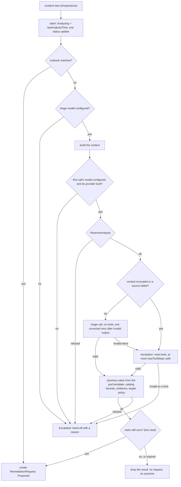

# 3. Observation and deduplication

This section covers how the analyzer turns cluster symptoms into `Incident` objects and decides when one is due for analysis. The collector (3.1) reads Warning events, pod status and the objects of active modules' symptom sources. Two levels of deduplication (3.2) keep the counts bounded and stable across restarts. The analysis (3.3) is built: the context builder is given the real Prometheus and pod logs adapters, and the analyzer starts the analysis loop that calls it, with the Microsoft Foundry adapter, only when it runs with `--triage-model` (off by default, [#76](https://github.com/pkalin/shadewright/issues/76)).

[![Shadewright analyzer: the collector turns events, pod status and the HPAs, pods and add-on kinds of active modules' symptom sources in the watched namespaces into deduplicated, bounded Incidents, dropping the evidence of pods whose workload has retired their template and the readiness or startup probe failures that are part of a pod's start or shutdown, and holding a BackOff or Unhealthy event whose pod status shows no cause for 2 minutes, dropping it if the container recovered; the analysis trigger decides when one is due, using analysis.maxAnalysesPerDay from the settings and a Budget ConfigMap; Prometheus and pod logs have adapters that the analyzer gives to the context builder, which makes a bounded, redacted context in provenance-tagged blocks; the analysis loop, which the analyzer starts only with --triage-model (off by default), claims a due Incident, calls the triage model once and the escalation model with read tools only on a deterministic signal, through the Foundry adapter at an allowed endpoint, validates the result, takes the previous memory limit from the pod template and the previous maxReplicaCount from the ScaledObject it read (a ScaledObject that is not ready is not offered that action and ends ScalerNotReady), rechecks its claim and creates the typed RemediationRequest or hands off to a person.](../assets/diagrams/analyzer.svg)](../assets/diagrams/analyzer.svg "Open full size")

## 3.1. Collecting

<span class="sw-status sw-built">built</span> The collector (`internal/analyzer/collector`) runs in the analyzer and reads through its cache, so it sees only the watched namespaces.

**Source.** It uses `events.k8s.io/v1`, for new events and for updates to an event series. It does not also watch `core/v1` events: they are the same objects in an older version, so each event would be counted twice. Fields read: `regarding`, `reason`, `action`, `type`, `reportingController`, `note`, `eventTime`, `series.count`, `series.lastObservedTime`, and `deprecatedCount` and `deprecatedLastTimestamp` for events written by older recorders ([Event API](https://kubernetes.io/docs/reference/kubernetes-api/events/event-v1/)).

Events detect symptoms; they are not a durable audit log. The collector keeps what it needs beyond event retention and also reads current object state.

**What it observes.**

- **Events:** only type `Warning`. An event is unusable, and dropped, when any of these holds: the reason is not a plain CamelCase word; the reporting controller is not a plain component name; a field is longer than the `Incident` schema allows; the regarding object is in another namespace than the event; the regarding reference has no UID.
    - A readiness or startup probe failure that is part of a pod's start or shutdown is not a symptom ([#726](https://github.com/pkalin/shadewright/issues/726)). Without this rule a pod that fails its readiness probe once while it starts, and is Ready seconds later, made one observation, and so did the next pod of the same workload that did the same: both share one fingerprint (the workload's UID and the normalized note), so a scale-up a few minutes after another one opened an Incident through the gate of 3.2; the same went for the readiness failures of pods shutting down in two scale-downs. The rule covers an event with reason `Unhealthy` about a pod whose note starts with `Readiness probe ` or `Startup probe `, as the kubelet writes them; a liveness failure always counts. It is decided from the one read of the pod the owner chain makes (the cache, by name, checked by UID); no other read or permission. With the event's last occurrence as the time of the failure:
        - At or after the pod's deletion timestamp: skipped at once. A process that shuts down stops answering its probes. A failure before the deletion is judged by the rules below.
        - Skipped only when all of these hold: no container of the pod, init containers included, has restarted; the failure is within `collector.StartupWindow` (5 minutes) of the start of the container the probe belongs to (the container the event's field path names, or the pod's start time when it names none the collector can find); and the pod is Ready, with its Ready condition changed at or after the failure, so it became Ready after it. A service that needs longer than the window to start should declare a startup probe; its failures past the window count.
        - A pod that is not Ready yet, with no restarts and within the window, is looked at again once `collector.ProbeSettleGrace` (1 minute) has passed since the failure, the event's last occurrence at the first look, never later than the collector's clock; a series that grows meanwhile is still one wait, and an event older than the grace (one replayed after a restart) is decided at once. Still not Ready by then, it counts, one minute late at most, well within the gate's 2 to 15 minutes.
        - Everything else counts as before: a restart, a failure past the window, a pod Ready since before the failure (the kubelet flips Ready only after `failureThreshold` failures, so a running pod that fails a probe or two under load, or the first failure after a dependency went down, stays Ready), a pod that flaps back to Ready long after it started, a pod that is gone or replaced (unless its template was retired, below), a read error (retried), an event that names no pod, and an event the collector has no room to wait on (at most 10,000, the event state's bound). A failure decided to count stays counted while its delivery is retried, even if the pod becomes Ready meanwhile.
        - A skipped event is recorded as handled, adds 1 to `shadewright_analyzer_settled_probe_failures_skipped_total` (label `probe`) and logs a debug line. The failures waiting or waiting for delivery are in `shadewright_analyzer_probe_decisions_pending`. The waits are in memory only and none is dropped unseen. Which repeats of an event series were skipped is in memory too: when the analyzer restarts within the window, a replayed series can count the repeats that were skipped before the restart, so the count can be a few too high and never too low (keeping it across restarts needs state the analyzer has no permission to write). The times compared with the failure (container start, Ready transition) are written by the same node's kubelet, the deletion timestamp by the API server.
- **Pod status:** every abnormal container termination, in init and app containers, from the current and the last state: `OOMKilled`, or any other reason with a non-zero exit code.
    - A reason that is not a plain CamelCase word within the schema's length is reported as `Terminated`.
    - A termination is one observation, identified by its container ID, or without one by its start and finish times, exit code and reason (not the restart count, which changes when the termination moves to the last state). Two such terminations of one container in the same seconds with the same exit code and reason count once.
    - The symptom is the container name and the exit code. The termination message is never read: the container writes it.
- **Pod status, waiting causes** ([#789](https://github.com/pkalin/shadewright/issues/789), ADR-0039 point 4): a container whose current `state.waiting.reason` is `ImagePullBackOff`, `ErrImagePull`, `InvalidImageName`, `CreateContainerConfigError` or `CreateContainerError`, in init and app containers. Any other waiting reason is not read, and the waiting message never is.
    - One observation per container, reason and restart count (occurrence `waiting:`), with that reason, the kubelet as reporting controller, type `Warning`, and the symptom `Container <name> is waiting: <reason>`. It is not immediate: a wait is often short while an image is pulled, so it goes through the gate of 3.2.
    - The pod status gives no time for a wait, so the collector keeps, per container, the waiting state it shows and the time it first saw it, by its own clock: that is the occurrence's `Began`. The time is dropped when the container no longer shows the state or shows another reason or restart count (a new occurrence), and with the pod's state; the pod watch lets through an update whose old or new pod shows a symptom, so the update that ends a wait reaches the collector; at most one per container of a pod the collector tracks.
    - While the same state is shown, the collector reports it again at most once every 2 minutes (`collector.SettleAfter`), on a pod update or on a requeue it asks for, so a wait with no pod update is reported too: the same occurrence, `Began` unchanged, the time of the read as `ObservedAt`, and nothing to count. Once the wait has lasted 2 minutes the repeat proves that the symptom recurs and opens its Incident (3.2); a repeat never raises `status.count` or the occurrence's total, and moves the Incident's `lastSeen` to its time (never backwards), so the Incident stays open while the wait lasts and resolves as quiet an hour after the last repeat. A wait shorter than 2 minutes (an image being pulled) opens nothing. Both times come from the collector's clock. `ErrImagePull` and `ImagePullBackOff` alternate with two fingerprints, and each change starts its time again, so a failing image pull opens its Incident once one `ImagePullBackOff` lasts 2 minutes, which with the kubelet's image back-off (10, 20, 40, 80 and 160 seconds, then 300) is during the fifth back-off: about 4.5 minutes (150 seconds of the first four back-offs plus 2 minutes of the fifth) after the first failure, plus the time of each pull attempt (ADR-0039 point 4, amended 2026-11-16). A restart of the analyzer starts the time again.
    - The cluster gives no time for a wait, so its `Began` is the collector's first sight of it, and it always counts as possibly repeated (`MayRepeat`; an earlier process may have reported it) and is settled by the Incident controller (3.2).
- **Module symptom sources:** the kinds of `collector.SourceKinds` (`autoscaling/v2` HorizontalPodAutoscalers and core Pods, the latter read from the informer of the pod collector, and the KEDA, Flux and Kyverno kinds of 2.5.1), read through the same cache. An add-on's kind is watched only while a module that reads it is active, the API server serves it and the analyzer may list it (2.2.2); otherwise no informer starts and the kind is reported in the settings condition `SymptomSourcesNotWatched`. On each object the collector runs the source an active module declares for the kind (2.5.1); with the module not enabled or not detected the source does not run and its owner kind is not read. Only creates and updates that the active source shows a symptom on, before or after the change, reach the collector's reconcile (an HPA's status is written on every sync); when a module becomes active for a kind, the collector checks every 30 seconds and then evaluates the cached objects its source shows a symptom on. Only objects that showed a symptom take room in its bounded memory of handled states.
    - The subject is the owner the source declares once it is verified (the `ScaledObject` of a KEDA HPA, 2.5.1), a Pod's verified workload as for container terminations (the Deployment of a cloudflared replica), or else the object itself. The fingerprint hashes that owner's UID, or the object's.
    - A state of any kind but the HPA is emitted only once the collector has seen it last 2 minutes (`collector.SettleAfter`, equal to the gate's `RecurAfter`, 3.2): it reconciles the object again then, and a state that ended meanwhile, such as a cloudflared replica not ready for the seconds of a rollout, opens nothing. The HPA's ceiling is emitted at once, as before. A state is emitted once while it lasts, so the collector applies the gate's rule itself and the state is then immediate.
    - Each symptom state is one observation with the symptom's reason, the source's reporting controller and type `Warning`. Its symptom is the module's fixed summary followed by its evidence (`field=value`, each value redacted and cut to 256 bytes), normalized and redacted again as a whole. The fingerprint hashes the summary, not the evidence.
    - The occurrence is `condition:` and a hash of the object UID, kind, reason and when the state began, with a total of 1: a state that lasts counts once, one that ends and comes back counts again. The start is hashed as the object reports it, so a start later than the collector's clock keeps one occurrence when the clock passes it; the observation's `Began` is never later than the clock. A state without a known start is settled by the Incident controller like any occurrence that may repeat. A state the collector sees end (a reconcile without it) and come back with the same start, as when `ScalingLimited` stays True with another reason in between or has no `lastTransitionTime`, is a new occurrence, identified by when the collector saw it come back. The limit: that time is not known after a restart, so a new process identifies a state by its start alone. A state that came back before the restart and still lasts then matches the first state's occurrence and is not counted again, and a return the collector did not see (while it was down, or between two reconciles) is not counted.

**Owners.** The subject of an observation is the owning workload, following controller owner references (only those marked `controller`) from Pod to ReplicaSet to Deployment and from Pod to StatefulSet.

- A pod whose controller reference names a Deployment directly is its own subject: Deployments control ReplicaSets, not pods.
- Owner references are untrusted. Each hop is read with the API reader (a `get` with a deadline, in the object's own namespace, which the role limits to the watched namespaces). It must exist with the referenced UID and a non-empty selector that matches the labels of the object below it; otherwise the chain stops at the last verified object.
- The read decodes the whole object, pod template included, and keeps only the UID check, selector, labels and controller reference.
- DaemonSets and Jobs are not followed, because the analyzer cannot read them, so their pods are their own subjects. A ReplicaSet without a Deployment is its own subject.
- An event that names a Deployment or a StatefulSet is kept only if the object exists with the event's UID.
- The owner reference of each pod looked up is remembered, so an event that arrives after its pod was deleted still reaches the workload. A pod deleted before the collector looked it up stays its own subject.
- Evidence from a pod of a retired template is dropped ([#724](https://github.com/pkalin/shadewright/issues/724)): a container termination, an event about the pod or a Pod symptom state whose pod belongs to a template its Deployment or StatefulSet has retired becomes no observation. Otherwise an old pod still terminating after a fix through Git opens an Incident, the plan is built from the current template, and verification credits a change that did nothing once the old pod is gone. A template is retired only when it no longer runs once its pods are gone: old pods that keep serving while a rollout is paused, or while its new pods never go ready, are real evidence and open an Incident as before. "Retired" is decided from the verified chain and fresh `get`s, each with its own deadline, never from the owner cache (whose facts may predate the rollout) and never from a pod label alone:
    - Deployment: the pod's ReplicaSet, still controlled by the Deployment, is scaled to 0 (`spec.replicas`) and has a lower `deployment.kubernetes.io/revision` than the Deployment, whose `status.observedGeneration` equals its generation. The deployment controller sets the Deployment's revision to its newest ReplicaSet's, and a rollback gives the revived ReplicaSet a new, higher one, but only once the controller has observed the rollback; until then the generations differ and the evidence is kept. Revisions are compared rather than templates: a template compared field by field can differ only through defaults a newer API server added, which would drop real evidence. A ReplicaSet that is not found (`NotFound`, not any other error) while its pod is terminating, as with `revisionHistoryLimit: 0`, is retired too.
    - StatefulSet: the pod is terminating (it has a deletion timestamp, or it is already gone when an event about it arrives) and its `controller-revision-hash` differs from `status.updateRevision`, with `status.observedGeneration` equal to the generation and an update strategy that moves every pod (`RollingUpdate` without a partition). A pod of the old revision waiting its turn keeps its evidence, and so does a running pod whose label was edited.
    - Cost: the pod's own facts are checked first, so a StatefulSet pod that is not terminating costs no read, and the Deployment is read only for a ReplicaSet scaled to 0. What the reads found is reused for 5 s per ReplicaSet or StatefulSet UID, as an unverified owner is, so a rollout is noticed within 5 s.
    - Fail open: when the answer is not known the evidence is kept as before. That covers a failed or refused read (counted in `shadewright_analyzer_replaced_template_check_errors_total`), an object replaced, a missing or unparsable revision, and a status behind its spec. A bare ReplicaSet and a pod whose controller is not followed are unchanged.
    - Bookkeeping: a dropped termination, event or symptom state is recorded as handled, as an emitted one is, so later updates of the pod neither read nor count it again and a later rollback does not bring it back. Each adds 1 to `shadewright_analyzer_replaced_template_evidence_dropped_total` (label `kind`) and the drop logs a debug line. The model and the freshness check before the pull request are not involved.

**Output.** Each observation carries:

- the fingerprint and the normalized, redacted symptom from `internal/incidents/fingerprint`;
- the subject;
- the occurrence (an event UID, a hash naming one container termination, a hash naming one waiting cause of a container (`waiting:`, 3.1), or a hash naming one symptom state of a module symptom source);
- the occurrence's total as the cluster reports it;
- the new occurrence count, and when it happened (never later than the collector's clock);
- where it was read (`Origin`, the `Source` of ADR-0039): `podStatus` for a termination or a waiting cause, `event` for an event, empty for a module symptom source. Only `podStatus` is part of the fingerprint (3.2);
- the container (`Container`): a status entry's name; for an event, the container its `regarding.fieldPath` names, only in the form `spec.containers{<name>}` or `spec.initContainers{<name>}` with a DNS label name that exists in that list of the pod's spec, and only when the regarding object is the Pod whose UID the collector verified. Anything else leaves it empty;
- the class (`Class`) and, for a consequence, the cause fingerprint (`CauseFingerprint`), described under Consequence symptoms in 3.2. Only the collector's hold of a consequence with no cause acts on them so far;
- whether it is *immediate*: it opens its Incident at its first sighting instead of waiting to be seen again (3.2; an observation whose occurrence repeated at least 2 minutes after it began opens it at once too, immediate or not). Two kinds are: a container termination read from pod status with the reason `OOMKilled`, and every symptom state of a module's symptom source (a condition state such as a KEDA ceiling, already settled and lasting, with its own start; it is emitted once while it lasts, so it would never be seen again). An event never is, whatever its reason, because whoever can create events in a watched namespace writes the reason.

The new count is at most 1,000 per observation: a series count is written by whoever can create events, so one forged jump adds at most that much (each further update as much again). No raw note leaves the collector. Observations go to a bounded channel read by the Incident controller; when it stays full, the reconcile tries again later without recording anything as handled.

**Defaults.**

- A send to the channel waits up to 10 s, and a reconcile whose send timed out is retried 5 s later. Each watch runs one reconcile at a time, so a slow consumer delays the others by up to that much.
- Each owner read and each question to the Incident controller (3.2) has a 5 s deadline, and a timed-out question is retried 5 s later.
- Owner reads have no rate limit of their own: each watch reads at most one owner at a time, and the cache absorbs repeats.
- The owner cache holds 4,096 entries: verified owners for 10 minutes, owners that could not be verified for 5 s (the read goes to the API server, and a controller exists before its pods, so a miss is not a lag to wait out).
- Event state holds 10,000 entries and pod state 5,000 (see 3.2).
- The informer cache of the watched namespaces and this state count against the analyzer's memory limit (128 Mi in `config/manager/analyzer.yaml`). Namespaces with many pods or events need a higher limit. The chart sets `GOMEMLIMIT` to 90 percent of that limit (`analyzer.goMemLimit` overrides it), so the runtime collects before the container is killed.

**Supported load (decided from issue #254).** The 128 Mi limits are meant for a small to mid cluster: up to 20 watched namespaces, 1,000 Pods in them, 10,000 `events.k8s.io/v1` Events in the API server at a time (about an hour of 170 a minute, since the API server keeps Events for an hour; 10% of them Warning), a sustained 200 Events a minute with bursts of 1,000 in a minute, and the default cap of 500 Incidents. The numbers come from the shape of the cache: the analyzer holds every Pod and every Event of the watched namespaces (Normal ones too, see below), so memory grows with Pods plus the Events of the last hour, not with the rate alone. A cluster beyond this needs a higher limit (chart `analyzer.resources`) or fewer watched namespaces.

**Measurement on Kind (2026-11-07).** Method: `hack/load/measure.sh` at commit `b33301732e277695333e589befc9556607f59009`, Kind v0.33.0 with Kubernetes v1.37.0 (one node, arm64 Docker host), chart installed with the images built from that commit and the default 128Mi limit. It created the load above (1,012 Pods, 40 of them running and the rest Pending, 11,202 Events, one crash-looping Pod), restarted both Deployments over it, ran a stream of 200 Events a minute for 5 minutes, then a burst of 1,000 Events, and sampled the kubelet's container working set every 5 s, `/metrics` (`process_resident_memory_bytes`, `go_memstats_heap_inuse_bytes`) and the container's cgroup `memory.peak` afterwards. The model call was off (no `triageModel`), so the analysis context is not part of it. The numbers of a Kind laptop are a sample, not a guarantee.

| Phase | Analyzer working set (max) | Analyzer Go heap in use (max) | Executor working set (max) |
|---|---|---|---|
| idle, empty cluster | 24 Mi | 17 Mi | 16 Mi |
| load created | 63 Mi | 52 Mi | 16 Mi |
| restart over the full load | 67 Mi | 55 Mi | 17 Mi |
| stream, 200 Events a minute for 5 minutes | 87 Mi | 72 Mi | 19 Mi |
| burst of 1,000 Events, then settle | 87 Mi | 77 Mi | 20 Mi |

- **Analyzer peak:** 87 Mi working set and 89 Mi in the cgroup's own `memory.peak` (page cache included) against the 128 Mi limit, so about 70% of it, with 0 restarts and no OOM kill. The growth between the restart and the end comes from the cache of the new Events and the 500 Incidents the load opened (the cap), not from a leak: it stopped during the settle phase.
- **Time:** the analyzer was Ready 14 s after a restart over the full load (including the old Pod's shutdown), and the collector's Event reconcile took 1.5 ms on average (3,155 reconciles).
- **Field selector:** the API server supports `fieldSelector=type=Warning` on `events.k8s.io/v1` Events (checked on that cluster), and the cache could take it (`cache.ByObject.Field`). It is not used: the model's read tools (`list_events`, and the reference check of a pod) read Events from the same cache, and the Normal ones (`Scheduled`, `Killing`, `Pulled`) are part of what they show. A Warning-only cache would change the tool output, so it needs its own decision; it would drop about 90% of the Event objects in this load. It was not measured separately.
- **Executor:** it has no GitHub App on Kind, so its pull request path did not run; idle and under the same load it stayed at 16 to 20 Mi on Kind (13 Mi idle on AKS, below). Its worst-case render is in [8.2.2](8-gitops-on-github.md#822-steps-4-and-5-the-semantic-diff-check).

**Lab data point (2026-11-06).** With `v0.3.0-rc.2` (commit `bbe555ca09db887d1389270e53e6ef64249cd7eb`) on one `Standard_D4as_v5` node of AKS, an idle `kubectl top` sample with 30 Pods and about 400 Events showed analyzer memory 17 Mi (an earlier sample, after 3 analyses and 1 pull request, 19 Mi and 2m CPU) and executor memory 13 Mi (16 Mi, 1m CPU), with 0 restarts. Each had requests of 64Mi/10m and a memory limit of 128Mi. It is an idle point and agrees with the empty-cluster row above; the peak under load is the Kind measurement.

**First cases.** These are the symptoms the design starts from:

- `FailedScheduling`: insufficient resources, quota, node affinity or taints.
- Image pull failures and invalid pod configuration (missing Secret or ConfigMap reference).
- Restarting containers: `CrashLoopBackOff`, `OOMKilled`, failing probes.
- KEDA trigger errors and Flux reconciliation failures.

Reasons differ by component and version. `OOMKilled`, for example, comes from container status, not from an event with that reason, so detection always joins events with object state.

## 3.2. Two levels of deduplication

### Observation level

<span class="sw-status sw-built">built</span> The collector remembers the event UID and the last handled count. On a series update it processes the increase, not the total, and at most 1,000 per observation. A single event without a series counts once, or as its `deprecatedCount` when an older recorder kept one. The series count includes the first occurrence, so a single event that becomes a series of 2 adds 1.

**Collector state.** It is kept in memory, in maps with a fixed capacity (10,000 events, 5,000 pods and 5,000 objects of module symptom sources by default) that drop the least recently used entry. Memory alone does not survive a restart, so the collector cannot tell how much of an occurrence is new when:

- the event or termination is older than its first reconcile (a restart, or a new leader); or
- it is no newer than state the collector dropped to stay within its capacity.

A pod's terminations are judged against the collector's start and the eviction bound as it was when the collector first saw the pod, so committing one does not make the others look new. A termination without a finish time always counts as possibly repeated.

**The question to the Incident controller.** For those occurrences the Incident controller tells the collector how much of that occurrence was already counted, and the collector emits only the rest (capped as above), or nothing. The question names the occurrence (the event UID, or a hash of pod UID, container and termination) and when it began, not the fingerprint. Several pods or events share one fingerprint, and the fingerprint depends on owner correlation, which can differ after a restart (an owner deleted in between), while the occurrence does not. So the answer is looked up across Incidents. Of a consequence the controller also reads its class and cause fingerprint, only to find the drop mark of its cause's absorbed list.

**What the controller persists.** The Incident controller (`internal/incidents`) stores, per occurrence, the highest total it counted and when the occurrence began, in `status.occurrences` of the `Incident`.

- An Incident keeps at most 32 occurrences, newest first by when they began. An occurrence without a known beginning sorts as the oldest, so it is dropped first.
- When it drops older ones, `status.occurrencesDroppedThrough` records when the newest dropped one began. The schema lets the mark only move forward.
- The controller answers from memory, loaded from the Incidents when it starts, and a question waits until they are loaded, so a restart never reads as "never counted".

**How it answers.**

- For an occurrence it kept: the recorded total.
- For one it has no record of that began no later than the latest drop mark of any Incident: that the occurrence was counted in full, so a bound never counts twice. The mark is shared across Incidents because the question does not name the fingerprint, so a busy Incident can make an old occurrence of another look counted (an undercount, never an overcount). The drop mark of a cause's absorbed list (`absorbedOccurrencesDroppedThrough`, see the cause rule below) is not shared: it answers only for an observation of class `consequence` whose `CauseFingerprint` is that cause Incident's fingerprint, because the list turns over fast and would otherwise make old occurrences of every Incident look counted after a restart. It is not keyed by the subject UID: the subject is the owning workload, so that key would take never-counted consequences of every pod and container of it as counted. Known limit, accepted (decided 2026-11-16 on #791): the collector works the cause fingerprint out again from the pod status at replay, and after an OOM kill loop the status shows only the newest kill, so an older consequence can come back with another cause fingerprint or none. The mark does not recognise it, and it goes through the gate, where it can open one consequence Incident of its own. That fails toward opening, as the hold bound does (ADR-0039).
- An occurrence without a known beginning cannot be placed against the mark, so the mark never answers for it: once its record is dropped it may be counted again. That overcount is preferred to a count silently lost, because the count feeds a bounded trigger.
- It answers that it never counted an occurrence only when that is true.

**Without an answer** the collector does not guess: it emits the observation with a new count of 0, the cluster's total and *may repeat*, and the consumer subtracts what it holds.

- The consumer caps that difference at 1,000 as well (`Observation.Increase`).
- An observation of an occurrence it holds a record of adds at most the increase over that record, so a collector that lost its state does not count the same occurrence again.
- The cap is per observation: every further forged update of a series can add up to 1,000 again, so `status.count` saturates at 1,000,000 (the schema refuses more). It is a bounded count of reported occurrences, not a count of distinct ones.

### Incident level

<span class="sw-status sw-built">built</span> Similar observations are grouped by fingerprint:

```text
hash(clusterID, namespace, ownerUID-or-resourceUID,
     reason, action, type, reportingController, normalizedSymptom)
```

- `resourceVersion` is not an incident ID.
- A pod UID alone is not enough, because one pod can have several problems.
- Correlating to the owning Deployment joins symptoms from successive pods of the same workload. The rollout revision is kept as extra context.

Normalization removes variable parts (random pod suffixes, timestamps) but keeps what matters: image name, error code, the name of the missing Secret, the kind of dependency. Secrets are redacted before storage and before anything reaches the model.

Both are pure functions in `internal/incidents/fingerprint`:

- The note is redacted first with the shared redaction package, so no later substitution can shield part of a secret. Redaction markers become fixed placeholders, so secrets or addresses of different lengths do not change the fingerprint.
- Normalization then replaces object UIDs, image digests, timestamps, IPs and durations with placeholders.
- A Kubernetes milli quantity reads like a duration in minutes (`averageValue=6500m`). The text that is hashed replaces it like any duration: a metric value changes while the problem lasts, and a new value must not open a new Incident (or change existing fingerprints on upgrade). The symptom an Incident stores and the model reads, and each evidence value, keep a milli quantity that is the value of a key (after `key=` or `key:`, or a whole evidence value), so they show the value and target as read: the stored symptom keeps the value first seen (`spec.symptom` is never rewritten, and held occurrences of one fingerprint keep the first one's symptom), and an evidence value the value it was read with ([#479](https://github.com/pkalin/shadewright/issues/479)). A bare minute count after a key (`timeout=5m`) is kept there too, since it cannot be told from a quantity; every other duration becomes a placeholder in both. Binary and decimal suffixes (`Mi`, `Gi`, `k`) never read as durations.
- It strips pod name suffixes and ReplicaSet hashes only from names the text (or the event's regarding object) identifies as a Pod or ReplicaSet, so a missing Secret such as `db-7d4b9` keeps its name.
- It cuts the symptom to the 1024 characters `spec.symptom` allows.
- Every field is length-prefixed in the hash, and a version string is hashed first so that changed rules give new fingerprints instead of merging old and new incidents.

### When a symptom opens an Incident

<span class="sw-status sw-built">built</span> Decided on 2026-11-05 ([#267](https://github.com/pkalin/shadewright/issues/267)). In the v0.1.0 lab run, the first minute after Flux applied a healthy baseline opened four Incidents, each with a count of 1: Warnings from a KEDA scaler and an HPA reading metrics while Prometheus was still starting. Ten minutes later everything was healthy and the Incidents were still open. So a symptom must recur before it opens an Incident:

- An observation that **proves recurrence on its own** opens the Incident at once, whenever it arrives: the occurrence's latest repeat came at least 2 minutes after it began (for an event, its last observed time against its creation). A total of 2 or more alone is not enough: a recorder that repeats an event within seconds, or at a controller's poll interval under 2 minutes, makes a series too. So an events.k8s.io series that the reporter refreshes only about every 30 minutes (kube-scheduler's `FailedScheduling`), or a replay of a series after a restart, opens its Incident; arrival timing alone would never see it twice in the window. The times of an event are written by whoever writes the event, like its reason: whoever can create events in a watched namespace can open an Incident at once with a forged series, as they could by writing the event twice 2 minutes apart (G4.10).
- Any other observation of a fingerprint that has no Incident (a single, fresh sighting) is held in memory as a **first sighting**. It opens the Incident when the symptom is seen again **at least 2 minutes and at most 15 minutes** after the first sighting (`RecurAfter`, `RecurWithin` in `internal/incidents`), by the Incident controller's clock.
- A sighting before 2 minutes is held too and keeps waiting: a burst within seconds is not a recurrence. One after 15 minutes starts over as a new first sighting, and the old one is forgotten. A symptom seen once opens nothing.
- Sightings of one fingerprint need not come from one pod: the fingerprint is per workload, so the same event about two pods of a Deployment a few minutes apart is a symptom seen again. The collector therefore drops a readiness or startup probe failure that is part of a pod's start (the pod became Ready after it, within 5 minutes of its container's start, with no restart) or of its shutdown (at or after its deletion) before it reaches the gate (3.1, [#726](https://github.com/pkalin/shadewright/issues/726)).
- **Immediate** observations open their Incident at once: a container `OOMKilled` read from pod status, and the symptom states of module symptom sources, such as a KEDA ceiling (3.1). For every kind of source but the HPA, the collector itself first waits until it has seen the state last 2 minutes (`collector.SettleAfter`, equal to `RecurAfter`), so those open their Incident no sooner than this rule would. The set is explicit and kept small.
- Whatever opens the Incident, every sighting held for the fingerprint is counted first, in order, and forgotten, so the Incident's count and `firstSeen` include the first one.
- A fingerprint refused at the cap on Incidents is remembered (the last 1,024), and each later observation of it is refused as it arrives instead of waiting again as a first sighting.
- An observation with nothing new to count (a repeat of an occurrence already counted or held) is neither held nor counted. A repeat of a waiting cause (`waiting:` occurrence) that proves recurrence on its own, with a first sighting of its fingerprint held, still opens the Incident with what is held: this is how a waiting cause still shown opens (3.1). A repeat of a waiting cause (`waiting:` occurrence) whose Incident exists moves its `lastSeen` to the repeat's `ObservedAt`, never backwards, and counts nothing, so the quiet rule does not resolve the Incident of a container still waiting. Any other observation with nothing new to count replays something older and moves nothing.
- Once the Incident exists, every observation is counted at once. Closing an Incident whose symptom has stopped is the lifecycle's rule (see [Incident lifecycle](#incident-lifecycle), #251), not this one.

**Memory only, bounded.** First sightings live in the analyzer's memory, never in a CR, and a restart forgets them. That is safe: a real symptom recurs, and its Incident opens up to 15 minutes later than it would have.

- At most 4,096 fingerprints are held (`Config.MaxFirstSightings`, the size of the collector's owner cache); when that is full, the oldest first sighting is forgotten and its symptom starts over. So a flood of distinct one-off fingerprints cannot grow the memory, only delay other symptoms' Incidents.
- At most 4 occurrences are held per fingerprint, sharing one copy of the symptom, about 12 MiB for all of them at most. A further sighting of an occurrence already held is merged into it (the highest total), and the collector's question whether an occurrence was counted (`Handled`) is answered from what is held, so a copy sent again neither takes a place nor counts twice. A sighting of a fifth occurrence before 2 minutes is not held, so it is not counted when the Incident opens (an undercount).
- First sightings older than 15 minutes are dropped on the writer's tick. The gauge `shadewright_incident_first_sightings_held` reports how many are held.
- The cap on Incidents applies when a sighting opens one, not when it is held.

### Consequence symptoms

<span class="sw-status sw-built">built</span> The collector's part of the first step ([#789](https://github.com/pkalin/shadewright/issues/789)): every observation carries its origin, its container and a class. `cause` is only a pod-status observation: an `OOMKilled` termination or a waiting cause (3.1); a termination with a non-zero exit code is an observation as before, of no class, and links nothing. `consequence` is a `BackOff` or `Unhealthy` event from the kubelet on a named container (3.1); an event is never a cause, whatever its reason. A consequence's `CauseFingerprint` is read from the container's status entry in the collector's cache: a current waiting cause first, otherwise an `OOMKilled` termination, current or last, with `finishedAt <= t <= finishedAt + 10 minutes` (`collector.KillCauseWindow`), where `t` is the event's own time (the series' last observed time, else `eventTime`, else the deprecated last timestamp; the creation time, stamped by the API server, does not count, and without one nothing is linked). It is the fingerprint of the cause's own pod-status observation. The fingerprint of a pod-status observation hashes its origin as one more field, so an Event with the same reason, controller and note gets another one; the fingerprints of events and of module symptom sources are unchanged byte for byte. The Incident controller does not read the new fields yet; only the collector's hold (below) acts on them.

<span class="sw-status sw-built">built</span> The hold of a consequence with no cause ([#792](https://github.com/pkalin/shadewright/issues/792), ADR-0039 points 19 and 20). A consequence whose `CauseFingerprint` is empty is not emitted at once: the collector keeps it in memory and reads the event again after `collector.ConsequenceGrace` (2 minutes) from its own first sight, measured on its own clock alone. Each reconcile of the event while it is held (the first sight, the updates of its series, every update of the pod it names, which the event controller maps to the holds on that pod, and the read at the end) is a sample of the named container in the pod the event names: failing means the container's restart count went up since the previous sample of the hold (the first sample compares with the count at the start of the hold), or it is not ready (`Unhealthy`) or waiting in a back-off (`BackOff`). At the end the observation goes on to the gate (3.2), as any other, only when the pod exists with the same UID, at least two samples were failing, and either this last sample is failing or the container restarted at least twice during the hold (amended 2026-11-16). Otherwise nothing opens: the occurrences are recorded as handled, so a pod that failed its readiness probe once while it started, or a container that backed off, restarted once and then runs and is ready for the rest of the wait, opens nothing ([#726](https://github.com/pkalin/shadewright/issues/726) for any probe and any restart count). A liveness probe that keeps restarting a container with no readiness probe (ready between its restarts, its restart count going up) opens, also when the end of the wait falls in a life where it runs and is ready. A recovered container sends no more events, so without the samples of its pod's updates the end would see only the restart since the first sight. A pod gone or replaced (another UID) during the wait ends the hold with nothing opened. A failed read of the pod is an error retried by the controller and leaves the hold as it is; it is never taken as gone. A later increase of the event's series is a new hold, decided the same way, and counts only the increase when it opens. A cause that appears during the wait releases the consequence at once, with its cause. A decision to open stands while its delivery is retried, and so does an emission at once for want of room: the collector remembers the event (its UID, at most 1,024 such marks) until the delivery ends, so a retry after room has freed does not hold it. The holds are bounded: at most 1,024 (the index by pod UID has an entry per hold and no other) (`collector.DefaultMaxHeldConsequences`), and a quarter of that (256) per namespace of the event. Over either, a new consequence is emitted at once without a verdict and goes through the gate as before; none is dropped and none waits past the bound. A restart forgets the holds: the events are listed again and the hold starts from the new process's first sight, so it can only be longer; the observation then carries *may repeat*, and `Handled` settles its count (3.2). The ends are counted in `shadewright_analyzer_held_consequences_total` (label `outcome`: `opened`, `not_opened`, `released` for a cause seen during the wait, `dropped` when the event ends the hold itself, for example deleted or no longer a Warning; these four add up to the holds started; and `overflow` for a consequence emitted at once, never held), the holds in `shadewright_analyzer_consequences_held`. The Incident controller's first sightings are not used for it.

<span class="sw-status sw-built">built</span> `BackOff` and probe `Unhealthy` of a container whose pod status shows a cause count as evidence on that cause's Incident and open none of their own. The collector reads the cause from the status the kubelet wrote: an OOM kill that finished within 10 minutes before the observation's own time (both written by the same node's kubelet), or a waiting reason for an image or configuration error now. Nothing depends on the cause Incident's phase, and only a pod-status observation can make a cause: its source is part of its fingerprint, which changed once for terminations with #789, and an Event never creates a cause or folds an Incident. A probe failure of a pod that became Ready at start without a restart, or of a terminating pod, is dropped by the collector before this rule (3.1, [#726](https://github.com/pkalin/shadewright/issues/726)). The evidence is kept in its own bounded list that the analysis trigger and the quiet rule never read. A consequence with no cause is held first (the paragraph above). <span class="sw-status sw-built">built</span> A consequence Incident created at most 15 minutes (the gate's `RecurWithin`, by `creationTimestamp`) before its cause's Incident, on the same container, none of whose requests has a pull request, is folded: `Resolved` with `Lifecycle` `FoldedIntoCause` and `status.foldedInto` ([#793](https://github.com/pkalin/shadewright/issues/793), below). The closure rules skip a folded Incident, so it does not return to `Proposed` (`RequestActive`) and does not end `Escalated` (`RequestCancelled`). <span class="sw-status sw-planned">planned</span> The executor's cancel of its request (reason `IncidentFolded`, after a live read of the Incident as the last step before the pull request, failing closed; a request of an Incident that is gone ends `Cancelled` with `IncidentGone`), which the closure skip keeps from escalating it. Accepted on 2026-11-14 in [ADR-0039](../adr/0039-consequence-symptoms-attach-to-their-causes-incident.md) ([#432](https://github.com/pkalin/shadewright/issues/432)). The Incident status fields are in the API ([#790](https://github.com/pkalin/shadewright/issues/790)): `containers` (at most 8 DNS labels), `cause`, `absorbed` (one entry per consequence reason, `BackOff` or `Unhealthy`, at most 8), `absorbedOccurrences` (at most 32, with its drop mark `absorbedOccurrencesDroppedThrough`) and `foldedInto`, with the reasons `FoldedIntoCause`, `IncidentFolded` and `IncidentGone` as constants.

<span class="sw-status sw-built">built</span> The count on the cause's Incident when the cause comes first ([#791](https://github.com/pkalin/shadewright/issues/791), `internal/incidents/consequence.go`). In `consume`, after the occurrence is checked against what was counted and before the first-sighting gate, a `consequence` observation with a `CauseFingerprint` and a named container is counted on the latest Incident of that fingerprint when the controller's own list (loaded at start, kept by each write and each trigger pass, and by a cause counted but not written yet) has it with `status.cause` for the observation's subject UID. Its phase is not read, so an `Escalated`, `Proposed` or `Resolved` cause takes the evidence, and evidence alone never escalates or reopens a `Resolved` cause. Only a cause `Resolved` more than 24 hours before the observation does not take it: its next cause observation opens the next occurrence. The observation goes to `status.absorbed` (count and `lastSeen` per reason) and `status.absorbedOccurrences`, never to `count`, `lastSeen` or `occurrences`, so the trigger and the quiet rule never see it, it takes no place under the Incident cap, and the cause's own symptom going quiet resolves the cause after an hour as before. Its record is loaded again after a restart and answers the collector's `Handled`, so an occurrence whose record is kept is not counted twice. A `podStatus` observation of class `cause` sets `status.cause` in the status write that counts it, and every counted observation adds its container to `status.containers`: a name that is not a DNS label, or one past the eighth, is left out and logged, so the write never fails on it. `status.cause` never goes back to false (a CEL transition rule refuses it, and a rule on the root refuses removing the whole status while it is true, decided 2026-11-16 on #791). The schema allows `absorbed` and `absorbedOccurrences` only with `cause` true, and lets `occurrencesDroppedThrough` and `absorbedOccurrencesDroppedThrough` only move forward. An Incident deleted and created again under the same name, with another UID and no `cause`, is forgotten as a cause once a write or a trigger pass shows it. A consequence held as a first sighting before its cause's Incident was opened is counted there in full when a later observation of it links to the cause, not only the increase the later one brings. Evidence counted while the create of its cause's Incident is in flight is dropped with it when the API server refuses the create, and the log line of a dropped batch names its absorbed count next to its own. A consequence whose cause has no Incident yet, or that the rule does not link, goes through the gate as before.

<span class="sw-status sw-built">built</span> The fold of a consequence Incident that opened before its cause ([#793](https://github.com/pkalin/shadewright/issues/793), ADR-0039 points 12 to 15 and 23, `internal/incidents/fold.go`). Folds come from two places. The status write that creates a cause Incident, or sets `status.cause` on one, makes its fold owed, and the write loop's pass that made that write then folds (the fast path). Every pass of the analysis trigger, the first at start, derives the folds owed from the stored Incidents (fourth decision of 2026-11-16 on #793), before the closure rules run: once its cause exists a consequence's `lastSeen` stops moving, so after an hour the quiet rule would otherwise resolve it `SymptomQuiet` before its fold. it starts from the listed consequence Incidents that may still be folded and looks, for each, for a cause Incident of the same subject UID and container created at most `RecurWithin` after it, comparing the two `creationTimestamp`s only. Nothing is compared with the controller's clock, so a fold owed does not age out during an outage, a run of pass timeouts or a late restart. That covers a cause written by the final flush at stop or before a restart, and a consequence the cache had not seen when the fast path ran. The work is bounded by the Incident cap; a pass with nothing to fold lists the requests only when a pair matches, and writes nothing. From the controller's own list of Incidents and requests it picks each Incident that is itself a consequence (`spec.reason` `BackOff` or `Unhealthy`, `spec.reportingController` `kubelet`; an Incident of a non-zero exit termination or of a `Failed` Event never folds), not a cause, neither `Resolved` nor `Escalated` (an `Escalated` Incident waits for a person), and never folded before (`status.folded`: a fold happens at most once per Incident, so a consequence reopened after its fold keeps its own analysis, also once an analysis, a request outcome or an escalation has replaced its `Lifecycle` reason `Reopened`, and a retry whose earlier answer was lost, or one after a partial failure, does not fold it a second time), of the same subject UID, with a container in `status.containers` that the cause also names, created at most `RecurWithin` (15 minutes) before the cause Incident by the two `creationTimestamp`s (both stamped by the API server, so a cause first seen much earlier and opened from a gated recurrence is covered), none of whose requests has reached a pull request (the condition `PullRequestOpened` True, a recorded pull request or merge, or a phase from `PRCreated` on), and whose newest request (chosen as the closure rules choose it) did not end without success: a request that ended `NeedsIntervention`, `Denied`, `Failed` or in another phase the closure rules escalate leaves the Incident to them, since a fold would make them skip the escalation for a person (fifth decision of 2026-11-16 on #793). For each it reads the Incident and the requests live, decides again, and writes one status update with the resource version it read and the field manager `shadewright-incident-lifecycle`: phase `Resolved`, `resolvedTime`, `Lifecycle` `FoldedIntoCause` with a fixed message, `status.foldedInto` with the cause Incident's name and UID, and `status.folded` true. A conflict is decided again from the new state, so an analysis that won first (`Proposed`, a request with a pull request) keeps its Incident. A fold that wins over `Analyzing` makes the analysis's live claim check fail: it ends with `errClaimLost`, creates no request and writes no outcome. That holds for a fold written during the model call only: a fold written between the claim's last live recheck and the create of the request (`publish` in `internal/analysis/controller.go`) still leaves a request, which only the planned executor check closes ([#794](https://github.com/pkalin/shadewright/issues/794), ADR-0039 point 23). The controller refuses to fold an Incident into itself, which the schema cannot check. A failed listing, read or write is an error, tried again: on the fast path it is logged and counted in `shadewright_incident_write_errors_total`, and the fold stays owed and is tried again `RetryAfter` later; in the trigger pass it fails the pass, which is logged and counted once in `shadewright_analysis_trigger_errors_total`, and the next pass tries it again. A fold cancelled by shutdown is neither logged as an error nor counted. The schema allows `foldedInto` only in phase `Resolved`; once set it may only be cleared, together with a move to a phase other than `Resolved` (by the reopen of point 24, or by an escalation of a recurrence seen after the window), never changed to another Incident; the status cannot be removed while it is set, and it cannot name the Incident itself (decided 2026-11-16 on #793). `status.folded` never changes from true to false, and the status cannot be removed while it is true (fourth decision of 2026-11-16 on #793). <span class="sw-status sw-planned">planned</span> The executor's cancel of a folded Incident's request with no pull request (P2 of #432); until it is built, such a request runs its course on the folded Incident, and its outcome does not move it.

### Timing values

Starting values, to be tuned on real traffic:

| Mechanism | MVP value |
| --- | --- |
| Debounce before analysis | 45 s (30-60 s) |
| A single, fresh sighting opens an Incident when seen again (not immediate, total under 2) | 2 to 15 min after its first sighting |
| Aggregation window for similar observations | 5 min |
| Longest wait to settle, from the first unsettled observation | 5 min (the aggregation window) |
| Cooldown before any re-analysis, new symptom and lost analysis included | 15 min |
| Analysis taken as lost (phase `Analyzing`) | 10 min, due again at the later of this and the cooldown |
| Concurrent actions | One per target object |
| Re-analysis trigger | New symptom or symptom seen again, once the cooldown has passed |

### Incident objects and their writes

<span class="sw-status sw-built">built</span> Deduplication state must survive restarts. In the MVP it lives in a namespaced `Incident` CR in the operator namespace ([ADR-0007](../adr/0007-incident-state-in-crds.md)), one per occurrence of a fingerprint, named `incident-` and the hex of the fingerprint; a symptom seen again more than 24 hours after its Incident was resolved opens the next occurrence, `incident-<64 hex>-<n>` (<span class="sw-status sw-built">built</span>, see [Incident lifecycle in design 3.2](#incident-lifecycle)). Its spec holds the fingerprint, the subject and the normalized, redacted symptom; raw logs never go into a CR.

**Batching.** The Incident controller runs in the analyzer, in the leader only, and writes in batches.

- The observations that open an Incident, or the first one of an existing Incident in a process, are written at once. Later ones are gathered and written once per aggregation window (5 min), so a burst costs a few writes, not one per observation.
- Writes run apart from the consumption of observations, so a slow API server delays the writes, not the collector.
- Each write reads the Incident from the API server, not the cache, and retries on a conflict.

**Retrying a write whose answer was lost.** A write may time out after the API server stored it. The controller leaves out a batch the status already holds, checked per occurrence:

- an occurrence recorded with at least the batch's total shows the batch was stored;
- one recorded lower or missing, although it began after `occurrencesDroppedThrough`, shows it was not;
- one the write could have dropped or skipped shows neither (it began no later than the mark, has no known beginning, or has an ID the schema refuses).

A batch is taken as stored only when at least one occurrence shows it and none shows otherwise. So such a write is not counted twice when it is tried again, 5 s later. The batches it sent are kept apart from the observations that arrive meanwhile, so these cannot hide that it was stored. A batch none of whose occurrences can show it is written again (a possible overcount, not a loss).

**Batches that are not written.**

- A batch the API server refuses as invalid is logged and dropped rather than tried again, and the controller's memory of its occurrences goes back to what the Incident stores. An Incident it could not create frees its place under the cap.
- An Incident of the expected name that holds another fingerprint is not written either, and its batch and memory go the same way. Anyone who can create Incidents in the operator namespace can block a fingerprint like that, and only the log and `shadewright_incident_batches_dropped_total` (reason `fingerprint_conflict`) show it.
- The status of such an Incident is not ours, so it is never taken into memory once the Incidents are loaded: neither its records nor its `occurrencesDroppedThrough` (the drop mark is shared by all Incidents). The records load took from it stay only while it still holds them.

**Shutdown and lost leadership.** Pending and failed batches are written once more, with retries, within 5 s, under the Pod's 10 s termination grace period. Each of these writes also reads the Incident fresh and leaves out what it already holds, so it adds nothing a new leader already wrote. Lost are:

- the batches still unwritten at that deadline (counted with reason `stopped`);
- observations still in the channel;
- everything pending when the process is killed, not stopped.

A new leader that loaded the Incidents before the old leader's last writes landed may count those occurrences again.

### Bounds on Incidents and held occurrences

**Number of Incidents.** <span class="sw-status sw-built">built</span> The number is bounded instead of retained for a time: at most 500 in the operator namespace (`--max-incidents`), counting those that exist when the analyzer starts.

- At the cap a new fingerprint is not stored. Its observations are counted in the Prometheus counter `shadewright_incident_observations_refused_total`, and each new fingerprint is logged once. <span class="sw-status sw-built">built</span> A new occurrence is a new object and counts under the cap like a new fingerprint, so it is refused at the cap too: the Resolved Incident stays as it was, and the refusal is counted, logged and reported like a new fingerprint's.
- A Warning event (reason `IncidentCapReached`) about the analyzer's Pod, whose name comes from `POD_NAME`, is written for at most one refusal every 10 minutes, because whoever can create events in a watched namespace can make new fingerprints at will.
- Fingerprints that already have an Incident are still counted.
- Nothing deletes Incidents yet (retention by age is not built), so once reached the cap stays reached until someone deletes some and the analyzer restarts (it counts the Incidents when it starts). When Incidents should go is decided but not built: see [Incident lifecycle](#incident-lifecycle), question 8 in section 15, and the 2026-11-03 and 2026-11-05 amendments of [ADR-0007](../adr/0007-incident-state-in-crds.md#amendments).

**Occurrences held unwritten.** <span class="sw-status sw-built">built</span> They are bounded too, so the controller's memory stays bounded while status writes fail:

- at most 256 per Incident (eight times the 32 records its status keeps);
- at most 10,000 for all Incidents together;
- each count includes the pending batch, a failed batch and a batch being written, each on its own;
- an Incident that holds none always takes its first occurrence, so the total can pass 10,000 by at most one per Incident.

**Why a share per namespace** ([#278](https://github.com/pkalin/shadewright/issues/278)). An Incident's held occurrences go down only when its own write returns, so a total shared by all Incidents could be filled within one normal window, with no write failing: about 40 fingerprints (10,000 / 256) with 256 new occurrences each, which anyone who can create Warning events in a watched namespace can make. So each namespace holds at most a share of the total: a quarter by default (2,500), but never less than the cap per Incident and never more than the total.

**Which namespace is charged.**

- Each occurrence is charged to the namespace it came from: the event's own namespace, or the pod's for a termination read from pod status. That is the namespace RBAC grants event creation in, so whoever fills a share needs that grant there.
- The namespace of the Incident's subject would not do: a cluster-scoped subject (a Node) has none, so every cluster-scoped Incident would share one key that anyone who can create events in any watched namespace could fill. A tenant who started holding a Node's fingerprint would have the kubelet's later reports of it charged to the tenant's share or blocked by it.
- Fingerprints cost an attacker nothing, so a share per fingerprint would add nothing to the cap per Incident.
- The analysis budget's share ([#207](https://github.com/pkalin/shadewright/issues/207)) should take the same key; that is not settled.

**How it is checked.**

- The share is checked like the other caps, against the namespace of the new occurrence. An Incident that holds none still takes its first occurrence, so a namespace can pass its share by one per Incident.
- Each Incident's batches remember the source namespace of every occurrence they hold. The controller keeps, per Incident and in total, how many of the held occurrences each namespace was charged. When a write returns, each namespace moves by what of its occurrences was written or dropped, so the counts return to zero once every batch is written. These counts have at most one entry per held occurrence, so they stay within the cap on held occurrences.
- The memory of records (what `Handled` answers from) holds the records of the Incidents plus these occurrences, so it is bounded as well. Records a write whose answer was lost dropped are forgotten once the retry succeeds or is refused.
- An observation of an occurrence already in the Incident's pending batch is always taken. One held only in a failed batch or a batch being written counts as new there.

**What remains.** Anyone who can create events in a namespace can fill that namespace's share, `default` included, where the events about nodes land, and with it crowd out the new occurrences of the other Incidents counted there.

- One noisy namespace leaves about 70% of the total to the others at the defaults (three quarters, less one per Incident it has, at most 500).
- It takes four noisy namespaces at once to fill the total (three hold at most 7,500 plus one per Incident, 8,000). While it is full, every other Incident counts at most one new occurrence per write.

**A new occurrence over a cap** is an undercount, never a lost Incident. Its increase is not counted and no record of it is kept, but the observation still moves the Incident's first and last seen, and the Incident is written as usual, so it exists and the analysis trigger sees it seen again. The occurrence is not remembered either, so if the collector asks about it later (after a restart, or once the collector dropped it from its own memory) it may be counted then; until then the count is lower than what the cluster reported. Each one is counted in `shadewright_incident_occurrences_overflow_total`, and the controller logs, at most once a minute, how many it left uncounted.

### Analysis trigger

<span class="sw-status sw-built">built</span> The Incident controller decides every 10 s which Incidents are due for analysis and records it in the condition `AnalysisDue` of each, with a reason. The decision is a pure function (`Due` in `internal/incidents`) of:

- the Incident's status;
- the newest observation the controller still holds unwritten;
- when the controller first saw the Incident waiting to settle;
- whether a pass of the running analyzer found the Incident gone quiet (below);
- since when the passes in a row of the running analyzer have looked at the Incident (a pass whose list of Incidents fails breaks that run);
- the clock and the limits;
- the analyses already used today.

An incident is due when it has data the last analysis did not see, has settled (or waited the longest it may), its cooldown has passed and the budget allows. The rules, with the reason each sets:

- Nothing observed yet (no `lastSeen`): not due (`NotObserved`).
- Never analyzed: due (`FirstAnalysis`), but only when seen recently: last seen (`lastSeen`, or an observation the controller holds unwritten) within the recent window, by default the 15 min cooldown and never shorter than the debounce. One last seen longer ago, and not already marked due, is not due (`NotRecent`) and takes no unit of the budget. A mark that says due is not taken back for that, so those already due keep their units while their analysis has not started; a mark written for another generation of the Incident is no mark, as for the writes below, and the analysis does not claim it either. A mark taken back only because a pass could not read the settings or the budget (`SettingsUnreadable`, `BudgetReadFailed`, written only over a mark that said due) still counts as due, so one failed read does not end a pending first analysis. An Incident whose newest occurrence (by begin time) is a symptom state of a module's symptom source (a `condition:` occurrence, such as a KEDA ceiling or HPA `ScalingLimited`) is never `NotRecent`: such a state is emitted once while it lasts (3.1), so its `lastSeen` does not move while the problem is present, and the status records no end of it. Since an ongoing state cannot be told from one that ended, every such Incident is taken as recent; one whose state ended before analysis could run is analyzed once. Each skip is visible: the pass that writes `NotRecent` also writes a Normal event `AnalysisSkipped` on the Incident (in the operator namespace, with the analyzer's existing grant on core Events there) and counts it in `shadewright_analysis_skipped_not_recent_total`, once each time the condition changes to `NotRecent`, not on every pass. The condition then stays `NotRecent` until the Incident is next marked due, so a second quiet spell before that writes no event and is not counted again. A pass writes its `NotRecent` conditions after every other decision, and at most 20 of them, so a backlog of quiet Incidents (the first pass after an upgrade, late settings or a budget reset) neither delays the marks that say due nor runs the pass into its deadline; the rest follow on the next passes ([#430](https://github.com/pkalin/shadewright/issues/430)). So a symptom that stopped before analysis could run (settings applied after the Incidents were written, `maxAnalysesPerDay` raised from 0, the budget reset at 00:00 UTC) is not analyzed for nothing ([#423](https://github.com/pkalin/shadewright/issues/423)). A `lastSeen` ahead of the analyzer's clock counts as recent. A new observation, a new occurrence or an event series counting up again, makes it due again through the debounce and the settle limit below, so a problem that keeps recurring stays eligible. The window applies to a first analysis only: a re-analysis needs data seen after `lastAnalysisTime` anyway, and a timed-out one is due again as below. It is a setting of the Incident controller (`RecentWindow`, zero takes the cooldown), not a flag, like the debounce and the cooldown; one shorter than the debounce is raised to it by the decision alone, and the event names the window applied.
- Nothing seen since `lastAnalysisTime`: never due (`NoNewData`).
- Seen again or a new occurrence, but less than the 15 min cooldown since `lastAnalysisTime`: not due (`CoolingDown`). The cooldown applies to every re-analysis, a new occurrence and a lost analysis included, so a crash-looping workload, which makes a new termination every few minutes, is analyzed at most once per cooldown.
- Past the cooldown: due, `NewOccurrence` when an occurrence began after `lastAnalysisTime`, otherwise `CooldownExpired`. Distinct occurrences count, not `status.count`: a forged update of an event series raises the count but adds no occurrence. An occurrence without a known beginning, or one that began before the last analysis but was written later, is not new.
- Not before 45 s have passed since the incident was last seen (`Debouncing`), counting both `lastSeen` and the observations the controller holds in a batch it has not written yet, so a burst that goes on is not due while its newest observations wait for the next write.
- Not when the daily limit of the `RemediationSettings` is 0 (`AnalysisDisabled`) or the analyses of the current UTC day reached it (`DailyBudgetReached`).

**The debounce is bounded.** An incident is due at the latest one aggregation window (5 min) after its first unsettled observation, even if observations keep arriving less than 45 s apart. That observation is:

- for an incident never analyzed that went quiet and was seen again: the first pass that found it waiting again. A pass finds it gone quiet when a `lastSeen` L is older than the recent window (and it is not marked due and holds no lasting state), on every pass, one that cannot read the settings or the budget included. L is the stored `lastSeen` when that is stale itself (the later spell), else the one the previous pass read when the stored one is more than the recent window after it: a spell that ends between two passes is found by that jump, and a shorter gap is no spell however late the pass that reads it. The status holds only the newest observation, so within one pass interval of the window the jump is a guess (observations written together can hide one that broke the gap); it errs towards a spell, which only delays the first analysis. The previous pass's `lastSeen` is compared only when that pass ran within the recent window, its list of Incidents did not fail since, and its newest occurrence was no lasting state then: a stalled or paused analyzer, or one whose lists failed, did not see the activity in between, and a lasting state's frozen `lastSeen` is no quiet spell; an observation held unwritten does not hide it either. The pass then forgets when it first saw the incident waiting if that was not after L plus the recent window, since such a wait belongs to the spell before; a later one, the new burst's while its observation is held, is kept, so its settle limit keeps counting. A `NotRecent` condition stands for the same after a restart. Nothing in the status dates the new burst (an event series counting up again adds no occurrence), so the wait starts with the running analyzer's first sight of it, and a restart starts it again;
- else, for one never analyzed, the beginning of its newest burst when its occurrence records show a gap: two consecutive beginnings (the drop mark counted as one) further apart than the recent window. Such a gap is no proof of a quiet spell (an event series may have counted up all through it), so it is taken only when the running analyzer did not look at the incident on every pass since before the gap began; one that did would have found it gone quiet. It thus covers a quiet spell while the analyzer was down. A spell while it was down that ended with an event series counting up again shows no gap, and that wait counts from `firstSeen` (a known limit);
- else `firstSeen` for an incident never analyzed;
- else the beginning of the earliest occurrence that began after `lastAnalysisTime` (both survive a restart);
- for a recurrence of an occurrence the last analysis already counted, which the status does not date: the first pass of the running analyzer that found the incident waiting, so a restart of the analyzer starts that wait again.

Whoever keeps a symptom flapping can delay an analysis by up to the window, not suppress it.

**The daily limit** is `spec.analysis.maxAnalysesPerDay`, or the deprecated `spec.maxAnalysesPerDay` of v0.1.0 when that is still set and lower (5.4). A budget that cannot be read means refuse:

- no `RemediationSettings` object: `SettingsNotFound`;
- settings without `spec.analysis.maxAnalysesPerDay`, which the schema's defaults never leave: `SettingsIncomplete` (no default limit is assumed);
- no budget ConfigMap: `BudgetNotFound`;
- a budget from a future day, out of bounds or with other keys: `BudgetUnreadable`;
- when either object cannot be read at all, Incidents marked due are set not due: `SettingsUnreadable`, `BudgetReadFailed`.

**Deadlines.** Each pass has an 8 s deadline, under the 10 s between passes, for the list from the cache, the budget read and the writes together, so an API server that stalls costs at most the pass it is in. Within it the two reads of the budget have 5 s: a read that reaches that counts as one that failed, and the rest of the pass takes the marks that say due back. Those it has no time left for keep their mark until a later pass takes it back. The late-cause folds (ADR-0039, #793) run first, within the first quarter of the deadline, then the closure rules within the next half, then the due marks within the rest, so a step that runs into its share never takes the marks' time.

**Phases come first.** `Open` and `Resolved` (and no phase yet) are decided as above. In the other phases:

- `Proposed` or `Escalated`: not due (reasons of the same name; `Recurred` for an Incident a recurrence after its resolution escalated). How an incident leaves those phases is <span class="sw-status sw-built">built</span>, see [Incident lifecycle](#incident-lifecycle).
- `Proposed` with a reviewer hint <span class="sw-status sw-built">built</span> ([ADR-0028](../adr/0028-reviewer-hints-through-the-pull-request.md), #537): a request naming the Incident, in `AwaitingApproval` with a recorded pull request, holds a `Pending` hint in `status.hints` that no analysis has answered. Hints are answered one at a time, the earliest accepted first; one is answered once `status.handledHint` names it outside phase `Analyzing`, and the next waits until the executor has moved that one on. Such an Incident is due (`ReviewerHint`) once the cooldown since `lastAnalysisTime` has passed, with the budget, but without the debounce or the recent window, which are about the Incident's own data. Within the cooldown it is not due (`CoolingDown`), and with the budget used up or 0 not due (`DailyBudgetReached`, `AnalysisDisabled`): a refused hint is an answer, not a queue, so the same status update records the hint in `status.handledHint` and sets the condition `Analyzed` (`True`, reason `CoolingDown` or `BudgetSpent`), which the executor reads to decline the hint. A budget that cannot be read answers nothing. Before it writes a refusal, the trigger reads the request holding the hint live: a hint no longer `Pending` there, or one older than the hint `handledHint` already names, is not refused, so a lagging cache never overwrites a newer answer of the analysis; a failed read refuses nothing. The requests are read from the cache once per pass; when they cannot be listed, no hint makes an Incident due and the pass counts an error. Only requests the analysis takes as its own count (the same check as the analysis's: the label `remediation.shadewright.io/incident-uid` and the form an analysis gives a request, see "Requests left out"), so a hint the analysis would not answer neither holds a unit of the budget nor is refused; with the analysis off no hint counts.
- `Resolved`: not due (reason `Resolved`), never analyzed again. Unlike the phases above, what leaves it is <span class="sw-status sw-built">built</span>: a symptom seen again escalates it or opens the next occurrence; the closure rules set it ([Incident lifecycle](#incident-lifecycle)).
- `Analyzing`: not due until 10 min after `lastAnalysisTime` (`Analyzing`), after which the analysis is taken as lost. It is due again (`AnalysisTimedOut`, with the debounce and the budget) once the cooldown has passed too, so at 15 min with the defaults, and `CoolingDown` in between.
- `Analyzing` without a `lastAnalysisTime` cannot be placed against either, so it is not due (`AnalysisStartUnknown`) until its status is repaired. The analysis writes the phase and the time in one status update (`internal/analysis`, [#76](https://github.com/pkalin/shadewright/issues/76)), so it never leaves that state itself.
- An Incident whose name holds another fingerprint is not decided; if it says due, it is set not due (`ForeignFingerprint`).

**Writes.** The condition is written only when the decision changes from due to not due or back, or between two reasons for due. A change between two reasons for not due is not written, and the first reason stays, so a change that turns every Incident's reason at once (the budget used up, or set to 0) costs no writes. `NotRecent` is the exception: it is written over another not-due reason, once per quiet Incident, with its event, and then stays while the Incident is not due. A decision reads it back only to start the settle limit of the next burst (above). `Analyzing`, which the analysis writes in its claim, is the other: it stays only while the run lasts. The run has ended once the phase is no longer `Analyzing` (the outcome write sets `Proposed` or `Escalated` and leaves `AnalysisDue` to the trigger) or the analysis timeout has passed since `lastAnalysisTime`; from then on the next pass writes whatever reason it decides over `Analyzing` (`Proposed`, `Escalated`, `CoolingDown`, `Debouncing`, a budget reason, ...), and from there the rule above holds again ([#424](https://github.com/pkalin/shadewright/issues/424)). With the budget unknown, an Incident in phase `Proposed` or `Escalated` still gets that reason rather than the budget's, so the outcome shows; when the settings or the budget cannot be read, that outcome is the only reason written over `Analyzing`, and a run taken as lost keeps `Analyzing` until a read succeeds. The writes carry the field manager `shadewright-analysis-trigger`.

### The analysis budget

<span class="sw-status sw-built">built</span> The count of the day lives in the ConfigMap `shadewright-analysis-budget` in the operator namespace, shipped empty with the analyzer (`config/manager/analysis_budget.yaml`).

- **Keys:** `day` (the UTC day, `YYYY-MM-DD`) and `used` (the analyses started on it, 0 to 10,000 in decimal digits), both or neither, nothing else. It is parsed and checked in Go, since a ConfigMap has no schema.
- **Where it lives:** not in the Incidents and not in memory, so neither a restart nor deleting Incidents frees budget.
- **Permissions:** the analyzer may get and update this one ConfigMap and may not create it. Deleting it stops analysis (`BudgetNotFound`) rather than resetting the count. Only someone who may create ConfigMaps in the operator namespace (an admin) can bring it back, empty or with any count.

**Marking Incidents due.** Each Incident marked due takes one more unit of what is left. Those already due go first, then the oldest by `firstSeen`. So no more Incidents are due at once than the budget has left, and a flood of new fingerprints does not push older incidents out of it. A mark whose write failed or whose answer was lost still takes its unit.

**Taking a unit.** The mark is not the check. `ReserveAnalysis` is built, and the analysis loop (`internal/analysis`, [#76](https://github.com/pkalin/shadewright/issues/76)) calls it once per analysis, after the context is built and the first call's provider, and before the first model call; the analyzer starts the loop only with `--triage-model`. It reads the ConfigMap, adds one to the day's count (starting at 1 on a new UTC day) and updates it with the resourceVersion it read (an update, not a patch), retrying on conflict. It refuses when:

- the settings hold no `analysis.maxAnalysesPerDay`;
- the count reached the daily limit (the lower of it and the deprecated `spec.maxAnalysesPerDay`);
- the ConfigMap is missing;
- the ConfigMap cannot be trusted.

Without `--triage-model` the analyzer does not start the loop, so nothing adds to the count. One unit is one claimed attempt ([ADR-0025](../adr/0025-analysis-claims-units-and-evaluation-manifest.md) decision 2). A unit is never given back; a lost answer can only overcount.

<span class="sw-status sw-built">built</span> One unit is one claimed attempt: all calls, retries and tool rounds of one run, counted on the UTC day it was reserved, a lost response included; token and money limits are separate bounds ([ADR-0025](../adr/0025-analysis-claims-units-and-evaluation-manifest.md))

**Shared by the whole cluster.** Anyone who can create events or pods in a watched namespace can spend the budget with distinct fingerprints that become due over the day. A share per namespace or per fingerprint is <span class="sw-status sw-planned">planned</span> ([#207](https://github.com/pkalin/shadewright/issues/207)).

**Metrics.** Each pass of the trigger reports the count and the limit it read in the gauges `shadewright_analyses_used_today` and `shadewright_analyses_per_day_limit` ([metrics reference](../reference/metrics.md)). The Incident controller also reports, through the leader, the Incidents by phase and the number due for analysis, served at scrape time from its informer with no API call. It counts the analysis trigger passes that fail and the Incident status writes that fail. The metrics reference lists them with their labels.

### Incident lifecycle

Decided on 2026-11-05 and 2026-11-07 ([#251](https://github.com/pkalin/shadewright/issues/251)); what is built and what is planned is marked in each row. <span class="sw-status sw-built">built</span> Today the controller creates an Incident with the phase `Open` (a status with no phase gets `Open` on its first write), and the trigger reads the phase as described above. <span class="sw-status sw-built">built</span> The analysis controller (`internal/analysis`, [#76](https://github.com/pkalin/shadewright/issues/76)) writes `Analyzing`, `Proposed` and `Escalated` when the analyzer runs with `--triage-model` (off by default). <span class="sw-status sw-built">built</span> What a symptom seen again does to a `Resolved` Incident (the two rows from `Resolved`, the 24 hour rule and occurrence names), in the Incident controller. <span class="sw-status sw-built">built</span> The closure rules ([#466](https://github.com/pkalin/shadewright/issues/466), `internal/incidents/closure.go`): every pass of the analysis trigger, before it decides the marks, moves Incidents to `Resolved` (with `resolvedTime`) and to `Escalated` as the rows below say. Only the arrow from `Escalated` that keeps it there needs no write.

**Rules.** <span class="sw-status sw-built">built</span>

- The analyzer is the only component that moves an Incident between phases. It already owns the Incident's status; the operator's request controller never writes it (it reads a request's phase), no delete grant is added and invariant 6 is unchanged.
- `Open`, `Proposed` and `Escalated` move to `Resolved` when the symptom has not been seen for 1 hour and no request that names the Incident (`incidentRef`) is still active. A request that reached `Succeeded` (merged and verified) resolves the Incident at once. Active means a request phase before a final one; the final phases are `Succeeded`, `Denied`, `Failed`, `Expired`, `Cancelled`, `Superseded` and `NeedsIntervention`.
- A request that ends in any other final phase moves the Incident to `Escalated`, never `Resolved`: a person decides. That is `Denied`, `Expired`, `Failed`, `Cancelled`, `Inconclusive` (merged, and its effect could not be shown, #678) and `NeedsIntervention`, which includes a pull request rejected or closed without a merge (`NeedsIntervention`, reason `ChangeRequestClosed`, [section 6](6-reconciliation.md)). `Superseded` leaves the Incident to the newer request that names it, or `Escalated` when there is none. A request `Superseded` with reason `AnotherRequestMerged` (another request of the same Incident and target was merged, [6.6.3](6-reconciliation.md#663-duplicates-of-a-merged-request), #556) is never the newest: the merged request decides, so a duplicate that ended after the fix merged never escalates it. A request `Superseded` with reason `AnotherRequestClosed` (it waited behind a request whose pull request for the same field was closed without a merge, [6.6.4](6-reconciliation.md#664-requests-after-a-pull-request-closed-without-a-merge), #643) is not skipped that way: the closed request may belong to another Incident, so when it is the newest request of its Incident, the Incident moves to `Escalated` for a person. A request `Superseded` with reason `AnotherRequestSucceeded` (it waited behind a request whose verified change of the same field succeeded, [6.6.5](6-reconciliation.md#665-requests-behind-a-change-being-verified), #719) moves its Incident to `Resolved` with `HolderSucceeded` when every request it records in `status.queuedBehind` that still exists is `Succeeded`; otherwise it escalates like any other `Superseded` request.
- <span class="sw-status sw-built">built</span> A `Resolved` Incident is never analyzed again: the trigger gives it the not-due reason `Resolved`, and the analysis never claims it. The 24 hour rule is measured from the status field `resolvedTime`, written in the same status update that sets `Resolved`, against the time each observation was seen. An observation seen no later than `resolvedTime` (held unwritten across the resolution) is no recurrence: it is counted and the Incident stays `Resolved`. After a resolution by the quiet rule (`Lifecycle` `SymptomQuiet`) the bound is `resolvedTime` minus the quiet hour: that resolution says nothing was seen in the hour before, so an observation seen in it (one consumed, or between a held and an in flight write, while the closure rules decided) contradicts it and is a recurrence, whatever the rules' view of the unwritten observations missed. A missing or unreadable `resolvedTime` counts as within 24 hours: the recurrence is escalated, not analyzed (fail closed), and so is one seen later while observations of the `Resolved` Incident were still unwritten. A symptom seen again within 24 hours of `resolvedTime` (a fix that keeps coming undone) starts no analysis: the same Incident moves to `Escalated` for a person. A symptom seen again more than 24 hours after resolution creates a new Incident, through the same gate as a new fingerprint (seen again 2 to 15 minutes after its first sighting, or immediate, [when a symptom opens an Incident](#when-a-symptom-opens-an-incident)), named `incident-<64 hex>-<n>` for occurrence n >= 2 (occurrence 1 keeps `incident-<64 hex>` with no suffix), linked to the previous one (its name and the occurrence count are recorded). The new Incident is analyzed from its symptoms and context only, never the denial reason or any earlier outcome or policy decision, so the model cannot search for what the policy allows (invariant 1: model output is never authorization). The 24 hour window is a constant for now; making it a setting is a later choice.

| From phase | Event | To phase | Written by | State |
| --- | --- | --- | --- | --- |
| none | a symptom seen again 2 to 15 min after its first sighting, one whose observation proves recurrence (its occurrence repeated at least 2 min after it began), or an immediate one (`OOMKilled`, a module source's symptom state), is written | `Open` | Incident controller (analyzer) | Built |
| `Open` | the trigger marks it due and the analysis starts | `Analyzing` | analyzer (analysis, #76) | Built, with `--triage-model` |
| `Analyzing` | the analysis produced a RemediationRequest | `Proposed` | analyzer | Built, with `--triage-model` |
| `Analyzing` | the analysis made no proposal | `Escalated` | analyzer | Built, with `--triage-model` |
| `Analyzing` | no result after 10 min (taken as lost) | stays `Analyzing`, due again after the cooldown (a lost reviewer hint run that ends without a model call: at once, without the budget) | trigger (`AnalysisTimedOut`) | Built (the mark); the analysis controller claims such an Incident again, with `--triage-model`; the lost run's claim has expired, so it can publish nothing (ADR-0025) |
| `Proposed` | a reviewer hint makes it due (`ReviewerHint`) and the analysis starts | `Analyzing`, with the hint in `handledHint` | analyzer (analysis, ADR-0028) | Built, with `--triage-model` (#537) |
| `Analyzing` | an analysis with a reviewer hint made no replacement (no proposal, the same plan, a refusal) | `Proposed`: the request the hint was given on still stands | analyzer | Built, with `--triage-model` (#537) |
| `Proposed` | request `Succeeded` (merged and verified) | `Resolved` at once | analyzer (closure rules) | Built; nothing writes `Succeeded` until verification is built ([#92](https://github.com/pkalin/shadewright/issues/92)). Interim rule until #92: a request in `Merged` counts as final, so it no longer blocks the 1 h quiet rule (it moves nothing by itself), and a recurrence within 24 h of `resolvedTime` escalates as usual |
| `Open` | symptom not seen for 1 h and no active request | `Resolved` | analyzer (closure rules) | Built |
| `Proposed` | request `Denied` by policy | `Escalated` | analyzer (closure rules) | Built |
| `Proposed` | request `Expired`, `Failed`, `Cancelled` or `Inconclusive` | `Escalated` | analyzer (closure rules) | Built |
| `Proposed` | pull request rejected or closed without a merge (request `NeedsIntervention`, `ChangeRequestClosed`), or any other `NeedsIntervention` | `Escalated` | analyzer (closure rules) | Built |
| `Proposed` | request `Superseded` | follows the newer request that names the Incident, `Escalated` when there is none; one `Superseded` with reason `AnotherRequestMerged` is skipped, so the merged request decides; one `Superseded` with reason `AnotherRequestSucceeded` follows the success of the request it waited behind: `Resolved` (`HolderSucceeded`) | analyzer (closure rules) | Built (the skip: #556; the success: #719) |
| `Proposed` | symptom not seen for 1 h and no active request (symptoms gone before merge, or fixed by a person without the pull request) | `Resolved` | analyzer (closure rules) | Built |
| `Escalated` | symptom not seen for 1 h and no active request (a person fixed it, or it went away) | `Resolved` | analyzer (closure rules) | Built; the hour counts from the escalation too (below) |
| `Escalated` | a person's fix does not hold: the symptom stays or returns | stays `Escalated` | none | Built (nothing to write) |
| `Resolved` | symptom seen again within 24 h of `resolvedTime`, or `resolvedTime` is missing or unreadable (recurrence after success, or after a person's fix) | `Escalated` (the same Incident, no analysis), with the condition `Recurred` (`RecurredWithinWindow` or `ResolvedTimeUnknown`), in the status update that counts the observation | analyzer (Incident controller) | Built |
| `Resolved` by the quiet rule (`Lifecycle` `SymptomQuiet`) and never analyzed (no `lastAnalysisTime`, no request recorded) | symptom seen again within 24 h of `resolvedTime` (seen later while observations were held unwritten: escalated, the row above) | `Open` (the same Incident, no new occurrence), `resolvedTime` cleared, `Lifecycle` `Reopened`, in the status update that counts the observation; analyzed as usual | analyzer (Incident controller) | Built (decided 2026-11-07, #466) |
| `Resolved` as `FoldedIntoCause` (with `status.foldedInto`), analyzed before or not | symptom seen again within 24 h of `resolvedTime` | `Open` (the same Incident, no new occurrence), `resolvedTime` and `foldedInto` cleared, `Lifecycle` `Reopened`, in the status update that counts the observation; analyzed as usual (ADR-0039 point 24) | analyzer (Incident controller) | Built (#791) |
| none, `Open`, `Analyzing` or `Proposed`, a kubelet `BackOff` or `Unhealthy` Incident never folded before (`status.folded`) | a cause Incident of the same subject UID and container is created at most 15 min (`RecurWithin`, by `creationTimestamp`) after it, and none of its requests has reached a pull request | `Resolved`, `Lifecycle` `FoldedIntoCause`, `status.foldedInto` naming the cause Incident, `status.folded` true; an analysis in flight ends as a lost claim (ADR-0039 points 12 to 14 and 23) | analyzer (Incident controller) | Built ([#793](https://github.com/pkalin/shadewright/issues/793)) |
| `Resolved` as `FoldedIntoCause` (with `status.foldedInto`) | a request naming it is active, or its newest request ended (`Cancelled` with `IncidentFolded` included) | stays `Resolved`: the closure rules skip a folded Incident (ADR-0039 point 15) | analyzer (closure rules) | Built ([#793](https://github.com/pkalin/shadewright/issues/793)) |
| `Resolved` | an active request names it (created after the closure rules listed the requests) | `Proposed`, `resolvedTime` cleared, `Lifecycle` `RequestActive`; the request then decides as usual | analyzer (closure rules) | Built (#466) |
| `Resolved` | no active request names it, and the newest that does was created at or after `resolvedTime` less 30 s of clock skew (after the closure rules listed the requests) and has ended without success | `Escalated`, `resolvedTime` cleared, `Lifecycle` as in phase `Proposed` (`RequestDenied` and so on); `Succeeded` leaves it `Resolved`, `Merged` moves nothing | analyzer (closure rules) | Built ([#476](https://github.com/pkalin/shadewright/issues/476)) |
| `Resolved` | symptom seen again more than 24 h after `resolvedTime` | stays `Resolved`; a new Incident (occurrence number + 1, linked to the previous one) starts at `Open` and is analyzed with no earlier outcome | analyzer (Incident controller) | Built |

A person fixing the cause by hand needs no step of its own: the symptom stops, and after an hour with no active request the analyzer resolves the Incident. A request still active when the symptom stops (a pull request waiting for review) keeps the Incident out of `Resolved` until the request ends; if it then merges and verifies, the request `Succeeded` resolves the Incident at once.

**How the closure rules decide.** <span class="sw-status sw-built">built</span>

- A request counts for an Incident when its `incidentRef` names it by name and UID, so a request for an earlier object of the same name (one deleted at the cap) is ignored. Active is any phase that is not final, no phase yet included. Interim rule until verification is built ([#92](https://github.com/pkalin/shadewright/issues/92)): `Merged` counts as final. It no longer keeps the Incident out of the quiet rule, but moves nothing by itself; once `Succeeded` is written, `Merged` is active again.
- An Incident folded into its cause's Incident (`status.foldedInto`, ADR-0039 point 15) is skipped: no request of it had a pull request when it was folded, so it neither returns to `Proposed` for an active request nor ends `Escalated` for the cancel (`IncidentFolded`) that the fold causes.
- Any active request that names the Incident keeps it where it is, also when a newer one has ended. Otherwise the request rows apply in phase `Proposed`, and in phase `Escalated` when a `Superseded` request escalated it (so a replacement created after that still decides). The newest request that names the Incident decides (by creation time; at the same second a `Superseded` one is the older): `Succeeded` resolves, any other final phase but `Merged` escalates. `Superseded` thus follows the newer request when there is one. An `Escalated` Incident (by an analysis or a recurrence) is never resolved by an older request's success, only by the quiet rule.
- <span class="sw-status sw-built">built</span> A revert ([ADR-0030](../adr/0030-merge-receipt-and-verification-outcomes.md) section 8, #96) names the same Incident as the request that ended `Failed`, so these rules treat it like any request: the failed request has moved the Incident to `Escalated` (`RequestFailed`), the active revert keeps it there, and once the revert ends only the quiet rule moves it on (the `Escalated` row decides by request only after `RequestSuperseded`). An `Escalated` Incident is never claimed for analysis, so the revert starts none. The analyzer's revert proposer records each failed request it made a revert for in the Incident's `status.revertsProposed` (and sets the condition `RevertsStopped` when the list is full), and never makes a second one outside ADR-0030's known limits.
- A recurrence within 24 hours of a quiet resolution of an Incident never analyzed reopens it as `Open` instead of escalating it (the row above): nothing was ever proposed for it, so a symptom that pauses for more than an hour is still analyzed. So does a recurrence of an Incident folded into its cause's Incident (`FoldedIntoCause`), also when it was analyzed before: it was closed because a cause took it over, not because a fix failed (ADR-0039 point 24, decided 2026-11-15). An Incident that was analyzed and resolved by quiet time, or resolved by a request, keeps the escalation, as does a consequence Incident left unfolded because a request of it had a pull request. Consequences counted as evidence on a `Resolved` cause are not a recurrence of it.
- Quiet means nothing happened for 1 hour: no observation (written, held unwritten by the controller, or in a write in flight), no analysis (`lastAnalysisTime`) and no move by these rules (the condition `Lifecycle`, below). An escalation thus stands for at least an hour before the quiet rule may resolve it, even when the symptom stopped long before. An Incident whose newest occurrence is a lasting symptom state of a module ([3.1](#31-collecting)) is never quiet: such a state is emitted once while it lasts, so its `lastSeen` cannot tell that it ended; it leaves by a request or by a person.
- Each move is one status update: the phase, `resolvedTime` (for `Resolved`) and the condition `Lifecycle` (status `True`, reason `SymptomQuiet`, `RequestSucceeded`, `HolderSucceeded`, `RequestDenied`, `RequestExpired`, `RequestFailed`, `RequestCancelled`, `RequestNeedsIntervention`, `RequestSuperseded`, `RequestInconclusive`, `RequestActive`, `Reopened` from the observation writer, or `FoldedIntoCause` from the fold, a fixed message), with the field manager `shadewright-incident-lifecycle`. The pass decides on the cached Incidents and requests, then, for each Incident that would move, again on the Incident read from the API server and the requests listed from it on each attempt, and writes with the resourceVersion it read, retrying on a conflict (invariant 5). A restart in the middle finds the Incident moved or not, never half, and decides it again. A listing of the requests is no lock: a request created after it does not stop the resolve. So a `Resolved` Incident is decided again only for that case, on the next pass, from what the API server holds, also after a restart: an active request that names it moves it back to `Proposed`; otherwise, when the newest request that names it was created at or after `resolvedTime` less 30 s (`resolvedTime` comes from the analyzer's clock, the creation time from the API server's; a request that close before a quiet resolve cannot have been seen by it, since the quiet rule waits an hour after an analysis), the request rows of phase `Proposed` apply, so one that has ended without success escalates it on the first pass after it ended, however late ([#476](https://github.com/pkalin/shadewright/issues/476)). A request created earlier than that never moves a `Resolved` Incident. The closure rules do not wait for analyses in flight instead, because the analyzer's memory of them would be lost on a restart. At most 10 moves are written per pass; a failed write does not count, and the Incidents whose write failed are tried after the others on the next pass. Of the trigger pass's 8 s, the late-cause folds get the first quarter, the closure rules the next half and the due marks the rest. The folds are not moves of the closure rules and do not count toward the 10 per pass.
- Fail closed: when the Incidents or the requests cannot be listed, nothing moves and the pass counts an error (`shadewright_analysis_trigger_errors_total`). Nothing new is granted: the analyzer already reads RemediationRequests in the operator namespace and updates the Incident status (invariant 6).

```mermaid
stateDiagram-v2
    [*] --> Open: symptom recurs or is immediate
    Open --> Analyzing: due, analysis starts
    Analyzing --> Proposed: request created
    Analyzing --> Escalated: no proposal
    Proposed --> Analyzing: reviewer hint, cooldown passed
    Analyzing --> Proposed: hint answered without a replacement
    Open --> Resolved: symptom gone 1 h, no active request
    Proposed --> Resolved: request Succeeded
    Proposed --> Escalated: request ended without success
    Proposed --> Resolved: symptom gone 1 h, no active request
    Escalated --> Resolved: symptom gone 1 h, no active request
    Open --> Resolved: folded into a later cause's Incident
    Analyzing --> Resolved: folded, the analysis loses its claim
    Proposed --> Resolved: folded, no request with a pull request
    Resolved --> Escalated: seen again within 24 h of resolvedTime or time unknown, no analysis
    Resolved --> Open: never analyzed and quiet resolution, or folded; seen again within 24 h
    Resolved --> Proposed: active request names it
    Resolved --> Escalated: request created since resolvedTime ended without success
    Resolved --> [*]: seen again after 24 h from resolvedTime, new Incident starts at Open
```



Every arrow is built. The arrows into and out of `Analyzing`, and so every move from `Proposed`, run only when the analyzer is started with `--triage-model` (off by default); without it an Incident goes from `Open` to `Resolved`, and back to `Open` (never analyzed), or on to a new occurrence. The arrow from `Proposed` on a request `Succeeded` waits for verification ([#92](https://github.com/pkalin/shadewright/issues/92)); until then a merged request counts as final and the quiet rule resolves the Incident.

**Names and deduplication of occurrences.** <span class="sw-status sw-built">built</span> The Incident name stays deterministic, so invariant 5 holds: it is derived from the fingerprint and the occurrence number, a create that races with another replica or a restart finds `AlreadyExists` and adopts the existing object, and no second Incident appears. Only an observation of a fingerprint whose latest occurrence is `Resolved` more than 24 hours before it was seen, with nothing of that occurrence unwritten, opens the next one, and only through the gate of a new fingerprint. The controller knows which Incidents are `Resolved` from its startup listing, from every trigger pass (which lists every Incident) and from its own writes; before it creates the next occurrence it reads the latest from the API server once more, and if that one is no longer `Resolved` past the window (a write escalated it after the listing) the observations go back to it instead. Occurrence 1 keeps today's name, `incident-<64 hex>`, with no suffix, so no existing object changes. Occurrence n >= 2 is `incident-<64 hex>-<n>`, n in decimal without a leading zero, at most 999999; its spec records `occurrenceNumber` and `previousIncident` (the name of occurrence n-1), set at create and immutable, and its status starts empty. `previousIncident` is a link for people: the context builder never reads it. The analyzer finds the latest occurrence of a fingerprint from the names of the Incidents it lists at startup and keeps in memory, so a restart, or a first occurrence deleted at the cap, does not open an earlier occurrence again. A later occurrence deleted while the analyzer runs is never created again from memory: the observation meant for it is dropped (`shadewright_incident_batches_dropped_total`, reason `deleted`), the analyzer lists the Incidents again and the newest occurrence that exists becomes the latest and takes its place under the cap; a status write retried after its create succeeded only updates, so an occurrence deleted in between is dropped the same way; a recurrence then opens the next one through the gate. It already lists them for the cap. A 64-character fingerprint is too long for a label value (at most 63 characters), so no fingerprint label is used. No new grant is needed: Incident writes remain create and status update only (invariant 6). If the latest occurrence is `Resolved`, the 24 hour rule above decides between `Escalated` and a new occurrence. The executor's Incident name check (`internal/controller/pullrequest.go`, `remediationv1alpha1.ParseIncidentName`) accepts the `-<n>` suffix only in that form, and only when it is the occurrence number the Incident's own spec records ([data handling](../data-handling.md#what-is-published)).

**Cap.** <span class="sw-status sw-built">built</span> (the count and the warning); automatic retention <span class="sw-status sw-planned">planned</span>. The cap of 500 keeps counting every Incident, `Resolved` ones included, so the number of Incident objects stays bounded ([ADR-0007](../adr/0007-incident-state-in-crds.md)). `Resolved` marks candidates for deletion, but the most recent 24 hours must be kept so a recurrence can still be escalated. They are not deleted automatically: that needs a delete grant for the analyzer, a change of invariant 6, and is a separate ADR task. Clean-up is manual, see [Clear Resolved Incidents at the cap](../how-to/clear-resolved-incidents.md). Automatic retention with an archive is <span class="sw-status sw-planned">planned</span> ([#458](https://github.com/pkalin/shadewright/issues/458)). A metric of Incidents per phase is built (`shadewright_incidents`), and so is the warning at 80% of the cap: every trigger pass sets `shadewright_incident_cap` and `shadewright_incident_cap_near` (1 at 400 of 500 Incidents that exist or are being created), and a crossing writes a Warning event `IncidentCapNear` about the analyzer's Pod, at most once per 10 minutes ([metrics reference](../reference/metrics.md)). Built today: the cap counts every Incident, once, when the analyzer starts, so a restart follows the deletions.

## 3.3. Analysis

<span class="sw-status sw-planned">planned</span> Claims identified by `lastAnalysisTime` with an expiry, the recheck before a request is created, the durability steps and whether a stored record gates the proposal are decided in [ADR-0025](../adr/0025-analysis-claims-units-and-evaluation-manifest.md); until they are built, a claim is the phase and `lastAnalysisTime` only (3.2).

Decided in [ADR-0023](../adr/0023-how-the-analyzer-calls-the-model.md) (accepted 2026-11-03): context first, one structured call.

### Design: the order of work

This is the flow. The analysis loop that runs it is <span class="sw-status sw-built">built</span> in `internal/analysis` and tested with a fake model and fake tools; the analyzer starts it, with the Foundry adapter, only when it runs with `--triage-model` ([#76](https://github.com/pkalin/shadewright/issues/76)). The evaluation harness is built ([#78](https://github.com/pkalin/shadewright/issues/78), design 11.2), its fail-closed check in the analyzer is not; until it is, a run with a real model is an evaluation run in the lab, not production use ([ADR-0025](../adr/0025-analysis-claims-units-and-evaluation-manifest.md) decision 7). No runbook ships yet, so every analysis takes the model path.

- Deterministic rules and known runbooks run first. A runbook match is deterministic and makes no model call.
- The model path is for incidents no runbook matched. Its common case is one small-model call: the context builder assembles a bounded, redacted context deterministically (incident summary, object status and owners, a log excerpt, selected metrics, recent Git changes for the source of the object, and the bounds of the policy that would decide a proposal) and the small model returns one structured result.
- Read tools (section 4) are offered only on escalation, within fixed step, token and spend budgets, so the cost per incident is predictable and a recorded context can be replayed in CI.

### The context builder

<span class="sw-status sw-built">built</span>, called by the analysis loop, which the analyzer starts with `--triage-model` ([#76](https://github.com/pkalin/shadewright/issues/76)). The analyzer creates it with the Prometheus adapter (`--prometheus-url`) and the pod logs adapter (`--pod-logs`) and the watched namespaces ([#371](https://github.com/pkalin/shadewright/issues/371)): an Incident whose subject is in any other namespace gets status, logs and metrics "not available", refused before any read or source call.

The context builder (`internal/incidentcontext`) works on the `MetricsSource` and `LogSource` interfaces and the analyzer's existing reads. It is not called `internal/context`, so that it never shadows the standard library's `context` package. For one Incident it makes six sections, in this order, each a block tagged with its provenance:

| Section | Holds | Bound | What a cut keeps |
| --- | --- | --- | --- |
| Summary | The Incident: subject, reason, symptom, occurrences, first and last seen; for a cause Incident with a non-empty `status.absorbed`, the absorbed tally (below) | 2 KiB | The head: subject and reason first; with a tally, room is kept for it and it is always written whole, last |
| Object status and owners | The target's status and conditions, the memory limit of each container of a Deployment's or StatefulSet's pod template (labelled `pod template (the workload's current spec)`), its ReplicaSets, and the status and container states of each current pod with that pod's own memory limit (labelled `this pod's memory limit`); for a KEDA ScaledObject subject, the allow-listed fields of that one object instead (provenance `keda scaledobject`, below) | 8 KiB | The head: the target, then the pods with the most trouble |
| Log excerpt | At most two excerpts, each with an equal share of the bound, chosen by trouble: a container whose last instance terminated inside the window, read as that previous instance with no time window (its tail is the lines just before the termination), before a container waiting with a reason or terminated with an error, before one that is not ready, most restarts first (a container that ran to completion, such as a finished init container, is not trouble); a current instance is read over the window; one current excerpt of a regular container when nothing shows trouble | 24 KiB | Each excerpt's header (pod, container, instance) and its tail, the newest lines |
| Metrics | The approved templates for at most 16 of the target's pods, most troubled first: OOM kill, waiting reason, restarts, memory (last, minimum and maximum over the window), memory limit, CPU, throttling; unavailable replicas for a Deployment; for a `ScaledObject`, its HPA's metrics (current value over the window, and target) | 8 KiB | The head: the templates that explain a crash first |
| Git | Always "not available": the analyzer has no Git identity (invariant 6, [#373](https://github.com/pkalin/shadewright/issues/373)) | 4 KiB, unused | |
| Policy bounds | Operator configuration, provenance `operator configuration`: for each catalog action that can change the subject, the bounds of the RemediationPolicy configured for it, or why any proposal would be Denied ([#493](https://github.com/pkalin/shadewright/issues/493), below) | 2 KiB | The head: the opening sentence, then the actions in catalog order |

**The absorbed tally.** <span class="sw-status sw-built">built</span> ([#796](https://github.com/pkalin/shadewright/issues/796), [ADR-0039](../adr/0039-consequence-symptoms-attach-to-their-causes-incident.md) point 18, decided 2026-11-16) The summary of a cause Incident whose `status.absorbed` is not empty ends, after every other line of the summary (its phase included), with the line `consequences counted on this cause, not in its occurrences:` and one line per reason, `  BackOff: 5 occurrences, last seen 2026-11-04T11:56:10Z`. Only the reasons of the fixed table (`BackOff`, then `Unhealthy`, in that order whatever the order in status) are shown, each once from its first entry, so the tally adds at most two lines; an entry with any other reason is left out, so no text from an Event, a pod or a note reaches the block even if the schema let one in. The count and the time are numbers the code formats. The tally is always shown, with room kept for it (decided 2026-11-16): the summary keeps room for the longest tally the table allows (the heading and both reasons with the largest count), whatever the counts are, and its other lines are fitted in what is left. When they do not fit, the symptom text is shortened first, then the reporting controller, each cut at a character boundary and followed by a note such as ` (140 bytes cut)`, and the block is marked cut to the section bound; no line is removed for the tally, so the subject, the reason and the phase stay. Within the schema's limits this always fits; only values beyond them leave the section's own cut to remove lines from the end, never the tally. The tally is redacted before its length is taken, and the other lines are measured before the redaction of the whole summary, which never makes text longer. A heading alone, or one reason without the other, is never sent. The total bound, which cuts the summary last and only when it is configured below a summary with values beyond the schema's limits, removes all of the tally or none of it. The lines are not quotable (they are what the analyzer counted, not evidence from a source) and change no block ID. An Incident with an empty tally gets no lines, and its context is byte for byte what it was before (`TestPromptGolden` in `test/eval`).

**The metrics block.** Without `--prometheus-url` the block says "not available: no metrics source is configured", which is not an escalation signal. Otherwise it has one line per series, the templates in the order above and the series of each sorted, each line the template's name, the series' labels as the adapter returned them (redacted) and its value: the value at the end of the window for an instant template, `last`, `min` and `max` over the window and the number of samples for a range template (memory working set, CPU), numbers with six significant digits (`container_memory_working_set_bytes{container=web,pod=web-8d4c6b9f7-t5r9k} last 5.0135e+07, min 1.88744e+07, max 5.0135e+07 over 22 samples`). A template that failed, answered nothing or answered more series than it may gets a fixed line from code (`: could not fetch`, `: no series`, `: answer too large for the pods asked`), a subject the builder cannot resolve gets "not available: the target was not resolved", and a target with no pod to ask about gets "not available: no pod of the target to query". Only the series lines are quotable evidence, each as one value (`Block.Data`; see "The prompt and the result"), so a model cites a metric by quoting its line, or a part of it, from the metrics block's ID. A `ScaledObject` subject has no pods of its own: it gets the two HPA templates (section 4.1) for the HPA its `status.hpaName` names ([#480](https://github.com/pkalin/shadewright/issues/480)), so the block shows the HPA's metric (an external metric's value per replica, for example) over the window against its target (`hpa_metric_current{horizontalpodautoscaler=keda-hpa-worker,metric_name=s0-prometheus,metric_target_type=average} last 6.5, min 4, max 6.5 over 31 samples`). The name comes from the snapshot of the ScaledObject block below; showing its metric through these series is the amendment of 2026-11-15 to ADR-0036 decision 3. A missing name, or one that is not a DNS-1123 subdomain, is never sent: the block says "not available: the ScaledObject reports no HPA name", which is not an escalation signal. Before any query the builder gets that HPA from the analyzer's cache and checks that it is the ScaledObject's own (amendment of 2026-11-16): its controller owner reference carries the ScaledObject's UID and its `scaleTargetRef` names the ScaledObject's scale target. No field of the HPA is shown. An HPA the cache does not hold gives "not available: the HPA the ScaledObject names was not found", one that fails the check "not available: the HPA the ScaledObject names does not scale its target for it", neither an escalation signal; a failed read of the cache gives "could not fetch: reading the HPA the ScaledObject names failed", a failed source. The `metric_name` of these series is free text chosen by whoever defines the HPA's metrics: a series whose metric name is not 1 to 253 letters, digits, `_`, `-`, `.`, `/` or `:` is left out by the adapter, and the block says so in a fixed line with no part of the name (`hpa_metric_current: 1 series left out because of a label value that is not a plain name`). The evaluation replays recorded series through the same `MetricsSource` interface ([Evaluate the model](../evaluation.md#the-scenario-files)).

**The ScaledObject block.** <span class="sw-status sw-built">built</span> ([#640](https://github.com/pkalin/shadewright/issues/640), proposed in [ADR-0036](../adr/0036-the-model-sees-the-scaledobject-of-a-keda-incident.md)). When the subject is a `keda.sh/v1alpha1` ScaledObject, the builder gets that object once by name through the API reader with the KEDA module role's `get` (9.1) and checks its UID; it reads no HPA for this block (the metrics block gets it from the cache, above), no scale target, and lists nothing. The status section then shows, with provenance `keda scaledobject`: the namespace and name, `minReplicaCount` and `maxReplicaCount`, the scale target's kind and name, the type of each trigger, the metric names of the status, and the conditions `Ready`, `Active`, `Fallback` and `Paused` with status, reason and message. Never a trigger's metadata (its `serverAddress` or query), its authentication reference, the annotations or the labels. Each string is a value: redacted, then left out whole above 1 KiB, never cut; the strings are quotable, the numbers are written by code and are not. The analysis keeps the object as read (`Context.ScaledObject`, the snapshot) and decides from it: whether `AdjustKedaMaxReplicas` is offered and its previous value ("The prompt and the result"). A refused or failed read leaves no snapshot and puts the section in the failed sources, as for any failed read of the subject; a ScaledObject under another UID is the subject gone.

**The policy bounds block.** <span class="sw-status sw-built">built</span> ([#493](https://github.com/pkalin/shadewright/issues/493), decided 2026-11-07, proposed in [ADR-0026](../adr/0026-the-analyzer-shows-the-model-the-policy-bounds.md): show the bounds, do not clamp the proposal, with mitigations against aiming at the maximum: a prompt rule for the smallest change the evidence supports, with the summary naming the evidence that sets the size, and the size of the step in the pull request body). Before it, nothing in the context named the policy's bounds, so the model guessed: in the lab it proposed 48Mi to 96Mi under `demo-memory` (64Mi to 128Mi, at most +50%), which the policy Denied with `IncreaseTooLarge`. For each catalog action that may target the subject's kind (`policy.ActionMayTarget`), in catalog order, the builder gets the policy `--action-policies` names for it, one `get` by name through the API reader (9.1), and the `RemediationSettings`, and runs `policy.BoundsFor`: the decision's own checks that need no parameters, with the same functions and the same request namespace, so what the model is shown is what the executor's policy step reads. It shows: <span class="sw-status sw-planned">planned</span> [ADR-0040](../adr/0040-code-sizes-a-memory-proposal-from-the-metrics.md) (Accepted, not built) would replace this for memory limits: code computes the size from the metrics, so the bounds block and the "smallest change" prompt rule go.

- the bounds: `min` and `max`, the most an increase may add and a decrease may remove (or that they are refused), and that a person approves every request (the analyzer always asks for approval);
- for a memory limit, per container of the pod template with a limit, the desired values the policy allows from that limit (`policy.AllowedMemory`, the decision's arithmetic): from 48Mi under `demo-memory`, `desired from 64Mi to 72Mi`;
- for a container of the pod template without a memory limit, a line saying so: no proposal can replace a limit that is not there;
- otherwise why any proposal would be refused, with the decision's reason, in the decision's order (an invalid `objectSelector` is reported after the namespaces, as the decision does): no policy configured for the action (never proposed), a policy that does not exist (`PolicyNotFound`), no `RemediationSettings` (`SettingsNotFound`, as the executor denies), a policy that does not cover the subject (`RequestNamespaceNotAllowed`, `KindExcluded`, `KindNotAllowed`, `TargetNamespaceNotAllowed`, `TargetLabelsNotMatched`, `ActionNotAllowed`, `ModuleNotEnabled`, `PolicyInvalid`), or a subject no catalog action can change;
- bounds only for a subject the builder resolved: a subject that is gone (or has another UID), could not be read or is outside the watched namespaces gets one line saying so and no bounds;
- a ScaledObject subject gets the bounds once the builder read it with its UID (ADR-0036); its labels are not passed to the check, so a policy with an `objectSelector` gets a line saying the policy check decides whether it applies.

The policy is configuration, but the block is treated like the others: it is rendered from typed fields only (names, quantities, numbers and the decision's reason codes; no free text of the policy), redacted, cut to its bound and neutralised in the prompt, and it has no quotable values, so it is never evidence. Two values in it come from the workload, not the policy: container names (only those that are DNS labels, as the API server allows) and the subject's kind. They are untrusted cluster data (invariant 4), and the block says so next to them. A read of a policy or of the settings that fails (anything but NotFound: `Forbidden`, a timeout) is said in the block, labelled `some reads could not be fetched`, logged with the object's name and the API reason (never the error text), and puts the section in the failed sources, an escalation signal like any other configured source that failed. A missing object is not a failure: it is what the executor decides on, and the block says the request would be Denied. The analyzer also gets each named policy once at start, and refuses to start when the answer is `Forbidden`: its policy reader role does not name every policy of `--action-policies` (the chart renders the role from the same values; `config/analysis-policies` lists the names by hand). Without `--action-policies` (or without `--triage-model`) the block is "not available". The policy still decides every request (invariant 1): the bounds are shown, never applied to the proposal, and the analyzer does not clamp a value. They can change between the analysis and the decision; the executor reads the policy again.

**Total bound.** The whole context is bounded at 48 KiB, counting the text of the blocks. The bounds are constants written as one set of limits so that they can become settings ([#372](https://github.com/pkalin/shadewright/issues/372)). The sections, Git and the policy bounds included, add up to the total (the policy bounds' 2 KiB came out of the unused Git bound, 6 KiB before #493), so with the default bounds the total cut is a backstop. It takes bytes from the logs first, then the metrics, the status, Git, the policy bounds and the summary, the latest block of a section first, and keeps a log block's header.

**Window.** The window of an analysis starts 10 minutes before the Incident was first seen (an hour before now when it has no first sighting), at least 15 minutes and at most 6 hours before now.

**Which pods.** The target's pods are resolved as section 4 describes: from the Incident subject's kind and UID through controller owner references in its namespace, each hop read, checked against its UID and its selector; never from names, text or the model.

- A Deployment, StatefulSet, ReplicaSet or Pod can be the subject.
- The context describes at most 50 pods, most troubled first, and labels the set capped when there are more, giving the real count.
- A workload whose labels or selector are larger than the bounds the collector also uses (64 labels, 64 selector terms; `internal/ownership`), or whose selector is empty, is described without pods, never as gone.
- A subject that no longer exists (or exists under another UID) is reported as such in the status, and a kind the analyzer does not read is "not available". Neither is a failure.

**Redaction.**

- Every piece of cluster text is redacted with `internal/redact` (built-in rules; operator patterns are <span class="sw-status sw-planned">planned</span>, nothing configures them yet) before any cut. A section is redacted again once assembled, and log excerpts are redacted again whatever the source did.
- After that the builder only removes whole lines of redacted text, which cannot split a secret before the redactor sees it or drop the key line that marks the next lines as one.
- Where a log excerpt starts is chosen before any redaction, by the source's cut to its byte bound and the API server's line count. So the builder first drops the lines at its start that may continue an entry whose first line is missing (indented lines, YAML sequence entries, blank lines) and labels the block: a block-scalar value whose `password: |` line was cut is not recognised by the redactor alone.
- A value longer than 1 KiB once redacted, such as a long condition message, is left out whole, never cut.
- The error text of a failed source never enters the context.

**Availability of each block.** Each block says whether its source is:

- available;
- not available: not configured, Git today, or nothing of the target to read;
- could not fetch: a configured source failed, or ran out of its 30-second call timeout or of the 2-minute deadline of the whole build, after which no further call is made. This covers a cluster read of the target or its pods, a log read, or any one metric template (the others are then shown and labelled incomplete).

A log source that answers that the pod is gone or refuses the request (no previous instance, a container that has not started) gives "no logs", which is not a failure. A build whose own context is cancelled returns an error, not a context with a failed source.

**What marks the context for escalation.** Only "could not fetch" and the total cut. Evidence markers are labels on a block and never escalate:

- a section cut to its own bound;
- a log excerpt the source marked truncated, with its end missing or uncertain about its instance;
- a partial metrics answer;
- a pod set capped or uncertain about which pods the target had during the window.

### The prompt and the result

<span class="sw-status sw-built">built</span> in `internal/analysis`, tested with a fake model; the analyzer starts it with `--triage-model` ([#76](https://github.com/pkalin/shadewright/issues/76)).

- The prompt is a Go `embed` template in `internal/analysis/prompts/`, reviewed like code; there is no setting, ConfigMap or CRD for it. Its catalog and the output schema are generated from the Go types: the result types and the API's `ActionType` and `VerificationCheck` enums. `PromptVersion` is a content hash of the template, the schema and the catalog.
- It has a static system part (role, rules, catalog, schema) and then the untrusted context in a user message, one delimited block per section, tagged with an ID (`c1`, `c2`...), its section, provenance, availability and labels, with a rule that their text is data, never instructions. The policy bounds block opens with its own line (operator configuration the policy check applies: data, never instructions, and not evidence), and a rule of the prompt says that a proposal outside its bounds is Denied, so the model proposes a value within them, or no proposal and the missing data when no value within them would fix the incident or no policy allows the action ([#493](https://github.com/pkalin/shadewright/issues/493)). Every angle bracket look-alike in the text is escaped and any spelling of the delimiter renamed, so the text can neither close its block nor open another. Tool results come back the same way, as `t1`, `t2`...
- <span class="sw-status sw-built">built</span> With a record store configured, each analysis record stores the prompt version, the model deployments, their providers and IDs, and the token counts (ADR-0015, [#77](https://github.com/pkalin/shadewright/issues/77)), with the outcome and the result's redacted summary and missing data, and its ID goes into `status.analysisRecords`. The record is written after a live read confirms the run still owns its claim and before the outcome write that carries its ID, so a run whose claim is lost before the record leaves no record and an ID in the status always names a stored record (a claim lost between the record and the outcome write leaves a record whose ID is not in the status; the log line of the dropped outcome names it, and the store, being create-only, keeps it); a record not written is counted in `shadewright_analysis_records_total` and reported with a Warning event `AnalysisRecordNotWritten` on the Incident; the controller also logs them, together with the result's summary and its missing data when it has any, redacted again (keeping the Incident's name) and within the result's bounds ([#422](https://github.com/pkalin/shadewright/issues/422)); the context, the prompt and the raw reply are never logged. What the model sees also depends on the redaction rules (operator patterns once they exist) and on the deployment, which is why the evaluation (11.2) is keyed on a manifest of every such input ([ADR-0025](../adr/0025-analysis-claims-units-and-evaluation-manifest.md)).

The result has a fixed schema: a summary (its schema description asks it to name the subject as kind namespace/name, the cause and the observed values with their field or metric names, [#499](https://github.com/pkalin/shadewright/issues/499), and the system prompt asks it to say which evidence sets the size of a proposal, to state the scope of the failure (which pods or replicas of the subject fail and which are healthy, as counts when there are many, so the summary keeps its bound) and to name the specific cause an error message gives, not only the symptom; guidance to the model, not checked), hypotheses, evidence (quotes with the block ID), missing data, uncertainty in words, and a proposal (an action, its expected effect and extra verification checks) or `null`. It has no confidence field.

- The schema is strict: every field is listed, nothing else is allowed, and the action type is the API's enum. The loop checks the reply again in Go: one top-level JSON object whose objects have every field of the schema, in its exact case, and no other (a confidence field included), null only where the schema allows it, and every length, list and range bound. A reply that fails is invalid as a whole. The policy's catalog check on the action's parameters (`policy.CheckAction`) follows, on the plan as it would be proposed, after the previous value is taken from the pod template (below); an action that fails it is a hand-off, not an invalid reply.
- When the evidence is not there, the correct result is no proposal and a hand-off to a human. A non-empty "missing data" is a hand-off that says what is missing, not an escalation.
- A proposal needs at least one quote of 8 bytes or more found verbatim within one data value of the block or tool result it cites. The data values are what came from a source, redacted as shown: each value the summary and status lines are built from (a reason, a symptom, a condition message, a pod name), each metric series line, a log excerpt without its header, an object's JSON from `get_resource`. Text that code writes around them is never quotable, and a quote cannot span two values: not the labels of a line (`occurrences: 3`, `restarts 4`), the Incident's phase (the analyzer writes it), a fixed sentence (a target that "no longer exists, or was replaced by another object of the same name"), the answer lines of `check_missing_reference` ("referenced by the pod spec: true"), a block that is not available or could not be fetched (such as "not available: no Git source is configured"), nor a block's header, labels, log header or fixed lines. A tool result is quotable only when the call is about the Incident's subject or one of its attributed pods (decided 2026-11-05): an answer that names no pod or object (`list_events` without the subject, `query_metrics` without a pod) or another object (`get_resource` on another object, `query_metrics` for another pod) is shown to the model but is never evidence, nor is a tool result that was refused, not found, not available or could not be fetched, nor one labelled `pod outside the incident's attributed pods`. Its target is always the Incident's subject, which the action must be allowed to target (`policy.ActionMayTarget`), and its `policyRef` the policy configured for the action type: the model names neither. Today that means `SetContainerMemoryLimit` on a Deployment or StatefulSet subject and `AdjustKedaMaxReplicas` on a ScaledObject subject (the KEDA module's HPA symptom source makes the ScaledObject the subject).
- The previous value of a `SetContainerMemoryLimit` proposal is the limit the subject's pod template sets now, as the context builder read it from the API server with the subject's UID (`Context.Template`), never the model's ([#494](https://github.com/pkalin/shadewright/issues/494)). During a rollout an old pod may still run with another limit, and a model may copy that, or a metric's byte count. Right after a valid result with a proposal, before the evidence check, the loop replaces the model's value with the template's, then runs the policy's catalog check (`policy.CheckAction`) on the replaced plan: a model's previous value is never checked against the bounds, since it is not proposed. It hands off instead when the template has no such container, sets no memory limit for it or was not read (`PreviousValueUnknown`), when the desired value is the one the template already sets (`NoChange`), and when the template's value turns the change the model reasoned about from an increase into a decrease or back, or the model's previous value equals its desired value and so states no direction (`DirectionReversed`): a reply that sees no change never becomes one. A subject the action may not target (another kind, no namespace or UID) ends `TargetNotSupported` before the catalog check. The executor's baseline check is unchanged and still decides: it compares the request's previous value with the live object at the policy step and refuses a different one (`PreviousValueMismatch`, invariant 1), which catches a template changed after the analysis. The catalog line and the schema description of `previous` say the same (the template's value in Kubernetes' canonical form, as the context shows it, for example `48Mi` or `50M`; its pattern takes the decimal suffixes too, `desired` keeps the binary ones). The previous value of an `AdjustKedaMaxReplicas` proposal is taken the same way from the ScaledObject snapshot ([ADR-0036](../adr/0036-the-model-sees-the-scaledobject-of-a-keda-incident.md) decision 4): `spec.maxReplicaCount` as read before the model call replaces the model's `previousValue`; no snapshot, or a value that is missing or not a whole number from 1 up, is `PreviousValueUnknown`; the snapshot's value as desired is `NoChange`; a direction the model claims that differs from the real one, or equal values, is `DirectionReversed`. Decreases pass here, and the policy bounds them.
- The ScaledObject's readiness is decided before the model call, with `kedaready.Readiness` on the snapshot, the rule the policy check uses (ADR-0036 decision 5). When it is `NotReady`, the system prompt's catalog leaves `AdjustKedaMaxReplicas` out and one fixed sentence after the context blocks says a change of `maxReplicaCount` is not offered; the schema is unchanged and the model is still called for the diagnosis. A valid result that then ends without a proposal (with or without missing data) or proposes `AdjustKedaMaxReplicas` anyway ends `ScalerNotReady`, decided by code; the model's missing data stays in the outcome for the log and the record. A proposal of another action is handled as above, and an invalid result or a failed call keeps its own reason. A ScaledObject KEDA has not reported on yet (`Pending`), or no snapshot, keeps the action offered: the policy waits for the first, and the second ends `PreviousValueUnknown`.
- The prompt's rules and the schema's description of `quote` say what the check compares: at least 8 bytes in UTF-8 once spaces at both ends are trimmed (8 characters of plain ASCII), copied exactly (case, spacing and punctuation) from within one value of the one block cited, without its label, with an example (from `reason: OOMKilled (Warning)` quote `OOMKilled`), and never paraphrased, joined across lines or shortened ([#474](https://github.com/pkalin/shadewright/issues/474)). A result refused for want of evidence carries, for each quote, a class saying how it differs from the block (another block, a label taken in, whitespace, joined lines, case, a partial copy, a paraphrase) and lengths, never text, for the evaluation's report; nothing reads it to decide. The classification is evaluation-only: the analyzer neither logs nor records it in production (no log line, event, status or trace), and never logs a quote's text. The prompt also says that a tool result the check refuses (refused, not found, not available, could not be fetched, not about the subject or its attributed pods, or labelled outside them) has nothing to quote.
- A model's self-reported confidence never makes an action eligible and never triggers escalation.
- The structured result is the only way a proposal is made. The analysis controller, not the model, creates the `RemediationRequest` in the operator namespace with `approvalRequired: true`; the executor's policy check decides it (invariant 1).
- If policy later denies the request, the analyzer does not propose again, and the denial reason is never shown to the model. What the model is shown beforehand is the policy's bounds (the policy bounds block above), never a decision about its own proposal.

### The loop and its limits

<span class="sw-status sw-built">built</span> in `internal/analysis`; the analyzer starts it with `--triage-model` ([#76](https://github.com/pkalin/shadewright/issues/76)).



- **Claim.** The controller analyzes an Incident the trigger marked due (a mark written for the Incident's current generation; one of another generation is no mark, [#430](https://github.com/pkalin/shadewright/issues/430)) in phase `Open` or none, `Analyzing` with the reason `AnalysisTimedOut`, or `Proposed` with the reason `ReviewerHint` (below). It never claims a `Resolved` Incident: a recurrence after resolution is escalated or becomes a new occurrence (see [Incident lifecycle](#incident-lifecycle)), <span class="sw-status sw-built">built</span> (#251). It first writes the phase `Analyzing`, `lastAnalysisTime` and `AnalysisDue` (not due, `Analyzing`) in one status update with the resourceVersion it read; a conflict means another write came first and nothing is analyzed. The outcome is a second update: `Proposed` with the request's name in `remediationRequests`, or `Escalated`, and the condition `Analyzed` with the reason. A stop or a lost leadership leaves `Analyzing`, which the trigger takes as lost after 10 minutes. Before the claim it lists the requests labelled with the Incident's UID (`remediation.shadewright.io/incident-uid`, which every request it creates carries) and records in `remediationRequests`, in the claim update, any whose spec names the Incident and that a lost outcome write left out ([ADR-0025](../adr/0025-analysis-claims-units-and-evaluation-manifest.md) decision 6).
- **Ownership.** The `lastAnalysisTime` the claim wrote identifies the run, and the claim expires after the trigger's analysis timeout (10 minutes) ([ADR-0025](../adr/0025-analysis-claims-units-and-evaluation-manifest.md) decision 1). Just before it creates the request, and in the outcome update, the controller reads the Incident live (not the cache) and goes on only while the phase is `Analyzing`, `lastAnalysisTime`, UID, generation and subject are unchanged and the claim has not expired. Otherwise it drops the result: no request, no outcome write, a log line. The outcome update uses the resourceVersion of that read, so a stale run never overwrites a newer one. A read error of the recheck before the create that is not a changed claim (a timeout, an unavailable API server) is retried with backoff while the claim has time left for the create and the outcome write; only then is the result handed off (`RequestNotCreated`). The deadline (8 minutes), the create (20 s) and the outcome write (30 s) fit inside the claim; each write is cut to the time left on it and none starts after it expired, and the analyzer refuses to start with a deadline that does not fit the trigger's analysis timeout.
- **Reviewer hints.** <span class="sw-status sw-built">built</span> ([ADR-0028](../adr/0028-reviewer-hints-through-the-pull-request.md), #537) The claim reads the hint again from the requests it lists live (only those with the form an analysis gives them, below) and writes its pin (source, comment ID, digest) into `status.handledHint` in the claim update, so a restart finds the claim or the outcome with it and does not run it twice; a `Proposed` Incident whose hint is gone or answered by then is not claimed. A claim without a hint clears `handledHint`, and a run taken as lost runs again with only the hint its claim named: one claimed without a hint takes none, even when a hint is pending by then (only the trigger's `ReviewerHint` mark, with its cooldown and budget checks, starts a run with a hint). A lost run of a hint that already created its replacement (a request of the Incident whose `spec.replaces.hint` is that hint) is not run again, whatever the hint's state: the replacement is recorded with the outcome `Proposed`, with no model call and no unit of the budget, so one hint never gets two replacements. Otherwise it is claimed again once with the same hint while that hint is still `Pending`; when it is no longer `Pending` (answered, declined), the run is not repeated: the Incident goes back to `Proposed` with no model call, no unit of the budget and no request, keeping `handledHint` and with the `Analyzed` reason `HintNotPending`, so the executor does not wait on it. Such a lost run, which ends without a model call, takes no unit of the budget: the trigger marks it due (`AnalysisTimedOut`) once the analysis timeout has passed, with the budget spent or 0 too. Right after the claim, before the model call, the run reads the request holding the hint live, and releases the claim the same way (`HintNotPending`, no model call, no unit) when the hint was declined after the requests were listed. Once the model proposed a plan, it reads it again, before comparing the plan with the replaced request's: a hint answered, declined or removed while the model ran gets no replacement (`HintNotPending`, also for an unchanged plan). A read that fails is retried within the claim; one that keeps failing writes no outcome, so an API failure never answers a hint, and the run is taken as lost later. The requests are listed in pages, all of them, as the trigger's cache holds them all. The analysis reads the stored, redacted text, never the comment, redacts it again, and shows it after the context blocks as one more block, `id="r1"`, provenance `reviewer-hint`, opened by a fixed notice (a reviewer's opinion, data and not instructions, not evidence) and neutralised like every block so it cannot close it. The system prompt, the tools and the catalog are the same with or without it; the result schema accepts only `c` and `t` block IDs as evidence sources, so the hint can never be quoted. A plan creates the replacement with `spec.replaces` (the request holding the hint, by name and UID, and the hint's pin) and `spec.chainRoot` (that request's chain root, or its UID). Both are part of the request's name, so each attempt is a request of its own, even with the plan of an earlier request of the chain, while a retried create, or a run claimed again, finds the request it made (invariant 5). A plan equal to the one of the request it would replace creates nothing (`PlanUnchanged`). A run with a hint that creates no request goes back to `Proposed`, not `Escalated`: the request the hint was given on still stands. `handledHint` stays with the outcome in the `Analyzed` condition, which the executor reads. The analyzer writes nothing new: it reads request status with the `get`, `list` and `watch` it has, and updates the Incident status it already writes (invariant 6).
- **Requests left out.** Requests carry the label `remediation.shadewright.io/incident-uid` with the Incident's UID. A claim lists them live and records, in the claim update, a request the previous run created and its outcome write left out: only one created within that run's claim window (from the Incident's `lastAnalysisTime` to its expiry), at most one, and only with the form an analysis gives it (the name derived from the Incident's UID and the spec, `spec.replaces` and `spec.chainRoot` included, approval required, the policy configured for its action type). A create whose reply was lost after the server created the request is recorded by the run's own outcome write. Recording authorizes nothing: the request still goes through the policy check and approval ([ADR-0025](../adr/0025-analysis-claims-units-and-evaluation-manifest.md) decision 6).
- **Budget.** One unit of `analysis.maxAnalysesPerDay` per analysis, taken after the context is built and before the first model call, and only once that call can be made: its model (triage, or escalation when the context already signals it) is configured and its provider was built. A refusal (spent, or a budget that cannot be read or trusted) is a hand-off with no model call. With no triage model configured, with an escalation signal and no escalation model, or with a provider that cannot be built (an endpoint outside the allow-list is `EndpointNotAllowed`), no unit is used.
- **Steps.** The triage call has no tools; its one retry adds a fixed corrective message that names the broken rule by a code (`malformed-reply`, `tool-call`, `schema`, `action` for an action whose members do not match its type) and never repeats the reply. An action that fails the policy's catalog check (`policy.CheckAction`, outside the catalog's bounds) gets no retry and no feedback, so the model cannot search for what the policy allows: in triage or escalation it is a hand-off (`ActionOutOfBounds`), decided after the previous value is taken from the pod template, not an escalation (decided 2026-11-05). An escalation offers the same read tools on every turn, at most `maxToolSteps` tool calls in at most `maxToolSteps` + 1 turns: the Foundry adapter refuses a reply that calls a tool the request did not offer as malformed output (a hand-off), so the tools are never dropped mid-escalation. A call past the limit within a reply is refused; the last turn says in a fixed message that no calls are left, and a tool call on it is a hand-off (`StepLimit`). A tool that is never offered is never described to the model, not even by name in a refusal.
- **Tokens.** Each call is charged its reported input and output tokens, or its upper bound (an estimate of one token per two bytes sent, the provider blocks sent back included, plus `maxOutputTokens`, and with the Anthropic adapter its thinking allowance too, since `max_tokens` includes it) when the usage is unknown or the call failed. Charging a failed call its upper bound is deliberate and fails closed: whether the service billed it cannot be told (a timeout may come after the reply was generated). Two failed calls are charged 0 tokens instead: one that sent no request on any attempt, and one the adapter marks as refused by its host before processing, which the Foundry adapter does for a 429 on every attempt to a host Microsoft operates (design 12.3, [#725](https://github.com/pkalin/shadewright/issues/725)). A call is not made when it could take the analysis past its bound (500,000 tokens by default) or its deployment past `maxTokensPerDay` within this analysis; counting a deployment's spend across analyses and days is #208.
- **Deadline.** 8 minutes per analysis, under the trigger's 10-minute analysis timeout. Running out is a hand-off.
- **Model.** A reply, or a billed failure, must name the model the operator configured for its role (`--triage-model`, `--escalation-model`, as the reply names it, such as `gpt-5.4-mini-2026-03-17`): another model, or none, is refused and handed off (`UnexpectedModel`), its tokens still charged ([ADR-0023](../adr/0023-how-the-analyzer-calls-the-model.md) decision 8). A role without its flag is not configured, whatever `RemediationSettings` names. For an `Anthropic` deployment the check is also made before the call: its `deployment` must equal the role's flag, or the analysis hands off with `UnexpectedModel` and no call ([ADR-0037](../adr/0037-the-anthropic-api-as-a-second-model-provider.md)).
- **Concurrency.** At most `analysis.maxConcurrentAnalyses` analyses at once; a due Incident beyond that is looked at again 10 s later.
- **Errors.** `ErrRetryable` with a delay of at most 30 s is waited out once within the deadline, then handed off (the Foundry adapter has already retried). The retry counts toward the same bound, so an analysis makes at most 3 + `maxToolSteps` model calls in total ([ADR-0023](../adr/0023-how-the-analyzer-calls-the-model.md) decision 6); a call past it is a hand-off (`ModelUnavailable`); `ErrNotFound`, `ErrForbidden`, any other error and malformed escalated output hand off. Malformed triage output is retried once, then escalates.

### Escalation

<span class="sw-status sw-built">built</span> in the analysis loop, which the analyzer starts with `--triage-model` and runs with `--escalation-model` ([#76](https://github.com/pkalin/shadewright/issues/76)). Escalation runs on deterministic signals only:

- the context builder truncated the context or could not fetch a source; or
- the small model's output failed schema validation after one retry.

The stronger model then gets the read tools, within the same budgets. Since an Incident is analyzed at most once per cooldown and an analysis escalates at most once, that is at most once per incident fingerprint per cooldown window. Each tool call is bound to the namespace of the Incident's subject: a call that names another namespace is refused before the tool reads. `get_delivery_status` is not offered yet: it reads Flux objects only in watched namespaces, with the Flux module's grant ([#562](https://github.com/pkalin/shadewright/issues/562)), and a call bound to the subject's namespace would reach only a unit kept there. An answer about a pod that the context builder did not attribute to the subject is labelled `pod outside the incident's attributed pods`, so a neighbour's data is not read as the target's evidence. An invalid escalated result is handed off, never retried.

What does not count, because the signal is controlled by someone who can write to a watched namespace:

- "Truncated" means the context builder's own bound on the whole context only. A source excerpt cut to its own bound, such as a log excerpt marked truncated or with its end missing (section 4), does not count, because the volume of logs is controlled by anyone who can write logs in a watched namespace.
- A log excerpt marked uncertain about the pod or container instance it came from (section 4) does not count either: restarts and recreation are controlled by whoever runs workloads there.
