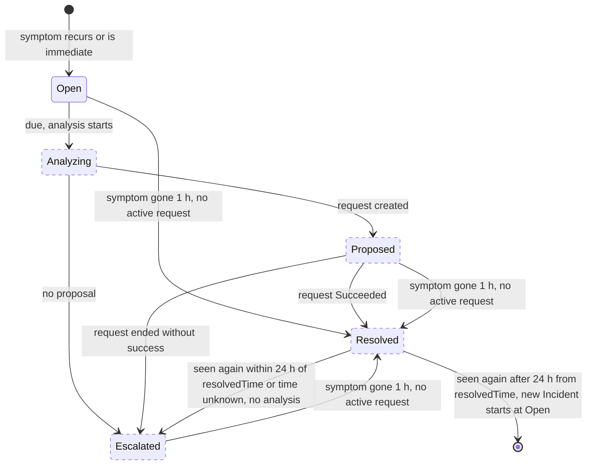
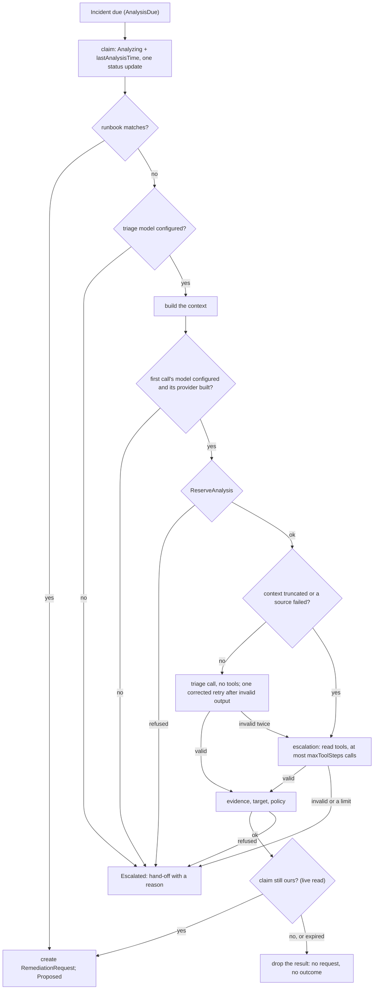

# 3. Observation and deduplication

This section covers how the analyzer turns cluster symptoms into `Incident` objects and decides when one is due for analysis. The collector (3.1) reads Warning events, pod status and the objects of active modules' symptom sources. Two levels of deduplication (3.2) keep the counts bounded and stable across restarts. The analysis (3.3) is built: the context builder is given the real Prometheus and pod logs adapters, and the analyzer starts the analysis loop that calls it, with the Microsoft Foundry adapter, only when it runs with `--triage-model` (off by default, [#76](https://github.com/pkalin/shadewright/issues/76)).

[![Shadewright analyzer: the collector turns events, pod status and the HPAs of active modules' symptom sources in the watched namespaces into deduplicated, bounded Incidents; the analysis trigger decides when one is due, using analysis.maxAnalysesPerDay from the settings and a Budget ConfigMap; Prometheus and pod logs have adapters that the analyzer gives to the context builder, which makes a bounded, redacted context in provenance-tagged blocks; the analysis loop, which the analyzer starts only with --triage-model (off by default), claims a due Incident, calls the triage model once and the escalation model with read tools only on a deterministic signal, through the Foundry adapter at an allowed endpoint, validates the result, rechecks its claim and creates the typed RemediationRequest or hands off to a person.](../assets/diagrams/analyzer.svg)](../assets/diagrams/analyzer.svg "Open full size")

## 3.1. Collecting

<span class="sw-status sw-built">built</span> The collector (`internal/analyzer/collector`) runs in the analyzer and reads through its cache, so it sees only the watched namespaces.

**Source.** It uses `events.k8s.io/v1`, for new events and for updates to an event series. It does not also watch `core/v1` events: they are the same objects in an older version, so each event would be counted twice. Fields read: `regarding`, `reason`, `action`, `type`, `reportingController`, `note`, `eventTime`, `series.count`, `series.lastObservedTime`, and `deprecatedCount` and `deprecatedLastTimestamp` for events written by older recorders ([Event API](https://kubernetes.io/docs/reference/kubernetes-api/events/event-v1/)).

Events detect symptoms; they are not a durable audit log. The collector keeps what it needs beyond event retention and also reads current object state.

**What it observes.**

- **Events:** only type `Warning`. An event is unusable, and dropped, when any of these holds: the reason is not a plain CamelCase word; the reporting controller is not a plain component name; a field is longer than the `Incident` schema allows; the regarding object is in another namespace than the event; the regarding reference has no UID.
- **Pod status:** every abnormal container termination, in init and app containers, from the current and the last state: `OOMKilled`, or any other reason with a non-zero exit code.
    - A reason that is not a plain CamelCase word within the schema's length is reported as `Terminated`.
    - A termination is one observation, identified by its container ID, or without one by its start and finish times, exit code and reason (not the restart count, which changes when the termination moves to the last state). Two such terminations of one container in the same seconds with the same exit code and reason count once.
    - The symptom is the container name and the exit code. The termination message is never read: the container writes it.
- **Module symptom sources:** the kinds whose sources are wired (for now `autoscaling/v2` HorizontalPodAutoscalers), read through the same cache. On each object the collector runs the source an active module declares for the kind (2.5.1); with the module not enabled or not detected the source does not run and its owner kind is not read. Only creates and updates that the active source shows a symptom on, before or after the change, reach the collector's reconcile (an HPA's status is written on every sync); when a module becomes active for a kind, the collector checks every 30 seconds and then evaluates the cached objects its source shows a symptom on. Only objects that showed a symptom take room in its bounded memory of handled states.
    - Each symptom state is one observation with the symptom's reason, the source's reporting controller and type `Warning`. Its symptom is the module's fixed summary followed by its evidence (`field=value`, each value redacted and cut to 256 bytes), normalized and redacted again as a whole. The fingerprint hashes the summary, not the evidence.
    - The occurrence is `condition:` and a hash of the object UID, kind, reason and when the state began, with a total of 1: a state that lasts counts once, one that ends and comes back counts again. The start is hashed as the object reports it, so a start later than the collector's clock keeps one occurrence when the clock passes it; the observation's `Began` is never later than the clock. A state without a known start is settled by the Incident controller like any occurrence that may repeat. A state the collector sees end (a reconcile without it) and come back with the same start, as when `ScalingLimited` stays True with another reason in between or has no `lastTransitionTime`, is a new occurrence, identified by when the collector saw it come back. The limit: that time is not known after a restart, so a new process identifies a state by its start alone. A state that came back before the restart and still lasts then matches the first state's occurrence and is not counted again, and a return the collector did not see (while it was down, or between two reconciles) is not counted.
    - The subject is the owner kind the source declares once it is verified (the `ScaledObject` of a KEDA HPA, 2.5.3), otherwise the object itself.

**Owners.** The subject of an observation is the owning workload, following controller owner references (only those marked `controller`) from Pod to ReplicaSet to Deployment and from Pod to StatefulSet.

- A pod whose controller reference names a Deployment directly is its own subject: Deployments control ReplicaSets, not pods.
- Owner references are untrusted. Each hop is read with the API reader (a `get` with a deadline, in the object's own namespace, which the role limits to the watched namespaces). It must exist with the referenced UID and a non-empty selector that matches the labels of the object below it; otherwise the chain stops at the last verified object.
- The read decodes the whole object, pod template included, and keeps only the UID check, selector, labels and controller reference.
- DaemonSets and Jobs are not followed, because the analyzer cannot read them, so their pods are their own subjects. A ReplicaSet without a Deployment is its own subject.
- An event that names a Deployment or a StatefulSet is kept only if the object exists with the event's UID.
- The owner reference of each pod looked up is remembered, so an event that arrives after its pod was deleted still reaches the workload. A pod deleted before the collector looked it up stays its own subject.

**Output.** Each observation carries:

- the fingerprint and the normalized, redacted symptom from `internal/incidents/fingerprint`;
- the subject;
- the occurrence (an event UID, a hash naming one container termination, or a hash naming one symptom state of a module symptom source);
- the occurrence's total as the cluster reports it;
- the new occurrence count, and when it happened (never later than the collector's clock);
- whether it is *immediate*: it opens its Incident at its first sighting instead of waiting to be seen again (3.2; an observation whose occurrence repeated at least 2 minutes after it began opens it at once too, immediate or not). Two kinds are: a container termination read from pod status with the reason `OOMKilled`, and every symptom state of a module's symptom source (a condition state such as a KEDA ceiling, already settled and lasting, with its own start; it is emitted once while it lasts, so it would never be seen again). An event never is, whatever its reason, because whoever can create events in a watched namespace writes the reason.

The new count is at most 1,000 per observation: a series count is written by whoever can create events, so one forged jump adds at most that much (each further update as much again). No raw note leaves the collector. Observations go to a bounded channel read by the Incident controller; when it stays full, the reconcile tries again later without recording anything as handled.

**Defaults.**

- A send to the channel waits up to 10 s, and a reconcile whose send timed out is retried 5 s later. Each watch runs one reconcile at a time, so a slow consumer delays the others by up to that much.
- Each owner read and each question to the Incident controller (3.2) has a 5 s deadline, and a timed-out question is retried 5 s later.
- Owner reads have no rate limit of their own: each watch reads at most one owner at a time, and the cache absorbs repeats.
- The owner cache holds 4,096 entries: verified owners for 10 minutes, owners that could not be verified for 5 s (the read goes to the API server, and a controller exists before its pods, so a miss is not a lag to wait out).
- Event state holds 10,000 entries and pod state 5,000 (see 3.2).
- The informer cache of the watched namespaces and this state count against the analyzer's memory limit (128 Mi in `config/manager/analyzer.yaml`). Namespaces with many pods or events need a higher limit.

**Lab measurement (2026-11-06).** With `v0.3.0-rc.2` (commit `bbe555ca09db887d1389270e53e6ef64249cd7eb`) on one `Standard_D4as_v5` node, an idle `kubectl top` sample after 3 analyses and 1 pull request showed analyzer memory 19Mi and CPU 2m, executor memory 16Mi and CPU 1m, with 0 restarts (how many namespaces, pods and events were watched was not recorded). Each had requests of 64Mi/10m and a memory limit of 128Mi. Peak memory during an analysis is not measured yet: it needs a metrics query over the run window, not a point sample. The 128Mi limits are therefore not yet backed by a peak measurement.

**First cases.** These are the symptoms the design starts from:

- `FailedScheduling`: insufficient resources, quota, node affinity or taints.
- Image pull failures and invalid pod configuration (missing Secret or ConfigMap reference).
- Restarting containers: `CrashLoopBackOff`, `OOMKilled`, failing probes.
- KEDA trigger errors and Flux reconciliation failures.

Reasons differ by component and version. `OOMKilled`, for example, comes from container status, not from an event with that reason, so detection always joins events with object state.

## 3.2. Two levels of deduplication

### Observation level

<span class="sw-status sw-built">built</span> The collector remembers the event UID and the last handled count. On a series update it processes the increase, not the total, and at most 1,000 per observation. A single event without a series counts once, or as its `deprecatedCount` when an older recorder kept one. The series count includes the first occurrence, so a single event that becomes a series of 2 adds 1.

**Collector state.** It is kept in memory, in maps with a fixed capacity (10,000 events, 5,000 pods and 5,000 objects of module symptom sources by default) that drop the least recently used entry. Memory alone does not survive a restart, so the collector cannot tell how much of an occurrence is new when:

- the event or termination is older than its first reconcile (a restart, or a new leader); or
- it is no newer than state the collector dropped to stay within its capacity.

A pod's terminations are judged against the collector's start and the eviction bound as it was when the collector first saw the pod, so committing one does not make the others look new. A termination without a finish time always counts as possibly repeated.

**The question to the Incident controller.** For those occurrences the Incident controller tells the collector how much of that occurrence was already counted, and the collector emits only the rest (capped as above), or nothing. The question names the occurrence (the event UID, or a hash of pod UID, container and termination) and when it began, not the fingerprint. Several pods or events share one fingerprint, and the fingerprint depends on owner correlation, which can differ after a restart (an owner deleted in between), while the occurrence does not. So the answer is looked up across Incidents.

**What the controller persists.** The Incident controller (`internal/incidents`) stores, per occurrence, the highest total it counted and when the occurrence began, in `status.occurrences` of the `Incident`.

- An Incident keeps at most 32 occurrences, newest first by when they began. An occurrence without a known beginning sorts as the oldest, so it is dropped first.
- When it drops older ones, `status.occurrencesDroppedThrough` records when the newest dropped one began.
- The controller answers from memory, loaded from the Incidents when it starts, and a question waits until they are loaded, so a restart never reads as "never counted".

**How it answers.**

- For an occurrence it kept: the recorded total.
- For one it has no record of that began no later than the latest drop mark of any Incident: that the occurrence was counted in full, so a bound never counts twice. The mark is shared across Incidents because the question does not name the fingerprint, so a busy Incident can make an old occurrence of another look counted (an undercount, never an overcount).
- An occurrence without a known beginning cannot be placed against the mark, so the mark never answers for it: once its record is dropped it may be counted again. That overcount is preferred to a count silently lost, because the count feeds a bounded trigger.
- It answers that it never counted an occurrence only when that is true.

**Without an answer** the collector does not guess: it emits the observation with a new count of 0, the cluster's total and *may repeat*, and the consumer subtracts what it holds.

- The consumer caps that difference at 1,000 as well (`Observation.Increase`).
- An observation of an occurrence it holds a record of adds at most the increase over that record, so a collector that lost its state does not count the same occurrence again.
- The cap is per observation: every further forged update of a series can add up to 1,000 again, so `status.count` saturates at 1,000,000 (the schema refuses more). It is a bounded count of reported occurrences, not a count of distinct ones.

### Incident level

<span class="sw-status sw-built">built</span> Similar observations are grouped by fingerprint:

```text
hash(clusterID, namespace, ownerUID-or-resourceUID,
     reason, action, type, reportingController, normalizedSymptom)
```

- `resourceVersion` is not an incident ID.
- A pod UID alone is not enough, because one pod can have several problems.
- Correlating to the owning Deployment joins symptoms from successive pods of the same workload. The rollout revision is kept as extra context.

Normalization removes variable parts (random pod suffixes, timestamps) but keeps what matters: image name, error code, the name of the missing Secret, the kind of dependency. Secrets are redacted before storage and before anything reaches the model.

Both are pure functions in `internal/incidents/fingerprint`:

- The note is redacted first with the shared redaction package, so no later substitution can shield part of a secret. Redaction markers become fixed placeholders, so secrets or addresses of different lengths do not change the fingerprint.
- Normalization then replaces object UIDs, image digests, timestamps, IPs and durations with placeholders.
- It strips pod name suffixes and ReplicaSet hashes only from names the text (or the event's regarding object) identifies as a Pod or ReplicaSet, so a missing Secret such as `db-7d4b9` keeps its name.
- It cuts the symptom to the 1024 characters `spec.symptom` allows.
- Every field is length-prefixed in the hash, and a version string is hashed first so that changed rules give new fingerprints instead of merging old and new incidents.

### When a symptom opens an Incident

<span class="sw-status sw-built">built</span> Decided on 2026-11-05 ([#267](https://github.com/pkalin/shadewright/issues/267)). In the v0.1.0 lab run, the first minute after Flux applied a healthy baseline opened four Incidents, each with a count of 1: Warnings from a KEDA scaler and an HPA reading metrics while Prometheus was still starting. Ten minutes later everything was healthy and the Incidents were still open. So a symptom must recur before it opens an Incident:

- An observation that **proves recurrence on its own** opens the Incident at once, whenever it arrives: the occurrence's latest repeat came at least 2 minutes after it began (for an event, its last observed time against its creation). A total of 2 or more alone is not enough: a recorder that repeats an event within seconds, or at a controller's poll interval under 2 minutes, makes a series too. So an events.k8s.io series that the reporter refreshes only about every 30 minutes (kube-scheduler's `FailedScheduling`), or a replay of a series after a restart, opens its Incident; arrival timing alone would never see it twice in the window. The times of an event are written by whoever writes the event, like its reason: whoever can create events in a watched namespace can open an Incident at once with a forged series, as they could by writing the event twice 2 minutes apart (G4.10).
- Any other observation of a fingerprint that has no Incident (a single, fresh sighting) is held in memory as a **first sighting**. It opens the Incident when the symptom is seen again **at least 2 minutes and at most 15 minutes** after the first sighting (`RecurAfter`, `RecurWithin` in `internal/incidents`), by the Incident controller's clock.
- A sighting before 2 minutes is held too and keeps waiting: a burst within seconds is not a recurrence. One after 15 minutes starts over as a new first sighting, and the old one is forgotten. A symptom seen once opens nothing.
- **Immediate** observations open their Incident at once: a container `OOMKilled` read from pod status, and the symptom states of module symptom sources, such as a KEDA ceiling (3.1). The set is explicit and kept small.
- Whatever opens the Incident, every sighting held for the fingerprint is counted first, in order, and forgotten, so the Incident's count and `firstSeen` include the first one.
- A fingerprint refused at the cap on Incidents is remembered (the last 1,024), and each later observation of it is refused as it arrives instead of waiting again as a first sighting.
- Once the Incident exists, every observation is counted at once. Closing an Incident whose symptom has stopped is the lifecycle's rule (see [Incident lifecycle](#incident-lifecycle), #251), not this one.

**Memory only, bounded.** First sightings live in the analyzer's memory, never in a CR, and a restart forgets them. That is safe: a real symptom recurs, and its Incident opens up to 15 minutes later than it would have.

- At most 4,096 fingerprints are held (`Config.MaxFirstSightings`, the size of the collector's owner cache); when that is full, the oldest first sighting is forgotten and its symptom starts over. So a flood of distinct one-off fingerprints cannot grow the memory, only delay other symptoms' Incidents.
- At most 4 occurrences are held per fingerprint, sharing one copy of the symptom, about 12 MiB for all of them at most. A further sighting of an occurrence already held is merged into it (the highest total), and the collector's question whether an occurrence was counted (`Handled`) is answered from what is held, so a copy sent again neither takes a place nor counts twice. A sighting of a fifth occurrence before 2 minutes is not held, so it is not counted when the Incident opens (an undercount).
- First sightings older than 15 minutes are dropped on the writer's tick. The gauge `shadewright_incident_first_sightings_held` reports how many are held.
- The cap on Incidents applies when a sighting opens one, not when it is held.

### Timing values

Starting values, to be tuned on real traffic:

| Mechanism | MVP value |
| --- | --- |
| Debounce before analysis | 45 s (30-60 s) |
| A single, fresh sighting opens an Incident when seen again (not immediate, total under 2) | 2 to 15 min after its first sighting |
| Aggregation window for similar observations | 5 min |
| Longest wait to settle, from the first unsettled observation | 5 min (the aggregation window) |
| Cooldown before any re-analysis, new symptom and lost analysis included | 15 min |
| Analysis taken as lost (phase `Analyzing`) | 10 min, due again at the later of this and the cooldown |
| Concurrent actions | One per target object |
| Re-analysis trigger | New symptom or symptom seen again, once the cooldown has passed |

### Incident objects and their writes

<span class="sw-status sw-built">built</span> Deduplication state must survive restarts. In the MVP it lives in a namespaced `Incident` CR in the operator namespace ([ADR-0007](../adr/0007-incident-state-in-crds.md)), one per fingerprint (several occurrences per fingerprint are <span class="sw-status sw-planned">planned</span>, see [Incident lifecycle in design 3.2](#incident-lifecycle)), named `incident-` and the hex of the fingerprint. Its spec holds the fingerprint, the subject and the normalized, redacted symptom; raw logs never go into a CR.

**Batching.** The Incident controller runs in the analyzer, in the leader only, and writes in batches.

- The observations that open an Incident, or the first one of an existing Incident in a process, are written at once. Later ones are gathered and written once per aggregation window (5 min), so a burst costs a few writes, not one per observation.
- Writes run apart from the consumption of observations, so a slow API server delays the writes, not the collector.
- Each write reads the Incident from the API server, not the cache, and retries on a conflict.

**Retrying a write whose answer was lost.** A write may time out after the API server stored it. The controller leaves out a batch the status already holds, checked per occurrence:

- an occurrence recorded with at least the batch's total shows the batch was stored;
- one recorded lower or missing, although it began after `occurrencesDroppedThrough`, shows it was not;
- one the write could have dropped or skipped shows neither (it began no later than the mark, has no known beginning, or has an ID the schema refuses).

A batch is taken as stored only when at least one occurrence shows it and none shows otherwise. So such a write is not counted twice when it is tried again, 5 s later. The batches it sent are kept apart from the observations that arrive meanwhile, so these cannot hide that it was stored. A batch none of whose occurrences can show it is written again (a possible overcount, not a loss).

**Batches that are not written.**

- A batch the API server refuses as invalid is logged and dropped rather than tried again, and the controller's memory of its occurrences goes back to what the Incident stores. An Incident it could not create frees its place under the cap.
- An Incident of the expected name that holds another fingerprint is not written either, and its batch and memory go the same way. Anyone who can create Incidents in the operator namespace can block a fingerprint like that, and only the log and `shadewright_incident_batches_dropped_total` (reason `fingerprint_conflict`) show it.
- The status of such an Incident is not ours, so it is never taken into memory once the Incidents are loaded: neither its records nor its `occurrencesDroppedThrough` (the drop mark is shared by all Incidents). The records load took from it stay only while it still holds them.

**Shutdown and lost leadership.** Pending and failed batches are written once more, with retries, within 5 s, under the Pod's 10 s termination grace period. Each of these writes also reads the Incident fresh and leaves out what it already holds, so it adds nothing a new leader already wrote. Lost are:

- the batches still unwritten at that deadline (counted with reason `stopped`);
- observations still in the channel;
- everything pending when the process is killed, not stopped.

A new leader that loaded the Incidents before the old leader's last writes landed may count those occurrences again.

### Bounds on Incidents and held occurrences

**Number of Incidents.** <span class="sw-status sw-built">built</span> The number is bounded instead of retained for a time: at most 500 in the operator namespace (`--max-incidents`), counting those that exist when the analyzer starts.

- At the cap a new fingerprint is not stored. Its observations are counted in the Prometheus counter `shadewright_incident_observations_refused_total`, and each new fingerprint is logged once. <span class="sw-status sw-planned">planned</span> A new occurrence is a new object and counts under the cap like a new fingerprint, so it is refused at the cap too.
- A Warning event (reason `IncidentCapReached`) about the analyzer's Pod, whose name comes from `POD_NAME`, is written for at most one refusal every 10 minutes, because whoever can create events in a watched namespace can make new fingerprints at will.
- Fingerprints that already have an Incident are still counted.
- Nothing deletes Incidents yet (retention by age is not built), so once reached the cap stays reached until someone deletes some and the analyzer restarts (it counts the Incidents when it starts). When Incidents should go is decided but not built: see [Incident lifecycle](#incident-lifecycle), question 8 in section 15, and the 2026-11-03 and 2026-11-05 amendments of [ADR-0007](../adr/0007-incident-state-in-crds.md#amendments).

**Occurrences held unwritten.** <span class="sw-status sw-built">built</span> They are bounded too, so the controller's memory stays bounded while status writes fail:

- at most 256 per Incident (eight times the 32 records its status keeps);
- at most 10,000 for all Incidents together;
- each count includes the pending batch, a failed batch and a batch being written, each on its own;
- an Incident that holds none always takes its first occurrence, so the total can pass 10,000 by at most one per Incident.

**Why a share per namespace** ([#278](https://github.com/pkalin/shadewright/issues/278)). An Incident's held occurrences go down only when its own write returns, so a total shared by all Incidents could be filled within one normal window, with no write failing: about 40 fingerprints (10,000 / 256) with 256 new occurrences each, which anyone who can create Warning events in a watched namespace can make. So each namespace holds at most a share of the total: a quarter by default (2,500), but never less than the cap per Incident and never more than the total.

**Which namespace is charged.**

- Each occurrence is charged to the namespace it came from: the event's own namespace, or the pod's for a termination read from pod status. That is the namespace RBAC grants event creation in, so whoever fills a share needs that grant there.
- The namespace of the Incident's subject would not do: a cluster-scoped subject (a Node) has none, so every cluster-scoped Incident would share one key that anyone who can create events in any watched namespace could fill. A tenant who started holding a Node's fingerprint would have the kubelet's later reports of it charged to the tenant's share or blocked by it.
- Fingerprints cost an attacker nothing, so a share per fingerprint would add nothing to the cap per Incident.
- The analysis budget's share ([#207](https://github.com/pkalin/shadewright/issues/207)) should take the same key; that is not settled.

**How it is checked.**

- The share is checked like the other caps, against the namespace of the new occurrence. An Incident that holds none still takes its first occurrence, so a namespace can pass its share by one per Incident.
- Each Incident's batches remember the source namespace of every occurrence they hold. The controller keeps, per Incident and in total, how many of the held occurrences each namespace was charged. When a write returns, each namespace moves by what of its occurrences was written or dropped, so the counts return to zero once every batch is written. These counts have at most one entry per held occurrence, so they stay within the cap on held occurrences.
- The memory of records (what `Handled` answers from) holds the records of the Incidents plus these occurrences, so it is bounded as well. Records a write whose answer was lost dropped are forgotten once the retry succeeds or is refused.
- An observation of an occurrence already in the Incident's pending batch is always taken. One held only in a failed batch or a batch being written counts as new there.

**What remains.** Anyone who can create events in a namespace can fill that namespace's share, `default` included, where the events about nodes land, and with it crowd out the new occurrences of the other Incidents counted there.

- One noisy namespace leaves about 70% of the total to the others at the defaults (three quarters, less one per Incident it has, at most 500).
- It takes four noisy namespaces at once to fill the total (three hold at most 7,500 plus one per Incident, 8,000). While it is full, every other Incident counts at most one new occurrence per write.

**A new occurrence over a cap** is an undercount, never a lost Incident. Its increase is not counted and no record of it is kept, but the observation still moves the Incident's first and last seen, and the Incident is written as usual, so it exists and the analysis trigger sees it seen again. The occurrence is not remembered either, so if the collector asks about it later (after a restart, or once the collector dropped it from its own memory) it may be counted then; until then the count is lower than what the cluster reported. Each one is counted in `shadewright_incident_occurrences_overflow_total`, and the controller logs, at most once a minute, how many it left uncounted.

### Analysis trigger

<span class="sw-status sw-built">built</span> The Incident controller decides every 10 s which Incidents are due for analysis and records it in the condition `AnalysisDue` of each, with a reason. The decision is a pure function (`Due` in `internal/incidents`) of:

- the Incident's status;
- the newest observation the controller still holds unwritten;
- when the controller first saw the Incident waiting to settle;
- whether a pass of the running analyzer found the Incident gone quiet (below);
- since when the passes in a row of the running analyzer have looked at the Incident (a pass whose list of Incidents fails breaks that run);
- the clock and the limits;
- the analyses already used today.

An incident is due when it has data the last analysis did not see, has settled (or waited the longest it may), its cooldown has passed and the budget allows. The rules, with the reason each sets:

- Nothing observed yet (no `lastSeen`): not due (`NotObserved`).
- Never analyzed: due (`FirstAnalysis`), but only when seen recently: last seen (`lastSeen`, or an observation the controller holds unwritten) within the recent window, by default the 15 min cooldown and never shorter than the debounce. One last seen longer ago, and not already marked due, is not due (`NotRecent`) and takes no unit of the budget. A mark that says due is not taken back for that, so those already due keep their units while their analysis has not started; a mark written for another generation of the Incident is no mark, as for the writes below, and the analysis does not claim it either. A mark taken back only because a pass could not read the settings or the budget (`SettingsUnreadable`, `BudgetReadFailed`, written only over a mark that said due) still counts as due, so one failed read does not end a pending first analysis. An Incident whose newest occurrence (by begin time) is a symptom state of a module's symptom source (a `condition:` occurrence, such as a KEDA ceiling or HPA `ScalingLimited`) is never `NotRecent`: such a state is emitted once while it lasts (3.1), so its `lastSeen` does not move while the problem is present, and the status records no end of it. Since an ongoing state cannot be told from one that ended, every such Incident is taken as recent; one whose state ended before analysis could run is analyzed once. Each skip is visible: the pass that writes `NotRecent` also writes a Normal event `AnalysisSkipped` on the Incident (in the operator namespace, with the analyzer's existing grant on core Events there) and counts it in `shadewright_analysis_skipped_not_recent_total`, once each time the condition changes to `NotRecent`, not on every pass. The condition then stays `NotRecent` until the Incident is next marked due, so a second quiet spell before that writes no event and is not counted again. A pass writes its `NotRecent` conditions after every other decision, and at most 20 of them, so a backlog of quiet Incidents (the first pass after an upgrade, late settings or a budget reset) neither delays the marks that say due nor runs the pass into its deadline; the rest follow on the next passes ([#430](https://github.com/pkalin/shadewright/issues/430)). So a symptom that stopped before analysis could run (settings applied after the Incidents were written, `maxAnalysesPerDay` raised from 0, the budget reset at 00:00 UTC) is not analyzed for nothing ([#423](https://github.com/pkalin/shadewright/issues/423)). A `lastSeen` ahead of the analyzer's clock counts as recent. A new observation, a new occurrence or an event series counting up again, makes it due again through the debounce and the settle limit below, so a problem that keeps recurring stays eligible. The window applies to a first analysis only: a re-analysis needs data seen after `lastAnalysisTime` anyway, and a timed-out one is due again as below. It is a setting of the Incident controller (`RecentWindow`, zero takes the cooldown), not a flag, like the debounce and the cooldown; one shorter than the debounce is raised to it by the decision alone, and the event names the window applied.
- Nothing seen since `lastAnalysisTime`: never due (`NoNewData`).
- Seen again or a new occurrence, but less than the 15 min cooldown since `lastAnalysisTime`: not due (`CoolingDown`). The cooldown applies to every re-analysis, a new occurrence and a lost analysis included, so a crash-looping workload, which makes a new termination every few minutes, is analyzed at most once per cooldown.
- Past the cooldown: due, `NewOccurrence` when an occurrence began after `lastAnalysisTime`, otherwise `CooldownExpired`. Distinct occurrences count, not `status.count`: a forged update of an event series raises the count but adds no occurrence. An occurrence without a known beginning, or one that began before the last analysis but was written later, is not new.
- Not before 45 s have passed since the incident was last seen (`Debouncing`), counting both `lastSeen` and the observations the controller holds in a batch it has not written yet, so a burst that goes on is not due while its newest observations wait for the next write.
- Not when the daily limit of the `RemediationSettings` is 0 (`AnalysisDisabled`) or the analyses of the current UTC day reached it (`DailyBudgetReached`).

**The debounce is bounded.** An incident is due at the latest one aggregation window (5 min) after its first unsettled observation, even if observations keep arriving less than 45 s apart. That observation is:

- for an incident never analyzed that went quiet and was seen again: the first pass that found it waiting again. A pass finds it gone quiet when a `lastSeen` L is older than the recent window (and it is not marked due and holds no lasting state), on every pass, one that cannot read the settings or the budget included. L is the stored `lastSeen` when that is stale itself (the later spell), else the one the previous pass read when the stored one is more than the recent window after it: a spell that ends between two passes is found by that jump, and a shorter gap is no spell however late the pass that reads it. The status holds only the newest observation, so within one pass interval of the window the jump is a guess (observations written together can hide one that broke the gap); it errs towards a spell, which only delays the first analysis. The previous pass's `lastSeen` is compared only when that pass ran within the recent window, its list of Incidents did not fail since, and its newest occurrence was no lasting state then: a stalled or paused analyzer, or one whose lists failed, did not see the activity in between, and a lasting state's frozen `lastSeen` is no quiet spell; an observation held unwritten does not hide it either. The pass then forgets when it first saw the incident waiting if that was not after L plus the recent window, since such a wait belongs to the spell before; a later one, the new burst's while its observation is held, is kept, so its settle limit keeps counting. A `NotRecent` condition stands for the same after a restart. Nothing in the status dates the new burst (an event series counting up again adds no occurrence), so the wait starts with the running analyzer's first sight of it, and a restart starts it again;
- else, for one never analyzed, the beginning of its newest burst when its occurrence records show a gap: two consecutive beginnings (the drop mark counted as one) further apart than the recent window. Such a gap is no proof of a quiet spell (an event series may have counted up all through it), so it is taken only when the running analyzer did not look at the incident on every pass since before the gap began; one that did would have found it gone quiet. It thus covers a quiet spell while the analyzer was down. A spell while it was down that ended with an event series counting up again shows no gap, and that wait counts from `firstSeen` (a known limit);
- else `firstSeen` for an incident never analyzed;
- else the beginning of the earliest occurrence that began after `lastAnalysisTime` (both survive a restart);
- for a recurrence of an occurrence the last analysis already counted, which the status does not date: the first pass of the running analyzer that found the incident waiting, so a restart of the analyzer starts that wait again.

Whoever keeps a symptom flapping can delay an analysis by up to the window, not suppress it.

**The daily limit** is `spec.analysis.maxAnalysesPerDay`, or the deprecated `spec.maxAnalysesPerDay` of v0.1.0 when that is still set and lower (5.4). A budget that cannot be read means refuse:

- no `RemediationSettings` object: `SettingsNotFound`;
- settings without `spec.analysis.maxAnalysesPerDay`, which the schema's defaults never leave: `SettingsIncomplete` (no default limit is assumed);
- no budget ConfigMap: `BudgetNotFound`;
- a budget from a future day, out of bounds or with other keys: `BudgetUnreadable`;
- when either object cannot be read at all, Incidents marked due are set not due: `SettingsUnreadable`, `BudgetReadFailed`.

**Deadlines.** Each pass has an 8 s deadline, under the 10 s between passes, for the list from the cache, the budget read and the writes together, so an API server that stalls costs at most the pass it is in. Within it the two reads of the budget have 5 s: a read that reaches that counts as one that failed, and the rest of the pass takes the marks that say due back. Those it has no time left for keep their mark until a later pass takes it back.

**Phases come first.** `Open` and `Resolved` (and no phase yet) are decided as above. In the other phases:

- `Proposed` or `Escalated`: not due (reasons of the same name). How an incident leaves those phases is <span class="sw-status sw-planned">planned</span>, see [Incident lifecycle](#incident-lifecycle).
- `Analyzing`: not due until 10 min after `lastAnalysisTime` (`Analyzing`), after which the analysis is taken as lost. It is due again (`AnalysisTimedOut`, with the debounce and the budget) once the cooldown has passed too, so at 15 min with the defaults, and `CoolingDown` in between.
- `Analyzing` without a `lastAnalysisTime` cannot be placed against either, so it is not due (`AnalysisStartUnknown`) until its status is repaired. The analysis writes the phase and the time in one status update (`internal/analysis`, [#76](https://github.com/pkalin/shadewright/issues/76)), so it never leaves that state itself.
- An Incident whose name holds another fingerprint is not decided; if it says due, it is set not due (`ForeignFingerprint`).

**Writes.** The condition is written only when the decision changes from due to not due or back, or between two reasons for due. A change between two reasons for not due is not written, and the first reason stays, so a change that turns every Incident's reason at once (the budget used up, or set to 0) costs no writes. `NotRecent` is the exception: it is written over another not-due reason, once per quiet Incident, with its event, and then stays while the Incident is not due. A decision reads it back only to start the settle limit of the next burst (above). `Analyzing`, which the analysis writes in its claim, is the other: it stays only while the run lasts. The run has ended once the phase is no longer `Analyzing` (the outcome write sets `Proposed` or `Escalated` and leaves `AnalysisDue` to the trigger) or the analysis timeout has passed since `lastAnalysisTime`; from then on the next pass writes whatever reason it decides over `Analyzing` (`Proposed`, `Escalated`, `CoolingDown`, `Debouncing`, a budget reason, ...), and from there the rule above holds again ([#424](https://github.com/pkalin/shadewright/issues/424)). With the budget unknown, an Incident in phase `Proposed` or `Escalated` still gets that reason rather than the budget's, so the outcome shows; when the settings or the budget cannot be read, that outcome is the only reason written over `Analyzing`, and a run taken as lost keeps `Analyzing` until a read succeeds. The writes carry the field manager `shadewright-analysis-trigger`.

### The analysis budget

<span class="sw-status sw-built">built</span> The count of the day lives in the ConfigMap `shadewright-analysis-budget` in the operator namespace, shipped empty with the analyzer (`config/manager/analysis_budget.yaml`).

- **Keys:** `day` (the UTC day, `YYYY-MM-DD`) and `used` (the analyses started on it, 0 to 10,000 in decimal digits), both or neither, nothing else. It is parsed and checked in Go, since a ConfigMap has no schema.
- **Where it lives:** not in the Incidents and not in memory, so neither a restart nor deleting Incidents frees budget.
- **Permissions:** the analyzer may get and update this one ConfigMap and may not create it. Deleting it stops analysis (`BudgetNotFound`) rather than resetting the count. Only someone who may create ConfigMaps in the operator namespace (an admin) can bring it back, empty or with any count.

**Marking Incidents due.** Each Incident marked due takes one more unit of what is left. Those already due go first, then the oldest by `firstSeen`. So no more Incidents are due at once than the budget has left, and a flood of new fingerprints does not push older incidents out of it. A mark whose write failed or whose answer was lost still takes its unit.

**Taking a unit.** The mark is not the check. `ReserveAnalysis` is built, and the analysis loop (`internal/analysis`, [#76](https://github.com/pkalin/shadewright/issues/76)) calls it once per analysis, after the context is built and the first call's provider, and before the first model call; the analyzer starts the loop only with `--triage-model`. It reads the ConfigMap, adds one to the day's count (starting at 1 on a new UTC day) and updates it with the resourceVersion it read (an update, not a patch), retrying on conflict. It refuses when:

- the settings hold no `analysis.maxAnalysesPerDay`;
- the count reached the daily limit (the lower of it and the deprecated `spec.maxAnalysesPerDay`);
- the ConfigMap is missing;
- the ConfigMap cannot be trusted.

Without `--triage-model` the analyzer does not start the loop, so nothing adds to the count. One unit is one claimed attempt ([ADR-0025](../adr/0025-analysis-claims-units-and-evaluation-manifest.md) decision 2). A unit is never given back; a lost answer can only overcount.

<span class="sw-status sw-built">built</span> One unit is one claimed attempt: all calls, retries and tool rounds of one run, counted on the UTC day it was reserved, a lost response included; token and money limits are separate bounds ([ADR-0025](../adr/0025-analysis-claims-units-and-evaluation-manifest.md))

**Shared by the whole cluster.** Anyone who can create events or pods in a watched namespace can spend the budget with distinct fingerprints that become due over the day. A share per namespace or per fingerprint is <span class="sw-status sw-planned">planned</span> ([#207](https://github.com/pkalin/shadewright/issues/207)).

**Metrics.** Each pass of the trigger reports the count and the limit it read in the gauges `shadewright_analyses_used_today` and `shadewright_analyses_per_day_limit` ([metrics reference](../reference/metrics.md)). The Incident controller also reports, through the leader, the Incidents by phase and the number due for analysis, served at scrape time from its informer with no API call. It counts the analysis trigger passes that fail and the Incident status writes that fail. The metrics reference lists them with their labels.

### Incident lifecycle

Decided on 2026-11-05 and 2026-11-07 ([#251](https://github.com/pkalin/shadewright/issues/251)); what is built and what is planned is marked in each row. <span class="sw-status sw-built">built</span> Today the controller creates an Incident with the phase `Open` (a status with no phase gets `Open` on its first write), and the trigger reads the phase as described above. <span class="sw-status sw-built">built</span> The analysis controller (`internal/analysis`, [#76](https://github.com/pkalin/shadewright/issues/76)) writes `Analyzing`, `Proposed` and `Escalated` when the analyzer runs with `--triage-model` (off by default). <span class="sw-status sw-planned">planned</span> Every other transition: nothing writes `Resolved` and nothing moves an Incident on from `Proposed` or `Escalated` (#251).

**Rules.** <span class="sw-status sw-planned">planned</span>

- The analyzer is the only component that moves an Incident between phases. It already owns the Incident's status; the operator's request controller never writes it (it reads a request's phase), no delete grant is added and invariant 6 is unchanged.
- `Open`, `Proposed` and `Escalated` move to `Resolved` when the symptom has not been seen for 1 hour and no request that names the Incident (`incidentRef`) is still active. A request that reached `Succeeded` (merged and verified) resolves the Incident at once. Active means a request phase before a final one; the final phases are `Succeeded`, `Denied`, `Failed`, `Expired`, `Cancelled`, `Superseded` and `NeedsIntervention`.
- A request that ends in any other final phase moves the Incident to `Escalated`, never `Resolved`: a person decides. That is `Denied`, `Expired`, `Failed`, `Cancelled` and `NeedsIntervention`, which includes a pull request rejected or closed without a merge (`NeedsIntervention`, reason `ChangeRequestClosed`, [section 6](6-reconciliation.md)). `Superseded` leaves the Incident to the newer request that names it, or `Escalated` when there is none.
- A `Resolved` Incident is never analyzed again. The 24 hour rule is measured from a new status field, `resolvedTime`, written in the same status update that sets `Resolved` (planned). A missing or unreadable `resolvedTime` counts as within 24 hours: the recurrence is escalated, not analyzed (fail closed). A symptom seen again within 24 hours of `resolvedTime` (a fix that keeps coming undone) starts no analysis: the same Incident moves to `Escalated` for a person. A symptom seen again more than 24 hours after resolution creates a new Incident, named `incident-<64 hex>-<n>` for occurrence n >= 2 (occurrence 1 keeps `incident-<64 hex>` with no suffix), linked to the previous one (its name and the occurrence count are recorded). The new Incident is analyzed from its symptoms and context only, never the denial reason or any earlier outcome or policy decision, so the model cannot search for what the policy allows (invariant 1: model output is never authorization). The 24 hour window is a constant for now; making it a setting is a later choice.

| From phase | Event | To phase | Written by | State |
| --- | --- | --- | --- | --- |
| none | a symptom seen again 2 to 15 min after its first sighting, one whose observation proves recurrence (its occurrence repeated at least 2 min after it began), or an immediate one (`OOMKilled`, a module source's symptom state), is written | `Open` | Incident controller (analyzer) | Built |
| `Open` | the trigger marks it due and the analysis starts | `Analyzing` | analyzer (analysis, #76) | Built, with `--triage-model` |
| `Analyzing` | the analysis produced a RemediationRequest | `Proposed` | analyzer | Built, with `--triage-model` |
| `Analyzing` | the analysis made no proposal | `Escalated` | analyzer | Built, with `--triage-model` |
| `Analyzing` | no result after 10 min (taken as lost) | stays `Analyzing`, due again after the cooldown | trigger (`AnalysisTimedOut`) | Built (the mark); the analysis controller claims such an Incident again, with `--triage-model`; the lost run's claim has expired, so it can publish nothing (ADR-0025) |
| `Proposed` | request `Succeeded` (merged and verified) | `Resolved` at once | analyzer | Planned |
| `Open` | symptom not seen for 1 h and no active request | `Resolved` | analyzer | Planned |
| `Proposed` | request `Denied` by policy | `Escalated` | analyzer | Planned |
| `Proposed` | request `Expired`, `Failed` or `Cancelled` | `Escalated` | analyzer | Planned |
| `Proposed` | pull request rejected or closed without a merge (request `NeedsIntervention`, `ChangeRequestClosed`), or any other `NeedsIntervention` | `Escalated` | analyzer | Planned |
| `Proposed` | request `Superseded` | follows the newer request that names the Incident, `Escalated` when there is none | analyzer | Planned |
| `Proposed` | symptom not seen for 1 h and no active request (symptoms gone before merge, or fixed by a person without the pull request) | `Resolved` | analyzer | Planned |
| `Escalated` | symptom not seen for 1 h and no active request (a person fixed it, or it went away) | `Resolved` | analyzer | Planned |
| `Escalated` | a person's fix does not hold: the symptom stays or returns | stays `Escalated` | none | Planned |
| `Resolved` | symptom seen again within 24 h of `resolvedTime`, or `resolvedTime` is missing or unreadable (recurrence after success, or after a person's fix) | `Escalated` (the same Incident, no analysis) | analyzer | Planned |
| `Resolved` | symptom seen again more than 24 h after `resolvedTime` | stays `Resolved`; a new Incident (occurrence number + 1, linked to the previous one) starts at `Open` and is analyzed with no earlier outcome | analyzer | Planned |

A person fixing the cause by hand needs no step of its own: the symptom stops, and after an hour with no active request the analyzer resolves the Incident. A request still active when the symptom stops (a pull request waiting for review) keeps the Incident out of `Resolved` until the request ends; if it then merges and verifies, the request `Succeeded` resolves the Incident at once.



The arrow into `Open` from the start always runs (it is also how a new occurrence of a resolved fingerprint begins). The arrows into and out of `Analyzing` run when the analyzer is started with `--triage-model` (off by default); every other arrow is planned (#251).

**Names and deduplication of occurrences.** <span class="sw-status sw-planned">planned</span> The Incident name stays deterministic, so invariant 5 holds: it is derived from the fingerprint and the occurrence number, a create that races with another replica or a restart finds `AlreadyExists` and adopts the existing object, and no second Incident appears. Occurrence 1 keeps today's name, `incident-<64 hex>`, with no suffix, so no existing object changes. Occurrence n >= 2 is `incident-<64 hex>-<n>`. The analyzer finds the latest occurrence of a fingerprint from the names of the Incidents it lists at startup and keeps in memory. It already lists them for the cap. A 64-character fingerprint is too long for a label value (at most 63 characters), so no fingerprint label is used. No new grant is needed: Incident writes remain create and status update only (invariant 6). If the latest occurrence is `Resolved`, the 24 hour rule above decides between `Escalated` and a new occurrence. In the same planned code change, the executor's Incident name check in `internal/controller/pullrequest.go` (currently `^incident-[0-9a-f]{64}$`) will accept the `-<n>` suffix, and [data handling](../data-handling.md#what-is-published) will document that accepted suffix.

**Cap.** <span class="sw-status sw-built">built</span> (the count); the rest <span class="sw-status sw-planned">planned</span>. The cap of 500 keeps counting every Incident, `Resolved` ones included, so the number of Incident objects stays bounded ([ADR-0007](../adr/0007-incident-state-in-crds.md)). `Resolved` marks candidates for deletion, but the most recent 24 hours must be kept so a recurrence can still be escalated. They are not deleted automatically: that needs a delete grant for the analyzer, a change of invariant 6, and is a separate ADR task. Clean-up is manual, see [Clear Resolved Incidents at the cap](../how-to/clear-resolved-incidents.md). Automatic retention with an archive is <span class="sw-status sw-planned">planned</span> ([#458](https://github.com/pkalin/shadewright/issues/458)). A metric of Incidents per phase is built (`shadewright_incidents`); an alert at 80% of the cap is <span class="sw-status sw-planned">planned</span>. Built today: the cap counts every Incident, once, when the analyzer starts, so a restart follows the deletions.

## 3.3. Analysis

<span class="sw-status sw-planned">planned</span> Claims identified by `lastAnalysisTime` with an expiry, the recheck before a request is created, the durability steps and whether a stored record gates the proposal are decided in [ADR-0025](../adr/0025-analysis-claims-units-and-evaluation-manifest.md); until they are built, a claim is the phase and `lastAnalysisTime` only (3.2).

Decided in [ADR-0023](../adr/0023-how-the-analyzer-calls-the-model.md) (accepted 2026-11-03): context first, one structured call.

### Design: the order of work

This is the flow. The analysis loop that runs it is <span class="sw-status sw-built">built</span> in `internal/analysis` and tested with a fake model and fake tools; the analyzer starts it, with the Foundry adapter, only when it runs with `--triage-model` ([#76](https://github.com/pkalin/shadewright/issues/76)). The evaluation harness is built ([#78](https://github.com/pkalin/shadewright/issues/78), design 11.2), its fail-closed check in the analyzer is not; until it is, a run with a real model is an evaluation run in the lab, not production use ([ADR-0025](../adr/0025-analysis-claims-units-and-evaluation-manifest.md) decision 7). No runbook ships yet, so every analysis takes the model path.

- Deterministic rules and known runbooks run first. A runbook match is deterministic and makes no model call.
- The model path is for incidents no runbook matched. Its common case is one small-model call: the context builder assembles a bounded, redacted context deterministically (incident summary, object status and owners, a log excerpt, selected metrics and recent Git changes for the source of the object) and the small model returns one structured result.
- Read tools (section 4) are offered only on escalation, within fixed step, token and spend budgets, so the cost per incident is predictable and a recorded context can be replayed in CI.

### The context builder

<span class="sw-status sw-built">built</span>, called by the analysis loop, which the analyzer starts with `--triage-model` ([#76](https://github.com/pkalin/shadewright/issues/76)). The analyzer creates it with the Prometheus adapter (`--prometheus-url`) and the pod logs adapter (`--pod-logs`) and the watched namespaces ([#371](https://github.com/pkalin/shadewright/issues/371)): an Incident whose subject is in any other namespace gets status, logs and metrics "not available", refused before any read or source call.

The context builder (`internal/incidentcontext`) works on the `MetricsSource` and `LogSource` interfaces and the analyzer's existing reads. It is not called `internal/context`, so that it never shadows the standard library's `context` package. For one Incident it makes five sections, in this order, each a block tagged with its provenance:

| Section | Holds | Bound | What a cut keeps |
| --- | --- | --- | --- |
| Summary | The Incident: subject, reason, symptom, occurrences, first and last seen | 2 KiB | The head: subject and reason first |
| Object status and owners | The target's status and conditions, its ReplicaSets, and the status and container states of each current pod | 8 KiB | The head: the target, then the pods with the most trouble |
| Log excerpt | At most two excerpts, each with an equal share of the bound, chosen by trouble: a container whose last instance terminated inside the window, read as that previous instance with no time window (its tail is the lines just before the termination), before a container waiting with a reason or terminated with an error, before one that is not ready, most restarts first (a container that ran to completion, such as a finished init container, is not trouble); a current instance is read over the window; one current excerpt of a regular container when nothing shows trouble | 24 KiB | Each excerpt's header (pod, container, instance) and its tail, the newest lines |
| Metrics | The approved templates for at most 16 of the target's pods, most troubled first: OOM kill, waiting reason, restarts, memory (last, minimum and maximum over the window), memory limit, CPU, throttling; unavailable replicas for a Deployment | 8 KiB | The head: the templates that explain a crash first |
| Git | Always "not available": the analyzer has no Git identity (invariant 6, [#373](https://github.com/pkalin/shadewright/issues/373)) | 6 KiB, unused | |

**Total bound.** The whole context is bounded at 48 KiB, counting the text of the blocks. The bounds are constants written as one set of limits so that they can become settings ([#372](https://github.com/pkalin/shadewright/issues/372)). The sections, Git included, add up to the total, so with the default bounds the total cut is a backstop. It takes bytes from the logs first, then the metrics, the status, Git and the summary, the latest block of a section first, and keeps a log block's header.

**Window.** The window of an analysis starts 10 minutes before the Incident was first seen (an hour before now when it has no first sighting), at least 15 minutes and at most 6 hours before now.

**Which pods.** The target's pods are resolved as section 4 describes: from the Incident subject's kind and UID through controller owner references in its namespace, each hop read, checked against its UID and its selector; never from names, text or the model.

- A Deployment, StatefulSet, ReplicaSet or Pod can be the subject.
- The context describes at most 50 pods, most troubled first, and labels the set capped when there are more, giving the real count.
- A workload whose labels or selector are larger than the bounds the collector also uses (64 labels, 64 selector terms; `internal/analyzer/ownership`), or whose selector is empty, is described without pods, never as gone.
- A subject that no longer exists (or exists under another UID) is reported as such in the status, and a kind the analyzer does not read is "not available". Neither is a failure.

**Redaction.**

- Every piece of cluster text is redacted with `internal/redact` (built-in rules; operator patterns are <span class="sw-status sw-planned">planned</span>, nothing configures them yet) before any cut. A section is redacted again once assembled, and log excerpts are redacted again whatever the source did.
- After that the builder only removes whole lines of redacted text, which cannot split a secret before the redactor sees it or drop the key line that marks the next lines as one.
- Where a log excerpt starts is chosen before any redaction, by the source's cut to its byte bound and the API server's line count. So the builder first drops the lines at its start that may continue an entry whose first line is missing (indented lines, YAML sequence entries, blank lines) and labels the block: a block-scalar value whose `password: |` line was cut is not recognised by the redactor alone.
- A value longer than 1 KiB once redacted, such as a long condition message, is left out whole, never cut.
- The error text of a failed source never enters the context.

**Availability of each block.** Each block says whether its source is:

- available;
- not available: not configured, Git today, or nothing of the target to read;
- could not fetch: a configured source failed, or ran out of its 30-second call timeout or of the 2-minute deadline of the whole build, after which no further call is made. This covers a cluster read of the target or its pods, a log read, or any one metric template (the others are then shown and labelled incomplete).

A log source that answers that the pod is gone or refuses the request (no previous instance, a container that has not started) gives "no logs", which is not a failure. A build whose own context is cancelled returns an error, not a context with a failed source.

**What marks the context for escalation.** Only "could not fetch" and the total cut. Evidence markers are labels on a block and never escalate:

- a section cut to its own bound;
- a log excerpt the source marked truncated, with its end missing or uncertain about its instance;
- a partial metrics answer;
- a pod set capped or uncertain about which pods the target had during the window.

### The prompt and the result

<span class="sw-status sw-built">built</span> in `internal/analysis`, tested with a fake model; the analyzer starts it with `--triage-model` ([#76](https://github.com/pkalin/shadewright/issues/76)).

- The prompt is a Go `embed` template in `internal/analysis/prompts/`, reviewed like code; there is no setting, ConfigMap or CRD for it. Its catalog and the output schema are generated from the Go types: the result types and the API's `ActionType` and `VerificationCheck` enums. `PromptVersion` is a content hash of the template, the schema and the catalog.
- It has a static system part (role, rules, catalog, schema) and then the untrusted context in a user message, one delimited block per section, tagged with an ID (`c1`, `c2`...), its section, provenance, availability and labels, with a rule that their text is data, never instructions. Every angle bracket look-alike in the text is escaped and any spelling of the delimiter renamed, so the text can neither close its block nor open another. Tool results come back the same way, as `t1`, `t2`...
- <span class="sw-status sw-built">built</span> With a record store configured, each analysis record stores the prompt version, the model deployments and IDs, and the token counts (ADR-0015, [#77](https://github.com/pkalin/shadewright/issues/77)), with the outcome and the result's redacted summary and missing data, and its ID goes into `status.analysisRecords`. The record is written after a live read confirms the run still owns its claim and before the outcome write that carries its ID, so a run whose claim is lost before the record leaves no record and an ID in the status always names a stored record (a claim lost between the record and the outcome write leaves a record whose ID is not in the status; the log line of the dropped outcome names it, and the store, being create-only, keeps it); a record not written is counted in `shadewright_analysis_records_total` and reported with a Warning event `AnalysisRecordNotWritten` on the Incident; the controller also logs them, together with the result's summary and its missing data when it has any, redacted again (keeping the Incident's name) and within the result's bounds ([#422](https://github.com/pkalin/shadewright/issues/422)); the context, the prompt and the raw reply are never logged. What the model sees also depends on the redaction rules (operator patterns once they exist) and on the deployment, which is why the evaluation (11.2) is keyed on a manifest of every such input ([ADR-0025](../adr/0025-analysis-claims-units-and-evaluation-manifest.md)).

The result has a fixed schema: a summary, hypotheses, evidence (quotes with the block ID), missing data, uncertainty in words, and a proposal (an action, its expected effect and extra verification checks) or `null`. It has no confidence field.

- The schema is strict: every field is listed, nothing else is allowed, and the action type is the API's enum. The loop checks the reply again in Go: one top-level JSON object whose objects have every field of the schema, in its exact case, and no other (a confidence field included), null only where the schema allows it, every length, list and range bound, and the policy's catalog check on the action's parameters (`policy.CheckAction`). A reply that fails is invalid as a whole.
- When the evidence is not there, the correct result is no proposal and a hand-off to a human. A non-empty "missing data" is a hand-off that says what is missing, not an escalation.
- A proposal needs at least one quote of 8 bytes or more found verbatim within one data value of the block or tool result it cites. The data values are what came from a source, redacted as shown: each value the summary and status lines are built from (a reason, a symptom, a condition message, a pod name), each metric series line, a log excerpt without its header, an object's JSON from `get_resource`. Text that code writes around them is never quotable, and a quote cannot span two values: not the labels of a line (`occurrences: 3`, `restarts 4`), the Incident's phase (the analyzer writes it), a fixed sentence (a target that "no longer exists, or was replaced by another object of the same name"), the answer lines of `check_missing_reference` ("referenced by the pod spec: true"), a block that is not available or could not be fetched (such as "not available: no Git source is configured"), nor a block's header, labels, log header or fixed lines. A tool result is quotable only when the call is about the Incident's subject or one of its attributed pods (decided 2026-11-05): an answer that names no pod or object (`list_events` without the subject, `query_metrics` without a pod) or another object (`get_resource` on another object, `query_metrics` for another pod) is shown to the model but is never evidence, nor is a tool result that was refused, not found, not available or could not be fetched, nor one labelled `pod outside the incident's attributed pods`. Its target is always the Incident's subject, which the action must be allowed to target (`policy.ActionMayTarget`), and its `policyRef` the policy configured for the action type: the model names neither. Today that means `SetContainerMemoryLimit` on a Deployment or StatefulSet subject; `AdjustKedaMaxReplicas` targets a ScaledObject, which no Incident has as its subject yet, so it is handed off.
- A model's self-reported confidence never makes an action eligible and never triggers escalation.
- The structured result is the only way a proposal is made. The analysis controller, not the model, creates the `RemediationRequest` in the operator namespace with `approvalRequired: true`; the executor's policy check decides it (invariant 1).
- If policy later denies the request, the analyzer does not propose again, and the denial reason is never shown to the model.

### The loop and its limits

<span class="sw-status sw-built">built</span> in `internal/analysis`; the analyzer starts it with `--triage-model` ([#76](https://github.com/pkalin/shadewright/issues/76)).



- **Claim.** The controller analyzes an Incident the trigger marked due (a mark written for the Incident's current generation; one of another generation is no mark, [#430](https://github.com/pkalin/shadewright/issues/430)) in phase `Open` or none, or `Analyzing` with the reason `AnalysisTimedOut`. It never claims a `Resolved` Incident: a recurrence after resolution is escalated or becomes a new occurrence (see [Incident lifecycle](#incident-lifecycle)), <span class="sw-status sw-planned">planned</span> (#251). It first writes the phase `Analyzing`, `lastAnalysisTime` and `AnalysisDue` (not due, `Analyzing`) in one status update with the resourceVersion it read; a conflict means another write came first and nothing is analyzed. The outcome is a second update: `Proposed` with the request's name in `remediationRequests`, or `Escalated`, and the condition `Analyzed` with the reason. A stop or a lost leadership leaves `Analyzing`, which the trigger takes as lost after 10 minutes. Before the claim it lists the requests labelled with the Incident's UID (`remediation.shadewright.io/incident-uid`, which every request it creates carries) and records in `remediationRequests`, in the claim update, any whose spec names the Incident and that a lost outcome write left out ([ADR-0025](../adr/0025-analysis-claims-units-and-evaluation-manifest.md) decision 6).
- **Ownership.** The `lastAnalysisTime` the claim wrote identifies the run, and the claim expires after the trigger's analysis timeout (10 minutes) ([ADR-0025](../adr/0025-analysis-claims-units-and-evaluation-manifest.md) decision 1). Just before it creates the request, and in the outcome update, the controller reads the Incident live (not the cache) and goes on only while the phase is `Analyzing`, `lastAnalysisTime`, UID, generation and subject are unchanged and the claim has not expired. Otherwise it drops the result: no request, no outcome write, a log line. The outcome update uses the resourceVersion of that read, so a stale run never overwrites a newer one. A read error of the recheck before the create that is not a changed claim (a timeout, an unavailable API server) is retried with backoff while the claim has time left for the create and the outcome write; only then is the result handed off (`RequestNotCreated`). The deadline (8 minutes), the create (20 s) and the outcome write (30 s) fit inside the claim; each write is cut to the time left on it and none starts after it expired, and the analyzer refuses to start with a deadline that does not fit the trigger's analysis timeout.
- **Requests left out.** Requests carry the label `remediation.shadewright.io/incident-uid` with the Incident's UID. A claim lists them live and records, in the claim update, a request the previous run created and its outcome write left out: only one created within that run's claim window (from the Incident's `lastAnalysisTime` to its expiry), at most one, and only with the form an analysis gives it (the name derived from the Incident's UID and the spec, approval required, the policy configured for its action type). A create whose reply was lost after the server created the request is recorded by the run's own outcome write. Recording authorizes nothing: the request still goes through the policy check and approval ([ADR-0025](../adr/0025-analysis-claims-units-and-evaluation-manifest.md) decision 6).
- **Budget.** One unit of `analysis.maxAnalysesPerDay` per analysis, taken after the context is built and before the first model call, and only once that call can be made: its model (triage, or escalation when the context already signals it) is configured and its provider was built. A refusal (spent, or a budget that cannot be read or trusted) is a hand-off with no model call. With no triage model configured, with an escalation signal and no escalation model, or with a provider that cannot be built (an endpoint outside the allow-list is `EndpointNotAllowed`), no unit is used.
- **Steps.** The triage call has no tools; its one retry adds a fixed corrective message that names the broken rule by a code (`malformed-reply`, `tool-call`, `schema`, `action` for an action whose members do not match its type) and never repeats the reply. An action that fails the policy's catalog check (`policy.CheckAction`, outside the catalog's bounds) gets no retry and no feedback, so the model cannot search for what the policy allows: in triage or escalation it is a hand-off (`ActionOutOfBounds`), not an escalation (decided 2026-11-05). An escalation offers the same read tools on every turn, at most `maxToolSteps` tool calls in at most `maxToolSteps` + 1 turns: the Foundry adapter refuses a reply that calls a tool the request did not offer as malformed output (a hand-off), so the tools are never dropped mid-escalation. A call past the limit within a reply is refused; the last turn says in a fixed message that no calls are left, and a tool call on it is a hand-off (`StepLimit`). A tool that is never offered is never described to the model, not even by name in a refusal.
- **Tokens.** Each call is charged its reported input and output tokens, or its upper bound (an estimate of one token per two bytes sent, plus `maxOutputTokens`) when the usage is unknown or the call failed. Charging a failed call its upper bound is deliberate and fails closed: whether the service billed it cannot be told (a timeout may come after the reply was generated). A call is not made when it could take the analysis past its bound (500,000 tokens by default) or its deployment past `maxTokensPerDay` within this analysis; counting a deployment's spend across analyses and days is #208.
- **Deadline.** 8 minutes per analysis, under the trigger's 10-minute analysis timeout. Running out is a hand-off.
- **Model.** A reply, or a billed failure, must name the model the operator configured for its role (`--triage-model`, `--escalation-model`, as the reply names it, such as `gpt-4.1-mini-2025-04-14`): another model, or none, is refused and handed off (`UnexpectedModel`), its tokens still charged ([ADR-0023](../adr/0023-how-the-analyzer-calls-the-model.md) decision 8). A role without its flag is not configured, whatever `RemediationSettings` names.
- **Concurrency.** At most `analysis.maxConcurrentAnalyses` analyses at once; a due Incident beyond that is looked at again 10 s later.
- **Errors.** `ErrRetryable` with a delay of at most 30 s is waited out once within the deadline, then handed off (the Foundry adapter has already retried). The retry counts toward the same bound, so an analysis makes at most 3 + `maxToolSteps` model calls in total ([ADR-0023](../adr/0023-how-the-analyzer-calls-the-model.md) decision 6); a call past it is a hand-off (`ModelUnavailable`); `ErrNotFound`, `ErrForbidden`, any other error and malformed escalated output hand off. Malformed triage output is retried once, then escalates.

### Escalation

<span class="sw-status sw-built">built</span> in the analysis loop, which the analyzer starts with `--triage-model` and runs with `--escalation-model` ([#76](https://github.com/pkalin/shadewright/issues/76)). Escalation runs on deterministic signals only:

- the context builder truncated the context or could not fetch a source; or
- the small model's output failed schema validation after one retry.

The stronger model then gets the read tools, within the same budgets. Since an Incident is analyzed at most once per cooldown and an analysis escalates at most once, that is at most once per incident fingerprint per cooldown window. Each tool call is bound to the namespace of the Incident's subject: a call that names another namespace is refused before the tool reads. `get_delivery_status` is not offered until its delivery namespaces are decided. An answer about a pod that the context builder did not attribute to the subject is labelled `pod outside the incident's attributed pods`, so a neighbour's data is not read as the target's evidence. An invalid escalated result is handed off, never retried.

What does not count, because the signal is controlled by someone who can write to a watched namespace:

- "Truncated" means the context builder's own bound on the whole context only. A source excerpt cut to its own bound, such as a log excerpt marked truncated or with its end missing (section 4), does not count, because the volume of logs is controlled by anyone who can write logs in a watched namespace.
- A log excerpt marked uncertain about the pod or container instance it came from (section 4) does not count either: restarts and recreation are controlled by whoever runs workloads there.
