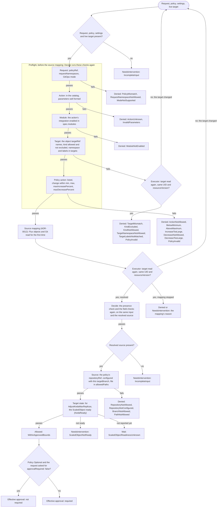

# 5. API

Group `remediation.shadewright.io`, version `v1alpha1` ([ADR-0009](../adr/0009-api-group-and-docs-domain.md)). Schemas are generated from Go types by Kubebuilder.

This section covers the four objects: the request (5.1), the incident (5.2), the policy (5.3) and the settings (5.4). Numbers and edge cases that only matter when you build or debug are in the table "Details" at the end (5.5).

## 5.1. RemediationRequest

A namespaced CR that holds one concrete plan, the policy decision and the execution state. Example (values are illustrative):

```yaml
apiVersion: remediation.shadewright.io/v1alpha1
kind: RemediationRequest
metadata:
  name: orders-keda-capacity-001
  namespace: shadewright-system
spec:
  incidentRef:
    name: orders-scaling-001
    uid: "11111111-1111-4111-8111-111111111111"
  targetRef:
    apiVersion: keda.sh/v1alpha1
    kind: ScaledObject
    namespace: orders
    name: orders-worker
    uid: "22222222-2222-4222-8222-222222222222"
  mode: GitOps
  approvalRequired: true
  policyRef: keda-capacity
  action:
    type: AdjustKedaMaxReplicas
    adjustKedaMaxReplicas:
      previousValue: 10
      desiredValue: 15
  verification:
    timeout: 10m
    stableFor: 3m
    checks:
      - DeliveryRevisionApplied
      - KedaReady
      - QueueBacklogDecreasing
status:
  observedGeneration: 1
  phase: AwaitingApproval
  effectiveApprovalRequired: true
  source:
    repositoryRef: fleet
    targetBranch: main
    path: apps/orders/scaledobject.yaml
    buildPath: apps/orders
    baseCommit: "0123456789abcdef0123456789abcdef01234567"
  planDigest: "sha256:aaaaaaaaaaaaaaaaaaaaaaaaaaaaaaaaaaaaaaaaaaaaaaaaaaaaaaaaaaaaaaaa"
  policyRevision: "keda-capacity/3"
  policyUID: "44444444-4444-4444-8444-444444444444"
  pullRequest:
    number: 42
    url: https://github.com/example/fleet/pull/42
    headSHA: "89abcdef0123456789abcdef0123456789abcdef"
    renderedTargetHead: "fedcba9876543210fedcba9876543210fedcba98"
  conditions:
    - type: PolicyAllowed
      status: "True"
      reason: WithinApprovedBounds
      message: "The change is within the policy bounds"
      observedGeneration: 1
      lastTransitionTime: "2026-11-01T10:00:00Z"
```

### Who writes what

Only the user or analyzer writes `metadata` and `spec`. Only the controller writes `status`. RBAC on `/status` separates proposal from decision and execution. The `/status` subresource, standard conditions and `observedGeneration` are part of the implementation.

### Schema and admission rules

**What it does.** Each action type has its own typed parameter struct (a discriminated union on `action.type`), so validation happens in the schema rather than in a free-form map. The MVP catalog has two actions: `AdjustKedaMaxReplicas` and `SetContainerMemoryLimit`.

**Why.** The API server enforces the schema rules itself (OpenAPI and CEL), before any controller sees the object. Envtest tests in `test/apivalidation` cover them. Valid examples of every kind are in `config/samples`, and a test applies them.

**The rules:**

- `approvalRequired` defaults to `true`.
- `GitOps` is the default mode and, in the MVP, the only one.
- The action type is an enum. Parameters are typed and bounded. Memory values are whole bytes between 1Mi and 1Ti.
- The whole spec is immutable. A different plan is a new request, so an approval can never carry over to a changed plan.
- Verification can only be made stricter. The controller always runs the checks the action needs, `stableFor` is at least 1m, and `timeout` is at most 24h and longer than `stableFor`.
- `approvalRequired: false` is a request for automation, not a way to lower central policy.

### What a request may target

Each action type fixes the kinds it may target:

- `AdjustKedaMaxReplicas`: only a `keda.sh` ScaledObject. The policy check further requires `keda.sh/v1alpha1`, the only version KEDA 2.x serves and the one the readiness rule reads. Another version is `Denied` with `KindNotAllowed`.
- `SetContainerMemoryLimit`: only an `apps/v1` Deployment or StatefulSet.

The target must be namespaced and pinned by UID. The target namespace and object are authorized independently, including cross-namespace references.

### The spec says what, never where

The repository, branch and file are resolved by the controller from the Flux objects that deliver the target ([ADR-0012](../adr/0012-object-to-source-mapping.md)) and written to `status.source`. A request cannot point a change at another file, another repository or an unprotected branch.

`policyRef` points to admin-managed configuration, and the policy decides which namespaces may use it (`requestNamespaces`). The model never chooses a URL, host, branch or credential reference.

### The plan digest

**What it does.** Any change to the plan, resolved source, repository settings or policy invalidates an earlier approval. The digest is how that is detected.

**What it covers:**

- the semantic change;
- the target UID;
- the resolved source, with the repository URL and installation from settings;
- the policy UID and generation. A recreated policy can reach the same generation again, never the same UID.

**How it is built.** It is `sha256:` over a versioned canonical encoding: every field labelled, length-prefixed and in a fixed order, and memory quantities written by value, so `256Mi` and `268435456` give the same digest (`internal/policy/digest`).

**When it is fixed.** The policy check stores it in `status.planDigest` in the same status write that sets `PolicyChecked`, from the very policy, settings and source the decision was made on. The branch is created later, at the head of the target branch as it is then, after the freshness check has confirmed that the target file there still holds the previous value.

### The freshness check

**What it does.** Later merges to the target branch do not change the digest. Before each write the controller checks that the target file at the branch head still holds the previous value. If an input of the digest changes, the request becomes `Superseded`, its PR is closed and a new request is needed. The branch is never rebuilt or force-pushed.

**How it checks** (`internal/policy/freshness`):

- It reads the policy and settings from the API server, never the cache.
- It compares the policy UID and generation, and recomputes the digest from the live settings.
- It confirms the target still has the planned UID.
- It reads the target file at the head of the target branch, not of the PR branch.

**What can go wrong.**

- Any error reading an input is "not fresh". The write waits and is retried. Only a definite change supersedes.
- Repository settings that can never open a Git provider end the request in `NeedsIntervention` (`RepositoryUnusable`) without closing anything.
- While `RemediationSettings.spec.paused` is set, the write waits too.

### Cleanup of a stale plan

The cleanup runs in three steps:

1. A status write sets `PlanFresh` `False` with the stale reason and leaves the phase as it is. This is the mark that the cleanup has started.
2. The idempotent close of the change request.
3. The status write that sets `Superseded`.

A crash, restart or deadline anywhere in between leaves the mark. The next reconcile finishes the cleanup without checking the plan again: it closes again (a no-op if the first close went through) and supersedes.

A recorded pull request found closed while the mark is set was closed by that cleanup. It ends `Superseded`, not `NeedsIntervention` (`ChangeRequestClosed`), even if the plan looks fresh again by then.

### Raising `maxReplicaCount`

**Why a precondition.** Raising `maxReplicaCount` makes sense only after confirming that the replica cap is the cause, and that the cluster and the downstream dependency have capacity. A backlog alone is not enough evidence.

**What it does.** One precondition is enforced by deterministic code, not left to the evidence the model was shown (invariant 1). The policy check refuses `AdjustKedaMaxReplicas` unless the live `ScaledObject` is ready by the `KedaReady` rule (listed in 5.5).

**Outcomes.**

- A missing or malformed object is not ready.
- A definite not-ready state is `NeedsIntervention` with reason `ScaledObjectNotReady` (section 6).
- A `ScaledObject` KEDA has not reported on yet (no status, no `Ready` condition, `Ready=Unknown` other than `PartialTriggerError`) is waited for, for up to 10 minutes, and then ends the same way.
- The freshness check before every write applies the same rule, confirmed by a second read.

## 5.2. Incident

A namespaced CR in the operator namespace, next to the requests that point at it ([ADR-0007](../adr/0007-incident-state-in-crds.md)). It holds:

- the fingerprint, counters, first and last seen, and the correlated owner;
- references to analyses and requests.

Large data (log excerpts, full model transcripts) lives outside etcd, or is dropped after analysis in the MVP.

## 5.3. RemediationPolicy

A cluster-scoped CR, writable only by the cluster admin ([ADR-0011](../adr/0011-policy-as-cluster-scoped-crd.md)). Each policy names:

- the action types it allows;
- the target selector (namespaces and labels; kinds are fixed per action by the catalog);
- parameter bounds;
- the Git paths it may patch;
- the namespaces whose requests may use it;
- whether review is always required.

`metadata.generation` together with the policy UID is the revision recorded in every request's digest.

### Safe defaults

- `approval` is `Required`.
- A policy must name its target namespaces: there is no "all namespaces".
- `requestNamespaces` is `[shadewright-system]`. A request from any other namespace is `Denied`, so the right to create requests somewhere does not grant a policy.
- Bounds have a minimum and a maximum, and `maxDecreasePercent` is 0: decreases are refused unless the admin allows them.
- `allowedPaths` are globs with a literal first segment. `*` and `**` never match a segment that starts with a dot, and no segment may start with a dot or a dash, so a policy cannot cover the whole repository, `.github/` or option-like names.

### The decision

**What it does.** The decision is a pure function (`internal/policy`). It reads the request, the policy, the settings, the resolved source and the live target. It returns `Allowed`, `Denied` or `NeedsIntervention`, with a machine-readable reason (one per check) and the effective approval.

**Why.** It uses no client and no clock, so the same input always gives the same decision.

**Outcomes besides `Allowed`:**

- Missing input (no resolved source, no live target) gives `NeedsIntervention`.
- Every other failed check gives `Denied`.
- The exception is the target state check. A `ScaledObject` that is not ready gives `NeedsIntervention`. One KEDA has not reported on yet gives `Wait`, which the controller decides again later.

### The checks, in order

The first check that fails gives the reason. All of this is built (`internal/policy.Decide`). Before them, a request with the request, the policy, the settings or the live target missing stops with `NeedsIntervention`, reason `IncompleteInput`. A missing resolved source gives the same answer, checked after the first five checks, so whichever inputs are missing the answer is the same.

The first five checks read only the request, the policy, the settings and the live target, never the resolved source. The executor runs exactly those first (`internal/policy.Preflight`), before the source mapping, so a request the policy refuses on its own fields costs no Flux or Git read, no signing and no GitHub token. The preflight uses the same code, order, reasons and conditions as `Decide`, and it only refuses: a request it lets through is mapped to its source, and then `Decide` runs every check again, in full. The target state check stays last, after the source checks, so a plan the source checks refuse is `Denied` whatever state its target is in.

This order is intended (#242): a refusal on the request's own fields wins over anything the source mapping would have said, a stop for a person (`NeedsIntervention`) or a Git error worth a retry included, since the mapping is never asked. Of the five, only the target check reads what can change on the live object (its labels). A refusal by it rests on one read, so the executor reads the target again first and starts the check over if its UID or resourceVersion changed, as it does after the mapping (section 6.2). The other refusals hold whatever the target is and need no second read.

- The request's `policyRef` and namespace (`requestNamespaces`), and the `GitOps` mode.
- The action type is in the catalog and its parameters are well formed.
- The integration module that contributes the action, if any, is enabled in `RemediationSettings` `spec.modules.integrations` (`AdjustKedaMaxReplicas` needs `keda`).
- The live target is the object `targetRef` names (UID, apiVersion, kind, namespace, name). Its kind is one the action may target and not one excluded by section 10 item 10. Its namespace and labels are covered by `targets`.
- The policy lists the action, and the change is within `min`, `max`, `maxIncreasePercent` and `maxDecreasePercent` (compared by value, in arbitrary precision).
- The resolved repository is the policy's `gitOps.repositoryRef`. It is configured in RemediationSettings with the resolved branch as its `targetBranch`. The file matches `allowedPaths`.
- The live target is in a state the action may be applied to. For `AdjustKedaMaxReplicas` that is a `ScaledObject` ready by `KedaReady`, whose identity in the live object is the target's.



### Limits of the decision

- The path match is purely lexical, so it is never the only guard. A pattern such as `apps/**` also matches a file declaring a Role or a Secret, and the kind check refuses it.
- The decision does not trust the API server to have defaulted the policy. An unset field reads in its strictest sense: no request namespaces, approval `Required`, no increases or decreases.
- One exception to the strict reading: a policy without `objectSelector` covers every object of the allowed kinds in its target namespaces. Labels are not a security boundary anyway, because anyone who can patch the object can set them.

### Effective approval

The effective approval is `false` only when all three hold: the outcome is `Allowed`, the policy is `Optional`, and the request asked for `approvalRequired: false`.

## 5.4. RemediationSettings

One cluster-scoped object named `default`. It holds:

- the kill switch (`paused`, checked right before every write);
- global limits: `maxConcurrentRemediations`, checked by the executor right before an allowed decision is written (section 10.7);
- the analysis bounds and model deployments (`analysis`, see below);
- the Git repositories Shadewright may write to, each with its provider settings. For GitHub that is the App client ID, installation ID and the signer (a Key Vault key, ADR-0006);
- the module lists (`modules`).

Policies and requests refer to repositories by name only.

### Repositories

**What it does.** Each repository names the only branch pull requests may target (`targetBranch`, default `main`). The branch Flux tracks must equal it.

**Why.** Installation tokens must never go to another host. So URLs carry no credentials, query or fragment and no `.` or `..` path segment, and a GitHub repository must be `https://github.com/<owner>/<repo>`.

**The schema holds a GitHub entry to the adapter's own rules**, so a bad entry is refused when it is applied, not when a request first uses it. The adapter checks the same rules again before it is built. The rules are in 5.5.

**What can go wrong: an entry stored before a rule existed.** The schema is checked only when an object is written, so such an entry stays in the object after an upgrade.

- With CRD validation ratcheting (on by default since Kubernetes 1.30), the entry does not block later writes to the object while it is left unchanged.
- Without ratcheting, the API server refuses every write to the object, setting `paused` (the kill switch) included, until the entry is fixed.
- In both cases the remedy is to fix or remove the entry. Until then a request that uses it ends `NeedsIntervention` (`RepositoryUnusable`, section 6).

### The kill switch

**What it does.** The kill switch is one gate (`writeAllowed`, `internal/controller/killswitch.go`). Every Git provider the executor opens is wrapped so that each write first reads `default` from the API server, never from the cache. The writes are creating the branch, the commit, opening a pull request, closing one, and enabling auto-merge. The wrapper calls the host only when the object exists and `paused` is not true.

**The write checkpoint.** The wrapper also hands the gate to the adapter as a write checkpoint carried by the context (`providers.WithWriteCheckpoint`, a plain function, so the adapter imports nothing of Kubernetes).

- Every adapter must call it (`providers.CheckWrite`) right before each write request it sends and each retry.
- That includes each of the several writes of one method. The GitHub commit is, today, a blob, a tree, a commit and the GraphQL branch update.
- It comes after any slow work such as a token refresh, so the check is the last thing before the request is handed to the HTTP client.
- The GitHub adapter and the fake used in tests do. Reads are not checked.
- The adapter gets only the class of a refusal (paused, or settings that cannot be read), never the API server's error text.

**What it guarantees.** A pause set at any moment stops the next write request in the reconcile it is set in. That holds also after the freshness check passed, between the reads of one step or between two requests of one method. No further write request or retry goes out once the pause is seen.

**What it does not stop.**

- A write request already handed to the HTTP client may complete.
- There is no lock with the API server, so a pause set after the check's read does not stop that one request.
- A method stopped half way leaves at most unreferenced Git objects or a branch without its pull request. The steps of 8.2 are idempotent (the branch is found at its commit, the file on the branch is read before a commit, the open pull request of the branch is returned), so the request resumes without a duplicate (invariant 5).
- A pause does not revoke a published pull request, revert a merge or stop analysis. See the [emergency runbook](../emergency.md).

**What can go wrong: unreadable settings.** The gate fails closed. Settings that cannot be read, or that are gone, block the write, which is retried with backoff.

**What a held-back request looks like.**

- It keeps its phase and the rest of its status: the deadline, a recorded pull request, the mark of a stale plan's cleanup.
- It gets the condition `WritesPaused` (`True`, reason `WritesPaused`) and a Normal Event `WritesPaused`.
- It checks again every minute.
- Time spent paused still counts against a started deadline. A request whose deadline passes while paused expires once writes are allowed again (`expire` closes what it opened first, which is a write too).
- The first recheck that finds writes allowed again removes the condition, with an Event `WritesResumed`, whatever the rest of that check finds (a failure or a refusal of the host included). The request goes on from where it stopped. A request that ends instead loses the condition without one.
- The Events are core Events about the request in the operator namespace. They are written with the grant on Events that the executor's leader election Role already holds.

**Other paths.** The freshness check, the look at a recorded pull request and the close also read the switch first, so a paused executor does not read Git for a write it may not make. The gate is what holds whatever the path.

**Planned.** Issues and comments (ADR-0014) are not built. They are writes and must go through the same gate.

### Modules

**What it does.** `modules` enables the platform and integration modules of 2.4 and 2.5 in two separate lists, `platforms` and `integrations`, since platform and integration names are separate namespaces.

**Limits of the lists.**

- Each list is a set: a name given twice is refused.
- The lists hold at most 8 and 32 names. `internal/modules` refuses to build a registry with more compiled-in modules than that (2.4), so every module a binary has can be enabled.
- A name is a DNS label that starts with a letter, at most 63 characters. This is the rule `internal/modules` checks when it builds its registry, and a test keeps the schema and the registry in agreement.
- The generic platform is always on and may not be listed.

**Why names are a pattern.** A module added in a later release, or shipped as a pack ([ADR-0019](../adr/0019-extension-packaging.md)), needs no schema change. The price is that a misspelt name is accepted, matches no compiled-in module and contributes nothing.

**Nothing is enabled by default.** With `modules` left out, the analyzer uses the generic platform and no integration, whatever it detects. A cluster admin enables each module on purpose.

**When a module is active.**

- A module contributes hooks only when it is enabled here and detected ([ADR-0018](../adr/0018-three-axes-of-pluggability.md)).
- Detection only reports and narrows what is enabled. It never enables a module, and no override makes a module active on a cluster where it is not detected.
- More than one platform may be enabled, so one settings file can serve clusters on different platforms. Only the detected one is active.
- Which modules are active is always worked out again from `spec.modules` and live detection, never read from status. Status is a report, never an input, so a stale or forged status cannot enable anything.

### Analysis limits

**What it does.** `analysis` bounds every model-backed analysis and names the models it may call (11.1, 12.3). Its limits have safe defaults and hard upper bounds in the schema, and an explicit `0` is refused where it is out of bounds.

**Read today: `maxAnalysesPerDay`.**

- It counts analyses per UTC day across all Incidents. Default 100, range 0 to 10000. 0 disables the model.
- The analysis trigger reads it (3.2): 0 marks every Incident not due.
- The default applies also when `analysis` is left out, since `analysis` itself defaults to an empty object.
- It is counted against in the analyzer's own ConfigMap in the operator namespace, not in this object, whose spec the analyzer only reads (3.2).

**The old top-level field.** v0.1.0 had this field at the top level as `spec.maxAnalysesPerDay`.

- It stays in the schema, deprecated and without a default, under a CEL rule that refuses any write that sets or changes it.
- Validation ratcheting lets an object stored by v0.1.0 keep its value through updates of other fields. Removing it always passes.
- While it is set, the trigger goes by the lower of the two. So a 0 set by the v0.1.0 runbook keeps analysis off after an upgrade, instead of falling back to the new field's default of 100.

**Models.** `models` has a `triage` deployment for the one structured call and an optional `escalation` deployment for the stronger model ([ADR-0023](../adr/0023-how-the-analyzer-calls-the-model.md)).

- An escalation model without a triage model is refused.
- So are two that name the same endpoint (ignoring a trailing `/`) and deployment (ignoring case), so the escalation cap cannot become a second budget for the triage model.
- Each names an `endpoint`, a `deployment` name and an `apiVersion` (`v1` or a valid-looking date, optionally `-preview`). The endpoint rules are in 5.5.
- Each must set a daily cap `maxTokensPerDay`. It has no default, so the admin chooses it per deployment. Range 0 to 1,000,000,000, and 0 stops calls to it.
- There is no field for a key or any other credential. The analyzer authenticates with its workload identity (11.1).

**Why write access is security-relevant.** The schema is vendor-neutral ([ADR-0013](../adr/0013-adapters-for-every-external-system.md)), but the endpoint decides where the analyzer's Entra ID token and the redacted context go. This includes the `patch` right that the [emergency runbook](../emergency.md) hands out for the kill switch.

**Planned.** No component reads the rest of `analysis` yet. The analysis loop ([#76](https://github.com/pkalin/shadewright/issues/76)) will enforce the limits, and the token caps need the spend counter of [#208](https://github.com/pkalin/shadewright/issues/208). Until then the only analysis limit in force is `analysis.maxAnalysesPerDay` (3.2). The daily count is enforced once the analysis reserves units of the budget ([#16](https://github.com/pkalin/shadewright/issues/16), [#76](https://github.com/pkalin/shadewright/issues/76)); until then nothing adds to it.

- `maxContextBytes`: the redacted context of one analysis, default 32768, 4096 to 262144.
- `maxToolSteps`: read tool calls of one escalation, default 4, 0 to 16.
- `maxOutputTokens`: per model call, sent as `MaxOutputTokens`, default 2048, 256 to 16384.
- `maxConcurrentAnalyses`: default 1, 1 to 8.
- An analysis makes at most 3 + `maxToolSteps` model calls: the triage call, one retry after invalid output, and `maxToolSteps` + 1 escalated turns. An invalid escalated result gets no retry and is handed off.
- The analyzer refuses a host outside an allow-list of suffixes held by the operator (a flag, not these settings). It refuses private, loopback and link-local addresses when it dials, and requests a token for the Cognitive Services audience only ([#76](https://github.com/pkalin/shadewright/issues/76)).
- When a model is missing (#76): with no `triage` model it makes no model call, uses no unit of `analysis.maxAnalysesPerDay`, and hands an incident no runbook matched off to a person. With no `escalation` model an escalation trigger (ADR-0023) hands off. A deployment whose `maxTokensPerDay` is 0, or whose cap for the day is spent, is not called and the incident is handed off.

### Status

**What it does.** The status reports what was detected and what is in use. The analyzer writes it (2.4). It is the analyzer's only write outside the operator namespace, an `update` of the status subresource ([ADR-0024](../adr/0024-analyzer-writes-detection-to-settings-status.md), invariant 6). The executor neither writes nor reads it.

**Why it is only a report.** No component reads any of these fields, or any other field of the status, to decide anything. Decision state of another component (signer health, a circuit breaker) must not be kept here.

**Platform.** `status.platform` has two fields:

- `detected`: the platform that claims every node with certainty (left out when none does).
- `active`: the platform in use. It is `detected` when it is enabled in `spec.modules.platforms`, `generic` otherwise.

So a cluster on AKS without `aks` enabled shows `detected: aks, active: generic`, and the admin sees why AKS diagnosis is missing.

**Integrations.** `status.integrations` lists every integration that is enabled or detected, with:

- `detected`;
- the group version that matched (`version`, such as `keda.sh/v1alpha1`);
- `active` (enabled and detected).

A detected add-on whose module is not enabled is listed too, so the cluster admin can see what to enable. An enabled name no compiled-in module has is listed as not detected. That makes at most 64 entries: 32 enabled names and at most 32 more detected ones, since only a compiled-in module can be detected.

cloudflared has no API group and declares core `v1` (2.5). It is listed as detected with `version: v1` on every cluster, so for it `detected: true` means nothing about whether cloudflared runs. Only `active` does, and it follows `spec.modules`.

**What the schema refuses.**

- An integration that is active but not detected.
- A version without detection, or detection without a version.
- `generic` given as detected.
- An active platform that is neither `generic` nor the detected one.

It does not tie status to `spec`: a status written before a spec edit would then block the edit.

**Conditions the analyzer writes**, with `observedGeneration`:

- `UnknownModules`: `True` (reason `UnknownModulesEnabled`) when `spec.modules` names a module the binary does not have, with the names in the message. `False` (`AllModulesKnown`) otherwise.
- `DetectionFailed`: `True` (reason `DetectionFailed`, with a fixed message) when the last run could not list the nodes or read the discovery API. The report is then from the last run that succeeded or, when none has, shows only `generic` active and no integrations. `False` (`Detected`) after a run that succeeded.
- `NoWatchedNamespaces`: set from the count of `--watch-namespaces`, not from detection. `True` (reason `NoNamespacesWatched`) when the analyzer watches no namespace, so it reads no events or pods and records no Incident. `False` (`NamespacesWatched`, with the count) otherwise.

Conditions of other types are kept as they are. Like the others, these appear only once a `RemediationSettings` object exists, which the chart does not create by default (`settings.create: false`).

## 5.5. Details

| Topic | Detail |
| --- | --- |
| `KedaReady` rule | `Ready=True`; not paused, partial pauses and the annotations `autoscaling.keda.sh/paused`, `paused-replicas`, `paused-scale-in` and `paused-scale-out` included whatever their value; not being deleted; not on fallback; `HPAActive` not `False` |
| Wait for an unreported `ScaledObject` | Up to 10 minutes, then `NeedsIntervention` (`ScaledObjectNotReady`) |
| Memory values | Whole bytes between 1Mi and 1Ti |
| Verification | `stableFor` at least 1m; `timeout` at most 24h and longer than `stableFor` |
| Digest | `sha256:` over a versioned canonical encoding (`internal/policy/digest`) |
| GitHub repository URL | `https://github.com/<owner>/<repo>`; no credentials, query, fragment, `.` or `..` segment |
| GitHub repository name | May start with `.` (as in `.github`); may not be `.` or `..` or end in `.git`; 1 to 100 characters |
| GitHub owner | 1 to 39 characters, starting with a letter or digit |
| App client ID | Letters, digits, `.`, `_` and `-` |
| Target branch | Starts with a letter or digit; at most 200 characters; does not end with `.` |
| Key ID | Follows the Key Vault naming rules: vault name 3 to 24 characters with no consecutive hyphens; key name 1 to 127 characters |
| Model endpoint | HTTPS only; at most 256 characters; host name of lower-case DNS labels; port 1 to 65535 if any; no IP address, user info, query, fragment or dot segment |
| Model `apiVersion` | `v1` or a valid-looking date, optionally `-preview` |
| `maxTokensPerDay` | No default; 0 to 1,000,000,000; 0 stops calls |
| `maxAnalysesPerDay` | Default 100; 0 to 10000; 0 disables the model |
| Planned analysis limits | `maxContextBytes` 32768 (4096 to 262144); `maxToolSteps` 4 (0 to 16); `maxOutputTokens` 2048 (256 to 16384); `maxConcurrentAnalyses` 1 (1 to 8) |
| Model calls per analysis | At most 3 + `maxToolSteps` |
| Module lists | `platforms` at most 8 names, `integrations` at most 32; a name is a DNS label starting with a letter, at most 63 characters |
| `status.integrations` | At most 64 entries (32 enabled, at most 32 more detected) |
| Paused request recheck | Every minute |
