# 6. Reconciliation

[![Shadewright executor: a RemediationRequest passes the policy's field checks, the source mapping, the full policy decision, the limits, the freshness check, the patcher with the semantic diff and the kill switch gate; the Key Vault signer lets the GitHub App open the pull request, the request waits in AwaitingApproval and reaches Merged when a person merges, with the merge receipt; with --verify-outcomes (off by default) it then waits in WaitingForDelivery until Flux applies the merge commit and is checked in Verifying (Delivered, Configured, RolledOut), ending Succeeded, Failed or Inconclusive; refusals end in Denied, NeedsIntervention or Superseded; with --verify-outcomes a merged request keeps the target lock until it ends, and a request queued behind it for the same field ends Superseded when it succeeds; built up to Succeeded, with the executor judging cleared from the verifier's report; a revert's link check before the field checks and its end Inconclusive with RevertApplied are built and not drawn, as is the analyzer proposing a revert; auto-merge is planned.](../assets/diagrams/executor.svg)](../assets/diagrams/executor.svg "Open full size")

[![RemediationRequest phases: Pending, PolicyChecked, PRCreated, AwaitingApproval or AutoMergeQueued, Merged, WaitingForDelivery, Verifying, Succeeded; built up to Succeeded, the steps after Merged only with --verify-outcomes (off by default), with AutoMergeQueued planned; a step before the merge can end in Denied, Failed, Expired, Cancelled, Superseded or NeedsIntervention, and a request stopped NeedsIntervention because the target branch changed moves on to Merged when its pull request is merged later; after the merge a request ends Succeeded, Failed or Inconclusive, never Expired; a merged request without a merge receipt, or a plan merged after it was known stale, ends Inconclusive; a request cancelled because its Incident was folded or is gone moves on to Merged if its own pull request is found merged.](../assets/diagrams/phases.svg)](../assets/diagrams/phases.svg "Open full size")

This section covers how a `RemediationRequest` moves through its phases: the phases and transitions (6.1), the policy check that decides a request (6.2), retries and deadlines (6.3), the shape of every reconcile (6.4), the pull request step (6.5), the checks that run before every write (6.6) and what happens when a request is deleted (6.7). Numbers and edge cases that only matter when you build or debug are in the table "Details" at the end (6.8).

The steps after `Merged` are built (#678, #681, #683): the merge receipt, the delivery window, the executor's own checks after the delivery, and `Cleared` judged from the verifier's report (#682), ending `Succeeded`, `Failed` or `Inconclusive`. They run only with the executor flag `--verify-outcomes` (chart value `executor.verification.enabled`), off by default until a lab run with a release candidate decides the default. On with the verifier deployed, a request can end `Succeeded`; on without a verifier, no report is written and every merge ends `Inconclusive` (`StaleReport`) or `Failed`, so the circuit breaker would not close again once tripped. Off, a merged request keeps `Merged` with its rollout report (#532), except a plan merged after it was known stale: it ends `Inconclusive` (`StalePlanMerged`) once its rollout check is over, and the circuit breaker never reads it as a success (6.5).

Other terminal or waiting phases: `Denied`, `Failed`, `Expired`, `Cancelled`, `Superseded`, `NeedsIntervention`, `Inconclusive` (merged, and neither success nor failure could be shown, [ADR-0030](../adr/0030-merge-receipt-and-verification-outcomes.md) section 5). Conditions explain why; `phase` is a summary for humans.

## 6.1. Phases and transitions

The API defines every phase below. The executor sets the first step: a `Pending` request (or one without a phase yet) becomes `PolicyChecked`, `Denied` or `NeedsIntervention` in one status write.

What happens next, step by step:

- **Held back by a limit.** A request the policy allows stays `Pending` with the condition `Queued` while a limit of section 10.7 holds it back. It is checked again every 30 seconds, or every 10 minutes (and when the holder changes) behind a lock held by a request that stopped.
- **A duplicate of a merged request.** An undecided request whose Incident and target already have a merged request ends `Superseded` (`AnotherRequestMerged`) before it takes the target lock (6.6.3).
- **After a pull request closed without a merge.** An undecided request that waited behind the target lock of another request for the same target and field, whose pull request was then closed without a merge, ends `Superseded` (`AnotherRequestClosed`) before it takes the lock (6.6.4).
- **After the change it waited behind succeeded.** With `--verify-outcomes` on, a merged request keeps the target lock until it ends. An undecided request that waited behind it, for the same field, from the same previous value and in the same direction, ends `Superseded` (`AnotherRequestSucceeded`) when it ends `Succeeded`, and is decided as usual when it ends `Failed` or `Inconclusive` (6.6.5, #719).
- **Freshness before merge.** The executor re-checks the freshness of a decided request before merge every five minutes, and at once on any change to the request (once its pull request waits for review, only when no full recheck ran in the last five minutes). While a pull request waits for review, the executor only looks at the pull request in between, every `--pull-request-poll-interval` (one minute by default), so a merge or a close is seen within that interval (#434), and the full recheck also says when the Incident stops while it waits ([step 4](#step-4-recording-the-pull-request), #715); a look writes nothing to Git, so every write still comes right after a freshness check. A stale plan becomes `Superseded`, or `NeedsIntervention` if its repository settings became unusable, without waiting for a write.
- **Opening the pull request.** A fresh `PolicyChecked` request opens its pull request and moves to `PRCreated` and `AwaitingApproval` (6.5). One whose Incident was folded into its cause's Incident, or is gone, by the last step before the open ends `Cancelled` (`IncidentFolded`, `IncidentGone`) instead (#794).
- **Merge.** Observing a person's merge is built: the request then reaches `Merged`, with the merge receipt in the same status write; a merge without a full merge commit ID ends `Inconclusive` (`NoMergeReceipt`) on the next reconcile (step 5 of 6.5).
- **Delivery and verification.** Built (#681, [ADR-0030](../adr/0030-merge-receipt-and-verification-outcomes.md) sections 2 and 4), behind `--verify-outcomes` (off by default; off, a request found in `WaitingForDelivery` or `Verifying` ends `Inconclusive` with `VerificationDisabled` at its next reconcile, so none stays there). A `Merged` request with a merge receipt moves to `WaitingForDelivery` on the next reconcile, with `status.deadline` at the end of the delivery window: one hour after `mergeReceipt.mergedAt`, extended by the time writes were paused. Delivery is asked against the receipt (its merge commit on its target branch, and the ancestry of a later applied commit in the receipt's repository), never the live settings. When Flux reports the merge commit, or a later commit that holds it, applied, one status write records `appliedObservedAt` and the rollout fields, sets `Delivered` `True` and moves the request to `Verifying` with `status.deadline` at the timeout: the larger of `spec.verification.timeout` and the rollout deadline plus the effective `stableFor` plus `--node-grace`, 21 minutes for a memory fix with the defaults. At the end of the window without that, the last read decides: Flux failing on exactly the merge commit ends `Failed` (`DeliveryFailed`); a failure on a later commit that holds it `Inconclusive` (`DeliveryBlocked`); a suspended Kustomization `DeliverySuspended`; anything else `DeliveryNotObserved`; reads that fail to the end of the window plus 10 minutes `DeliveryNotChecked`, a Flux that keeps moving between applied commits while it is read included. A cause that does not clear by itself (the receipt's repository gone from the settings or unusable, a Git provider without an ancestry check, no delivery verifier) is retried too, and named in `Delivered` and the final message. A failure inside the window is not final, since Flux retries. Every reconcile in `Verifying` (every 30 seconds) reads the target again: a live field without the desired value ends `Inconclusive` (`Configured` `False`, `ValueChanged`), a pod template or revision other than the one recorded ends `RolloutSuperseded`, and `RolledOut` follows the rollout (`RolloutPartitioned` for a partitioned StatefulSet, naming the pods left on the old revision). A target that is gone ends `TargetGone` and one with another UID `TargetReplaced`, at once, in either phase. A field that cannot be read on the target ends `Inconclusive` (`TargetNotChecked`), not `ValueChanged`. Each check then judges `Cleared` (#683, ADR-0030 sections 4 and 7): it reads the verifier's `VerificationReport` of the request (`get`, operator namespace) as untrusted evidence. An OOM kill of the action's container recorded in a report bound to the request ends `Failed` (`OOMKilled`) at once. A check is good when `RolledOut` is `True`, every desired replica is available (else `NotAvailable`) and the report passes the trust contract: missing, never sampled or with a sample counter that has not risen for 90 seconds by the executor's clock is `StaleReport`, another request, merge commit, target UID, template revision or container is `ReportMismatch`, coverage short of `spec.replicas` is `PartialRollout`. A good check opens the executor's own window (`status.verification`: `windowStart`, `lastReset`, `resets`, forward only by CEL), a bad one resets it. The request ends `Succeeded`, with `Cleared` and `Verified` `True` (`NoRecurrence`; `Cleared` gets `ResolvedBeforeRollout` instead under the rule below) in the same status write, when a good check finds both spans at least the effective `stableFor` plus `--node-grace` (the report's on the verifier's clock, the executor's on its own) and the report's counter higher than at a check at most 30 seconds earlier; once both spans are long enough the executor checks every 15 seconds. The counter is kept in memory. A check whose status write fails keeps the reset it found in memory, and the next check applies it again to the window it reads, so a lost write cannot let a window span the bad check it missed and end a request, a revert or a ScaledObject included. A restart or a leader change loses that memory, so no window counts time from before the executor process began reconciling (taken once on its clock, when it wins leader election, which on a standby that becomes leader later is that moment, not its start): the span of every window, a revert's and a ScaledObject's included, runs from the later of the stored `windowStart` and that moment, and the stored `windowStart` is kept as it is. The cost: after a restart or a leader change every open window needs a full `stableFor` (plus `--node-grace` for a pod target) again, so a request whose timeout comes sooner ends at the timeout `Inconclusive` with the last reset of its windows (without one `EvidenceMissing`, `ClearingNotChecked` for a ScaledObject), never `Succeeded` and never `Failed` for it; an executor that keeps restarting ends no verification before its timeout, the fail-closed side. A ScaledObject cannot succeed: once ready and configured for `stableFor` it ends `Inconclusive` (`ClearingNotChecked`), and a request naming `QueueBacklogDecreasing` ends `Inconclusive` (`CheckNotAvailable`) where it would succeed. At the timeout a request ends `Failed` (`RolloutStuck`) when `RolledOut` is `False`, `Failed` (`KedaNotReady`) when a ScaledObject target is not ready by the KedaReady rule, `Failed` (`Restarted`) when a report bound to the request recorded a restart above its baseline after its window opened, and otherwise `Inconclusive` with the reason that holds the window closed (for example `StaleReport`, or `PodNotReady` from the report for a pod not Ready without a restart). A report that cannot be read is retried, never read as missing, until 10 minutes past the timeout. A target that cannot be read until 10 minutes past the timeout ends `RolloutStuck` when that was recorded, else `Inconclusive` (`TargetNotChecked`). Each wait is measured on the executor's clock from a time it recorded itself; a clock set back by more than a minute ends the wait `Inconclusive` at once instead of stretching it, and one up to a minute behind (a leader on another node) does not. A request whose applied time the rollout report recorded in `Merged`, past its timeout when `--verify-outcomes` is turned on, ends `Inconclusive` (`ClearingNotChecked`). The circuit breaker reads `WaitingForDelivery` and `Verifying` as neither a success nor a failure (10.7), and with the flag on also a `Merged` request with a merge receipt, which has not moved to `WaitingForDelivery` yet: read as a success in that gap, a half-open probe that has just merged would close the breaker before its outcome is known. With the flag off `Merged` is a success, as before #681; a `Merged` request without a receipt is read as before (like `Inconclusive` with the `NoMergeReceipt` mark, a success otherwise). The kill switch gates writes only: while writes are paused every read still runs, and only the delivery window is extended. Past the merge a deadline never ends a request `Expired`.
- **Rollout after the merge with `--verify-outcomes` off, or of a request without a receipt.** Built (#532), reporting only, for every merged request while `--verify-outcomes` is off, and for a request merged before receipts existed (`MergedBeforeVerification`): the phase stays `Merged`, except for a plan merged after it was known stale, which ends `Inconclusive` (`StalePlanMerged`) once the check below is over, good or bad (#199). The executor waits up to an hour after the merge for the Flux Kustomization that applies a Deployment or StatefulSet target to report the merge commit (or a later commit of the target branch that holds it) applied, records that time once in `status.pullRequest.appliedObservedAt`, then reads the target's rollout status and sets `RolledOut`: `True` when every pod runs the applied template, `False` with reason `RolloutStuck` and one core Event when it did not within 10 minutes of that time. A delivery not seen within the hour gives `False` with reason `DeliveryNotObserved` and one Event; a target of another kind gives `Unknown` with reason `KindNotChecked`. The target branch asked about is the one in the merge receipt when there is one, which for a pull request moved to the target branch the settings name after a change and merged there is that branch (#771), and `status.source.targetBranch` otherwise; the `DeliveryNotObserved` message names it. The ancestry of a later applied commit is asked of the receipt's repository, opened by its URL and installation whatever target branch the settings name now, so a later commit of the receipt's branch counts after a retarget too; only a request merged before receipts existed asks the plan's repository through the live settings. One function (`mergeQuery`) makes that choice for both modes, and while writes are paused this check asks the Git host nothing and waits. It never acts on a pod (invariant 2) and uses only the `get` it already holds (invariant 6). A read that fails or a cancelled reconcile is never a verdict, but the check always ends with one: a stuck rollout is read again for an hour after the deadline, a newer template revision ends it with `RolloutSuperseded`, a gone or unreadable target with `RolloutNotDetermined`. The delivery is checked before the hour is judged, and time while writes are paused does not count against the hour (`status.rollout.pausedSince` and `pausedSeconds`), so a resume leaves the unused part of it. The rollout judged is the one the applied commit produced: right after Flux reports it applied, the executor reads the target and records, in the same status write as the applied time, the commit Flux applied (`status.rollout.appliedRevision`), the target's generation and a hash of its pod template, after asking Flux once more that it still reports the same commit applied (otherwise it looks again); the template revision is recorded once the target's controller observed that generation and the target's current one (a Deployment's revision annotation can name a later generation before its status does), and a template that changed again before then ends the check with `RolloutSuperseded`. A later commit of the target branch that holds the merge commit counts as ours, so the template it produced is judged. A change made outside Git (`kubectl edit`, another controller) that lands before that read cannot be told apart and is not covered. `status.rollout` is set once: CEL rules keep it and each of its fields, and `ended` never goes back to false, so neither the delivery window nor a final verdict can be reopened by a status write.
- **Resolved before the rollout.** Built (#684, [ADR-0030](../adr/0030-merge-receipt-and-verification-outcomes.md) section 4). The executor reads the request's Incident with its existing `get` and records its `status.count` twice in `status.verification.incidentCount`, each reading `{uid, count, readAt}` with `readAt` on its own clock, never changed once set but removable (CEL; an executor rolled back to a release without the field drops it, and a removed reading is never taken again): `atMerge` only in the status write that sets `Merged` with the receipt (when that read fails it stays absent for good, since a later reading could follow the change), and `atApplied` in the status write that sets `appliedObservedAt`, never later, and only by the process that took `atMerge` (after a restart or a change of leader in between the reason stays `NoRecurrence`). The read is skipped when the step's deadline leaves less than its own timeout plus one minute, so it never shortens the status write. `atMerge` takes its time after the read and `atApplied` before it, so the recorded span never exceeds the real one. `Cleared` `True` carries `ResolvedBeforeRollout` instead of `NoRecurrence` only when both readings exist, both UIDs equal `spec.incidentRef.uid`, the counts are equal and below 1000000 (saturated), and `atApplied.readAt - atMerge.readAt` is at least the effective `stableFor` plus twice the analyzer's aggregation window (`aggregation.DefaultWindow`, 5 minutes). A failed read never delays the merge, the delivery or the phase: the reading stays absent and the reason stays `NoRecurrence`. `Verified`, the phase and the circuit breaker do not change, and nothing branches on the reason.
- **A revert.** Built (#96, [ADR-0030](../adr/0030-merge-receipt-and-verification-outcomes.md) section 8): a request with `spec.reverts` has its link checked before the policy check (the named request exists with that UID, ended `Failed` with `Verified` False, is not a revert itself, has the same Incident, target, action type and container, its previous and desired are swapped exactly, and the revert's name derives from the failed UID), else it ends `Denied` with `InvalidRevert`; a failed read of the named request is retried. A valid revert goes through the policy check and the pull request like any request, always with approval required, except that its pull request's title, body and rollback line differ (see [step 3](#step-3-branch-commit-and-pull-request)). In `Verifying` it reads no report: once rolled out, configured and available (at least one desired replica) held for `stableFor` it ends `Inconclusive` with `RevertApplied`, never `Succeeded`, with `Cleared` `Unknown` (`RevertApplied`); a check before the rollout completed resets its window (`PartialRollout`). The circuit breaker never reads a revert as a success, in any phase. The analyzer's deterministic revert proposer (`internal/analyzer/revert`, no model call) creates the revert of a request that ended `Failed` with `Verified` False: the same Incident, target and policy, the inverse action (`InverseAction`, the helper the link check compares against), approval required, named after the failed UID; it records its decision in the Incident's `status.revertsProposed` before the create (`Pending`, then `Created` once the revert exists) and never takes a second one, also after the revert was deleted. The two exceptions are ADR-0030's known limits: the move to `Created` was lost and the revert was deleted before the retry, or two analyzers run without leader election. For a `Pending` entry it reads the revert's name first: a revert there that names the failed request moves the entry to `Created` whatever the checks say now. Otherwise every create, the first or a retried one, runs the same checks first, and right before it the Incident is read again (no create when the entry is no longer `Pending` or the Incident is being deleted); when a check says no, the revert's name is taken by a request with another link, the create is refused as invalid, or the failed request is deleted or its name taken by another UID, the entry moves to `Abandoned`, final, with a `reason` and one Warning event `RevertAbandoned`. `Pending` entries are also settled from the Incident's side, when the analyzer starts leading and whenever an Incident with one changes, so an entry whose request went away while no analyzer led does not stay `Pending`. CEL accepts a new entry only as `Pending`, lets a state move only from `Pending` to `Created` or `Abandoned`, sets `reason` exactly with `Abandoned` and never changes it, and a rule on the root keeps the status from being removed while the list has entries. It runs whether a triage model is set or not. It proposes a revert only when the request's `Verified` condition moved to False at most 24 hours ago and at most five minutes ahead of the analyzer's clock, so at start-up older failures are logged and left to a person. It makes none for a revert, for any other end (`Inconclusive` included), when the Incident or the target is gone (a Warning event on the request for the Incident), when the Incident is being deleted, when the target's kind is no longer served, or when the action cannot be inverted; a target read refused as `Forbidden` is retried with backoff until the 24 hour bound ends it; a full list (20) sets the Incident condition `RevertsStopped` with one Warning event, and a request at the revert's name that reverts something else is left as it is. Any other failed read or write is retried with backoff. The policy refuses the decrease of a revert by default (`DecreaseNotAllowed`); whether a policy may allow it is open.
- **Planned.** Enabling auto-merge is designed but not built. [ADR-0030](../adr/0030-merge-receipt-and-verification-outcomes.md) defines what comes after `Merged`: a merge receipt written with the phase (built, #678), delivery checked against it and the outcomes delivered, rolled out and configured as separate conditions (built, #681), cleared and the stable window (built, #683, from the verifier's report, #682), and the terminal phase `Inconclusive` for a merged change whose effect cannot be shown either way. The window logic lives in `internal/verification/clearing` (#679).

```mermaid
stateDiagram-v2
    [*] --> Pending
    state Active {
        state BeforeMerge {
            Pending --> PolicyChecked: allowed, source resolved
            PolicyChecked --> PRCreated: branch, commit, pull request
            PRCreated --> AwaitingApproval: review required
            PRCreated --> AutoMergeQueued: policy allows automation (planned)
            AwaitingApproval --> Merged: a person merged it (observed, merge receipt written)
            PRCreated --> Merged: merged before the first review step (observed)
            PolicyChecked --> Merged: an existing merged pull request is adopted (observed)
            AutoMergeQueued --> Merged: checks pass (planned)
        }
        Merged --> WaitingForDelivery: next reconcile with --verify-outcomes, deadline is the delivery window
        Merged --> Inconclusive: no merge receipt, NoMergeReceipt (next reconcile)
        WaitingForDelivery --> Verifying: Flux applied the merge commit or a descendant, Delivered True
    }
    WaitingForDelivery --> Failed: Flux failed on the merge commit at the end of the window, DeliveryFailed
    WaitingForDelivery --> Inconclusive: not observed, blocked, suspended, not checked, target gone or replaced, or --verify-outcomes off (VerificationDisabled)
    Verifying --> Verifying: a check that is not good resets status.verification (a repeat of the last reason on a closed window writes nothing)
    Verifying --> Failed: OOM kill in the report (OOMKilled); at the timeout RolledOut is False (RolloutStuck), the ScaledObject is not ready (KedaNotReady) or the report recorded a restart (Restarted)
    Verifying --> Inconclusive: value changed, template superseded, target gone, replaced or not readable, a ScaledObject after stableFor (ClearingNotChecked), at the timeout no evidence (StaleReport, PodNotReady, ...), or --verify-outcomes off (VerificationDisabled)
    Pending --> Denied: policy refuses
    Pending --> NeedsIntervention: source cannot be mapped, or the ScaledObject is not ready
    Pending --> Pending: KEDA has not reported on the ScaledObject yet, or Flux is reconciling the Kustomization (waits up to 10 minutes)
    Pending --> Superseded: another request of the same Incident and target was merged (6.6.3)
    Pending --> Superseded: a pull request for the same target and field was closed without a merge (6.6.4)
    Pending --> Superseded: the request it waited behind for the same field succeeded (6.6.5)
    Pending --> Pending: allowed, but a limit holds it back (Queued, checked again every 30 s, or 10 min behind a stopped holder)
    Verifying --> Succeeded: a fresh report of a quiet window for stableFor plus nodeGrace, Cleared True
    BeforeMerge --> Cancelled: cancelled before merge
    BeforeMerge --> Superseded: a plan input changed, the ScaledObject is no longer ready or the module was disabled
    BeforeMerge --> Expired: a step reached its deadline
    BeforeMerge --> Failed: a step failed
    BeforeMerge --> NeedsIntervention: cannot continue alone
    NeedsIntervention --> Merged: a stopped holder's own pull request found merged (#771, #808)
    Expired --> Merged: a stopped holder's own pull request found merged (#808)
    Cancelled --> Merged: its own pull request found merged after the cancel
    Superseded --> Merged: a stale plan whose close was refused, merged by a person (#199)
    Succeeded --> [*]
    Denied --> [*]
    Failed --> [*]
    Expired --> [*]
    Cancelled --> [*]
    Superseded --> [*]
    Inconclusive --> [*]
```

## 6.2. The policy check

### What it does

The policy check is the first step. It loads the policy the request names, the `default` RemediationSettings and the live target, and then maps the target to its file in Git (ADR-0012).

It refuses in this order, and the first refusal decides:

1. A missing policy or settings object (`Denied`).
2. A kind the action cannot change, before the target is read (`NeedsIntervention`).
3. A missing target (`NeedsIntervention`) or one with another UID (`Denied`).
4. A field the live target does not set (`NeedsIntervention`), or a previous value that is not the live one (`Denied`, `PreviousValueMismatch`).
5. The policy's field checks (`internal/policy.Preflight`, section 5.3): request, action, module, target and bounds.
6. The source mapping, the first step that reads Flux objects or Git and so may need a GitHub token.
7. The full decision (`internal/policy.Decide`) on everything, the resolved source included.

Steps 1 to 5 read only the Kubernetes API, so a request refused there costs no Git read, no signing and no token.

The order is intended (#242): a refusal in step 5 wins over anything step 6 would have said, a stop for a person or a Git error worth a retry included, because the mapping does not run. A request refused in step 5 therefore has no `status.source`: no Git read happened.

### Why the target is read twice

The target is read again after the mapping, and the check starts over if its UID or resourceVersion changed. This way the previous value and the file in Git always describe the same object.

The same second read comes before a step 5 refusal by the policy's target check (kind, namespace, labels), the one field check that rests on what was read from the live object. A `Denied` is final, so a target that Flux relabelled after the first read starts the check over instead of being refused on its old labels. The other step 5 refusals depend only on the request, the policy and the settings, and need no second read.

### What it stores

It stores these fields together with the phase:

- `status.source`;
- `policyUID`;
- `policyRevision` (`name/generation`);
- `effectiveApprovalRequired`;
- the pull request step's `deadline` (unless writes are paused);
- the `PolicyAllowed` condition.

The write goes through the status subresource with the resourceVersion it read. A stale read ends in a conflict, so a decided request is never decided again.

### Metrics

- The decision is counted in `shadewright_policy_decisions_total` only after the status write succeeds. A lost answer undercounts and never counts twice.
- A denial is also counted by its reason, taken from a closed list of the reason constants of the controller, the policy rules and the source mapping. Any other text is counted as `Other`.
- Every reconcile error is counted by kind (timeout, conflict, cancelled, other) by a wrapper around the reconciler.
- The request phase gauge is served at scrape time by a leader-only runnable from the informer the controller already uses, with no API call.

All of them are listed in the [metrics reference](../reference/metrics.md).

### Findings

| Finding | Phase | `PolicyAllowed` |
| --- | --- | --- |
| Policy or settings object missing, target UID differs from the live object | `Denied` (`PolicyNotFound`, `SettingsNotFound`, `TargetMismatch`) | `False` |
| The previous value in the request is not the live value (the policy measures increases and decreases from it) | `Denied` (`PreviousValueMismatch`) | `False` |
| The live object does not set the field the action changes | `NeedsIntervention` (`FieldNotFound`) | `Unknown` |
| Source mapping denies (repository, branch, path or inventory) or `policy.Decide` denies | `Denied`, reason of the check | `False` |
| `policy.Preflight` denies (step 5), before the mapping; no `status.source` is written, since no Git read happened | `Denied`, reason of the check | `False` |
| `AdjustKedaMaxReplicas` without the `keda` integration enabled in `spec.modules` | `Denied` (`ModuleNotEnabled`) | `False` |
| `AdjustKedaMaxReplicas` on a `ScaledObject` that is definitely not ready (see "A `ScaledObject` that is not ready" below), checked after every check that denies | `NeedsIntervention` (`ScaledObjectNotReady`) | `Unknown` |
| `AdjustKedaMaxReplicas` on a `ScaledObject` KEDA has not reported on yet (no status, no `Ready` condition, `Ready=Unknown` other than `PartialTriggerError`) | no phase: see "A `ScaledObject` KEDA has not reported on" below | `Unknown` (`ScaledObjectReadinessUnknown`) while it waits |
| Source mapping needs a human (Helm, patches, missing target, unknown Flux shape), or the target got another UID while the mapping ran (`TargetChanged`) | `NeedsIntervention`, reason of the mapping | `Unknown` |
| The Kustomization is not `Ready` for its current generation but reports no failure: Flux is still reconciling it, for example applying a pull request just merged (#556) | no phase: see "A Kustomization Flux is still reconciling" below | `Unknown` (`KustomizationReconciling`) while it waits |
| The matching repository's settings cannot open a Git provider (see "Settings that cannot open a Git provider" below) | `NeedsIntervention`, `RepositoryUnusable` | `Unknown` |
| The Git host refuses a read of the source mapping for good (the table in 6.5.1: a 403 without rate limit signals, a token the installation refuses, an unexplained 422) | `NeedsIntervention` (`GitForbidden`, `GitRejected`) | `Unknown` |
| All checks pass | `PolicyChecked`, `WithinApprovedBounds` | `True` |
| All checks pass, but a limit (10.7) holds the request back | no phase (or `Pending`), condition `Queued` with the reasons `TargetLocked`, `ConcurrencyLimitReached`, `CircuitOpen` or `CircuitHalfOpen`; rechecked every 30 s (10 min behind a lock held by a stopped request) | unchanged |

### A `ScaledObject` that is not ready

`KedaReady` says a `ScaledObject` is definitely not ready when it shows one of these:

- a trigger error or `PartialTriggerError`;
- a fallback;
- a pause (partial pauses and pause annotations included);
- a deletion;
- an HPA that cannot read its metrics.

The result is `NeedsIntervention`, not `Denied`: the plan may be within every bound, but no catalog action fixes a trigger, so a person must look (the fleet scenario `broken-keda-trigger` expects this).

### A `ScaledObject` KEDA has not reported on

The request keeps no phase and is checked again after a delay that doubles with the time waited (15 s to 2 min). After 10 minutes (`TargetStateTimeout`) it becomes `NeedsIntervention` (`ScaledObjectNotReady`). The 10 minutes are counted since the condition took a wait reason (this one or `KustomizationReconciling`, below). A request the limits queue (10.7) has passed a policy check that did not wait, so its wait is over: `Queued` removes the waiting `PolicyAllowed` condition, and a wait after the request is let through starts its own 10 minutes (#556).

### A Kustomization Flux is still reconciling

The source mapping tells a Kustomization that fails from one Flux is still working on (`fluxstatus.Reconciling`, #556). It fails when a current condition says so: `Stalled=True`, or `Ready=False` with a reason other than `HealthCheckCanceled` (which Flux sets only while a new reconcile replaces the running one). Anything else that is not `Ready` for the current generation is a reconcile in progress: `Ready=Unknown` while a revision is applied, a status about an older generation, no `Ready` condition yet.

A failure ends the request `NeedsIntervention` (`KustomizationNotReady`) at once, as before. A reconcile in progress gives the reason `KustomizationReconciling`: the request keeps no phase, takes no lock and is checked again with the delays of the KEDA wait above (15 s to 2 min). After 10 minutes (`TargetStateTimeout`) it ends `NeedsIntervention` (`KustomizationNotReady`), with a message that says Flux did not finish (fail closed). The 10 minutes bound the whole wait, not each reason: a wait whose reason alternates between `ScaledObjectReadinessUnknown` and `KustomizationReconciling` keeps the start of the first (the `PolicyAllowed` condition keeps its `lastTransitionTime` while it moves between wait reasons), so it cannot restart its clock for good. A wait ends when a policy check does not wait, and the limits queue a request only after such a check: `Queued` removes the waiting condition, so time spent `Queued` behind the lock (while the holder's merge is applied, say) never counts towards a later wait. The freshness check of a decided request (6.6.1) retries such a mapping instead of calling the plan stale, for at most the same 10 minutes in every phase, also once the pull request is open and no deadline bounds it: the retries are recorded as `PlanFresh` `Unknown` with reason `KustomizationReconciling` (its `lastTransitionTime` is the clock, removed once a check passes), and after 10 minutes the plan is stale (`SourceChanged`), as it was at once before #556. Only the part that needs the mapping waits: the Git-only check of the target file still runs, so a file on the target branch that no longer holds the previous value is stale (`TargetFileChanged`) at once, and its pull request is closed. The `GitRepository` is not told apart: one that is not `Ready` still ends the request `SourceNotReady`.

### Settings that cannot open a Git provider

The schema refuses what the adapter refuses (5.4), so this finding is the runtime fallback. It catches an entry the API server stored before a rule existed (5.4 says how such an entry affects later writes).

## 6.3. Retries and deadlines

### What is retried

Only a failure worth retrying is retried, with backoff, or after the delay the host asked for. Such failures are those of the API server, the Git host, or a signer that is throttled, cannot reach Key Vault or Entra ID, or cannot get a token yet.

- The delay the host asks for is `Retry-After`. For a request that has not opened its pull request yet it is cut to the time left before `status.deadline`, so the request expires on time.
- The exception is a request whose stale plan is being cleaned up. It never expires and waits as long as the host asked.

### What is final

Every permanent refusal is a final phase:

- settings that can never open a Git provider (the same refusal ends a later freshness check in `NeedsIntervention`, `PlanFresh` reason `RepositoryUnusable`, without closing anything);
- a read of the source mapping that the Git host refuses for good (`GitForbidden`, `GitRejected`; the classes are in the table in 6.5.1).

### While a retry is pending

The request keeps no phase (or `Pending`) and no `PolicyAllowed` condition. The exception is the wait for KEDA to report on its `ScaledObject` (6.2), when `PolicyAllowed` is `Unknown` with a fixed message and is written once.

The retry limit is planned.

### No stale reads

The policy and settings are read from the API server on every check, never from the cache, so a deleted policy or a tightened setting takes effect at once.

### No Git URLs or provider text

Messages and conditions never carry Git URLs or provider text.

### Step deadlines

Every external call of a step runs under the step's own deadline. Each of these has its own:

- the policy check (`CheckTimeout`): the uncached reads (all pages of every list of the limits included) and the source resolver together;
- the freshness check, with its own context;
- the cleanup of a stale plan: open the repository, find and close the change request, as one sequence under one shared deadline;
- each Git step of the pull request step (`WriteTimeout`).

A step that reaches its deadline returns a retryable error and keeps the request in its phase. It never ends in a final phase. The caller's own cancellation stays a different error, so shutdown is not reported as a timeout.

## 6.4. Each reconcile

Each reconcile does these steps:

1. Gets the current CR and checks generation, plan validity and cancellation.
2. Reads the target object, its UID, the incident state and the policy revision.
3. Checks that the change is still needed and that no other action runs on the same target.
4. Rebuilds external state: does the branch, commit, PR or finished rollout already exist?
5. Does one idempotent step, or records why it is waiting.
6. Updates status and requeues with a deadline.

Never assume exactly-once execution. A PR can be created while the status write that records its number fails. The branch name `shadewright/<request-uid>` and a marker in the PR body (request UID and plan digest) let the controller find the existing operation after a restart. built (#539, off by default, opt-in with `--reviewer-hints`; [ADR-0028](../adr/0028-reviewer-hints-through-the-pull-request.md)) For a replacement request the branch name derives from `spec.chainRoot`, the UID of the first request of the supersede chain, and never from status, so a lost status write is recovered by the same name; the marker still holds the request's own UID and plan digest.

## 6.5. The pull request step

### What it does

The pull request step (`internal/controller/pullrequest.go`) runs for a fresh request in `PolicyChecked`, and again while its pull request waits in `PRCreated` or `AwaitingApproval` (step 6).

It does at most one write per reconcile. The write comes right after the freshness check, in the repository that check opened and at the target branch head it checked.

### Step 1: the deadline and the finalizer

- Its deadline, `status.deadline` (30 minutes by default), is stored by the policy check in the same status write that sets `PolicyChecked`. It also ends a request whose freshness check never passes (a Git host that stays down).
- The exception is a request whose stale plan is being cleaned up (`PlanFresh` `False` with the stale reason, phase unchanged). It finishes the cleanup past its deadline and ends `Superseded`. If the Git host refuses the close for good it keeps watching its recorded pull request (below, #199); with no pull request recorded it ends `NeedsIntervention` at once and keeps the target lock while a pull request of its own may be open (#808, decision 2026-11-17). The read after the stop goes through the installation the cleanup used, a new one included: it tries the close again at each look, releases the lock once the pull request is closed or gone, and records a merge as a stale plan's merge.
- A request decided while writes are paused gets no deadline then. It gets one, in its own write, on the first freshness check that finds writes allowed again.
- Once started, time spent paused counts against the deadline. A request whose deadline passed during a pause becomes `Expired` at the first reconcile after the pause ends, before any other step (sixth decision of 2026-11-18 on #771).
- The step then adds the finalizer `remediation.shadewright.io/close-pull-request`, in its own write.

### Step 2: look for an existing change request

It looks for a change request on `shadewright/<request-uid>` first (`shadewright/<chainRoot>` for a replacement in a supersede chain).

- One that carries the request's exact marker and holds the desired value at its head is adopted.
- A merged one becomes `Merged`.
- A closed one, or one without the marker, is `NeedsIntervention` (`ChangeRequestClosed`, `ForeignChangeRequest`).

### Step 3: branch, commit and pull request

Without an existing change request, the step does these things in order:

1. Creates the branch at the head of the target branch at which the freshness check has just found the file holding the previous value. It does not use a head read again, which may hold a file no check saw.
2. Renders the change at the head of the target branch that the freshness check of that later reconcile has read. This may be newer than the branch (the render rule in 6.5.2).
3. Commits the typed change on top of the branch head it read (the patch checks the previous value).
4. Opens the pull request with the evidence, scope, the size of the step beside the policy (ADR-0026), expected effect, risk, rollback and the marker.

Every write names the head it expects, so a lost status write or a concurrent reconcile finds the work instead of repeating it.

The title and body are built from validated fields and redacted. A revert ([ADR-0030](../adr/0030-merge-receipt-and-verification-outcomes.md) section 8, #720) says so: its title is `revert: set <what> of <namespace>/<name> back to <value>` (both repositories' title checks accept the type `revert`), and its body names the request it reverts with its UID, that request's pull request (the number only, which the code host links; the URL in its status is checked against nothing and is left out) and the reason of its `Verified` condition, all from that request as the executor reads it from the API server with the UID in `spec.reverts`, and no model text. Its Rollback line says that reverting it applies the failed value again. That read has a deadline of its own, as the Incident read below, so a stalled API server leaves the step its time; a failed read of that request is retried, and no pull request is opened or rewritten until it succeeds; a request that is gone or has another UID is named from `spec.reverts` alone. The branch and the marker do not change, and neither derives from the title, so a pull request opened under an older title is still found. Two values stay out of the redactor. The first is the request's own `namespace/name`. Its creator chooses the name, so its shape proves nothing. It is kept only when it equals the name the analyzer derives from the request's own spec as the API server stored it: `remediation-` and, in hex, the first 12 bytes of the SHA-256 of `spec.incidentRef.uid`, `/` and the JSON of the plan's part of the spec (every field but `verification.timeout` and `verification.stableFor`, which the API server defaults). For a revert the name must instead equal `revert-` and, in hex, the first 12 bytes of the SHA-256 of `revert/` and the UID in its own `spec.reverts` (`RevertName`, #720); the request it reverts, as read back, is kept by the same rule as any request. The namespace must also be one the redactor leaves unchanged (`RequestName` in `api/v1alpha1`, `keptRequestName`, #433). Nobody can steer either hash to a chosen value. The second is the Incident name. It is kept only when both of these hold:

- it has the collector's form (exactly `incident-` and 64 lower-case hex digits, with `-<n>` for occurrence n >= 2: 2 to 999999, no leading zero);
- the executor has read that Incident from the API server in the request's namespace, with the UID of `spec.incidentRef` and a fingerprint and occurrence number (`spec.occurrenceNumber`) that give that name (`verifiedIncidentName`, `redact.StringKeeping`).

Otherwise, or when the read fails, the name is redacted like the rest, and so is any request name that is not that derivation. So a hex secret written as `incident-<secret>` in a request, or as a request's name `remediation-<secret>` or `revert-<secret>`, does not reach the Git host.

built The last step before the pull request is opened, after the token, the Git reads, the branch, the commit and the body, reads the Incident the request names live from the API server, never from the cache (#794, [ADR-0039](../adr/0039-consequence-symptoms-attach-to-their-causes-incident.md) points 21 and 22). It fails closed:

- the Incident has `status.foldedInto` (it was folded into the Incident of its cause): the request ends `Cancelled` with reason `IncidentFolded`;
- the API server answers `NotFound` for that Incident, or the Incident of that name has another UID than `spec.incidentRef.uid` (deleted and opened again under the same name): the request ends `Cancelled` with reason `IncidentGone`;
- any other answer (a failed or timed-out read, a `NotFound` that does not name the Incident): the request is held and the step is retried with backoff; it never opens the pull request on a failed read, and its deadline (`Expired`) bounds the retries.

The end is one status write, past the kill switch's gate like every write: phase `Cancelled` and condition `PullRequestOpened` `False` with the reason and a fixed message that names no Incident. `Cancelled` is final, so the same write frees the request's slot under `maxConcurrentRemediations`. The target lock is not released in that write (ADR-0039 points 21 and 22, amended 2026-11-16): the request has no recorded pull request, so one may still exist (an earlier open whose answer was lost and that the listing does not show yet, or one a person opens from the branch the cancel leaves), and the lock rule keeps it, as for `Expired` (6.5.3). The write wakes the request, and its next reconcile reads the branch (`checkHeld`): no open pull request of the branch that may deliver the change releases the lock (`status.holdsTarget` false), and a request waiting behind it goes on; an open one without the request's marker keeps it (`TargetHeld`) and is never closed; a read that fails keeps it and is made again after 10 minutes (`heldRecheckInterval`) or the host's longer delay, with `GitReadRetry` and, when the Git host refuses it, `PullRequestUnreadable`. An open pull request with the request's marker (an earlier open whose answer was lost) is recorded in one write, with the reason of the cancel moved to `Approved` and `PullRequestOpened` `True` saying it was found, and the next reconcile closes it with the cleanup `Expired` uses, through the kill switch's gate; `PullRequestOpened` then says Shadewright closed it (`PullRequestClosed`), the request stays `Cancelled` with its reason, and the read of the branch after the close releases the lock. One found closed before it was recorded (a person closed it) is recorded in the write that releases the lock, with the reason moved to `Approved` the same way, so the request keeps why it was cancelled. A pause holds the close: nothing is closed, `WritesPaused` says so, and the first read after the pause removes it. A close that is refused or fails keeps the lock, with condition `PullRequestNotClosed` and a Warning Event, and is tried again (after 10 minutes for a refusal, with the error backoff or the host's delay otherwise). One found merged, before or after it was recorded, is followed as a merged stale plan: `Merged` with its receipt and `PlanFresh` `False` with the reason of the cancel, then `Inconclusive` with `StalePlanMerged`; merged with another change, it ends `NeedsIntervention` with `MergedWithForeignChange` and the same `PlanFresh` ([ADR-0039](../adr/0039-consequence-symptoms-attach-to-their-causes-incident.md), third decision of 2026-11-16 on #794). Deleting a `Cancelled` request that still holds the lock closes the open pull requests of its branch with its marker, as deleting an `Expired` one does (6.6). The branch and its commit are left as they are. A write that meets a conflict is retried and decided again. A request that already has a pull request (recorded, or found on its branch in step 2) never reaches this check and runs its course; the executor does not close pull requests for this. The check needs no new grant: it is the `get` on the Incident a request names that the executor already holds. A fold that comes after the check and before the create call still gets its pull request, the one window left.

### Step 4: recording the pull request

Recording the pull request sets `PRCreated` with its number, URL and head commit and clears the deadline. The next reconcile moves it to `AwaitingApproval` (`Approved` `False`, `WaitingForReview`).

Auto-merge is not built yet, so a request whose policy allows automation also waits for a person (the `AutoMergeQueued` edge of the diagram is planned).

No deadline covers the wait for review, so the executor says when the Incident stops while the pull request waits. built (#715, [ADR-0030](../adr/0030-merge-receipt-and-verification-outcomes.md) section 4, "Stopped before the merge") At each full recheck that read the pull request open with the recorded head, found the plan fresh and whose step did not stop at a pause (`WritesPaused`), it reads the request's Incident with its existing `get`. The executor process keeps the count and its own time after the first read of that count in memory; a later read of the same count at least an hour after it (`QuietBeforeResolved`, the quiet time of the Incident's closure rules, from `internal/incidents/quiet`) marks the request: `status.pullRequest.incidentStopped` with the reading, the source of the mark, and condition `IncidentStopped` `True` with reason `IncidentCountUnchanged`, derived from it in the same status patch, then at most one Normal Event `IncidentStopped` (none when the patch went through but its answer was lost). A read of another count, an Incident that is gone (`NotFound`) and one made again under the same name (another UID) remove the field and the condition in one write. A conflict on that write reads the request again and tries once more in the same reconcile; a second conflict and any other failed write are tried again at the next full recheck. The step's requeue stands in every case, so a Retry-After of the Git host is kept. A failed read and a paused executor decide nothing; a saturated count and an Incident whose newest occurrence is a lasting symptom state are never marked. Nothing is closed: the phase stays `AwaitingApproval`, the pull request stays open and the lock on the target is kept, so a person still merges or closes it. A restart or a change of leader starts the wait again.

### Step 5: watching the recorded pull request

From then on each reconcile looks at the recorded pull request before the freshness check, because a merged change makes the plan look stale. built (#678) It finds it by its recorded number in the repository of `status.planRepository` (`GetChangeRequest`), not by its branch, and checks that it is from the request's branch to its target branch: a branch can carry a newer pull request after the first merged (a supersede chain shares its branch), and the merge of the recorded one must still be recorded. A look-up that fails is retried and decides nothing. built (#688) The other reads of a recorded pull request do the same: the handoff of a supersede chain (the predecessor's number, before and after the branch update), the target lock of a stopped request, the close of a request's pull request (stale plan, deadline, deletion), and the look after a close that a merge refused (by the number the close tried). Each checks the number, the branch and the target branch of the answer. A request with no recorded pull request (the status write after the open was lost) reads the listing of every pull request of its branch in all states and looks at each that carries its marker, so a newer closed pull request never hides an older open or merged one. No single read ends anything. A 404 for the recorded number is believed only when the listing of every pull request of the branch (`ListChangeRequests`) has none with that number either, and only on a second such look at least two minutes after the first, as for a merge conflict: the first look is kept in the memory of the executor process (the number and the time on its clock, bound to the request's UID) and is retried after the time left, with nothing ended, the lock and the finalizer kept. Gone needs a second look of the same process at least two minutes and less than 30 minutes after the first. Any other outcome of a read drops the first look: a read that shows the number or a pull request of the request (by its number, in the listing of the branch, or in its open listing), conflicting reads, a failed read and any verdict but gone. A look for another number replaces it, and the end or removal of the request, an age of 30 minutes or a time ahead of the clock start the wait again. Reads of one request's pull requests never overlap, however many workers run: each holds a lock per request (the request whose pull request it reads, also when the handoff of its successor reads it) from its first read to its decision, so no other read falls between a 404 and what is decided on it. A read that gives up waiting for that lock (its context ended) reads nothing and is retried. The lock goes with the request's other memory. First looks older than 30 minutes are dropped for every request whenever one is kept, so a request that is never read again leaves none behind. A 404 whose listing shows a pull request with the request's marker is never gone: it is retried. The first look is decided once per read and never written, so no cache or status write can keep an old one; the cost is that a restart or a change of leader starts every wait again ([ADR-0030](../adr/0030-merge-receipt-and-verification-outcomes.md), #688 entry). A pull request read open by its number but without the request's marker is gone for that alone, and an open listing that shows it does not conflict with that read. Otherwise a 404 is retried, so one passing 404 does not end the request `ChangeRequestGone`, end a cleanup `ForeignChangeRequest` with the pull request open, or abort a standing handoff intent. An answer about another pull request is retried the same way, on every path, and a listing that fails (a 404 included) is retried too. A recorded pull request closed without a merge, or confirmed gone, releases the target lock only when no other open pull request of the branch may deliver the change (6.5.3, 10.7); one read closed by its number that the listing of the branch still shows open keeps the lock until the two reads agree. Every one of these reads goes through one function of the executor, `changeOf`, whose answer is open, merged, closed, gone or unknown; unknown is retried on every path and ends nothing, releases no lock and removes no finalizer. A read the Git host refuses (403, 422) is retried like any other unknown, but never silently: condition `PullRequestUnreadable` (reason `GitForbidden` or `GitRejected`) names the read while the refusal lasts, with one Warning Event when it starts, and the next read that works removes it ([troubleshooting](../troubleshooting.md#pull-request-step)).

- Merged is `Merged` (`Approved` `True`), with the merge receipt in the same status write (below).
- A moved head or a pull request that cannot be found is `NeedsIntervention` (`HeadMoved`, `ChangeRequestGone`). A pull request with the recorded number that is not from the request's branch to its target branch counts as not found; the condition message names the cause. An answer of the host for another number (`ErrUntrustedAnswer`) and a 404 that the listing of the branch does not confirm are failed reads, retried, and never `ChangeRequestGone` (#688).
- Open, and the Git host reports a merge conflict with the target branch (`Conflicted`, on GitHub `mergeable` `false` with `mergeable_state` `dirty`, which only the look-up by number returns), is `NeedsIntervention` (`ChangeRequestConflict`, #680), not a rejection. The freshness check runs first: a stale plan ends `Superseded` and its pull request is closed as usual, and a check that fails decides nothing. GitHub computes mergeability lazily, so after the target branch moves (and moves back) one answer can be stale while the plan is fresh: a conflict ends the request only when confirmed. The first conflicted look with a fresh plan records `status.pullRequest.conflictSeen` (the time on the executor's clock, the recorded head and the target branch head the freshness check read) and requeues; nothing else runs meanwhile. The request ends only on a later conflicted look with a fresh plan at least two minutes after that time, on the same recorded head. A look that finds no conflict (`mergeable` `null` included) removes the mark, a moved head ends the request as above, and a stale plan ends `Superseded`. A move of the target branch that leaves the plan fresh does not start the wait again (the recorded target branch head is kept as what the first report was about), so a busy branch cannot postpone the end. A recorded time more than a minute after the executor's clock means the clock went back: the mark is recorded anew, so the wait is never cut short and lasts at most three minutes on a clock that does not go back again. Known limit: a clock that keeps going back by more than a minute starts the wait again each time, and no deadline covers an open pull request, so such a request does not end; it fails closed, holding the lock and writing nothing to Git. The decision reads only the recorded status and the executor's own clock, never a time of the Git host. A fresh plan that ends stops before the render of step 6, and the pull request is left open with no comment: resolving the conflict means a push to the branch, which is a person's. `PullRequestOpened` keeps saying it is open, so the request holds the lock on its target until it is merged or closed (`checkHeld`). A host that has not computed the answer yet (`mergeable` `null`) reports no conflict, and the next look asks again.
- Closed without a merge is a rejection, `NeedsIntervention` (`ChangeRequestClosed`). There are two exceptions. The cleanup of a stale plan has started (`PlanFresh` `False` with a stale reason, written before the close), or the plan is stale now: a stale plan's own close looks the same and ends `Superseded`. The exceptions hold also while condition `PullRequestNotClosed` is set (the Git host refused that close, #199): the executor kept trying the close, and a retried close whose answer was lost may be the one that closed it, so the request ends `Superseded` with the stale reason kept on `PlanFresh`, and `PullRequestOpened` says that it is not known whether the executor's retried close or a person closed the pull request. It is no failure for the circuit breaker.
- A merge after the cleanup has started still ends `Merged`, and the mark stays: the plan was marked stale before the merge, so the outcome after the merge is capped (`StalePlanMerged`, below).
- A merge seen before any full recheck marked the plan is checked once more before it is recorded. built (#737, [ADR-0041](../adr/0041-a-freshness-check-at-the-merge-of-a-pull-request.md) sections 1 to 3, with the bounded retry below; section 4, `Preflight`, the source checks, `MergedAgainstPolicy` and section 7 are not built, so a deleted or narrowed policy ends `Inconclusive` with `StalePlanMerged`) The full recheck runs every five minutes, so without this a person who changes the policy, the settings or the target and merges before the next one would end a stale plan `Succeeded`. Every path that records a merge (the look at the recorded pull request, a merge found for a pull request never recorded, and a merge right after a handoff) first runs a reduced check that reads the API server only, straight and never from the cache, and nothing in Git or Flux: after the merge the target file and the live field hold the new value, which the full check would call stale. It compares the recorded policy UID and revision, the module of the action, the repository entry and its target branch, the plan digest, and the target's UID and the policy's object selector with what the API server holds now. A pause does not hide a stale plan here: the check writes nothing to Git. A plan found stale gets the mark (`PlanFresh` `False` with the stale reason) in the write that records `Merged`, and the cap below applies unchanged. A request that records no plan digest or source, or a target apiVersion that does not parse, can never be checked: it is stale at once (`PlanChanged`, `TargetChanged`). A read that fails (anything but a clean "not found", which is a change; a forbidden read, a server error, a timeout and a kind the REST mapper cannot map included) records nothing but the start of the wait the merge commit uses (`status.mergeCommitAwaitedSince`, set once, on the executor's clock): the look at the pull request returns the error and is retried with the error backoff, never going on to the full check, also when the look's own deadline or a cancelled reconcile replaces the error; right after a handoff the takeover, and for a pull request never recorded the pull request, is recorded like an open one and the next look checks again. The reads get half of the time left to the step, so a check that runs out of time still writes the start of the wait. The periodic check keeps taking a kind the REST mapper cannot map for a gone target (`TargetChanged`): it has no wait to bound a retry. Five minutes after that start (the same wait, so a merge whose commit came late has less of it left), a check that still fails records the merge with `PlanFresh` `False`, reason `PlanChanged`, a message that names the failure, a Warning Event `StalePlanMerged` and an error in the log, so the cap applies and the target lock goes. The object selector is tested against the target's labels as they are when the merge is seen: the plan records no labels, so a relabelling that Flux already applied, from the merge or from another change, counts as if it came before the merge. It compares no timestamp of two sources, so a change between the merge in Git and the executor's look also marks the plan stale; that only lowers the reported outcome.

**The merge receipt** built (#678, [ADR-0030](../adr/0030-merge-receipt-and-verification-outcomes.md) section 1). The status write that sets `Merged` also writes `status.mergeReceipt`: the repository and installation of `status.planRepository`, `status.source.targetBranch` (or, for a pull request moved to the target branch the settings name after a change and merged there, that branch, #771), the pull request number, the head that was merged (`status.pullRequest.headSHA`), the merge commit (`status.pullRequest.mergeCommitSHA`) and `mergedAt` (`status.pullRequest.mergedAt` of that write). It is written on the three paths that record a merge: the recorded pull request, a merged pull request adopted by its marker after a lost write (`endMerged`), and the replacement's merge after a handoff (with the replacement's head). A merge with a foreign change (`MergedWithForeignChange`), or a merge into a newly configured target branch whose content could not be read (`MergeContentUnreadable`, #771), gets none. Two CEL rules on the object keep the receipt equal to its first value (also when it or the whole status is removed and written again) and its merge commit equal to `status.pullRequest.mergeCommitSHA`. A lost write leaves the request in its earlier phase; the next look finds the pull request again by its number, and the host's answer for a merged pull request does not change, so the receipt is written with the same values (only `mergedAt`, the time of the write, is new). When the host reports no merge commit, or one that is not a full commit ID (GitHub computes it after the merge, so the adapter returns such a merge without one), the executor waits for it five minutes, measured on its own clock from when it first saw that state, which it records once in `status.mergeCommitAwaitedSince` (a CEL rule keeps it), so a restart does not start the wait again; it never compares with the host's merge time. A recorded start more than a minute after the executor's clock means the clock went back: the wait is then over, so it never lasts longer than six minutes on that clock. Meanwhile the request keeps its phase and its lock, and nothing else runs (a merged change makes the plan look stale). A commit reported within the wait is recorded with its receipt as usual. After the wait the request is `Merged` without a receipt, with `Verified` `Unknown`, reason `NoMergeReceipt`, in the same write; the next reconcile ends it `Inconclusive` with that reason, and the circuit breaker reads it as `Inconclusive` in between. On the adopt path the same wait comes before `checkMerged`, which without the merge commit ends `MergedWithForeignChange`; a handoff replacement records a pull request merged without one like an open one, and the look above waits. Every write that sets `Merged` carries the receipt or the `NoMergeReceipt` mark: `recordMerge` writes the merge commit only with the receipt (`status.pullRequest.mergeCommitSHA` is set once), and `setPhase` adds the mark on any other path. So a request merged before the receipt existed is the only one with neither: it keeps `Merged` and gets `Verified` `Unknown`, reason `MergedBeforeVerification`, once; its phase does not change, so the circuit breaker reads the same history. A receipt-less `Merged` request whose `Verified` has any other reason, which the executor never writes, ends `Inconclusive` (`NoMergeReceipt`) rather than passing. CEL also ties the receipt's pull request, head and `mergedAt` to `status.pullRequest` (so its number and head cannot change once a receipt exists) and allows a receipt only in `Merged` or a later phase. The decision reads only the recorded status and the executor's own clock.

These outcomes are written to the `Approved` condition. `PullRequestOpened` stays `True`, the pull request having been opened.

Once the pull request is closed without a merge, or the request ends on a confirmed merge conflict, its reason and message say so:

- `ChangeRequestClosed` ("Pull request #26 was closed without a merge") for a rejection;
- `PullRequestClosed` with why for a close of Shadewright's own ("Pull request #26 is closed: the plan is stale (PolicyChanged)", or "the change no longer renders as planned" with the render's reason);
- `ChangeRequestConflict` ("The Git host reports that the pull request conflicts with the target branch; it is left open for a person to resolve or close, and automation stopped") for a merge conflict seen twice, at least two minutes apart, on the same recorded head (above). The pull request stays open, and `PullRequestOpened` keeps saying so.

### Step 6: rendering again while it waits

While the pull request waits, a fresh plan is rendered again (the render rule in 6.5.2) when the freshness check found the target branch at another head than `status.pullRequest.renderedTargetHead`. That field holds the head of the last render that passed.

- The field is empty when the pull request is recorded, so the first recheck renders once more (the commit was rendered at a head the status does not keep).
- After that a quiet target branch costs no Git read beyond the freshness check, which returns the head and the target file it checked.
- Each render is marked in `status.unfinishedRenders` before it starts and the mark is removed when it returns, in the status write that records `renderedTargetHead` after a pass (6.5.2).
- A waiting pull request that fails the render is closed and the request stops in `NeedsIntervention` (the render rule in 6.5.2). So is one whose render never finished three times in a row (`RenderNeverFinished`).

### What stops automation

These stop automation with `NeedsIntervention`:

- a branch whose file holds neither the previous nor the desired value, or that holds more than Shadewright's one commit on top of the target branch: before the commit, a commit that is not on the target branch; before the pull request is opened or recorded, or while it waits, anything beside the one commit that changes the target file, and a file on the branch that is not byte for byte the planned change of the target file (`BranchDiverged`). A pull request whose head moved during the open, or that is found before it was recorded and fails these checks, is closed and recorded. The render sees the target branch with the file replaced, so a foreign commit on the branch would reach the pull request unchecked (#524);
- a head that moved away from the recorded commit: if the new head holds more than the planned change, `BranchDiverged` with one comment that hands the pull request to a person, who may be working on it, so it stays open (ADR-0028; since #542 the comment, on whether or not reviewer hints are on, needs the App's ID first, one `GET /app` with a Key Vault signature per provider, design 9.2; only a whole-line marker in a comment the App's own bot user posted counts as the comment being there already; on a pull request with more than 1,000 comments, or when the App's ID cannot be read, nothing is posted; a post that fails is not repeated; the request stops either way, and its message says the comment failed); merged by then, `MergedWithForeignChange`; otherwise `HeadMoved`. A merged head is judged against its own parent on the target branch, not the target branch after the merge; a read of that check that fails decides nothing and counts as a merge seen and not recorded, retried visibly like the check at the merge, so the full freshness check never runs on the merged change (#879);
- a patch the patcher refuses (`PatchRefused`).

Nothing is force-pushed or rebuilt.

### When a person cancels the request

built (#289) A person sets `spec.cancel` (the API accepts it only before the merge and never takes it back, 5.1). The request stays as the record; deleting it (6.7) also closes the pull request but removes the record.

- An undecided request (no phase, or `Pending`) ends `Cancelled` before the policy check, with nothing read from or written to Git and no lock taken.
- A decided request first gets its usual look at the recorded pull request, so a merge seen there is recorded and the request ends `Merged`, never `Cancelled`. A replacement whose handoff status write was lost then recovers what it pushed first (ADR-0028), so a merge of its own commit ends it `Merged` too. Then nothing else is written to the pull request (no reply, no freshness check, no render) but a failed check and the close: with reviewer hints on, the check `shadewright/review` of the recorded head is failed first, as for a stale plan (#713), so a pull request reopened later cannot be merged on a green check; the executor then closes it (the recorded one by its number; with none recorded, every open one of the branch with the request's marker), leaves the branch, and ends the request `Cancelled` with reason `CancelRequested` on `PullRequestOpened` (no pull request recorded) or `Approved`. With reviewer hints on that takes two status writes, one that records the failed check (`status.pullRequest.reviewCheck` state `Stale`) and one that ends the request; with hints off, or no pull request recorded, it is one. The Event `Cancelled` (Normal) is recorded right before the ending write, so a restart after the write cannot lose it; the request is first read from the API server, not the cache, and a request changed since it was read is retried as a conflict and records no Event. A failed write repeats the Event. A pull request found closed ends it the same way, once the check is failed. A pull request of the branch found merged before any status recorded it ends it `Merged`.
- A closed pull request ends the cancel even when the failed check cannot be written. A write of the check that the Git host refuses for good (403 or 422) ends the request `Cancelled` at once; one that fails in a way worth a retry is retried within the bound below, and at the bound the request ends `Cancelled` too, as the pull request cannot merge while it is closed. Either way the message of the ending condition adds that the check could not be failed, and a Warning Event `CancelCheckNotFailed` says the same: whoever reopens the pull request should not trust a check on it that passed. The target is not kept locked for a check that cannot be written.
- A request whose stale plan's cleanup had started (the mark on `PlanFresh`) and whose repository the settings reach only through a new installation of the GitHub App (#290, see "A stale plan" in 6.6.1) settles its target lock before it ends `Cancelled`, as it does before `Superseded`: no look after the end reaches that installation. While the read of the branch fails, or another open pull request of the branch holds the lock (`TargetHeld`), the request keeps its phase and is looked at again every poll interval.
- No status mark comes before the close: `spec.cancel` is the record that the close is Shadewright's, so a close whose answer or status write is lost is made again on the next reconcile.
- `Cancelled` is final only when the pull request cannot merge any more: it is known closed, or known never opened. Until then the request keeps its phase and condition `CancelPending` says why, with one Warning Event `CancelPending` when it is set or its reason changes, and its pull request is still watched, so a merge ends it `Merged` (and the checks after the merge start) and a close ends it `Cancelled`.
- A pause of writes waits and starts no bound; the cancel watch does not read the pull request while it lasts. A failed read of a pull request (whatever its class) is retried at the poll interval, or after a longer `Retry-After`, with condition `GitReadRetry` (never the controller's rate limiter); a close that fails for a reason worth a retry, a conflict (the pull request may have been merged since the look), a failed write of the check and a failed check of a merge found on the branch are retried with backoff (`CancelPending` reason `CancelFailing`).
- **A cancel after the target branch changed** settles like any other stop (fifth decision of 2026-11-18 on #771, point 3; [ADR-0039](../adr/0039-consequence-symptoms-attach-to-their-causes-incident.md#amendments) entry of 2026-11-18). The close is not made on a changed branch, so the cancel watch reads the pull request instead, read-only, on the recorded and on the configured branch: closed or confirmed gone ends the request `Cancelled` and the lock is released; merged is recorded as decided on 2026-11-16 (the stale merge with the cancel reason, and on the configured branch only a merge that brings the planned change alone); open keeps the watch and the lock. A request whose pull request record was lost is found by its marker first. A read that fails keeps the lock and is retried at the poll interval. A replacement whose recovery of its handoff fails while `spec.cancel` is set is a cancel that cannot finish, never an end: it gets the same condition, retry and watch (a refusal of the recovery's reads is watched at once, with the refusal as the reason), so a merge of its own commit is still recorded `Merged` once the reads work again; the recovery's own grace after the deadline does not apply. While the request's handoff intent stands (ADR-0028 section 4), nothing is closed and it is looked at again after the poll interval (`HandoffInFlight`); the handoff then ends it `Superseded` (`HandedOff`) or is aborted and the cancel goes on. Both are bounded as the cleanup of a deleted request is (24 hours after `CancelPending` was set, on the executor's clock): then the reason becomes `CancelNotFinished`, with a Warning Event, and the request is watched as below instead of retried with backoff.
- A step of the close the Git host refuses for good (403 or 422), a repository that left the settings or now targets another branch, settings that cannot be used, or a recorded pull request that is not the request's are not retried with backoff: the request is watched at once, as a stale plan whose close is refused is (#199), with the reason on `CancelPending` (`GitForbidden`, `GitRejected`, `RepositoryUnavailable`, `TargetBranchChanged`, `RepositoryUnusable`, `ForeignChangeRequest`). Every look reads the pull request and tries the close again, and writes nothing else. The refusal stays the reason of `CancelPending` until the cancel finishes or the refusal is gone: a failure worth a retry in between (a 5xx, a failed read) writes nothing and records no Event, and the request stays watched. A person closes an open pull request by hand; the target stays locked while the request waits.

### When the deadline passes

A request that has not opened its pull request by its deadline becomes `Expired` (`PullRequestDeadline`), then closes what it opened. This also holds while the freshness check keeps failing and while Git reads fail: the end is one status write with no Git read (fifth decision of 2026-11-18 on #771, point 5), and the cleanup is the next step. A pause holds the end like every other step: a deadline that passed during it ends at the first reconcile after it.

- If the cleanup of a stale plan has started (the mark), the request finishes the cleanup past its deadline and ends `Superseded`. A close the Git host refuses for good keeps it watching its recorded pull request (#199, below); with no pull request recorded it ends `NeedsIntervention` and the read after the stop settles the lock (#808, 6.6.1).
- The cleanup runs on the reconciles after the end, as the read of a stopped holder (`settleTargetLock`): a pull request of its own found open on the branch (opened while the write that would record it was lost) is closed; one found merged into the recorded branch is recorded as the request's own merge (`Merged`, with its receipt), never as a stale plan's merge, also when a read of what it brought failed first. A read that fails keeps the lock and is retried at the pace of a stopped holder (10 minutes, or a longer `Retry-After`), with `PullRequestUnreadable` saying why; a refused read is retried the same way.
- A close that fails for a reason worth a retry (a 5xx, a rate limit, a conflict) is bounded as the cleanup of a deleted request is: the first failure sets condition `CleanupFailing` (reason `CleanupFailed`, with a Warning Event) and rewrites the message of the deadline's condition to say the close is failing; the close is tried again at the pace of a stopped holder (10 minutes, or a longer `Retry-After`), never as an error for the controller's rate limiter; 24 hours after the first failure, on the executor's clock, one more close is tried: if it fails (the close, or the read of the branch it starts with), the cleanup ends with the reason `PullRequestDeadlineCleanupFailed` and asks a person to close the pull request. That cutoff is read from recorded state before any read of the Git host, so failing look-ups cannot hold it back (seventh decision of 2026-11-18 on #771), and it waits for a pause like the close it bounds: the one more close is made at the first reconcile after the lift (ninth decision). The condition goes once the close works or the look-up finds none of its own open.
- If the Git host refuses the close for good, or the repository of the plan now targets another branch or cannot be used, the reason becomes `PullRequestDeadlineCleanupRefused` (not `PullRequestDeadline`) and the cleanup is not tried again. The request keeps the lock on its target (10.7). The message says why, and that a pull request of its own may be left open and must be closed by hand.
- An expired request found with its own pull request merged while the check of the plan at the merge does not answer keeps its phase and its deadline and records the pull request; the merge is recorded (`Merged`) when the check answers or its wait ends. `Expired` never goes back to `PRCreated` (sixth decision of 2026-11-18 on #771).
- The expiry never releases the lock itself, even when its cleanup closed every pull request with the request's marker: the look-up of the branch after it does, once no pull request open on the branch may deliver the change (10.7).
- A replacement whose handoff is `Reserved` first looks for its own commit on the branch (the recovery of the handoff, below). If that look fails for a reason worth retrying (the repository cannot be opened, the Git host does not answer), it is retried, past the deadline too, after the delay the host asked for (`Retry-After`) or with the error backoff, for at most 15 minutes after the deadline; the deadline alone does not end it, since its commit may be on the pull request already. Then it ends `NeedsIntervention` with the reason `HandoffRecoveryFailed`, its handoff `Aborted`. A pause, a final refusal or settings that cannot reach the repository end or hold it as for any request.

### While writes are paused

built A pause (`spec.paused` of `RemediationSettings`, the kill switch, 5.4) holds the request where it is (sixth decision of 2026-11-18 on #771, which withdrew the fifth decision's pause that stopped writes only). Besides the gate before every write (`writeAllowed`), the paths that would read the Git host read the switch first: the freshness check, the look at a recorded pull request, the settlement of a stopped holder's lock by a read (`planEntry`), the cancel watch and the close. The end of a Git wait past its bound waits too, the request deadline among them. Compared with `main` path by path (seventh decision of 2026-11-18 on #771), the pause holds more in two places only, both reads new with #771: the cancel watch after a change of the target branch and the look of a stopped holder on two branches. It holds more in two waits too, both new with #771: `MergeContent` and the cutoff of the cleanup after `Expired`. `MergeCheck` holds as on `main`, where the wait for the merge commit ended only in the look at the pull request, which a pause holds (ninth decision of 2026-11-18 on #771). And it holds the lock of a merge that did not deliver the plan as shown (`MergedWithForeignChange`, `MergeContentUnreadable`), which `main` released from status: that lock waits for a read of the branch (tenth decision of 2026-11-18 on #771). While writes are paused no request can open a pull request, so that costs no request anything. It does not hold what recorded status proves: a merge the status records, besides those two stops (a phase after the merge, `Failed` with its receipt, or the pull request marked merged) frees its target in the write that records it, or, with `--verify-outcomes` on, in the write that ends its verification, as `settleLock` did on `main`, during a pause too. A request past its merge goes on to its delivery check and its verification during a pause, as on `main`, and they can end it; only the delivery window is extended by the paused time (`status.rollout.pausedSince`, `pausedSeconds`). The request deadline and the handoff grace count paused time and end with no read at the first reconcile after the lift, as on `main`. A wait for a read (`MergeCheck`, `MergeContent`) past its end ends only after one more read, made at the first reconcile that is not paused (`markLastRead`, `endAfterLastRead`), and only on evidence about that read (tenth decision): an answer goes on as after any read, and the wait ends when the read failed (with no retry; a rate limit is a failure), could not start (the repository left the settings or its entry cannot be used), or answered without settling it. A reconcile that met a pause at any point, or that read nothing, keeps the wait and runs again within the poll interval; answers that disagree end it past its end (eleventh decision of 2026-11-18). So it never ends without a read after its end, whatever kept the executor from reading (a pause, a restart, a leader change, an executor scaled to zero), and a pause that comes and goes cannot end it. A stopped request with an open wait for a read makes that read whether or not it still holds its lock. One end makes no last Git read, as on `main`: a check at the merge that fails for a reason other than a Git read past the end of its wait records the merge with the plan marked not shown fresh (`mergeCheckFailed`). Nothing is recorded for a pause, so no write can be lost. The cleanup's cutoff ends the same way, on one more close. Every reconcile that leaves a stopped request holding its lock asks to run again at a time (`lookAgainWhileHeld`), so the lock settles within a few scheduled reconciles after the lift.

- While writes are paused the executor asks the Git host nothing for a request before its merge and changes no phase. The request keeps its phase and status, condition `WritesPaused` and an Event say so, and it checks again every minute. The checks after a merge read and write only the request's own status and go on (with `--verify-outcomes` the delivery check reads the receipt's ancestry; without it the check waits, and a pause never ends the delivery window).
- After the lift, before any other step, the deadline's waits that passed during the pause end (paused time counts against them); a read wait whose end passed makes its last read in that reconcile and ends if it fails, and the cleanup's cutoff tries one more close. A stopped holder whose pull request can no longer merge releases its target within a few scheduled reconciles; a recorded merge released it already.
- A request decided while writes are paused gets no deadline until writes are allowed (Step 1 above).
- Why not a pause of Git writes only: an operator pulls the pause when the executor settles or records something wrongly, and a pause that lets settlement, merge records and ends go on would not stop that. While writes are paused no request can open a pull request, so a target that stays locked for the pause blocks nobody.

### 6.5.1. What the Git host refuses

A refusal the Git host gives for good does not wait for the deadline. The GitHub adapter classes each error status from its code and headers:

| GitHub answers | Class | The request |
| --- | --- | --- |
| 429 (any), or 403 with `Retry-After`, with `x-ratelimit-remaining: 0`, with the secondary rate limit message (searched in at most 16 KiB of the body, never kept), or with a body that cannot be read | retryable, with the delay asked for (`Retry-After`, else until `x-ratelimit-reset`, else one minute) | waits in place up to 15 seconds, else requeues after the delay, cut to `status.deadline` |
| 403 without those signals (a permission the App lacks, a rule of the repository), on a call or when the installation refuses the token | final, `ErrForbidden` | `NeedsIntervention` (`GitForbidden`); with a pull request recorded, or on a read of a pull request, see below |
| 422 that the state explains: the branch exists (at the same commit; at another, a conflict the next reconcile reads again), or an open pull request of the branch | resolved by the adapter | goes on; a pull request without the request's marker is `NeedsIntervention` (`ForeignChangeRequest`) |
| 422 that the state does not explain (a branch name or rule GitHub refuses, a pull request it will not open). A create of the branch or the pull request is sent again first, up to four attempts with backoff, because a read may come from a replica that does not show the branch, the pull request of a lost response or the commit just pushed yet; when the call runs out of time before the last attempt, it is retryable | final, `ErrRejected` | `NeedsIntervention` (`GitRejected`); with a pull request recorded, see below |
| 408, 5xx, network errors and timeouts | retryable | retried with backoff until `status.deadline`, then `Expired` |

The stop is written with fixed text, never with the response. It applies wherever the refusal comes from: the policy check's source mapping, the freshness check's reads and the pull request step.

**While a recorded pull request waits** (`PRCreated`, `AwaitingApproval`), a refusal does not stop the watch.

- The phase stays. `PlanFresh` `Unknown` (`GitForbidden`, `GitRejected`) says why.
- Shadewright writes nothing to Git.
- Each recheck still looks at the pull request first, so a later merge (or a moved head, or a pull request that is gone) is recorded, after the check at the merge (above). A close without a merge is decided once the freshness check can run again.
- The condition is removed once the freshness check passes again.

**A read of a pull request the Git host refuses** (403 or 422 on the read by number or the listing of the branch, #688) is a failed read, not a refused write: the open step's look for a pull request of its own and the recovery of a handoff retry it until their own deadline (`status.deadline`, then `Expired`; the handoff's grace, then `HandoffRecoveryFailed`). The deadline's cleanup, which runs after the request ended `Expired`, retries it at the pace of a stopped holder with the lock kept and `PullRequestUnreadable` saying why (fifth decision of 2026-11-18 on #771). A stale plan's cleanup retries it with the mark kept (#199): a failed read is never an end. The finalizer of a deleted request counts it as a refused step of its cleanup, which lets the request go 15 minutes after the first refusal (6.7, #288); any other failed read of the finalizer falls under its 24 hour bound.

**A stale plan whose close the Git host refuses for good** built (#199) keeps watching its recorded pull request instead of ending:

- The phase stays (`PRCreated`, `AwaitingApproval`), and so does the mark: `PlanFresh` `False` with the stale reason. Condition `PullRequestNotClosed` (`GitForbidden`, `GitRejected`; after a change of installation also `GitNotFound` and `GitFailed`, see "A stale plan" in 6.6.1, #797) names the pull request, by number and URL, with one Warning Event `PullRequestNotClosed` when it is set or its reason changes (after a change of installation also when the failed step changes).
- Each look at the pull request (every poll interval) tries the close again and writes nothing else but the failed check below: no status write while the refusal is the same, no reply to a hint, no merge gate, no comment, and never a merge, an approval or a push; a replacement that asks to take the pull request over ends `Cancelled` with `HandoffRefused`. The provider the executor opens for the plan's repository refuses every write but the close and a failed check run `shadewright/review` while the request carries the mark, so no step can reach the pull request with another write. A push by someone else stops the request as for any request (`NeedsIntervention`, `BranchDiverged`), without the comment that hands the pull request over, and ends the retried close: the pull request now holds a person's commits and is theirs to close.
- A close that then goes through ends the request `Superseded`, as a stale plan does.
- A merge by a person records `Merged` and keeps `PlanFresh` `False` with the stale reason. Once written, nothing removes that mark but the request's end as a closed stale plan (`Superseded`), so a merge before the first close, after a refusal or after a failure worth a retry is recorded the same way. The merged change goes through delivery and verification like any merge, so a bad effect is still seen (`Failed` stays `Failed`, counts for the circuit breaker and gets a revert proposed). A stale merged plan never counts as a success for the breaker: where a plan that is not stale would end in a state the breaker counts as a success, it ends `Inconclusive` with reason `StalePlanMerged` instead, and every other end is the same. That is `Succeeded`, and, with `--verify-outcomes` off, `Merged` once its rollout check is over, whether the report is good or bad (or not checked); `RolledOut` keeps saying what the rollout did, so a failure stays visible ([ADR-0030](../adr/0030-merge-receipt-and-verification-outcomes.md) section 5). The circuit breaker and the Incident's closure read it like any other `Inconclusive` end. One function decides the cap, where the final outcome is written, by reading the mark alone (`PlanFresh` on the request), whether the mark was written before the merge or by the check at the merge (#737, above).
- While the request is still `Merged` (with `--verify-outcomes` off the rollout check can take minutes before the cap), the circuit breaker already reads it as the `Inconclusive` it ends in, never as a success, as it does for a `Merged` request with the `NoMergeReceipt` mark. The other readers of a success need no change: the Incident's closure resolves only on `Succeeded`, which a stale plan never reaches, and the clearing success of the breaker is `Succeeded` too.
- A failed call never removes `PullRequestNotClosed`, also not a retried close that may have closed the pull request (a timeout, a 5xx, a lost status write): only a close that went through, a read that finds the pull request closed or merged, or the request's end does. A close that goes through while the end still waits, for the failed review check (#713, #809) or, through a new installation of the GitHub App, for the target lock (#797), removes it in the same status write that records the close in `PullRequestOpened`, so the end says the executor closed it. That write wakes no reconcile of its own, and one that fails is logged and leaves the condition, so the end then says it is not known who closed the pull request. A pull request found closed (not merged) while it is set ends the request as a stale plan the executor closed: `Superseded` with the stale reason, and `PullRequestOpened` (`PullRequestClosed`) says that the pull request is closed and that it is not known whether the executor's retried close or a person closed it. It is no failure for the circuit breaker. A close by a person is recorded this way too: the executor cannot tell it from its own retried close.
- With reviewer hints on (`--reviewer-hints`), a stale plan fails its own check (#713, [ADR-0028](../adr/0028-reviewer-hints-through-the-pull-request.md) section 5): before each try of the close, the executor completes `shadewright/review` on the recorded head with conclusion `failure` and a summary that says the plan is stale and why, whether or not the close then goes through. So a check that went green before the plan went stale no longer carries a merge where the ruleset requires it, also while the close is refused. It writes it until `status.pullRequest.reviewCheck` records state `Stale` (a second failed run after a lost status write is harmless), a restart reads that state instead of writing again, and the request never writes the check again, so it never goes green again. A failed or refused write of the check, or a lost status write, changes nothing else (no condition, no Event, the close goes on) and is tried again with the next try of the close. A close that goes through while `Stale` is not recorded does not end the request, because a closed pull request can be reopened and merged on a green check: it keeps its phase and the mark, and each look (every poll interval) finds the pull request closed and tries the check again, then ends `Superseded`. That wait has no bound of its own, like the refused close. A request that handed its pull request over does not write it. With hints off nothing is written, as before; where the ruleset does not require the check, a person can still merge, and the merge is recorded and its outcome capped as above.

A stale plan with no recorded pull request (the status write after the open was lost) whose close is refused for good still ends `NeedsIntervention` with `PlanFresh` `False` (`GitForbidden`, `GitRejected`): no pull request is watched. It keeps the lock until the look-up of its branch finds none open (10.7).

**Still retried** whatever the status:

- reads of the render check;
- a GraphQL `updateRefs` refusal while the branch head has not moved (the commit);
- a deletion still waits for its close.

**A 422 when the installation token is created** is not classed either. GitHub documents it for a failed validation and for a spammed endpoint alike, so it is retried until the deadline. It stays unclassed on deletion too, like the 404 of an uninstalled App and the error of a signer that cannot sign: the 24 hour bound of the finalizer ends those (6.7).

### 6.5.2. The render rule

A validation refusal is written with fixed text, never with the content it checked.

#### What it does

The render rule covers both windows in which the target branch can move under the change: between cutting the branch and the commit, and while the pull request waits (#181). The change is rendered at the head of the target branch at which the freshness check has just found the plan fresh, which is what merging it would build.

#### What must match first

The merge must give exactly the file the change commits or committed.

- **Before the commit**, the target file at that head must be byte for byte the file on the branch the change is made from. A merge elsewhere passes. Any edit of that file (another field, a comment, another spelling of the previous value) stops the request.
- **While the pull request waits**, the target file at that head with the planned change applied must be byte for byte the file of the pull request. The patcher replaces the bytes of one scalar only, so the one difference it allows is how the previous value is spelled (`256Mi` or `268435456`). That is on the line the pull request changes, so Git cannot merge it without a conflict, and resolving that pushes to the branch (`HeadMoved`).

If another edit to the file was merged, the merge would combine edits that no render saw. The request stops in `NeedsIntervention` (`TargetFileDiverged`). A target file the patcher refuses at that head stops it with `PatchRefused`.

#### Then the render

The Kustomization's directory (`status.source.buildPath`) at that head is rendered with and without the change (8.2 steps 4 and 5). Anything but the planned difference stops the request in `NeedsIntervention` with the check's reason (such as `OtherObjectChanged`).

Before the commit, nothing is committed (`PullRequestOpened` `False`).

Each render is marked first (#714, [ADR-0035](../adr/0035-render-check-in-a-limited-child-process.md) point 11). Before the render process starts, the executor raises `status.unfinishedRenders.count` for the plan digest by one, with its process identity, in a status write of its own; when the check returns, whatever it returns, it removes the mark in another write, which for a pass of a waiting pull request also records `renderedTargetHead`. A removal that conflicts with another change of the request (a label or an annotation someone set during the render) reads the request again and removes the mark there if it is still the mark this render wrote, in at most four tries. A mark written by the executor process that reads it is of a render that returned whose removal was lost: it is cleared and not counted. Only a mark of a process that is gone counts. At three in a row for the plan no render starts and the request stops in `NeedsIntervention` with `RenderNeverFinished`; a waiting pull request is closed first, as for any other refusal here. A process that is gone includes one that lost its leader election, since the executor then exits without a graceful shutdown. The controller ignores updates of a request that change only this mark, so neither write wakes the request before the backoff, step delay or `Retry-After` the reconcile returned.

#### A waiting pull request that fails the render

It is closed for any of the reasons above. The close is the same one, with the same permission, as a stale plan's or an expired request's: only by its recorded number, in the repository the plan was made for, with no comment and nothing from the file.

Then the request stops in `NeedsIntervention`. This is written to the `Approved` condition with the reason and fixed text (never file content), and to `PullRequestOpened` (`PullRequestClosed`, step 5). `renderedTargetHead` keeps the last head that passed.

#### What you see

- On GitHub the pull request shows as closed without a merge by the App, with no comment. Its branch `shadewright/<request-uid>` stays.
- The reason is on the request (`kubectl get remediationrequest`).

#### Why it is closed

Shadewright no longer stands behind the pull request. Left open, it could still be approved and merged while the request says it would build something other than the plan, and nothing on the pull request would say so.

Shadewright never reopens it and does not watch it any more. The way back to the change is a new request.

#### What can go wrong

- **The close fails.** It is handled as the close of a stale plan's change request. A Git host failure, paused writes or the deadline leave the request waiting and are retried (the next reconcile renders and closes again). Settings that no longer reach the repository stop the request with the pull request left open.
- **The close succeeds but the status write after it fails.** The next reconcile finds the pull request closed and stops the request with `ChangeRequestClosed` instead of the render's reason.
- **A failed Git read** is retried like the rest of the step, after the delay the host asked for (`Retry-After`). A render cut short by the step's deadline (`WriteTimeout`) or by cancellation is retried, never a refusal.
- **A merge to the target branch does not wake the request.** It is seen at the next full recheck, at most five minutes later (the looks at the pull request in between read only the pull request). A person who merges the pull request in that window merges a change that was not rendered at the new head.

#### Limits

- A request whose `status.source` has no `buildPath` (one decided before the field existed), or whose status has no `planDigest` (its render could not be marked), stops in `NeedsIntervention` (`PlanIncomplete`) before any commit and has to be decided again. In practice the freshness check sees the missing value first (the mapping and the plan digest both include it) and ends it `Superseded` (`SourceChanged`).
- A pull request adopted after a lost status write is rendered on its first recheck from the target file at its head. Other files on its branch are not compared (see the next point).
- Known limit: after a lost status write the step checks the file at the branch head, not that the head is its own commit, because the provider interface has no commit-parent read yet. A later push that keeps the desired value is caught only once the pull request is recorded.

### 6.5.3. Closing a change request

A change request is closed only when it carries the request's exact marker (a replacement whose body was not rewritten: the marker of an earlier request of its chain, 6.5.4). Without a recorded number it is every open pull request of the request's branch with the marker, read from the listing of the branch in all states (#688); a merged one with the marker means the change landed before any status recorded it, and the request ends as merged. Once a number is recorded, it is read by that number (`GetChangeRequest`, #688) and closed only when the answer is that number, from the request's branch to its target branch.

So someone else's pull request on the same branch name, a newer pull request on the branch, or a recorded number that is not the request's (a 404 that the listing of the branch confirms, another branch or base branch, no marker) is never closed. The cleanup of a stale plan then ends `NeedsIntervention`, `ForeignChangeRequest`. A 404 the listing does not confirm and an answer about another pull request are failed reads: the cleanup is retried and does not end the request. On deletion the finalizer closes the recorded pull request when it is open with the marker, then every open pull request of the branch (`ListChangeRequests`) that carries the request's marker, whatever its number: that one is the request's change. An open pull request without the marker is left alone and does not hold the finalizer. A 404 for the recorded number counts only when the listing of the branch in all states does not show the number either, and an answer about another pull request is retried. A read that fails keeps the finalizer and is retried.

### 6.5.4. Reviewer hints and the handoff

built, off by default, opt-in with the executor flag `--reviewer-hints` (#631); the GitOps repository must require the check `shadewright/review` from the App first ([ADR-0028](../adr/0028-reviewer-hints-through-the-pull-request.md), #538, #539, #542). Today a plan that goes stale ends `Superseded` and its pull request is closed (6.6.1). A reviewer's hint does the opposite: it never closes the pull request and never opens another.

- **Seeing the hint.** built (#538; off unless the executor runs with `--reviewer-hints`) On the look at a request in `AwaitingApproval` whose pull request is open with the head Shadewright pushed, the executor reads the conversation comments (never inline review comments) through `FeedbackSource`, one bounded look per poll (at most 5 pages), from its durable cursor in `status.commentCursor`. A sweep that found nothing keeps its `since` and the `ETag` of its answer, so while nothing changes the next look is a `304`. Only a person's comment counts (bots and Apps, the executor's own comments among them, are ignored), and only a first line that starts with `/shadewright reanalyze:`. A comment already stored is not handled again, and the cursor keeps the ID and `updated_at` of the newest 50 comments judged since its `since` (`status.commentCursor.seen`), so one that comes back on the watermark unchanged is not judged again, whatever the record of refusals still holds; the ones pushed out of that bound leave a watermark (`evictedAt`, `evictedID`: a command up to that ID and update time counts as judged, so an unchanged one refused at the cap is not accepted later when a slot frees up, while an edit after its judgement is judged again); `since` is inclusive (a comment created at it counts as read). A CEL rule keeps the cursor once set and never moves `since` back, and keeps an `ETag` only on the first page of a sweep. The code host is asked for the author's base permission first, at most 10 authors per look: a comment that would need an eleventh question ends the look there, unjudged and not refused, the cursor moves to just after the last comment judged, and the next look asks. A refusal or an unknown author ends it: such commands are counted in a log line and never recorded, so a person without write access cannot push records out; such a command is recorded in `seen` like any judged command, so it is asked about again only when it is edited. For a writer, the text is redacted before anything is stored and refused when the result is not clean (`NotRedactable`) or over 2 KiB (`TooLong`); a request with 3 hints `Consumed` or `Reserved` (the cap of a chain; `Pending` and `Declined` ones do not count) refuses the next (`CapReached`). `status.hints` holds at most 10 entries, and a stored hint is never removed, so a `Declined` one stays as the record (a CEL rule also keeps at most 3 `Consumed` or `Reserved`); once it is full, a further command is neither stored nor refused, the cursor passes it, and a log line counts it (no record, so no reply). An accepted hint is stored in `status.hints`, `Pending`, pinned by comment ID, digest and `updated_at`. An edit after that changes nothing and sets the hint's `editedAfterAccept` flag once (CEL: never unset); a comment read before and edited later to carry the command is refused as `EditedAfterSeen`. So is a refused command (`Empty`, `TooLong`) that its writer fixes by editing the comment, once a sweep has passed the comment's creation, and the stored reason stays (a comment has one record): the writer posts a new comment instead. A hint's `reason` is one of a closed list (the analysis outcomes it copies, `NoAnswer`, `PullRequestMerged`, `PullRequestClosed`, `RequestEnded`, `ReplacementDenied`, `HandoffAborted`, `HintsTurnedOff`); an outcome outside it is stored as `NoAnswer`. With `--reviewer-hints` off, the look reads no comments and declines every `Pending` or `Reserved` hint (`HintsTurnedOff`), aborts a standing handoff intent, and the admission denies any replacement (`HintsTurnedOff`) while one admitted before ends `Cancelled` with that reason without the handoff, its recovery included (ADR-0028, amendment of 2026-11-10). Refusals go into `status.refusedHints` (at most 10, no text; one still owed its reply is never dropped). Hints, refusals and the cursor are written in one status update, after the kill switch allowed it, so a lost write stores nothing and the next look makes the same decisions; a failed permission question stores what came before it and moves the cursor to just after it, and records a Warning Event `HintPermissionUnknown` on the request, once per comment in the process, since every later look stops at the same comment until the host answers. A hint is consumed once.
- **The analysis.** built (#537) The analyzer reads `status.hints`, analyzes again with the hint fenced, and creates a replacement with `spec.replaces` and `spec.chainRoot` (CEL: one only with the other); a plan equal to the replaced one creates nothing (`PlanUnchanged`). It records the hint it handled in the Incident's `status.handledHint` with the outcome in the `Analyzed` condition; a hint within the cooldown or with the budget spent is answered without an analysis (`CoolingDown`, `BudgetSpent`), see [section 3](3-observation-and-deduplication.md#analysis-trigger). built (#538) On the same look the executor reads the Incident the request names (`get`, from the API server) while a hint is `Pending`: when its `status.handledHint` names the hint outside phase `Analyzing` and `Analyzed` is `True`, an outcome that created a replacement (`Proposed`, `RunbookMatched`) is stored on the hint (`outcome`, CEL: set once, never changed) and leaves it to the handoff, whatever the Incident handles later, and any other outcome (`BudgetSpent`, `CoolingDown`, `NoProposal`, `PlanUnchanged`, a model error) declines it with that reason. A hint with no such answer one hour after it was accepted (`HintAnswerTimeout`: an analysis takes at most 10 minutes, a lost one runs again after the 15 minute cooldown) is declined as `NoAnswer`; an outcome outside the list is declined as `NoAnswer` too and logged with its value. The answers and the timeout run after every look at the pull request that did not end the request, also while reviewer hints are off, in `AutoMergeQueued`, or when the look failed, within a deadline of their own. Whatever ends the request, the status write that records the end declines every `Pending` hint: `PullRequestMerged`, `PullRequestClosed`, or `RequestEnded` (a moved head, a stale plan). built (#539) A hint answered `Proposed` or `RunbookMatched` is moved on by the handoff (`Reserved`, then `Consumed`), and is declined once every replacement naming it ended without taking over: `ReplacementDenied` when one was `Denied`, `HandoffAborted` otherwise (a replacement `Denied` for `ChainLinkInvalid` is not counted). Known limit: a hint answered `Proposed` or `RunbookMatched` whose replacement never appears (its create was lost, or the analyzer ended before it) stays `Pending`, and a later hint on the same request waits behind it until the request ends. planned Turning hints on, per repository (ADR-0028 section 5): it waits for the check run on every pull request (below) and the ruleset that requires it. The lab runbook (#541).
- **The chain link is checked at admission.** built (#539) Before a branch name is computed for a request with `chainRoot`, at the policy check, the executor checks that the request named in `spec.replaces` is for the same Incident and target, has the same chain root, is `AwaitingApproval` with an open pull request and holds the named hint `Pending`. Otherwise the replacement is `Denied` (`ChainLinkInvalid`). It is not repeated: the predecessor changes during the handoff, so later reconciles accept the replacement only through the `status.handoff` the executor wrote (`Reserved` or `Done`, `from` equal to `spec.replaces`). Admission then takes the predecessor's lock and concurrency slot under `admitMu`; nothing else is exempt and the circuit breaker applies.
- **The handoff** built (#539, off by default; the reply #542) is written in this order: the replacement reserves (`holdsTarget`, `status.handoff`); the predecessor records its intent and the hint becomes `Reserved` in one write (a conflict on that write is tried again, since the predecessor writes its status on every look); the update of the branch; the replacement records the pull request and moves on; the predecessor ends `Superseded` with reason `HandedOff` (its hint `Consumed`, its `holdsTarget` false); then the title and body, the check run and the reply. A restart at any point resumes from what each status and the branch head show, as ADR-0028 section 4 lists. While its intent is recorded, the predecessor's `watchPullRequest` accepts a head whose parent is the head it recorded and that the App made, instead of `HeadMoved`: the executor reads no author, so "the App made it" means the chain from the old head changes only the target file and the file equals the replacement's plan, computed again from the file at the old head (the predecessor's value changed to the replacement's), so a person's one-commit push to the target file is `HeadMoved`. While the intent stands the predecessor writes nothing to Git: no freshness check (so no close of its stale plan), no close by its finalizer, which waits until the replacement took over or ended. Every close reads the request again from the API server right before it, so a reconcile that read the predecessor before the handoff never closes the pull request its replacement took over. A replacement whose branch update happened before a restart or a lost status write finds its commit before its own freshness check and deadline, so a merge of that commit, or a target branch that moved since, is still its own. A merge with a merge commit, or a fast-forward, puts the commit on the target branch, where the chain can no longer be told apart from it; the commit is then judged against its own parent instead (`CheckCommit`: one parent, the head the predecessor recorded, and only the target file changed, #591). An intent that aborted does not block a later hint of the same predecessor: its next replacement replaces it. The predecessor's other `Pending` hints move to the replacement at the record of the pull request, since the comment cursor it carries is past them. Only an admitted replacement (its `status.handoff.from` naming `spec.replaces`) frees a concurrency slot. `prMayBeOpen` treats `Superseded` with `HandedOff` as possibly open, and `checkHeld` does not look it up.
- **The commit.** built (#539) One new commit on the existing branch: no force-push, no rebase, no new base. Its net change against the base is exactly the new plan (planned if the path differs, the old path is restored to base content; until then a plan for another file ends the replacement `Cancelled` with `HandoffAborted` and the old pull request stays). The ref moves by a fast-forward with the expected head as the parent; that catches a push by anyone. It does not catch a squash merge or a close, which leave the head ref alone, so the pull request is read right before the update and again right after. A close ends the replacement without taking over (`Cancelled`, `HandoffAborted`). For a merge the merged head decides: the old head means the predecessor is `Merged` and the replacement is `Cancelled`; the new commit means the replacement owns the merge and ends `Merged`. The reply says which plan reached the base. Every write of this section checks the kill switch right before it; while paused the handoff waits. Before the update, the render check (6.5.2) and the branch rule (#524) must pass; a refusal of either, `RenderNeverFinished` included, ends the replacement `Cancelled` with `HandoffAborted` and a message that names the refusal's reason, and the pull request is left as it is. A person can still push to the branch (a force-push included); the request then stops as #524 says.
- **After it.** built (#539, off by default) The executor rewrites the title and body, recorded in `status.handoff.from.pullRequestUpdate` (`Done`); a final refusal of the Git host is recorded `Refused`, never as done, and is not asked again: a body the host did not rewrite keeps the predecessor's marker, which the replacement keeps accepting. After two or more refused rewrites in a row the body keeps the marker of a request further up the chain (#591): the close and the lock's look-up then walk the chain from the replacement through `status.handoff.from`, each link read by name and accepted only with the UID it names, the same chain root and an outgoing handoff to the request below it, up to the first request whose rewrite was done or that opened the pull request, and accept the marker of any request on that walk. A request of another chain or Incident, or one the walk does not reach, is never accepted; a link that no longer exists ends the walk and fails closed, as for any marker that is not the request's (6.5.3). A final refusal is a permission or rule the App lacks (`GitForbidden`), or a title or body the host would refuse as invalid (`GitRejected`: an empty or too long title, a body over 65536 characters, text that is not UTF-8); the pull request is read first, so one merged or closed meanwhile is left to the watch instead. A refusal sets `PullRequestOpened` (still `True`) to the reason `PullRequestRewriteRefused` with a Warning Event of the same reason. When the status write after the rewrite fails, the executor keeps the host's answer in memory and retries the write with backoff without sending the rewrite again (after a restart it is sent again, which changes nothing), and the look at the pull request still runs, so a merge or a close is recorded meanwhile. The replacement carries every hint of the chain, a declined one included, so each of their authors stays out of the approvers that count.
- **The check run and the merge gate.** built (#539, off by default) On every head of a Shadewright pull request, the first one it opened or adopted as well as one a handoff pushed, each look that finds the pull request open with the recorded head creates the check run `shadewright/review` `in_progress` on a head that has none, with the App permission `checks: write` that the token request asks for. Its state is `status.pullRequest.reviewCheck`, which names the head it is for (CEL: always `headSHA`); a write that records a new head starts without it, so a state never outlives its head. The merge gate decides only on a look whose read of the comments reached the end and stored what it accepted, so an approver whose hint is already on the pull request never counts: it reads every review of the pull request and decides what the check run should show: `completed` with `success` (`Passed`) while the latest review of someone who wrote no hint in the chain (compared by user ID; a review that only comments is skipped, as GitHub's own count of approvals skips it) approves the recorded head (8.4), `in_progress` otherwise. An approval of an earlier head never counts; an approval of the head by a hint author does not count either and gets a comment saying why, once per review (asked once per review by the executor process, not on every look). "Wrote a hint" means a hint stored in `status.hints`: a command that was never stored because the list was full (10 entries) does not keep its author out of the gate, because an unstored command never steered the change. Reviews are read in at most 4 looks; on a pull request with more the gate fails closed: it completes the check run with `failure` and a summary saying why, records it `Failed` with `Approved` `False` (reason `ReviewListTooLong`) and a Warning Event, and does not read the reviews again on that head (CEL: on one head `Failed` changes only to `Stale`, the failed check of a stale plan, which says why it must not be merged), so a person decides the merge. A comment that runs out of time does not keep a passing gate from completing the check (the comments get half of the time of the step; those left are asked on a later look), and a comment the host refused for good is not asked again. The check is level-based on the Git host's real state (#748): on each such look the executor reads the App's own latest check run `shadewright/review` on the recorded head (a run of that name from another source never counts; `checks: read`, which `checks: write` includes) and, when it shows something other than what the reviews call for, writes it on the host, then records the state. The record is never a reason to skip the comparison: a status write lost after a host write, in either direction, is made good on the next look, and a look that finds the host already right only records it. A failed read of the reviews or of the check run returns an error and changes nothing, so the next look reads again; the provider asks the kill switch right before the host write, so nothing is written while writes are paused. A final refusal of the host is recorded `Refused`, with the count of refusals in a row and the executor's time of the latest (`refusals`, `refusedAt`), and sets `Approved` `False` with reason `ReviewCheckRefused`, whose message says what the host shows, and a Warning Event per refusal. The executor asks again after a backoff from that record (one minute, doubling, at most one hour; a `refusedAt` after the executor's now is not trusted), so a fixed App permission heals without a new head; a look that finds host and reviews in agreement records the state without a write. A stale plan's cleanup completes the check with `failure` once and records `Stale` (#713, see the stale plan above), and so does a cancel (`spec.cancel`, #289), with a run that says the request was cancelled; the request never writes it again. Recording `InProgress`, `Passed` or `Stale` sets a leftover `ReviewCheckRefused` or `ReviewListTooLong` back to `WaitingForReview` (#606); only a merge sets `Approved` `True`. Ten failed looks in a row on one head raise one Warning Event `ReviewCheckStuck` (counted in memory). Four cases can leave a pass in place after its approval is gone (#755). Two raise a Warning Event, counted in memory like `ReviewCheckStuck`, so a restart may record it once more: each Event fires once per head after 10 looks that showed its condition with no look in between that showed the condition gone. Looks that could not tell (a failed read, a paused look, a look that returned early for another reason) neither count nor reset. The two conditions are: looks whose read of the comments did not reach the end, or could not store what it judged, while the gate was due (`ReviewCommentsUnread`; such a look skips the gate and is not a failed look; only a look that read the comments to the end shows the condition gone), and check run writes the host answered with a conflict on a pull request each look saw open (`ReviewCheckConflict`; a conflict is read as a pull request closed or merged meanwhile, records nothing and is not a failed look; only a check run write that went through shows the condition gone). Two stay as they are: while a handoff intent stands the gate is skipped, so a pass on the old head stays until the replacement pushes a new head or the intent clears; and the GitHub adapter reads at most 300 of the App's own check runs on one head (3 pages of 100), so on a head with more the read returns an error before any write, which only `ReviewCheckStuck` reports. Once a merge receipt exists the state does not change (CEL).
- **The reply.** built (#542, off by default) On each look that finds the pull request open with the recorded head while the request waits for review and no handoff intent of it stands, the executor replies in the same pull request, mentioning the author, to every hint in `status.hints` that is `Declined` or `Consumed` and to every command in `status.refusedHints`, once each: "Applied" with the new plan's typed values (what, target, desired value) and its head for the hint the request answers (`spec.replaces`); "Applied earlier" for a consumed hint further up the chain; "Not applied" with the hint's reason in words and as its code; "Not stored" with the refusal's reason, saying no hint was stored. The reply is a fixed template filled with typed fields; the one free text is the stored hint's text (redacted when it was accepted), quoted in a code span (so it neither mentions nor links), cut to 200 bytes, with format characters (bidi controls, zero width) turned into spaces, and left out when it holds a control character or a comment marker. No model text goes into a reply. It fails closed: the whole reply must be text the redactor would not change (only the recorded head, a commit ID, is kept); otherwise nothing is posted and the entry's `reply` records `NotRedactable`. It is posted through `CommentChangeRequest` with a marker that names the comment, so the pull request gets one reply per comment across retries, restarts and the requests of a chain (a replacement carries the hints and the refused commands with their `reply`). The marker counts only as a whole line of a comment the App's own bot user posted (the GitHub adapter reads the App's ID once with its JWT, `GET /app`), so a person cannot forge it to suppress a reply; the adapter reads the comments newest first, at most 50 pages of 20, and past them posts nothing (`TooManyComments`); the first page is read again at the end, so a comment that a deletion moved onto it is not missed. It posts at most once per call: a post that fails for a reason worth retrying may have gone through while the list of comments lags behind it, so it is not repeated in that call. The post and the status write pass the kill switch: while paused nothing is posted or recorded. A post that fails for a reason worth retrying ends the look's replies, and no reply of the request is posted again (nor its marker looked for) before 30 seconds have passed, or the delay the Git host asked for (a rate limit, at most an hour); the look is requeued for the end of the wait. It is tried on later looks at most 5 times per process, then recorded `GaveUp`, and a rate limit is no try (the count is dropped only with the status write that records it); a final refusal of the Git host is recorded `Refused`; a pull request closed or merged meanwhile records nothing and ends the look's replies. `status.refusedHints` never drops a refusal whose reply is still owed: at its 10 entries the oldest one with a `reply` goes, and while all 10 wait a new refusal is not recorded (a log line says so). `reply` is set once (CEL: never changed or unset, and only on a `Declined` or `Consumed` hint). At most 5 replies per look. Known limits: a hint declined in the write that ends the request (merged, closed, `RequestEnded`) gets no reply, since the request no longer looks at the pull request; a command not stored because the list of hints was full, or one from an author without write access, gets none either (no record, and an outsider must not be able to make Shadewright comment); the reply quotes but does not link the hint's comment; on a pull request with more than 1,000 comments no reply is posted.

## 6.6. Required mechanisms

- Leader election, bounded concurrency, a lock per target object; a request of an Incident whose fix another request merged ends `Superseded` before it takes the lock (6.6.3), and so does one for a field whose pull request a reviewer closed without a merge while it waited (6.6.4), or whose change succeeded while it waited (6.6.5).
- Optimistic concurrency on Kubernetes objects and a base SHA check on every Git write.
- Retries with exponential backoff, jitter and `Retry-After`, with a limit (the limit is planned).
- Deadlines for policy, PR, delivery and verification, stored in status.
- No model call during reconcile when the context did not change.
- Policy and plan freshness re-checked right before every write (6.6.1).
- Auto-merge disabled when the request is cancelled before merge. After merge, undoing needs a separate revert PR.

### 6.6.1. The freshness check

#### What it does

It runs right before every write. The step is `ensureFresh` in the controller (around `freshness.Checker.Check`). The pull request step and the later state machine run right after it and write only on what it read. The reconcile runs it every five minutes for a decided request before merge.

#### What must still hold

- Same policy UID and generation, same settings.
- The source mapping (ADR-0012), run again with the policy check's resolver, still gives the recorded repository, branch, file and build directory (`status.source.buildPath`).
- The target file still holds the previous value.

The base commit is not compared, because it moves with every merge. A merge that moves it leaves the plan fresh but makes the pull request step render the change again at the new head.

#### For `AdjustKedaMaxReplicas`

- The `keda` integration must still be enabled in `spec.modules`. Disabled, the plan is stale, `PlanFresh` reason `ModuleNotEnabled`.
- The live `ScaledObject` must still be ready by the rule the policy check applied (`KedaReady`). This is checked after the previous value, so a changed `maxReplicaCount` reports `TargetChanged`.

A `ScaledObject` read not ready (a state not reported yet counts as not ready here) is not acted on at once. The check runs on through the mapping and the Git reads, then reads and checks the target again and last the policy and settings, as for a stale mapping.

- Only when it is still not ready is the plan stale (`PlanFresh` reason `ScaledObjectNotReady`), so it is `Superseded` and its pull request is closed.
- Ready on the second read, or a pause or a changed policy meanwhile, is a retry. One blip of the status never closes an approved plan.
- A failed read of the object is retried, never fresh.

#### Known limits

- The policy check reads the target again after the mapping and starts over when its resourceVersion changed. A `ScaledObject` whose status KEDA writes often (`lastActiveTime`, `health`) can therefore make it start over. Comparing the generation and the fields the check read instead would allow a status change the readiness rule depends on to pass unseen, so it is not done.
- KEDA's conditions carry no `observedGeneration`, so `Ready=True` read right after a spec change may still describe the previous spec. No settle time on the `ScaledObject`'s generation is required, because it would only shorten this window, not close it (threat model G1.10).

#### The read order

The mapping reads the branch head, the target and the Flux objects on every run. The freshness check, after its last Git read, reads these again in this order before it says fresh:

1. the branch head;
2. the target and those Flux objects;
3. last, the policy and settings (a pause returns "paused", any other change a retry).

The mapping also reads the Flux Kustomization and GitRepository again after scanning Git and retries if either changed, for a stop (`Denied`, `NeedsIntervention`) as for a source. A stale mapping is checked in the same order before it is acted on.

#### Fresh, stale or retried

- A mapping error is "not fresh" and is retried, never stale.
- A mapping that now denies or needs a person, or gives another source, is stale (`SourceChanged`), never fresh. The exception is a Kustomization Flux is still reconciling (`KustomizationReconciling`, 6.2): not fresh, retried for at most 10 minutes (`PlanFresh` `Unknown` meanwhile), then stale (`SourceChanged`). The target file is still read at the head of the target branch meanwhile, and one that no longer holds the previous value is stale (`TargetFileChanged`) at once.
- It is stale only once all of these hold: the mapping read the plan's repository and target branch; the head of that branch is still the commit it read (or the branch is still missing); the target and those Flux objects (a missing one still missing) are read again unchanged; and last the policy and settings it was given are unchanged.
- Otherwise the result describes a delivery or a tree that has gone, and the check is retried.

#### A stale plan

built (#539, off by default) The one `Superseded` that does not close the change request is reason `HandedOff` (6.5.4): the pull request lives on under the replacement request.

A stale plan becomes `Superseded` and its change request is closed (once, idempotently), never a rebuilt branch.

1. The status is marked first (`PlanFresh` `False`, phase unchanged).
2. The change request is closed.
3. The phase is set to `Superseded`.

So a close whose answer was lost is known to be Shadewright's own.

The close happens only in the repository the plan was made for (same URL and installation, with the one exception below) and against its recorded target branch. If that entry is gone or now names another target branch, nothing is closed and the request ends in `NeedsIntervention` (`RepositoryUnavailable` or `TargetBranchChanged`).

built (#290, decided 2026-11-15) A new installation of the GitHub App for the same repository is the one exception. The plan digest covers the installation, so a changed `installationID` makes a waiting plan stale (`PlanChanged`), and it ends the way any stale plan does. Only for this cleanup (while `PlanFresh` carries the stale mark, never for the finalizer) the settings entry with the same URL and another installation counts as the plan's repository: URLs are unique in the settings, and the same URL is the same repository. The look at the recorded pull request, the failed check run (#713) and the close go through the new installation, and each reads the pull request by its recorded number with the request's marker (request UID and plan digest, invariant 5) first: a pull request under that number without the marker is not touched and the request ends `NeedsIntervention` (`ForeignChangeRequest`). The provider opened through the new installation writes nothing but the close and that failed check. A changed URL closes nothing, as before. When the Git host refuses the new installation the token, the read or the listing (403 or 422), the request keeps its phase and the mark, condition `PullRequestNotClosed` says which step was refused, and every look tries again, as for a refused close (#199), so a later grant, a merge or a close by a person is still recorded. Any other failure of those steps sets the same condition, with reason `GitNotFound` for a 404 (an `installationID` with a typing mistake, an installation not granted the repository) or `GitFailed` (a server error, a timeout, a rate limit, a token that could not be minted, a step still running at the cleanup's deadline, which names that step); a close through the new installation that fails without a refusal sets it too, so the message always names the latest failed step, with one Warning Event per change of reason or step (#797); it is retried with the error backoff or the delay the host asked for, and the status write of the condition wakes no reconcile of its own, so it does not cut that delay short. A failed read of the Kubernetes API in the same cleanup (the request right before the close, or a request of its supersede chain whose marker the body may still carry, #812) is no step of the Git host: it is retried as before and sets no condition. A pull request merged meanwhile is recorded `Merged` with the stale mark, so its outcome is capped (`StalePlanMerged`). The target lock is settled before the request ends `Superseded`, or `Cancelled` when a person sets `spec.cancel` while the mark is there: the read of the branch that releases it (as `checkHeld` makes it) goes through the new installation while the mark still allows it, and the lock is released in the status write that ends the request; while that read fails, or another open pull request of the branch holds the lock (`TargetHeld`), the request keeps its phase and the mark and tries again every poll interval, since no final phase reaches the new installation. A failed read of the Git host there, a token of the new installation that cannot be had or a look past the cleanup's deadline sets condition `PullRequestUnreadable`, with the refusal's reason, `GitNotFound` or `GitFailed` (#797), while a failed read of a request of the supersede chain in that look sets none and is retried (#812); a write of it with `GitNotFound` or `GitFailed`, a change between the two and its removal wake no reconcile of their own, so the poll interval or the backoff holds, and the read that works removes it. `status.planRepository` is never rewritten: the merge receipt keeps the old installation. The delivery check of such a merged stale plan (`StalePlanMerged`) reads the ancestry of a later applied commit through the entry with the receipt's URL and the new installation (#797), through a provider that writes nothing but a close and a failed check run, and only reads; any other request whose receipt names an installation the settings no longer have is still told that its repository is not in the settings. With no pull request recorded (#808, decision 2026-11-17), the cleanup lists the request's branch through the new installation to find its pull request by the marker. A token, listing or close that fails without a refusal is retried through the shared record of Git retries (`GitReadRetry`, a `Paced` entry: the cleanup of a stale plan has no deadline), never the controller's rate limiter. A step the Git host refuses for good ends the request `NeedsIntervention` at once, with the refusal on `PlanFresh`, so no concurrency slot waits on it; the request keeps the target lock, and the read after the stop (`checkHeld`) still reaches the plan's URL under the new installation while `PlanFresh` holds that refusal: it tries the close of the request's own marked pull request again at each look, releases the lock with a verdict once the pull request is closed or gone, and records a merge as a stale plan's merge (`recordStoppedMerge`). The same holds through the plan's own installation. The finalizer still never uses the new installation.

A target branch that changed in the settings after the pull request was opened does not hide a merge (#754, #771). Before that stop, the look at the pull request reads it twice more by its recorded number, in the recorded repository (`status.planRepository`), through providers that write nothing: first on the target branch the settings name now, then on the recorded target branch (`status.source`). A pull request a person moved to the branch the settings name now and merged there counts when it has the recorded number, the head Shadewright pushed and the request's marker, and the merge brought that branch the planned change and nothing else (below). A pull request with no number recorded (its open succeeded and the status write was lost) is found by the request's marker, and the marker is text anyone can write: its head counts only after a read of the recorded branch shows one commit with the planned change on its planned parent, the check a recorded head gets; any other head ends `NeedsIntervention` with `MergedWithForeignChange` and no receipt; its merge receipt names that branch, so delivery is checked on the branch the merge went into, with `--verify-outcomes` on or off. On the recorded branch a merge with the head Shadewright pushed counts, as before. A merge into any other branch does not count. A merge that counts is recorded like any merge, with its merge receipt; the plan is stale (`SettingsChanged`, found by the check at the merge, or set by the executor for a merge into the new branch when that check finds nothing because the settings changed back), so the outcome is capped (`StalePlanMerged`, below) and the circuit breaker does not count a failure. The read on the branch the settings name now keeps no first look at a missing number: a 404 there only means the pull request was not merged into it, and the read on the recorded branch confirms a missing pull request as before. A read that fails, or a recorded repository that cannot be opened (an expired token, an outage of the host), is retried and ends nothing, since the pull request may be merged. As for any recorded pull request, nothing bounds these retries in time: the shared Git-read retry helper paces them at the poll interval or the host's longer delay. Each failure sets condition `PullRequestUnreadable`, reason `TargetBranchChanged` (or `GitForbidden`, `GitRejected` while the host refuses for good), with one Warning Event when it starts and a log line at Info on every try; the read that works removes it (on the branch the settings name now only a merge that counts does: any other answer there leaves the condition to the read on the recorded branch, so one change gives one Event while that read fails), and a `WritesPaused` left from an earlier pause goes once writes are allowed again. Settings that can never open the recorded repository look up nothing, which the executor log says, and stop with `TargetBranchChanged` as before. Open, closed, gone, with another head, without the marker or merged into a branch the settings do not name, the request stops in `NeedsIntervention` with `TargetBranchChanged`, as before.

**What a merge into the new branch brought** (#771, decided 2026-11-16). The plan's commits were made on the old branch, so a merge into the new one may bring that branch commits of the old one it lacked, also commits that change the plan's own file. The merge counts only when what it brought as a whole, whatever the merge method, is the planned change alone: the head of the new branch right before the merge and the merge result differ in the plan's file alone, the file before holds the plan's previous value, and the file after is byte for byte the planned change of it. The head before the merge is found from the shape of the merge result. A merge commit must have the head Shadewright pushed as its second parent, and the head before is its first parent (one call). A single parent is a squash or a rebase merge: the merge added as many commits as the head carries that the merge result's history lacks (one compare call), one for a squash and one per replayed commit for a rebase, and the head before is found by walking that many first parents back from the merge result, each with one parent. A rebase thus never shows only its last replayed commit. For a squash of a head of more than one commit the walk goes further back than the merge, so the comparison also covers commits made on the new branch before it and refuses unless they too are part of the planned change: it fails closed. More commits than a Shadewright branch carries (four), a merge result equal to the head, a walk that meets a merge commit, or a merge commit without the head as its second parent is refused. This costs, once per merge, two calls for the parents and the count, then for each further commit walked four more (the commit's own change, its parents and the file at both ends), at most `providers.MaxChainCommits` (four) commits, then a tree comparison per level of the file's path and two reads of the file: about 8 to 16 calls to GitHub for one commit, and up to about 28 for the longest walk. Anything else ends `NeedsIntervention` with `MergedWithForeignChange` and the branch in condition `Approved`: no merge receipt, so no verification, no circuit breaker outcome and no revert proposal. A file before the merge that the typed patcher refuses (it does not parse, the object is not in it) shows nothing about the merge: it ends `MergeNotCheckable`, with the patch reason in the message and the same consequences, never `MergedWithForeignChange` (fifth decision of 2026-11-18). A read of those that fails is retried, with its own wait: the first failure records an entry of kind `MergeContent` in `status.gitWaits`, with its start and the pull request the reads are about (fixed while it stands; a successful content read removes it, so a later failure starts a new wait and the wait for the merge commit cannot have used it up), and the reads are retried for five minutes from it. The entry records its end, its pull request, the branch it merged into and the merge commit, so the end needs no read. Reads that still fail then end `NeedsIntervention` with `MergeContentUnreadable`, which claims nothing about the content, also when the reads of the pull request itself fail meanwhile, and with the pull request the entry names recorded when the status holds none (a pull request found by its marker after a lost status write), with the same consequences as `MergedWithForeignChange`: the pull request is marked merged, the target lock goes only after a read of the branch shows no other open pull request that can still deliver the change, or with the repository gone from the settings (below), and a person reviews what the merge brought; a later read cannot record the merge any more. Known limit: a Git host outage longer than this window ends `MergeContentUnreadable` for good, also for a merge that brought the planned change alone.

**One place settles the target lock** (#771, decision 2026-11-17, amended 2026-11-18). The lock goes only through `lockverdict.Release`, which takes a sealed settlement verdict (package `internal/controller/lockverdict`) and returns an error for a nil or empty one, and only the reads that prove a verdict can build one: the merge recorded (with its receipt, or a recorded end such as `MergedWithForeignChange`, `MergeContentUnreadable` or `MergeNotCheckable`), the pull request proven closed or gone with the confirmation of #688, or no pull request ever opened, proven by the search for the request's marker. A request with no pull request recorded settles by that search through the same path. Without a verdict nothing is released. A merge the status records, besides the three stops below, releases the lock by what is recorded, as `main`'s `settleLock` told it: a phase after the merge (`Merged`, `WaitingForDelivery`, `Verifying`, `Succeeded`, `Inconclusive`), `Failed` with its receipt, or, outside `Superseded` (and in `Superseded` after a completed handoff), the recorded pull request marked merged (`PullRequestOpened` with reason `ChangeRequestMerged`), with or without a receipt, once verification no longer holds it, from the status alone (`lockverdict.RecordedMerge`, ninth and tenth decisions of 2026-11-18; a test compares it with `main`'s rule case by case, less the three stops below by name): in the write that records the merge or ends the verification (`settleRecorded`, as `settleLock` did on `main`), with no read of the branch, so neither a pause, a repository that left the settings nor a Git host that fails keeps it. A merge that did not deliver the plan as shown (`MergedWithForeignChange`, `MergeContentUnreadable`, `MergeNotCheckable`, eleventh decision of 2026-11-18 for the last), and a merge marked merged whose wait for a read is still open, keep the rule of 2026-11-17: the lock goes only after a read of the branch shows no other open pull request that can still deliver the change, and under a pause that read waits. With the repository gone from settings that exist that read cannot start, and the lock is released (`lockverdict.UndeliveredRepositoryGone`): a second open pull request of the branch could no longer be seen anyway. A `RemediationSettings` object that is missing is not that: the lock is kept, `PullRequestUnreadable` says so with reason `SettingsNotFound`, and the look runs again until the settings exist. `status.holdsTarget` is written by `acquire` (the admission, and the backfill of a request decided before the field existed that its status shows holding) and `lockverdict.Release` alone; the backfill records a free lock only with the verdict that the status of such a request shows it free, so it never clears a held one. A test fails on any other write of the field: an assignment, one through its pointer or an alias of it, the pointer passed to a function or returned, a composite literal, a whole status replaced or decoded into (besides the restore of a status the same reconcile saved), or a patch that names it; and on a verdict built outside its read. A merge found before the status records it is recorded first (a stale plan's merge, for any stop), and the lock waits for that record; a request handing its pull request over leaves the merge to the handoff, which gives it to the replacement when the merged head is the replacement's commit. Every stopped holder, whether stopped for a branch change, cancelled, expired, recovered after a handoff or ending stale-plan cleanup, uses `settleTargetLock`. It reads the request's pull requests and lists the open pull requests from its Shadewright branch in the recorded repository, on both the recorded target branch and the configured target branch when they differ. A successful read of one branch never releases the lock without the other. A recorded closed or merged pull request is not enough: another open pull request from the branch may still carry the change, with or without its marker. `TargetHeld` names that pull request. The only exclusion is a pull request already held by another request of the same target and supersede chain. A status-only stop keeps the lock until this read, except a recorded merge (above); verification keeps it through `Merged`, `WaitingForDelivery` and `Verifying`, and the write that ends the verification releases it. An admission refusal never took a lock, a completed handoff transfers it to its replacement, and deletion releases it after the finalizer; these do not decide that Git work has disappeared.

**One helper paces failed Git reads, one check ends them.** A wait on a failed Git read is recorded state: an entry of `status.gitWaits` per kind of bound, with its start on the executor's clock, its end and the read that failed (third decision of 2026-11-17; the end since the fourth decision of 2026-11-18). The kinds are `Paced` (no end of its own), `RequestDeadline` (ends at the deadline), `HandoffGrace` (the deadline plus the grace), `MergeCheck` (five minutes after its own start, never from `status.mergeCommitAwaitedSince`) and `MergeContent` (five minutes after its start), the last two ending only after one more read once their end has passed (above); the two merge kinds also name the pull request, the branch it merged into and its merge commit. The entry is built with its end where it is recorded (`newWait`, `wholeWait`), and its operation is cut to the schema's 256 characters there, so the API server accepts it for the longest branch name and path. Every status time field that bounds a Git wait is such an entry; a test lists the time fields of the status and fails on one that is neither an entry nor listed with the test that proves its wait ends, or why it bounds none. Starting or ending one kind never touches another, so a failure of another read neither replaces nor moves a wait that stands, and an entry is recorded whole: the merge waits can only be built with their pull request, and the API server refuses one without it, a bounded kind without its end, a `Paced` one with an end, a moved start or end, or a second entry of a kind. A write of the entries from a newer read of the request leaves the caller's copy untouched, so a later write of that copy is refused as a conflict instead of putting back older fields. Condition `GitReadRetry` summarizes the entries for people: its reason is that of the entry that ends first (`GitReadFailedBeforeDeadline`, `GitReadFailedBeforeHandoffGrace`, `GitReadFailedBeforeMergeWait`, `GitReadFailedBeforeContentWait`), or `GitReadFailed` when only a `Paced` entry stands, its message names the reads and its `lastTransitionTime` is that entry's start. `retryGitRead` records the caller's kind and the kind the failed read belongs to, each as its own entry; it returns the pull request poll interval, or a longer `Retry-After`, with no error for the controller's default rate limiter. The provider boundary identifies reads; the path that made the read calls the helper where the read failed, with a bound of its own type: the kind of wait (`boundBy`), a time to look again by (`paceAt`, `paceWithin`), or no bound with the reason in its name (`unboundedRead`, used by the policy check before a decision, a stopped holder's settlement and its merge record, a cancelled request's close and merge, the cleanup of a stale plan, a request past its decision without a deadline of its read, and a refusal watched while its pull request waits; a test lists each with its reason). A read that runs out of the step's time is still that read and is retried the same way. One write takes the same helper: the close of a stale plan's pull request when no pull request is recorded, in the cleanup and in the read after its stop on a refusal (#808). A close that fails without a refusal for good or a conflict is recorded under the fixed name `close the change request`, with the bound of its path (none for the cleanup of a stale plan, a stopped holder's pace after the stop), so it never goes to the controller's rate limiter. A call site only starts or continues a wait, and the merge wait records its clock (`status.mergeCommitAwaitedSince`) with its entry in one write; a wait whose status write fails is a Kubernetes error and goes to the error backoff. So is a status write the API server answers without an entry it was sent, as one with an older CustomResourceDefinition of RemediationRequest prunes `status.gitWaits` (#866): every status write of the executor goes through the reconciler's `Status()`, which compares the answer with what it sent (also for `status.unfinishedRenders` and `status.pullRequest.incidentStopped`), records a Warning Event `CustomResourceDefinitionOutdated` on the request and refuses every later status write of that request in the reconcile, so nothing is decided from a wait that was not stored; a test over the package source fails on a status write that does not go through it. The end of each kind is read from its entry alone. A check at the start of every reconcile, before any read or step, ends every `RequestDeadline` and `HandoffGrace` entry past its end with no Git read and no retry, except while writes are paused, when it waits for the pause and the first reconcile after it ends those that passed: the request expires at its deadline (also while reads fail; the cleanup is the step after it, above), and a handoff recovery ends `HandoffRecoveryFailed` at the end of its grace. A `MergeCheck` or `MergeContent` entry past its end ends after one more read (ninth decision of 2026-11-18), and only on evidence about that read (tenth decision): the reconcile that finds it passed, not under a pause, makes its reads as any other (`markLastRead`), whether or not the request still holds its lock; an answer goes on as after any read (a merge commit reported records the merge with its receipt); a read that fails is no retry (`retryGitRead` records nothing; a rate limit is a failure) and, like a read that cannot start (the repository left settings that exist or its entry cannot be used; a missing settings object is no such evidence), answers that disagree (a pull request missing by its number while its branch lists it; before the end they keep the wait, eleventh decision of 2026-11-18) or an answer that agrees and settles nothing, ends the wait after that reconcile (`endAfterLastRead`); a reconcile that met a pause at any point (`waitWhilePaused` marks it, and the settings are read again after the reads) or that read nothing keeps the wait and asks to run again after at least a second and at most the poll interval: the check at the merge marks the plan not shown fresh and the merge is recorded from the entry (with a receipt when the entry names a full merge commit, in the branch it names), and the content reads end `MergeContentUnreadable`, each message saying which evidence ended it. A check at the merge that fails for a reason other than a Git read (`mergeCheckFailed`) ends the `MergeCheck` wait past its end with no last Git read, as on `main`. A Kubernetes error in that reconcile goes to the error backoff, and the next reconcile reads once more. An entry whose kind no longer applies to the request (the merge is recorded, the request left `PolicyChecked`) is removed. An entry past its end always ends, never as an error that repeats: only a failed Kubernetes read or write is returned. An error, a timeout or an early return in a step cannot skip that end. The requeue is never later than the end of any entry or the pace time, also when a path chooses a slower pace of its own (a stopped holder's 10 minutes) and also when the reconcile ends with no wait of its own; one that has already passed asks for the next reconcile at once, which ends it. Those ends are read from the request as the API server holds it, not from the cached copy the reconcile started with (#885): a copy that still shows a wait a later write ended would otherwise bring the request back at once, with a Git read each pass, for as long as the cache lags; a failed read of the request goes to the error backoff; a read that fails inside an end is paced at the poll interval and starts no wait of its own. Any error that is not a failed Git read (a Kubernetes read or write, a timeout of a cluster read after a failed look) goes to the error backoff unchanged. A look at the pull request that failed while the steps after it went on is retried visibly too, never later than the steps' own wait and the look's bound. A reconcile that ends without an error and schedules no Git retry removes every entry but the two merge waits: `MergeContent`, which only a successful read of what the merge brought removes, and `MergeCheck`, which ends at its end or with the merge it waits for recorded; it reads the request again for that only when the request it read at its start showed an entry or the condition, so a reconcile of a request without them costs no extra read. These writes do not enqueue an immediate reconcile. A failed Kubernetes API read or status write remains a Kubernetes error and never becomes a Git wait. Existing conditions such as `PullRequestUnreadable` still name repository restrictions, contradictory answers or a refused pull request read. The kinds with an end: a request in `PolicyChecked` by its deadline; the recovery of a handoff by the end of its grace after the deadline; the check at the merge by the end of the wait for the merge commit; the reads of what a retargeted merge brought by the end of `mergeContentWait`. The steps that decide their own end at the last read pace by it: the delivery check by the end of its window and then of its grace, with `--verify-outcomes` and without; the cleanup on deletion by the end of its grace or of its 24 hour bound; a cancel by the end of its 24 hour bound; and a look at the pull request, including the read of the review check run, by the full recheck's period. A test lists every call site of the helper and checks each bound with a one hour `Retry-After` one second before it. A generated test drives a model of the world through `Reconcile` with a moving clock over seeded orders (the request waiting or stopped for each reason, its pull request open, closed, merged, moved and merged, deleted or never opened, failing and timed-out reads, lost and conflicting status writes, restarts, the executor down for longer than a wait, adoption after a lost write, a second request for the same target) and checks that every wait ends by its end plus one poll interval (by the lift plus one poll interval for an end that passed during a pause), that a reconcile while writes are paused calls the Git host nothing and changes no phase of a request before its merge, that the first reconcile after the lift ends every deadline's wait that passed, that a read wait ends by its end plus a poll interval, or by the end of the pause or of the time the executor was down that its end fell in, also when the pause comes and goes at every reconcile and a status write is lost at the pause or the lift, that a reconcile not paused that starts with a read wait past its end leaves none standing unless it met a pause, ends one only on the evidence its message names, and keeps one at a pace between a second and the poll interval (the last read), that a recorded merge that delivered the plan holds no lock, paused or not, that every reconcile leaving a stopped holder with its lock asks to run again at a time, that a stopped holder whose pull request is closed holds no lock three reconciles after a lift with reads working, that no reconcile returns an error three times in a row while no write is made to fail, that the second request never holds the target while the first does, and that the lock is free, or held while a pull request can still merge. It also checks that no three reconciles in a row ask to run again within a second, that a recorded merge names its pull request and stays recorded, that a released lock is never held again, and that every write is accepted by the CRD's schema. Seeds 1 to 240 run by default (90 under the race detector or `-short`; each order of the fourth and eighth decisions of 2026-11-18 is found in that range on the build before its fix, and the range fails when the last read of the ninth is removed or a failed last read is retried); `SHADEWRIGHT_MODEL_SEED_RANGE=a-b` runs others. A stopped holder is not looked at sooner than every 10 minutes unless a wait it records ends sooner. A Git host that refuses a read for good (403 or 422) in a step without a recorded pull request still stops the request at once (`NeedsIntervention`, or `Expired` past the deadline), with no retry; with a pull request recorded, `PlanFresh` says the refusal and `GitReadRetry` the retry. Answers that disagree, or a 404 the branch does not confirm, are no failed call: the lock is kept and looked at again with nothing written (a wait for a read past its end ends on them, above). Known limit: when the Kubernetes API fails the write that removes a content wait after a read that worked, for longer than what is left of that wait, the wait ends `MergeContentUnreadable` although the content could be read; the end is fail-safe (no receipt, no breaker outcome, a person reviews the merge).

| Why the request stopped | What the reads find | Result |
| --- | --- | --- |
| `TargetBranchChanged` | Its own pull request merged on the recorded branch, or a qualifying merge on the configured branch | Record `Merged` and the receipt, mark the plan stale, then `Inconclusive` with `StalePlanMerged`. A foreign, unreadable or uncheckable merge ends `MergedWithForeignChange`, `MergeContentUnreadable` or `MergeNotCheckable`. |
| `IncidentFolded` or `IncidentGone`, also after a target branch change | Its own pull request merged on either branch | Follow the stale merge with the cancel reason; a configured-branch merge must pass the same whole-content check. |
| Incident cancellation, target branch unchanged | Its own marked pull request is open | Record it and close it through the kill switch; settle the lock with the same branch read afterwards. |
| Any stop, including Incident cancellation after a branch change | A pull request can still merge on either branch | Keep the lock. `TargetHeld` names another open pull request. A branch change permits reads only, never a close on the new branch. |
| Any stop | No pull request can still merge on either branch | Release the lock. A closed pull request does not change the stop's reason. |
| Any stop | A Git read fails or the answers conflict | Keep the lock, record a visible retry and wait the poll interval, or a longer `Retry-After`, never past the step's bound (a stopped holder, which has none, waits 10 minutes or the longer delay). Decide nothing from the failed read. |
| Any stop | The repository is unavailable or unusable | Keep the lock; `PullRequestUnreadable` names the restriction. Exception: a merge that did not deliver the plan as shown (`MergedWithForeignChange`, `MergeContentUnreadable`) whose repository is gone from the settings releases it (tenth decision of 2026-11-18). |
| Any stop | Kubernetes cannot be read or written | Keep the lock and retry the Kubernetes error; do not label it a Git failure. |
| Any stop | Writes are paused | Keep the lock; `WritesPaused` names the pause. Nothing is read from the Git host and no Git write bypasses the gate. After the pause the reconciles settle the lock as in the rows above, within a few scheduled ones (sixth and seventh decisions of 2026-11-18 on #771). A merge the status records released it already, besides those two stops,, in the write that recorded it (eighth decision); after `MergedWithForeignChange` or `MergeContentUnreadable` the lock waits for the read after the lift (tenth decision). |

Every stop with `TargetBranchChanged` counts, whether the reason is on `PlanFresh` or `Approved`. The Incident remains `Escalated` after an inconclusive merge, and its earlier failure for the branch stop becomes no circuit-breaker outcome.

### 6.6.2. The shared read cache

The mapping keeps the files it reads at a commit, which never change, in a cache shared by the policy check and the rechecks (`sourcemap.ReadCache`). The rechecks of a branch that has not moved read none of the build's files again.

- **Size.** At most 4,096 reads and 16 MiB, least recently used evicted first, in the executor's memory (640 Mi in `config/manager/manager.yaml` since #614, shared with the render process of the render check; 256 Mi from #615).
- **Key.** An entry is keyed by the whole settings entry (URL, installation, App and signing key), the full commit ID and the path, so no other entry or repository reads it.
- **What is kept.** Only a file, a file too large and a path the adapter found absent from a tree it read at that commit (`providers.ErrPathNotInTree`), and in the same way a directory listing (`ListDir`), a directory over 1000 entries and a path that is not a directory: a tree at a commit ID never changes, so a listing is as safe to keep as a file, and a listing and a file read of one path have separate entries. A failed read is never kept, and neither is a plain not found. The GitHub adapter also gives a plain not found for a commit it does not have yet, any 404 or 410 and a token it cannot get, so an outage cannot hide a `.sourceignore` or a second kustomization file.
- **Verdicts.** Every read and listing, cached or not, counts against the mapping's read bound and byte budget, so a hit or an eviction never changes a verdict.

### 6.6.3. Duplicates of a merged request

built (#556) The analyzer may propose more than one request for one Incident and target. Only one holds the target lock at a time; the others wait, `Queued` with `TargetLocked`. Once the pull request of one of them is merged, the Incident has its fix, so each of the others ends `Superseded` with reason `AnotherRequestMerged` on `PlanFresh`, whose message names the merged request and its pull request. Before #556 they went on to the policy check as soon as the lock was released, met Flux applying the merged revision and ended `NeedsIntervention` (`KustomizationNotReady`), which asked a person to look at requests nobody needed (lab run of 2026-11-08).

- **Which requests.** Only one that cannot have a pull request of its own: no phase or `Pending`, no recorded pull request, no lock (`status.holdsTarget`), and no supersede chain (`spec.replaces` or `status.handoff`, which ADR-0028's checks decide). A request with a pull request open or merged, or in a handoff, is never ended this way.
- **Which merge.** A request with the same Incident UID and target UID, the same action type and the same field (`sourcemap.FieldFor`: the memory limit of another container of the same Deployment is another fix), in `Merged` (or a later phase) with a recorded pull request, merged after the duplicate was created. The time of the merge is `status.pullRequest.mergedAt`, written with the phase `Merged` and never moved; `lastPhaseTransitionTime` moves with every later phase (`WaitingForDelivery`, `Verifying`, `Succeeded`), so it would take a request proposed after the merge for a duplicate. A request merged before `mergedAt` existed counts only while it is still `Merged`, where `lastPhaseTransitionTime` is the merge's. A request proposed after the merge (the fix did not help) is decided as usual. The executor's time of the merge stands in for the Git host's, so a request created in the seconds between the merge and the executor seeing it counts as a duplicate too: it was proposed without the fix in view.
- **Still in effect.** The merged change must still hold, read from the live target the executor already reads (`get` on the target kinds): the field holds the merged request's desired value, or, within 10 minutes (`TargetStateTimeout`) of the merge, still its previous value (Flux has not applied the merge yet). A merge that was reverted and applied, a target changed since by anything else, deleted or replaced, or a merge older than 10 minutes that never reached the target, supersedes nothing: the duplicate is decided as usual, and its own previous value decides whether it is stale (fail toward not superseding). The live target is the cheapest sound signal: the target branch head would need a Git read and the patcher for every check, which a duplicate waiting behind the lock must not make, and the merged request's phase cannot tell a revert, since it stays `Merged` until verification is built (#92). A revert in the 10 minutes before Flux applies the merge is not seen; the duplicate it supersedes opened nothing, and the Incident is analyzed again if the symptom returns.
- **When.** Each time an undecided request is looked at, before anything is written to Git: for a request that is not `Queued` before its policy check, so neither a wait for the target's state (a request in a wait is not `Queued`) nor a refusal comes first; for a `Queued` request each time the limits of 10.7 let it through, before its policy check (so a duplicate waiting behind the lock reads no Git); and for every request under the admission lock right before an allowed decision takes the lock. The holder releases the lock in the status write that sets `Merged`, and every candidate the cache does not show ended is read again from the API server, so a check of the limits that found the lock free is always followed by a read that finds the merge. Two duplicates that run at once each write only their own status.
- **What it writes.** The duplicate's own status: phase `Superseded`, `PlanFresh` `False`, `holdsTarget` false, `Queued` removed. Nothing is written to Git (invariant 3), and the executor uses only the reads and the status write it already has (invariant 6).
- **Other Incidents.** A merge of another Incident's request supersedes nothing here, even for the same target and field: one root cause that opens several Incidents (#432) is covered by 6.6.5 when `--verify-outcomes` is on. With it off, such a request is decided as usual once the lock is free: once the merge is applied, the policy check finds the live value no longer the previous value it claims (`Denied`, `PreviousValueMismatch`); while Flux is still applying it, the request waits (6.2) and ends `NeedsIntervention` (`KustomizationNotReady`) if that takes more than 10 minutes.
- **Merged first.** The merge is the phase `Merged`, not the delivery: `status.pullRequest.appliedObservedAt` is recorded only for a Deployment or StatefulSet target, and with `--verify-outcomes` off the lock is released at the merge, so a check that waited for the delivery would let the duplicates through first. With it on the holder keeps the lock until it ends (6.6.5), and a duplicate is looked at once that end is written. A merged change that Flux then fails to apply shows on the merged request (`RolledOut`), and the Incident is analyzed again if the symptom returns.

### 6.6.4. Requests after a pull request closed without a merge

built (#643) Requests for the same target and field may wait behind the target lock while another one's pull request is reviewed. When a reviewer closes that pull request without a merge, the reviewer said no to the change, and the waiting requests were planned without knowing it. Each of them ends `Superseded` with reason `AnotherRequestClosed` on `PlanFresh`, whose message names the closed request and its pull request. It does not go back to the analyzer: if the symptom continues, the Incident's next analysis after its cooldown proposes again, with the closed request in its history. Before #643 a waiting request took the lock once it was released and opened a second pull request for the same field: in the lab run of 2026-11-10 one OOM opened three Incidents, the first pull request (72Mi) was closed unmerged, and a waiting request opened another (64Mi) a minute later, which a person closed by hand. A check of the waiting request against the target's current state cannot see this: the target had not changed.

- **Which requests.** The same as in 6.6.3: no phase or `Pending`, no recorded pull request, no lock, no supersede chain; of any Incident.
- **The record.** A request the limits hold back (`Queued`, with `TargetLocked` or a reason that comes before it, such as `CircuitOpen`) while its target is locked records the requests that hold the lock on that target (name and UID, at most four: those for the same field first, then by name) in `status.queuedBehind`, in the status write that queues it. When a later check finds other holders (a handoff moved the lock to the replacement, or another request took it first), the recorded ones are checked first, as below, and only then replaced. They are checked as well when a later check finds the target no longer locked while another limit (such as `CircuitOpen`) still holds the request back: a holder that ended and released the lock ends the waiter then, not only once that limit lets it through (#719). The record is kept while the target is not locked. Once set the record is never removed or emptied (a validation rule refuses that write; its entries may be replaced); it is read only while the request is undecided.
- **Which close.** A recorded request, read from the API server (the cache may not show the close yet, and `checkHeld` records a close of a stopped holder without a phase change), with the same UID as recorded, the same target UID, the same action type and the same field (`sourcemap.FieldFor`), that ended `NeedsIntervention` with reason `ChangeRequestClosed` (what a close without a merge keeps writing, [ADR-0030](../adr/0030-merge-receipt-and-verification-outcomes.md) section 6) (on `Approved` once its pull request was recorded, or on `PullRequestOpened` before, which also covers a holder that had stopped for another reason before `checkHeld` saw the close). A pull request Shadewright closed itself because the plan went stale (`Superseded`, `PullRequestClosed`) is no reviewer's no and ends nothing; nor does any other end, a deleted holder or one recreated under the same name. A request for another field of the same target (another container), or one that never waited behind the closed request (created, or first checked, after the lock was released), is decided as usual, whatever the clocks say. A request that did wait behind it ends even when it was created after the close on the Git host: it was planned without knowing it.
- **No clock.** The decision reads only recorded state (invariant 5): the record, the holder's final phase and reason, its target and field. Comparing the holder's `lastPhaseTransitionTime` with this request's `creationTimestamp` would be wrong both ways: `creationTimestamp` keeps whole seconds, the phase time is when the executor saw the close (after an outage, minutes later), and a holder that stopped before the close keeps its earlier phase time.
- **Known limits.** A request behind more than four holders records four of them; a holder for its field is recorded before the others, but when more than four hold the lock for that field, one may be unrecorded, and its close then ends nothing. A holder deleted before the waiter reads it ends nothing either, since its phase and reason are gone; the waiter is then decided as before #643 and may open a pull request for the same field.
- **Merged first.** When both a merge (6.6.3) and a close apply, the merge's reason is written.
- **When and what.** The same checks and status write as 6.6.3, at the same points, and also when a `Queued` request's holders change. A read that fails is returned and the request is looked at again, neither ended nor let through on it.
- **The Incident.** A request ended this way is like any other `Superseded` one for its Incident's closure (section 3): the Incident follows a newer request that names it, or moves to `Escalated` when there is none, for a person to look at.

### 6.6.5. Requests behind a change being verified

built (#719) With the executor flag `--verify-outcomes` on, a merged request keeps the target lock until it ends, not only until its merge: through `Merged` with a merge receipt, `WaitingForDelivery` and `Verifying`, released by the common branch read after it ends `Succeeded`, `Failed` or `Inconclusive`. Before #719 the lock went with the write that set `Merged`, and in the lab run of 2026-11-14 (`v0.5.0-rc.1`, scenario `oom`) one OOM opened three Incidents and three requests for the same memory limit: the first merged, the other two left the queue eleven seconds later, the source mapping found the merged 64Mi in Git and 48Mi still live, and both ended `NeedsIntervention` with `ValueMismatch`, their Incidents `Escalated`, while the first ended `Succeeded`.

- **The hold.** `heldForVerification`: the phase and the merge receipt the executor recorded, nothing else, so a restart neither releases the lock early nor keeps it longer. A holder in verification is not looked up on the branch (`checkHeld`): its end settles the lock. It does not count against `maxConcurrentRemediations` (it is not active); requests behind it check the limits every 10 minutes and at once when it changes, as behind any stopped holder. Their condition `Queued` keeps the reason `TargetLocked`, and its message says they wait for the verification of the holder's merged change, not for an open pull request. The hold covers the whole target, as the lock does, so a request for another field of the same workload also waits, up to the verification timeout. A `Merged` request without a receipt is not held: it ends `Inconclusive` (`NoMergeReceipt`) at its next reconcile.
- **Succeeded.** A request that waited behind the holder (recorded in `status.queuedBehind`, 6.6.4) ends `Superseded` with reason `AnotherRequestSucceeded` on `PlanFresh` when the holder, read from the API server, ended `Succeeded` with a change of the same target and field from the same previous value as the waiter's, to another value on the same side of it (both above or both below): the holder's verified change took the waiter's baseline away, went the way the waiter would have gone, and fixed what it was proposed for. The message names the holder and its pull request. It reads no Git and writes nothing but its own status. A waiter planned from another previous value, or from the value the holder set, or the other way (a holder that went from 256Mi to 128Mi does not end a waiter planned from 256Mi to 512Mi), is decided as usual: a mismatch no Shadewright request explains stays as it is. So is a waiter when any of the four values cannot be compared (a quantity outside the bounded form): a value that cannot be read never ends a request. A recorded holder that no longer exists (deleted by hand) ends nothing, and is logged.
- **A waiter of the holder's own Incident.** The rules here are for a waiter of another Incident. A waiter that names the holder's Incident and target is a duplicate of a merged request first (6.6.3): while the holder's change is in effect it ends `Superseded` with `AnotherRequestMerged`, whether the holder ended `Succeeded` or `Failed`.
- **Failed or Inconclusive.** The waiter is not superseded: the lock goes with the holder's end, and the waiter is checked against the live value as any request is. After a delivered change its previous value is no longer live, so it ends `Denied` with `PreviousValueMismatch`; when the change was not delivered (an `Inconclusive` before Flux applied it), the source mapping finds the merged value in Git and the old one live, `NeedsIntervention` with `ValueMismatch`, as before #719.
- **The Incident.** A request ended `AnotherRequestSucceeded` follows the holder's outcome in its Incident's closure (section 3): the Incident moves to `Resolved` with Lifecycle reason `HolderSucceeded`, not `Escalated`. The executor writes the reason only after it read the holder `Succeeded`, a final phase; the closure rules also check the record: the request must name its holders in `status.queuedBehind`, and each of them still listed must be `Succeeded` (one deleted since is accepted). The executor ends the waiter when one recorded holder qualifies, so a record that still names a second holder that did not succeed (a handoff of ADR-0028 caught between two wakes) leaves the Incident `Escalated` with `RequestSuperseded`: a person looks, which is the safe side. An Incident resolved this way whose symptom comes back is marked `Recurred` and escalates like any other (section 3).
- **Verification off.** Nothing changes: the holder releases the lock in the write that sets `Merged`, as before.
- **No clock.** The hold and the supersede read recorded phases, receipts and specs only (invariant 5). A waiter ended once is no longer undecided, so a repeated look writes nothing.

## 6.7. Finalizer and deletion

A finalizer is used only where deleting the CR needs bounded external cleanup (closing an open PR, disabling auto-merge). The pull request step adds it before its first Git write.

Deleting a request closes its pull request, and every open pull request of its branch that carries its marker (6.5.3), and then removes the finalizer, which releases the lock on its target. This holds in these cases:

- before merge;
- after it stopped in `NeedsIntervention` or `Expired`;
- while it holds the lock on its target (`status.holdsTarget`, in any phase, 10.7), a `Cancelled` request with `IncidentFolded` or `IncidentGone` included, whose marked pull requests are closed as an `Expired` request's are (#794), except a merged request that holds it only while its outcome is verified (6.6.5): its pull request is merged, and the finalizer goes without reading it. Deleting such a held request by hand releases its waiters at once, before Flux may have applied the merge, so they are decided as usual and may end `NeedsIntervention` with `ValueMismatch`.

A repository that left the settings or changed its target branch, or a pull request that is already gone (a 404 that the listing of the branch confirms, on two looks of the same executor process at least two minutes apart, so such a deletion takes at least two minutes, and two more after a restart of the executor) or merged, does not block the deletion. Neither does a recorded pull request that is open without the request's marker (a person removed it): it is not the request's change, the finalizer goes and leaves it open. A recorded number that is gone, or not the request's, while the branch lists another pull request with the request's marker is retried on every other path (condition `PullRequestUnreadable`, reason `RecordedMissingOtherListed`); the deletion instead closes each such open one and goes, since a person deleted the holder.

While writes are paused (`spec.paused` of `RemediationSettings`, the kill switch) the deletion waits, also for good, because closing is a write. Deleting the CR never rolls back a deployment.

built (#288) The Git cleanup cannot hold a deletion for good: two bounds, both on the executor's clock and both counted from conditions set only on a deleted request, let it go when the cleanup of its pull request cannot finish. Other steps of the finalizer still can, since neither bound covers them: a pause (`spec.paused`) holds the deletion as long as it lasts; the look at an outgoing handoff (`handoffHolds`, the replacement may still take the pull request over), the wait for a slot under `maxConcurrentRemediations` (`waitForCapOnDelete`) and the restore of the circuit breaker counts this request cleared (`restoreCleared`, fail closed on any error but a request that is gone) run before or after the cleanup and keep the finalizer while they fail or wait.

| Bound | Starts | Ends without a release | Releases the finalizer |
| --- | --- | --- | --- |
| `CleanupRefused`, 15 minutes | The first refusal for good (403, 422) of a step after the deletion began | A cleanup that goes through, which removes this condition and `CleanupFailing` in one status write | The first attempt that is refused 15 minutes or more after the first refusal, with a Warning Event `PullRequestLeftOpen` |
| `CleanupFailing`, 24 hours | The first failed attempt of the cleanup after the deletion began, whatever its class (a refusal included) | A cleanup that goes through, which removes this condition and `CleanupRefused` in one status write | The next failure 24 hours or more after the first, with a Warning Event `PullRequestLeftOpen` |

`spec.paused` of `RemediationSettings` holds the deletion and starts neither bound: a pause is no failure. The caller's cancellation (a shutdown) records nothing.

The shorter bound covers a known refusal. A step of the cleanup that the Git host refuses for good (403 or 422) holds the deletion only for a while. The steps are the access token for the plan's repository, the read of the recorded pull request, the listing of the request's branch and the close; one function classifies the failure by its error class, never by text:

- The first refusal after the deletion began sets condition `CleanupRefused` (`GitForbidden`, `GitRejected`), with one Warning Event `CleanupRefused` when it is set or its reason changes. Its message says which step was refused and names the recorded pull request (number and URL), if there is one. The condition is only ever set on a deleted request, so its `lastTransitionTime`, on the executor's clock, is when the grace starts; it stays while the refusals go on, and a failure worth a retry in between does not move it. `PullRequestNotClosed`, which a stale plan's refused close may have set long before, plays no part here.
- The finalizer stays, and the cleanup is tried again every minute. A cleanup that goes through lets the request go as usual and removes `CleanupRefused` and `CleanupFailing` in one status write, so a request whose cleanup is done shows neither, also while another finalizer or a failed restore of the breaker counts keeps it.
- The finalizer is released by the first attempt that is refused 15 minutes or more after the first refusal, so the refusal still holds at the moment of the release. An attempt after the 15 minutes that fails another way (a signer error, a 5xx) decides nothing about the refusal and releases nothing: the finalizer stays until the next refused attempt, or until the 24 hour bound below. On that release a Warning Event `PullRequestLeftOpen` on the request and a log line name the pull request (number and URL, never the host's answer). When the close itself was refused, the pull request is left open; when an earlier step was (the token, the read, the listing), its state is unknown and it may be open, and the Event says so. Both are recorded before the finalizer is removed, so a patch that finds the request gone, or a restart right after the patch, loses neither; a failed patch is retried and may report it twice. The Event is a core/v1 Event in the request's namespace (the operator namespace) with no owner, so it outlives the request for the API server's Event time to live (one hour by default); the log line stays as long as the logs do. Check that pull request and close it by hand.
- A failure worth a retry (a 5xx, a timeout, a rate limit) and a failed read that is not a refusal never start the grace.

The longer bound covers every other failure, so no error class has to be named for a deletion to end. The real cases of an App that lost a repository mostly arrive unclassed: a repository removed from the App's installation makes the token mint answer 422, which stays unclassed (6.5), an uninstalled App answers 404, a Key Vault signer that cannot sign or a deleted key gives an error with no class or a 404, and a cached token reading a repository outside the installation gets 404s. None of them is reclassified:

- Any failure of the cleanup, whatever its class, sets condition `CleanupFailing` at the first failed attempt after the deletion began, with one Warning Event `CleanupFailing`. Its reason is the refusal's (`GitForbidden`, `GitRejected`), `RecordedMissingOtherListed` for that read, or `CleanupFailed`; its message names the step and the recorded pull request, never text from a response. Its `lastTransitionTime` is kept while failures go on; the condition is removed only when the cleanup completes.
- The cleanup is retried as before (a refusal every minute, anything else with the error backoff or the delay the host asked for, never later than the end of the bound). 24 hours after the first failure the next failure lets the request go, with a Warning Event `PullRequestLeftOpen` and a log line first, which say that the cleanup could not be finished for 24 hours, that the state of the pull request is not known and that it may be open, naming the last failed step and the pull request (number and URL). As for the grace, both are recorded before the finalizer patch.
- Both bounds count from the condition's `lastTransitionTime` as persisted, in whole seconds, plus one second, so neither is ever shorter than stated (`boundLeft`).
- Neither bound counts from `deletionTimestamp`: that is the API server's clock, and no decision compares it with the executor's.

## 6.8. Details

| Topic | Detail |
| --- | --- |
| Queued recheck | Every 30 seconds; every 10 minutes (and when the holder changes) behind a lock held by a stopped request |
| Freshness recheck before merge | Every five minutes, and at once on any change to the request (once its pull request waits, only when none ran in the last five minutes) |
| Look at a waiting pull request (merge, close, moved head) | Every `--pull-request-poll-interval`, one minute by default (30 s to 5 min); one GitHub REST call a look. The time since the last full recheck is kept in memory, so a restart or a new leader starts with a full recheck |
| Merge to the target branch | Does not wake the request; seen at the next recheck, at most five minutes later |
| `status.deadline` | 30 minutes by default; set by the policy check in the write that sets `PolicyChecked`; not set while writes are paused |
| KEDA not reported yet | Recheck delay doubles from 15 s to 2 min; after 10 minutes `TargetStateTimeout` gives `NeedsIntervention` (`ScaledObjectNotReady`) |
| Flux still reconciling (`KustomizationReconciling`) | Same delays and the same 10 minutes, counted once for a wait that moves between the two reasons; then `NeedsIntervention` (`KustomizationNotReady`). `Queued` ends a wait, so a later one starts its own 10 minutes. The freshness check of a decided request retries for 10 minutes too (`PlanFresh` `Unknown`), then `SourceChanged`; a stale target file is not waited for |
| Retry limit | Planned |
| Wait kept in the call | Up to 15 seconds; longer requeues after the delay, cut to `status.deadline` |
| Secondary rate limit message | Searched in at most 16 KiB of the body, never kept |
| Delay for a rate-limited answer | `Retry-After`, else until `x-ratelimit-reset`, else one minute |
| Create of branch or pull request after an unexplained 422 | Up to four attempts with backoff |
| Read cache | `sourcemap.ReadCache`: at most 4,096 reads and 16 MiB; executor memory 640 Mi, shared with the render process (#614) |
| Finalizer | `remediation.shadewright.io/close-pull-request` |
| Pull request number in messages | Example: "Pull request #26 was closed without a merge" |
