# 6. Reconciliation

Only the steps up to `Merged` are built; delivery and verification (the rest of the main path in the picture) are planned.

Other terminal or waiting phases: `Denied`, `Failed`, `Expired`, `Cancelled`, `Superseded`, `NeedsIntervention`. Conditions explain why; `phase` is a summary for humans.

The transitions between phases. The API defines every phase below. The executor sets the first step: a `Pending` request (or one without a phase yet) becomes `PolicyChecked`, `Denied` or `NeedsIntervention` in one status write. A request the policy allows stays `Pending` with the condition `Queued` while a limit of section 10.7 holds it back, and is checked again every 30 seconds (every 10 minutes, and when the holder changes, behind a lock held by a request that stopped). It also re-checks the freshness of a decided request before merge every five minutes (and at once on any change to the request), so a stale plan becomes `Superseded`, or `NeedsIntervention` if its repository settings became unusable, without waiting for a write. A fresh `PolicyChecked` request then opens its pull request and moves to `PRCreated` and `AwaitingApproval` (below). Observing a person's merge is built: the request then stops in `Merged` (step 5 of the pull request step below). Enabling auto-merge, following delivery (`WaitingForDelivery`) and verification (`Verifying`, `Succeeded`) are designed but not built.

```mermaid
stateDiagram-v2
    [*] --> Pending
    state Active {
        state BeforeMerge {
            Pending --> PolicyChecked: allowed, source resolved
            PolicyChecked --> PRCreated: branch, commit, pull request
            PRCreated --> AwaitingApproval: review required
            PRCreated --> AutoMergeQueued: policy allows automation (planned)
            AwaitingApproval --> Merged: a person merged it (observed; the request stops here today)
            PRCreated --> Merged: merged before the first review step (observed)
            PolicyChecked --> Merged: an existing merged pull request is adopted (observed)
            AutoMergeQueued --> Merged: checks pass (planned)
        }
        Merged --> WaitingForDelivery: (planned)
        WaitingForDelivery --> Verifying: the GitOps controller applied the merge commit (planned)
    }
    Pending --> Denied: policy refuses
    Pending --> NeedsIntervention: source cannot be mapped, or the ScaledObject is not ready
    Pending --> Pending: KEDA has not reported on the ScaledObject yet (waits up to 10 minutes)
    Pending --> Pending: allowed, but a limit holds it back (Queued, checked again every 30 s, or 10 min behind a stopped holder)
    Verifying --> Succeeded: checks held for stableFor (planned)
    BeforeMerge --> Cancelled: cancelled before merge
    BeforeMerge --> Superseded: a plan input changed, the ScaledObject is no longer ready or the module was disabled
    Active --> Expired: a step reached its deadline
    Active --> Failed: a step failed
    Active --> NeedsIntervention: cannot continue alone
    Succeeded --> [*]
    Denied --> [*]
    Failed --> [*]
    Expired --> [*]
    Cancelled --> [*]
    Superseded --> [*]
```

The policy check, the first step, loads the policy the request names, the `default` RemediationSettings and the live target, and then maps the target to its file in Git (ADR-0012). The target is read again after the mapping, and the check starts over if its UID or resourceVersion changed, so the previous value and the file in Git always describe the same object. It stores `status.source`, `policyUID`, `policyRevision` (`name/generation`), `effectiveApprovalRequired`, the pull request step's `deadline` (unless writes are paused) and the `PolicyAllowed` condition together with the phase, through the status subresource with the resourceVersion it read, so a stale read ends in a conflict and a decided request is never decided again.

The decision is counted in `shadewright_policy_decisions_total` only after that status write succeeds, so a lost answer undercounts and never counts twice; a denial is also counted by its reason, taken from a closed list of the reason constants of the controller, the policy rules and the source mapping, and any other text is counted as `Other`. Every reconcile error is counted by kind (timeout, conflict, cancelled, other) by a wrapper around the reconciler. The request phase gauge is served at scrape time by a leader-only runnable from the informer the controller already uses, with no API call. All of them are listed in the [metrics reference](../reference/metrics.md).

| Finding | Phase | `PolicyAllowed` |
| --- | --- | --- |
| Policy or settings object missing, target UID differs from the live object | `Denied` (`PolicyNotFound`, `SettingsNotFound`, `TargetMismatch`) | `False` |
| The previous value in the request is not the live value (the policy measures increases and decreases from it) | `Denied` (`PreviousValueMismatch`) | `False` |
| The live object does not set the field the action changes | `NeedsIntervention` (`FieldNotFound`) | `Unknown` |
| Source mapping denies (repository, branch, path or inventory) or `policy.Decide` denies | `Denied`, reason of the check | `False` |
| `AdjustKedaMaxReplicas` without the `keda` integration enabled in `spec.modules` | `Denied` (`ModuleNotEnabled`) | `False` |
| `AdjustKedaMaxReplicas` on a `ScaledObject` that is definitely not ready (`KedaReady`: a trigger error, `PartialTriggerError`, a fallback, a pause, partial pauses and pause annotations included, a deletion, or an HPA that cannot read its metrics), checked after every check that denies. Not `Denied`: the plan may be within every bound, but no catalog action fixes a trigger, so a person must look (the fleet scenario `broken-keda-trigger` expects this) | `NeedsIntervention` (`ScaledObjectNotReady`) | `Unknown` |
| `AdjustKedaMaxReplicas` on a `ScaledObject` KEDA has not reported on yet (no status, no `Ready` condition, `Ready=Unknown` other than `PartialTriggerError`) | no phase: checked again after a delay that doubles with the time waited (15 s to 2 min); after 10 minutes (`TargetStateTimeout`, counted since the condition last took this reason; time spent `Queued` counts too, 10.7) `NeedsIntervention` (`ScaledObjectNotReady`) | `Unknown` (`ScaledObjectReadinessUnknown`) while it waits |
| Source mapping needs a human (Helm, patches, missing target, unknown Flux shape), or the target got another UID while the mapping ran (`TargetChanged`) | `NeedsIntervention`, reason of the mapping | `Unknown` |
| The matching repository's settings cannot open a Git provider. The schema refuses what the adapter refuses (5.4), so this is the runtime fallback: it catches an entry the API server stored before a rule existed (5.4 says how such an entry affects later writes) | `NeedsIntervention`, `RepositoryUnusable` | `Unknown` |
| The Git host refuses a read of the source mapping for good (the table below: a 403 without rate limit signals, a token the installation refuses, an unexplained 422) | `NeedsIntervention` (`GitForbidden`, `GitRejected`) | `Unknown` |
| All checks pass | `PolicyChecked`, `WithinApprovedBounds` | `True` |
| All checks pass, but a limit (10.7) holds the request back | no phase (or `Pending`), condition `Queued` with the reasons `TargetLocked`, `ConcurrencyLimitReached`, `CircuitOpen` or `CircuitHalfOpen`; rechecked every 30 s (10 min behind a lock held by a stopped request) | unchanged |

Only a failure worth retrying (API server, Git host, or a signer that is throttled, cannot reach Key Vault or Entra ID, or cannot get a token yet) is retried, with backoff, or after the delay the host asked for (`Retry-After`, cut to the time left before `status.deadline` for a request that has not opened its pull request yet, so it expires on time, unless the cleanup of its stale plan has started, which never expires and waits as long as the host asked); every permanent refusal is a final phase, settings that can never open a Git provider included (the same refusal ends a later freshness check in `NeedsIntervention`, `PlanFresh` reason `RepositoryUnusable`, without closing anything), and so is a read of the source mapping that the Git host refuses for good (`GitForbidden`, `GitRejected`; the classes are in the table of the pull request step below). While a retry is pending the request keeps no phase (or `Pending`) and no `PolicyAllowed` condition, except while it waits for KEDA to report on its `ScaledObject` (the table above), when `PolicyAllowed` is `Unknown` with a fixed message and is written once. The retry limit is planned. The policy and settings are read from the API server on every check, never from the cache, so a deleted policy or a tightened setting takes effect at once. Messages and conditions never carry Git URLs or provider text.

Every external call of a step runs under the step's own deadline: the policy check (the uncached reads, all pages of every list of the limits included, and the source resolver together) and, separately, the freshness check and the cleanup of a stale plan (open the repository, find and close the change request, as one sequence). A step that reaches its deadline returns a retryable error and keeps the request in its phase; it never ends in a final phase. The caller's own cancellation stays a different error, so shutdown is not reported as a timeout.

Each reconcile:

1. Gets the current CR and checks generation, plan validity and cancellation.
2. Reads the target object, its UID, the incident state and the policy revision.
3. Checks that the change is still needed and that no other action runs on the same target.
4. Rebuilds external state: does the branch, commit, PR or finished rollout already exist?
5. Does one idempotent step, or records why it is waiting.
6. Updates status and requeues with a deadline.

Never assume exactly-once execution. A PR can be created while the status write that records its number fails. The branch name `shadewright/<request-uid>` and a marker in the PR body (request UID and plan digest) let the controller find the existing operation after a restart.

The pull request step (`internal/controller/pullrequest.go`) runs for a fresh request in `PolicyChecked`, and again while its pull request waits in `PRCreated` or `AwaitingApproval` (step 6). It does at most one write per reconcile, right after the freshness check, in the repository that check opened and at the target branch head it checked:

1. Its deadline, `status.deadline` (30 minutes by default), is stored by the policy check in the same status write that sets `PolicyChecked`, so it also ends a request whose freshness check never passes (a Git host that stays down), unless the cleanup of a stale plan has started (`PlanFresh` `False` with the stale reason, phase unchanged): that request finishes the cleanup past its deadline and ends `Superseded`, or `NeedsIntervention` if the close is refused. A request decided while writes are paused gets no deadline then; it gets one, in its own write, on the first freshness check that finds writes allowed again. Once started, time spent paused counts against it, and a request whose deadline passed during a pause becomes `Expired` when writes resume. The step then adds the finalizer `remediation.shadewright.io/close-pull-request`, in its own write.
2. It looks for a change request on `shadewright/<request-uid>` first. One that carries the request's exact marker and holds the desired value at its head is adopted; a merged one becomes `Merged`, a closed one or one without the marker `NeedsIntervention` (`ChangeRequestClosed`, `ForeignChangeRequest`).
3. Without one, it creates the branch at the head of the target branch at which the freshness check has just found the file holding the previous value (not at a head read again, which may hold a file no check saw), then renders the change at the head of the target branch the freshness check of that later reconcile has read, which may be newer than the branch (the render rule below), and only then commits the typed change on top of the branch head it read (the patch checks the previous value), then opens the pull request with the evidence, scope, expected effect, risk, rollback and the marker. The title and body are built from validated fields and redacted. The one value the body keeps out of the redactor is the Incident name, and only when it has the collector's form (exactly `incident-` and 64 lower-case hex digits) and the executor has read that Incident from the API server in the request's namespace with the UID of `spec.incidentRef` and a fingerprint that gives that name (`verifiedIncidentName`, `redact.StringKeeping`); otherwise, or when the read fails, the name is redacted like the rest, so a hex secret written as `incident-<secret>` in a request does not reach the Git host. Every write names the head it expects, so a lost status write or a concurrent reconcile finds the work instead of repeating it.
4. Recording the pull request sets `PRCreated` with its number, URL and head commit and clears the deadline; the next reconcile moves it to `AwaitingApproval` (`Approved` `False`, `WaitingForReview`). Auto-merge is not built yet, so a request whose policy allows automation also waits for a person (the `AutoMergeQueued` edge of the diagram is planned).
5. From then on each reconcile looks at the recorded pull request before the freshness check, because a merged change makes the plan look stale: merged is `Merged` (`Approved` `True`); a moved head or a pull request that cannot be found is `NeedsIntervention` (`HeadMoved`, `ChangeRequestGone`); closed without a merge is a rejection, `NeedsIntervention` (`ChangeRequestClosed`), unless the cleanup of a stale plan has started (`PlanFresh` `False` with a stale reason, written before the close) or the plan is stale now: a stale plan's own close looks the same and ends `Superseded`. A merge after the cleanup has started still ends `Merged`, and the mark is removed. Once a pull request is recorded, these outcomes are written to the `Approved` condition and `PullRequestOpened` stays `True`, the pull request having been opened; once the pull request is closed without a merge, its reason and message say so, with the number: `ChangeRequestClosed` ("Pull request #26 was closed without a merge") for a rejection, and `PullRequestClosed` with why for a close of Shadewright's own ("Pull request #26 is closed: the plan is stale (PolicyChanged)", or "the change no longer renders as planned" with the render's reason).
6. While the pull request waits, a fresh plan is rendered again (the render rule below) when the freshness check found the target branch at another head than `status.pullRequest.renderedTargetHead`, the head of the last render that passed. The field is empty when the pull request is recorded, so the first recheck renders once more (the commit was rendered at a head the status does not keep); after that a quiet target branch costs no Git read beyond the freshness check, which returns the head and the target file it checked. A waiting pull request that fails the render is closed and the request stops in `NeedsIntervention` (the render rule below).

A branch whose file holds neither the previous nor the desired value, a head that moved away from the recorded commit, or a patch the patcher refuses stops automation with `NeedsIntervention` (`BranchDiverged`, `HeadMoved`, `PatchRefused`); nothing is force-pushed or rebuilt. A request that has not opened its pull request by its deadline closes what it opened and becomes `Expired` (`PullRequestDeadline`), also while the freshness check keeps failing, unless the cleanup of a stale plan has started (the mark), in which case it finishes the cleanup past its deadline and ends `Superseded` (or `NeedsIntervention` if the close is refused); if the Git host refuses that look-up or close for good, it still becomes `Expired`, with the reason `PullRequestDeadlineCleanupRefused` (not `PullRequestDeadline`), keeps the lock on its target (10.7), and the message says that a pull request of its own may be left open and must be closed by hand. A refusal the Git host gives for good does not wait for the deadline; the GitHub adapter classes each error status from its code and headers:

| GitHub answers | Class | The request |
| --- | --- | --- |
| 429 (any), or 403 with `Retry-After`, with `x-ratelimit-remaining: 0`, with the secondary rate limit message (searched in at most 16 KiB of the body, never kept), or with a body that cannot be read | retryable, with the delay asked for (`Retry-After`, else until `x-ratelimit-reset`, else one minute) | waits in place up to 15 seconds, else requeues after the delay, cut to `status.deadline` |
| 403 without those signals (a permission the App lacks, a rule of the repository), on a call or when the installation refuses the token | final, `ErrForbidden` | `NeedsIntervention` (`GitForbidden`); with a pull request recorded, see below |
| 422 that the state explains: the branch exists (at the same commit; at another, a conflict the next reconcile reads again), or an open pull request of the branch | resolved by the adapter | goes on; a pull request without the request's marker is `NeedsIntervention` (`ForeignChangeRequest`) |
| 422 that the state does not explain (a branch name or rule GitHub refuses, a pull request it will not open). A create of the branch or the pull request is sent again first, up to four attempts with backoff, because a read may come from a replica that does not show the branch, the pull request of a lost response or the commit just pushed yet; when the call runs out of time before the last attempt, it is retryable | final, `ErrRejected` | `NeedsIntervention` (`GitRejected`); with a pull request recorded, see below |
| 408, 5xx, network errors and timeouts | retryable | retried with backoff until `status.deadline`, then `Expired` |

The stop is written with fixed text, never with the response, and applies wherever the refusal comes from: the policy check's source mapping, the freshness check's reads and the pull request step. A refusal while a recorded pull request waits (`PRCreated`, `AwaitingApproval`) does not stop the watch: the phase stays, `PlanFresh` `Unknown` (`GitForbidden`, `GitRejected`) says why, Shadewright writes nothing to Git, and each recheck still looks at the pull request first, so a later merge (or a moved head, or a pull request that is gone) is recorded, and a close without a merge is decided once the freshness check can run again; the condition is removed once the freshness check passes again. A stale plan whose close the Git host refuses for good ends in `NeedsIntervention` with `PlanFresh` `False` (`GitForbidden`, `GitRejected`) saying that the plan is stale and its change request was not closed; that request no longer watches its pull request. Reads of the render check are still retried whatever the status, and so is a GraphQL `updateRefs` refusal while the branch head has not moved (the commit); a deletion still waits for its close. A 422 when the installation token is created is not classed either: GitHub documents it for a failed validation and for a spammed endpoint alike, so it is retried until the deadline.

A change request is closed only when it is the pull request of the request's branch and carries the request's exact marker, and, once a number is recorded, only when it is that number, so someone else's pull request on the same branch name, or a recorded number that is not the branch's own, is never closed (the cleanup of a stale plan then ends `NeedsIntervention`, `ForeignChangeRequest`). A validation refusal is written with fixed text, never with the content it checked. The render rule covers both windows in which the target branch can move under the change, between cutting the branch and the commit, and while the pull request waits (#181): the change is rendered at the head of the target branch at which the freshness check has just found the plan fresh, which is what merging it would build. First, the merge must give exactly the file the change commits or committed. Before the commit, the target file at that head must be byte for byte the file on the branch the change is made from, so a merge elsewhere passes and any edit of that file (another field, a comment, another spelling of the previous value) stops the request. While the pull request waits, the target file at that head with the planned change applied must be byte for byte the file of the pull request; the patcher replaces the bytes of one scalar only, so the one difference it allows is how the previous value is spelled (`256Mi` or `268435456`), which is on the line the pull request changes, so Git cannot merge it without a conflict, and resolving that pushes to the branch (`HeadMoved`). If another edit to the file was merged, the merge would combine edits that no render saw, and the request stops in `NeedsIntervention` (`TargetFileDiverged`); a target file the patcher refuses at that head stops it with `PatchRefused`. Then the Kustomization's directory (`status.source.buildPath`) at that head is rendered with and without the change (8.2 steps 4 and 5): anything but the planned difference stops it in `NeedsIntervention` with the check's reason (such as `OtherObjectChanged`). Before the commit, nothing is committed (`PullRequestOpened` `False`). A waiting pull request that fails the render, for any of these reasons, is closed through the same close and the same permission as a stale plan's or an expired request's (only by its recorded number, in the repository the plan was made for, with no comment and nothing from the file), and then the request stops in `NeedsIntervention`, written to the `Approved` condition with the reason and fixed text, never file content, and to `PullRequestOpened` (`PullRequestClosed`, step 5); `renderedTargetHead` keeps the last head that passed. On GitHub the pull request shows as closed without a merge by the App, with no comment, and its branch `shadewright/<request-uid>` stays; the reason is on the request (`kubectl get remediationrequest`). It is closed rather than left open because Shadewright no longer stands behind it: left open it could still be approved and merged while the request says it would build something other than the plan, and nothing on the pull request would say so. Shadewright never reopens it and does not watch it any more; the way back to the change is a new request. A close that fails is handled as the close of a stale plan's change request: a Git host failure, paused writes or the deadline leave the request waiting and are retried (the next reconcile renders and closes again), and settings that no longer reach the repository stop the request with the pull request left open. If the close succeeds but the status write after it fails, the next reconcile finds the pull request closed and stops the request with `ChangeRequestClosed` instead of the render's reason. A failed Git read is retried like the rest of the step, after the delay the host asked for (`Retry-After`), and a render cut short by the step's deadline (`WriteTimeout`) or by cancellation is retried, never a refusal. A merge to the target branch does not wake the request, so it is seen at the next periodic recheck, at most five minutes later; a person who merges the pull request in that window merges a change that was not rendered at the new head. A request whose `status.source` has no `buildPath` (one decided before the field existed) stops in `NeedsIntervention` (`PlanIncomplete`) before any commit and has to be decided again; in practice the freshness check sees the missing value first (the mapping and the plan digest both include it) and ends it `Superseded` (`SourceChanged`). A pull request adopted after a lost status write is rendered on its first recheck from the target file at its head; other files on its branch are not compared (the limit below). One known limit: after a lost status write the step checks the file at the branch head, not that the head is its own commit, because the provider interface has no commit-parent read yet; a later push that keeps the desired value is caught only once the pull request is recorded.

Required mechanisms:

- Leader election, bounded concurrency, a lock per target object.
- Optimistic concurrency on Kubernetes objects and a base SHA check on every Git write.
- Retries with exponential backoff, jitter and `Retry-After`, with a limit (the limit is planned).
- Deadlines for policy, PR, delivery and verification, stored in status.
- No model call during reconcile when the context did not change.
- Policy and plan freshness re-checked right before every write: same policy UID and generation, same settings, the source mapping (ADR-0012) run again with the policy check's resolver still gives the recorded repository, branch, file and build directory (`status.source.buildPath`) (the base commit is not compared, because it moves with every merge; a merge that moves it leaves the plan fresh but makes the pull request step render the change again at the new head), and the target file still holds the previous value. For `AdjustKedaMaxReplicas` the `keda` integration must still be enabled in `spec.modules` (disabled, the plan is stale, `PlanFresh` reason `ModuleNotEnabled`), and the live `ScaledObject` must still be ready by the rule the policy check applied (`KedaReady`), checked after the previous value, so a changed `maxReplicaCount` reports `TargetChanged`. A `ScaledObject` read not ready (a state not reported yet counts as not ready here) is not acted on at once: the check runs on through the mapping and the Git reads, then reads and checks the target again and last the policy and settings, as for a stale mapping. Only when it is still not ready is the plan stale (`PlanFresh` reason `ScaledObjectNotReady`), so it is `Superseded` and its pull request is closed; ready on the second read, or a pause or a changed policy meanwhile, is a retry, so one blip of the status never closes an approved plan. A failed read of the object is retried, never fresh. Known limit: the policy check reads the target again after the mapping and starts over when its resourceVersion changed, so a `ScaledObject` whose status KEDA writes often (`lastActiveTime`, `health`) can make it start over; comparing the generation and the fields the check read instead would allow a status change the readiness rule depends on to pass unseen, so it is not done. Known limit: KEDA's conditions carry no `observedGeneration`, so `Ready=True` read right after a spec change may still describe the previous spec; no settle time on the `ScaledObject`'s generation is required, because it would only shorten this window, not close it (threat model G1.10). The mapping reads the branch head, the target and the Flux objects on every run, but keeps the files it reads at a commit, which never change, in a cache shared by the policy check and the rechecks (`sourcemap.ReadCache`: at most 4,096 reads and 16 MiB, least recently used evicted first, in the executor's memory, 128 Mi in `config/manager/manager.yaml`), so the rechecks of a branch that has not moved read none of the build's files again. An entry is keyed by the whole settings entry (URL, installation, App and signing key), the full commit ID and the path, so no other entry or repository reads it; only a file, a file too large and a path the adapter found absent from a tree it read at that commit (`providers.ErrPathNotInTree`) are kept, never a failed read and never a plain not found, which the GitHub adapter also gives for a commit it does not have yet, any 404 or 410 and a token it cannot get, so an outage cannot hide a `.sourceignore` or a second kustomization file; and every read, cached or not, counts against the mapping's read bound, so a hit or an eviction never changes a verdict. The mapping then reads the Flux Kustomization and GitRepository again after scanning Git and retries if either changed, for a stop (`Denied`, `NeedsIntervention`) as for a source, and the freshness check, after its last Git read, reads the branch head again, then the target and those Flux objects, and last the policy and settings (a pause returns "paused", any other change a retry) before it says fresh. A stale mapping is checked in the same order before it is acted on. A mapping error is "not fresh" and is retried, never stale; a mapping that now denies or needs a person, or gives another source, is stale (`SourceChanged`), never fresh, but only once, when the mapping read the plan's repository and target branch, the head of that branch is still the commit it read (or the branch is still missing), then the target and those Flux objects (a missing one still missing) are read again unchanged, and last the policy and settings it was given are unchanged; otherwise it describes a delivery or a tree that has gone, and the check is retried. A stale plan becomes `Superseded` and its change request is closed (once, idempotently), never a rebuilt branch: the status is marked first (`PlanFresh` `False`, phase unchanged), then the change request is closed, then the phase is set to `Superseded`, so a close whose answer was lost is known to be Shadewright's own. The close happens only in the repository the plan was made for (same URL and installation) and against its recorded target branch: if that entry is gone or now names another target branch, nothing is closed and the request ends in `NeedsIntervention` (`RepositoryUnavailable` or `TargetBranchChanged`). The step is `ensureFresh` in the controller (around `freshness.Checker.Check`); the pull request step and the later state machine run right after it and write only on what it read, and the reconcile runs it every five minutes for a decided request before merge.
- Auto-merge disabled when the request is cancelled before merge. After merge, undoing needs a separate revert PR.

A finalizer is used only where deleting the CR needs bounded external cleanup (closing an open PR, disabling auto-merge). The pull request step adds it before its first Git write; deleting a request before merge, after it stopped in `NeedsIntervention` or `Expired`, or while it holds the lock on its target (`status.holdsTarget`, in any phase, 10.7), closes its pull request (a repository that left the settings or changed its target branch, or a pull request that is already gone or merged, does not block the deletion) and then removes the finalizer, which releases that lock. While writes are paused the deletion waits, because closing is a write. Deleting the CR never rolls back a deployment.
