# 6. Reconciliation

[![Shadewright executor: a RemediationRequest passes the policy's field checks, the source mapping, the full policy decision, the limits, the freshness check, the patcher with the semantic diff and the kill switch gate; the Key Vault signer lets the GitHub App open the pull request, the request waits in AwaitingApproval and stops in Merged when a person merges, after which the rollout of a Deployment or StatefulSet is reported in RolledOut once Flux applied the merge commit; refusals end in Denied, NeedsIntervention or Superseded; built up to Merged and the rollout report, with auto-merge, the delivery phases and the verifier planned, drawn dashed.](../assets/diagrams/executor.svg)](../assets/diagrams/executor.svg "Open full size")

This section covers how a `RemediationRequest` moves through its phases: the phases and transitions (6.1), the policy check that decides a request (6.2), retries and deadlines (6.3), the shape of every reconcile (6.4), the pull request step (6.5), the checks that run before every write (6.6) and what happens when a request is deleted (6.7). Numbers and edge cases that only matter when you build or debug are in the table "Details" at the end (6.8).

Only the steps up to `Merged` are built; delivery and verification (the rest of the main path in the picture) are planned.

Other terminal or waiting phases: `Denied`, `Failed`, `Expired`, `Cancelled`, `Superseded`, `NeedsIntervention`. Conditions explain why; `phase` is a summary for humans.

## 6.1. Phases and transitions

The API defines every phase below. The executor sets the first step: a `Pending` request (or one without a phase yet) becomes `PolicyChecked`, `Denied` or `NeedsIntervention` in one status write.

What happens next, step by step:

- **Held back by a limit.** A request the policy allows stays `Pending` with the condition `Queued` while a limit of section 10.7 holds it back. It is checked again every 30 seconds, or every 10 minutes (and when the holder changes) behind a lock held by a request that stopped.
- **Freshness before merge.** The executor re-checks the freshness of a decided request before merge every five minutes, and at once on any change to the request (once its pull request waits for review, only when no full recheck ran in the last five minutes). While a pull request waits for review, the executor only looks at the pull request in between, every `--pull-request-poll-interval` (one minute by default), so a merge or a close is seen within that interval (#434); a look writes nothing to Git, so every write still comes right after a freshness check. A stale plan becomes `Superseded`, or `NeedsIntervention` if its repository settings became unusable, without waiting for a write.
- **Opening the pull request.** A fresh `PolicyChecked` request opens its pull request and moves to `PRCreated` and `AwaitingApproval` (6.5).
- **Merge.** Observing a person's merge is built: the request then stops in `Merged` (step 5 of 6.5).
- **Rollout after the merge.** Built (#532), reporting only: the phase stays `Merged`. The executor waits up to an hour after the merge for the Flux Kustomization that applies a Deployment or StatefulSet target to report the merge commit (or a later commit of the target branch that holds it) applied, records that time once in `status.pullRequest.appliedObservedAt`, then reads the target's rollout status and sets `RolledOut`: `True` when every pod runs the applied template, `False` with reason `RolloutStuck` and one core Event when it did not within 10 minutes of that time. A delivery not seen within the hour gives `False` with reason `DeliveryNotObserved` and one Event; a target of another kind gives `Unknown` with reason `KindNotChecked`. It never acts on a pod (invariant 2) and uses only the `get` it already holds (invariant 6). A read that fails or a cancelled reconcile is never a verdict, but the check always ends with one: a stuck rollout is read again for an hour after the deadline, a newer template revision ends it with `RolloutSuperseded`, a gone or unreadable target with `RolloutNotDetermined`. The delivery is checked before the hour is judged, and time while writes are paused does not count against the hour (`status.rollout.pausedSince` and `pausedSeconds`), so a resume leaves the unused part of it. The rollout judged is the one the applied commit produced: right after Flux reports it applied, the executor reads the target and records, in the same status write as the applied time, the commit Flux applied (`status.rollout.appliedRevision`), the target's generation and a hash of its pod template, after asking Flux once more that it still reports the same commit applied (otherwise it looks again); the template revision is recorded once the target's controller observed that generation and the target's current one (a Deployment's revision annotation can name a later generation before its status does), and a template that changed again before then ends the check with `RolloutSuperseded`. A later commit of the target branch that holds the merge commit counts as ours, so the template it produced is judged. A change made outside Git (`kubectl edit`, another controller) that lands before that read cannot be told apart and is not covered. `status.rollout` is set once: CEL rules keep it and each of its fields, and `ended` never goes back to false, so neither the delivery window nor a final verdict can be reopened by a status write.
- **Planned.** Enabling auto-merge, following delivery (`WaitingForDelivery`) and verification (`Verifying`, `Succeeded`) are designed but not built.

```mermaid
stateDiagram-v2
    [*] --> Pending
    state Active {
        state BeforeMerge {
            Pending --> PolicyChecked: allowed, source resolved
            PolicyChecked --> PRCreated: branch, commit, pull request
            PRCreated --> AwaitingApproval: review required
            PRCreated --> AutoMergeQueued: policy allows automation (planned)
            AwaitingApproval --> Merged: a person merged it (observed; the phase stays here today, RolledOut reports the rollout)
            PRCreated --> Merged: merged before the first review step (observed)
            PolicyChecked --> Merged: an existing merged pull request is adopted (observed)
            AutoMergeQueued --> Merged: checks pass (planned)
        }
        Merged --> WaitingForDelivery: (planned)
        WaitingForDelivery --> Verifying: the GitOps controller applied the merge commit (planned)
    }
    Pending --> Denied: policy refuses
    Pending --> NeedsIntervention: source cannot be mapped, or the ScaledObject is not ready
    Pending --> Pending: KEDA has not reported on the ScaledObject yet (waits up to 10 minutes)
    Pending --> Pending: allowed, but a limit holds it back (Queued, checked again every 30 s, or 10 min behind a stopped holder)
    Verifying --> Succeeded: checks held for stableFor (planned)
    BeforeMerge --> Cancelled: cancelled before merge
    BeforeMerge --> Superseded: a plan input changed, the ScaledObject is no longer ready or the module was disabled
    Active --> Expired: a step reached its deadline
    Active --> Failed: a step failed
    Active --> NeedsIntervention: cannot continue alone
    Succeeded --> [*]
    Denied --> [*]
    Failed --> [*]
    Expired --> [*]
    Cancelled --> [*]
    Superseded --> [*]
```

## 6.2. The policy check

### What it does

The policy check is the first step. It loads the policy the request names, the `default` RemediationSettings and the live target, and then maps the target to its file in Git (ADR-0012).

It refuses in this order, and the first refusal decides:

1. A missing policy or settings object (`Denied`).
2. A kind the action cannot change, before the target is read (`NeedsIntervention`).
3. A missing target (`NeedsIntervention`) or one with another UID (`Denied`).
4. A field the live target does not set (`NeedsIntervention`), or a previous value that is not the live one (`Denied`, `PreviousValueMismatch`).
5. The policy's field checks (`internal/policy.Preflight`, section 5.3): request, action, module, target and bounds.
6. The source mapping, the first step that reads Flux objects or Git and so may need a GitHub token.
7. The full decision (`internal/policy.Decide`) on everything, the resolved source included.

Steps 1 to 5 read only the Kubernetes API, so a request refused there costs no Git read, no signing and no token.

The order is intended (#242): a refusal in step 5 wins over anything step 6 would have said, a stop for a person or a Git error worth a retry included, because the mapping does not run. A request refused in step 5 therefore has no `status.source`: no Git read happened.

### Why the target is read twice

The target is read again after the mapping, and the check starts over if its UID or resourceVersion changed. This way the previous value and the file in Git always describe the same object.

The same second read comes before a step 5 refusal by the policy's target check (kind, namespace, labels), the one field check that rests on what was read from the live object. A `Denied` is final, so a target that Flux relabelled after the first read starts the check over instead of being refused on its old labels. The other step 5 refusals depend only on the request, the policy and the settings, and need no second read.

### What it stores

It stores these fields together with the phase:

- `status.source`;
- `policyUID`;
- `policyRevision` (`name/generation`);
- `effectiveApprovalRequired`;
- the pull request step's `deadline` (unless writes are paused);
- the `PolicyAllowed` condition.

The write goes through the status subresource with the resourceVersion it read. A stale read ends in a conflict, so a decided request is never decided again.

### Metrics

- The decision is counted in `shadewright_policy_decisions_total` only after the status write succeeds. A lost answer undercounts and never counts twice.
- A denial is also counted by its reason, taken from a closed list of the reason constants of the controller, the policy rules and the source mapping. Any other text is counted as `Other`.
- Every reconcile error is counted by kind (timeout, conflict, cancelled, other) by a wrapper around the reconciler.
- The request phase gauge is served at scrape time by a leader-only runnable from the informer the controller already uses, with no API call.

All of them are listed in the [metrics reference](../reference/metrics.md).

### Findings

| Finding | Phase | `PolicyAllowed` |
| --- | --- | --- |
| Policy or settings object missing, target UID differs from the live object | `Denied` (`PolicyNotFound`, `SettingsNotFound`, `TargetMismatch`) | `False` |
| The previous value in the request is not the live value (the policy measures increases and decreases from it) | `Denied` (`PreviousValueMismatch`) | `False` |
| The live object does not set the field the action changes | `NeedsIntervention` (`FieldNotFound`) | `Unknown` |
| Source mapping denies (repository, branch, path or inventory) or `policy.Decide` denies | `Denied`, reason of the check | `False` |
| `policy.Preflight` denies (step 5), before the mapping; no `status.source` is written, since no Git read happened | `Denied`, reason of the check | `False` |
| `AdjustKedaMaxReplicas` without the `keda` integration enabled in `spec.modules` | `Denied` (`ModuleNotEnabled`) | `False` |
| `AdjustKedaMaxReplicas` on a `ScaledObject` that is definitely not ready (see "A `ScaledObject` that is not ready" below), checked after every check that denies | `NeedsIntervention` (`ScaledObjectNotReady`) | `Unknown` |
| `AdjustKedaMaxReplicas` on a `ScaledObject` KEDA has not reported on yet (no status, no `Ready` condition, `Ready=Unknown` other than `PartialTriggerError`) | no phase: see "A `ScaledObject` KEDA has not reported on" below | `Unknown` (`ScaledObjectReadinessUnknown`) while it waits |
| Source mapping needs a human (Helm, patches, missing target, unknown Flux shape), or the target got another UID while the mapping ran (`TargetChanged`) | `NeedsIntervention`, reason of the mapping | `Unknown` |
| The matching repository's settings cannot open a Git provider (see "Settings that cannot open a Git provider" below) | `NeedsIntervention`, `RepositoryUnusable` | `Unknown` |
| The Git host refuses a read of the source mapping for good (the table in 6.5.1: a 403 without rate limit signals, a token the installation refuses, an unexplained 422) | `NeedsIntervention` (`GitForbidden`, `GitRejected`) | `Unknown` |
| All checks pass | `PolicyChecked`, `WithinApprovedBounds` | `True` |
| All checks pass, but a limit (10.7) holds the request back | no phase (or `Pending`), condition `Queued` with the reasons `TargetLocked`, `ConcurrencyLimitReached`, `CircuitOpen` or `CircuitHalfOpen`; rechecked every 30 s (10 min behind a lock held by a stopped request) | unchanged |

### A `ScaledObject` that is not ready

`KedaReady` says a `ScaledObject` is definitely not ready when it shows one of these:

- a trigger error or `PartialTriggerError`;
- a fallback;
- a pause (partial pauses and pause annotations included);
- a deletion;
- an HPA that cannot read its metrics.

The result is `NeedsIntervention`, not `Denied`: the plan may be within every bound, but no catalog action fixes a trigger, so a person must look (the fleet scenario `broken-keda-trigger` expects this).

### A `ScaledObject` KEDA has not reported on

The request keeps no phase and is checked again after a delay that doubles with the time waited (15 s to 2 min). After 10 minutes (`TargetStateTimeout`) it becomes `NeedsIntervention` (`ScaledObjectNotReady`). The 10 minutes are counted since the condition last took this reason, and time spent `Queued` counts too (10.7).

### Settings that cannot open a Git provider

The schema refuses what the adapter refuses (5.4), so this finding is the runtime fallback. It catches an entry the API server stored before a rule existed (5.4 says how such an entry affects later writes).

## 6.3. Retries and deadlines

### What is retried

Only a failure worth retrying is retried, with backoff, or after the delay the host asked for. Such failures are those of the API server, the Git host, or a signer that is throttled, cannot reach Key Vault or Entra ID, or cannot get a token yet.

- The delay the host asks for is `Retry-After`. For a request that has not opened its pull request yet it is cut to the time left before `status.deadline`, so the request expires on time.
- The exception is a request whose stale plan is being cleaned up. It never expires and waits as long as the host asked.

### What is final

Every permanent refusal is a final phase:

- settings that can never open a Git provider (the same refusal ends a later freshness check in `NeedsIntervention`, `PlanFresh` reason `RepositoryUnusable`, without closing anything);
- a read of the source mapping that the Git host refuses for good (`GitForbidden`, `GitRejected`; the classes are in the table in 6.5.1).

### While a retry is pending

The request keeps no phase (or `Pending`) and no `PolicyAllowed` condition. The exception is the wait for KEDA to report on its `ScaledObject` (6.2), when `PolicyAllowed` is `Unknown` with a fixed message and is written once.

The retry limit is planned.

### No stale reads

The policy and settings are read from the API server on every check, never from the cache, so a deleted policy or a tightened setting takes effect at once.

### No Git URLs or provider text

Messages and conditions never carry Git URLs or provider text.

### Step deadlines

Every external call of a step runs under the step's own deadline. Each of these has its own:

- the policy check (`CheckTimeout`): the uncached reads (all pages of every list of the limits included) and the source resolver together;
- the freshness check, with its own context;
- the cleanup of a stale plan: open the repository, find and close the change request, as one sequence under one shared deadline;
- each Git step of the pull request step (`WriteTimeout`).

A step that reaches its deadline returns a retryable error and keeps the request in its phase. It never ends in a final phase. The caller's own cancellation stays a different error, so shutdown is not reported as a timeout.

## 6.4. Each reconcile

Each reconcile does these steps:

1. Gets the current CR and checks generation, plan validity and cancellation.
2. Reads the target object, its UID, the incident state and the policy revision.
3. Checks that the change is still needed and that no other action runs on the same target.
4. Rebuilds external state: does the branch, commit, PR or finished rollout already exist?
5. Does one idempotent step, or records why it is waiting.
6. Updates status and requeues with a deadline.

Never assume exactly-once execution. A PR can be created while the status write that records its number fails. The branch name `shadewright/<request-uid>` and a marker in the PR body (request UID and plan digest) let the controller find the existing operation after a restart. built (#539, not enabled in the shipped binary; [ADR-0028](../adr/0028-reviewer-hints-through-the-pull-request.md)) For a replacement request the branch name derives from `spec.chainRoot`, the UID of the first request of the supersede chain, and never from status, so a lost status write is recovered by the same name; the marker still holds the request's own UID and plan digest.

## 6.5. The pull request step

### What it does

The pull request step (`internal/controller/pullrequest.go`) runs for a fresh request in `PolicyChecked`, and again while its pull request waits in `PRCreated` or `AwaitingApproval` (step 6).

It does at most one write per reconcile. The write comes right after the freshness check, in the repository that check opened and at the target branch head it checked.

### Step 1: the deadline and the finalizer

- Its deadline, `status.deadline` (30 minutes by default), is stored by the policy check in the same status write that sets `PolicyChecked`. It also ends a request whose freshness check never passes (a Git host that stays down).
- The exception is a request whose stale plan is being cleaned up (`PlanFresh` `False` with the stale reason, phase unchanged). It finishes the cleanup past its deadline and ends `Superseded`, or `NeedsIntervention` if the close is refused.
- A request decided while writes are paused gets no deadline then. It gets one, in its own write, on the first freshness check that finds writes allowed again.
- Once started, time spent paused counts against the deadline. A request whose deadline passed during a pause becomes `Expired` when writes resume.
- The step then adds the finalizer `remediation.shadewright.io/close-pull-request`, in its own write.

### Step 2: look for an existing change request

It looks for a change request on `shadewright/<request-uid>` first (`shadewright/<chainRoot>` for a replacement in a supersede chain).

- One that carries the request's exact marker and holds the desired value at its head is adopted.
- A merged one becomes `Merged`.
- A closed one, or one without the marker, is `NeedsIntervention` (`ChangeRequestClosed`, `ForeignChangeRequest`).

### Step 3: branch, commit and pull request

Without an existing change request, the step does these things in order:

1. Creates the branch at the head of the target branch at which the freshness check has just found the file holding the previous value. It does not use a head read again, which may hold a file no check saw.
2. Renders the change at the head of the target branch that the freshness check of that later reconcile has read. This may be newer than the branch (the render rule in 6.5.2).
3. Commits the typed change on top of the branch head it read (the patch checks the previous value).
4. Opens the pull request with the evidence, scope, the size of the step beside the policy (ADR-0026), expected effect, risk, rollback and the marker.

Every write names the head it expects, so a lost status write or a concurrent reconcile finds the work instead of repeating it.

The title and body are built from validated fields and redacted. Two values stay out of the redactor. The first is the request's own `namespace/name`. Its creator chooses the name, so its shape proves nothing. It is kept only when it equals the name the analyzer derives from the request's own spec as the API server stored it: `remediation-` and, in hex, the first 12 bytes of the SHA-256 of `spec.incidentRef.uid`, `/` and the JSON of the plan's part of the spec (every field but `verification.timeout` and `verification.stableFor`, which the API server defaults). The namespace must also be one the redactor leaves unchanged (`RequestName` in `api/v1alpha1`, `keptRequestName`, #433). Nobody can steer that hash to a chosen value. The second is the Incident name. It is kept only when both of these hold:

- it has the collector's form (exactly `incident-` and 64 lower-case hex digits, with `-<n>` for occurrence n >= 2: 2 to 999999, no leading zero);
- the executor has read that Incident from the API server in the request's namespace, with the UID of `spec.incidentRef` and a fingerprint and occurrence number (`spec.occurrenceNumber`) that give that name (`verifiedIncidentName`, `redact.StringKeeping`).

Otherwise, or when the read fails, the name is redacted like the rest, and so is any request name that is not that derivation. So a hex secret written as `incident-<secret>` in a request, or as a request's name `remediation-<secret>`, does not reach the Git host.

### Step 4: recording the pull request

Recording the pull request sets `PRCreated` with its number, URL and head commit and clears the deadline. The next reconcile moves it to `AwaitingApproval` (`Approved` `False`, `WaitingForReview`).

Auto-merge is not built yet, so a request whose policy allows automation also waits for a person (the `AutoMergeQueued` edge of the diagram is planned).

### Step 5: watching the recorded pull request

From then on each reconcile looks at the recorded pull request before the freshness check, because a merged change makes the plan look stale.

- Merged is `Merged` (`Approved` `True`).
- A moved head or a pull request that cannot be found is `NeedsIntervention` (`HeadMoved`, `ChangeRequestGone`).
- Closed without a merge is a rejection, `NeedsIntervention` (`ChangeRequestClosed`). There are two exceptions. The cleanup of a stale plan has started (`PlanFresh` `False` with a stale reason, written before the close), or the plan is stale now: a stale plan's own close looks the same and ends `Superseded`.
- A merge after the cleanup has started still ends `Merged`, and the mark is removed.

These outcomes are written to the `Approved` condition. `PullRequestOpened` stays `True`, the pull request having been opened.

Once the pull request is closed without a merge, its reason and message say so, with the number:

- `ChangeRequestClosed` ("Pull request #26 was closed without a merge") for a rejection;
- `PullRequestClosed` with why for a close of Shadewright's own ("Pull request #26 is closed: the plan is stale (PolicyChanged)", or "the change no longer renders as planned" with the render's reason).

### Step 6: rendering again while it waits

While the pull request waits, a fresh plan is rendered again (the render rule in 6.5.2) when the freshness check found the target branch at another head than `status.pullRequest.renderedTargetHead`. That field holds the head of the last render that passed.

- The field is empty when the pull request is recorded, so the first recheck renders once more (the commit was rendered at a head the status does not keep).
- After that a quiet target branch costs no Git read beyond the freshness check, which returns the head and the target file it checked.
- A waiting pull request that fails the render is closed and the request stops in `NeedsIntervention` (the render rule in 6.5.2).

### What stops automation

These stop automation with `NeedsIntervention`:

- a branch whose file holds neither the previous nor the desired value, or that holds more than Shadewright's one commit on top of the target branch: before the commit, a commit that is not on the target branch; before the pull request is opened or recorded, or while it waits, anything beside the one commit that changes the target file, and a file on the branch that is not byte for byte the planned change of the target file (`BranchDiverged`). A pull request whose head moved during the open, or that is found before it was recorded and fails these checks, is closed and recorded. The render sees the target branch with the file replaced, so a foreign commit on the branch would reach the pull request unchecked (#524);
- a head that moved away from the recorded commit: if the new head holds more than the planned change, `BranchDiverged` with one comment that hands the pull request to a person, who may be working on it, so it stays open (ADR-0028); merged by then, `MergedWithForeignChange`; otherwise `HeadMoved`. A merged head is judged against its own parent on the target branch, not the target branch after the merge;
- a patch the patcher refuses (`PatchRefused`).

Nothing is force-pushed or rebuilt.

### When the deadline passes

A request that has not opened its pull request by its deadline closes what it opened and becomes `Expired` (`PullRequestDeadline`). This also holds while the freshness check keeps failing.

- If the cleanup of a stale plan has started (the mark), the request finishes the cleanup past its deadline and ends `Superseded` (or `NeedsIntervention` if the close is refused).
- If the Git host refuses the look-up or the close for good, the request still becomes `Expired`, with the reason `PullRequestDeadlineCleanupRefused` (not `PullRequestDeadline`). It keeps the lock on its target (10.7). The message says that a pull request of its own may be left open and must be closed by hand.
- A replacement whose handoff is `Reserved` first looks for its own commit on the branch (the recovery of the handoff, below). If that look fails for a reason worth retrying (the repository cannot be opened, the Git host does not answer), it is retried, past the deadline too, after the delay the host asked for (`Retry-After`) or with the error backoff, for at most 15 minutes after the deadline; the deadline alone does not end it, since its commit may be on the pull request already. Then it ends `NeedsIntervention` with the reason `HandoffRecoveryFailed`, its handoff `Aborted`. A pause, a final refusal or settings that cannot reach the repository end or hold it as for any request.

### 6.5.1. What the Git host refuses

A refusal the Git host gives for good does not wait for the deadline. The GitHub adapter classes each error status from its code and headers:

| GitHub answers | Class | The request |
| --- | --- | --- |
| 429 (any), or 403 with `Retry-After`, with `x-ratelimit-remaining: 0`, with the secondary rate limit message (searched in at most 16 KiB of the body, never kept), or with a body that cannot be read | retryable, with the delay asked for (`Retry-After`, else until `x-ratelimit-reset`, else one minute) | waits in place up to 15 seconds, else requeues after the delay, cut to `status.deadline` |
| 403 without those signals (a permission the App lacks, a rule of the repository), on a call or when the installation refuses the token | final, `ErrForbidden` | `NeedsIntervention` (`GitForbidden`); with a pull request recorded, see below |
| 422 that the state explains: the branch exists (at the same commit; at another, a conflict the next reconcile reads again), or an open pull request of the branch | resolved by the adapter | goes on; a pull request without the request's marker is `NeedsIntervention` (`ForeignChangeRequest`) |
| 422 that the state does not explain (a branch name or rule GitHub refuses, a pull request it will not open). A create of the branch or the pull request is sent again first, up to four attempts with backoff, because a read may come from a replica that does not show the branch, the pull request of a lost response or the commit just pushed yet; when the call runs out of time before the last attempt, it is retryable | final, `ErrRejected` | `NeedsIntervention` (`GitRejected`); with a pull request recorded, see below |
| 408, 5xx, network errors and timeouts | retryable | retried with backoff until `status.deadline`, then `Expired` |

The stop is written with fixed text, never with the response. It applies wherever the refusal comes from: the policy check's source mapping, the freshness check's reads and the pull request step.

**While a recorded pull request waits** (`PRCreated`, `AwaitingApproval`), a refusal does not stop the watch.

- The phase stays. `PlanFresh` `Unknown` (`GitForbidden`, `GitRejected`) says why.
- Shadewright writes nothing to Git.
- Each recheck still looks at the pull request first, so a later merge (or a moved head, or a pull request that is gone) is recorded. A close without a merge is decided once the freshness check can run again.
- The condition is removed once the freshness check passes again.

**A stale plan whose close the Git host refuses for good** ends in `NeedsIntervention` with `PlanFresh` `False` (`GitForbidden`, `GitRejected`). The condition says that the plan is stale and its change request was not closed. That request no longer watches its pull request.

**Still retried** whatever the status:

- reads of the render check;
- a GraphQL `updateRefs` refusal while the branch head has not moved (the commit);
- a deletion still waits for its close.

**A 422 when the installation token is created** is not classed either. GitHub documents it for a failed validation and for a spammed endpoint alike, so it is retried until the deadline.

### 6.5.2. The render rule

A validation refusal is written with fixed text, never with the content it checked.

#### What it does

The render rule covers both windows in which the target branch can move under the change: between cutting the branch and the commit, and while the pull request waits (#181). The change is rendered at the head of the target branch at which the freshness check has just found the plan fresh, which is what merging it would build.

#### What must match first

The merge must give exactly the file the change commits or committed.

- **Before the commit**, the target file at that head must be byte for byte the file on the branch the change is made from. A merge elsewhere passes. Any edit of that file (another field, a comment, another spelling of the previous value) stops the request.
- **While the pull request waits**, the target file at that head with the planned change applied must be byte for byte the file of the pull request. The patcher replaces the bytes of one scalar only, so the one difference it allows is how the previous value is spelled (`256Mi` or `268435456`). That is on the line the pull request changes, so Git cannot merge it without a conflict, and resolving that pushes to the branch (`HeadMoved`).

If another edit to the file was merged, the merge would combine edits that no render saw. The request stops in `NeedsIntervention` (`TargetFileDiverged`). A target file the patcher refuses at that head stops it with `PatchRefused`.

#### Then the render

The Kustomization's directory (`status.source.buildPath`) at that head is rendered with and without the change (8.2 steps 4 and 5). Anything but the planned difference stops the request in `NeedsIntervention` with the check's reason (such as `OtherObjectChanged`).

Before the commit, nothing is committed (`PullRequestOpened` `False`).

#### A waiting pull request that fails the render

It is closed for any of the reasons above. The close is the same one, with the same permission, as a stale plan's or an expired request's: only by its recorded number, in the repository the plan was made for, with no comment and nothing from the file.

Then the request stops in `NeedsIntervention`. This is written to the `Approved` condition with the reason and fixed text (never file content), and to `PullRequestOpened` (`PullRequestClosed`, step 5). `renderedTargetHead` keeps the last head that passed.

#### What you see

- On GitHub the pull request shows as closed without a merge by the App, with no comment. Its branch `shadewright/<request-uid>` stays.
- The reason is on the request (`kubectl get remediationrequest`).

#### Why it is closed

Shadewright no longer stands behind the pull request. Left open, it could still be approved and merged while the request says it would build something other than the plan, and nothing on the pull request would say so.

Shadewright never reopens it and does not watch it any more. The way back to the change is a new request.

#### What can go wrong

- **The close fails.** It is handled as the close of a stale plan's change request. A Git host failure, paused writes or the deadline leave the request waiting and are retried (the next reconcile renders and closes again). Settings that no longer reach the repository stop the request with the pull request left open.
- **The close succeeds but the status write after it fails.** The next reconcile finds the pull request closed and stops the request with `ChangeRequestClosed` instead of the render's reason.
- **A failed Git read** is retried like the rest of the step, after the delay the host asked for (`Retry-After`). A render cut short by the step's deadline (`WriteTimeout`) or by cancellation is retried, never a refusal.
- **A merge to the target branch does not wake the request.** It is seen at the next full recheck, at most five minutes later (the looks at the pull request in between read only the pull request). A person who merges the pull request in that window merges a change that was not rendered at the new head.

#### Limits

- A request whose `status.source` has no `buildPath` (one decided before the field existed) stops in `NeedsIntervention` (`PlanIncomplete`) before any commit and has to be decided again. In practice the freshness check sees the missing value first (the mapping and the plan digest both include it) and ends it `Superseded` (`SourceChanged`).
- A pull request adopted after a lost status write is rendered on its first recheck from the target file at its head. Other files on its branch are not compared (see the next point).
- Known limit: after a lost status write the step checks the file at the branch head, not that the head is its own commit, because the provider interface has no commit-parent read yet. A later push that keeps the desired value is caught only once the pull request is recorded.

### 6.5.3. Closing a change request

A change request is closed only when it is the pull request of the request's branch and carries the request's exact marker (a replacement whose body was not rewritten: the marker of an earlier request of its chain, 6.5.4). Once a number is recorded, it is closed only when it is that number.

So someone else's pull request on the same branch name, or a recorded number that is not the branch's own, is never closed. The cleanup of a stale plan then ends `NeedsIntervention`, `ForeignChangeRequest`.

### 6.5.4. Reviewer hints and the handoff

built, not enabled in the shipped binary: `cmd/main.go` never sets the executor's `ReviewerHints` ([ADR-0028](../adr/0028-reviewer-hints-through-the-pull-request.md), #538, #539). Today a plan that goes stale ends `Superseded` and its pull request is closed (6.6.1). A reviewer's hint does the opposite: it never closes the pull request and never opens another.

- **Seeing the hint.** built (#538; off: the executor's `ReviewerHints` setting, which `cmd/main.go` does not turn on) On the look at a request in `AwaitingApproval` whose pull request is open with the head Shadewright pushed, the executor reads the conversation comments (never inline review comments) through `FeedbackSource`, one bounded look per poll (at most 5 pages), from its durable cursor in `status.commentCursor`. A sweep that found nothing keeps its `since` and the `ETag` of its answer, so while nothing changes the next look is a `304`. Only a person's comment counts (bots and Apps, the executor's own comments among them, are ignored), and only a first line that starts with `/shadewright reanalyze:`. A comment already stored is not handled again, and the cursor keeps the ID and `updated_at` of the newest 50 comments judged since its `since` (`status.commentCursor.seen`), so one that comes back on the watermark unchanged is not judged again, whatever the record of refusals still holds; the ones pushed out of that bound leave a watermark (`evictedAt`, `evictedID`: a command up to that ID and update time counts as judged, so an unchanged one refused at the cap is not accepted later when a slot frees up, while an edit after its judgement is judged again); `since` is inclusive (a comment created at it counts as read). A CEL rule keeps the cursor once set and never moves `since` back, and keeps an `ETag` only on the first page of a sweep. The code host is asked for the author's base permission first, at most 10 authors per look: a comment that would need an eleventh question ends the look there, unjudged and not refused, the cursor moves to just after the last comment judged, and the next look asks. A refusal or an unknown author ends it: such commands are counted in a log line and never recorded, so a person without write access cannot push records out; such a command is recorded in `seen` like any judged command, so it is asked about again only when it is edited. For a writer, the text is redacted before anything is stored and refused when the result is not clean (`NotRedactable`) or over 2 KiB (`TooLong`); a request with 3 hints `Consumed` or `Reserved` (the cap of a chain; `Pending` and `Declined` ones do not count) refuses the next (`CapReached`). `status.hints` holds at most 10 entries, and a stored hint is never removed, so a `Declined` one stays as the record (a CEL rule also keeps at most 3 `Consumed` or `Reserved`); once it is full, a further command is neither stored nor refused, the cursor passes it, and a log line counts it (the reply is #542). An accepted hint is stored in `status.hints`, `Pending`, pinned by comment ID, digest and `updated_at`. An edit after that changes nothing and sets the hint's `editedAfterAccept` flag once (CEL: never unset); a comment read before and edited later to carry the command is refused as `EditedAfterSeen`. So is a refused command (`Empty`, `TooLong`) that its writer fixes by editing the comment, once a sweep has passed the comment's creation, and the stored reason stays (a comment has one record): the writer posts a new comment instead. A hint's `reason` is one of a closed list (the analysis outcomes it copies, `NoAnswer`, `PullRequestMerged`, `PullRequestClosed`, `RequestEnded`); an outcome outside it is stored as `NoAnswer`. Refusals go into `status.refusedHints` (the newest 10, no text). Hints, refusals and the cursor are written in one status update, after the kill switch allowed it, so a lost write stores nothing and the next look makes the same decisions; a failed permission question stores what came before it and moves the cursor to just after it, and records a Warning Event `HintPermissionUnknown` on the request, once per comment in the process, since every later look stops at the same comment until the host answers. A hint is consumed once.
- **The analysis.** built (#537) The analyzer reads `status.hints`, analyzes again with the hint fenced, and creates a replacement with `spec.replaces` and `spec.chainRoot` (CEL: one only with the other); a plan equal to the replaced one creates nothing (`PlanUnchanged`). It records the hint it handled in the Incident's `status.handledHint` with the outcome in the `Analyzed` condition; a hint within the cooldown or with the budget spent is answered without an analysis (`CoolingDown`, `BudgetSpent`), see [section 3](3-observation-and-deduplication.md#analysis-trigger). built (#538) On the same look the executor reads the Incident the request names (`get`, from the API server) while a hint is `Pending`: when its `status.handledHint` names the hint outside phase `Analyzing` and `Analyzed` is `True`, an outcome that created a replacement (`Proposed`, `RunbookMatched`) is stored on the hint (`outcome`, CEL: set once, never changed) and leaves it to the handoff, whatever the Incident handles later, and any other outcome (`BudgetSpent`, `CoolingDown`, `NoProposal`, `PlanUnchanged`, a model error) declines it with that reason. A hint with no such answer one hour after it was accepted (`HintAnswerTimeout`: an analysis takes at most 10 minutes, a lost one runs again after the 15 minute cooldown) is declined as `NoAnswer`; an outcome outside the list is declined as `NoAnswer` too and logged with its value. The answers and the timeout run after every look at the pull request that did not end the request, also while reviewer hints are off, in `AutoMergeQueued`, or when the look failed, within a deadline of their own. Whatever ends the request, the status write that records the end declines every `Pending` hint: `PullRequestMerged`, `PullRequestClosed`, or `RequestEnded` (a moved head, a stale plan). built (#539) A hint answered `Proposed` or `RunbookMatched` is moved on by the handoff (`Reserved`, then `Consumed`), and is declined once every replacement naming it ended without taking over: `ReplacementDenied` when one was `Denied`, `HandoffAborted` otherwise (a replacement `Denied` for `ChainLinkInvalid` is not counted). Known limit: a hint answered `Proposed` or `RunbookMatched` whose replacement never appears (its create was lost, or the analyzer ended before it) stays `Pending`, and a later hint on the same request waits behind it until the request ends. planned Turning hints on, per repository (ADR-0028 section 5): it waits for the check run on every pull request (below) and the ruleset that requires it. The reply in the pull request (#541, #542).
- **The chain link is checked at admission.** built (#539) Before a branch name is computed for a request with `chainRoot`, at the policy check, the executor checks that the request named in `spec.replaces` is for the same Incident and target, has the same chain root, is `AwaitingApproval` with an open pull request and holds the named hint `Pending`. Otherwise the replacement is `Denied` (`ChainLinkInvalid`). It is not repeated: the predecessor changes during the handoff, so later reconciles accept the replacement only through the `status.handoff` the executor wrote (`Reserved` or `Done`, `from` equal to `spec.replaces`). Admission then takes the predecessor's lock and concurrency slot under `admitMu`; nothing else is exempt and the circuit breaker applies.
- **The handoff** built (#539, not enabled in the shipped binary; the reply is #542) is written in this order: the replacement reserves (`holdsTarget`, `status.handoff`); the predecessor records its intent and the hint becomes `Reserved` in one write (a conflict on that write is tried again, since the predecessor writes its status on every look); the update of the branch; the replacement records the pull request and moves on; the predecessor ends `Superseded` with reason `HandedOff` (its hint `Consumed`, its `holdsTarget` false); then the title and body, the check run and the reply. A restart at any point resumes from what each status and the branch head show, as ADR-0028 section 4 lists. While its intent is recorded, the predecessor's `watchPullRequest` accepts a head whose parent is the head it recorded and that the App made, instead of `HeadMoved`: the executor reads no author, so "the App made it" means the chain from the old head changes only the target file and the file equals the replacement's plan, computed again from the file at the old head (the predecessor's value changed to the replacement's), so a person's one-commit push to the target file is `HeadMoved`. While the intent stands the predecessor writes nothing to Git: no freshness check (so no close of its stale plan), no close by its finalizer, which waits until the replacement took over or ended. Every close reads the request again from the API server right before it, so a reconcile that read the predecessor before the handoff never closes the pull request its replacement took over. A replacement whose branch update happened before a restart or a lost status write finds its commit before its own freshness check and deadline, so a merge of that commit, or a target branch that moved since, is still its own. A merge with a merge commit, or a fast-forward, puts the commit on the target branch, where the chain can no longer be told apart from it; the commit is then judged against its own parent instead (`CheckCommit`: one parent, the head the predecessor recorded, and only the target file changed, #591). An intent that aborted does not block a later hint of the same predecessor: its next replacement replaces it. The predecessor's other `Pending` hints move to the replacement at the record of the pull request, since the comment cursor it carries is past them. Only an admitted replacement (its `status.handoff.from` naming `spec.replaces`) frees a concurrency slot. `prMayBeOpen` treats `Superseded` with `HandedOff` as possibly open, and `checkHeld` does not look it up.
- **The commit.** built (#539) One new commit on the existing branch: no force-push, no rebase, no new base. Its net change against the base is exactly the new plan (planned if the path differs, the old path is restored to base content; until then a plan for another file ends the replacement `Cancelled` with `HandoffAborted` and the old pull request stays). The ref moves by a fast-forward with the expected head as the parent; that catches a push by anyone. It does not catch a squash merge or a close, which leave the head ref alone, so the pull request is read right before the update and again right after. A close ends the replacement without taking over (`Cancelled`, `HandoffAborted`). For a merge the merged head decides: the old head means the predecessor is `Merged` and the replacement is `Cancelled`; the new commit means the replacement owns the merge and ends `Merged`. The reply says which plan reached the base. Every write of this section checks the kill switch right before it; while paused the handoff waits. Before the update, the render check (6.5.2) and the branch rule (#524) must pass. A person can still push to the branch (a force-push included); the request then stops as #524 says.
- **After it.** built (#539, not enabled in the shipped binary) The executor rewrites the title and body, recorded in `status.handoff.from.pullRequestUpdate` (`Done`); a final refusal of the Git host is recorded `Refused`, never as done, and is not asked again: a body the host did not rewrite keeps the predecessor's marker, which the replacement keeps accepting. After two or more refused rewrites in a row the body keeps the marker of a request further up the chain (#591): the close and the lock's look-up then walk the chain from the replacement through `status.handoff.from`, each link read by name and accepted only with the UID it names, the same chain root and an outgoing handoff to the request below it, up to the first request whose rewrite was done or that opened the pull request, and accept the marker of any request on that walk. A request of another chain or Incident, or one the walk does not reach, is never accepted; a link that no longer exists ends the walk and fails closed, as for any marker that is not the request's (6.5.3). A final refusal is a permission or rule the App lacks (`GitForbidden`), or a title or body the host would refuse as invalid (`GitRejected`: an empty or too long title, a body over 65536 characters, text that is not UTF-8); the pull request is read first, so one merged or closed meanwhile is left to the watch instead. A refusal sets `PullRequestOpened` (still `True`) to the reason `PullRequestRewriteRefused` with a Warning Event of the same reason. When the status write after the rewrite fails, the executor keeps the host's answer in memory and retries the write with backoff without sending the rewrite again (after a restart it is sent again, which changes nothing), and the look at the pull request still runs, so a merge or a close is recorded meanwhile. The replacement carries every hint of the chain, a declined one included, so each of their authors stays out of the approvers that count.
- **The check run and the merge gate.** built (#539, not enabled in the shipped binary) On every head of a Shadewright pull request, the first one it opened or adopted as well as one a handoff pushed, each look that finds the pull request open with the recorded head creates the check run `shadewright/review` `in_progress` on a head that has none, with the App permission `checks: write` that the token request asks for. Its state is `status.pullRequest.reviewCheck`, which names the head it is for (CEL: always `headSHA`); a write that records a new head starts without it, so a state never outlives its head. The merge gate decides only on a look whose read of the comments reached the end and stored what it accepted, so an approver whose hint is already on the pull request never counts: it reads every review of the pull request and creates the check run again, `completed` with `success` (`Passed`), once the latest review of someone who wrote no hint in the chain (compared by user ID) approves the recorded head (8.4). An approval of an earlier head never counts; an approval of the head by a hint author does not count either and gets a comment saying why, once per review (asked once per review by the executor process, not on every look). "Wrote a hint" means a hint stored in `status.hints`: a command that was never stored because the list was full (10 entries) does not keep its author out of the gate, because an unstored command never steered the change. Reviews are read in at most 4 looks; on a pull request with more the gate fails closed: it completes the check run with `failure` and a summary saying why, records it `Failed` with `Approved` `False` (reason `ReviewListTooLong`) and a Warning Event, and does not read the reviews again on that head, so a person decides the merge. A comment that runs out of time does not keep a passing gate from completing the check (the comments get half of the time of the step; those left are asked on a later look), and a comment the host refused for good is not asked again. A final refusal to create or complete it is recorded `Refused` and sets `Approved` `False` with reason `ReviewCheckRefused` and a Warning Event, so a pull request the required check blocks says why; it is not asked again on that head. Either reason is about one head and is final there. A request's head does not change in place today (a push stops it with `HeadMoved`, a handoff's new head belongs to the replacement), so recording `InProgress` or `Passed` also sets a leftover reason back to `WaitingForReview` only as a guard (#606); only a merge sets `Approved` `True`. planned The reply (#542) in the pull request to the hint's author with the old and the new plan, or with why nothing changed. Replies are redacted and fail closed.

## 6.6. Required mechanisms

- Leader election, bounded concurrency, a lock per target object.
- Optimistic concurrency on Kubernetes objects and a base SHA check on every Git write.
- Retries with exponential backoff, jitter and `Retry-After`, with a limit (the limit is planned).
- Deadlines for policy, PR, delivery and verification, stored in status.
- No model call during reconcile when the context did not change.
- Policy and plan freshness re-checked right before every write (6.6.1).
- Auto-merge disabled when the request is cancelled before merge. After merge, undoing needs a separate revert PR.

### 6.6.1. The freshness check

#### What it does

It runs right before every write. The step is `ensureFresh` in the controller (around `freshness.Checker.Check`). The pull request step and the later state machine run right after it and write only on what it read. The reconcile runs it every five minutes for a decided request before merge.

#### What must still hold

- Same policy UID and generation, same settings.
- The source mapping (ADR-0012), run again with the policy check's resolver, still gives the recorded repository, branch, file and build directory (`status.source.buildPath`).
- The target file still holds the previous value.

The base commit is not compared, because it moves with every merge. A merge that moves it leaves the plan fresh but makes the pull request step render the change again at the new head.

#### For `AdjustKedaMaxReplicas`

- The `keda` integration must still be enabled in `spec.modules`. Disabled, the plan is stale, `PlanFresh` reason `ModuleNotEnabled`.
- The live `ScaledObject` must still be ready by the rule the policy check applied (`KedaReady`). This is checked after the previous value, so a changed `maxReplicaCount` reports `TargetChanged`.

A `ScaledObject` read not ready (a state not reported yet counts as not ready here) is not acted on at once. The check runs on through the mapping and the Git reads, then reads and checks the target again and last the policy and settings, as for a stale mapping.

- Only when it is still not ready is the plan stale (`PlanFresh` reason `ScaledObjectNotReady`), so it is `Superseded` and its pull request is closed.
- Ready on the second read, or a pause or a changed policy meanwhile, is a retry. One blip of the status never closes an approved plan.
- A failed read of the object is retried, never fresh.

#### Known limits

- The policy check reads the target again after the mapping and starts over when its resourceVersion changed. A `ScaledObject` whose status KEDA writes often (`lastActiveTime`, `health`) can therefore make it start over. Comparing the generation and the fields the check read instead would allow a status change the readiness rule depends on to pass unseen, so it is not done.
- KEDA's conditions carry no `observedGeneration`, so `Ready=True` read right after a spec change may still describe the previous spec. No settle time on the `ScaledObject`'s generation is required, because it would only shorten this window, not close it (threat model G1.10).

#### The read order

The mapping reads the branch head, the target and the Flux objects on every run. The freshness check, after its last Git read, reads these again in this order before it says fresh:

1. the branch head;
2. the target and those Flux objects;
3. last, the policy and settings (a pause returns "paused", any other change a retry).

The mapping also reads the Flux Kustomization and GitRepository again after scanning Git and retries if either changed, for a stop (`Denied`, `NeedsIntervention`) as for a source. A stale mapping is checked in the same order before it is acted on.

#### Fresh, stale or retried

- A mapping error is "not fresh" and is retried, never stale.
- A mapping that now denies or needs a person, or gives another source, is stale (`SourceChanged`), never fresh.
- It is stale only once all of these hold: the mapping read the plan's repository and target branch; the head of that branch is still the commit it read (or the branch is still missing); the target and those Flux objects (a missing one still missing) are read again unchanged; and last the policy and settings it was given are unchanged.
- Otherwise the result describes a delivery or a tree that has gone, and the check is retried.

#### A stale plan

built (#539, not enabled in the shipped binary) The one `Superseded` that does not close the change request is reason `HandedOff` (6.5.4): the pull request lives on under the replacement request.

A stale plan becomes `Superseded` and its change request is closed (once, idempotently), never a rebuilt branch.

1. The status is marked first (`PlanFresh` `False`, phase unchanged).
2. The change request is closed.
3. The phase is set to `Superseded`.

So a close whose answer was lost is known to be Shadewright's own.

The close happens only in the repository the plan was made for (same URL and installation) and against its recorded target branch. If that entry is gone or now names another target branch, nothing is closed and the request ends in `NeedsIntervention` (`RepositoryUnavailable` or `TargetBranchChanged`).

### 6.6.2. The shared read cache

The mapping keeps the files it reads at a commit, which never change, in a cache shared by the policy check and the rechecks (`sourcemap.ReadCache`). The rechecks of a branch that has not moved read none of the build's files again.

- **Size.** At most 4,096 reads and 16 MiB, least recently used evicted first, in the executor's memory (256 Mi in `config/manager/manager.yaml` since #615).
- **Key.** An entry is keyed by the whole settings entry (URL, installation, App and signing key), the full commit ID and the path, so no other entry or repository reads it.
- **What is kept.** Only a file, a file too large and a path the adapter found absent from a tree it read at that commit (`providers.ErrPathNotInTree`), and in the same way a directory listing (`ListDir`), a directory over 1000 entries and a path that is not a directory: a tree at a commit ID never changes, so a listing is as safe to keep as a file, and a listing and a file read of one path have separate entries. A failed read is never kept, and neither is a plain not found. The GitHub adapter also gives a plain not found for a commit it does not have yet, any 404 or 410 and a token it cannot get, so an outage cannot hide a `.sourceignore` or a second kustomization file.
- **Verdicts.** Every read and listing, cached or not, counts against the mapping's read bound and byte budget, so a hit or an eviction never changes a verdict.

## 6.7. Finalizer and deletion

A finalizer is used only where deleting the CR needs bounded external cleanup (closing an open PR, disabling auto-merge). The pull request step adds it before its first Git write.

Deleting a request closes its pull request, and then removes the finalizer, which releases the lock on its target. This holds in these cases:

- before merge;
- after it stopped in `NeedsIntervention` or `Expired`;
- while it holds the lock on its target (`status.holdsTarget`, in any phase, 10.7).

A repository that left the settings or changed its target branch, or a pull request that is already gone or merged, does not block the deletion.

While writes are paused the deletion waits, because closing is a write. Deleting the CR never rolls back a deployment.

## 6.8. Details

| Topic | Detail |
| --- | --- |
| Queued recheck | Every 30 seconds; every 10 minutes (and when the holder changes) behind a lock held by a stopped request |
| Freshness recheck before merge | Every five minutes, and at once on any change to the request (once its pull request waits, only when none ran in the last five minutes) |
| Look at a waiting pull request (merge, close, moved head) | Every `--pull-request-poll-interval`, one minute by default (30 s to 5 min); one GitHub REST call a look. The time since the last full recheck is kept in memory, so a restart or a new leader starts with a full recheck |
| Merge to the target branch | Does not wake the request; seen at the next recheck, at most five minutes later |
| `status.deadline` | 30 minutes by default; set by the policy check in the write that sets `PolicyChecked`; not set while writes are paused |
| KEDA not reported yet | Recheck delay doubles from 15 s to 2 min; after 10 minutes `TargetStateTimeout` gives `NeedsIntervention` (`ScaledObjectNotReady`) |
| Retry limit | Planned |
| Wait kept in the call | Up to 15 seconds; longer requeues after the delay, cut to `status.deadline` |
| Secondary rate limit message | Searched in at most 16 KiB of the body, never kept |
| Delay for a rate-limited answer | `Retry-After`, else until `x-ratelimit-reset`, else one minute |
| Create of branch or pull request after an unexplained 422 | Up to four attempts with backoff |
| Read cache | `sourcemap.ReadCache`: at most 4,096 reads and 16 MiB; executor memory 256 Mi |
| Finalizer | `remediation.shadewright.io/close-pull-request` |
| Pull request number in messages | Example: "Pull request #26 was closed without a merge" |
