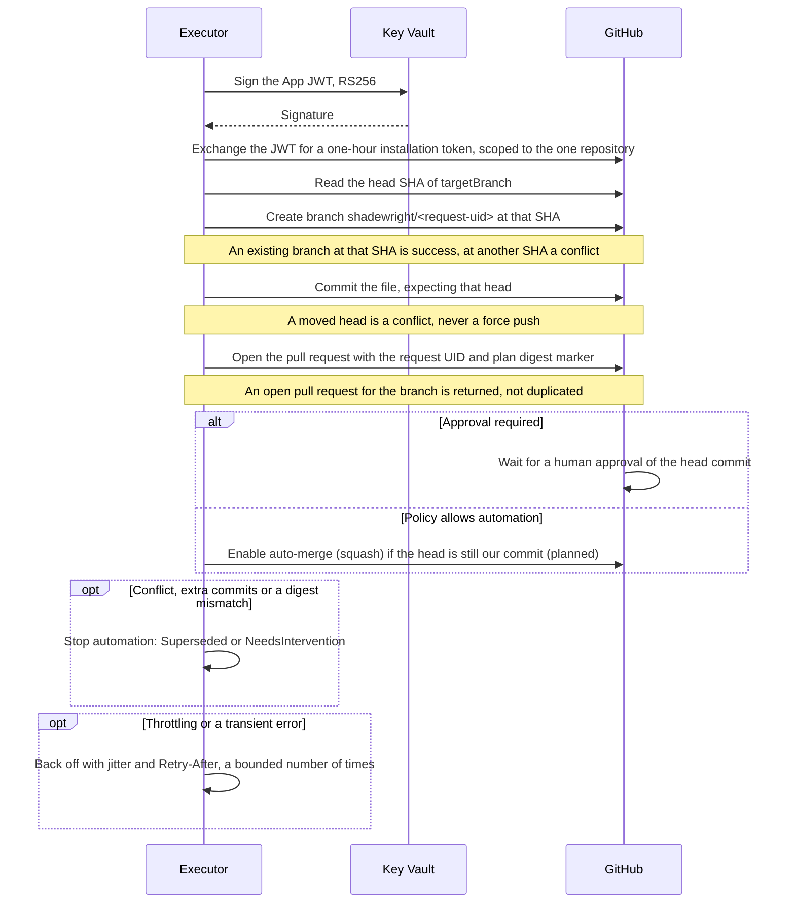

# 8. GitOps on GitHub

## 8.1. What approvalRequired means

| Request says | Shadewright does | Repository rules |
| --- | --- | --- |
| `true` | Opens the PR and waits for an independent human approval of the current head commit | All branch rules still apply |
| `false` | May enable auto-merge after policy allows automation | All branch rules still apply |
| Anything, but policy requires review | Effective value is `true` | Shadewright cannot lower it |
| Anything, but the change is not allowed | Stops with `Denied` | No PR |

`approvalRequired` is a field of our CRD, not a switch that turns off review on GitHub. If the branch requires a review, a PR with `false` still waits for it.

Fully automatic merges happen only where the repository owner deliberately allows them. On GitHub that is expressed with a ruleset plus `CODEOWNERS`: require code owner review, make every path owned by a human, and leave only the narrow paths that policy may auto-merge without an owner (a later `CODEOWNERS` pattern with no owner). Those PRs then merge on required checks alone; everything else needs a human.

## 8.2. Making a change

1. Map the object to its source in Git ([ADR-0012](../adr/0012-object-to-source-mapping.md)): the Flux labels on the object name its Kustomization, which gives the source and path; the file is the one plain manifest in that path that declares the object. The labels are untrusted, so the mapping is accepted only if the Kustomization is Ready and its `status.inventory` lists the object, and the value in the file equals the live value (otherwise an inline patch changes it). Ready must be True for the current generation; Flux includes workload health in it only when the Kustomization sets `wait: true` or `healthChecks`, so a Kustomization that waits on a broken workload stays not Ready and is refused. A Kustomization delivering workloads Shadewright should fix must therefore not wait on them (the fleet's `apps` Kustomizations do not); accepting applied-but-unhealthy objects needs its own ADR ([#259](https://github.com/pkalin/shadewright/issues/259)). The `GitRepository` must track a branch (`spec.ref.branch`); tags, semver, commits and other refs stop with `NeedsIntervention`. Its URL must equal exactly one repository in RemediationSettings, that repository must be the policy's `gitOps.repositoryRef` (otherwise `Denied`), the branch must equal the repository's `targetBranch`, and the file must match the policy's `allowedPaths`. Record the result in `status.source`. The files searched are the ones the path's kustomization file lists in `resources`; a path without a kustomization file, and objects from patches, generators or Helm charts, are not supported yet: stop with `NeedsIntervention` (details in ADR-0012). Git contents are untrusted, so the mapping bounds what it parses: besides the limits of ADR-0012 on depth, files, reads and file size (1 MiB), one mapping reads at most 16 MiB in all (kustomization and `.sourceignore` lookups and cached reads included) and decodes at most 4096 YAML documents (ones holding only comments or blank lines included; a separator with nothing before it is skipped by the reader and never decoded); past either it stops with `NeedsIntervention` and reason `InputTooLarge`. The byte budget is checked once a file has been read, so it bounds parsing, not the download or the read cache ([#298](https://github.com/pkalin/shadewright/issues/298)). It decodes one document at a time, keeps only the declaration, and stops with `AmbiguousDeclaration` at the first document that makes the match ambiguous (a second declaration, or one in another version or without a namespace) instead of reading the rest of the build. Because of this early stop, the reason reported can depend on file order: a near match or second declaration in an earlier file is reported before a problem in a later file (invalid YAML, a missing file, a budget run out), and every one of them is `NeedsIntervention`.
2. Read the current SHA of the target branch and create branch `shadewright/<request-uid>`.
3. Apply the typed change to the allowed file, checking the previous value. Patch YAML in place, preserving comments and formatting.
4. Render the final manifests and compute the semantic diff, including indirect changes through values.
5. Validate YAML, schemas, safety rules and cost or capacity bounds.
6. Commit and open a PR with the evidence, scope, expected effect, risk and rollback plan.
7. Bind the PR to the request UID and plan digest. Any new push to the branch invalidates the plan.
8. After merge, follow delivery and the success criteria instead of stopping at "merged".

Steps 4 and 5 are built in `internal/gitops/semdiff`, with its own tests, and the pull request step calls them before every commit and again whenever the target branch moves while the pull request waits (section 6). `Load` reads the files the Kustomization path (`status.source.buildPath`, recorded by the policy check) builds from at the head of the target branch, the tree the change would merge into (bounded like the source mapping), and `Check` renders the path with the kustomize API, in process, twice: from those files and with the patched file in their place. It passes only when both renders hold the same objects, every object other than the target is unchanged, and the target differs in exactly the action's field, from the previous to the desired value; another object changed (for example through a shared base), an object added or removed, another field of the target changed, or a value an overlay overrides all refuse with a reason. The changed object then gets basic schema checks: a Deployment or StatefulSet must convert strictly to its `apps/v1` type and keep its memory limit at or above its memory request; a ScaledObject must name its scale target and keep `maxReplicaCount` at or above `minReplicaCount`. Rendering is locked down: every kustomization file must use only resources, components, patches and the built-in name, namespace, label, annotation, image and replica transformers, and every reference must be a plain relative path inside the repository, so no URL or remote base reaches kustomize; generators, Helm charts, plugins and KRM functions are refused, kustomize runs with built-in plugins only and Helm off, and its file system is in memory and holds only the files of the build. The walk counts directory visits and input bytes with repetition, so a diamond of overlays over a large base is refused before it is rendered once per path, and a `.sourceignore` file anywhere on the build stops it, as in the source mapping. Renders run one at a time; a caller waiting for its turn gives up when its context ends, while a render that has started runs to its end. Helm values, safety rules and cost or capacity bounds are not checked yet.

Opening the change on GitHub, steps 2 to 7 above. Steps marked *(planned)* are designed but not built yet. The executor signs, exchanges the token and reads the head for the source mapping and the freshness check, and creates the branch, commits and opens the pull request in the pull request step (section 6). Auto-merge is not built in any adapter (`EnableAutoMerge` returns an error and `Capabilities()` reports no auto-merge, #20). *(planned)* means not called by the running operator. The GitHub App key never leaves Key Vault ([ADR-0006](../adr/0006-github-app-key-in-key-vault.md)); every write names the state it expects, so a restart or a race finds the existing work instead of repeating it.

The GitHub steps are done by the `GitProvider` adapter in `internal/providers/github`; the executor already uses it to read Git (head of the branch and files) for the source mapping and the freshness check, to write the branch, commit and pull request, and to close the pull request of a stale plan, signing through Key Vault with workload identity; auto-merge is not wired yet. One provider per repository entry is kept across reconciles, so the token cache survives; it is built on first use from the entry (URL, installation ID, App client ID, key ID, target branch), rebuilt when the entry changes and dropped when it leaves the settings (`internal/providers/registry`). The adapter is bound to one repository and its `targetBranch`, and refuses anything else before sending a request:

- It writes only to branches named `shadewright/<name>`. A new branch must start at the head of `targetBranch` or an ancestor of it, so a commit of a fork or another branch cannot become the base.
- The commit is built with the Git data API (blob, tree, commit, keeping the file mode) on top of the expected head, and the branch moves with GraphQL `updateRefs`: an atomic compare-and-swap on the expected head, without force. A head that moved in any direction, a rewind to an ancestor included, is a conflict; the update never forces.
- Pull requests are opened, found and closed only when their head is a `shadewright/` branch of this repository and their base is `targetBranch`; a fork's pull request from a branch of the same name is ignored.
- Files are read through the commit's trees: only regular files, the size checked before the download, at most 1 MiB read, and the content checked against its Git object ID.
- Transient failures (network, timeouts, 408, 429, 5xx, rate limits) are retried with exponential backoff and jitter, at most four attempts. A delay GitHub asks for (`Retry-After`, `X-RateLimit-Reset` for an exhausted quota, or one minute for a secondary rate limit without headers) is waited for when it is at most 15 seconds; a longer one goes back to the reconciler with the delay, so it requeues instead of blocking. Every attempt of a write (any request but a GET), the first and each retry, asks the kill switch's write checkpoint (5.4) right before it is handed to the HTTP client, after the token and the body; when it refuses, nothing more is sent in that call.
- Errors carry fixed text, the status code and their class (not found, conflict, too large, retryable); never a URL, a header, response text, a repository or branch name, or a token.

## 8.3. Auto-merge

The GitHub App enables auto-merge (GraphQL `enablePullRequestAutoMerge`, squash) only when policy allows automation, the head SHA is the commit Shadewright created, and the diff still matches the plan digest. GitHub then merges once required reviews and checks pass. The repository must have "Allow auto-merge" on.

## 8.4. Branch protection

- Required status checks, including a trusted path guard that fails when a PR touches anything outside the allowed paths.
- `.github/`, `CODEOWNERS`, Flux config, RBAC and policy files are owned by a human, so a PR that touches them always needs review.
- Stale approvals dismissed on new pushes, and approval of the most recent push required.
- The GitHub App is never on a ruleset bypass list and has only `contents: write`, `pull_requests: write`, `issues: write` (for notifications, ADR-0014) and `metadata: read` on one repository. It cannot approve its own PRs.
- No direct pushes or force pushes to `main`; only branches and PRs.
- On the clusters that run scenarios, the protected branch Flux tracks, and that the agent's PRs target, is `cluster/<cluster>`, not `main`. Its rulesets mirror the PR rules of `main` for the agent's PRs (approval, code owner review and the required checks `Conventional PR title`, `Render manifests` and `Path guard`), the repository admin role can still push to it directly (a known limit for v0.1.0, with a planned follow-up), and nobody can force-push or delete it ([ADR-0022](../adr/0022-scenario-switch-and-clusters.md)).
- Extra commits, a changed target or a digest mismatch stop automation.
