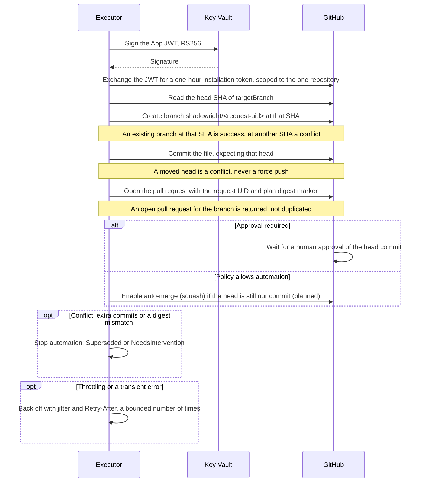

# 8. GitOps on GitHub

This section covers how a fix becomes a pull request: what `approvalRequired` means (8.1), the steps from a request to a merged change (8.2), auto-merge (8.3) and the branch protection the repository must have (8.4). Numbers and edge cases that only matter when you build or debug are in the table "Details" at the end (8.5).

## 8.1. What approvalRequired means

`approvalRequired` is a field of our CRD. It is not a switch that turns off review on GitHub: if the branch requires a review, a PR with `false` still waits for it.

| Request says | Shadewright does | Repository rules |
| --- | --- | --- |
| `true` | Opens the PR and waits for an independent human approval of the current head commit | All branch rules still apply |
| `false` | May enable auto-merge after policy allows automation | All branch rules still apply |
| Anything, but policy requires review | Effective value is `true` | Shadewright cannot lower it |
| Anything, but the change is not allowed | Stops with `Denied` | No PR |

### Where merges happen without a human

Fully automatic merges happen only where the repository owner deliberately allows them. On GitHub that is a ruleset plus `CODEOWNERS`:

- Require code owner review.
- Make every path owned by a human.
- Leave only the narrow paths that policy may auto-merge without an owner (a later `CODEOWNERS` pattern with no owner).

Those PRs then merge on required checks alone; everything else needs a human.

## 8.2. Making a change

The executor runs steps 1 to 7; step 8 is planned (section 6). Every Git write names the state it expects, so a restart or a race finds the existing work instead of repeating it.

1. Map the object to its source in Git (8.2.1).
2. Read the current SHA of the target branch and create branch `shadewright/<request-uid>` (`shadewright/<chainRoot>` for a replacement in a supersede chain, ADR-0028, which takes the existing branch over instead of creating one).
3. Apply the typed change to the allowed file, checking the previous value. Patch YAML in place, preserving comments and formatting.
4. Render the final manifests and compute the semantic diff, including indirect changes through values (8.2.2).
5. Validate YAML, schemas, safety rules and cost or capacity bounds.
6. Commit and open a PR with the evidence, scope, the size of the step beside the policy (ADR-0026), expected effect, risk and rollback plan.
7. Bind the PR to the request UID and plan digest. Any new push to the branch invalidates the plan.
8. After merge, follow delivery and the success criteria instead of stopping at "merged".

**Lab measurement (2026-11-06).** On one `Standard_D4as_v5` node running `v0.3.0-rc.2` (commit `bbe555ca09db887d1389270e53e6ef64249cd7eb`), symptom to pull request took 3 min 34 s. Measured between object timestamps, not per step: 2 min 16 s from the first `OOMKilled` to the analysis claim (Incident creation, debounce and a trigger pass), 10 s from the claim to the RemediationRequest (context and one model call), 26 s from the request to `PolicyAllowed` (source mapping and the policy check) and 42 s from there to the pull request opened. An idle sample on AKS with 30 Pods and about 400 Events showed the analyzer at 17 Mi and the executor at 13 Mi. The peak memory under a stated load, measured on Kind, is recorded in [3.1](3-observation-and-deduplication.md#31-collecting) (analyzer 87 Mi, executor 20 Mi against 128Mi).

### 8.2.1. Step 1: source mapping

**What it does.** It finds the one file in Git that declares the live object ([ADR-0012](../adr/0012-object-to-source-mapping.md)). The Flux labels on the object name its Kustomization, which gives the source and path. The file is the one plain manifest in that path that declares the object. The result is recorded in `status.source`.

**Why.** The agent must change what Flux delivers, and nothing else. The labels on the object are untrusted, so the mapping is checked from several sides before it is accepted.

**It is accepted only if all of these hold:**

- The Kustomization is Ready (`True` for the current generation) and its `status.inventory` lists the object.
- The value in the file equals the live value (otherwise an inline patch changes it).
- The `GitRepository` tracks a branch (`spec.ref.branch`). Tags, semver, commits and other refs stop with `NeedsIntervention`.
- Its URL equals exactly one repository in RemediationSettings, and that repository is the policy's `gitOps.repositoryRef` (otherwise `Denied`).
- The branch equals the repository's `targetBranch`.
- The file matches the policy's `allowedPaths`.

**Limits.**

- The files searched are the ones the path's kustomization file lists in `resources`.
- A path without a kustomization file is searched as Flux builds it: Flux generates a kustomization from every `.yaml` and `.yml` file below the path, so the mapping lists the path with `GitProvider.ListDir` (one directory per call; GitHub: the Git Trees API, not recursive) to a depth of 5, sorted by name, and follows a nested directory with its own kustomization file as such. Symbolic links and submodules are skipped. Names Flux's source-controller leaves out of every artifact by default are skipped as Flux skips them (`.git/`, `.gitignore`, `.gitmodules`, `.gitattributes`, `.github/`, `.circleci/`, CI files such as `cloudbuild.yaml` and `appveyor.yml`, `*.png`, `*.zip` and other images and archives, `.sops.yaml`, `.flux.yaml`, `.goreleaser.yml`; the patterns are vendored from `ExcludeVCS`, `ExcludeExt`, `ExcludeCI` and `ExcludeExtra` of fluxcd/pkg `sourceignore` v0.9.0 and kept equal to upstream), and so are files that are not manifests and the entries of a directory with its own kustomization file. Hidden directories are listed, as Flux descends into them. A `.sourceignore` file in a listed directory, or a manifest or base that would be in the build and whose name is not a plain path segment (a hidden manifest such as `.env.yaml`), stops the mapping. Depth: a base found `d` directories below the path starts at nesting depth `d`, so `MaxDepth` (8) bounds the directories passed and the chain of kustomizations together; a hand-written kustomization that lists a directory several levels down counts them the same way. Only `ErrPathNotInTree` from `ListDir` means the path is not a directory; a plain not found is retried. The GitHub adapter keeps the tree object ID of each directory it read at a commit, so a walk costs about one request per directory ([#122](https://github.com/pkalin/shadewright/issues/122)).
- Objects from patches, generators or Helm charts are not supported yet: they stop with `NeedsIntervention` (details in ADR-0012).

**What can go wrong: a Kustomization that waits.** Flux includes workload health in Ready only when the Kustomization sets `wait: true` or `healthChecks`. A Kustomization that waits on a broken workload stays not Ready, so it is refused. A Kustomization delivering workloads Shadewright should fix must therefore not wait on them (the fleet's `apps` Kustomizations do not). Accepting applied-but-unhealthy objects needs its own ADR ([#259](https://github.com/pkalin/shadewright/issues/259)).

**What can go wrong: hostile or huge Git contents.** Git contents are untrusted, so the mapping bounds the file contents it downloads, caches and parses:

- Besides the limits of ADR-0012 on depth, files, reads and file size (1 MiB), one mapping reads at most 16 MiB in all and decodes at most 4096 YAML documents (see 8.5). Past either, it stops with `NeedsIntervention` and reason `InputTooLarge`.
- Each read asks the Git provider for at most what is left of the byte budget (and at most 1 MiB). The provider checks the size the host reports before downloading (the tree entry, for GitHub), so a file past the budget is neither downloaded nor kept in the read cache, and a cached file is checked against the budget the same way. A build of exactly 16 MiB resolves; past it, the mapping stops with `InputTooLarge`, also when the file would be over 1 MiB too, so a cold and a warm cache give the same reason. A missing file costs nothing and is never refused for the budget ([#298](https://github.com/pkalin/shadewright/issues/298)).
- The budget counts file contents and directory listings. A `ListDir` call counts as one read and costs 128 bytes per entry (`ListEntryBytes`, about one entry of a GitHub tree answer, since the interface does not report what was downloaded); a directory of more than 1000 entries is refused by the provider (`TooManyFiles`), and a listing past what is left of the budget stops with `InputTooLarge`, from the cache or not. The tree listings the GitHub adapter reads inside a `ReadFile` call to find a file are bounded per call (the adapter's JSON body limit) and in number by the read limit, not by the 16 MiB. The semantic diff's loader asks for what is left of its own 4 MiB build budget the same way (8.2.2).
- It decodes one document at a time and keeps only the declaration.
- Before decoding, it checks each kustomization file and each manifest document with the same fail-closed check as the semantic diff (`internal/gitops/gityaml`): input that is not UTF-8, YAML anchors, aliases and merge keys, text after `---` on a separator line other than a comment after a space or a tab, a line break other than LF or CRLF, and YAML directives stop it with `FileNotReadable` (#594). Its parser (`sigs.k8s.io/yaml`) replaces aliases by copies, so a 200 KB manifest allocated over 150 MiB, past the executor's limit of 128 MiB at the time (256 MiB from #615, 384 MiB since #614 for the executor and its render process; the budgets below stay the bound). A kustomization file, or one manifest document, holding more than 4096 objects by that check's count (a List counts 1 plus its items) stops it with `InputTooLarge`, since the check does not read past that count, as does one of more than 131,072 YAML nodes: the check counts them from the bytes, erring high, before any parser builds a tree (proven an upper bound for the patcher's and the semantic diff's parser; for the mapping's parser the peaks are measured), since a dense document of 1 MiB took more heap than the executor has (#595). So does a mapping of more than 256 keys, found in the node tree the check builds anyway: the duplicate key check of the patcher's decoder and of kustomize's compares every pair of keys of a mapping, so 43,000 keys within the node budget took 4 to 6 s of CPU, and twelve files of 31 mappings of 2,048 keys took 6.2 s to render; the widest mapping in about 500 real YAML files (CRDs from the Go module cache and Kubernetes API fixtures, surveyed 2026-11-10, listed at `gityaml.MaxMappingKeys`) held 76 keys, and the widest in the lab fleet and chart holds 21 (#608). A mapping that holds a scalar key twice stops it with `FileNotReadable`, from the same walk: kustomize refuses it anyway, and the decoders build an error holding the key for every pair of equal keys, so 2,048 copies of one long key took seconds and gigabytes of allocations (#608).
- It stops with `AmbiguousDeclaration` at the first document that makes the match ambiguous (a second declaration, or one in another version or without a namespace), instead of reading the rest of the build.

Because of this early stop, the reason reported can depend on file order. A near match or second declaration in an earlier file is reported before a problem in a later file (invalid YAML, a missing file, a budget run out). Every one of them is `NeedsIntervention`. Near the end of the byte budget, a `.sourceignore` file or a file over 1 MiB is reported as `InputTooLarge`, since its size is not asked for.

### 8.2.2. Steps 4 and 5: the semantic diff check

**What it does.** It renders the Kustomization path twice with the kustomize API, in a child process with operating system limits ([ADR-0035](../adr/0035-render-check-in-a-limited-child-process.md)): once from the files at the head of the target branch, and once with the patched file in their place. It passes only when both renders hold the same objects, every object other than the target is unchanged, and the target differs in exactly the action's field, from the previous to the desired value.

**Why.** A one-line edit can change more than it shows (a shared base, an overlay). The check proves the change does only what the plan says.

**It refuses, with a reason, when:**

- another object changed (for example through a shared base);
- an object was added or removed;
- another field of the target changed;
- an overlay overrides the value.

The changed object then gets basic schema checks:

- A Deployment or StatefulSet must convert strictly to its `apps/v1` type and keep its memory limit at or above its memory request.
- A ScaledObject must name its scale target and keep `maxReplicaCount` at or above `minReplicaCount`.

**Where it runs.** Steps 4 and 5 are built in `internal/gitops/semdiff`, with its own tests. The pull request step calls them before every commit and again whenever the target branch moves while the pull request waits (section 6). `Load` reads the files the Kustomization path (`status.source.buildPath`, recorded by the policy check) builds from, at the head of the target branch, the tree the change would merge into (bounded like the source mapping). When the path has no kustomization file, `Load` lists it as the source mapping does and adds the kustomization Flux would generate (`resources` only) to the files, so `Check` renders the same build Flux does. `Check` does the rendering and comparing.

**Rendering is locked down.**

- Every kustomization file may use only resources, components, patches and the built-in name, namespace, label, annotation, image and replica transformers.
- Every reference must be a plain relative path inside the repository, so no URL or remote base reaches kustomize.
- Generators, Helm charts, plugins and KRM functions are refused. Kustomize runs with built-in plugins only and Helm off, and its file system is in memory and holds only the files of the build.
- The walk counts directory visits, input bytes and YAML documents with repetition, so a diamond of overlays over a large base is refused before it is rendered once per path.
- Every file of the build (kustomization files, resource and patch files, inline patches) must be UTF-8 YAML without anchors, aliases or merge keys (a `<<` key or a key with the `!!merge` tag; a plain `<<` value is accepted), and a separator line may hold only `---` and a comment (kustomize drops the rest of that line, but the parser of a kustomization file reads it as the first document, #594), lines end in LF or CRLF only (a bare CR, NEL, LS or PS ends a line for the parsers but not for the split of kustomize) and no line starts with a YAML directive; anything else is refused with `InvalidYAML`, the error naming the file and line (#488, #492). Kustomize replaces aliases by copies and resolves merges before it looks for Lists, so a few bytes could expand into thousands of objects (an alias bomb, or alias keys and merge tags that hide a List from a count), or, for an anchor that contains itself, recurse until the Go stack overflowed, which ends the process; and it also reads UTF-16 and UTF-32 with a byte order mark. Refusing them fails closed instead of mimicking Kustomize's YAML handling. The same check refuses a document of more than 131,072 YAML nodes (`gityaml.MaxNodes`, #595) or a mapping of more than 256 keys (`gityaml.MaxMappingKeys`, #608) with `TooLarge`, and a mapping that holds a key twice, also when two spellings resolve to one value, with `InvalidYAML` (#608). The 256-key bound applies to each input file; what patches merge into one mapping in the render has its own bound (`semdiff.MaxMergedKeys`, below).
- A JSON patch (RFC 6902) `copy` operation in any patch, inline or from a file, YAML or JSON, is refused with `UnsupportedKustomization` before the render (#488): each copy can double a value, so 17 copies in about 1 KiB rendered 10 MB and 25 would reach a gigabyte, past every bound checked on the input. The check looks for an `op` key whose value is `copy` in every mapping of a patch, so a strategic merge patch that sets a field `op` to `copy` is refused too.
- What patches and transformers can add to the render is bounded before it (#495, `semdiff.MaxTransformBytes`, 4 MiB): a patch with a target and the label, annotation, namespace, name prefix and suffix, image and replica transformers copy one value into every place they reach, so 160 KB of input rendered about 100 MB over 1,000 objects, within every input budget. Memory follows YAML nodes more than bytes (a review of the first, byte-only bound rendered 418 to 1,188 MiB of Go heap from builds it accepted, with values of many one-character entries), so each value costs its bytes (a byte that JSON may escape, such as a control character or `<`, counts 6, as the render holds the objects as JSON too) plus 128 for each node (`semdiff.NodeBytes`: a node held about 650 to 800 bytes of heap in the render, a byte of a long scalar about 4 to 6). The walk adds up, for each directory visit, that cost times an upper bound of the places the visit's patches and transformers reach among the objects that visit builds (its resources, the directories it lists and the components it applies), and refuses a build over the budget with `TooLarge`, in `Load` (so at the policy check too) and on the tree before and after the change. The bound only over-counts. A patch with a target counts once per object of the kind its target names, when that is a plain name, otherwise once per document (a target is a regular expression or a selector, which the walk does not evaluate); one without a target applies to the one object it names and counts as one with a target that selects that object (#626; before, it counted only as input, so 60 patches of 255 keys merged into one ConfigMap counted 2.7 MiB where the same patches with a target counted over 4 MiB). Everything a patch puts into an object is a place for every transformer: a strategic merge patch under its own keys, a JSON patch value under the key its path ends in (or as an item of the sequence its path names), and a value whose path the walk cannot read, or any node of the objects after a `move`, under every key. A transformer counts the places its built-in field specs (copied from Kustomize v0.21.2, with their `create` flags) can reach in each object of each kind, the mappings they may create, one place per item of a sequence under a key on such a path, since Kustomize visits every item of a sequence it meets, and for a spec without `create` one per mapping or item under the key the path ends in; an image override counts every `containers`, `initContainers` and `volumes` item. A name change (a name prefix or suffix, or a patch that writes a `name` or `namespace`) counts against every scalar value of the objects, since any may be a reference, under any key (annotation references carry a domain prefix). A patch that may change a kind (`allowKindChange`, a JSON patch to `/kind`, a `move`) makes every object count as the costliest kind. The count is checked against the render, in bytes and in nodes, on a fixture that reaches every kind of place (`TestGrowthBoundsTheRender`) and on the bypasses the review found. A build of about 1,000 objects with common labels, a namespace, a name prefix and an image override is at about 87 percent of the budget; with a small strategic merge patch (a few YAML nodes) on every Deployment too, about 800 objects fit; a three-entry `env` patch on each of 800 Deployments is over the budget.
- What strategic merge patches merge into one mapping or list of an object is bounded before the render too (#626, `semdiff.MaxMergedKeys`, 4,096 keys or items). Kustomize merges each patch into the whole object, so the render's time grows faster than the merged mapping's width, which a budget linear in what patches add cannot express: one ConfigMap and 60 patches of 255 `data` keys each, within every other bound, rendered one mapping of 15,300 keys in 16 s and allocated 4 GB (measured 2026-11-10 in the test process, Go 1.27.3, arm64); counting the patches in the transform budget alone still accepted 29 of them (7,395 keys, 2.1 s, 1.1 GB). The walk counts, per path from an object's root (the items of a list sharing one path), the keys of each mapping and the items of each list of every strategic merge patch, with and without a target, summed per object over every patch that may reach it in every directory visit, and refuses more than 4,096 at one path of one object with `TooLarge`, in `Load` and on the tree before and after the change. A patch without a target counts toward the object it names (kind and name; objects that differ only by namespace count together); one with a target toward every object of the kind its target names, or of any kind; where an object may have another name or kind by the time a patch runs (a name prefix or suffix below the directory or in a component it lists, a JSON patch, `allowNameChange` or `allowKindChange`), every patch of that visit counts toward every object. So patches of different objects do not add up: 800 ConfigMaps with a patch of six `data` keys each pass (`TestCheckMergedKeysPerObject`). The keys that name the patched object (`apiVersion`, `kind`, `metadata` and its `name` and `namespace`) count for none, since every object holds them; a resource's own mapping adds at most 256 more. At the bound (16 patches of 256 keys into one ConfigMap) the render took 0.5 s. A JSON patch adds one value per operation, which the transform budget counts. The bound is an estimate with known gaps, not a bound of the render: it does not count together keys merged under sibling paths of one mapping, keys that `labels`, `commonLabels` or `commonAnnotations` add, patches wrapped in a `List`, JSON 6902 moves, or a list that a JSON patch creates and a strategic merge patch then merges into. What those gaps let through is bounded by the render process below ([#614](https://github.com/pkalin/shadewright/issues/614)).
- A `.sourceignore` file anywhere on the build stops it, as in the source mapping.

- The render itself is bounded by its process (#614, [ADR-0035](../adr/0035-render-check-in-a-limited-child-process.md)). The budgets above are estimates of what a render grows to, and overlays can chain one transformer's output into another's input past them: a base adds a 64 KiB annotation, an overlay moves it into a ConfigMap name with a JSON patch, and kustomize copies the new name into 1,000 references. About 100 KB of input within every budget rendered 66 MB and peaked at 374 MiB of Go heap in 5.6 s, and the check passed (measured 2026-11-14 in the test process, Go 1.27.4, arm64). So `Check` validates its input in the executor and runs the walk, both renders and the comparison in a child process, the executor's own binary started again with one fixed argument (`semdiff.RunRenderProcess`). The child sets its limits before it reads any input: 20 s of CPU time (`RLIMIT_CPU`, `semdiff.MaxRenderCPUSeconds`) and, on Linux, 512 MiB of private writable mappings (`RLIMIT_DATA`, `semdiff.MaxRenderData`; it counts address space, and the child starts with about 135 MiB of it). It exits by itself when the memory its Go runtime holds passes 128 MiB (`semdiff.MaxRenderMemory`, sampled every millisecond, with Go's soft limit at three quarters of it); the test suite's render checks peak at 46 MiB. On Linux it raises its own OOM score adjustment to 1000 first, so that the container's OOM killer picks it and not the executor. The largest builds the input budgets allow used at most 3.9 s of CPU time (`hack/load/render` at the executor's 500m and 384 MiB, Linux arm64, 2026-11-14), and at 500m the 20 s take 40 s of wall time, so the refusal arrives inside the 2 minutes of the pull request step even with one render ahead of it (`TestRenderCPURefusalWithinTheStep`). Only the ends the child chose are refused with `TooLarge`, with a message that names the limit: its exit at the memory sampling or at the CPU time limit, and the Go runtime's out of memory exit at the data limit (exit code 2 and a fatal error line about memory, the only line of the child's stderr the parent keeps). The #614 case is refused in about 1 s (`TestCheckBoundsAChainedNameReference`), and the same chain with a short value renders (`TestCheckRendersAnOrdinaryChain`). Every other end is an error for a retry, and the request ends at its deadline if it keeps failing: a child that could not start, ended before it set its limits, answered nothing readable or a reason the package does not give, was killed by a signal (the container's OOM killer, while the executor held its memory) or crashed otherwise, and a check whose context ended, which kills the child. It gets an empty environment, its input on stdin and its answer (at most 64 KiB, a refusal's detail cut at 2 KiB) on stdout. The executor's container holds both processes: 384 Mi in the chart, with the executor's `GOMEMLIMIT` at 60 percent of it (about 230 MiB, as before), plus 128 MiB for the child at its limit, is 358 MiB. The child shares the executor's user, file system and network, so its limits bound memory and CPU time, not what an exploited render could read (ADR-0035). macOS, for development only, refuses a small data limit, so there the sampling is the only memory bound; a race detector build (tests only) sets no data limit, allows eight times the CPU time and does not sleep before the child exits (`GORACE=atexit_sleep_ms=0`).

**Limits.** Render processes run one at a time. A caller waiting for its turn gives up when its context ends, and a render process is killed when it does.

**Render memory (measured 2026-11-07, issues #254 and #482).** Until #614 a render ran in the executor's process, so the limit bounded the repository it could check; since then the render process has its own limits (above), and the figures below stay the reason for the input budgets. The figures below were measured against 128 Mi; the limit was 256 Mi from #615 and is 384 Mi since #614, which holds the executor and one render process. The chart sets `GOMEMLIMIT` to 60 percent of the limit (241591910 bytes by default, 90 percent of 256 Mi before #614; `executor.goMemLimit` overrides it, [#601](https://github.com/pkalin/shadewright/issues/601)), so a decode that doubles the live heap before a collection is collected earlier; the figures below were measured without it. `hack/load/render` runs `Check` on a repository of ConfigMaps of 4 KiB each in a container limited to 128 MiB (the executor's limit then; Go 1.26.10, arm64). Before #482 (commit `b33301732e277695333e589befc9556607f59009`): a build of about 4 MiB and 1,021 objects peaked at 68 MiB resident and took 1.5 s; one of 7.8 MiB and 2,041 objects at 109 MiB and 4.7 s; a diamond (one 1 MiB base through 8 overlays) at 97 MiB and 8.6 s. The peak grows by about 13 MiB per MiB of input, and a build at the budget the code then allowed (16 MiB counted with repetition, 4,096 objects), flat or as a diamond, was killed by the memory limit (exit 137). A kill ends the executor's reconcile like a crash, so the request is tried again and fails the same way. **The supported repository is therefore a build of at most 4 MiB and 1,000 objects, and since #482 the limits are set to it: `MaxBuildBytes` 4 MiB (counted with repetition, its own budget, below the source mapping's 16 MiB read budget, which bounds reads, not a render) and `MaxObjects` 1,024.** The re-run at those limits (commit `b302bc300b65a148a844adc9c484d2c87b87e761` plus the change): a flat build of 3.9 MiB and 1,021 objects peaks at 69 MiB resident and takes 0.8 s, a diamond of 4 overlays over a 1 MiB base (1,024 objects) at 65 MiB and 0.9 s, so about 60 MiB stays for the rest of the executor. A build of 5 MiB, or the old 16 MiB one, flat or as a diamond, is now refused with `TooLarge` before kustomize runs (peak at most 67 MiB, the files held in memory). The budget is checked on the tree after the change too, every reference to the changed file included, so a value written one digit longer cannot take a build at the budget over it. The policy check loads the build with the same limits (`semdiff.Load`, at the commit the mapping read), so a build over its input limits ends `NeedsIntervention` with reason `TooLarge` on `PolicyAllowed` before any plan, approval or branch (the object limit is known only after a render). **Many small objects (#488).** The byte budget alone does not bound the number of objects: 1 MiB of ConfigMaps of about 78 bytes each (about 13,400 objects) peaked at 108 MiB and took 97 s before the render refused it, and 4 MiB of them (about 54,000) was killed (exit 137). The walk therefore also counts, with repetition per visit, the YAML documents of the resource and patch files and of inline patches, and refuses more than 4,096 (`MaxBuildDocuments`) with `TooLarge` before the render, in `Load` (so at the policy check too) and on the tree before and after the change. The count is an upper bound on the objects and List nodes Kustomize processes: each file is split at Kustomize's own separator (a line starting with `---`) and each part decoded as Kustomize decodes it, after the refusals above; every document counts 1, empty ones included, and a List (a mapping whose `kind` ends in `List`) counts 1 for itself plus its items, each counted the same way, so an empty List counts too and nested Lists add up. The two limits relate this way: since generators are refused, a render's objects come from the documents counted, each base once per visit, so the document count bounds the objects from above, and it also counts patches and empty documents. It is set higher than `MaxObjects` so that a build of 1,000 objects with some patches is not refused for its patches; the render's own check stays, and refuses 1,025 to 4,096 objects after kustomize has built them. Measured with `hack/load/render` in the same 128 MiB container (commit `2e426dad` plus the change): 4,096 documents of tiny ConfigMaps (shape `docs 4095`) peaks at 53 MiB before the render's object check refuses it; 4,096 ConfigMaps padded to just under 4 MiB, both input bounds at once (`heavy 4095`), at 75 MiB; 1,024 objects with 3,072 strategic merge patches of them (`patches 3072`, accepted then) at 77 MiB, so about 50 MiB stays for the rest of the executor; since #626 the transform budget counts each of those patches and refuses that build before the render (at most about 1,700 such one-label patches fit, `patches 1708`). Each took 3 to 15 s, depending on the load of the host, and a check renders twice. One document more, and 1 or 4 MiB of tiny ConfigMaps, are refused before the render (peak at most 35 MiB, the files held in memory). **Transformer output (#495).** Before the change, an annotation of 64 KiB on 1,000 ConfigMaps (about 120 KiB of input) rendered with a Go heap peak of 127 MiB (measured in the test process, not in a container); a bound on bytes alone still let through builds of many one-character entries that peaked at 418 to 1,188 MiB of Go heap. Measured with `hack/load/render` in the same 128 MiB container (Go 1.27.3, arm64), each case sized to the largest value the walk accepts: a build at the input budgets (4 MiB, 1,021 objects, shape `flat 4`) peaks at 45 to 47 MiB of Go heap (69 to 71 MiB resident); the same build with a value at the transform budget peaks at 57 to 62 MiB of heap (82 to 92 MiB resident) when the value is long (`annotations 100`, a common annotation; `images 100`, an image override of 1,000 containers), and at 60 to 68 MiB (85 to 97 MiB resident; up to 78 and 102 on a busy host) when it holds many nodes (`dense 100` and `denseseq 100`, a patch with a target of one-character annotations or of a list of numbers on every ConfigMap; `denseannotations 100`, a common annotation of one-character keys). At a 6 MiB budget a node-dense case reached 81 MiB of heap and 105 MiB resident, so 4 MiB was kept. One value over (`101`) is refused before the render (peak at most 58 MiB resident). Helm values, safety rules and cost or capacity bounds are not checked yet (planned).

### 8.2.3. Steps 2, 3, 6 and 7: opening the change on GitHub

**What it does.** The executor signs, exchanges the token, and reads the head for the source mapping and the freshness check. In the pull request step (section 6) it creates the branch, commits and opens the pull request.

**Why it is safe to repeat.** The GitHub App key never leaves Key Vault ([ADR-0006](../adr/0006-github-app-key-in-key-vault.md)). Every write names the state it expects, so a restart or a race finds the existing work instead of repeating it.

**Planned.** Steps marked *(planned)* in the diagram are designed but not built, meaning not called by the running operator. Auto-merge is not built in any adapter: `EnableAutoMerge` returns an error and `Capabilities()` reports no auto-merge (#20).

### 8.2.4. The GitHub adapter

**What it does.** The `GitProvider` adapter in `internal/providers/github` does the GitHub steps. The executor already uses it to read Git (head of the branch and files) for the source mapping and the freshness check, to write the branch, commit and pull request, and to close the pull request of a stale plan. It signs through Key Vault with workload identity. Auto-merge is not wired yet (planned).

**How providers are kept.** One provider per repository entry is kept across reconciles, so the token cache survives. It is built on first use from the entry (URL, installation ID, App client ID, key ID, target branch), rebuilt when the entry changes and dropped when it leaves the settings (`internal/providers/registry`).

**Limits.** The adapter is bound to one repository and its `targetBranch`, and refuses anything else before sending a request:

- **Branches.** It writes only to branches named `shadewright/<name>`. A new branch must start at the head of `targetBranch` or an ancestor of it, so a commit of a fork or another branch cannot become the base.
- **Commits.** The commit is built with the Git data API (blob, tree, commit, keeping the file mode) on top of the expected head, which must be the head of `targetBranch` or an ancestor of it: a branch carries at most one commit of its own, so a commit someone else pushed to it is never built on. The branch moves with GraphQL `updateRefs`: an atomic compare-and-swap on the expected head, without force. A head that moved in any direction, a rewind to an ancestor included, is a conflict; the update never forces.
- **Pull requests.** They are opened, found and closed only when their head is a `shadewright/` branch of this repository and their base is `targetBranch`. A fork's pull request from a branch of the same name is ignored.
- **What a branch holds.** Before the commit, and before a pull request is opened, recorded or rendered again, the executor asks the adapter what the branch head carries over `targetBranch` (`CheckBranch`): nothing yet (the head is on `targetBranch`), or one commit whose one parent is on `targetBranch` and whose tree differs from the parent's only in the content of the target file, compared tree by tree along its path. Anything else, a merge or a truncated tree included, is never a pass (#524).
- **What a merged commit held.** When a merge has taken a handoff commit into `targetBranch`, `CheckBranch` can no longer tell it apart, so the executor asks `CheckCommit`: the same tree comparison, against the commit's own one parent, which it returns so the executor can match it to the head it recorded (#591). A read, never a pass on its own.
- **Reads.** Files are read through the commit's trees: only regular files, the size checked before the download, at most 1 MiB read, and the content checked against its Git object ID.
- **Errors.** They carry fixed text, the status code and their class (not found, conflict, too large, retryable). Never a URL, a header, response text, a repository or branch name, or a token.

**What can go wrong: transient failures.** Network errors, timeouts, 408, 429, 5xx and rate limits are retried with exponential backoff and jitter, at most four attempts.

- A delay GitHub asks for (`Retry-After`, `X-RateLimit-Reset` for an exhausted quota, or one minute for a secondary rate limit without headers) is waited for when it is at most 15 seconds.
- A longer delay goes back to the reconciler with the delay, so it requeues instead of blocking.
- Every attempt of a write (any request but a GET), the first and each retry, asks the kill switch's write checkpoint (5.4) right before it is handed to the HTTP client, after the token and the body. When it refuses, nothing more is sent in that call.

## 8.3. Auto-merge

**What it does.** The GitHub App enables auto-merge (GraphQL `enablePullRequestAutoMerge`, squash). GitHub then merges once required reviews and checks pass.

**When.** Only when policy allows automation, the head SHA is the commit Shadewright created, and the diff still matches the plan digest.

**Limits.** The repository must have "Allow auto-merge" on. Not built yet (planned, #20; see 8.2.3).

## 8.4. Branch protection

**Why.** Shadewright's own checks are not the last line of defence. The repository must refuse unsafe merges even if the agent misbehaves.

**What the repository needs:**

- Required status checks, including a trusted path guard that fails when a PR touches anything outside the allowed paths.
- `.github/`, `CODEOWNERS`, Flux config, RBAC and policy files are owned by a human, so a PR that touches them always needs review.
- Stale approvals dismissed on new pushes, and approval of the most recent push required.
- No direct pushes or force pushes to `main`; only branches and PRs.

**The GitHub App's limits:**

- It is never on a ruleset bypass list.
- It has only `contents: write`, `pull_requests: write`, `issues: write` (for notifications, ADR-0014), `checks: write` (the merge gate of reviewer hints, ADR-0028, since #539) and `metadata: read`, on one repository. The executor asks for all five in every token request, and GitHub refuses a token request that names a permission the App lacks, so an App registered before #539 needs `checks: write` added before it runs a release with #539.
- It cannot approve its own PRs.
- built (#538, #539; off by default, opt-in with the executor flag `--reviewer-hints` (#631)) Reviewer hints ([ADR-0028](../adr/0028-reviewer-hints-through-the-pull-request.md)) need one new permission, `checks: write` (the fifth above). Reading and posting comments and reading reviews are `pull_requests: write` and `issues: write`, reading a commenter's permission is `metadata: read`, and the update of the branch is one fast-forward commit under `contents: write`, with the expected head as the parent. The executor creates the check run `shadewright/review` on every head of its pull requests, the first one included, so a required check never hangs on a pull request no hint touched: `in_progress` on a new head, `completed` with `success` only when the latest review of someone who wrote no hint in the chain approves that head. Unless the flag is set, the executor creates no check and the gate does not hold. **The ruleset must require `shadewright/review` with the Shadewright App as the expected source** (`integration_id`), because anyone with push access or an Actions workflow can post a commit status of that name (only an App can create a check run) (a requirement of ADR-0028; the App cannot check it, so hints stay off for a repository without it; the fleet README's list of required checks is updated when the feature ships). Amended 2026-11-09 for `checks: write` (#539). It replaces dismissing approvals as the control, because a dismissal can be refused and leaves a window; the stale-approval rule above stays as a second line. A hint author's own approval gets a pull request comment saying it does not count.

**Scenario clusters.** On the clusters that run scenarios, the protected branch Flux tracks, and that the agent's PRs target, is `cluster/<cluster>`, not `main` ([ADR-0022](../adr/0022-scenario-switch-and-clusters.md)).

- Its rulesets mirror the PR rules of `main` for the agent's PRs: approval, code owner review and the required checks `Conventional PR title`, `Render manifests` and `Path guard`.
- Nobody can force-push or delete it.
- Known limit for v0.1.0, with a planned follow-up: the repository admin role can still push to it directly.

**What can go wrong.** Extra commits, a changed target or a digest mismatch stop automation.

## 8.5. Details

| Topic | Detail |
| --- | --- |
| Source mapping budget | 16 MiB read in all (kustomization and `.sourceignore` lookups, cached reads and `ListDir` listings at 128 bytes per entry included), bounding the file contents downloaded, cached and parsed (the tree listings inside a `ReadFile` call are bounded per call and by the read limit); 4096 YAML documents decoded |
| Render check budget | 4 MiB of build input and 4,096 YAML documents read before the render, both counted with repetition per directory visit, 4 MiB that patches and transformers can add to the render (value bytes and 128 per YAML node, times an upper bound of the places each reaches, #495, #626), 4,096 keys or items that patches can merge into one mapping or list of an object (#626), 1,024 rendered objects, a render process of 128 MiB of Go memory, 512 MiB of data mappings and 20 s of CPU time (#614), and per input file 131,072 YAML nodes in a document and 256 keys in a mapping (`semdiff.MaxBuildBytes`, `semdiff.MaxBuildDocuments`, `semdiff.MaxTransformBytes`, `semdiff.MaxMergedKeys`, `semdiff.MaxObjects`, `semdiff.MaxRenderMemory`, `semdiff.MaxRenderData`, `semdiff.MaxRenderCPUSeconds`, `gityaml.MaxNodes`, `gityaml.MaxMappingKeys`); past any, the render check refuses with `TooLarge` (8.2.2); the input limits are checked at the policy check too, before a plan is made |
| Directory listings | `ListDir` of one directory, at most 1000 entries; a path without a kustomization file is listed 5 directories deep at most |
| YAML documents counted | Ones holding only comments or blank lines are counted; a separator with nothing before it is skipped by the reader and never decoded |
| File size limit | 1 MiB per file, in the source mapping and in the adapter's reads |
| Reason when a budget runs out | `InputTooLarge`, a `NeedsIntervention` |
| Adapter retries | Four attempts, exponential backoff with jitter |
| Longest wait kept in the call | 15 seconds; longer goes back to the reconciler |
| Secondary rate limit without headers | Delay of one minute (over 15 s, so the call returns it to the reconciler) |
| Installation token | One hour, scoped to the one repository |
| Auto-merge method | Squash |
