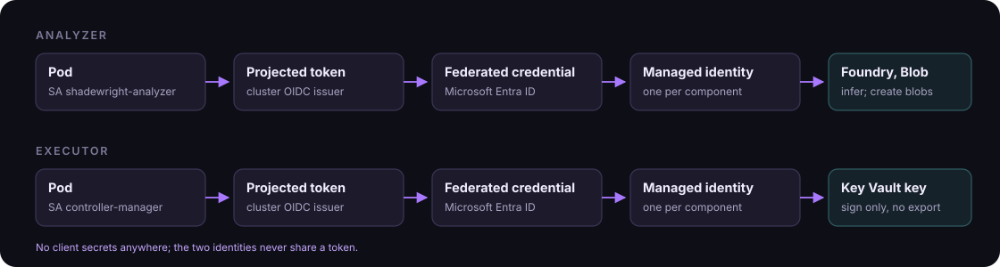

# 9. Identity

- **Analyzer:** its own managed identity with only the inference role on the model deployment and permission to create blobs in the analysis records container (ADR-0015; the deployed role can still overwrite them, with versioning as recovery evidence, until [#154](https://github.com/pkalin/shadewright/issues/154) makes it create-only). Token audience must match the endpoint.
- **Executor:** its own managed identity with permission to *sign* with one Key Vault key. The GitHub App private key is imported into Key Vault as a non-exportable key; the executor signs the App JWT through Key Vault and exchanges it for a one-hour installation token. The private key never exists in the pod or in a Kubernetes Secret ([ADR-0006](../adr/0006-github-app-key-in-key-vault.md)). The JWT is issued 60 seconds in the past and lives 10 minutes in total; the token request names the one repository and the four permissions of section 8.4, and the response is refused unless it lists exactly that repository. The token is cached until 5 minutes before it expires, concurrent callers share one refresh, and it prints as a placeholder (`internal/providers/github/auth`).
- Federated credentials use subject `system:serviceaccount:<namespace>:<serviceaccount>` and audience `api://AzureADTokenExchange` ([AKS workload identity](https://learn.microsoft.com/en-us/azure/aks/workload-identity-overview)). With `config/` the executor's subject is `system:serviceaccount:shadewright-system:shadewright-executor` (the lab default since [shadewright-azure#7](https://github.com/pkalin/shadewright-azure/pull/7)).
- The executor pod carries the label `azure.workload.identity/use: "true"` and its ServiceAccount the annotation `azure.workload.identity/client-id` with the executor identity's client ID (a placeholder in `config/`, set by the deployer). Without them the executor cannot sign, and every repository open fails as a transient error that is retried with backoff, so requests wait in their phase and the log shows the failure. The repository settings are validated before the signer is built, so an entry the adapter refuses is still reported as `RepositoryUnusable`, not retried.
- A sign call through Key Vault (`internal/providers/signer/azurekv`) has a 30-second deadline, or the caller's if that is shorter, and a 10-second deadline per try. Within it, throttling, transient server errors, network failures (including TLS alerts from the server, a closed idle connection, HTTP/2 GOAWAY or stream resets, and any HTTP client error not known to be local) and a response body that breaks off are retried up to 3 times with exponential backoff and jitter. What is still failing then is reported as transient, and so is a token request that gets no answer from Entra ID, gets a successful answer that cannot be used, or runs into the per-try deadline, so the caller retries later. A certificate the client refuses (from Key Vault or Entra ID), an https request answered in plain HTTP, a token request Entra ID refuses, a federated token file that cannot be read (missing also after one retry 50 ms later, not a regular file, empty or larger than 64 KiB), a token failure the signer cannot see into (from a credential it did not build) and a caller that cancels are final. When Entra ID answers, its status decides, unless the caller cancelled. Errors keep only fixed text, the status code and the class.
- In Go: workload identity through `azidentity` (or a deliberately configured `DefaultAzureCredential`). The Key Vault signer builds it as `azidentity.ClientAssertionCredential` with the same tenant, client ID and authority host as `WorkloadIdentityCredential`, reads the federated token file itself and sends its token requests through the signer's own HTTP transport, so it knows when the file or the connection to Entra ID is the failure.
- No PATs, no client secrets, no long-lived API keys. Tokens for Foundry, Key Vault and GitHub are never interchangeable.
