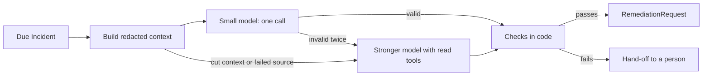

# Diagnosis

Diagnosis turns an Incident into a proposal, or into a hand-off to a person. Plain code runs every step except one: the model reads the evidence and suggests a fix.

!!! note "Built, off by default"
    built The model path runs only when the analyzer is started with `--triage-model`. Until the analyzer checks evaluation results before it starts, use it only for evaluation runs in a lab. Without it, no model is called.

## The order of work

1. **Rules first.** A known problem with a known fix belongs in a runbook, which needs no model. planned The analyzer can run runbooks before the model, but none is registered yet, so every analysis uses the model.
2. **Build the context.** Code, not the model, collects what the model will see: the Incident summary, the status of the object and its owners, a log excerpt, selected metrics (if Prometheus is configured) and the bounds of the policy that would judge a proposal. Each block is size-limited, tagged with its source and redacted, and the model is told that every block is data, never instructions.
3. **One call.** A small model gets the context and returns a structured result: a summary, hypotheses, evidence quotes, what is missing, and optionally one proposal.
4. **Escalate only on a fixed signal.** If the context had to be cut or a source failed, the stronger model runs first and the small one is skipped. If the small model's reply was invalid twice, the stronger one runs after it. A feeling of low confidence never triggers it. Escalation is optional: without `--escalation-model` there is no stronger model, and the Incident is handed off to a person.

## What the model can use

On escalation it may call up to five read tools: object state, recent events, pod logs, approved metric queries and a check for a missing Secret or ConfigMap a pod refers to. Logs and metrics are offered only when those sources are configured. Every tool is limited to the namespace of the Incident, has a size limit and a timeout, and returns redacted output. The analyzer has no write access to workloads, so a tool could not change one even if it were added.

## What the model cannot do

- It has no shell, no `exec`, no `kubectl apply` and no way to change a policy.
- It has no Git access. The analyzer holds no Git credential, so the model cannot read or write the repository.
- It cannot open a pull request or merge. A proposal is the structured result of the call, not a tool.
- It does not choose the "before" value of a memory change. Code reads it from the live pod template.

## What code checks before a request exists

- A proposal needs at least one quote of 8 or more characters that appears word for word in the evidence it cites. No quote, no proposal.
- The action must be on the fixed list and its parameters inside the policy's bounds. A proposal outside the bounds is a hand-off and is not retried, so the model cannot probe for what is allowed.

Missing evidence gives no proposal and a note on what is missing, and the Incident becomes `Escalated`.

The analyzer's own controller creates the `RemediationRequest` from a valid proposal, asking for approval. The model's answer is never an approval, as the [policy page](policy.md) explains.

## Limits

An analysis takes one unit of a daily budget, has a deadline of 8 minutes, and a bounded number of calls and tokens. Models come from Microsoft Foundry, the Anthropic API or an OpenAI-compatible endpoint, and an endpoint must be on an allow-list before any context is sent.

## In depth

- [Working with models](models.md): the concept and the parts.
- [Design 3.3: analysis](../design/3-observation-and-deduplication.md#33-analysis)
- [Design 4: tools](../design/4-tools.md#4-tools)
- [Data handling](../data-handling.md#what-is-sent-to-the-model): what leaves the cluster.
- [ADR-0023](../adr/0023-how-the-analyzer-calls-the-model.md): how the analyzer calls the model.
- [ADR-0026](../adr/0026-the-analyzer-shows-the-model-the-policy-bounds.md): the model sees the policy bounds.
