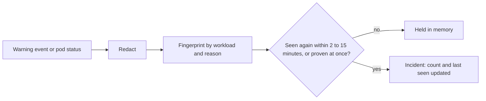
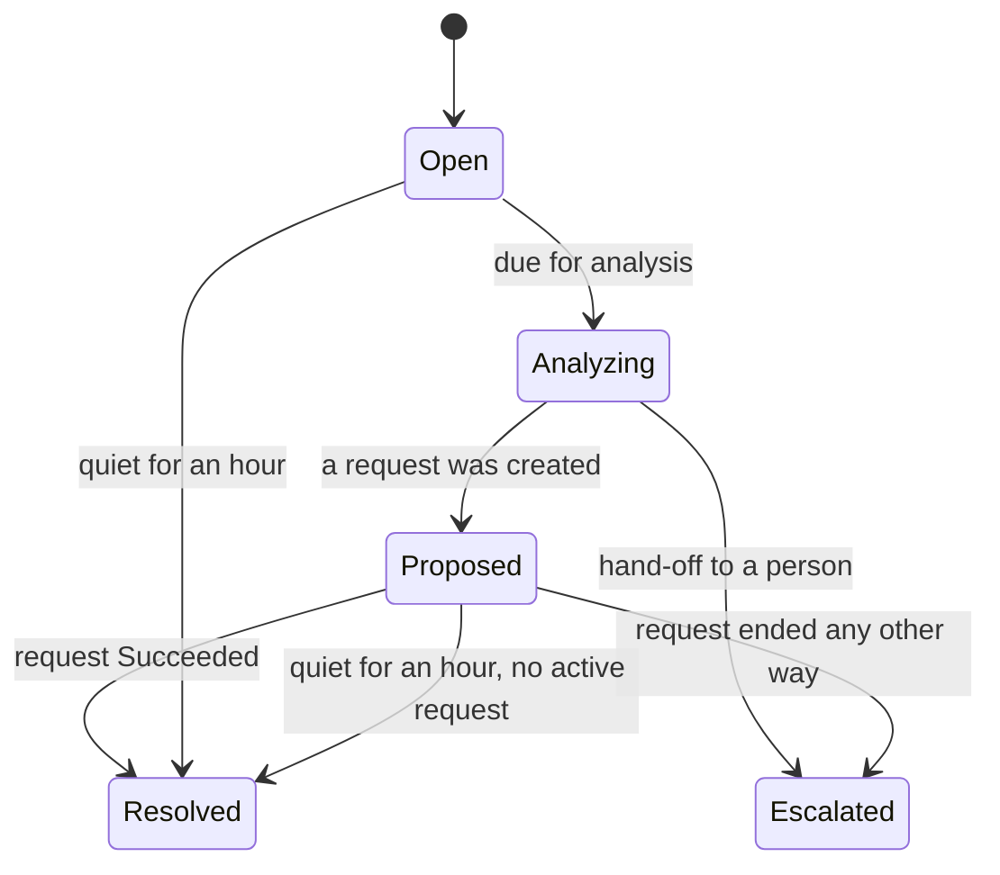

# Incidents

An `Incident` is one problem on one workload, stored as a small object in the operator's namespace. This page covers what Shadewright watches and how many warnings become one Incident. built

## What is watched

The analyzer reads only the namespaces you list, and it reads three kinds of signal.

- **Warning events.** Normal events are ignored. An event that is malformed, or about an object in another namespace, is dropped.
- **Pod status.** Every container that ended abnormally (an out-of-memory kill, or a non-zero exit code) and every container stuck waiting on an image or a configuration error, such as `ImagePullBackOff`. A pod that is being deleted counts only for an out-of-memory kill: a container stopped by a rollout, a scale down or a node drain exits non-zero (137 or 143) and is no symptom. It never reads the text a container leaves when it dies.
- **Add-on objects**, only when you enable the matching module: autoscalers, KEDA, Flux and Kyverno status. A KEDA scaler that has hit its replica ceiling is one example.

Each signal is attached to the workload that owns the pod, such as the Deployment, so symptoms from successive pods of one workload count together. Text is redacted before anything is stored.

## From warnings to one Incident

Each symptom gets a fingerprint: a hash of the namespace, the owning workload, the reason, the reporting component and the message with its variable parts removed (pod name suffixes, timestamps, addresses). The same problem gives the same fingerprint, so repeats update one Incident and a new problem opens another.

A symptom seen once opens nothing. It opens an Incident when it is seen again between 2 and 15 minutes after the first time. This keeps a short blip, such as a probe failing while a pod starts, from becoming an Incident. A few symptoms open one at once, because a single sighting already proves the problem: a container killed for running out of memory is the usual case.

A restart of the analyzer loses nothing that matters. First sightings are held in memory only, and a real symptom comes back. Old events of deleted pods open nothing new after a restart: an event about a pod that is gone, last seen more than 5 minutes before the analyzer started, is counted only on an Incident that already exists, and is dropped when there is none. A more recent event of a gone pod is handled as any other and can still open an Incident, and an event already counted on an Incident stays on it. If the analyzer was down for longer than 5 minutes and a pod was deleted in that time, that pod's events from the outage are among those old events: they fold into an existing Incident or are dropped, and the drops show in `shadewright_incident_batches_dropped_total` with reason `stale_on_start` ([metrics](../reference/metrics.md)).

A crash loop produces many follow-on events (`BackOff`, failing probes). When the pod status already shows the cause, those events are counted on the cause's Incident and open none of their own. The cause is an out-of-memory kill in the 10 minutes before the event, or a wait on an image or a configuration. A `BackOff` with neither counts on a non-zero exit within 10 minutes of it once the exit's Incident is open (a second crash), if the analyzer has room to hold it. Otherwise the `BackOff` can open its own Incident, which the exit's Incident folds if it opens within 15 minutes. A failing probe never counts on an exit: a failed liveness probe is what restarts the container. A pod being deleted, or marked as stopped as a whole (evicted, a node shutdown, a deadline), shows no exit as a cause from then on.

A container that cannot pull its image gets one Incident for the wait (`ErrImagePull` and `ImagePullBackOff` share it for the same container and image). The kubelet's short `Failed` events (`Error: ErrImagePull`, `Error: ImagePullBackOff`, `Error: InvalidImageName`) count on it too, or fold into it if they opened an Incident first. The long `Failed to pull image` event stays separate, so a missing image usually opens two Incidents, not one. An Incident that folded is `Resolved` with `Lifecycle` `FoldedIntoCause`.

## The life of an Incident

An Incident is `Open`, then `Analyzing` while a diagnosis runs, then `Proposed` once a request exists. It is `Resolved` when its symptom has not been seen for an hour and no request about it is still active, or at once when a request about it succeeded. A request that ends any other way (denied, failed, inconclusive, closed without a merge) marks the Incident `Escalated`: a person decides what next. Only the analyzer moves an Incident between phases.

## Limits

- The number of Incidents is capped, and a flood of one-off symptoms cannot grow the analyzer's memory without bound.
- Analyses are limited per day. The counter lives in a ConfigMap, so a restart or deleting Incidents does not reset it.

See [read an Incident](../how-to/read-an-incident.md) for the fields.

## In depth

- [Design 3.1: collecting](../design/3-observation-and-deduplication.md#31-collecting)
- [Design 3.2: two levels of deduplication](../design/3-observation-and-deduplication.md#32-two-levels-of-deduplication)
- [ADR-0007](../adr/0007-incident-state-in-crds.md): Incident state in custom resources.
- [ADR-0039](../adr/0039-consequence-symptoms-attach-to-their-causes-incident.md): consequences attach to their cause.
