# How it works

Shadewright watches a Kubernetes cluster for symptoms, works out a fix, and proposes it as a pull request to your GitOps repository. A person reviews and merges it, your GitOps controller delivers it, and Shadewright checks that the symptom went away. This section follows one symptom from start to end in seven short pages.

A replay, not a live view: release v0.3.0-rc.2, scenario `oom`. There the first OOMKilled event took 3 min 34 s to become a pull request, with one model call; the replay takes 28 seconds. The record has no later timings. The model call and the steps after the merge are off by default.

## Rules the design enforces

-   **01 The model never authorizes**

    The analyzer only proposes. Policy code decides; the executor acts only on a plan with the approved digest.

-   **02 Actions are a closed list**

    Typed, bounded parameters, a policy rule and a patcher for each. No free-form commands, `exec` or direct `apply`.

-   **03 Changes go through Git**

    A branch and a pull request, never a push to a protected branch. Policies, pipelines, RBAC and secrets are out of reach.

-   **04 Cluster input is untrusted**

    Events, logs and Git contents never change instructions, tools, permissions or actions. Secrets are redacted before a model sees them.

-   **05 Retries open no second pull request**

    Branch names derive from the request UID and plan digest, so a restart finds the existing pull request.

-   **06 Three separate identities**

    The analyzer reads the cluster. The executor holds the Git access. The verifier has no model, Git or Secrets. Never `cluster-admin`, never one token for both.

-   **07 Every analysis has a ceiling**

    A token bound per analysis (500,000 by default) and `maxAnalysesPerDay`.

-   **08 One trace per analysis**

    The analyzer can export an OpenTelemetry trace of each analysis. It is off by default.

-   **09 External systems sit behind adapters**

    A Go interface and one adapter per product.

## The five steps

1. **Observe.** The analyzer reads Warning events and pod status in the namespaces you name. Repeated symptoms of one workload become one `Incident`, a small object in the cluster. [Incidents](incidents.md).
2. **Diagnose.** Rules first, then a model that sees redacted input and read-only tools. It can only write a typed proposal, a `RemediationRequest`. [Diagnosis](diagnosis.md), and [Working with models](models.md).
3. **Check.** The executor compares the proposal with a fixed list of allowed changes and with a policy your cluster admin wrote. Plain code decides, not the model. [Policy](policy.md).
4. **Open a pull request.** The executor finds the file that defines the workload, changes one value and opens a pull request. Your branch rules and your reviewers decide whether it merges. [The pull request](pull-request.md).
5. **Verify.** After the merge and the rollout, a separate component reads the pods and the executor ends the request as succeeded, failed or inconclusive. [Verification](verification.md).

## What never happens

- Shadewright does not change a workload directly. In the cluster it writes only its own objects (Incidents, requests, verification reports, counters, leases and Events). Outside it writes the pull request and, if you configure a blob container, analysis records.
- It does not merge. Automatic merging is planned and not built: today a person merges every pull request.
- It does not run an action outside the fixed list or any shell command, and it never treats a model's answer as approval.

How these guarantees are kept, and by whom, is on the [safety model](safety.md) page.

## What is built today

built The whole path from an Incident to a pull request that waits for a person, and the checks after the merge.

Two parts are off by default. The model call starts only when the analyzer runs with `--triage-model`, and until its evaluation check exists it is meant for evaluation runs in a lab, so in a normal install a person (or a test) writes the request. The steps after the merge run only with `--verify-outcomes`.

planned Runbooks, which answer a known problem without a model.

The list of changes has two entries today: a container's memory limit and the maximum replica count of a KEDA `ScaledObject`.

## Try it without risk

The first install is observe-only: Incidents are recorded and nothing can write to Git. See [install in observe-only mode](../install.md).

## In depth

- [Architecture](../design/2-architecture.md#21-flow): the flow, the components and what each may read and write.
- [The life of a request](../request-lifecycle.md): every phase a request passes through.
- [ADR-0003](../adr/0003-gitops-only-typed-remediation.md): why changes go through Git as typed actions.

## Planned: control plane mode

Planned: ADR-0038 is proposed, nothing here is built. Read it at [ADR-0038](../adr/0038-control-plane-mode-a-hub-that-many-clusters-report-to.md).
