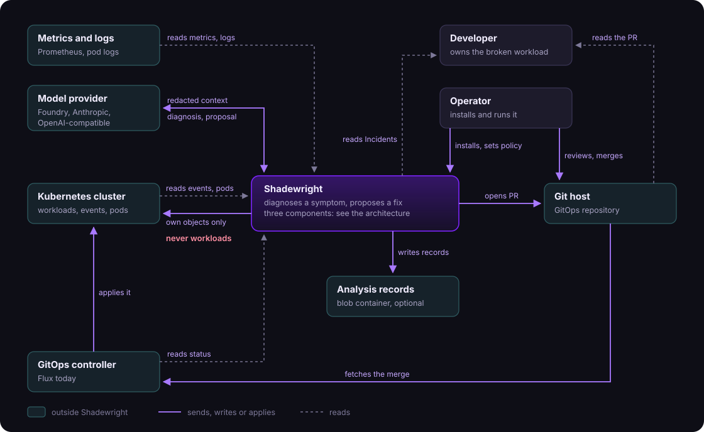
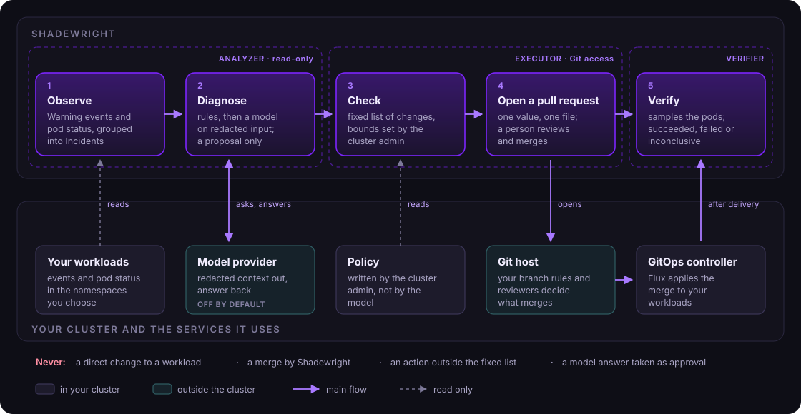

# How it works

Shadewright watches a Kubernetes cluster for symptoms, works out a fix, and proposes it as a pull request to your GitOps repository. A person reviews and merges it, your GitOps controller delivers it, and Shadewright checks that the symptom went away. Seven short pages follow one symptom end to end.

The operator installs Shadewright, sets its policy and merges; the workload's developer reads the Incident and pull request. For the model, Shadewright reads Prometheus metrics and pod logs; [your model provider](models.md) (Foundry, Anthropic or OpenAI-compatible) returns a diagnosis and proposal. Flux fetches and applies the merge; Shadewright reads its status. One level in, the [architecture](../design/2-architecture.md#21-flow) shows its three components.

Two laps, 13 seconds each. Lap 1 replays a recording: v0.3.0-rc.2, one OOMKilled workload. Its first event took 3 min 34 s to become a pull request, with one model call, so the dim path was not taken. Lap 2 is an illustration with no numbers: the same flow through the escalation model, with read tools offered, no call shown.

## Rules the design enforces

-   **01 The model never authorizes**

    The analyzer only proposes. Policy code decides; the executor acts only on a plan with the approved digest.

-   **02 Actions are a closed list**

    Typed, bounded parameters, a policy rule and a patcher for each. No free-form commands, `exec` or direct `apply`.

-   **03 Changes go through Git**

    A branch and a pull request, never a push to a protected branch, never a bypassed check. Policies, pipelines, RBAC and secrets are out of reach.

-   **04 Cluster input is untrusted**

    Events, logs and Git contents never change instructions, tools, permissions or actions. Secrets are redacted before storage and before a model sees them.

-   **05 Retries open no second pull request**

    Branch names derive from the request UID and plan digest, so a restart finds the existing pull request.

-   **06 Separate identities**

    The analyzer reads the cluster. The executor holds the Git access. The verifier has no model, Git or Secrets. Never `cluster-admin`, never one token for both.

-   **07 Every analysis has a ceiling**

    A token bound per analysis (500,000 by default) and `maxAnalysesPerDay`.

-   **08 One trace per analysis**

    The analyzer can export an OpenTelemetry trace of each analysis, off by default.

-   **09 External systems sit behind adapters**

    A Go interface and one adapter per product.

## The five steps

1. **Observe.** The analyzer reads Warning events and pod status in the namespaces you name. Repeated symptoms of one workload become one `Incident`, a small object in the cluster. [Incidents](incidents.md).
2. **Diagnose.** Rules first, then a model that sees redacted input and read-only tools. It can only write a typed proposal, a `RemediationRequest`. [Diagnosis](diagnosis.md), [Working with models](models.md).
3. **Check.** The executor compares the proposal with a fixed list of allowed changes and with a policy your cluster admin wrote. Plain code decides, not the model. [Policy](policy.md).
4. **Open a pull request.** The executor finds the file that defines the workload, changes one value and opens a pull request. Your branch rules and your reviewers decide whether it merges. [The pull request](pull-request.md).
5. **Verify.** After the merge and the rollout, a separate component reads the pods and the executor ends the request as succeeded, failed or inconclusive. [Verification](verification.md), [every phase of a request](../request-lifecycle.md).

## What never happens

- Shadewright does not change a workload directly. In the cluster it writes only its own objects (Incidents, requests, verification reports, counters, leases and Events). Outside it writes the pull request and, if you configure a blob container, analysis records.
- It does not merge. Automatic merging is planned and not built: today a person merges every pull request.
- It does not run an action outside the fixed list or any shell command, and it never treats a model's answer as approval.

How they are kept: [the safety model](safety.md); why only through Git: [ADR-0003](../adr/0003-gitops-only-typed-remediation.md).

## What is built today

built The whole path from an Incident to a pull request that waits for a person, and the checks after the merge.

Off by default: the model call (`--triage-model`) and the steps after the merge (`--verify-outcomes`). Until its evaluation check exists the model call is meant for lab evaluation runs, so in a normal install a person (or a test) writes the request.

planned Runbooks, which answer a known problem without a model.

The list has two changes today: a container's memory limit and the maximum replica count of a KEDA `ScaledObject`.

## Try it without risk

The first [install is observe-only](../install.md): Incidents are recorded and nothing can write to Git.

## Planned: control plane mode

Nothing here is built: [ADR-0038](../adr/0038-control-plane-mode-a-hub-that-many-clusters-report-to.md) is proposed.
