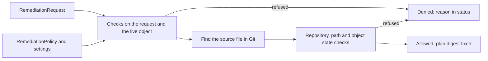

# Policy

Policy decides whether a proposal may become a pull request. It runs in the executor as plain code, with the same answer for the same input. A model is not asked and has no say. built

## A fixed list of allowed changes

Shadewright can make only the changes on a closed list, called the action catalog. Each entry has typed parameters with bounds, its own policy rule and its own file patcher, and a test that it is refused outside its bounds. There are two:

| Change | Target |
| --- | --- |
| Set a container's memory limit | A Deployment or StatefulSet |
| Set the maximum replica count of a KEDA scaler (needs the `keda` module) | A `ScaledObject` |

There is no free-form command, no `exec` and no direct apply. Adding a third means new code: a policy rule, a patcher and a test of its bounds.

## Who writes the policy

A `RemediationPolicy` is a cluster-scoped object that only your cluster admin should be able to write. Per action it sets:

- the allowed range: a minimum, a maximum and the largest increase or decrease in percent;
- the namespaces and labels of the objects it covers;
- the Git paths that may be changed, and the one repository;
- the namespaces whose requests may use it;
- whether review is always required.

The defaults are strict. Approval is required, a policy must name its namespaces (there is no "all namespaces"), and decreases are refused unless the admin allows them.

## What the decision checks

In this order, the first failure gives the reason:

1. The request refers to a policy it may use, from a namespace allowed to use it.
2. The action is on the list and its parameters are well formed.
3. The module that provides the action is enabled.
4. The live object is the one the request names, of an allowed kind, in a covered namespace.
5. The change is within the policy's bounds.
6. The repository, branch and file are the ones the policy allows.
7. The object is in a state the action fits (for example, a KEDA scaler that is ready).

The outcome is `Allowed`, `Denied` with a reason, or `NeedsIntervention` when input is missing. Checks 1 to 5 run before any Git read, so a refused request costs no token and no call to the Git host.

## Why a model's answer is not an approval

The proposal and the decision are written by different code, run by different identities. The analyzer can only create a request. The executor reads the request, the policy and the live cluster, and decides. The model never sees the decision about its own proposal, only the bounds beforehand.

The decision fixes a digest of the plan: the action, the target, the policy and the source it mapped. A later change to any of them makes the request stale, and Shadewright closes its pull request rather than carrying an old approval over. Even an allowed change normally waits for a person: the request asks for approval, and a policy can lower that only if the admin sets it to optional.

Read why a request was refused in [find why a request was refused](../how-to/find-why-refused.md) and write a policy in [write or tighten a policy](../how-to/write-a-policy.md).

## In depth

- [Design 5.3: RemediationPolicy](../design/5-api.md#53-remediationpolicy)
- [Design 5.1: RemediationRequest](../design/5-api.md#51-remediationrequest)
- [ADR-0003](../adr/0003-gitops-only-typed-remediation.md): typed actions, GitOps only.
- [ADR-0011](../adr/0011-policy-as-cluster-scoped-crd.md): policy as a cluster-scoped object.
