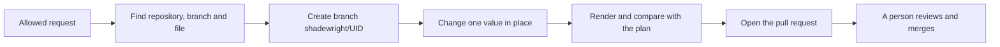

# The pull request

An approved plan reaches the cluster in one way: a pull request on your GitOps repository. This page covers where the change is written, what the pull request holds and who merges it. built

## Where the change is written

A request says what to change, never where. The executor finds the place itself. It follows the live object to the Flux objects that deliver it, and from there to one repository, one branch and one file. If the source is unclear, it stops and the request ends `NeedsIntervention` with no pull request.

It then:

1. Reads the head of the target branch and creates the branch `shadewright/<request UID>`.
2. Changes the one value in the file in place, keeping comments and formatting, and checks that the old value is what it expected.
3. Renders the final manifests and compares them with the render before the change. Any difference beyond the planned one stops the request.
4. Commits and opens the pull request.

Every write names the state it expects. A moved head is a conflict, never a force push, and after a restart the executor finds the pull request it opened instead of opening another.

## What the pull request holds

The body is built from checked fields of the request, and redacted once more before it is sent.

- The change: the action, the object, the old and the new value, as one value in one file on one branch.
- The evidence: the request, its Incident, the policy and the plan digest, a hash of the plan that any other push to the branch invalidates.
- The size of the step and the policy that bounds it. The policy bounds the step; it does not say the step is right.
- The expected effect, the risk and the rollback, which is to revert the pull request.
- Whether approval is required (yes, unless the policy allows otherwise).

The model's reasoning is not in the pull request. It is in the analysis record and the analyzer's log. Read it before you approve a change whose size you doubt.

## Who merges

A person, under your own rules. Shadewright never approves its own pull request and does not check reviews by default: required reviews, status checks and `CODEOWNERS` on your branch decide what merges. With reviewer hints on (`executor.reviewerHints.enabled`, off by default) the executor also reads comments and reviews on its own pull requests and creates the check run `shadewright/review`. The executor sees the merge within about a minute and records it.

Shadewright pushes only to its own branch and has no way to bypass branch protection. Automatic merging is planned and not built, so today every pull request waits for a person.

If the plan goes stale before the merge (the policy, the settings, the target or the file changed), Shadewright closes its pull request and the request ends `Superseded`. A new request starts from the current state. If someone pushes another change to the branch, automation stops and hands the pull request to a person.

## What keeps writes bounded

- A GitHub App whose private key stays in a cloud key vault: the executor asks the vault to sign and never holds the key. The token lasts an hour and names one repository.
- A lock keeps two requests from changing the same field at once.
- A cap on concurrent requests, and a circuit breaker that holds new requests after three failures with no success between.
- The kill switch, `spec.paused` in `RemediationSettings`, is read from the API server (never the cache) right before each write request to the Git host, each retry included. It fails closed: settings that cannot be read block the write. A request already sent is not recalled. See [pause and resume](../how-to/pause-and-resume.md).

## In depth

- [Design 8.2: making a change](../design/8-gitops-on-github.md#82-making-a-change)
- [Design 8.1: what approval means](../design/8-gitops-on-github.md#81-what-approvalrequired-means)
- [Design 10.7: loop protection](../design/10-security.md#107-loop-protection)
- [ADR-0006](../adr/0006-github-app-key-in-key-vault.md): the App key in Key Vault.
- [ADR-0012](../adr/0012-object-to-source-mapping.md): from an object to its source file.
