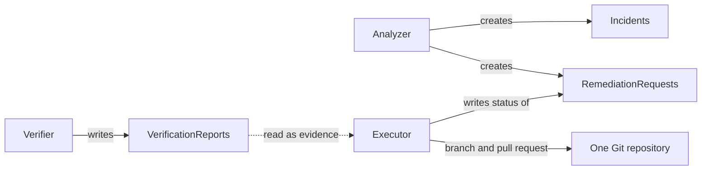

# The safety model

Shadewright assumes the model can be wrong or fooled, and that anything it reads from the cluster can be hostile. Each part is limited, so a mistake produces a pull request a person can reject, not a change in the cluster. built

## Six rules

1. **A model's output is never authorization.** The analyzer can only submit a proposal. Plain code decides whether it may run, and the executor acts only on a plan whose digest matches the one it approved.
2. **Changes come from a closed list.** Each allowed action has typed, bounded parameters, a policy rule, a patcher and a test that it is refused outside its bounds. No free-form commands, no `exec`, no direct apply.
3. **Changes go through Git only.** A branch and a pull request, never a push to a protected branch, never around branch protection or required checks. The remediation path cannot change policies, pipelines, RBAC or Secrets.
4. **Everything from the cluster is untrusted.** Events, logs, annotations and Git contents may hold instructions aimed at the model. They never change its instructions, tools, permissions or the list of actions. Secrets and tokens are removed before anything is stored or sent to a model, in the forms the redactor recognizes: a value after a secret key or flag, a known token shape, a connection string. The symptom an Incident stores is redacted from the text as a terminal prints it on one line, then normalised and cut. The whole symptom is withheld when it holds a terminal string or a control the redactor does not interpret, or when a secret split by control characters, escape sequences, invisible characters or line ends could still show, so a note of several lines loses its other lines too. A secret split only by plain spaces is not caught. A secret in a form the redactor does not recognize can pass, so keep secrets out of events and logs.
5. **A restart never repeats work.** Branch names and markers come from the request and plan digest, so a restart finds the existing pull request.
6. **Separate identities.** The parts that read, decide and write do not share credentials. There is no `cluster-admin` and no single token for both reading and writing.

## The three identities

Shadewright runs as three Deployments, each with its own ServiceAccount. The diagram shows the main writes; the table below lists them all. Only the analyzer calls the model.

| | Analyzer | Executor | Verifier |
| --- | --- | --- | --- |
| Cluster | Read-only in the namespaces you list, plus `list` on Nodes (platform detection) and `get` on the policies it is told to show the model | Reads the target, its Flux objects, policy, settings, the Incident a request names and the verifier's reports | Lists pods and reads ReplicaSets, Deployments and StatefulSets in your namespaces, and reads requests |
| Writes in the cluster | Incidents and their status, the requests it proposes, its analysis counter, platform detection in the settings status, Events, its lease | The status of requests and its finalizer on them, Events, its lease | Its own reports and their status, Events, its lease |
| Writes outside it | Analysis records in a blob container, when configured | The pull request | Nothing |
| Model | Yes | No | No |
| Git | No | Yes, one repository, through a GitHub App | No |
| Reads Secrets | No | No | No |

The executor's GitHub App key stays in a key vault and is used only to sign. The analyzer reaches the model with a federated identity, or with a key mounted as a file. The verifier has no cloud identity. None of the three can read Secrets, and a test against a real API server checks that.

So a compromised analyzer cannot write to Git, and a compromised executor has no credential for the model. What one writes, the next reads as untrusted input: the request is checked by policy and the report is only evidence.

## What you control

- The namespaces the analyzer watches.
- What it may change: the `RemediationPolicy` objects. A request outside them is denied.
- Where it may write: the repository named in `RemediationSettings`.
- Whether it writes at all: `spec.paused` stops the next Git write. See [pause and resume](../how-to/pause-and-resume.md) and the [emergency stop](../emergency.md).
- What merges: your branch rules and your reviewers.

## What it does not promise

The redaction is best effort and errs towards removing too much: a text it cannot decide within its work budget is withheld whole, and the model is told the source could not be fetched. A pull request is not proof that the diagnosis was right: review it as you would a colleague's. The [threat model](../threat-model.md) marks each guarantee built or planned and lists the known gaps.

## In depth

- [Invariants in AGENTS.md](https://github.com/shadewright-labs/shadewright/blob/main/AGENTS.md)
- [Threat model](../threat-model.md)
- [Design 9: identity](../design/9-identity.md#9-identity)
- [Design 10: security](../design/10-security.md#10-security)
- [Data handling](../data-handling.md)
- [ADR-0003](../adr/0003-gitops-only-typed-remediation.md) and [ADR-0011](../adr/0011-policy-as-cluster-scoped-crd.md).
