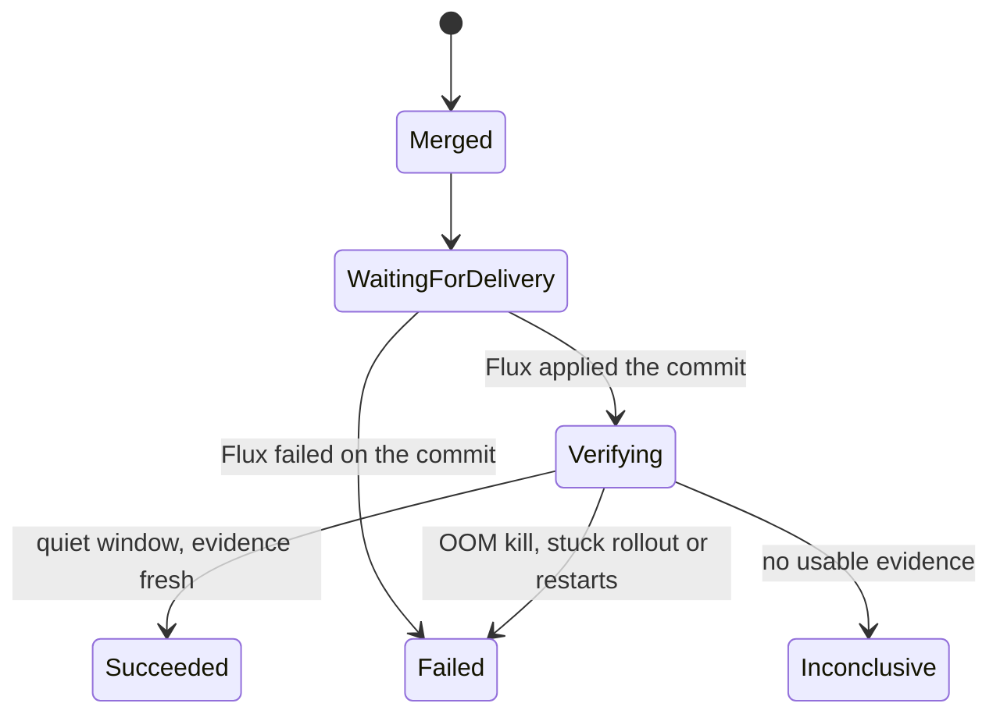

# Verification

A merged pull request does not prove the fix worked. Verification follows the change to the pods and ends the request in one of three ways. built

!!! note "Off by default"
    The steps after the merge run only when the executor has `--verify-outcomes` on (chart value `executor.verification.enabled`). With it off, a merged request stays `Merged` and records only whether its pods rolled out.

## What happens after the merge

1. **Merge receipt.** The executor records the merge commit and binds it to the repository, branch and pull request. No receipt, no verdict: the request ends `Inconclusive`.
2. **Waiting for delivery.** It waits for Flux to report that commit, or a later one containing it, as applied. If Flux fails on that commit the request ends `Failed`. If nothing is delivered within an hour it ends `Inconclusive`.
3. **Verifying.** Every 30 seconds the executor checks that the live field holds the new value and that the pods run the new template. A separate component, the verifier, lists the pods of the rollout and writes a `VerificationReport`.
4. **The quiet window.** The symptom must stay away for a set time, 11 minutes for a memory fix with the defaults, and the Incident's count must not rise.

## The verifier is evidence, not a judge

The verifier has no model, no Git credential and no Secrets, and it cannot write a request's status. Its report is untrusted evidence. The executor reads it and decides. Missing, stale or mismatched evidence never counts as success: it ends `Inconclusive`.

## The outcomes

| Outcome | Meaning |
| --- | --- |
| `Succeeded` | Delivered, rolled out, configured, and the symptom stayed away for the whole window. |
| `Failed` | Flux failed on the commit, the rollout stuck, the container was killed for running out of memory again (at once), or it restarted during the window. |
| `Inconclusive` | Merged, but neither success nor failure could be shown: the value was changed by a later commit, the target is gone, or there was no evidence. |

Other endings come before the merge: `Denied` (policy refused), `NeedsIntervention` (a person must act), `Superseded` (the plan went stale), `Expired` and `Cancelled`.

## What follows a failure

A request that ends `Failed` marks its Incident `Escalated`, so a person looks at it. The analyzer also proposes a revert: a new request through the same policy and the same pull request path, never a direct change, and always waiting for a person. The circuit breaker counts the failure, and three failures in a row hold new requests until one succeeds.

An Incident whose request `Succeeded` is resolved at once.

## In depth

- [ADR-0030](../adr/0030-merge-receipt-and-verification-outcomes.md): the merge receipt and the outcomes.
- [The life of a request](../request-lifecycle.md#after-the-merge-did-it-reach-the-pods)
- [Design 2.2.4: verifier permissions](../design/2-architecture.md#224-verifier-permissions)
- [Design 10.9: verification](../design/10-security.md#109-verification)
