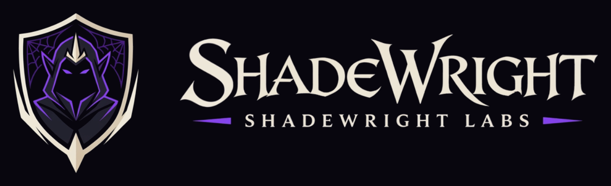
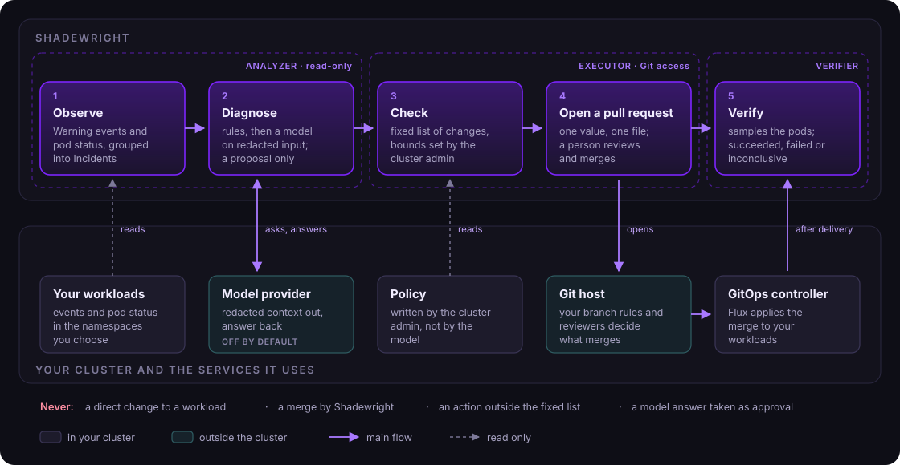

<div class="sw-hero" markdown>

<h1 class="sw-visually-hidden">Shadewright</h1>

{ width="1313" height="403" }

<p class="sw-lore">The Guardian is one hooded wright of the house, at work in the half-light while others sleep. It watches from the edge, lays no hand on what it guards and keeps quiet until it finds the fault. Then it shapes a fix at its bench and hands it over, and others judge whether the work is fit to use. <a href="name/">The name</a></p>

<p class="sw-tagline">Shadewright watches a Kubernetes cluster for failing workloads, works out a fix, and proposes it as a pull request to your GitOps repository for a person to review.</p>

[Get started](getting-started.md){ .md-button .md-button--primary }
[How it works](how-it-works/index.md){ .md-button }
[GitHub](https://github.com/shadewright-labs/shadewright){ .md-button }

</div>

## The problem

A container is killed for running out of memory. Someone reads the events and the logs, guesses a new limit and edits a manifest. A fix applied straight to the cluster is overwritten by the next sync, or leaves the cluster different from Git. Shadewright does the reading and writes the change where your review rules already apply: a pull request on your GitOps repository.

## How it works {#how-it-works}

[](assets/diagrams/how-it-works.svg "Open full size")

It observes events and pod status, diagnoses with rules and then a model, checks the proposal against a fixed list of changes and your policy, opens the pull request, and after the merge checks that the symptom went away. [Read the whole flow](how-it-works/index.md).

## An example pull request

For a container that keeps running out of memory, the executor opens a pull request like this one, taken from the [lab runbook](lab-oom-acceptance.md):

**Title:** `fix: set the memory limit of container web of demo/web to 64Mi`

**Body** (excerpt):

> **Change:** the memory limit of container web (`SetContainerMemoryLimit`) of Deployment `demo/web`, from `48Mi` to `64Mi`.
>
> **Scope:** one value in `apps/demo/web-deployment.yaml` on `cluster/lab`. Nothing else in this pull request is part of the plan.
>
> **Size:** an increase of 34% of the previous value, within policy `demo-memory`. The policy bounds the step; it does not say the step is the right size.
>
> **Rollback:** revert this pull request; the GitOps controller applies the previous value.
>
> **Approval required:** yes.

**Diff:**

```diff
-              memory: 48Mi
+              memory: 64Mi
```

Your branch rules and your reviewers decide whether it merges. The [first proposal](first-proposal.md) walks through one.

## What it never does

- It does not change a workload directly. It writes only its own objects (Incidents, requests, verification reports, their status and Events) and, outside the cluster, the pull request.
- It does not merge. Automatic merging is <span class="sw-status sw-planned">planned</span> and not built: today a person merges every pull request.
- It does not run an action outside the fixed list, and it does not run shell commands.
- It does not treat a model's answer as approval. The model's output is a proposal, nothing more.

The [safety model](how-it-works/safety.md) says how each of these is kept.

## Status {#status}

<span class="sw-status sw-planned">Early</span> The path from an incident to a pull request that waits for a person is <span class="sw-status sw-built">built</span>. The model call (`--triage-model`) and the checks after the merge (`--verify-outcomes`) are built and off by default; until the model call has its evaluation check it is meant for evaluation runs in a lab. Automatic merging and runbooks are <span class="sw-status sw-planned">planned</span>. Two changes are on the list today: a container's memory limit and the maximum replica count of a KEDA `ScaledObject`. The [threat model](threat-model.md) marks each guarantee as built or planned.

## Where to start

<div class="grid cards" markdown>

-   [**Try it**](install.md)

    Install in observe-only mode: it records incidents and cannot write to Git.

-   [**Understand it**](how-it-works/index.md)

    How it works: one symptom followed from start to end, in seven short pages.

-   [**Operate it**](operate.md)

    Upgrade, stop, rotate identities and know what is stored.

</div>

## The docs by reader

- [Overview](overview.md): for anyone deciding whether it fits, what it is and is not.
- [How it works](how-it-works/index.md): for a platform engineer who wants to know what it can touch.
- [Get started](getting-started.md): for the person installing it for the first time.
- [Use](use.md): for the people who review and approve its proposals.
- [Operate](operate.md): for the team that installs and runs it.
- [Reference](reference/index.md): for anyone looking up a setting, a metric or a field.

The design, the decisions behind it and the contributor guide are in the sidebar, for people who change Shadewright itself.

## Repositories

- [shadewright](https://github.com/shadewright-labs/shadewright): the operator and these docs.
- [shadewright-azure](https://github.com/shadewright-labs/shadewright-azure): Terraform for a disposable reference lab in Azure.
- [shadewright-fleet](https://github.com/shadewright-labs/shadewright-fleet): the lab's GitOps repository and incident scenarios.
