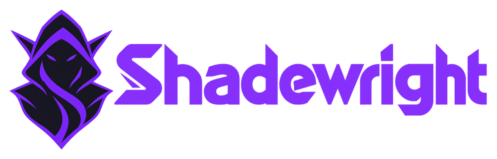

<h1 class="sw-visually-hidden">Shadewright</h1>

A Kubernetes operator that diagnoses incidents with an LLM and proposes fixes only as reviewed GitOps pull requests.

[Read the design](design.md){ .md-button .md-button--primary }
[Decisions](adr/index.md){ .md-button }
[GitHub](https://github.com/pkalin/shadewright){ .md-button }

Shadewright watches your cluster, groups repeated symptoms into incidents, asks an LLM for a diagnosis, and proposes a fix as a pull request to your GitOps repository. It never changes the cluster directly: your review rules decide what merges, and your GitOps controller delivers it.

!!! warning "Early"
    Built so far: the API and its validation, the policy check with source mapping and the freshness check, the YAML patchers, the semantic diff check, the GitHub and Key Vault adapters, the pull request step (branch, commit and pull request, up to a person's review), the collector (events and pod status to deduplicated observations) and the Incident controller (one bounded `Incident` per fingerprint, marked due for analysis within a daily budget), and the module registries with the Flux integration module (failing Flux objects as symptoms; not yet wired into the analyzer). Not built: the analysis, auto-merge, delivery and the verification. The [design](design.md) says what holds at each step, the [decisions](adr/index.md) say why, and the [threat model](threat-model.md) lists each guarantee as built or planned.

## How it works

-   **1. Observe**

    Events and object status in the namespaces you choose, deduplicated into incidents.

-   **2. Diagnose**

    Rules first, then a model with read-only tools and redacted context. No evidence, no proposal.

-   **3. Propose**

    A typed `RemediationRequest` from a closed catalog of actions, checked by deterministic policy.

-   **4. Open a PR**

    On a branch, in the one repository it may write to, with the evidence and a rollback plan.

-   **5. Verify**

    After merge, it follows the GitOps controller (Flux today) to the applied revision and checks that the symptom is gone.

## Principles

- The model's answer is never authorization.
- Every change is a reviewed, revertible commit.
- Everything read from the cluster is untrusted input.
- Separate, short-lived identities for analysis and for Git.

## Repositories

- [shadewright](https://github.com/pkalin/shadewright): the operator and these docs.
- [shadewright-azure](https://github.com/pkalin/shadewright-azure): Terraform for a disposable reference lab in Azure.
- [shadewright-fleet](https://github.com/pkalin/shadewright-fleet): the lab's GitOps repository and incident scenarios.
