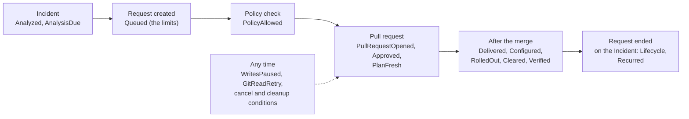

# Condition reasons

A lookup for one thing: you see a condition on a `RemediationRequest` or an `Incident`, and you want to know what its reason means and what to do. Find the condition type below, then the reason. Each row says what it means, what to do, and links to the longer explanation in [troubleshooting](troubleshooting.md).

```bash
kubectl -n shadewright-system get remediationrequest <name> \
  -o jsonpath='{range .status.conditions[*]}{.type}={.status} {.reason}: {.message}{"\n"}{end}'
kubectl -n shadewright-system get incident <name> \
  -o jsonpath='{range .status.conditions[*]}{.type}={.status} {.reason}: {.message}{"\n"}{end}'
```

Where in the life of a request each group of conditions appears. `Queued` is set by the limits check, before the policy check runs; `Lifecycle` and `Recurred` are set on the Incident after the request ended (or after the Incident went quiet):



On this page:

- Requests: [PolicyAllowed](#policyallowed), [Queued](#queued), [PullRequestOpened and Approved](#pullrequestopened-and-approved), [PlanFresh](#planfresh), [after the merge](#after-the-merge) (`Delivered`, `Configured`, `RolledOut`, `Cleared`, `Verified`), [other conditions](#other-conditions-of-a-request)
- Incidents: [Analyzed](#analyzed), [AnalysisDue](#analysisdue), [Lifecycle](#lifecycle), [Recurred](#recurred), [RevertsStopped](#revertsstopped)
- Settings: [RemediationSettings](#remediationsettings)

A reason with no row here is not a condition reason. The Event-only reasons and the reasons of reviewer hints in `status.hints` are explained in [troubleshooting](troubleshooting.md#pull-request-step).

## RemediationRequest

### PolicyAllowed

The policy check, before any Git write. `False` ends the request `Denied`, `Unknown` ends it `NeedsIntervention` or means it waits, `True` lets it through. Most requests that stop here stop on one of the rows under [request and target](#request-and-target) or [policy bounds](#policy-bounds). A request that ended `Denied` or `NeedsIntervention` in this check is not decided again: after the fix, apply a new request.

#### Allowed and waiting

| Reason | What it means | What to do |
| --- | --- | --- |
| <span id="pa-withinapprovedbounds"></span>`WithinApprovedBounds` | Every check passed (`True`). | Nothing. [More](troubleshooting.md#request-and-target) |
| <span id="pa-kustomizationreconciling"></span>`KustomizationReconciling` | A wait, not a stop (`Unknown`): Flux is still reconciling the Kustomization that delivers the target. | Nothing. After 10 minutes the request ends `NeedsIntervention` with `KustomizationNotReady`. While the pull request waits, the same reason on `PlanFresh` is retried the same way, and after 10 minutes the plan is taken as stale (`SourceChanged`). [More](troubleshooting.md#delivery-from-flux) |
| <span id="pa-scaledobjectreadinessunknown"></span>`ScaledObjectReadinessUnknown` | A wait (`Unknown`): KEDA has not reported on the ScaledObject yet. | Check that KEDA runs; the request is checked again for up to 10 minutes, then ends `NeedsIntervention` with `ScaledObjectNotReady`. [More](troubleshooting.md#policy-decision) |

#### Request and target

| Reason | What it means | What to do |
| --- | --- | --- |
| <span id="pa-policynotfound"></span>`PolicyNotFound` | `Denied`: `spec.policyRef` names no `RemediationPolicy`. | Create the policy or correct the name, then apply a new request. [More](troubleshooting.md#request-and-target) |
| <span id="pa-settingsnotfound"></span>`SettingsNotFound` | `Denied`: there is no `RemediationSettings` named `default`. | Create it. [More](troubleshooting.md#request-and-target) |
| <span id="pa-targetmismatch"></span>`TargetMismatch` | `Denied`: the live object has another UID than `targetRef.uid`, for example because it was recreated. | Read the current UID and apply a new request. [More](troubleshooting.md#request-and-target) |
| <span id="pa-previousvaluemismatch"></span>`PreviousValueMismatch` | `Denied`: the previous value in the request is not the live value. | Read the live value and apply a new request. [More](troubleshooting.md#request-and-target) |
| <span id="pa-invalidinput"></span>`InvalidInput` | `NeedsIntervention`: the action does not fit the target (not a namespaced object pinned by UID, a kind the action may not change, or no previous value). | Use a catalog action on a supported kind, with `uid` set. [More](troubleshooting.md#request-and-target) |
| <span id="pa-targetnotfound"></span>`TargetNotFound` | `NeedsIntervention`: the target does not exist. | Check namespace and name, then apply a new request. [More](troubleshooting.md#request-and-target) |
| <span id="pa-targetchanged"></span>`TargetChanged` | `NeedsIntervention`: the target's UID changed while its source was being mapped. | Apply a new request. [More](troubleshooting.md#request-and-target) |
| <span id="pa-fieldnotfound"></span>`FieldNotFound` | `NeedsIntervention`: the field the action changes is not set on the live object or in the file in Git. | Set the field in Git first, then apply a new request. [More](troubleshooting.md#request-and-target) |
| <span id="pa-valuemismatch"></span>`ValueMismatch` | `NeedsIntervention`: the value in the file differs from the live one, or is not a quantity Shadewright reads. | Make the file and the live object agree, then apply a new request. [More](troubleshooting.md#request-and-target) |
| <span id="pa-invalidrevert"></span>`InvalidRevert` | `Denied`: a request with `spec.reverts` is not the exact inverse of the failed request it names. | Look at who created it; revert the failed change in Git by hand. [More](troubleshooting.md#how-to-read-the-result) |
| <span id="pa-chainlinkinvalid"></span>`ChainLinkInvalid` | `Denied`: a replacement request names a request it does not replace (another Incident, target or chain, not waiting for approval, or a hint that is not pending). | Nothing was taken over; look at who created the request. [More](troubleshooting.md#how-to-read-the-result) |
| <span id="pa-hintsturnedoff"></span>`HintsTurnedOff` | The executor runs without `--reviewer-hints`, so it refuses a replacement made for a reviewer hint (`Denied`) and declines the hint. The same reason ends an admitted replacement `Cancelled`, and a replacement that already took the pull request over `NeedsIntervention`. | The old pull request keeps its plan. Turn hints on, or close the pull request without merging if the head carries a hint-steered change. [More](troubleshooting.md#how-to-read-the-result) |

#### Delivery from Flux

All `NeedsIntervention` unless marked. Shadewright maps the live object to its file through Flux labels, the Kustomization and its `GitRepository`.

| Reason | What it means | What to do |
| --- | --- | --- |
| <span id="pa-helmmanaged"></span>`HelmManaged` | A `HelmRelease` manages the object; Helm values are not supported. | Change the chart values by hand. [More](troubleshooting.md#delivery-from-flux) |
| <span id="pa-nofluxlabels"></span>`NoFluxLabels` | The object has no Flux Kustomization labels. | Let a Flux Kustomization apply it. [More](troubleshooting.md#delivery-from-flux) |
| <span id="pa-invalidfluxlabels"></span>`InvalidFluxLabels` | The Flux labels are not valid object names. | Remove the labels and let Flux reapply. [More](troubleshooting.md#delivery-from-flux) |
| <span id="pa-kustomizationnotfound"></span>`KustomizationNotFound` | The labelled Kustomization does not exist, or the Flux CRDs are not installed. | Restore it or reapply the object. [More](troubleshooting.md#delivery-from-flux) |
| <span id="pa-kustomizationsuspended"></span>`KustomizationSuspended` | The Kustomization is suspended, so a merge would not be applied. | Resume it. [More](troubleshooting.md#delivery-from-flux) |
| <span id="pa-kustomizationnotready"></span>`KustomizationNotReady` | The Kustomization fails, or was still reconciling after a 10 minute wait. | Fix it (`flux get kustomizations`), then apply a new request. [More](troubleshooting.md#delivery-from-flux) |
| <span id="pa-notininventory"></span>`NotInInventory` | `Denied`: the Kustomization named by the labels does not list the object, so the labels cannot be trusted. | Find which Kustomization really applies it. [More](troubleshooting.md#delivery-from-flux) |
| <span id="pa-kustomizationtransforms"></span>`KustomizationTransforms` | The Kustomization transforms the build (patches, images, prefixes, `postBuild` and similar), so Git is not what is applied. | Move the transforms into the manifests. [More](troubleshooting.md#delivery-from-flux) |
| <span id="pa-remotecluster"></span>`RemoteCluster` | The Kustomization applies to another cluster. | Not supported. [More](troubleshooting.md#delivery-from-flux) |
| <span id="pa-decryption"></span>`Decryption` | The Kustomization decrypts SOPS files. | Not supported, editing would break the MAC. [More](troubleshooting.md#delivery-from-flux) |
| <span id="pa-unsupportedsource"></span>`UnsupportedSource` | The source is not a `GitRepository`, or its reference is invalid. | Use a Git source. [More](troubleshooting.md#delivery-from-flux) |
| <span id="pa-sourcenotfound"></span>`SourceNotFound` | The `GitRepository` does not exist. | Restore it. [More](troubleshooting.md#delivery-from-flux) |
| <span id="pa-sourcenotbranch"></span>`SourceNotBranch` | The `GitRepository` does not track only a branch. | Track a branch. [More](troubleshooting.md#delivery-from-flux) |
| <span id="pa-sourceincludes"></span>`SourceIncludes` | The `GitRepository` has `spec.include`. | Remove the include. [More](troubleshooting.md#delivery-from-flux) |
| <span id="pa-sourceoptions"></span>`SourceOptions` | The `GitRepository` is suspended or sets `ignore`, `recurseSubmodules` or `sparseCheckout`, or a `.sourceignore` file is on the path. | Remove the option or the file. [More](troubleshooting.md#delivery-from-flux) |
| <span id="pa-sourcenotready"></span>`SourceNotReady` | The `GitRepository` is not `Ready` for its current generation. | This request has ended. Fix the source (URL, credentials) until the `GitRepository` is `Ready`, then apply a new request. [More](troubleshooting.md#delivery-from-flux) |
| <span id="pa-revisionmismatch"></span>`RevisionMismatch` | The Kustomization has not applied the revision its source last fetched, or that revision is not from the tracked branch. | Wait for Flux to catch up, then apply a new request. [More](troubleshooting.md#delivery-from-flux) |

#### Repository, branch and path

| Reason | What it means | What to do |
| --- | --- | --- |
| <span id="pa-repositorynotconfigured"></span>`RepositoryNotConfigured` | `Denied`: the `GitRepository` URL equals no `spec.repositories[].url` in the settings, or more than one. The match is exact. | Make the settings URL equal the Flux URL. [More](troubleshooting.md#repository-branch-and-path) |
| <span id="pa-repositorynotinpolicy"></span>`RepositoryNotInPolicy` | `Denied`: the matching repository is not the policy's `gitOps.repositoryRef`. | Correct `repositoryRef`. [More](troubleshooting.md#repository-branch-and-path) |
| <span id="pa-repositorynotallowed"></span>`RepositoryNotAllowed` | `Denied`: the same check, made again by the policy on the resolved source. | As for `RepositoryNotInPolicy`. [More](troubleshooting.md#repository-branch-and-path) |
| <span id="pa-repositoryunusable"></span>`RepositoryUnusable` | `NeedsIntervention`: the settings entry cannot be used to open the repository (URL, client ID, installation ID, key or signer). | Fix the settings, then apply a new request. [More](troubleshooting.md#repository-branch-and-path) |
| <span id="pa-branchmismatch"></span>`BranchMismatch` | `Denied`: the branch Flux tracks is not the repository's `targetBranch`. | Align `targetBranch` with Flux. [More](troubleshooting.md#repository-branch-and-path) |
| <span id="pa-branchnotallowed"></span>`BranchNotAllowed` | `Denied`: the same check, made again by the policy. | As for `BranchMismatch`. [More](troubleshooting.md#repository-branch-and-path) |
| <span id="pa-branchnotfound"></span>`BranchNotFound` | `NeedsIntervention`: the target branch does not exist in the repository. | Create it or correct the settings. [More](troubleshooting.md#repository-branch-and-path) |
| <span id="pa-pathnotallowed"></span>`PathNotAllowed` | `Denied`: the file that declares the object matches none of the policy's `allowedPaths`. | Widen `allowedPaths` on purpose, or accept that the change is out of scope. [More](troubleshooting.md#repository-branch-and-path) |

#### Files in Git

All `NeedsIntervention`. The mapping reads plain kustomize manifests only.

| Reason | What it means | What to do |
| --- | --- | --- |
| <span id="pa-invalidpath"></span>`InvalidPath` | A path in the Kustomization or a kustomization file is not a plain relative path inside the repository. | Use a relative path; rename hidden manifests. [More](troubleshooting.md#files-in-git) |
| <span id="pa-nokustomizationfile"></span>`NoKustomizationFile` | A listed directory has no kustomization file, or the Kustomization's `spec.path` is not a directory. | Add the file or correct `spec.path`. [More](troubleshooting.md#files-in-git) |
| <span id="pa-unsupportedkustomization"></span>`UnsupportedKustomization` | A kustomization file uses more than plain `resources` (patches, generators, components, remote resources). | Flatten the layout. [More](troubleshooting.md#files-in-git) |
| <span id="pa-filenotreadable"></span>`FileNotReadable` | A file the build needs is missing, over 1 MiB, not valid YAML, repeats a key, or uses anchors, aliases or merge keys. | Fix the file. [More](troubleshooting.md#yaml-the-render-check-refuses) |
| <span id="pa-toomanyfiles"></span>`TooManyFiles` | The build is deeper or lists more files and reads than the mapping allows. | Simplify the layout. [More](troubleshooting.md#files-in-git) |
| <span id="pa-inputtoolarge"></span>`InputTooLarge` | The build reads more than 16 MiB in all, or holds more than 4096 YAML documents. | Split the path. [More](troubleshooting.md#files-in-git) |
| <span id="pa-toolarge"></span>`TooLarge` | The build is over the render check's input limits. | Split the path or cut repetition. [More](troubleshooting.md#a-build-over-the-budget) |
| <span id="pa-declarationnotfound"></span>`DeclarationNotFound` | No document declares the object, for example because a generator or patch produces it. | Declare it in a plain manifest. [More](troubleshooting.md#files-in-git) |
| <span id="pa-ambiguousdeclaration"></span>`AmbiguousDeclaration` | More than one document could declare the object. | Keep exactly one. [More](troubleshooting.md#files-in-git) |

#### Policy bounds

The checks of the policy against the plan, in the order they run. `Denied` unless marked.

| Reason | What it means | What to do |
| --- | --- | --- |
| <span id="pa-incompleteinput"></span>`IncompleteInput` | `NeedsIntervention`: the request, policy, settings, source or target is missing from the check. | Should not happen; report it with the executor log. [More](troubleshooting.md#policy-decision) |
| <span id="pa-policymismatch"></span>`PolicyMismatch` | The policy is not the one the request names. | Report it. [More](troubleshooting.md#policy-decision) |
| <span id="pa-requestnamespacenotallowed"></span>`RequestNamespaceNotAllowed` | The request's namespace is not in the policy's `requestNamespaces`. | Add the operator namespace to the policy. [More](troubleshooting.md#policy-decision) |
| <span id="pa-modenotsupported"></span>`ModeNotSupported` | The mode is not GitOps. | Use GitOps. [More](troubleshooting.md#policy-decision) |
| <span id="pa-actionunknown"></span>`ActionUnknown` | The action type is not in the catalog. | Use a catalog action. [More](troubleshooting.md#policy-decision) |
| <span id="pa-invalidparameters"></span>`InvalidParameters` | Parameters are missing, belong to another action, are out of range, or `desired` equals `previous`. | Correct the parameters. [More](troubleshooting.md#policy-decision) |
| <span id="pa-kindexcluded"></span>`KindExcluded` | The target's kind is never remediated (Shadewright's own, admission, CRD, RBAC and Flux groups, Secrets and a few more). | By design; change it by hand. [More](troubleshooting.md#policy-decision) |
| <span id="pa-kindnotallowed"></span>`KindNotAllowed` | The action cannot target that apiVersion and kind. | Use a kind the action supports. [More](troubleshooting.md#policy-decision) |
| <span id="pa-targetnamespacenotallowed"></span>`TargetNamespaceNotAllowed` | The target's namespace is not in `targets.namespaces`. | Add it, or accept that the change is out of scope. [More](troubleshooting.md#policy-decision) |
| <span id="pa-targetlabelsnotmatched"></span>`TargetLabelsNotMatched` | The target's labels do not match the policy's `objectSelector`. | Label the object or adjust the selector. [More](troubleshooting.md#policy-decision) |
| <span id="pa-actionnotallowed"></span>`ActionNotAllowed` | The policy does not list the action. | Add it with bounds. [More](troubleshooting.md#policy-decision) |
| <span id="pa-policyinvalid"></span>`PolicyInvalid` | The policy is unusable: a malformed selector, an action listed twice, or bounds outside the schema. | Fix the policy. [More](troubleshooting.md#policy-decision) |
| <span id="pa-belowminimum"></span>`BelowMinimum` | `desired` is below the policy's `min`. | Choose a value within the bounds. [More](troubleshooting.md#policy-decision) |
| <span id="pa-abovemaximum"></span>`AboveMaximum` | `desired` is above the policy's `max`. | Choose a value within the bounds. [More](troubleshooting.md#policy-decision) |
| <span id="pa-increasetoolarge"></span>`IncreaseTooLarge` | The increase is more than `maxIncreasePercent` of `previous`. | Take a smaller step, or raise the limit on purpose. [More](troubleshooting.md#policy-decision) |
| <span id="pa-decreasenotallowed"></span>`DecreaseNotAllowed` | A decrease, while `maxDecreasePercent` is 0 or unset. Decreases are refused by default. | Change it by hand, or set `maxDecreasePercent` on purpose. [More](troubleshooting.md#policy-decision) |
| <span id="pa-decreasetoolarge"></span>`DecreaseTooLarge` | The decrease is more than `maxDecreasePercent`. | Take a smaller step. [More](troubleshooting.md#policy-decision) |
| <span id="pa-modulenotenabled"></span>`ModuleNotEnabled` | The action belongs to an integration module (for example `keda`) that `spec.modules.integrations` does not list. | Enable the module in the settings. [More](troubleshooting.md#policy-decision) |
| <span id="pa-scaledobjectnotready"></span>`ScaledObjectNotReady` | `NeedsIntervention`: the ScaledObject is not ready (`Ready` false, a partial trigger error, paused, on fallback, `HPAActive` false, being deleted, missing or malformed), so raising `maxReplicaCount` is not the fix. | Fix the autoscaler first. [More](troubleshooting.md#policy-decision) |

### Queued

A limit holds the request back before its policy check. The request keeps no phase or `Pending`, reads no Git, and checks only the limits every 30 seconds (every 10 minutes behind a lock held by a request that stopped). The condition goes when the limits let it through.

| Reason | What it means | What to do |
| --- | --- | --- |
| <span id="q-targetlocked"></span>`TargetLocked` | Another request holds the lock on the same target, or a merged one keeps it while its outcome is verified. | Wait for it to end; for a stopped holder, close or merge its pull request. [More](troubleshooting.md#limits) |
| <span id="q-concurrencylimitreached"></span>`ConcurrencyLimitReached` | `maxConcurrentRemediations` requests are active. | Wait, review the open pull requests, or raise the limit in `RemediationSettings`. [More](troubleshooting.md#limits) |
| <span id="q-circuitopen"></span>`CircuitOpen` | The circuit breaker is open after consecutive failures (`Failed` or `NeedsIntervention` requests, three in a row by default). | Find out why they failed. The request is checked again every 30 seconds and goes on by itself once the breaker is half-open, 30 minutes by default after the latest failure. [More](troubleshooting.md#limits) |
| <span id="q-circuithalfopen"></span>`CircuitHalfOpen` | The breaker is half-open and another request runs as its probe. | Wait for the probe. Its success closes the breaker; its failure opens the breaker again for a full cool-down. [More](troubleshooting.md#limits) |
| <span id="q-limitsunknown"></span>`LimitsUnknown` | The limits could not be read, so the request is held back. It shows as no condition: the request stays `Pending` and is retried. Only the metrics count it. | Read the executor log; check the executor's role and that the CRDs match the release. [More](troubleshooting.md#limits) |

### PullRequestOpened and Approved

The pull request step. A stop before a pull request is recorded goes on `PullRequestOpened`; a stop after goes on `Approved`. All end `NeedsIntervention` unless marked.

#### Progress and review

| Reason | What it means | What to do |
| --- | --- | --- |
| <span id="pr-pullrequestopened"></span>`PullRequestOpened` | Progress, not a failure: the pull request is open on Shadewright's commit. | Nothing. [More](troubleshooting.md#pull-request-step) |
| <span id="pr-waitingforreview"></span>`WaitingForReview` | `Approved` is `False`: the pull request waits for a person. Nothing is merged automatically. | Review and merge it, or close it. [More](troubleshooting.md#pull-request-step) |
| <span id="pr-reviewcheckrefused"></span>`ReviewCheckRefused` | With reviewer hints on, the Git host refused for good to write the check run `shadewright/review` on the head, so a ruleset that requires it blocks the merge. | Fix the App's permission or the ruleset; it is asked again after a backoff. [More](troubleshooting.md#pull-request-step) |
| <span id="pr-reviewlisttoolong"></span>`ReviewListTooLong` | With reviewer hints on, the pull request has more reviews than the merge gate reads, so it failed the check on that head. | Final for that head; merge by hand if you accept it, or close the pull request. [More](troubleshooting.md#pull-request-step) |
| <span id="pr-pullrequestclosed"></span>`PullRequestClosed` | Shadewright closed its pull request without a merge, because the plan is stale (the request ends `Superseded`), the change no longer renders as planned, or a person set `spec.cancel` (the request ends `Cancelled`). `PullRequestOpened` stays `True`. | The message names the number and why; apply a new request if the change is still wanted. [More](troubleshooting.md#pull-request-step) |
| <span id="pr-changerequestmerged"></span>`ChangeRequestMerged` | The pull request was merged (phase `Merged`). | Nothing; the delivery and verification follow. [More](troubleshooting.md#pull-request-step) |
| <span id="pr-pullrequestrewriterefused"></span>`PullRequestRewriteRefused` | `PullRequestOpened` stays `True`: a replacement took the pull request over, but the Git host refused for good to rewrite its title and body, so the text shows the old plan. | Read the diff, not the text; fix the permission or rule. [More](troubleshooting.md#pull-request-step) |

#### Pull request stops

| Reason | What it means | What to do |
| --- | --- | --- |
| <span id="pr-planincomplete"></span>`PlanIncomplete` | `status.source` has no `buildPath` or the status has no `planDigest`, so the change cannot be rendered. | Apply a new request. [More](troubleshooting.md#pull-request-step) |
| <span id="pr-patchrefused"></span>`PatchRefused` | The typed patcher refused the file on the branch or on the target branch. The message names the patcher's reason. | Fix the file, then apply a new request. [More](troubleshooting.md#pull-request-step) |
| <span id="pr-targetfilediverged"></span>`TargetFileDiverged` | The target file on the target branch is not the file the change was made from, so merging would combine edits no render saw. | Apply a new request against the current file. [More](troubleshooting.md#pull-request-step) |
| <span id="pr-branchdiverged"></span>`BranchDiverged` | The Shadewright branch holds neither the previous nor the planned value, or more than its one commit. Someone else pushed. | Review the branch by hand, then apply a new request. [More](troubleshooting.md#pull-request-step) |
| <span id="pr-foreignchangerequest"></span>`ForeignChangeRequest` | A pull request for the branch exists without this request's marker. It is not touched. | Close or rename it, then apply a new request. [More](troubleshooting.md#pull-request-step) |
| <span id="pr-headmoved"></span>`HeadMoved` | The head of the pull request is not the commit Shadewright pushed, but the branch still holds one commit that changes only the target file, and that file is as Shadewright pushed it. Automation stopped and the pull request is left open. A push that changes more is `BranchDiverged`; a merge of another head is `MergedWithForeignChange`. | Review the branch by hand. The request is final: apply a new request for a new plan. It keeps the target lock while the pull request may be open. [More](troubleshooting.md#pull-request-step) |
| <span id="pr-changerequestclosed"></span>`ChangeRequestClosed` | The pull request was closed without a merge, not by a close Shadewright recorded (usually a person; it may also be Shadewright's own close whose status write was lost). It is never reopened. | Intended if you rejected it; otherwise apply a new request. The request is final. [More](troubleshooting.md#pull-request-step) |
| <span id="pr-changerequestconflict"></span>`ChangeRequestConflict` | The Git host reports a merge conflict on two looks at least two minutes apart, on the same head, while the plan is still fresh. The pull request stays open. | The request is final: resolving the conflict does not restart it. Close the pull request, or apply a new request. [More](troubleshooting.md#pull-request-step) |
| <span id="pr-changerequestgone"></span>`ChangeRequestGone` | The recorded pull request cannot be found any more: the Git host answered not found, and so did the listing of the branch, on two looks at least two minutes apart (or the number now belongs to a pull request of another branch). | Check the repository for the pull request. The request is final: apply a new request. It keeps the target lock until the branch shows no open pull request of its own. [More](troubleshooting.md#pull-request-step) |
| <span id="pr-changerequestonotherbase"></span>`ChangeRequestOnOtherBase` | The request's own pull request is open on, or was merged into, a branch other than the configured target branch. A replacement whose handoff was aborted ends this way too when the pull request it was to take over is merged into another branch, and frees the target at once. The request has ended; while that pull request is open it keeps the target lock, and nothing is written to it there. | Look at the pull request the message names. Close it to free the target, or handle the merge on the other branch yourself, then apply a new request if the change is still needed. [More](troubleshooting.md#pull-request-step) |
| <span id="pr-mergedwithforeignchange"></span>`MergedWithForeignChange` | A merge of the request's pull request was seen, and its content is not shown to be the planned change alone: it failed a check and a person merged it before Shadewright could close it, its head is not the one Shadewright pushed, or, merged into the branch the settings name now, it brought more than the plan. No merge receipt is kept and nothing after the merge is verified. | Check by hand what the merge put on the branch. The request is final. [More](troubleshooting.md#pull-request-step) |
| <span id="pr-mergecontentunreadable"></span>`MergeContentUnreadable` | A merge of the request's pull request was seen (on the branch the settings name now, or with a head Shadewright did not push), and what it brought could not be read for five minutes. It is not known to be the planned change alone. No merge receipt is kept and nothing after the merge is verified. | Check the merged content by hand. The request is final. [More](troubleshooting.md#pull-request-step) |
| <span id="pr-mergenotcheckable"></span>`MergeNotCheckable` | A merge of the request's pull request was found, but the file it is compared against is one the patcher refuses, so the merge cannot be checked. It is neither shown foreign nor shown to be the planned change. No merge receipt is kept and nothing after the merge is verified. | Check the merged content by hand. The request is final. [More](troubleshooting.md#pull-request-step) |
| <span id="pr-renderneverfinished"></span>`RenderNeverFinished` | The render check started three times in a row and never finished, because the executor ended each time. | Look for an executor OOM or lost leader election, then apply a new request. [More](troubleshooting.md#render-check) |

#### Deadline and Git host refusals

| Reason | What it means | What to do |
| --- | --- | --- |
| <span id="pr-pullrequestdeadline"></span>`PullRequestDeadline` | `Expired`: no pull request within 30 minutes of the decision (time with writes paused counts). Shadewright then looks for a pull request it may have opened on the branch and closes it, and the target stays locked until none is found open. | Find why no pull request was opened (failing Git calls, a pause of writes), then apply a new request. [More](troubleshooting.md#pull-request-step) |
| <span id="pr-pullrequestdeadlinecleanuprefused"></span>`PullRequestDeadlineCleanupRefused` | `Expired`, and no pull request Shadewright may have opened on the branch could be closed: the Git host refused to find or close it, or the repository of the plan is no longer usable as the settings stand. The request keeps the target lock until none is found open. | Close any pull request on that branch by hand. [More](troubleshooting.md#pull-request-step) |
| <span id="pr-pullrequestdeadlinecleanupfailed"></span>`PullRequestDeadlineCleanupFailed` | `Expired`, and closing a pull request opened with a lost record kept failing for 24 hours. | Close the pull request by hand. [More](troubleshooting.md#pull-request-step) |
| <span id="pr-gitforbidden"></span>`GitForbidden` | The Git host refused the App: a missing permission, an installation or a ruleset. Not retried. A replacement whose read of its handoff is refused does not stop here: its handoff is aborted and it watches the pull request for 24 hours with the lock (see `RecoveryWaitExpired`). | Compare with the App permissions and the rulesets, then apply a new request. [More](troubleshooting.md#pull-request-step) |
| <span id="pr-gitrejected"></span>`GitRejected` | The Git host refused the request as invalid, and Git state does not explain it. Not retried. A refused read of a replacement's handoff aborts the handoff and starts the 24 hour watch, as for `GitForbidden`. | Read the executor log, fix, apply a new request. [More](troubleshooting.md#pull-request-step) |
| <span id="pr-handoffrecoveryfailed"></span>`HandoffRecoveryFailed` | A replacement could not read the branch to learn whether its handoff commit is on the pull request, and kept failing 15 minutes past its deadline. | Find why the Git calls failed, then review the branch and pull request by hand. [More](troubleshooting.md#pull-request-step) |

Two more reasons come with these refusals and are strings in the executor, not API constants: `TargetBranchChanged` (the repository entry of the plan now names another target branch and the pull request is not merged) and `RepositoryUnavailable` (the repository of the plan is no longer in the settings). Restore the entry or the branch in the settings, or apply a new request; no pull request is closed meanwhile. [More](troubleshooting.md#pull-request-step)

#### Handoff and cancel

| Reason | What it means | What to do |
| --- | --- | --- |
| <span id="pr-handedoff"></span>`HandedOff` | The request ended `Superseded` because its replacement took over its pull request and branch. The pull request may still be open. | Follow the replacement request. [More](troubleshooting.md#how-to-read-the-result) |
| <span id="pr-handoffrefused"></span>`HandoffRefused` | A replacement ended `Cancelled` before taking anything over: the old request is gone or made again, no longer waits for review, has a stale plan, was handed to another replacement, or its hint is no longer pending. | The old request keeps its pull request and the replacement is final. [More](troubleshooting.md#how-to-read-the-result) |
| <span id="pr-handoffaborted"></span>`HandoffAborted` | A replacement ended `Cancelled` after its handoff began: the pull request was merged or closed, someone pushed to the branch, the target file changed, or the old request ended or is being deleted. The pull request is left as it is. | Check which request owns the pull request now; the replacement is final. [More](troubleshooting.md#how-to-read-the-result) |
| <span id="pr-mergedforreplacement"></span>`MergedForReplacement` | `Superseded`: the pull request was merged with the commit of this request's replacement, which records the merge with its receipt. This request's plan was not merged, and the circuit breaker does not count it. | Follow the replacement request. [More](troubleshooting.md#pull-request-step) |
| <span id="pr-mergedforpredecessor"></span>`MergedForPredecessor` | `Superseded`: this request had taken over the pull request of the request it replaces, and a person put that request's own commit back and merged it. The request it replaces records the merge. | Follow the request it replaces. [More](troubleshooting.md#pull-request-step) |
| <span id="pr-mergerecordpending"></span>`MergeRecordPending` | `Approved` is `False`, not a stop: the pull request of a handoff was merged with the other request's commit, and this request waits for that request to record the merge. It writes nothing to the merged pull request meanwhile. The message names the other request. | Nothing; it ends once the other request records the merge. If that request is gone or ended, this one records the merge itself. [More](troubleshooting.md#pull-request-step) |
| <span id="pr-recoverywaitexpired"></span>`RecoveryWaitExpired` | `NeedsIntervention`: a replacement's handoff was aborted at a refused read (or settings that cannot reach the repository), and it watched the pull request it was to take over for 24 hours for a merge of its commit (or waited with nothing to read, once the request it replaces was gone, made again or no longer handed over to it). It keeps the lock while that pull request may still deliver its commit. A merge of that pull request into another branch ends the watch at once with `ChangeRequestOnOtherBase` instead. | Merge or close the pull request; a merge of its commit is still recorded on it. Fix the permission or the settings. [More](troubleshooting.md#pull-request-step) |
| <span id="pr-cancelrequested"></span>`CancelRequested` | A person set `spec.cancel`; the request ended `Cancelled` once its pull request was known closed (or known never opened); the branch is left. `PullRequestOpened` before a pull request was recorded, `Approved` after. A merge seen first ends the request `Merged` instead. | Nothing; the request is final. Apply a new request for a new plan. [More](troubleshooting.md#how-to-read-the-result) |
| <span id="pr-incidentfolded"></span>`IncidentFolded` | `Cancelled` before the pull request: the request's Incident was folded into the Incident of its cause. It sits on `PullRequestOpened`, or on `Approved` once a pull request left by an earlier open is found; that pull request is closed, and a merge of it ends the request `Inconclusive` with `StalePlanMerged`. | Nothing; follow the cause's Incident. [More](troubleshooting.md#how-to-read-the-result) |
| <span id="pr-incidentgone"></span>`IncidentGone` | `Cancelled` before the pull request: the Incident the request names was deleted or replaced. It sits on `PullRequestOpened`, or on `Approved` once a pull request left by an earlier open is found, as for `IncidentFolded`. It also covers an Incident made again under the same name with another UID. | Nothing; if `PullRequestNotClosed` is set, close the pull request it names. [More](troubleshooting.md#how-to-read-the-result) |

#### Render refusals

Before it commits, and again when the target branch moves while the pull request waits, the executor renders the kustomize build with and without the change and requires exactly one difference: the planned field. A refusal puts one of these reasons on `PullRequestOpened` or `Approved`, and the fix is the same for all: make the build plain, so the one value is declared once and nothing overrides it, then apply a new request.

| Reason | What it means | What to do |
| --- | --- | --- |
| <span id="rc-invalidinput"></span>`InvalidInput` | The target, action, paths or file set are not usable. | Check the request and its paths. [More](troubleshooting.md#render-check) |
| <span id="rc-unsupportedkustomization"></span>`UnsupportedKustomization` | A kustomization file uses generators, Helm charts, plugins, replacements or a JSON patch `copy`. | Flatten the layout. [More](troubleshooting.md#render-check) |
| <span id="rc-invalidreference"></span>`InvalidReference` | A kustomization refers to a URL, a remote base, an absolute path or a path leaving the repository. | Use plain relative paths. [More](troubleshooting.md#render-check) |
| <span id="rc-filemissing"></span>`FileMissing` | The build needs a file that is missing, or a listed directory has no kustomization file. | Add the file. [More](troubleshooting.md#render-check) |
| <span id="rc-toolarge"></span>`TooLarge` | A limit was hit (file size, files, depth, the 4 MiB build budget, 1,024 objects). | Split the path. [More](troubleshooting.md#a-build-over-the-budget) |
| <span id="rc-invalidyaml"></span>`InvalidYAML` | A file does not parse, repeats a key, or uses anchors, aliases or merge keys. | Write out what the anchor stood for. [More](troubleshooting.md#yaml-the-render-check-refuses) |
| <span id="rc-renderfailed"></span>`RenderFailed` | Kustomize cannot build the path, before or after the change. | Run the build locally and fix it. [More](troubleshooting.md#render-check) |
| <span id="rc-filenotinbuild"></span>`FileNotInBuild` | The changed file is not a resource of the build. | Reference it from the kustomization. [More](troubleshooting.md#render-check) |
| <span id="rc-targetnotfound"></span>`TargetNotFound` | The rendered output does not hold the target. | Check the build output. [More](troubleshooting.md#render-check) |
| <span id="rc-ambiguoustarget"></span>`AmbiguousTarget` | The target may appear more than once, or two objects share an identity. | Keep exactly one. [More](troubleshooting.md#render-check) |
| <span id="rc-objectsaddedorremoved"></span>`ObjectsAddedOrRemoved` | The change adds or removes a rendered object. | Make the build plain. [More](troubleshooting.md#render-check) |
| <span id="rc-otherobjectchanged"></span>`OtherObjectChanged` | The change alters another rendered object, for example through a shared base. | Give the target its own base. [More](troubleshooting.md#render-check) |
| <span id="rc-otherfieldchanged"></span>`OtherFieldChanged` | The change alters another field of the target. | Make the build plain. [More](troubleshooting.md#render-check) |
| <span id="rc-previousvaluediffers"></span>`PreviousValueDiffers` | The rendered target before the change does not hold the previous value: something else sets the field. | Find what sets it. [More](troubleshooting.md#render-check) |
| <span id="rc-desiredvaluemissing"></span>`DesiredValueMissing` | The rendered target after the change lacks the desired value, for example an overlay overrides it. | Remove the override. [More](troubleshooting.md#render-check) |
| <span id="rc-fieldnotfound"></span>`FieldNotFound` | The rendered target does not set the field. | Set it in Git. [More](troubleshooting.md#render-check) |
| <span id="rc-sourceignored"></span>`SourceIgnored` | A `.sourceignore` applies to a directory of the build. | Remove it from the build's path. [More](troubleshooting.md#render-check) |
| <span id="rc-schemainvalid"></span>`SchemaInvalid` | The changed object fails the basic schema checks. | Fix the object. [More](troubleshooting.md#render-check) |

### PlanFresh

Whether the plan is still current. Checked about every five minutes while the pull request waits. `False` ends the request `Superseded` (or keeps its phase while a stale pull request is being closed).

| Reason | What it means | What to do |
| --- | --- | --- |
| <span id="pf-policychanged"></span>`PolicyChanged` | The policy was deleted, recreated or edited. | Apply a new request against the new policy. [More](troubleshooting.md#freshness) |
| <span id="pf-settingschanged"></span>`SettingsChanged` | The settings or the repository entry were removed, or its URL, installation or branch changed. | Apply a new request. [More](troubleshooting.md#freshness) |
| <span id="pf-targetchanged"></span>`TargetChanged` | The target is gone, has another UID, no longer holds the previous value live, or its labels left the policy's `objectSelector`. | Apply a new request. [More](troubleshooting.md#freshness) |
| <span id="pf-targetfilechanged"></span>`TargetFileChanged` | The file on the target branch is gone, is refused as YAML, no longer declares the target alone, or no longer holds the previous value. | Apply a new request. [More](troubleshooting.md#freshness) |
| <span id="pf-planchanged"></span>`PlanChanged` | The recorded inputs no longer give the recorded digest, for example a new `installationID` for the same repository. | Apply a new request. [More](troubleshooting.md#freshness) |
| <span id="pf-sourcechanged"></span>`SourceChanged` | Mapping the target again gives another repository, branch or file, or now denies it. | Look at the Flux objects, then apply a new request. [More](troubleshooting.md#freshness) |
| <span id="pf-scaledobjectnotready"></span>`ScaledObjectNotReady` | The ScaledObject is not ready on two reads. | Fix the autoscaler. [More](troubleshooting.md#freshness) |
| <span id="pf-modulenotenabled"></span>`ModuleNotEnabled` | The action's module was removed from the settings. | Enable it, then apply a new request. [More](troubleshooting.md#freshness) |
| <span id="pf-anotherrequestmerged"></span>`AnotherRequestMerged` | Another request of the same Incident and target was merged while this one waited. It opened no pull request. | Nothing; the merged request is the fix. [More](troubleshooting.md#how-to-read-the-result) |
| <span id="pf-anotherrequestclosed"></span>`AnotherRequestClosed` | The request this one waited behind had its pull request closed without a merge, so this one opens none. The Incident is then `Escalated` (Lifecycle `RequestSuperseded`) and is not analyzed again. | Nothing, unless the change is still wanted; a person proposes it again. [More](troubleshooting.md#how-to-read-the-result) |
| <span id="pf-anotherrequestsucceeded"></span>`AnotherRequestSucceeded` | The request this one waited behind changed the same field the same way and ended `Succeeded`. | Nothing; the other request is the fix. [More](troubleshooting.md#how-to-read-the-result) |
| <span id="pf-gitforbidden"></span>`GitForbidden` | `Unknown`: the Git host refuses the freshness check while the pull request waits. Nothing is written to Git; the request keeps watching the pull request and repeats the check. | Fix the App's permission or the rule; the condition goes when the check passes. [More](troubleshooting.md#pull-request-step) |
| <span id="pf-gitrejected"></span>`GitRejected` | `Unknown`: the Git host refuses the freshness check as invalid. The request keeps watching and repeats the check. | Read the executor log and fix the cause; the condition goes when the check passes. [More](troubleshooting.md#pull-request-step) |

### After the merge

With `--verify-outcomes` on, a merged request goes through `Delivered`, then `Configured`, `RolledOut` and `Cleared`, and `Verified` sums them up. Each section lists the reasons of one condition; `Verified` takes the reason that ended the request.

#### Delivered

| Reason | What it means | What to do |
| --- | --- | --- |
| <span id="dl-deliverypending"></span>`DeliveryPending` | `Unknown`: the executor waits for the GitOps controller to apply the merge commit (up to one hour, longer by the time writes were paused). | Nothing, it waits and looks every 30 seconds. If the message says the delivery cannot be read, that cause does not clear by itself: fix it, or the request ends `DeliveryNotChecked` after the window and ten minutes of grace. [More](troubleshooting.md#after-the-merge) |
| <span id="dl-mergecommitapplied"></span>`MergeCommitApplied` | `True`: the merge commit, or a later commit that holds it, is applied. | Nothing. [More](troubleshooting.md#after-the-merge) |
| <span id="dl-deliveryfailed"></span>`DeliveryFailed` | `False`, request `Failed`: at the end of the delivery window the GitOps controller had failed on exactly the merge commit. | Read the Kustomization's `Ready` message, then revert or fix the merged change. [More](troubleshooting.md#after-the-merge) |
| <span id="dl-deliveryblocked"></span>`DeliveryBlocked` | `False`, `Inconclusive`: at the end of the delivery window Flux had failed on a later commit that holds the merge commit. | Fix the later commit and check by hand once Flux applies again. [More](troubleshooting.md#after-the-merge) |
| <span id="dl-deliverysuspended"></span>`DeliverySuspended` | `False`, `Inconclusive`: the Kustomization was suspended at the end of the hour. | Resume it and check by hand. [More](troubleshooting.md#after-the-merge) |
| <span id="dl-deliverynotobserved"></span>`DeliveryNotObserved` | `False`, `Inconclusive`: no applied revision that holds the merge commit was seen within the hour (the unit is still on an older commit, applied one that does not hold it, or the target has no valid Kustomization labels). The same reason goes on `RolledOut` when verification is off. | Check Flux and the target's labels. [More](troubleshooting.md#after-the-merge) |
| <span id="dl-deliverynotchecked"></span>`DeliveryNotChecked` | `Unknown`, `Inconclusive`: the delivery could not be read to the end of the window and its grace, or the executor's clock went back. | Check the executor log and Flux by hand. [More](troubleshooting.md#after-the-merge) |

#### Configured

| Reason | What it means | What to do |
| --- | --- | --- |
| <span id="cf-valueconfigured"></span>`ValueConfigured` | `True`: the live target holds the desired value. | Nothing. [More](troubleshooting.md#after-the-merge) |
| <span id="cf-valuechanged"></span>`ValueChanged` | `False`, `Inconclusive` at once: a later commit or change overwrote the value. | Check what overwrote it. [More](troubleshooting.md#after-the-merge) |

#### RolledOut

Set on the target's rollout once the merged revision is applied.

| Reason | What it means | What to do |
| --- | --- | --- |
| <span id="ro-rolloutcomplete"></span>`RolloutComplete` | `True`: every pod runs the applied template and is ready. | Nothing. [More](troubleshooting.md#rollout-after-the-merge) |
| <span id="ro-rolloutpartitioned"></span>`RolloutPartitioned` | `True`: a StatefulSet's partition keeps the pods below it on the old revision on purpose. Not evidence that every replica runs the change. | Lower the partition when you want every pod on the new revision. [More](troubleshooting.md#rollout-after-the-merge) |
| <span id="ro-rolloutprogressing"></span>`RolloutProgressing` | `Unknown`: the rollout is under way and its deadline (10 minutes by default) has not passed. | Nothing, it waits and is read every 30 seconds. [More](troubleshooting.md#rollout-after-the-merge) |
| <span id="ro-rolloutstuck"></span>`RolloutStuck` | `False`: the rollout did not complete in time. With verification on, the request ends `Failed` at the verification timeout if it is still stuck; a rollout unblocked before then turns `True`. With verification off the condition only reports, and the rollout is read for an hour more. | Unblock the rollout; for a StatefulSet, see the note on the old revision in troubleshooting. [More](troubleshooting.md#rollout-after-the-merge) |
| <span id="ro-kindnotchecked"></span>`KindNotChecked` | `Unknown`: the target is not a Deployment or StatefulSet, so the check does not cover it. | Check the target yourself. [More](troubleshooting.md#rollout-after-the-merge) |
| <span id="ro-rolloutsuperseded"></span>`RolloutSuperseded` | `Unknown`: a newer template revision replaced the one applied with the merge. With verification on, the request ends `Inconclusive`. | Check the newer rollout yourself. [More](troubleshooting.md#rollout-after-the-merge) |
| <span id="ro-rolloutnotdetermined"></span>`RolloutNotDetermined` | `Unknown`: the target is gone, or it or the delivery could not be read until the end of the check. | Check the executor log and the target. [More](troubleshooting.md#rollout-after-the-merge) |

#### Cleared

Whether the symptom cleared after the change, judged from the verifier's report.

| Reason | What it means | What to do |
| --- | --- | --- |
| <span id="cl-observing"></span>`Observing` | `Unknown`: the quiet window of a Verifying request runs. | Nothing, it is read again until the request succeeds or the verification timeout ends it. [More](troubleshooting.md#after-the-merge) |
| <span id="cl-norecurrence"></span>`NoRecurrence` | `True` (and `Verified` `True`): a quiet window held for `stableFor` plus the node grace. The request is `Succeeded`. | Nothing. [More](troubleshooting.md#after-the-merge) |
| <span id="cl-resolvedbeforerollout"></span>`ResolvedBeforeRollout` | `True`, in place of `NoRecurrence`: the Incident's count did not move from the merge to the rollout over at least `stableFor` plus twice the aggregation window, so the symptom had stopped before the change arrived. The phase is still `Succeeded`. | Nothing; the change is not shown to be the cause. [More](troubleshooting.md#after-the-merge) |
| <span id="cl-oomkilled"></span>`OOMKilled` | `False`, request `Failed` at once: the report records an OOM kill of the action's container on a pod of the rollout. | The limit is still too low, or the cause is not the limit. [More](troubleshooting.md#after-the-merge) |
| <span id="cl-restarted"></span>`Restarted` | `False`, request `Failed` at the timeout: the report records a container restart above its baseline. | Read the pod's logs and events. [More](troubleshooting.md#after-the-merge) |

#### Verified

`False` ends the request `Failed`; `Unknown` ends it `Inconclusive`. Besides the reasons below, `Verified` carries `DeliveryFailed`, `DeliveryBlocked`, `DeliverySuspended`, `DeliveryNotObserved`, `DeliveryNotChecked`, `ValueChanged`, `RolloutStuck`, `RolloutSuperseded`, `NoRecurrence`, `OOMKilled` and `Restarted` (see above). From `StaleReport` to `ObservationGap` the reason is the one that held the quiet window closed when the verification timeout came; while the timeout has not passed, the window opens again by itself and the request can still succeed.

| Reason | What it means | What to do |
| --- | --- | --- |
| <span id="vf-staleplanmerged"></span>`StalePlanMerged` | `Unknown`, `Inconclusive`: a person merged a pull request whose plan was stale when the merge was recorded, so the request is never `Succeeded` (with `--verify-outcomes` off it is capped the same way). A Warning Event of the same name is recorded when the merge is found. A failure still ends `Failed`. | Check by hand what the merge put on the branch. [More](troubleshooting.md#after-the-merge) |
| <span id="vf-nomergereceipt"></span>`NoMergeReceipt` | `Unknown`: the Git host reported no full merge commit for the merged pull request, so nothing after the merge can be checked. | Check by hand what the merge put on the branch. [More](troubleshooting.md#merge-receipt) |
| <span id="vf-mergedbeforeverification"></span>`MergedBeforeVerification` | `Unknown`: the request was merged before the executor wrote merge receipts. It keeps `Merged` and no verification starts. | Nothing; check the rollout yourself if needed. [More](troubleshooting.md#merge-receipt) |
| <span id="vf-targetgone"></span>`TargetGone` | `Inconclusive` at once: the target was deleted after the merge. | Nothing to verify. [More](troubleshooting.md#after-the-merge) |
| <span id="vf-targetreplaced"></span>`TargetReplaced` | `Inconclusive` at once: an object of the target's name has another UID. | Check the new object by hand. [More](troubleshooting.md#after-the-merge) |
| <span id="vf-targetnotchecked"></span>`TargetNotChecked` | `Inconclusive`: the executor's own evidence on the target could not be read. | Check the executor log and its `get` on the target kind. [More](troubleshooting.md#after-the-merge) |
| <span id="vf-kedanotready"></span>`KedaNotReady` | `Failed`: a ScaledObject target is not ready at the timeout. | Read the ScaledObject's conditions and fix its triggers. [More](troubleshooting.md#after-the-merge) |
| <span id="vf-verificationdisabled"></span>`VerificationDisabled` | `Inconclusive` at once: the executor runs without `--verify-outcomes` and found the request waiting for delivery or verifying. | Check the change by hand, or turn verification on. [More](troubleshooting.md#after-the-merge) |
| <span id="vf-clearingnotchecked"></span>`ClearingNotChecked` | `Inconclusive`: clearing is not checked for a ScaledObject, whose symptom does not show in container status (`Cleared` shows it as `Unknown` while the request runs; it ends once the ScaledObject was ready for `stableFor`). | Check the symptom yourself. [More](troubleshooting.md#after-the-merge) |
| <span id="vf-checknotavailable"></span>`CheckNotAvailable` | `Inconclusive`: the request names the check `QueueBacklogDecreasing`, which no evidence source supports yet. | Check the backlog yourself. [More](troubleshooting.md#after-the-merge) |
| <span id="vf-revertapplied"></span>`RevertApplied` | `Inconclusive`: a revert (`spec.reverts`) ran its course. It is never checked for clearing. | Nothing; the change it undid had failed, so the Incident stays with a person. [More](troubleshooting.md#after-the-merge) |
| <span id="vf-stalereport"></span>`StaleReport` | `Inconclusive` at the timeout: the verifier's report was missing or stopped being updated. | Check that the verifier runs. [More](troubleshooting.md#after-the-merge) |
| <span id="vf-reportmismatch"></span>`ReportMismatch` | `Inconclusive`: the report names another request, merge commit, target or template revision. | Check the verifier's log. [More](troubleshooting.md#after-the-merge) |
| <span id="vf-partialrollout"></span>`PartialRollout` | `Inconclusive`: the report did not cover every desired replica on the applied revision. | Finish the rollout, then check by hand. [More](troubleshooting.md#after-the-merge) |
| <span id="vf-notavailable"></span>`NotAvailable` | `Inconclusive`: the target reported other available replicas than `spec.replicas`. | Check why pods are not available. [More](troubleshooting.md#after-the-merge) |
| <span id="vf-podnotready"></span>`PodNotReady` | `Inconclusive`: a pod of the rollout was not Ready without a restart. | Check the readiness probe and the node. [More](troubleshooting.md#after-the-merge) |
| <span id="vf-evidencemissing"></span>`EvidenceMissing` | `Inconclusive`: the report could not cover the pods (a pod without a status, or more than 200 pods). | Check the target's pods. [More](troubleshooting.md#after-the-merge) |
| <span id="vf-scaledtozero"></span>`ScaledToZero` | `Inconclusive`: the target's `spec.replicas` was 0. | Scale it up and check by hand. [More](troubleshooting.md#after-the-merge) |
| <span id="vf-observationgap"></span>`ObservationGap` | `Inconclusive`: a gap of more than a minute between samples, with a pod the verifier had not seen. | Check that the verifier runs steadily. [More](troubleshooting.md#after-the-merge) |

### Other conditions of a request

These come and go beside the phase; most name a Git host problem that is retried. Each has a Warning Event of the same name where noted.

#### WritesPaused

| Reason | What it means | What to do |
| --- | --- | --- |
| <span id="wp-writespaused"></span>`WritesPaused` | `RemediationSettings` `spec.paused` (the kill switch) holds back the request's next Git write. | Nothing for a request already waiting for review: it goes on when writes resume. A request that has not opened its pull request still counts its 30 minute deadline during the pause, so it can end `Expired` (`PullRequestDeadline`) right after the pause. See [pause and resume](how-to/pause-and-resume.md). |

#### IncidentStopped

| Reason | What it means | What to do |
| --- | --- | --- |
| <span id="is-incidentcountunchanged"></span>`IncidentCountUnchanged` | While the pull request waits for review, the Incident's count has not changed for at least an hour: the symptom may have stopped by itself. Only a signal, nothing is closed. | Check the analyzer runs before you close the pull request on this signal. [More](troubleshooting.md#pull-request-step) |

#### TargetHeld

| Reason | What it means | What to do |
| --- | --- | --- |
| <span id="th-pullrequestopenonbranch"></span>`PullRequestOpenOnBranch` | A request that stopped keeps the lock on its target because another pull request is open on its branch and may still deliver the change. The message names it. | Merge or close that pull request; the lock goes at the next look (every 10 minutes). [More](troubleshooting.md#limits) |
| <span id="th-personcommitonpullrequest"></span>`PersonCommitOnPullRequest` | A replacement that ended before it took the pull request over keeps the lock because that pull request is open with a person's commit on it, so it may still deliver the replacement's commit. | Merge or close the pull request; the lock goes then. [More](troubleshooting.md#pull-request-step) |

#### PullRequestUnreadable

The executor cannot read the request's pull requests. Nothing is decided on such a read; it is retried and a request that holds a lock keeps it. `GitForbidden` and `GitRejected` (the Git host refuses the read) are explained [above](#gitforbidden-and-gitrejected).

| Reason | What it means | What to do |
| --- | --- | --- |
| <span id="pu-recordedmissingotherlisted"></span>`RecordedMissingOtherListed` | The Git host has no pull request with the recorded number, but the branch lists another with this request's marker. | Delete the request (it closes the open pull requests of the branch with its marker), or, when the listed pull request is not this request's change, remove the marker from its description. Closing or merging that pull request alone does not end it. The read repeats until then. [More](troubleshooting.md#pull-request-step) |
| <span id="pu-gitnotfound"></span>`GitNotFound` | A step through a new GitHub App installation got a 404, for example an installation ID with a typo. | Check the `installationID` in the settings, and that the installation is granted the repository. It is tried again. [More](troubleshooting.md#pull-request-step) |
| <span id="pu-gitfailed"></span>`GitFailed` | A step through a new installation failed without a refusal or 404 (a server error, a timeout, a rate limit). It is tried again. | Wait; check the Git host's status if it lasts. [More](troubleshooting.md#pull-request-step) |
| <span id="pu-recoveryreadfailed"></span>`RecoveryReadFailed` | A replacement whose handoff was aborted at a refusal watches the pull request it was to take over; the cause named before is gone, but another read of that watch fails and is retried. The message names the read. | Wait; check the Git host if it lasts. [More](troubleshooting.md#pull-request-step) |

The same condition can also carry `SettingsNotFound`, `RepositoryUnavailable`, `TargetBranchChanged` and `RepositoryUnusable`, described under [PolicyAllowed](#pa-settingsnotfound) and [the pull request step](#deadline-and-git-host-refusals).

#### PullRequestNotClosed

The Git host refuses for good (`GitForbidden` or `GitRejected`) to close the pull request of a stale plan, or a step through a new installation fails (`GitNotFound`, `GitFailed`). The request keeps its phase and the close is tried again on every look. Reasons: see [PullRequestUnreadable](#pullrequestunreadable) and [Git host refusals](#deadline-and-git-host-refusals). Close the pull request by hand if the refusal is permanent. [More](troubleshooting.md#pull-request-step)

#### CleanupRefused

A deleted request's cleanup was refused by the Git host (`GitForbidden` or `GitRejected`) at the access token, the read of the pull request, the listing of the branch or the close. The finalizer retries every minute and, 15 minutes after the first refusal, lets the request go with a Warning Event `PullRequestLeftOpen`. Close the pull request the message names by hand. [More](troubleshooting.md#pull-request-step)

#### CleanupFailing

| Reason | What it means | What to do |
| --- | --- | --- |
| <span id="cu-cleanupfailed"></span>`CleanupFailed` | A step of a deleted request's cleanup failed in a way that is retried and no other reason names (`GitForbidden`, `GitRejected` and `RecordedMissingOtherListed` can stand here too). After 24 hours the finalizer lets the request go. On an `Expired` request the close is retried every 10 minutes for 24 hours, then it ends `PullRequestDeadlineCleanupFailed`. | Find why the Git calls fail; the Event `PullRequestLeftOpen` names a pull request that may be open. [More](troubleshooting.md#pull-request-step) |

#### CancelPending

`spec.cancel` is set and the cancel cannot finish. The request keeps its phase and its pull request is watched, so a merge still ends it `Merged`. Besides these reasons it can carry `GitForbidden`, `GitRejected`, `ForeignChangeRequest`, `RepositoryUnavailable`, `TargetBranchChanged` and `RepositoryUnusable`.

| Reason | What it means | What to do |
| --- | --- | --- |
| <span id="cp-handoffinflight"></span>`HandoffInFlight` | A handoff of the pull request to a replacement stands; nothing is closed until it is done or aborted. | Nothing, it is looked at again every poll interval; after 24 hours the reason becomes `CancelNotFinished`. [More](troubleshooting.md#pull-request-step) |
| <span id="cp-cancelfailing"></span>`CancelFailing` | A step of the close fails in a way worth a retry. It is retried with backoff for 24 hours. | Find why the Git calls fail. [More](troubleshooting.md#pull-request-step) |
| <span id="cp-cancelnotfinished"></span>`CancelNotFinished` | A wait or a failure has lasted 24 hours. The request keeps its phase and is looked at again every poll interval; a merge or a close still ends it. | Close the pull request by hand if it is open. [More](troubleshooting.md#pull-request-step) |

#### GitReadRetry

`True` while `status.gitWaits` holds an entry: a read of the Git host failed and is retried after the poll interval. Not a stop. The reason is that of the entry that ends first.

| Reason | What it means | What to do |
| --- | --- | --- |
| <span id="gr-gitreadfailed"></span>`GitReadFailed` | Only a wait with no end stands: the failed read is retried and nothing bounds it. | Read the executor log; check the Git host. [More](troubleshooting.md#pull-request-step) |
| <span id="gr-gitreadfailedbeforedeadline"></span>`GitReadFailedBeforeDeadline` | The first wait to end is the request's deadline (in `PolicyChecked`); at its end the request expires. | As for `GitReadFailed`. [More](troubleshooting.md#pull-request-step) |
| <span id="gr-gitreadfailedbeforehandoffgrace"></span>`GitReadFailedBeforeHandoffGrace` | The first wait to end is the grace of a handoff recovery, which then ends `NeedsIntervention` with `HandoffRecoveryFailed`. | As for `GitReadFailed`. [More](troubleshooting.md#pull-request-step) |
| <span id="gr-gitreadfailedbeforehandoffrecovery"></span>`GitReadFailedBeforeHandoffRecovery` | The first wait to end is the 24 hour watch of a replacement whose handoff was aborted at a refusal (the message says when it has nothing to read: the request it replaces is gone, made again or no longer hands over to it); at its end the replacement ends `NeedsIntervention` with `RecoveryWaitExpired`. | As for `GitReadFailed`. [More](troubleshooting.md#pull-request-step) |
| <span id="gr-gitreadfailedbeforemergewait"></span>`GitReadFailedBeforeMergeWait` | The first wait to end is the five minute wait for the merge commit or for the check at the merge. At its end the merge is recorded with the plan not shown fresh, so a good outcome is capped as `Inconclusive` with `StalePlanMerged` (a merge whose head is not Shadewright's ends `NeedsIntervention` instead). | As for `GitReadFailed`. [More](troubleshooting.md#pull-request-step) |
| <span id="gr-gitreadfailedbeforecontentwait"></span>`GitReadFailedBeforeContentWait` | The first wait to end is the five minute wait to read what a merge into a newly configured branch brought. At its end the request ends `NeedsIntervention` with `MergeContentUnreadable`. | As for `GitReadFailed`. [More](troubleshooting.md#pull-request-step) |

#### GitForbidden and GitRejected

On every condition above that names them, `GitForbidden` means the Git host refused Shadewright's identity (a permission the App lacks, or a rule of the repository) and `GitRejected` means it refused the request as invalid. On `PullRequestOpened` and `Approved` they end the request and nothing is retried: fix the permission or the rule, read the executor log, then apply a new request. On the conditions that watch a pull request or clean up after one (`PlanFresh`, `PullRequestUnreadable`, `PullRequestNotClosed`, `CleanupRefused`, `CancelPending`) the step is repeated, but it fails the same way until the permission or the rule is fixed. [More](troubleshooting.md#pull-request-step)

## Incident

### Analyzed

The outcome of the last analysis (`True`, with a fixed message). An analysis that ends without a request says why here. Except `Proposed`, `RunbookMatched`, `PlanUnchanged` and `HintNotPending`, every reason below is a hand-off: the Incident goes to phase `Escalated` and the trigger never analyzes an `Escalated` Incident again (`AnalysisDue` says `Escalated`). Nothing is retried for this Incident. Fixing the cause helps new Incidents; this one stays with a person. (An analysis run for a reviewer hint puts the Incident back to `Proposed` instead.)

| Reason | What it means | What to do |
| --- | --- | --- |
| <span id="an-proposed"></span>`Proposed` | The result carried a valid proposal with evidence; a request is created. | Review the request. [More](troubleshooting.md#not-request-reasons) |
| <span id="an-runbookmatched"></span>`RunbookMatched` | A deterministic runbook matched and proposed without a model call. | Review the request. [More](troubleshooting.md#not-request-reasons) |
| <span id="an-nomodelconfigured"></span>`NoModelConfigured` | `RemediationSettings` names no triage deployment, or the analyzer was started without its triage model (chart value `analyzer.analysis.triageModel`), so no model was called and no budget used. | Configure the model; it applies to new Incidents. [More](troubleshooting.md#not-request-reasons) |
| <span id="an-budgetspent"></span>`BudgetSpent` | The daily analysis budget is spent; no model was called. | Wait for the next UTC day or raise the limit; this Incident is not analyzed again. [More](troubleshooting.md#not-request-reasons) |
| <span id="an-budgetunavailable"></span>`BudgetUnavailable` | The budget could not be read or trusted; no model was called. | Check the budget ConfigMap and the analyzer log. [More](troubleshooting.md#not-request-reasons) |
| <span id="an-noproposal"></span>`NoProposal` | The result made no proposal. | Nothing; a person looks at the Incident. [More](troubleshooting.md#not-request-reasons) |
| <span id="an-missingdata"></span>`MissingData` | The result made no proposal and listed missing data. | Read the missing data in the Incident status and act on it by hand. [More](troubleshooting.md#not-request-reasons) |
| <span id="an-noevidence"></span>`NoEvidence` | The proposal quoted no evidence found in the context or tool results, so it was dropped. | Nothing; a person decides. [More](troubleshooting.md#not-request-reasons) |
| <span id="an-targetnotsupported"></span>`TargetNotSupported` | The proposed action may not target the Incident's subject, or the subject has no namespace or UID. | Nothing; the action catalog does not cover this subject. [More](troubleshooting.md#not-request-reasons) |
| <span id="an-previousvalueunknown"></span>`PreviousValueUnknown` | The proposal changes a value the analyzer takes from the pod template, and the template has no such value (no container of that name, no memory limit, or a limit outside the bounded form), or the ScaledObject was not read or has no usable `maxReplicaCount`. | Set the value in the workload first; it helps new Incidents. [More](troubleshooting.md#not-request-reasons) |
| <span id="an-nochange"></span>`NoChange` | The proposed value is the one the pod template (or the ScaledObject's `maxReplicaCount`) already holds. | Nothing. [More](troubleshooting.md#not-request-reasons) |
| <span id="an-directionreversed"></span>`DirectionReversed` | With the previous value taken from the pod template, the proposal turns from an increase into a decrease or back, or states no direction. | Nothing; the model reasoned about another change. [More](troubleshooting.md#not-request-reasons) |
| <span id="an-nopolicyforaction"></span>`NoPolicyForAction` | The analyzer has no `RemediationPolicy` named for the proposed action type (chart value `analyzer.analysis.actionPolicies`). | Name a policy for the action; it applies to new Incidents. [More](troubleshooting.md#not-request-reasons) |
| <span id="an-actionoutofbounds"></span>`ActionOutOfBounds` | The proposed action failed the action catalog's fixed check (type, parameters, bounds), which no `RemediationPolicy` changes. There is no retry and no feedback to the model. | Nothing; a person decides. [More](troubleshooting.md#not-request-reasons) |
| <span id="an-invalidoutput"></span>`InvalidOutput` | The escalated model's reply did not match the schema (or asked for too many tool calls at once). | Check the model deployment; this Incident is not analyzed again. [More](troubleshooting.md#not-request-reasons) |
| <span id="an-escalationnotconfigured"></span>`EscalationNotConfigured` | An escalation signal was found and no escalation model is configured. | Configure an escalation model, or decide by hand. [More](troubleshooting.md#not-request-reasons) |
| <span id="an-steplimit"></span>`StepLimit` | The escalated model asked for tool calls past the step limit. | Nothing; a person decides. [More](troubleshooting.md#not-request-reasons) |
| <span id="an-tokenlimit"></span>`TokenLimit` | The next call could exceed the analysis's or the deployment's token bound. | Nothing; a person decides. [More](troubleshooting.md#not-request-reasons) |
| <span id="an-deadlineexceeded"></span>`DeadlineExceeded` | The analysis ran out of its deadline, or the context of the Incident could not be built. | Read the analyzer log; this Incident is not analyzed again. [More](troubleshooting.md#not-request-reasons) |
| <span id="an-modelunavailable"></span>`ModelUnavailable` | The model stayed throttled or failing after its bounded retries, or the retries used up the call limit. | Check the deployment's quota and status; this Incident is not analyzed again. [More](troubleshooting.md#not-request-reasons) |
| <span id="an-modelnotfound"></span>`ModelNotFound` | The model deployment does not exist. | Correct the deployment name in the settings; it applies to new Incidents. [More](troubleshooting.md#not-request-reasons) |
| <span id="an-modelforbidden"></span>`ModelForbidden` | The endpoint refused the analyzer's identity. | Grant the analyzer's identity access to the deployment; it applies to new Incidents. [More](troubleshooting.md#not-request-reasons) |
| <span id="an-modelerror"></span>`ModelError` | Any other failure of the model call, or of building its provider. | Read the analyzer log. [More](troubleshooting.md#not-request-reasons) |
| <span id="an-unexpectedmodel"></span>`UnexpectedModel` | A reply named another model than the one configured for its role, or none. It is not used. | Check the deployment behind the endpoint. [More](troubleshooting.md#not-request-reasons) |
| <span id="an-endpointnotallowed"></span>`EndpointNotAllowed` | The deployment's endpoint is one the analyzer may not call. Nothing was sent to it. | Correct the endpoint or the analyzer's allow-list. [More](troubleshooting.md#not-request-reasons) |
| <span id="an-modelnotallowed"></span>`ModelNotAllowed` | The OpenAI-compatible deployment's model is absent from its endpoint's install-time list. No request is sent. | Add the model to the list. [More](troubleshooting.md#openai-compatible-model-refusals) |
| <span id="an-providernotconfigured"></span>`ProviderNotConfigured` | The provider needs something the analyzer was not started with (an API key file, an allow-list, a workload identity), or the key file could not be read. | Fix the analyzer's configuration; it applies to new Incidents. [More](troubleshooting.md#not-request-reasons) |
| <span id="an-planunchanged"></span>`PlanUnchanged` | An analysis for a reviewer hint proposed the plan of the request it would replace, so no replacement was created. | Nothing; the pull request keeps its plan. [More](troubleshooting.md#not-request-reasons) |
| <span id="an-scalernotready"></span>`ScalerNotReady` | The Incident's subject is a KEDA ScaledObject that is not ready, so `AdjustKedaMaxReplicas` was not offered, and the analysis made no other proposal (or proposed it anyway). | Fix the autoscaler first. [More](troubleshooting.md#not-request-reasons) |
| <span id="an-hintnotpending"></span>`HintNotPending` | The reviewer hint was no longer pending, so no replacement was created. | Nothing. [More](troubleshooting.md#not-request-reasons) |
| <span id="an-requestnotcreated"></span>`RequestNotCreated` | The analysis made a plan and the `RemediationRequest` could not be created. | Read the analyzer log; the analyzer's create grant is the usual cause. [More](troubleshooting.md#not-request-reasons) |

### AnalysisDue

Whether the Incident is due for analysis, and why not. `True` for the first five reasons, `False` for the others. It is a mark; the analysis reads it.

| Reason | What it means | What to do |
| --- | --- | --- |
| <span id="ad-firstanalysis"></span>`FirstAnalysis` | `True`: the Incident was never analyzed and has settled. | Nothing; it is analyzed next. [More](troubleshooting.md#not-request-reasons) |
| <span id="ad-newoccurrence"></span>`NewOccurrence` | `True`: a new symptom began after the last analysis and the cooldown has passed. | Nothing. [More](troubleshooting.md#not-request-reasons) |
| <span id="ad-cooldownexpired"></span>`CooldownExpired` | `True`: the symptom was seen again after the last analysis and the cooldown has passed. | Nothing. [More](troubleshooting.md#not-request-reasons) |
| <span id="ad-analysistimedout"></span>`AnalysisTimedOut` | `True`: the Incident was `Analyzing` longer than the analysis timeout, so that analysis is taken as lost. | Nothing; it runs again once the cooldown has passed (a lost run of a reviewer hint that needs no model call runs at once) and the budget allows. [More](troubleshooting.md#not-request-reasons) |
| <span id="ad-reviewerhint"></span>`ReviewerHint` | `True`: a request naming the Incident holds a reviewer hint no analysis has answered. | Nothing; it runs once the cooldown since the last analysis has passed and the budget allows. [More](troubleshooting.md#not-request-reasons) |
| <span id="ad-notobserved"></span>`NotObserved` | The status records no observation yet. | Wait; check the analyzer watches the namespace. [More](troubleshooting.md#not-request-reasons) |
| <span id="ad-notrecent"></span>`NotRecent` | The Incident was never analyzed and was last seen longer ago than the recent window, so it takes no budget. | Nothing; a new observation makes it due again. [More](troubleshooting.md#not-request-reasons) |
| <span id="ad-analyzing"></span>`Analyzing` | An analysis is running. | Wait. [More](troubleshooting.md#not-request-reasons) |
| <span id="ad-analysisstartunknown"></span>`AnalysisStartUnknown` | The Incident is `Analyzing` without a `lastAnalysisTime`, so the timeout cannot be placed. It stays not due. | Report it; the status needs repair. [More](troubleshooting.md#not-request-reasons) |
| <span id="ad-proposed"></span>`Proposed` | The last analysis made a proposal; the closure rules move the Incident on once its request ends or it goes quiet. | Nothing. [More](troubleshooting.md#not-request-reasons) |
| <span id="ad-escalated"></span>`Escalated` | The last analysis, or a request that ended without success, handed the Incident to a person. It is not analyzed again. | Look at the Incident. [More](troubleshooting.md#not-request-reasons) |
| <span id="ad-resolved"></span>`Resolved` | The Incident is `Resolved` and is not analyzed while it stays so. | Nothing. [More](troubleshooting.md#not-request-reasons) |
| <span id="ad-recurred"></span>`Recurred` | The Incident is `Escalated` because its symptom came back after it was resolved. It is not analyzed again. | A person decides. [More](troubleshooting.md#not-request-reasons) |
| <span id="ad-nonewdata"></span>`NoNewData` | Nothing was seen since the last analysis. | Nothing. [More](troubleshooting.md#not-request-reasons) |
| <span id="ad-coolingdown"></span>`CoolingDown` | New data exists, but the cooldown since the last analysis has not passed. | Wait. [More](troubleshooting.md#not-request-reasons) |
| <span id="ad-debouncing"></span>`Debouncing` | The last observation is more recent than the debounce, so the Incident has not settled. | Wait. [More](troubleshooting.md#not-request-reasons) |
| <span id="ad-analysisdisabled"></span>`AnalysisDisabled` | The daily limit in `RemediationSettings` is 0. | Raise `spec.analysis.maxAnalysesPerDay`. [More](troubleshooting.md#not-request-reasons) |
| <span id="ad-dailybudgetreached"></span>`DailyBudgetReached` | The analyses of the current UTC day reached the daily limit. | Wait for the next UTC day or raise the limit. [More](troubleshooting.md#not-request-reasons) |
| <span id="ad-budgetunreadable"></span>`BudgetUnreadable` | The budget ConfigMap holds a day in the future, a count out of bounds or unknown keys, so the budget is taken as spent. | Inspect the ConfigMap. [More](troubleshooting.md#not-request-reasons) |
| <span id="ad-budgetnotfound"></span>`BudgetNotFound` | The budget ConfigMap does not exist, so the budget is unknown. | Check the install created it. [More](troubleshooting.md#not-request-reasons) |
| <span id="ad-budgetreadfailed"></span>`BudgetReadFailed` | The budget ConfigMap could not be read. | Read the analyzer log. [More](troubleshooting.md#not-request-reasons) |
| <span id="ad-settingsnotfound"></span>`SettingsNotFound` | The `RemediationSettings` object does not exist, so the budget is unknown. | Create it. [More](troubleshooting.md#not-request-reasons) |
| <span id="ad-settingsunreadable"></span>`SettingsUnreadable` | The `RemediationSettings` object could not be read. | Read the analyzer log. [More](troubleshooting.md#not-request-reasons) |
| <span id="ad-settingsincomplete"></span>`SettingsIncomplete` | The settings set no `spec.analysis.maxAnalysesPerDay`, so the budget is unknown. | Set it; apply the CRDs of the release. [More](troubleshooting.md#not-request-reasons) |
| <span id="ad-foreignfingerprint"></span>`ForeignFingerprint` | The Incident's name is not the one derived from its own fingerprint, so the analyzer does not analyze it. | Nothing; the Incident was not made by Shadewright. [More](troubleshooting.md#not-request-reasons) |

### Lifecycle

Why the closure rules last moved the Incident's phase. Always `True`.

| Reason | What it means | What to do |
| --- | --- | --- |
| <span id="lc-symptomquiet"></span>`SymptomQuiet` | Nothing happened to the Incident for the quiet time and no request naming it is active, so it moved to `Resolved`. | Nothing. [More](troubleshooting.md#not-request-reasons) |
| <span id="lc-requestsucceeded"></span>`RequestSucceeded` | The newest request naming the Incident ended `Succeeded`, so it moved to `Resolved` at once. | Nothing. [More](troubleshooting.md#not-request-reasons) |
| <span id="lc-holdersucceeded"></span>`HolderSucceeded` | The newest request ended `Superseded` with `AnotherRequestSucceeded`; the Incident follows that success to `Resolved`. | Nothing. [More](troubleshooting.md#not-request-reasons) |
| <span id="lc-requestdenied"></span>`RequestDenied` | The newest request ended `Denied`, so the Incident moved to `Escalated`. | Find the reason on the request. [More](troubleshooting.md#not-request-reasons) |
| <span id="lc-requestexpired"></span>`RequestExpired` | The newest request ended `Expired`; the Incident moved to `Escalated`. | Find why no pull request opened. [More](troubleshooting.md#not-request-reasons) |
| <span id="lc-requestfailed"></span>`RequestFailed` | The newest request ended `Failed`; the Incident moved to `Escalated`. | Read the request's `Verified` reason. [More](troubleshooting.md#not-request-reasons) |
| <span id="lc-requestcancelled"></span>`RequestCancelled` | The newest request ended `Cancelled`; the Incident moved to `Escalated`. | A person decides. [More](troubleshooting.md#not-request-reasons) |
| <span id="lc-requestneedsintervention"></span>`RequestNeedsIntervention` | The newest request ended `NeedsIntervention`; the Incident moved to `Escalated`. | Read the request's reason and act. [More](troubleshooting.md#not-request-reasons) |
| <span id="lc-requestsuperseded"></span>`RequestSuperseded` | The newest request ended `Superseded` and no newer request names the Incident; it moved to `Escalated`. It is not analyzed again; a request created later that names it decides it. | A person decides. [More](troubleshooting.md#not-request-reasons) |
| <span id="lc-requestinconclusive"></span>`RequestInconclusive` | The newest request ended `Inconclusive`; the Incident moved to `Escalated`. | Check the change by hand. [More](troubleshooting.md#not-request-reasons) |
| <span id="lc-reopened"></span>`Reopened` | A `Resolved` Incident (by quiet time before any analysis, or folded) saw its symptom again within the recurrence window, so it is `Open` again. | Nothing; it is analyzed as usual. [More](troubleshooting.md#not-request-reasons) |
| <span id="lc-requestactive"></span>`RequestActive` | The Incident was `Resolved` while a request naming it was active, so it moved back to `Proposed`. | Nothing; the request decides. [More](troubleshooting.md#not-request-reasons) |
| <span id="lc-foldedintocause"></span>`FoldedIntoCause` | The Incident is a consequence of a cause whose Incident opened after it, so it was folded into that Incident (`status.foldedInto`). | Follow the cause's Incident. [More](troubleshooting.md#not-request-reasons) |

### Recurred

Always `True`. The symptom came back after the Incident was resolved, and the Incident moved to `Escalated`.

| Reason | What it means | What to do |
| --- | --- | --- |
| <span id="rec-recurredwithinwindow"></span>`RecurredWithinWindow` | The symptom was seen again within the recurrence window after the resolution (or while observations were still unwritten, failing closed). | The Incident is `Escalated` and is not analyzed again; a person decides. [More](troubleshooting.md#not-request-reasons) |
| <span id="rec-resolvedtimeunknown"></span>`ResolvedTimeUnknown` | The Incident was `Resolved` without a `resolvedTime`, so the window cannot be placed; the recurrence is escalated. | A person decides. [More](troubleshooting.md#not-request-reasons) |

### RevertsStopped

| Reason | What it means | What to do |
| --- | --- | --- |
| <span id="rs-revertlistfull"></span>`RevertListFull` | `True`: the Incident's `status.revertsProposed` holds the most entries (20), so no more reverts are proposed for it. | A person decides on its other failed requests. [More](troubleshooting.md#how-to-read-the-result) |

## RemediationSettings

The analyzer's detection controller (the leader) writes these four conditions into the status of `RemediationSettings`. It runs when the settings change and every 10 minutes, and each condition is a report only: nothing decides on it.

### UnknownModules

| Reason | What it means | What to do |
| --- | --- | --- |
| <span id="st-unknownmodulesenabled"></span>`UnknownModulesEnabled` | `True`: `spec.modules` names a module this analyzer does not have; that name contributes nothing. | Correct the module name. |
| <span id="st-allmodulesknown"></span>`AllModulesKnown` | `False`: every named module exists. | Nothing. |

### DetectionFailed

| Reason | What it means | What to do |
| --- | --- | --- |
| <span id="st-detectionfailed"></span>`DetectionFailed` | `True`: the last detection run failed (the node list or the discovery call), so the report is from the last run that succeeded, or shows only the generic platform when none has. The message is fixed text. | Read the analyzer log. The run is retried, and the condition goes when one succeeds. |
| <span id="st-detected"></span>`Detected` | `False`: detection ran. | Nothing. |

### NoWatchedNamespaces

| Reason | What it means | What to do |
| --- | --- | --- |
| <span id="st-nonamespaceswatched"></span>`NoNamespacesWatched` | `True`: the analyzer was started with an empty `--watch-namespaces` (the chart's default), so it reads no events or pods and records no Incident. | Set the watched namespaces (the chart's `analyzer.watchNamespaces`). |
| <span id="st-namespaceswatched"></span>`NamespacesWatched` | `False`: at least one namespace is watched. | Nothing. |

### SymptomSourcesNotWatched

| Reason | What it means | What to do |
| --- | --- | --- |
| <span id="st-sourcesnotwatched"></span>`SourcesNotWatched` | `True`: an active module declares a symptom source for a kind the analyzer does not watch (not served, not granted, or the watch failed), so that kind opens no Incident. The message names the kinds and the state. Not set while no namespace is watched. | `NotGranted`: turn on the chart value of the module under `analyzer.modules`. `NotServed`: the add-on's CRD is not installed. Or disable the module. |
| <span id="st-allsourceswatched"></span>`AllSourcesWatched` | `False`: every source kind is watched. | Nothing. |
| <span id="st-sourcesnotchecked"></span>`SourcesNotChecked` | `Unknown`: a kind of an active module has not been checked yet (its module just became active, or its first watch has not synced). | Wait; it is reported again when the watch state changes. |
