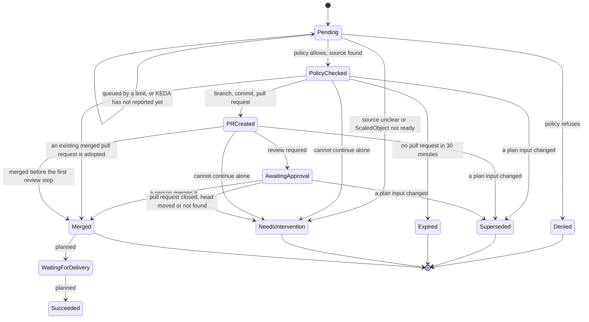

# The life of a request

What a `RemediationRequest` goes through, what you see at each step, what moves it on and what you can do. This summarises [design 6](design/6-reconciliation.md#6-reconciliation); every condition reason is explained in [troubleshooting](troubleshooting.md).

Only the steps up to `Merged` are built. Delivery tracking and verification are <span class="sw-status sw-planned">planned</span>: after a merge the request stops at `Merged`.



## What each phase means and what you do

| Phase | What happened | What moves it on | You can |
| --- | --- | --- | --- |
| `Pending` | New, or held back (condition `Queued`: the concurrency limit, the circuit breaker, or another request that holds the lock on the same target until its pull request is known merged or closed, also after it stopped) | The policy check, rechecked every 30 seconds while queued | Wait, or read the reason in [troubleshooting](troubleshooting.md#limits) |
| `PolicyChecked` | Policy allowed it (`PolicyAllowed=True`, reason `WithinApprovedBounds`); the plan digest is fixed | The pull request step | Nothing. It expires after 30 minutes without a pull request |
| `PRCreated` | The branch, commit and pull request exist | The executor records the review state | Open the pull request |
| `AwaitingApproval` | `Approved=False`, reason `WaitingForReview` | A person merges the pull request, seen within about a minute (`--pull-request-poll-interval`) | [Approve](how-to/review-and-approve.md) or [reject](how-to/reject-a-proposal.md) |
| `Merged` | The pull request was merged; `status.pullRequest.mergeCommitSHA` records the merge commit that delivery will be checked against (that commit or a later one of the target branch that holds it). The request stops here today | Nothing (delivery is the GitOps controller's job; verification is planned) | Check your GitOps controller |
| `Denied` | Policy or settings refuse the plan | Nothing, final | [Find the reason](how-to/find-why-refused.md), fix, apply a new request |
| `NeedsIntervention` | The executor cannot continue safely alone: a pull request closed without a merge (`ChangeRequestClosed`), a moved head (`HeadMoved`), a render refusal, a ScaledObject that is not ready | Nothing, final | Read the reason, then apply a new request if the change is still wanted |
| `Superseded` | A plan input changed before merge (policy, settings, target, file in Git). If a pull request was open, Shadewright closed it | Nothing, final | Apply a new request |
| `Expired` | No pull request opened within 30 minutes of the decision | Nothing, final | Find why the Git calls failed, apply a new request |

The API also defines `AutoMergeQueued`, `WaitingForDelivery`, `Verifying`, `Succeeded`, `Failed` and `Cancelled`. Nothing sets them yet (planned). Auto-merge is not built: even with a policy that has `approval: Optional` and a request with `approvalRequired: false`, a person decides.

Conditions give the reasons: `PolicyAllowed` (the policy check), `PullRequestOpened`, `Approved` and `PlanFresh` (the plan is still current, checked every five minutes before merge). A pause adds `WritesPaused`, see [pause and resume](how-to/pause-and-resume.md).

## What approving means

Shadewright never approves its own pull request and does not check reviews itself. Approval is your normal review on GitHub, enforced by your branch rules (required reviews and checks, `CODEOWNERS`). When a person merges, the executor sees it and ends the request `Merged`. See [design 8.1](design/8-gitops-on-github.md#81-what-approvalrequired-means).

## When the plan changes after the pull request

What happens depends on the cause. Only these cases close the pull request, and Shadewright never reopens one:

- A stale plan (a changed policy, settings, target or source file) ends `Superseded` and the executor closes its pull request.
- A render refusal while the pull request waits (`TargetFileDiverged`, `PatchRefused`, `BranchDiverged`, an unplanned difference in the rendered output) closes it and ends `NeedsIntervention`.
- A branch that does not hold exactly the planned change when the pull request is opened or found before it was recorded (`BranchDiverged`, for example a push to the branch during the open) closes it and ends `NeedsIntervention`.
- A push to a recorded pull request that leaves more than the planned change on the branch (`BranchDiverged`) ends `NeedsIntervention` with one comment on the pull request that hands it to a person; it stays open. Merged by then, the request ends `MergedWithForeignChange`.

These stop the automation but leave the pull request open, so a person closes it (or merges it knowingly): `HeadMoved` (the head moved to the same planned change), `ChangeRequestGone`, `ForeignChangeRequest`. The way back to the change is a new request. See [troubleshooting](troubleshooting.md#pull-request-step).

## Read it yourself

```bash
kubectl -n shadewright-system get remediationrequest
kubectl -n shadewright-system get remediationrequest <name> \
  -o jsonpath='{.status.phase}{"\n"}{range .status.conditions[*]}{.type}={.status} {.reason}: {.message}{"\n"}{end}'
```

!!! note "Not yet run"
    The commands on this page and in the how-to guides were not run against a live cluster for these pages (no kind cluster was available). The `get` and `jsonpath` forms are the ones already used in [troubleshooting](troubleshooting.md) and the [lab runbook](lab-oom-acceptance.md); the short name `rr` and the printed columns (Phase, Policy, Action, Target, PR, Age) come from the API types.
